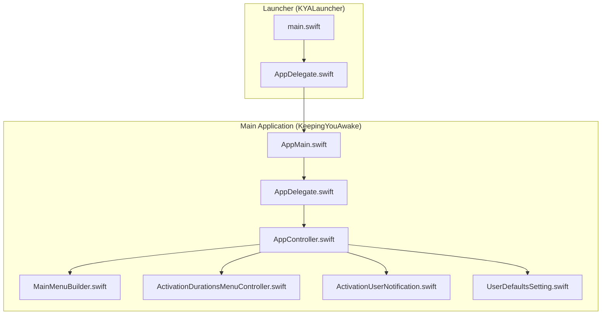
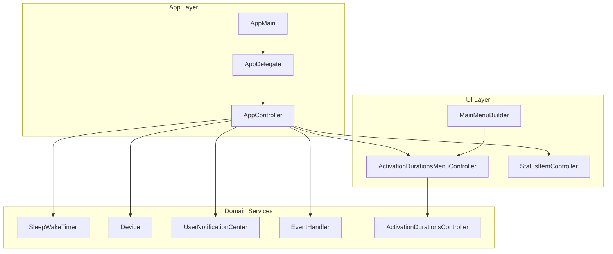
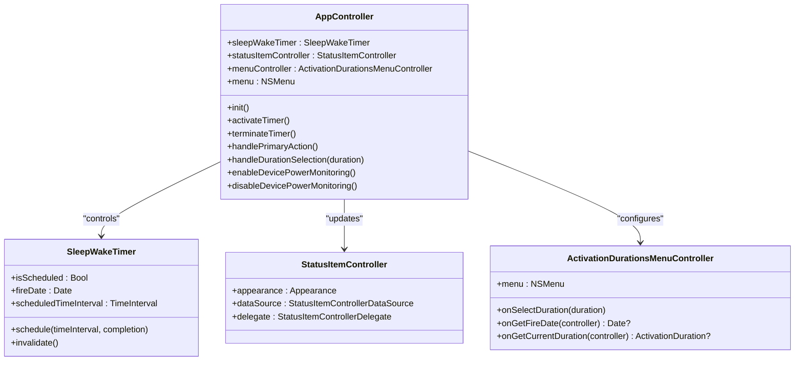
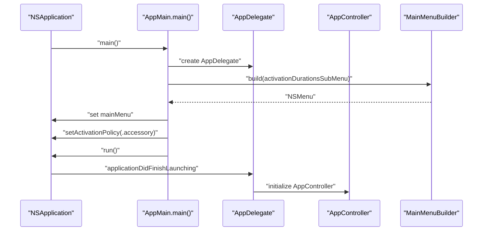
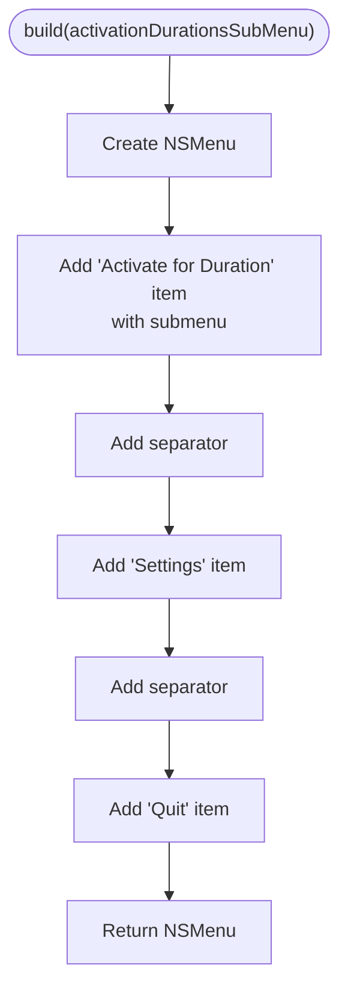
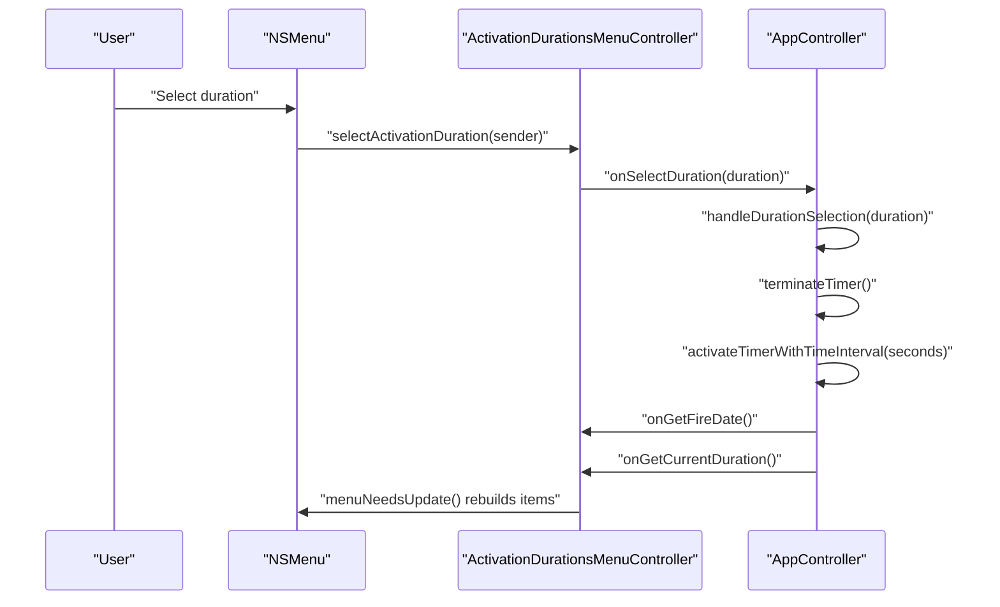
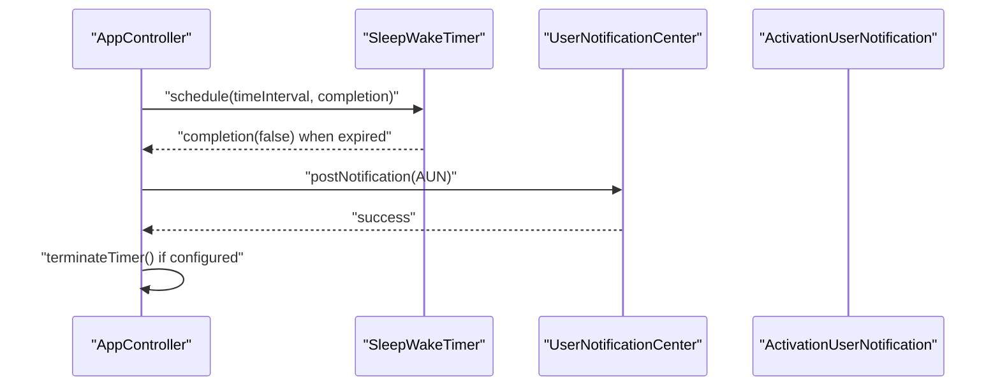
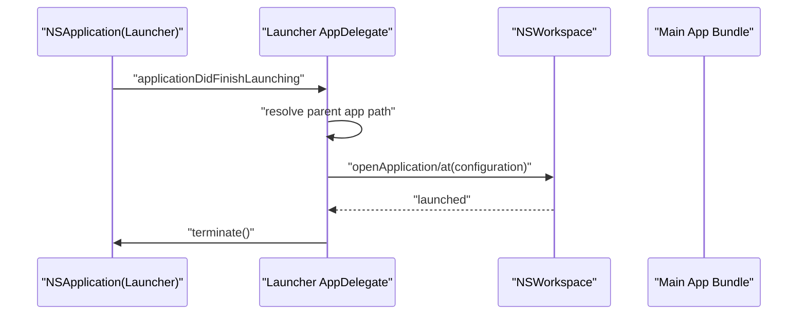
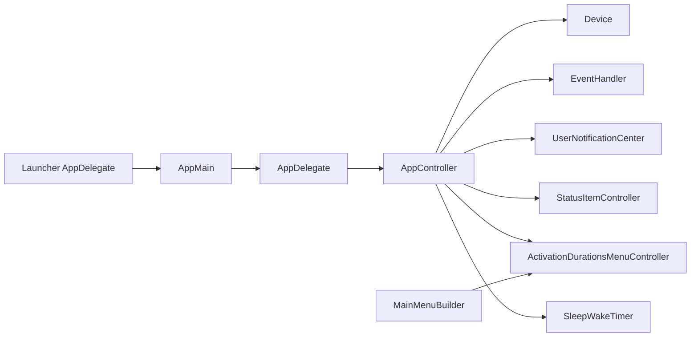

# Architecture Overview

<cite>
**Referenced Files in This Document**
- [AppMain.swift](file://KeepingYouAwake/AppMain.swift)
- [AppDelegate.swift](file://KeepingYouAwake/KYAAppController/AppDelegate.swift)
- [AppController.swift](file://KeepingYouAwake/KYAAppController/AppController.swift)
- [MainMenuBuilder.swift](file://KeepingYouAwake/KYAMainMenu/MainMenuBuilder.swift)
- [ActivationDurationsMenuController.swift](file://KeepingYouAwake/KYAActivationDurationsMenuController/ActivationDurationsMenuController.swift)
- [ActivationUserNotification.swift](file://KeepingYouAwake/KYAActivationUserNotification/ActivationUserNotification.swift)
- [main.swift](file://KYALauncher/main.swift)
- [AppDelegate.swift](file://KYALauncher/AppDelegate.swift)
- [UserDefaultsSetting.swift](file://KeepingYouAwake/UserDefaultsSetting.swift)
- [2026-05-28-swift-appkit-rewrite-design.md](file://docs/superpowers/specs/2026-05-28-swift-appkit-rewrite-design.md)
</cite>

## Table of Contents
1. [Introduction](#introduction)
2. [Project Structure](#project-structure)
3. [Core Components](#core-components)
4. [Architecture Overview](#architecture-overview)
5. [Detailed Component Analysis](#detailed-component-analysis)
6. [Dependency Analysis](#dependency-analysis)
7. [Performance Considerations](#performance-considerations)
8. [Troubleshooting Guide](#troubleshooting-guide)
9. [Conclusion](#conclusion)

## Introduction
This document describes the architecture of the KeepingYouAwake application, focusing on the Central Orchestrator Pattern with AppController as the main coordinator. The application follows a modular monolithic architecture composed of multiple Swift packages that encapsulate distinct functional domains. It integrates with macOS frameworks for UI, notifications, power monitoring, and workspace events. Design patterns include MVC-like structure, Protocol-Oriented Programming, Observer Pattern via NotificationCenter, and Factory Pattern in MainMenuBuilder. The system boundary separates the main application from the KYALauncher process, which acts as a thin bridge to open the main app.

## Project Structure
The project is organized as a modular monolith with two primary targets:
- Main Application Target: KeepingYouAwake
- Launcher Target: KYALauncher

High-level structure:
- KeepingYouAwake: Contains the main application logic, controllers, menus, settings, and supporting modules.
- KYALauncher: Minimal launcher that opens the main application bundle and terminates itself.
- Shared Modules: Swift packages providing domain-specific capabilities (e.g., sleep/wake timer, device info, status item UI, user notifications, activation durations).

**Diagram sources**
- [AppMain.swift:11-23](file://KeepingYouAwake/AppMain.swift#L11-L23)
- [AppDelegate.swift:13-25](file://KeepingYouAwake/KYAAppController/AppDelegate.swift#L13-L25)
- [AppController.swift:21-41](file://KeepingYouAwake/KYAAppController/AppController.swift#L21-L41)
- [MainMenuBuilder.swift:12-49](file://KeepingYouAwake/KYAMainMenu/MainMenuBuilder.swift#L12-L49)
- [ActivationDurationsMenuController.swift:14-31](file://KeepingYouAwake/KYAActivationDurationsMenuController/ActivationDurationsMenuController.swift#L14-L31)
- [ActivationUserNotification.swift:12-37](file://KeepingYouAwake/KYAActivationUserNotification/ActivationUserNotification.swift#L12-L37)
- [UserDefaultsSetting.swift:11-31](file://KeepingYouAwake/UserDefaultsSetting.swift#L11-L31)
- [main.swift:11-14](file://KYALauncher/main.swift#L11-L14)
- [AppDelegate.swift:12-25](file://KYALauncher/AppDelegate.swift#L12-25)

**Section sources**
- [AppMain.swift:11-23](file://KeepingYouAwake/AppMain.swift#L11-L23)
- [AppDelegate.swift:13-25](file://KeepingYouAwake/KYAAppController/AppDelegate.swift#L13-L25)
- [AppController.swift:19-41](file://KeepingYouAwake/KYAAppController/AppController.swift#L19-L41)

## Core Components
- AppController: Central orchestrator coordinating the sleep/wake timer, status item UI, activation durations menu, device power monitoring, user notifications, and event handling. It manages lifecycle transitions, schedules timers, updates UI state, and reacts to system events.
- AppMain: Application entry point that configures the NSApplication delegate, builds the main menu via MainMenuBuilder, assigns it to the application, sets activation policy, and starts the run loop.
- AppDelegate: Bridges lifecycle events to AppController, handles settings window presentation, and coordinates platform-specific behaviors.
- MainMenuBuilder: Factory that constructs the NSMenu programmatically, wiring actions and images for menu items.
- ActivationDurationsMenuController: Manages the activation durations submenu, exposing closures for selection, fire date retrieval, and current duration queries.
- ActivationUserNotification: macOS user notification payload for activation/deactivation events.
- KYALauncher: Minimal launcher that locates and opens the main application bundle and terminates itself.

Design patterns:
- Central Orchestrator Pattern: AppController coordinates subsystems and mediates interactions.
- MVC-like Structure: Controllers manage views (NSMenu) and models (durations, preferences).
- Protocol-Oriented Programming: Extensive use of protocols and closures for decoupled interfaces.
- Observer Pattern: NotificationCenter for system events; closures for internal state changes.
- Factory Pattern: MainMenuBuilder creates the main menu.

**Section sources**
- [AppController.swift:19-41](file://KeepingYouAwake/KYAAppController/AppController.swift#L19-L41)
- [AppMain.swift:13-21](file://KeepingYouAwake/AppMain.swift#L13-L21)
- [MainMenuBuilder.swift:12-49](file://KeepingYouAwake/KYAMainMenu/MainMenuBuilder.swift#L12-L49)
- [ActivationDurationsMenuController.swift:14-31](file://KeepingYouAwake/KYAActivationDurationsMenuController/ActivationDurationsMenuController.swift#L14-L31)
- [ActivationUserNotification.swift:12-37](file://KeepingYouAwake/KYAActivationUserNotification/ActivationUserNotification.swift#L12-L37)
- [main.swift:11-14](file://KYALauncher/main.swift#L11-L14)
- [AppDelegate.swift:12-25](file://KYALauncher/AppDelegate.swift#L12-L25)

## Architecture Overview
The architecture centers on AppController as the orchestrator. It initializes and wires subsystems, registers for notifications, and exposes closures to controllers for UI updates. The main menu is built programmatically by MainMenuBuilder and injected into the application. The launcher target ensures clean startup and delegation to the main app.

**Diagram sources**
- [AppController.swift:21-41](file://KeepingYouAwake/KYAAppController/AppController.swift#L21-L41)
- [AppMain.swift:13-19](file://KeepingYouAwake/AppMain.swift#L13-L19)
- [MainMenuBuilder.swift:13-25](file://KeepingYouAwake/KYAMainMenu/MainMenuBuilder.swift#L13-L25)
- [ActivationDurationsMenuController.swift:16-31](file://KeepingYouAwake/KYAActivationDurationsMenuController/ActivationDurationsMenuController.swift#L16-L31)

## Detailed Component Analysis

### AppController: Central Orchestrator
Responsibilities:
- Coordinates SleepWakeTimer activation/deactivation and status item appearance.
- Manages device power monitoring (battery capacity and low power mode).
- Handles workspace session changes and screen parameter updates.
- Integrates user notifications for activation/deactivation.
- Exposes closures to the menu controller for dynamic menu updates.

Key behaviors:
- Closures for menu controller callbacks (selection, fire date, current duration).
- Notification observers for application lifecycle and workspace sessions.
- Conditional timer scheduling and termination based on user defaults and device state.

**Diagram sources**
- [AppController.swift:21-41](file://KeepingYouAwake/KYAAppController/AppController.swift#L21-L41)
- [ActivationDurationsMenuController.swift:15-31](file://KeepingYouAwake/KYAActivationDurationsMenuController/ActivationDurationsMenuController.swift#L15-L31)

**Section sources**
- [AppController.swift:53-66](file://KeepingYouAwake/KYAAppController/AppController.swift#L53-L66)
- [AppController.swift:77-90](file://KeepingYouAwake/KYAAppController/AppController.swift#L77-L90)
- [AppController.swift:133-148](file://KeepingYouAwake/KYAAppController/AppController.swift#L133-L148)
- [AppController.swift:202-225](file://KeepingYouAwake/KYAAppController/AppController.swift#L202-L225)
- [AppController.swift:250-299](file://KeepingYouAwake/KYAAppController/AppController.swift#L250-L299)

### AppMain and AppDelegate: Application Entry and Lifecycle
- AppMain sets up the NSApplication delegate, builds the main menu using MainMenuBuilder, assigns it to the application, sets the activation policy, and runs the application loop.
- AppDelegate holds the AppController instance, handles application lifecycle events, and presents the settings window.

**Diagram sources**
- [AppMain.swift:13-21](file://KeepingYouAwake/AppMain.swift#L13-L21)
- [AppDelegate.swift:17-25](file://KeepingYouAwake/KYAAppController/AppDelegate.swift#L17-L25)

**Section sources**
- [AppMain.swift:13-21](file://KeepingYouAwake/AppMain.swift#L13-L21)
- [AppDelegate.swift:13-25](file://KeepingYouAwake/KYAAppController/AppDelegate.swift#L13-L25)

### MainMenuBuilder: Factory Pattern for Menu Construction
- Creates the main menu programmatically, attaching actions and optional system icons.
- Injects the activation durations submenu provided by the AppController’s menu controller.

**Diagram sources**
- [MainMenuBuilder.swift:13-49](file://KeepingYouAwake/KYAMainMenu/MainMenuBuilder.swift#L13-L49)

**Section sources**
- [MainMenuBuilder.swift:13-49](file://KeepingYouAwake/KYAMainMenu/MainMenuBuilder.swift#L13-L49)

### ActivationDurationsMenuController: Closure-Based Communication
- Manages the activation durations submenu and exposes closures for:
  - onSelectDuration: notifies the orchestrator of a selected duration.
  - onGetFireDate: retrieves the current timer fire date for display.
  - onGetCurrentDuration: determines the currently scheduled duration for highlighting.
- Implements NSMenuDelegate to dynamically populate menu items and mark defaults/current selections.

**Diagram sources**
- [ActivationDurationsMenuController.swift:33-38](file://KeepingYouAwake/KYAActivationDurationsMenuController/ActivationDurationsMenuController.swift#L33-L38)
- [AppController.swift:330-335](file://KeepingYouAwake/KYAAppController/AppController.swift#L330-L335)

**Section sources**
- [ActivationDurationsMenuController.swift:19-38](file://KeepingYouAwake/KYAActivationDurationsMenuController/ActivationDurationsMenuController.swift#L19-L38)
- [ActivationDurationsMenuController.swift:81-125](file://KeepingYouAwake/KYAActivationDurationsMenuController/ActivationDurationsMenuController.swift#L81-L125)
- [AppController.swift:55-66](file://KeepingYouAwake/KYAAppController/AppController.swift#L55-L66)

### ActivationUserNotification: Observer Pattern Integration
- Encapsulates user notification content for activation/deactivation events.
- Posted via UserNotificationCenter shared center when timer activates/deactivates.

**Diagram sources**
- [AppController.swift:101-121](file://KeepingYouAwake/KYAAppController/AppController.swift#L101-L121)
- [ActivationUserNotification.swift:19-37](file://KeepingYouAwake/KYAActivationUserNotification/ActivationUserNotification.swift#L19-L37)

**Section sources**
- [AppController.swift:101-121](file://KeepingYouAwake/KYAAppController/AppController.swift#L101-L121)
- [ActivationUserNotification.swift:12-37](file://KeepingYouAwake/KYAActivationUserNotification/ActivationUserNotification.swift#L12-L37)

### KYALauncher: System Boundary and Process Separation
- Thin launcher that locates the main application bundle and opens it using NSWorkspace.
- Terminates immediately after delegating to the main app.

**Diagram sources**
- [main.swift:11-14](file://KYALauncher/main.swift#L11-L14)
- [AppDelegate.swift:13-25](file://KYALauncher/AppDelegate.swift#L13-L25)

**Section sources**
- [main.swift:11-14](file://KYALauncher/main.swift#L11-L14)
- [AppDelegate.swift:13-25](file://KYALauncher/AppDelegate.swift#L13-L25)

## Dependency Analysis
Inter-component dependencies:
- AppMain depends on AppDelegate and MainMenuBuilder.
- AppDelegate holds AppController and coordinates settings window.
- AppController depends on SleepWakeTimer, StatusItemController, ActivationDurationsMenuController, UserNotificationCenter, EventHandler, Device, and UserDefaults-backed settings.
- MainMenuBuilder depends on ActivationDurationsMenuController for the submenu.
- ActivationDurationsMenuController depends on ActivationDurationsController and UserNotifications.
- KYALauncher depends on NSWorkspace to open the main app bundle.

**Diagram sources**
- [AppMain.swift:13-19](file://KeepingYouAwake/AppMain.swift#L13-L19)
- [AppDelegate.swift:14](file://KeepingYouAwake/KYAAppController/AppDelegate.swift#L14)
- [AppController.swift:21-25](file://KeepingYouAwake/KYAAppController/AppController.swift#L21-L25)
- [MainMenuBuilder.swift:13-25](file://KeepingYouAwake/KYAMainMenu/MainMenuBuilder.swift#L13-L25)
- [AppDelegate.swift:13-25](file://KYALauncher/AppDelegate.swift#L13-L25)

**Section sources**
- [AppController.swift:10-17](file://KeepingYouAwake/KYAAppController/AppController.swift#L10-L17)
- [MainMenuBuilder.swift:9](file://KeepingYouAwake/KYAMainMenu/MainMenuBuilder.swift#L9)

## Performance Considerations
- Closures for internal events reduce overhead compared to traditional delegate chains.
- Notification observers are registered on the main thread and removed in deinitialization to prevent leaks.
- Device monitoring toggles are controlled by user defaults to avoid unnecessary CPU wake-ups.
- Timer scheduling defers UI updates to the main queue to maintain thread safety.

[No sources needed since this section provides general guidance]

## Troubleshooting Guide
Common issues and remedies:
- Timer not activating: Verify activation policy and that AppController schedules the timer with a non-negative interval.
- Menu not updating: Ensure ActivationDurationsMenuController’s closures are set and menuNeedsUpdate is invoked.
- Notifications not posted: Confirm UserNotificationCenter availability and that activation/deactivation notifications are constructed and posted.
- Launcher fails to open main app: Validate bundle path resolution and NSWorkspace open configuration.

**Section sources**
- [AppController.swift:96-122](file://KeepingYouAwake/KYAAppController/AppController.swift#L96-L122)
- [ActivationDurationsMenuController.swift:81-125](file://KeepingYouAwake/KYAActivationDurationsMenuController/ActivationDurationsMenuController.swift#L81-L125)
- [ActivationUserNotification.swift:19-37](file://KeepingYouAwake/KYAActivationUserNotification/ActivationUserNotification.swift#L19-L37)
- [AppDelegate.swift:13-25](file://KYALauncher/AppDelegate.swift#L13-L25)

## Conclusion
KeepingYouAwake employs a clean Central Orchestrator Pattern centered on AppController, which coordinates UI, timers, device monitoring, and notifications. The modular monolithic structure enables focused development while maintaining cohesive integration. The use of closures, NotificationCenter, and factory-style construction promotes loose coupling and testability. The system boundary between the main app and the launcher is explicit and minimal, ensuring predictable startup behavior.