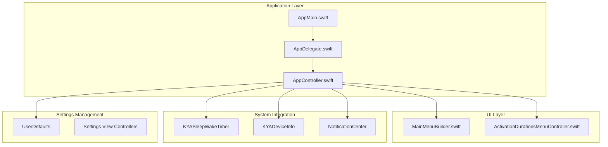
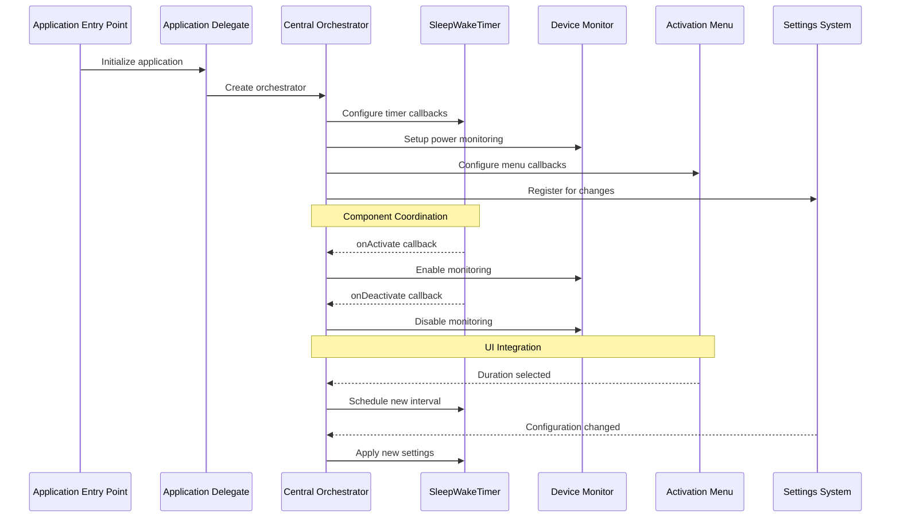
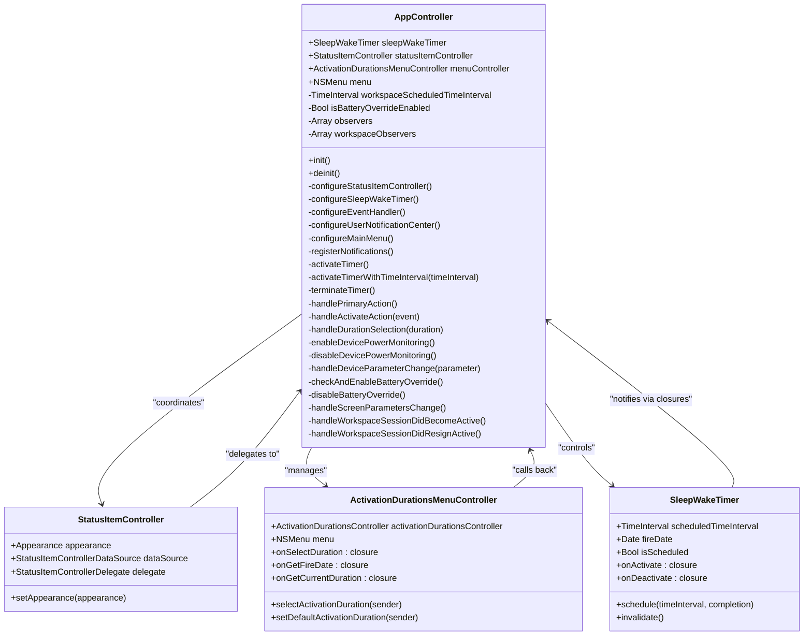
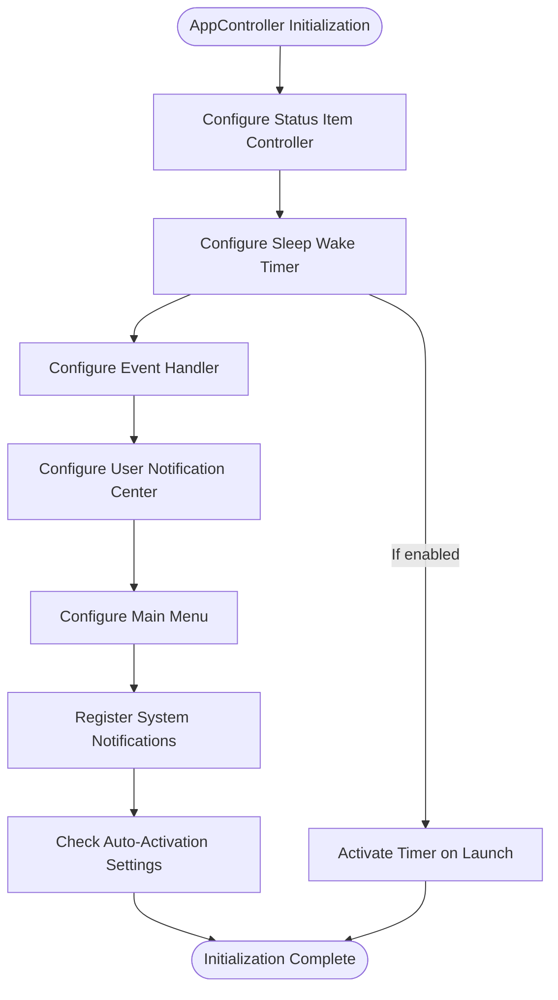
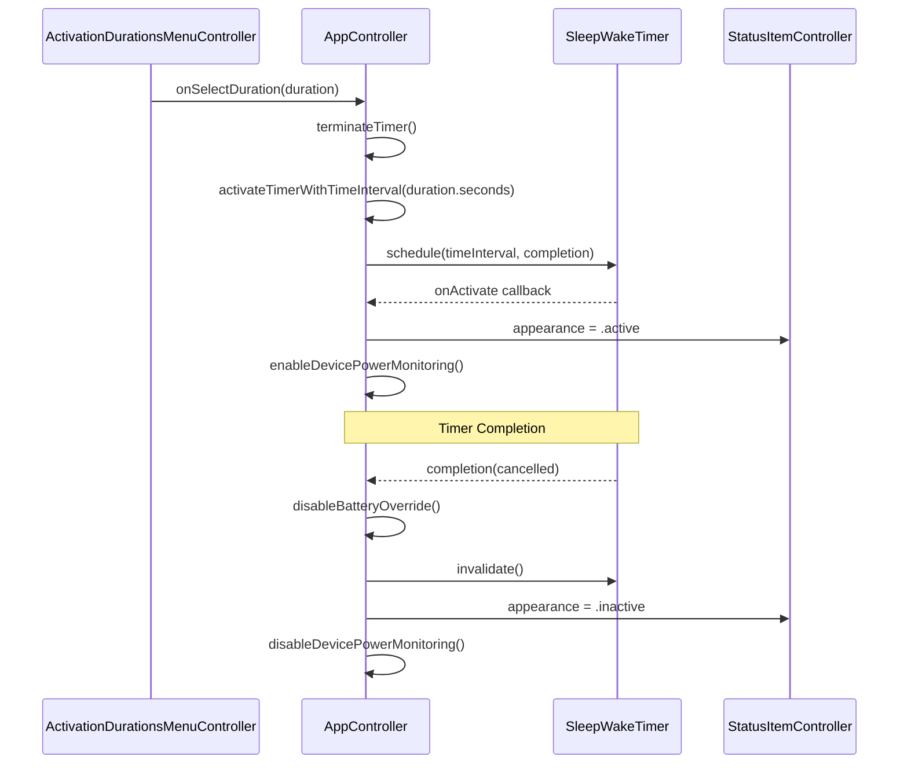
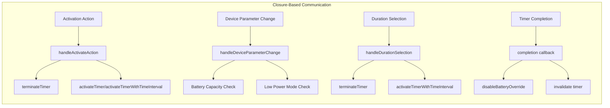
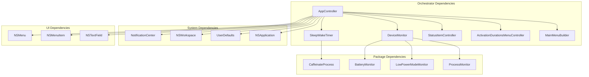

# Central Orchestrator Pattern

<cite>
**Referenced Files in This Document**
- [AppController.swift](file://KeepingYouAwake/KYAAppController/AppController.swift)
- [AppDelegate.swift](file://KeepingYouAwake/KYAAppController/AppDelegate.swift)
- [AppMain.swift](file://KeepingYouAwake/AppMain.swift)
- [ActivationDurationsMenuController.swift](file://KeepingYouAwake/KYAActivationDurationsMenuController/ActivationDurationsMenuController.swift)
- [MainMenuBuilder.swift](file://KeepingYouAwake/KYAMainMenu/MainMenuBuilder.swift)
- [BatteryCapacityThreshold.swift](file://KeepingYouAwake/BatteryCapacityThreshold.swift)
- [2026-05-28-swift-appkit-rewrite-design.md](file://docs/superpowers/specs/2026-05-28-swift-appkit-rewrite-design.md)
</cite>

## Table of Contents
1. [Introduction](#introduction)
2. [Project Structure](#project-structure)
3. [Core Components](#core-components)
4. [Architecture Overview](#architecture-overview)
5. [Detailed Component Analysis](#detailed-component-analysis)
6. [Dependency Analysis](#dependency-analysis)
7. [Performance Considerations](#performance-considerations)
8. [Troubleshooting Guide](#troubleshooting-guide)
9. [Conclusion](#conclusion)

## Introduction

The Central Orchestrator Pattern in KeepingYouAwake establishes a single point of coordination for managing all application subsystems. The AppController serves as the primary orchestrator, coordinating between SleepWakeTimer, Device monitoring, Settings management, and UI components while maintaining clean separation of concerns and enabling robust testability.

This pattern replaces traditional delegate-heavy architectures with Swift-native closure-based communication, leveraging NotificationCenter for system-level events while maintaining internal consistency through centralized coordination. The implementation demonstrates modern iOS/macOS development practices by utilizing weak references to prevent retain cycles, proper resource cleanup, and structured initialization sequences.

## Project Structure

The application follows a modular architecture with the central orchestrator pattern implemented through a clear separation of concerns:

**Diagram sources**
- [AppMain.swift:12-23](file://KeepingYouAwake/AppMain.swift#L12-L23)
- [AppDelegate.swift:13-14](file://KeepingYouAwake/KYAAppController/AppDelegate.swift#L13-L14)
- [AppController.swift:21-25](file://KeepingYouAwake/KYAAppController/AppController.swift#L21-L25)

**Section sources**
- [AppMain.swift:12-23](file://KeepingYouAwake/AppMain.swift#L12-L23)
- [AppDelegate.swift:13-14](file://KeepingYouAwake/KYAAppController/AppDelegate.swift#L13-L14)
- [AppController.swift:21-41](file://KeepingYouAwake/KYAAppController/AppController.swift#L21-L41)

## Core Components

The central orchestrator coordinates four primary subsystems through well-defined interfaces and communication patterns:

### AppController - The Central Coordinator

The AppController maintains responsibility for:
- **Component Initialization**: Structured setup of all subsystems in proper dependency order
- **State Coordination**: Managing cross-component state transitions and synchronization
- **Event Propagation**: Handling and forwarding events between components
- **Resource Management**: Proper cleanup and memory management through weak references

### SleepWakeTimer Integration

The timer system operates through closure-based callbacks instead of delegate protocols:
- `onActivate`: Triggered when the timer becomes active
- `onDeactivate`: Triggered when the timer becomes inactive
- Automatic UI state updates through coordinated callbacks

### Device Monitoring System

Power state monitoring utilizes a unified Device interface with closure-based change notifications:
- Battery capacity threshold monitoring
- Low power mode detection
- Automatic timer termination based on power state changes

### UI Component Coordination

The menu system integrates through closure-based communication patterns:
- Duration selection callbacks
- Real-time status updates
- Dynamic menu item state management

**Section sources**
- [AppController.swift:19-41](file://KeepingYouAwake/KYAAppController/AppController.swift#L19-L41)
- [AppController.swift:77-90](file://KeepingYouAwake/KYAAppController/AppController.swift#L77-L90)
- [AppController.swift:202-218](file://KeepingYouAwake/KYAAppController/AppController.swift#L202-L218)

## Architecture Overview

The Central Orchestrator Pattern establishes a unidirectional flow of control with bidirectional communication channels:

**Diagram sources**
- [AppController.swift:34-41](file://KeepingYouAwake/KYAAppController/AppController.swift#L34-L41)
- [AppController.swift:77-90](file://KeepingYouAwake/KYAAppController/AppController.swift#L77-L90)
- [AppController.swift:202-218](file://KeepingYouAwake/KYAAppController/AppController.swift#L202-L218)

The architecture emphasizes loose coupling through:
- **Closure-based Communication**: Eliminates delegate protocol proliferation
- **Weak Reference Patterns**: Prevents retain cycles in callback chains
- **Structured Initialization**: Ensures proper component setup order
- **Centralized State Management**: Single source of truth for application state

## Detailed Component Analysis

### AppController Class Structure

**Diagram sources**
- [AppController.swift:21-352](file://KeepingYouAwake/KYAAppController/AppController.swift#L21-L352)
- [ActivationDurationsMenuController.swift:15-126](file://KeepingYouAwake/KYAActivationDurationsMenuController/ActivationDurationsMenuController.swift#L15-L126)

### Component Initialization Order

The initialization sequence ensures proper dependency resolution:

**Diagram sources**
- [AppController.swift:34-90](file://KeepingYouAwake/KYAAppController/AppController.swift#L34-L90)

### Delegate-Based Communication Patterns

The implementation maintains AppKit-required delegates while adopting closures for internal communication:

**Diagram sources**
- [AppController.swift:55-66](file://KeepingYouAwake/KYAAppController/AppController.swift#L55-L66)
- [AppController.swift:77-122](file://KeepingYouAwake/KYAAppController/AppController.swift#L77-L122)

### NotificationCenter Integration

System-level event handling utilizes NotificationCenter for platform events:

| Notification Type | Purpose | Handler Method |
|-------------------|---------|----------------|
| `NSApplication.willFinishLaunchingNotification` | Register default event handler | `registerAsDefaultEventHandler()` |
| `NSApplication.didChangeScreenParametersNotification` | External display connection | `handleScreenParametersChange()` |
| `NSWorkspace.sessionDidBecomeActiveNotification` | User session activation | `handleWorkspaceSessionDidBecomeActive()` |
| `NSWorkspace.sessionDidResignActiveNotification` | User session deactivation | `handleWorkspaceSessionDidResignActive()` |
| `BatteryCapacityThreshold.didChangeNotification` | Battery threshold changes | `terminateTimer()` |

**Section sources**
- [AppController.swift:250-299](file://KeepingYouAwake/KYAAppController/AppController.swift#L250-L299)
- [BatteryCapacityThreshold.swift:11-15](file://KeepingYouAwake/BatteryCapacityThreshold.swift#L11-L15)

### Closure-Based Callback Architecture

Internal communication relies on closure-based patterns for improved testability:

**Diagram sources**
- [AppController.swift:150-169](file://KeepingYouAwake/KYAAppController/AppController.swift#L150-L169)
- [AppController.swift:227-246](file://KeepingYouAwake/KYAAppController/AppController.swift#L227-L246)
- [AppController.swift:330-335](file://KeepingYouAwake/KYAAppController/AppController.swift#L330-L335)

**Section sources**
- [AppController.swift:133-148](file://KeepingYouAwake/KYAAppController/AppController.swift#L133-L148)
- [AppController.swift:208-210](file://KeepingYouAwake/KYAAppController/AppController.swift#L208-L210)

## Dependency Analysis

The orchestrator maintains clear dependency relationships with minimal coupling:

**Diagram sources**
- [AppController.swift:9-17](file://KeepingYouAwake/KYAAppController/AppController.swift#L9-L17)
- [AppController.swift:21-25](file://KeepingYouAwake/KYAAppController/AppController.swift#L21-L25)

The dependency structure supports:
- **Single Responsibility Principle**: Each component has focused responsibilities
- **Loose Coupling**: Components communicate through well-defined interfaces
- **Test Isolation**: Individual components can be tested independently
- **Resource Management**: Centralized cleanup prevents resource leaks

**Section sources**
- [AppController.swift:9-17](file://KeepingYouAwake/KYAAppController/AppController.swift#L9-L17)
- [AppController.swift:43-51](file://KeepingYouAwake/KYAAppController/AppController.swift#L43-L51)

## Performance Considerations

The Central Orchestrator Pattern provides several performance benefits:

### Memory Management
- **Weak References**: All callback closures use `[weak self]` capture lists to prevent retain cycles
- **Proper Cleanup**: `deinit` method removes all registered observers and clears device monitoring
- **Resource Pooling**: Shared instances of system components (NotificationCenter, NSWorkspace)

### Event Handling Efficiency
- **Selective Registration**: Only necessary system notifications are registered
- **Queue-Specific Dispatching**: System events dispatched to main queue for UI safety
- **Conditional Processing**: Event handlers check preconditions before processing

### Initialization Optimization
- **Lazy Loading**: Components initialized only when needed
- **Batch Registration**: Multiple observers registered during single initialization phase
- **Configuration Caching**: UserDefaults values cached locally for frequent access

## Troubleshooting Guide

### Common Issues and Solutions

**Timer Not Starting on Launch**
- Verify `kya_activateOnLaunch` setting in UserDefaults
- Check `activateTimer()` method execution path
- Ensure `configureSleepWakeTimer()` completes successfully

**Device Monitoring Not Working**
- Confirm battery monitoring is enabled in settings
- Verify `Device.current.batteryMonitoringEnabled = true`
- Check `onChange` closure registration

**Menu Not Updating State**
- Ensure `menuController.onSelectDuration` closure is properly configured
- Verify `statusItemController.appearance` assignments
- Check `menuNeedsUpdate` delegate method execution

**Memory Leaks**
- Verify all observers removed in `deinit`
- Check `[weak self]` captures in all closure blocks
- Ensure `device.onChange = nil` in cleanup methods

**Section sources**
- [AppController.swift:43-51](file://KeepingYouAwake/KYAAppController/AppController.swift#L43-L51)
- [AppController.swift:220-225](file://KeepingYouAwake/KYAAppController/AppController.swift#L220-L225)

## Conclusion

The Central Orchestrator Pattern implementation in KeepingYouAwake demonstrates effective architectural principles for macOS application development. The AppController successfully coordinates multiple subsystems while maintaining clean separation of concerns through:

**Maintainability Benefits:**
- Clear component boundaries with well-defined interfaces
- Consistent closure-based communication patterns
- Structured initialization and cleanup procedures
- Comprehensive error handling and resource management

**Testability Enhancements:**
- Isolated component testing through dependency injection
- Mockable closure interfaces for unit testing
- Centralized state management for predictable behavior
- Clear separation between UI and business logic

**Architectural Strengths:**
- Modern Swift patterns replacing legacy delegate protocols
- Robust NotificationCenter integration for system events
- Efficient memory management through weak references
- Flexible configuration through UserDefaults integration

This implementation serves as a model for complex macOS applications requiring sophisticated coordination between multiple subsystems while maintaining code quality and developer productivity.