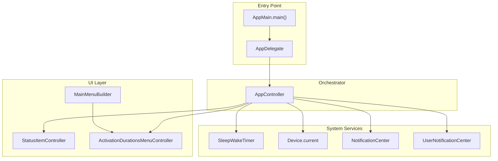
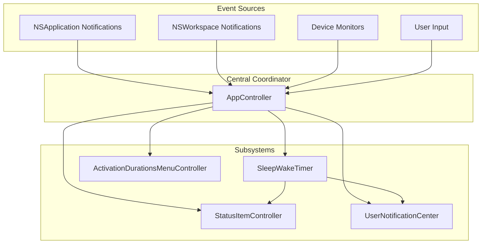
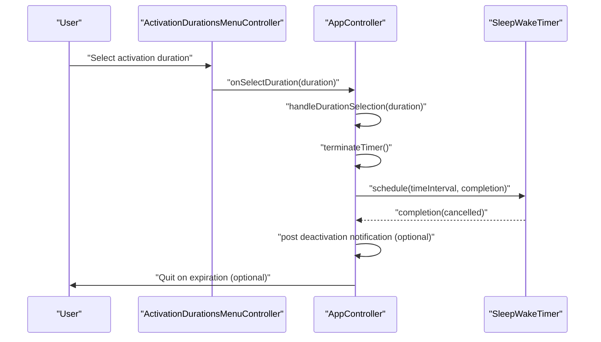
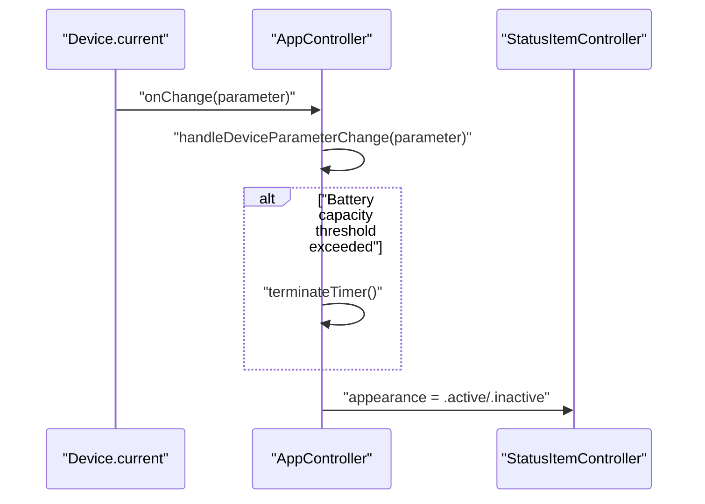
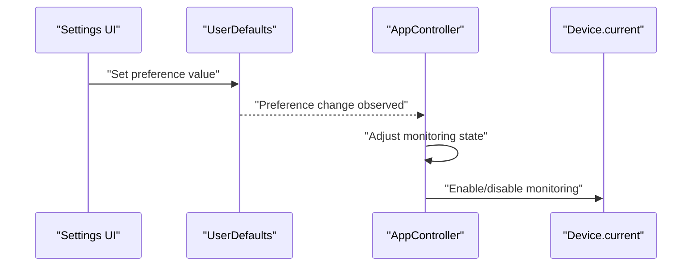
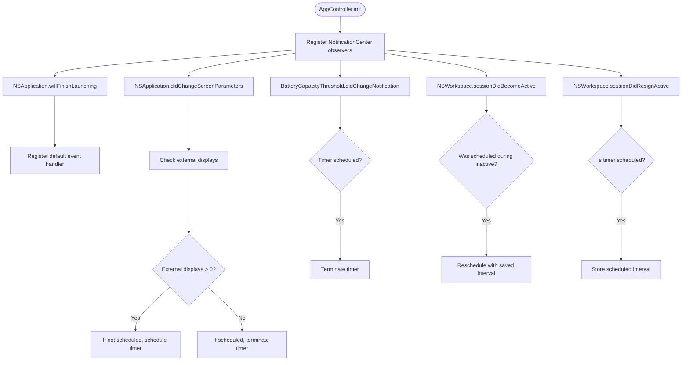
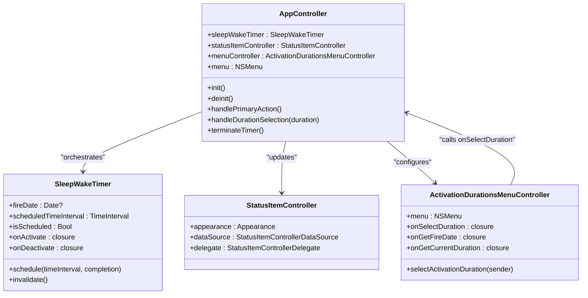

# Component Interaction and Data Flow

<cite>
**Referenced Files in This Document**
- [AppController.swift](file://KeepingYouAwake/KYAAppController/AppController.swift)
- [AppMain.swift](file://KeepingYouAwake/AppMain.swift)
- [AppDelegate.swift](file://KeepingYouAwake/KYAAppController/AppDelegate.swift)
- [MainMenuBuilder.swift](file://KeepingYouAwake/KYAMainMenu/MainMenuBuilder.swift)
- [ActivationDurationsMenuController.swift](file://KeepingYouAwake/KYAActivationDurationsMenuController/ActivationDurationsMenuController.swift)
- [UserDefaultsSetting.swift](file://KeepingYouAwake/UserDefaultsSetting.swift)
- [BatteryCapacityThreshold.swift](file://KeepingYouAwake/BatteryCapacityThreshold.swift)
- [ActivationUserNotification.swift](file://KeepingYouAwake/KYAActivationUserNotification/ActivationUserNotification.swift)
</cite>

## Table of Contents
1. [Introduction](#introduction)
2. [Project Structure](#project-structure)
3. [Core Components](#core-components)
4. [Architecture Overview](#architecture-overview)
5. [Detailed Component Analysis](#detailed-component-analysis)
6. [Dependency Analysis](#dependency-analysis)
7. [Performance Considerations](#performance-considerations)
8. [Troubleshooting Guide](#troubleshooting-guide)
9. [Conclusion](#conclusion)

## Introduction
This document explains how components collaborate and exchange data throughout the application. It focuses on three primary data pathways:
- User interaction flow: menu bar click → AppController → SleepWakeTimer
- Device monitoring flow: Device.current → AppController → UI updates
- Settings change flow: UserDefaults → Settings system → Component updates

It also details the event-driven architecture using NotificationCenter for loose coupling, state management patterns, error propagation mechanisms, and asynchronous operation handling.

## Project Structure
The application follows a modular structure with a central orchestrator (AppController) coordinating timers, UI, device monitoring, and notifications. The main entry point configures the application delegate, builds the main menu, and starts the run loop.

**Diagram sources**
- [AppMain.swift:12-23](file://KeepingYouAwake/AppMain.swift#L12-L23)
- [AppDelegate.swift:14-14](file://KeepingYouAwake/KYAAppController/AppDelegate.swift#L14-L14)
- [AppController.swift:21-25](file://KeepingYouAwake/KYAAppController/AppController.swift#L21-L25)
- [MainMenuBuilder.swift:13-49](file://KeepingYouAwake/KYAMainMenu/MainMenuBuilder.swift#L13-L49)

**Section sources**
- [AppMain.swift:12-23](file://KeepingYouAwake/AppMain.swift#L12-L23)
- [AppDelegate.swift:14-14](file://KeepingYouAwake/KYAAppController/AppDelegate.swift#L14-L14)

## Core Components
- AppController: Central orchestrator managing SleepWakeTimer, StatusItemController, ActivationDurationsMenuController, device monitoring, and notification registration.
- ActivationDurationsMenuController: Manages the activation durations submenu and communicates selections via closures to AppController.
- MainMenuBuilder: Constructs the main menu and wires actions to the AppController and AppDelegate.
- UserDefaultsSetting: Provides a simple Boolean setting backed by UserDefaults with a display title.
- BatteryCapacityThreshold: Defines a notification name for threshold changes.
- ActivationUserNotification: Encapsulates user-visible notifications for activation/deactivation events.

**Section sources**
- [AppController.swift:21-41](file://KeepingYouAwake/KYAAppController/AppController.swift#L21-L41)
- [ActivationDurationsMenuController.swift:15-31](file://KeepingYouAwake/KYAActivationDurationsMenuController/ActivationDurationsMenuController.swift#L15-L31)
- [MainMenuBuilder.swift:13-49](file://KeepingYouAwake/KYAMainMenu/MainMenuBuilder.swift#L13-L49)
- [UserDefaultsSetting.swift:12-31](file://KeepingYouAwake/UserDefaultsSetting.swift#L12-L31)
- [BatteryCapacityThreshold.swift:12-15](file://KeepingYouAwake/BatteryCapacityThreshold.swift#L12-L15)
- [ActivationUserNotification.swift:13-38](file://KeepingYouAwake/KYAActivationUserNotification/ActivationUserNotification.swift#L13-L38)

## Architecture Overview
The system uses an event-driven architecture with NotificationCenter for decoupled communication. AppController registers observers for application lifecycle, screen parameter changes, and battery threshold changes. Device monitoring callbacks trigger AppController to adjust timer state. UI updates occur through StatusItemController and menu controllers.

**Diagram sources**
- [AppController.swift:250-299](file://KeepingYouAwake/KYAAppController/AppController.swift#L250-L299)
- [AppController.swift:202-246](file://KeepingYouAwake/KYAAppController/AppController.swift#L202-L246)
- [ActivationDurationsMenuController.swift:15-31](file://KeepingYouAwake/KYAActivationDurationsMenuController/ActivationDurationsMenuController.swift#L15-L31)

## Detailed Component Analysis

### User Interaction Flow: Menu Bar Click → AppController → SleepWakeTimer
This flow demonstrates closure-based communication from the menu to the orchestrator and subsequent timer scheduling.

**Diagram sources**
- [ActivationDurationsMenuController.swift:33-38](file://KeepingYouAwake/KYAActivationDurationsMenuController/ActivationDurationsMenuController.swift#L33-L38)
- [AppController.swift:330-335](file://KeepingYouAwake/KYAAppController/AppController.swift#L330-L335)
- [AppController.swift:101-122](file://KeepingYouAwake/KYAAppController/AppController.swift#L101-L122)

**Section sources**
- [ActivationDurationsMenuController.swift:19-22](file://KeepingYouAwake/KYAActivationDurationsMenuController/ActivationDurationsMenuController.swift#L19-L22)
- [AppController.swift:55-66](file://KeepingYouAwake/KYAAppController/AppController.swift#L55-L66)
- [AppController.swift:330-335](file://KeepingYouAwake/KYAAppController/AppController.swift#L330-L335)

### Device Monitoring Flow: Device.current → AppController → UI Updates
This flow shows how device parameter changes are observed and how UI appearance is updated accordingly.

**Diagram sources**
- [AppController.swift:208-210](file://KeepingYouAwake/KYAAppController/AppController.swift#L208-L210)
- [AppController.swift:227-246](file://KeepingYouAwake/KYAAppController/AppController.swift#L227-L246)
- [AppController.swift:78-85](file://KeepingYouAwake/KYAAppController/AppController.swift#L78-L85)

**Section sources**
- [AppController.swift:202-246](file://KeepingYouAwake/KYAAppController/AppController.swift#L202-L246)

### Settings Change Flow: UserDefaults → Settings System → Component Updates
This flow illustrates how user preferences stored in UserDefaults influence runtime behavior and UI state.

**Diagram sources**
- [UserDefaultsSetting.swift:16-26](file://KeepingYouAwake/UserDefaultsSetting.swift#L16-L26)
- [AppController.swift:271-280](file://KeepingYouAwake/KYAAppController/AppController.swift#L271-L280)
- [AppController.swift:212-217](file://KeepingYouAwake/KYAAppController/AppController.swift#L212-L217)

**Section sources**
- [UserDefaultsSetting.swift:12-31](file://KeepingYouAwake/UserDefaultsSetting.swift#L12-L31)
- [BatteryCapacityThreshold.swift:12-15](file://KeepingYouAwake/BatteryCapacityThreshold.swift#L12-L15)

### Event-Driven Architecture with NotificationCenter
AppController registers observers for:
- Application lifecycle events (registering default event handler)
- Screen parameter changes (external display connection toggles)
- Battery threshold changes (terminates timer if scheduled)
- Workspace session changes (deactivate on user switch, reactivate on resume)

**Diagram sources**
- [AppController.swift:250-299](file://KeepingYouAwake/KYAAppController/AppController.swift#L250-L299)
- [AppController.swift:301-326](file://KeepingYouAwake/KYAAppController/AppController.swift#L301-L326)

**Section sources**
- [AppController.swift:250-299](file://KeepingYouAwake/KYAAppController/AppController.swift#L250-L299)
- [AppController.swift:301-326](file://KeepingYouAwake/KYAAppController/AppController.swift#L301-L326)

### State Management Patterns
- Timer state: scheduled vs. not scheduled, with explicit invalidation and re-scheduling.
- UI state: StatusItemController appearance transitions between active and inactive.
- Device monitoring state: selective enabling of battery and low power mode monitoring based on preferences.
- Workspace session state: temporary storage of scheduled intervals during user session switches.

**Section sources**
- [AppController.swift:124-129](file://KeepingYouAwake/KYAAppController/AppController.swift#L124-L129)
- [AppController.swift:78-85](file://KeepingYouAwake/KYAAppController/AppController.swift#L78-L85)
- [AppController.swift:212-217](file://KeepingYouAwake/KYAAppController/AppController.swift#L212-L217)
- [AppController.swift:314-325](file://KeepingYouAwake/KYAAppController/AppController.swift#L314-L325)

### Error Propagation Mechanisms
- Timer scheduling validates non-negative intervals and returns early for invalid values.
- Completion handlers receive cancellation status; on expiration, optional termination occurs.
- Device monitoring checks ensure thresholds and capabilities are enabled before acting.
- Workspace observers store intervals only when a timer is scheduled.

**Section sources**
- [AppController.swift:96-98](file://KeepingYouAwake/KYAAppController/AppController.swift#L96-L98)
- [AppController.swift:101-112](file://KeepingYouAwake/KYAAppController/AppController.swift#L101-L112)
- [AppController.swift:230-245](file://KeepingYouAwake/KYAAppController/AppController.swift#L230-L245)
- [AppController.swift:322-325](file://KeepingYouAwake/KYAAppController/AppController.swift#L322-L325)

### Asynchronous Operation Handling
- UI updates occur on the main queue for thread safety.
- Timer scheduling uses asynchronous completion callbacks.
- Device monitor callbacks are invoked asynchronously when parameters change.
- Workspace notifications are delivered on the main thread via observer queues.

**Section sources**
- [AppController.swift:332-334](file://KeepingYouAwake/KYAAppController/AppController.swift#L332-L334)
- [AppController.swift:101-112](file://KeepingYouAwake/KYAAppController/AppController.swift#L101-L112)
- [AppController.swift:208-210](file://KeepingYouAwake/KYAAppController/AppController.swift#L208-L210)
- [AppController.swift:256-257](file://KeepingYouAwake/KYAAppController/AppController.swift#L256-L257)

## Dependency Analysis
The following diagram shows key dependencies among components:

**Diagram sources**
- [AppController.swift:21-25](file://KeepingYouAwake/KYAAppController/AppController.swift#L21-L25)
- [ActivationDurationsMenuController.swift:15-31](file://KeepingYouAwake/KYAActivationDurationsMenuController/ActivationDurationsMenuController.swift#L15-L31)

**Section sources**
- [AppController.swift:21-41](file://KeepingYouAwake/KYAAppController/AppController.swift#L21-L41)
- [ActivationDurationsMenuController.swift:15-31](file://KeepingYouAwake/KYAActivationDurationsMenuController/ActivationDurationsMenuController.swift#L15-L31)

## Performance Considerations
- Minimize UI updates by batching state changes and using main-queue dispatches.
- Avoid unnecessary timer reschedules by checking current state before scheduling.
- Defer device monitoring initialization until activation to reduce overhead.
- Use weak references in closures to prevent retain cycles.

## Troubleshooting Guide
- If timers do not start, verify default interval values and ensure non-negative time intervals.
- If UI does not reflect active state, confirm StatusItemController appearance assignments on activation/deactivation.
- If device monitoring has no effect, verify that battery/low power mode monitoring is enabled in preferences.
- If notifications are missing, ensure UserNotificationCenter authorization is granted and notifications are posted on activation/deactivation.

**Section sources**
- [AppController.swift:78-85](file://KeepingYouAwake/KYAAppController/AppController.swift#L78-L85)
- [AppController.swift:181-187](file://KeepingYouAwake/KYAAppController/AppController.swift#L181-L187)
- [ActivationUserNotification.swift:13-38](file://KeepingYouAwake/KYAActivationUserNotification/ActivationUserNotification.swift#L13-L38)

## Conclusion
The application employs a clean, event-driven architecture centered around AppController. NotificationCenter decouples subsystems while closures streamline UI-to-controller communication. State transitions are explicit and reversible, with robust handling for asynchronous operations and device monitoring. The documented flows provide a foundation for extending functionality while maintaining system coherence.