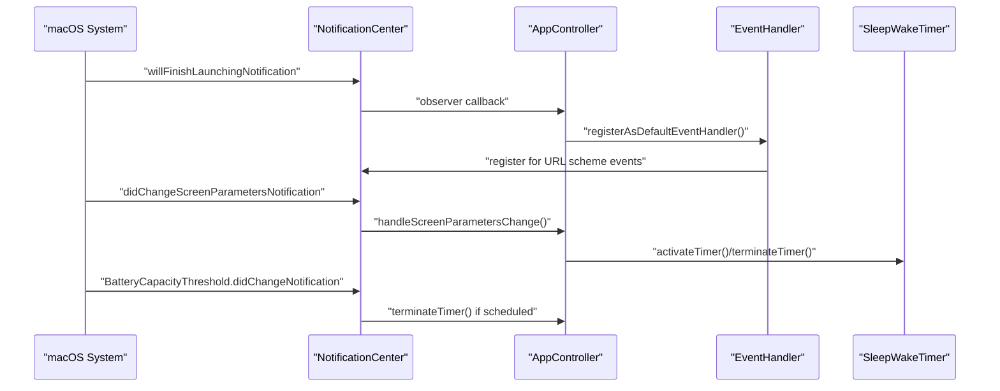
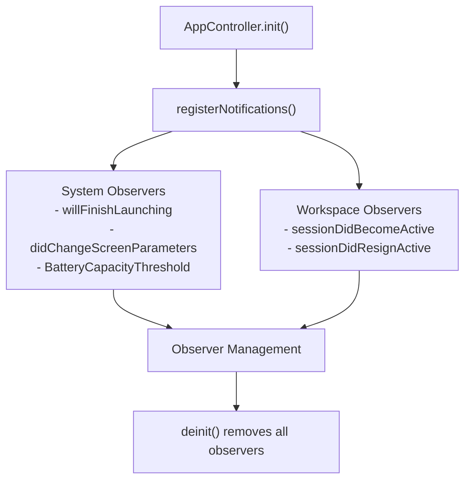
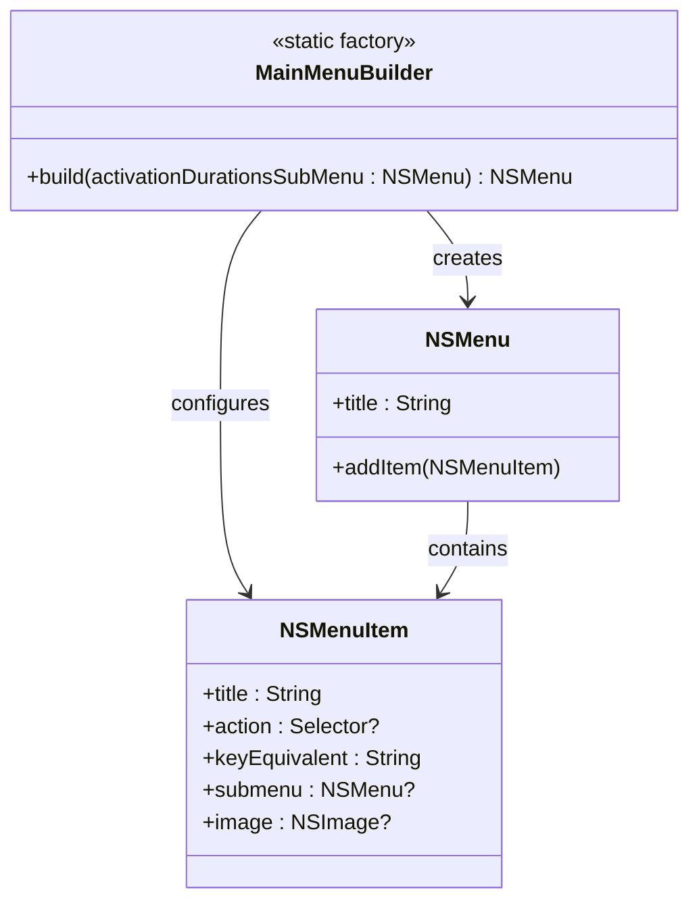
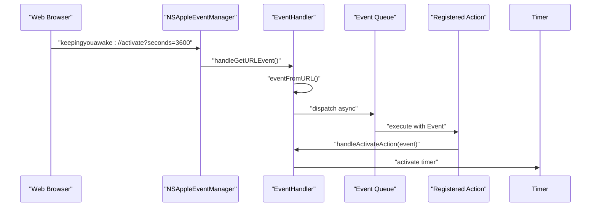
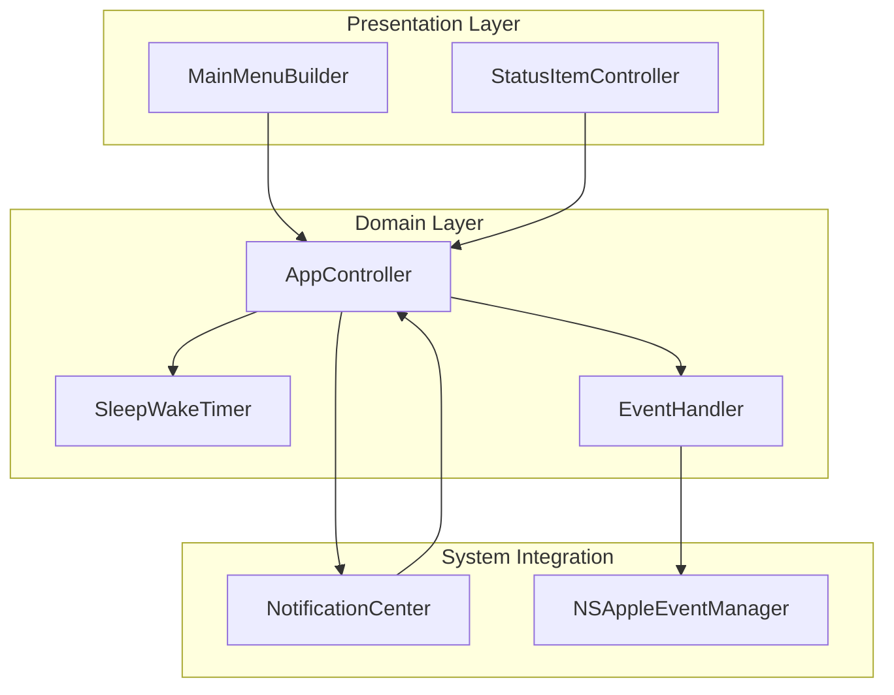

# Design Patterns Implementation

<cite>
**Referenced Files in This Document**
- [MainMenuBuilder.swift](file://KeepingYouAwake/KYAMainMenu/MainMenuBuilder.swift)
- [EventHandler.swift](file://Packages/KYAApplicationEvents/Sources/KYAApplicationEvents/EventHandler.swift)
- [EventHandler+DefaultEventHandler.swift](file://Packages/KYAApplicationEvents/Sources/KYAApplicationEvents/EventHandler+DefaultEventHandler.swift)
- [AppController.swift](file://KeepingYouAwake/KYAAppController/AppController.swift)
- [AppDelegate.swift](file://KeepingYouAwake/KYAAppController/AppDelegate.swift)
- [2026-05-28-swift-appkit-rewrite-design.md](file://docs/superpowers/specs/2026-05-28-swift-appkit-rewrite-design.md)
</cite>

## Table of Contents
1. [Introduction](#introduction)
2. [Observer Pattern with NotificationCenter](#observer-pattern-with-notificationcenter)
3. [Factory Pattern in MainMenuBuilder](#factory-pattern-in-mainmenubuilder)
4. [Protocol-Oriented Programming Approach](#protocol-oriented-programming-approach)
5. [Command Pattern in EventHandler System](#command-pattern-in-eventhandler-system)
6. [Closure-Based Communication Pattern](#closure-based-communication-pattern)
7. [Pattern Integration and Benefits](#pattern-integration-and-benefits)
8. [Conclusion](#conclusion)

## Introduction

This document analyzes the design patterns implemented throughout the KeepingYouAwake macOS application. The project has undergone a comprehensive Swift migration that emphasizes modern Swift programming paradigms while maintaining clean architectural boundaries. The analysis focuses on four primary patterns: Observer Pattern with NotificationCenter, Factory Pattern in MainMenuBuilder, Protocol-Oriented Programming replacing traditional inheritance hierarchies, Command Pattern in the EventHandler system, and Closure-Based Communication as a modern alternative to delegates.

The application demonstrates a thoughtful approach to pattern selection, prioritizing Swift-native solutions that enhance code maintainability, testability, and developer experience while preserving essential macOS integration points.

## Observer Pattern with NotificationCenter

The Observer Pattern implementation leverages Apple's NotificationCenter for system-wide event distribution and state change notifications. This pattern enables loose coupling between components while facilitating reactive behavior throughout the application.

### Core Implementation Details

The NotificationCenter-based Observer Pattern is implemented through two distinct communication channels:

**System-Level Observers**: Uses `NotificationCenter.default` for macOS system notifications including application lifecycle events, screen parameter changes, and power state modifications.

**Internal Change Notifications**: Employs custom notification names for internal state changes, particularly battery capacity threshold modifications and device parameter updates.



**Diagram sources**
- [AppController.swift:250-299](file://KeepingYouAwake/KYAAppController/AppController.swift#L250-L299)
- [EventHandler+DefaultEventHandler.swift:14-31](file://Packages/KYAApplicationEvents/Sources/KYAApplicationEvents/EventHandler+DefaultEventHandler.swift#L14-L31)

### Observer Registration and Management

The AppController manages observer lifecycle through a structured registration system:



**Diagram sources**
- [AppController.swift:34-51](file://KeepingYouAwake/KYAAppController/AppController.swift#L34-L51)
- [AppController.swift:248-299](file://KeepingYouAwake/KYAAppController/AppController.swift#L248-L299)

**Section sources**
- [AppController.swift:250-299](file://KeepingYouAwake/KYAAppController/AppController.swift#L250-L299)
- [2026-05-28-swift-appkit-rewrite-design.md:45-48](file://docs/superpowers/specs/2026-05-28-swift-appkit-rewrite-design.md#L45-L48)

## Factory Pattern in MainMenuBuilder

The MainMenuBuilder implements the Factory Pattern to dynamically construct the application's main menu interface. This pattern encapsulates menu creation logic and provides a centralized factory for generating menu instances with appropriate configurations.

### Menu Construction Architecture

The MainMenuBuilder serves as a static factory responsible for creating and configuring the application's main menu with activation durations, settings, and quit functionality.



**Diagram sources**
- [MainMenuBuilder.swift:12-49](file://KeepingYouAwake/KYAMainMenu/MainMenuBuilder.swift#L12-L49)

### Dynamic Menu Assembly

The factory method constructs menus with runtime-specific configurations:

1. **Activation Duration Menu**: Creates submenu items for predefined time intervals
2. **Settings Integration**: Dynamically assigns action selectors for settings access
3. **Quit Command**: Provides standardized quit functionality with keyboard shortcuts
4. **Platform-Specific Enhancements**: Incorporates system symbol images for modern macOS appearance

**Section sources**
- [MainMenuBuilder.swift:13-49](file://KeepingYouAwake/KYAMainMenu/MainMenuBuilder.swift#L13-L49)

## Protocol-Oriented Programming Approach

The application demonstrates a comprehensive shift from traditional Objective-C inheritance hierarchies to Swift's Protocol-Oriented Programming (POP) paradigm. This approach eliminates deep inheritance chains while maintaining type safety and code reusability.

### POP Implementation Examples

**Status Item Controller Protocol Adoption**:
The AppController implements multiple AppKit protocols without traditional inheritance:

```swift
extension AppController: StatusItemControllerDataSource {
    func menuForStatusItemController(_ controller: StatusItemController) -> NSMenu? {
        menu
    }
}

extension AppController: StatusItemControllerDelegate {
    func statusItemControllerShouldPerformPrimaryAction(_ controller: StatusItemController) {
        handlePrimaryAction()
    }
}
```

**Device Parameter Monitoring**:
The Device class uses closure-based callbacks instead of delegate protocols:

```swift
device.onChange = { [weak self] parameter in
    self?.handleDeviceParameterChange(parameter)
}
```

### Benefits Over Traditional Inheritance

1. **Flexibility**: Classes can conform to multiple protocols without complex inheritance hierarchies
2. **Composition**: Behavior is composed through protocol conformance rather than deep class hierarchies
3. **Type Safety**: Compile-time checking ensures protocol compliance
4. **Testability**: Protocols enable easier mocking and testing

**Section sources**
- [AppController.swift:338-352](file://KeepingYouAwake/KYAAppController/AppController.swift#L338-L352)
- [2026-05-28-swift-appkit-rewrite-design.md:75-77](file://docs/superpowers/specs/2026-05-28-swift-appkit-rewrite-design.md#L75-L77)

## Command Pattern in EventHandler System

The EventHandler system implements the Command Pattern to handle URL scheme events through registered action handlers. This pattern encapsulates request information as objects, enabling loose coupling between event producers and consumers.

### Command Structure and Execution Flow



**Diagram sources**
- [EventHandler.swift:47-62](file://Packages/KYAApplicationEvents/Sources/KYAApplicationEvents/EventHandler.swift#L47-L62)
- [EventHandler+DefaultEventHandler.swift:23-31](file://Packages/KYAApplicationEvents/Sources/KYAApplicationEvents/EventHandler+DefaultEventHandler.swift#L23-L31)

### Action Registration and Management

The command pattern enables dynamic action registration:

```swift
eventHandler.registerAction(name: "activate") { [weak self] event in
    self?.handleActivateAction(event)
}

eventHandler.registerAction(name: "deactivate") { [weak self] _ in
    self?.terminateTimer()
}

eventHandler.registerAction(name: "toggle") { [weak self] _ in
    self?.handlePrimaryAction()
}
```

**Section sources**
- [EventHandler.swift:14-81](file://Packages/KYAApplicationEvents/Sources/KYAApplicationEvents/EventHandler.swift#L14-L81)
- [EventHandler+DefaultEventHandler.swift:11-32](file://Packages/KYAApplicationEvents/Sources/KYAApplicationEvents/EventHandler+DefaultEventHandler.swift#L11-L32)
- [AppController.swift:133-148](file://KeepingYouAwake/KYAAppController/AppController.swift#L133-L148)

## Closure-Based Communication Pattern

The application extensively uses closures as a modern alternative to traditional delegate patterns, particularly for custom communication scenarios. This approach reduces boilerplate code while maintaining type safety and memory management best practices.

### Closure Implementation Examples

**Sleep Wake Timer Communication**:
```swift
sleepWakeTimer.onActivate = { [weak self] _ in
    self?.statusItemController.appearance = .active
    self?.enableDevicePowerMonitoring()
}

sleepWakeTimer.onDeactivate = { [weak self] in
    self?.statusItemController.appearance = .inactive
    self?.disableDevicePowerMonitoring()
}
```

**Menu Controller Communication**:
```swift
menuController.onSelectDuration = { [weak self] duration in
    self?.handleDurationSelection(duration)
}

menuController.onGetFireDate = { [weak self] _ in
    self?.sleepWakeTimer.fireDate
}
```

**Device Parameter Monitoring**:
```swift
device.onChange = { [weak self] parameter in
    self?.handleDeviceParameterChange(parameter)
}
```

### Memory Management and Weak References

The closure pattern consistently employs weak self references to prevent retain cycles:

```swift
{ [weak self] event in
    self?.handleActivateAction(event)
}
```

**Section sources**
- [AppController.swift:77-90](file://KeepingYouAwake/KYAAppController/AppController.swift#L77-L90)
- [AppController.swift:55-66](file://KeepingYouAwake/KYAAppController/AppController.swift#L55-L66)
- [2026-05-28-swift-appkit-rewrite-design.md:75-77](file://docs/superpowers/specs/2026-05-28-swift-appkit-rewrite-design.md#L75-L77)

## Pattern Integration and Benefits

The design patterns work together to create a cohesive, maintainable architecture that leverages Swift's strengths while integrating seamlessly with macOS frameworks.

### Architectural Cohesion



### Key Benefits Achieved

1. **Loose Coupling**: Components communicate through well-defined interfaces rather than direct dependencies
2. **Enhanced Testability**: Closures and protocols enable easy mocking and unit testing
3. **Improved Maintainability**: Clear separation of concerns and reduced complexity
4. **Modern Swift Integration**: Leverages Swift's type safety and memory management features
5. **Scalable Architecture**: Easy to extend with new features and capabilities

**Section sources**
- [2026-05-28-swift-appkit-rewrite-design.md:37-77](file://docs/superpowers/specs/2026-05-28-swift-appkit-rewrite-design.md#L37-L77)

## Conclusion

The KeepingYouAwake application demonstrates exemplary implementation of modern design patterns that prioritize Swift-native solutions while maintaining robust macOS integration. The strategic combination of Observer Pattern with NotificationCenter, Factory Pattern in MainMenuBuilder, Protocol-Oriented Programming, Command Pattern in EventHandler, and Closure-Based Communication creates a clean, maintainable, and scalable architecture.

These patterns collectively address the application's communication needs, menu construction requirements, and state management complexities while leveraging Swift's type safety and memory management features. The architecture successfully balances modern programming paradigms with essential macOS framework integration, providing a solid foundation for future development and maintenance.

The pattern choices reflect careful consideration of the application's requirements, ensuring that the resulting codebase is not only functional but also expressive, testable, and maintainable by future developers.