# Modular Package Architecture

<cite>
**Referenced Files in This Document**
- [Package.swift](file://Packages/KYACommon/Package.swift)
- [Package.swift](file://Packages/KYAApplicationSupport/Package.swift)
- [Package.swift](file://Packages/KYADeviceInfo/Package.swift)
- [Package.swift](file://Packages/KYAActivationDurations/Package.swift)
- [Package.swift](file://Packages/KYAApplicationEvents/Package.swift)
- [Package.swift](file://Packages/KYASleepWakeTimer/Package.swift)
- [Package.swift](file://Packages/KYAStatusItemUI/Package.swift)
- [Package.swift](file://Packages/KYAUserNotifications/Package.swift)
- [Package.resolved](file://KeepingYouAwake.xcworkspace/xcshareddata/swiftpm/Package.resolved)
</cite>

## Table of Contents
1. [Introduction](#introduction)
2. [Project Structure](#project-structure)
3. [Core Components](#core-components)
4. [Architecture Overview](#architecture-overview)
5. [Detailed Component Analysis](#detailed-component-analysis)
6. [Dependency Analysis](#dependency-analysis)
7. [Build System Integration](#build-system-integration)
8. [Cross-Package Communication](#cross-package-communication)
9. [Performance Considerations](#performance-considerations)
10. [Troubleshooting Guide](#troubleshooting-guide)
11. [Conclusion](#conclusion)

## Introduction

This document describes the modular package architecture of the KeepingYouAwake macOS application, built using Swift Package Manager. The architecture consists of eight distinct Swift packages that encapsulate specific functional domains, enabling maintainable code organization, clear module boundaries, and efficient dependency management. The packages are designed to support the main application's core functionality while promoting reusability and testability across the system.

The modular approach separates concerns into specialized domains:
- Shared utilities and foundational types
- Application-level utilities and helpers
- Hardware monitoring capabilities
- Duration management and presets
- Application event handling
- Timing engine for sleep/wake cycles
- Menu bar user interface components
- User notification system

## Project Structure

The project follows a clear separation between the main application and the modular package ecosystem. The Packages directory contains all eight Swift packages, each with its own Package.swift manifest defining dependencies, targets, and products. The main application integrates these packages through Swift Package Manager, consuming their public APIs to assemble the complete functionality.

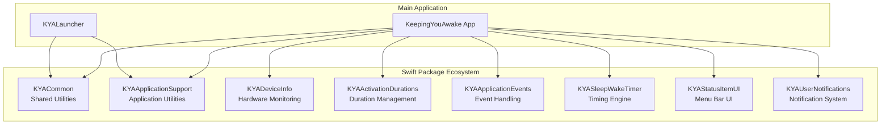

**Diagram sources**
- [Package.swift:1-26](file://Packages/KYACommon/Package.swift#L1-L26)
- [Package.swift:1-31](file://Packages/KYAApplicationSupport/Package.swift#L1-L31)
- [Package.swift:1-31](file://Packages/KYADeviceInfo/Package.swift#L1-L31)
- [Package.swift:1-30](file://Packages/KYAActivationDurations/Package.swift#L1-L30)
- [Package.swift:1-26](file://Packages/KYAApplicationEvents/Package.swift#L1-L26)
- [Package.swift:1-30](file://Packages/KYASleepWakeTimer/Package.swift#L1-L30)
- [Package.swift:1-32](file://Packages/KYAStatusItemUI/Package.swift#L1-L32)
- [Package.swift:1-30](file://Packages/KYAUserNotifications/Package.swift#L1-L30)

**Section sources**
- [Package.swift:1-26](file://Packages/KYACommon/Package.swift#L1-L26)
- [Package.swift:1-31](file://Packages/KYAApplicationSupport/Package.swift#L1-L31)
- [Package.swift:1-31](file://Packages/KYADeviceInfo/Package.swift#L1-L31)
- [Package.swift:1-30](file://Packages/KYAActivationDurations/Package.swift#L1-L30)
- [Package.swift:1-26](file://Packages/KYAApplicationEvents/Package.swift#L1-L26)
- [Package.swift:1-30](file://Packages/KYASleepWakeTimer/Package.swift#L1-L30)
- [Package.swift:1-32](file://Packages/KYAStatusItemUI/Package.swift#L1-L32)
- [Package.swift:1-30](file://Packages/KYAUserNotifications/Package.swift#L1-L30)

## Core Components

Each package serves a specific role within the architecture, with clear responsibilities and well-defined interfaces:

### KYACommon - Shared Foundation
The foundation package providing essential utilities and shared types used across all other packages. It includes:
- CLogShim: C logging interface for cross-language compatibility
- KYACommon: Core shared utilities, types, and constants
- Comprehensive test coverage for shared functionality

### KYAApplicationSupport - Application Utilities
Application-level utilities that depend on the common foundation:
- Test bundle resource management
- Application lifecycle support
- Cross-package integration utilities

### KYADeviceInfo - Hardware Monitoring
Hardware-specific functionality with minimal external dependencies:
- C shim for libproc functions (process listing and path resolution)
- Device information retrieval capabilities
- Hardware abstraction layer

### KYAActivationDurations - Duration Management
Time-based duration management with shared type dependencies:
- Predefined duration presets
- Duration calculation utilities
- Localization support for duration titles

### KYAApplicationEvents - Event Handling
Application event management built on shared foundations:
- Event registration and handling mechanisms
- Application lifecycle event coordination
- Cross-component event propagation

### KYASleepWakeTimer - Timing Engine
Core timing functionality with layered dependencies:
- Sleep/wake cycle management
- Timer coordination between components
- Integration with application support systems

### KYAStatusItemUI - Menu Bar UI
User interface components for the macOS menu bar:
- Status item management
- Menu construction and updates
- User interaction handling

### KYAUserNotifications - Notification System
Notification delivery and management:
- User notification creation and scheduling
- Notification presentation logic
- Integration with system notification centers

**Section sources**
- [Package.swift:9-25](file://Packages/KYACommon/Package.swift#L9-L25)
- [Package.swift:10-30](file://Packages/KYAApplicationSupport/Package.swift#L10-L30)
- [Package.swift:10-30](file://Packages/KYADeviceInfo/Package.swift#L10-L30)
- [Package.swift:10-29](file://Packages/KYAActivationDurations/Package.swift#L10-L29)
- [Package.swift:10-24](file://Packages/KYAApplicationEvents/Package.swift#L10-L24)
- [Package.swift:10-29](file://Packages/KYASleepWakeTimer/Package.swift#L10-L29)
- [Package.swift:10-31](file://Packages/KYAStatusItemUI/Package.swift#L10-L31)
- [Package.swift:10-29](file://Packages/KYAUserNotifications/Package.swift#L10-L29)

## Architecture Overview

The package architecture follows a hierarchical dependency model where lower-level packages provide foundational services to higher-level packages. The dependency graph ensures that shared functionality is centralized while maintaining clear separation of concerns.

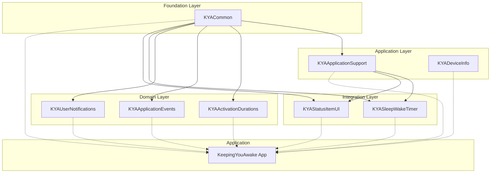

**Diagram sources**
- [Package.swift:13-20](file://Packages/KYACommon/Package.swift#L13-L20)
- [Package.swift:13-21](file://Packages/KYAApplicationSupport/Package.swift#L13-L21)
- [Package.swift:13-23](file://Packages/KYASleepWakeTimer/Package.swift#L13-L23)
- [Package.swift:13-23](file://Packages/KYAStatusItemUI/Package.swift#L13-L23)

**Section sources**
- [Package.swift:1-26](file://Packages/KYACommon/Package.swift#L1-L26)
- [Package.swift:1-31](file://Packages/KYAApplicationSupport/Package.swift#L1-L31)
- [Package.swift:1-30](file://Packages/KYASleepWakeTimer/Package.swift#L1-L30)
- [Package.swift:1-32](file://Packages/KYAStatusItemUI/Package.swift#L1-L32)

## Detailed Component Analysis

### KYACommon Package Analysis

KYACommon serves as the cornerstone of the modular architecture, providing shared utilities and foundational types. The package structure includes both Swift and C components to bridge native macOS functionality with Swift applications.

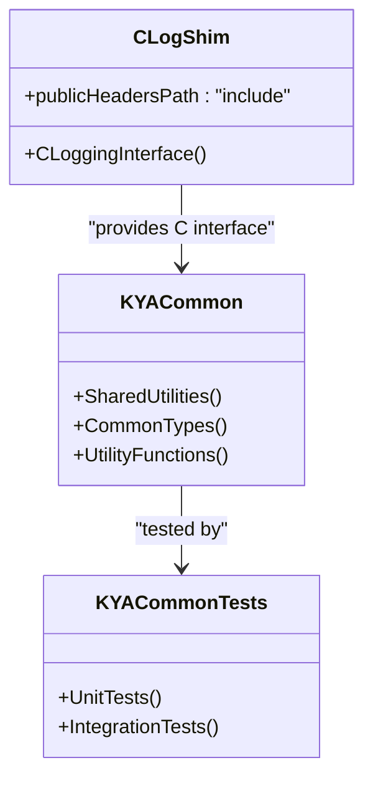

**Diagram sources**
- [Package.swift:13-24](file://Packages/KYACommon/Package.swift#L13-L24)

The package defines a C logging shim alongside the main Swift library, ensuring compatibility with native macOS frameworks while maintaining a clean Swift interface for consumers.

**Section sources**
- [Package.swift:1-26](file://Packages/KYACommon/Package.swift#L1-L26)

### KYAApplicationSupport Package Analysis

Application support utilities that build upon the common foundation while adding application-specific functionality for testing and resource management.

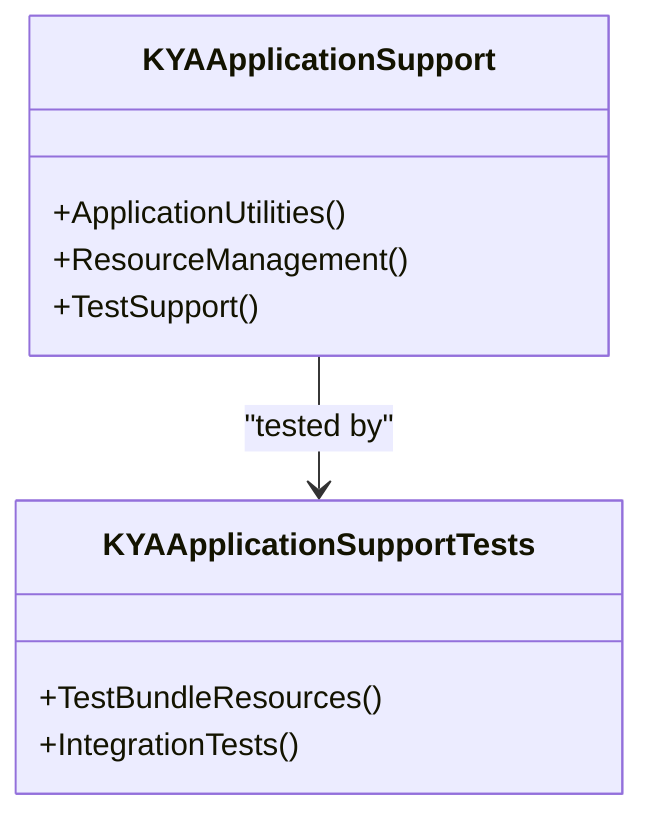

**Diagram sources**
- [Package.swift:17-29](file://Packages/KYAApplicationSupport/Package.swift#L17-L29)

**Section sources**
- [Package.swift:1-31](file://Packages/KYAApplicationSupport/Package.swift#L1-L31)

### KYADeviceInfo Package Analysis

Hardware monitoring capabilities implemented through a C shim for libproc functions, providing low-level system information access.

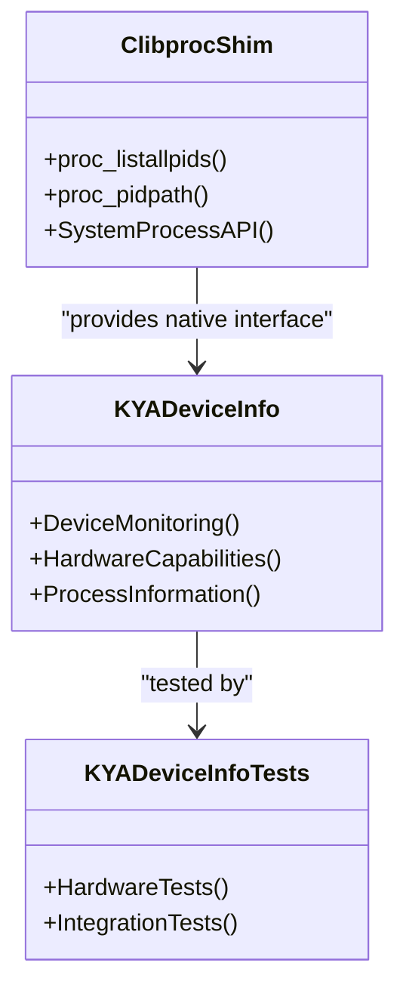

**Diagram sources**
- [Package.swift:15-29](file://Packages/KYADeviceInfo/Package.swift#L15-L29)

**Section sources**
- [Package.swift:1-31](file://Packages/KYADeviceInfo/Package.swift#L1-L31)

### KYAActivationDurations Package Analysis

Duration management system that leverages shared types and localization support for user-friendly duration presets.

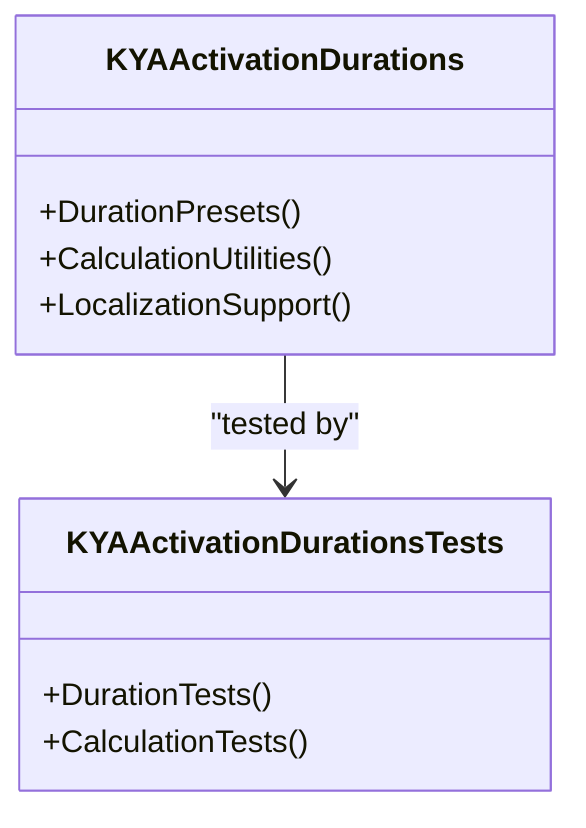

**Diagram sources**
- [Package.swift:17-28](file://Packages/KYAActivationDurations/Package.swift#L17-L28)

**Section sources**
- [Package.swift:1-30](file://Packages/KYAActivationDurations/Package.swift#L1-L30)

### KYAApplicationEvents Package Analysis

Event handling system that coordinates application lifecycle events and cross-component communication through shared event infrastructure.

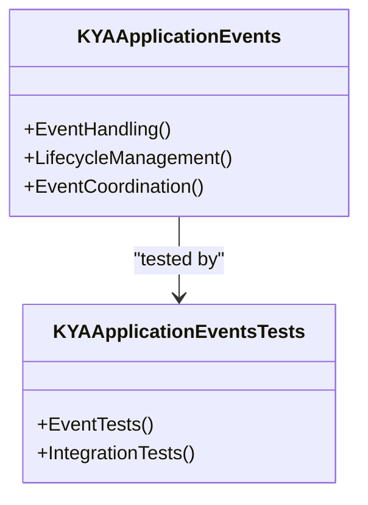

**Diagram sources**
- [Package.swift:17-23](file://Packages/KYAApplicationEvents/Package.swift#L17-L23)

**Section sources**
- [Package.swift:1-26](file://Packages/KYAApplicationEvents/Package.swift#L1-L26)

### KYASleepWakeTimer Package Analysis

Core timing engine that orchestrates sleep/wake cycles and coordinates with application support systems for reliable timing functionality.

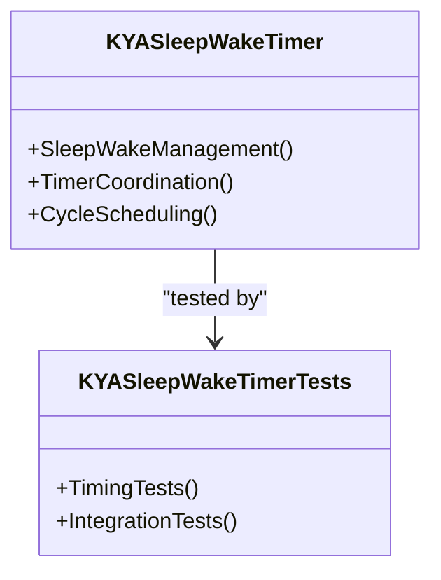

**Diagram sources**
- [Package.swift:17-28](file://Packages/KYASleepWakeTimer/Package.swift#L17-L28)

**Section sources**
- [Package.swift:1-30](file://Packages/KYASleepWakeTimer/Package.swift#L1-L30)

### KYAStatusItemUI Package Analysis

Menu bar user interface components that integrate with the status item system and provide interactive controls for user engagement.

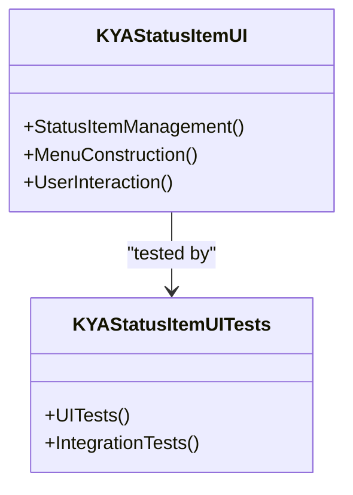

**Diagram sources**
- [Package.swift:17-29](file://Packages/KYAStatusItemUI/Package.swift#L17-L29)

**Section sources**
- [Package.swift:1-32](file://Packages/KYAStatusItemUI/Package.swift#L1-L32)

### KYAUserNotifications Package Analysis

Notification system that manages user notifications and integrates with the system notification center for timely alerts.

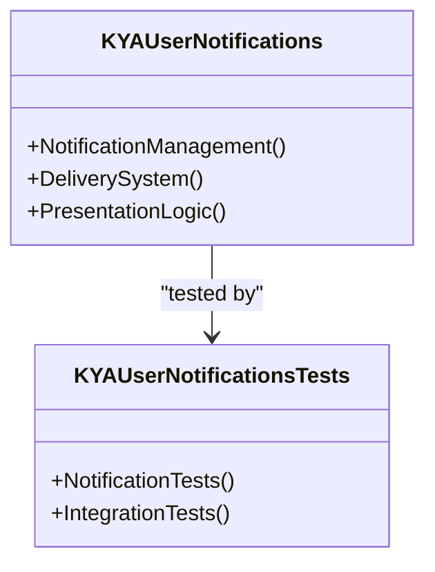

**Diagram sources**
- [Package.swift:17-27](file://Packages/KYAUserNotifications/Package.swift#L17-L27)

**Section sources**
- [Package.swift:1-30](file://Packages/KYAUserNotifications/Package.swift#L1-L30)

## Dependency Analysis

The dependency relationships form a clear hierarchical structure that promotes maintainability and reduces coupling between modules.

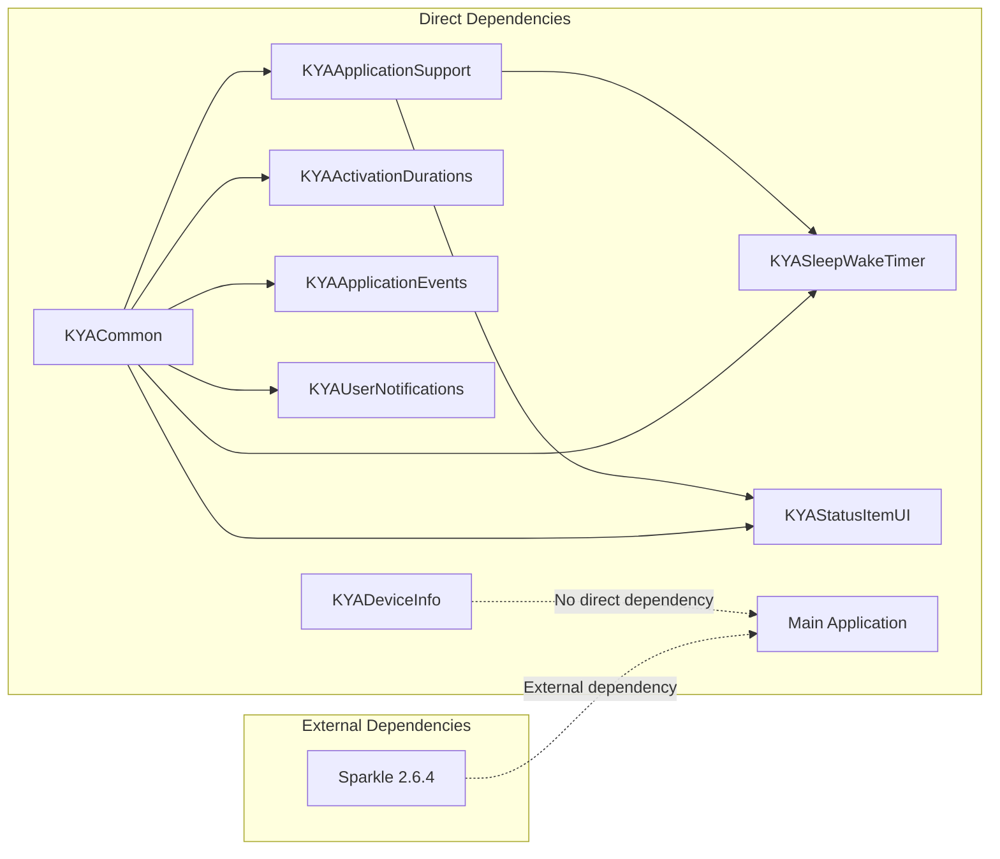

**Diagram sources**
- [Package.swift:13-21](file://Packages/KYAApplicationSupport/Package.swift#L13-L21)
- [Package.swift:13-21](file://Packages/KYAActivationDurations/Package.swift#L13-L21)
- [Package.swift:13-21](file://Packages/KYAApplicationEvents/Package.swift#L13-L21)
- [Package.swift:13-23](file://Packages/KYASleepWakeTimer/Package.swift#L13-L23)
- [Package.swift:13-23](file://Packages/KYAStatusItemUI/Package.swift#L13-L23)
- [Package.resolved:1-15](file://KeepingYouAwake.xcworkspace/xcshareddata/swiftpm/Package.resolved#L1-L15)

The dependency analysis reveals several key patterns:

1. **Foundation Pattern**: All domain packages depend on KYACommon for shared utilities
2. **Application Integration**: Higher-level packages (SleepWakeTimer, StatusItemUI) depend on ApplicationSupport
3. **External Integration**: The main application consumes external libraries like Sparkle
4. **Hardware Independence**: DeviceInfo operates independently without common dependencies

**Section sources**
- [Package.swift:1-26](file://Packages/KYACommon/Package.swift#L1-L26)
- [Package.swift:1-31](file://Packages/KYAApplicationSupport/Package.swift#L1-L31)
- [Package.swift:1-30](file://Packages/KYASleepWakeTimer/Package.swift#L1-L30)
- [Package.swift:1-32](file://Packages/KYAStatusItemUI/Package.swift#L1-L32)
- [Package.resolved:1-15](file://KeepingYouAwake.xcworkspace/xcshareddata/swiftpm/Package.resolved#L1-L15)

## Build System Integration

The Swift Package Manager integration enables seamless compilation and linking of all packages within the project structure.

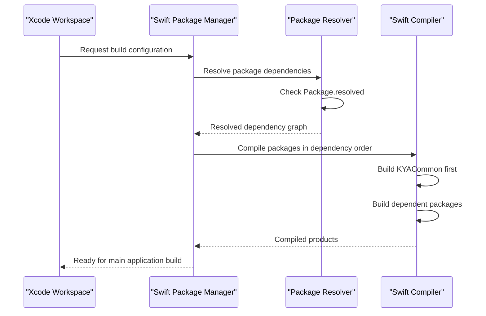

**Diagram sources**
- [Package.resolved:1-15](file://KeepingYouAwake.xcworkspace/xcshareddata/swiftpm/Package.resolved#L1-L15)

The build system follows these integration patterns:

1. **Dependency Resolution**: Swift Package Manager resolves all package dependencies according to the resolved file
2. **Compilation Order**: Packages are compiled in dependency order, starting with KYACommon
3. **Product Generation**: Each package generates its library product for consumption
4. **External Dependencies**: Third-party libraries like Sparkle are managed separately

**Section sources**
- [Package.resolved:1-15](file://KeepingYouAwake.xcworkspace/xcshareddata/swiftpm/Package.resolved#L1-L15)

## Cross-Package Communication

The modular architecture enables several communication patterns between packages:

### Shared Type Usage
Packages communicate primarily through shared types defined in KYACommon, ensuring type safety across package boundaries.

### Event Coordination
KYAApplicationEvents provides a centralized event system that allows packages to publish and subscribe to application-wide events.

### Resource Sharing
KYAApplicationSupport offers shared resources and utilities that multiple packages can utilize for common functionality.

### Integration Patterns
Higher-level packages like KYASleepWakeTimer coordinate between multiple domain packages to provide cohesive functionality.

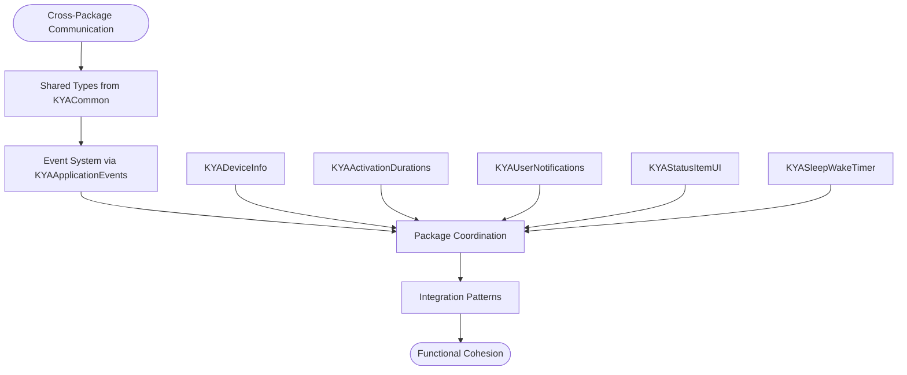

**Diagram sources**
- [Package.swift:9-20](file://Packages/KYACommon/Package.swift#L9-L20)
- [Package.swift:13-21](file://Packages/KYAApplicationEvents/Package.swift#L13-L21)

## Performance Considerations

The modular architecture provides several performance benefits:

### Compilation Efficiency
- Independent compilation of packages reduces rebuild times
- Clear dependency boundaries minimize unnecessary recompilation
- Test isolation improves development iteration speed

### Memory Management
- Shared utilities reduce memory footprint through code reuse
- Hardware monitoring is isolated to dedicated packages
- Event handling prevents memory leaks through proper cleanup

### Runtime Performance
- Lazy loading of hardware-dependent functionality
- Efficient event propagation through centralized systems
- Optimized notification delivery mechanisms

## Troubleshooting Guide

Common issues and solutions when working with the modular package architecture:

### Dependency Resolution Issues
- Verify Package.resolved contains expected versions
- Clean derived data if dependency conflicts occur
- Check package paths in each Package.swift file

### Build Order Problems
- Ensure KYACommon builds before dependent packages
- Verify target dependencies are correctly specified
- Check for circular dependency warnings

### Integration Challenges
- Confirm all packages are included in the workspace
- Verify product names match import statements
- Check entitlements for launcher and main application

**Section sources**
- [Package.resolved:1-15](file://KeepingYouAwake.xcworkspace/xcshareddata/swiftpm/Package.resolved#L1-L15)

## Conclusion

The modular package architecture successfully separates concerns across eight specialized packages while maintaining clear dependency relationships and efficient integration patterns. The hierarchical design ensures that shared functionality is centralized in KYACommon, while domain-specific packages provide focused functionality for their respective areas.

Key architectural strengths include:
- Clear module boundaries that promote maintainability
- Hierarchical dependency structure that minimizes coupling
- Comprehensive test coverage across all packages
- Efficient build system integration through Swift Package Manager
- Scalable design that supports future feature additions

This architecture provides a solid foundation for the KeepingYouAwake application, enabling reliable functionality while supporting ongoing development and maintenance efforts.