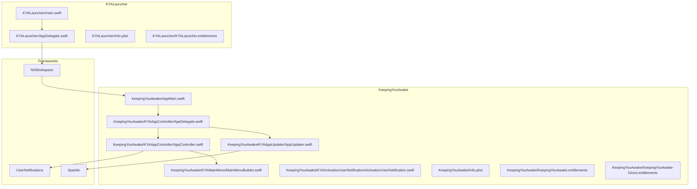
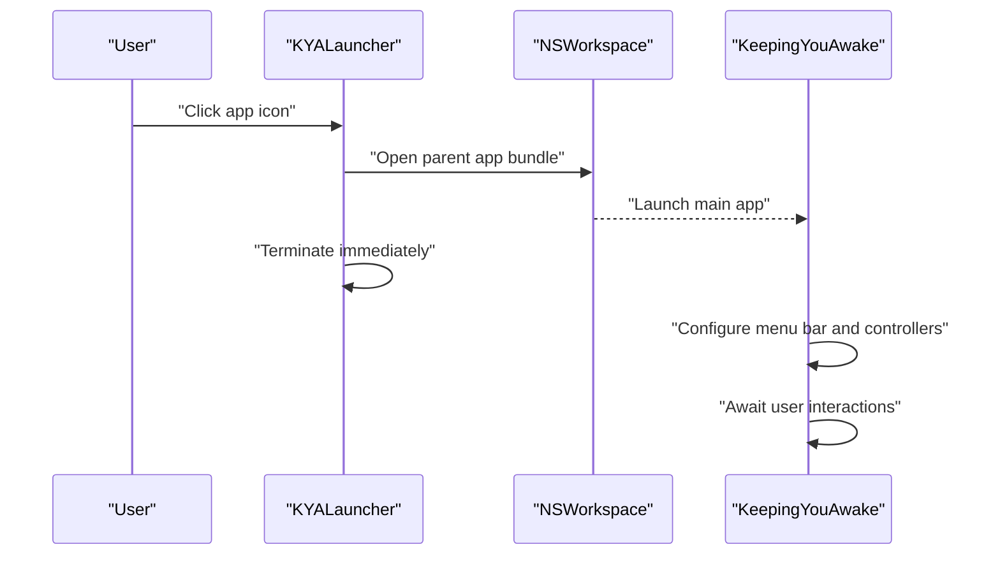
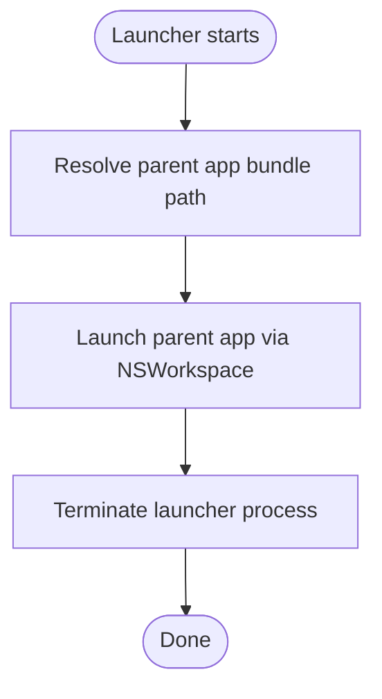
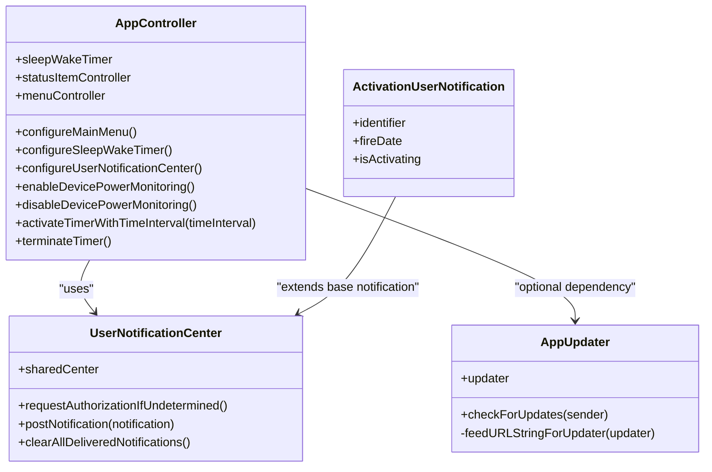
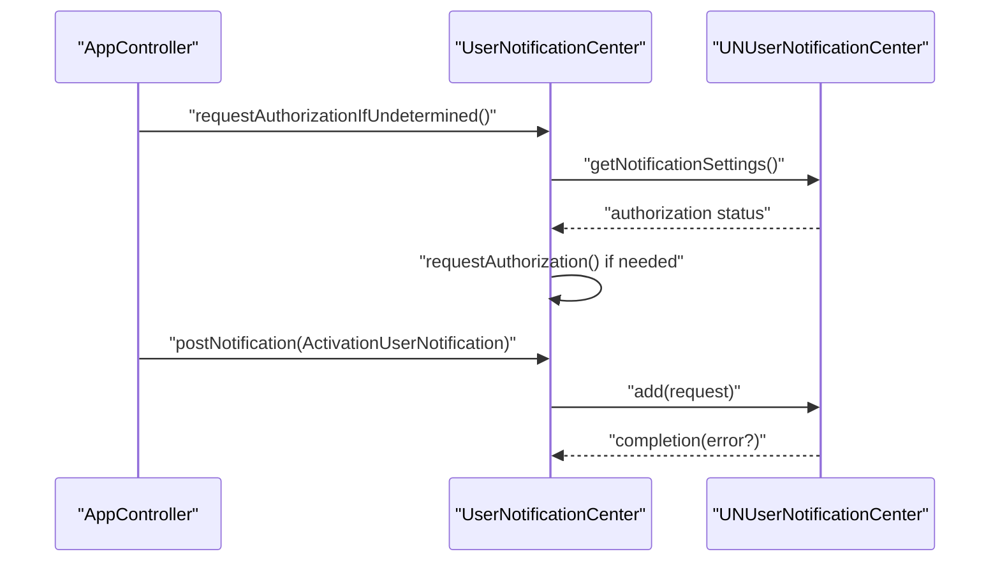
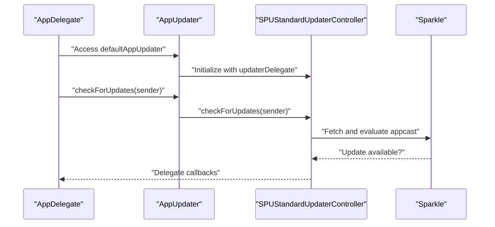
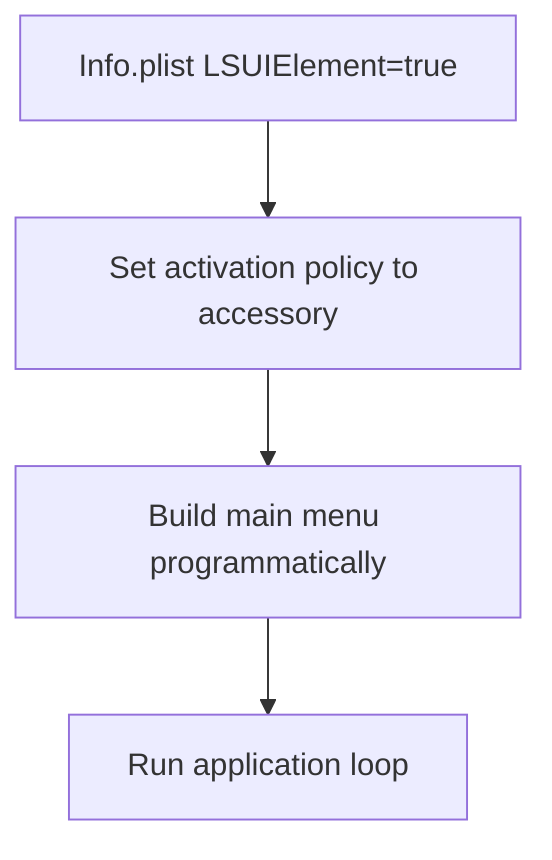
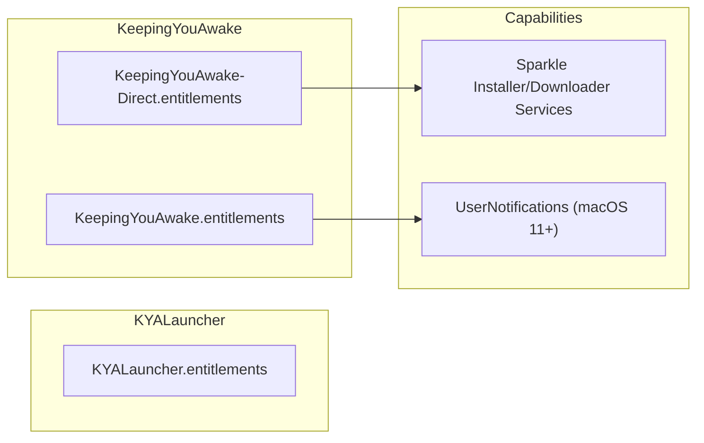
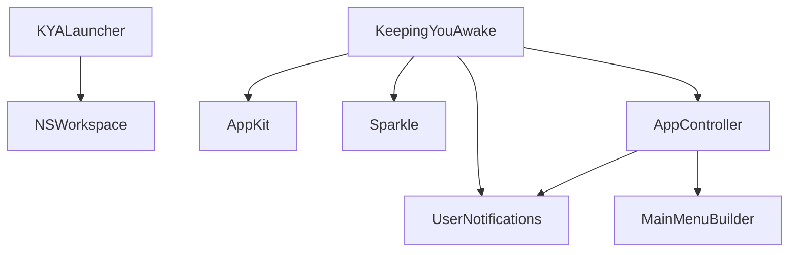

# System Boundaries and Integration Points

<cite>
**Referenced Files in This Document**
- [AppDelegate.swift](file://KYALauncher/AppDelegate.swift)
- [main.swift](file://KYALauncher/main.swift)
- [AppMain.swift](file://KeepingYouAwake/AppMain.swift)
- [AppController.swift](file://KeepingYouAwake/KYAAppController/AppController.swift)
- [AppDelegate.swift](file://KeepingYouAwake/KYAAppController/AppDelegate.swift)
- [AppUpdater.swift](file://KeepingYouAwake/KYAAppUpdater/AppUpdater.swift)
- [ActivationUserNotification.swift](file://KeepingYouAwake/KYAActivationUserNotification/ActivationUserNotification.swift)
- [UserNotificationCenter.swift](file://Packages/KYAUserNotifications/Sources/KYAUserNotifications/UserNotificationCenter.swift)
- [UserNotification.swift](file://Packages/KYAUserNotifications/Sources/KYAUserNotifications/UserNotification.swift)
- [MainMenuBuilder.swift](file://KeepingYouAwake/KYAMainMenu/MainMenuBuilder.swift)
- [Info.plist](file://KYALauncher/Info.plist)
- [Info.plist](file://KeepingYouAwake/Info.plist)
- [KYALauncher.entitlements](file://KYALauncher/KYALauncher.entitlements)
- [KeepingYouAwake.entitlements](file://KeepingYouAwake/KeepingYouAwake.entitlements)
- [KeepingYouAwake-Direct.entitlements](file://KeepingYouAwake/KeepingYouAwake-Direct.entitlements)
</cite>

## Table of Contents
1. [Introduction](#introduction)
2. [Project Structure](#project-structure)
3. [Core Components](#core-components)
4. [Architecture Overview](#architecture-overview)
5. [Detailed Component Analysis](#detailed-component-analysis)
6. [Dependency Analysis](#dependency-analysis)
7. [Performance Considerations](#performance-considerations)
8. [Troubleshooting Guide](#troubleshooting-guide)
9. [Conclusion](#conclusion)

## Introduction
This document explains the system boundaries and integration points in the KeepingYouAwake application, focusing on the separation between the main application and the KYALauncher process, the integration with macOS frameworks, and sandboxing and entitlements considerations. It also covers the LSUIElement configuration enabling menu bar behavior, Sparkle integration for updates, and the UserNotifications framework integration for user-visible state changes.

## Project Structure
The project is organized into two primary targets:
- KeepingYouAwake: The main menu bar application that manages timers, UI, and system integration.
- KYALauncher: A minimal helper app responsible for launching the main application and terminating itself afterward.

**Diagram sources**
- [main.swift:11-14](file://KYALauncher/main.swift#L11-L14)
- [AppDelegate.swift:13-25](file://KYALauncher/AppDelegate.swift#L13-L25)
- [AppMain.swift:13-22](file://KeepingYouAwake/AppMain.swift#L13-L22)
- [AppDelegate.swift:17-25](file://KeepingYouAwake/KYAAppController/AppDelegate.swift#L17-L25)
- [AppController.swift:34-41](file://KeepingYouAwake/KYAAppController/AppController.swift#L34-L41)
- [MainMenuBuilder.swift:13-49](file://KeepingYouAwake/KYAMainMenu/MainMenuBuilder.swift#L13-L49)
- [AppUpdater.swift:15-30](file://KeepingYouAwake/KYAAppUpdater/AppUpdater.swift#L15-L30)
- [Info.plist:7-8](file://KYALauncher/Info.plist#L7-L8)
- [Info.plist:22-23](file://KeepingYouAwake/Info.plist#L22-L23)
- [UserNotificationCenter.swift:14-24](file://Packages/KYAUserNotifications/Sources/KYAUserNotifications/UserNotificationCenter.swift#L14-L24)

**Section sources**
- [main.swift:11-14](file://KYALauncher/main.swift#L11-L14)
- [AppDelegate.swift:13-25](file://KYALauncher/AppDelegate.swift#L13-L25)
- [AppMain.swift:13-22](file://KeepingYouAwake/AppMain.swift#L13-L22)
- [AppDelegate.swift:17-25](file://KeepingYouAwake/KYAAppController/AppDelegate.swift#L17-L25)
- [AppController.swift:34-41](file://KeepingYouAwake/KYAAppController/AppController.swift#L34-L41)
- [MainMenuBuilder.swift:13-49](file://KeepingYouAwake/KYAMainMenu/MainMenuBuilder.swift#L13-L49)
- [AppUpdater.swift:15-30](file://KeepingYouAwake/KYAAppUpdater/AppUpdater.swift#L15-L30)
- [Info.plist:7-8](file://KYALauncher/Info.plist#L7-L8)
- [Info.plist:22-23](file://KeepingYouAwake/Info.plist#L22-L23)

## Core Components
- KYALauncher: Minimal app that launches the main application and immediately terminates itself. It uses NSWorkspace to open the parent app bundle and sets LSBackgroundOnly to ensure it runs without a dock icon.
- KeepingYouAwake: Menu bar app configured via LSUIElement, with an AppController orchestrating timers, UI, notifications, and device monitoring.
- UserNotifications integration: A wrapper around UNUserNotificationCenter for macOS 11+ and a legacy fallback for earlier versions.
- Sparkle integration: Automatic update checking and installation via SPUStandardUpdaterController.
- Entitlements and sandboxing: Separate entitlements for the launcher and main app, plus temporary exceptions for internal helper services.

**Section sources**
- [AppDelegate.swift:13-25](file://KYALauncher/AppDelegate.swift#L13-L25)
- [Info.plist:7-8](file://KYALauncher/Info.plist#L7-L8)
- [AppMain.swift:20-21](file://KeepingYouAwake/AppMain.swift#L20-L21)
- [Info.plist:22-23](file://KeepingYouAwake/Info.plist#L22-L23)
- [UserNotificationCenter.swift:14-24](file://Packages/KYAUserNotifications/Sources/KYAUserNotifications/UserNotificationCenter.swift#L14-L24)
- [AppUpdater.swift:15-30](file://KeepingYouAwake/KYAAppUpdater/AppUpdater.swift#L15-L30)
- [KYALauncher.entitlements:4-5](file://KYALauncher/KYALauncher.entitlements#L4-L5)
- [KeepingYouAwake.entitlements:4-5](file://KeepingYouAwake/KeepingYouAwake.entitlements#L4-L5)
- [KeepingYouAwake-Direct.entitlements:5-9](file://KeepingYouAwake/KeepingYouAwake-Direct.entitlements#L5-L9)

## Architecture Overview
The system is split across two processes:
- KYALauncher: Launches the main app and exits quickly to avoid lingering in the Dock.
- KeepingYouAwake: Runs as an accessory app with a menu bar interface, handles user actions, schedules sleep prevention, posts user notifications, and checks for updates.

**Diagram sources**
- [AppDelegate.swift:13-25](file://KYALauncher/AppDelegate.swift#L13-L25)
- [AppMain.swift:13-22](file://KeepingYouAwake/AppMain.swift#L13-L22)

## Detailed Component Analysis

### KYALauncher Process
Purpose:
- Launch the parent app bundle and exit immediately to keep the Dock clean and avoid duplicate icons.

Key behaviors:
- Uses NSWorkspace to launch the parent application after resolving the bundle path.
- Terminates itself after delegating launch responsibility.
- Configured with LSBackgroundOnly to run without a dock icon.

**Diagram sources**
- [AppDelegate.swift:13-25](file://KYALauncher/AppDelegate.swift#L13-L25)

**Section sources**
- [AppDelegate.swift:13-25](file://KYALauncher/AppDelegate.swift#L13-L25)
- [main.swift:11-14](file://KYALauncher/main.swift#L11-L14)
- [Info.plist:7-8](file://KYALauncher/Info.plist#L7-L8)

### KeepingYouAwake Main Application
Purpose:
- Provide a menu bar interface, manage sleep prevention timers, and integrate with macOS system services.

Key behaviors:
- Configures activation policy to accessory (menu bar) via LSUIElement.
- Builds a dynamic main menu with duration selection and settings.
- Orchestrates timer lifecycle, device monitoring, and user notifications.
- Integrates with Sparkle for automatic updates.

**Diagram sources**
- [AppController.swift:21-41](file://KeepingYouAwake/KYAAppController/AppController.swift#L21-L41)
- [AppUpdater.swift:15-43](file://KeepingYouAwake/KYAAppUpdater/AppUpdater.swift#L15-L43)
- [UserNotificationCenter.swift:14-24](file://Packages/KYAUserNotifications/Sources/KYAUserNotifications/UserNotificationCenter.swift#L14-L24)
- [ActivationUserNotification.swift:13-22](file://KeepingYouAwake/KYAActivationUserNotification/ActivationUserNotification.swift#L13-L22)

**Section sources**
- [AppMain.swift:20-21](file://KeepingYouAwake/AppMain.swift#L20-L21)
- [MainMenuBuilder.swift:13-49](file://KeepingYouAwake/KYAMainMenu/MainMenuBuilder.swift#L13-L49)
- [AppController.swift:34-41](file://KeepingYouAwake/KYAAppController/AppController.swift#L34-L41)
- [AppController.swift:77-122](file://KeepingYouAwake/KYAAppController/AppController.swift#L77-L122)
- [AppController.swift:181-187](file://KeepingYouAwake/KYAAppController/AppController.swift#L181-L187)
- [AppController.swift:202-225](file://KeepingYouAwake/KYAAppController/AppController.swift#L202-L225)
- [AppController.swift:250-299](file://KeepingYouAwake/KYAAppController/AppController.swift#L250-L299)
- [AppController.swift:330-335](file://KeepingYouAwake/KYAAppController/AppController.swift#L330-L335)

### UserNotifications Integration
Purpose:
- Provide user-visible feedback about activation/deactivation events using the modern UserNotifications framework on macOS 11+.

Key behaviors:
- Request authorization if undetermined.
- Clear previously delivered notifications.
- Post activation/deactivation notifications with localized content.

**Diagram sources**
- [AppController.swift:181-187](file://KeepingYouAwake/KYAAppController/AppController.swift#L181-L187)
- [ActivationUserNotification.swift:19-37](file://KeepingYouAwake/KYAActivationUserNotification/ActivationUserNotification.swift#L19-L37)
- [UserNotificationCenter.swift:88-113](file://Packages/KYAUserNotifications/Sources/KYAUserNotifications/UserNotificationCenter.swift#L88-L113)

**Section sources**
- [AppController.swift:181-187](file://KeepingYouAwake/KYAAppController/AppController.swift#L181-L187)
- [ActivationUserNotification.swift:12-37](file://KeepingYouAwake/KYAActivationUserNotification/ActivationUserNotification.swift#L12-L37)
- [UserNotificationCenter.swift:14-24](file://Packages/KYAUserNotifications/Sources/KYAUserNotifications/UserNotificationCenter.swift#L14-L24)
- [UserNotificationCenter.swift:34-86](file://Packages/KYAUserNotifications/Sources/KYAUserNotifications/UserNotificationCenter.swift#L34-L86)
- [UserNotificationCenter.swift:92-113](file://Packages/KYAUserNotifications/Sources/KYAUserNotifications/UserNotificationCenter.swift#L92-L113)

### Sparkle Integration for Updates
Purpose:
- Enable automatic update checks and installation via Sparkle’s SPUStandardUpdaterController.

Key behaviors:
- Configure updater controller in the app delegate.
- Choose between release and prerelease feeds based on user preferences.
- Expose a public method to manually trigger update checks.

**Diagram sources**
- [AppDelegate.swift:18-20](file://KeepingYouAwake/KYAAppController/AppDelegate.swift#L18-L20)
- [AppUpdater.swift:27-34](file://KeepingYouAwake/KYAAppUpdater/AppUpdater.swift#L27-L34)
- [AppUpdater.swift:38-42](file://KeepingYouAwake/KYAAppUpdater/AppUpdater.swift#L38-L42)

**Section sources**
- [AppDelegate.swift:18-20](file://KeepingYouAwake/KYAAppController/AppDelegate.swift#L18-L20)
- [AppUpdater.swift:15-43](file://KeepingYouAwake/KYAAppUpdater/AppUpdater.swift#L15-L43)

### LSUIElement and Menu Bar Behavior
Purpose:
- Configure the app to run as an accessory (menu bar) application without a dock icon or document window.

Key behaviors:
- LSUIElement set to true in the main app’s Info.plist.
- Activation policy set to accessory in the application lifecycle.
- Dynamic main menu built programmatically.

**Diagram sources**
- [Info.plist:22-23](file://KeepingYouAwake/Info.plist#L22-L23)
- [AppMain.swift:20-21](file://KeepingYouAwake/AppMain.swift#L20-L21)
- [MainMenuBuilder.swift:13-49](file://KeepingYouAwake/KYAMainMenu/MainMenuBuilder.swift#L13-L49)

**Section sources**
- [Info.plist:22-23](file://KeepingYouAwake/Info.plist#L22-L23)
- [AppMain.swift:20-21](file://KeepingYouAwake/AppMain.swift#L20-L21)
- [MainMenuBuilder.swift:13-49](file://KeepingYouAwake/KYAMainMenu/MainMenuBuilder.swift#L13-L49)

### Entitlements and Sandboxing Considerations
Purpose:
- Define system capabilities and exceptions required for proper operation.

Key points:
- KYALauncher: Minimal entitlements; intended to be lightweight.
- KeepingYouAwake: Standard entitlements; includes temporary exceptions for internal helper service names used during update installation.
- The main app uses Sparkle installer/downloader services, which require specific Mach service names resolved at runtime.

**Diagram sources**
- [KYALauncher.entitlements:4-5](file://KYALauncher/KYALauncher.entitlements#L4-L5)
- [KeepingYouAwake.entitlements:4-5](file://KeepingYouAwake/KeepingYouAwake.entitlements#L4-L5)
- [KeepingYouAwake-Direct.entitlements:5-9](file://KeepingYouAwake/KeepingYouAwake-Direct.entitlements#L5-L9)

**Section sources**
- [KYALauncher.entitlements:4-5](file://KYALauncher/KYALauncher.entitlements#L4-L5)
- [KeepingYouAwake.entitlements:4-5](file://KeepingYouAwake/KeepingYouAwake.entitlements#L4-L5)
- [KeepingYouAwake-Direct.entitlements:5-9](file://KeepingYouAwake/KeepingYouAwake-Direct.entitlements#L5-L9)

## Dependency Analysis
High-level dependencies:
- KYALauncher depends on NSWorkspace for launching the main app.
- KeepingYouAwake depends on AppKit for UI, UserNotifications for user alerts, and Sparkle for updates.
- AppController orchestrates subsystems and coordinates notifications and device monitoring.

**Diagram sources**
- [AppDelegate.swift:17-21](file://KYALauncher/AppDelegate.swift#L17-L21)
- [AppMain.swift:9-10](file://KeepingYouAwake/AppMain.swift#L9-L10)
- [UserNotificationCenter.swift](file://Packages/KYAUserNotifications/Sources/KYAUserNotifications/UserNotificationCenter.swift#L9)
- [AppUpdater.swift](file://KeepingYouAwake/KYAAppUpdater/AppUpdater.swift#L13)
- [AppController.swift:9-17](file://KeepingYouAwake/KYAAppController/AppController.swift#L9-L17)
- [MainMenuBuilder.swift](file://KeepingYouAwake/KYAMainMenu/MainMenuBuilder.swift#L9)

**Section sources**
- [AppDelegate.swift:17-21](file://KYALauncher/AppDelegate.swift#L17-L21)
- [AppMain.swift:9-10](file://KeepingYouAwake/AppMain.swift#L9-L10)
- [UserNotificationCenter.swift](file://Packages/KYAUserNotifications/Sources/KYAUserNotifications/UserNotificationCenter.swift#L9)
- [AppUpdater.swift](file://KeepingYouAwake/KYAAppUpdater/AppUpdater.swift#L13)
- [AppController.swift:9-17](file://KeepingYouAwake/KYAAppController/AppController.swift#L9-L17)
- [MainMenuBuilder.swift](file://KeepingYouAwake/KYAMainMenu/MainMenuBuilder.swift#L9)

## Performance Considerations
- Minimize UI work on the main thread; use async dispatch for long-running tasks.
- Defer update checks until after initial setup to avoid blocking startup.
- Keep notification posting lightweight and avoid excessive scheduling.
- Use device monitoring selectively to reduce overhead when thresholds are disabled.

## Troubleshooting Guide
Common issues and resolutions:
- Notifications not appearing:
  - Verify authorization status and request authorization if needed.
  - Ensure notifications are posted after authorization is granted.
- Update checks not working:
  - Confirm Sparkle feed URLs and network connectivity.
  - Check delegate callbacks and user preference for prerelease updates.
- App does not appear in menu bar:
  - Verify LSUIElement is set to true in Info.plist.
  - Confirm activation policy is set to accessory during startup.
- Launcher fails to start main app:
  - Ensure the parent bundle path resolution is correct.
  - Confirm NSWorkspace launch succeeds and launcher terminates promptly.

**Section sources**
- [UserNotificationCenter.swift:34-86](file://Packages/KYAUserNotifications/Sources/KYAUserNotifications/UserNotificationCenter.swift#L34-L86)
- [AppUpdater.swift:38-42](file://KeepingYouAwake/KYAAppUpdater/AppUpdater.swift#L38-L42)
- [Info.plist:22-23](file://KeepingYouAwake/Info.plist#L22-L23)
- [AppMain.swift:20-21](file://KeepingYouAwake/AppMain.swift#L20-L21)
- [AppDelegate.swift:17-25](file://KYALauncher/AppDelegate.swift#L17-L25)

## Conclusion
The KeepingYouAwake application separates concerns across two processes: a lightweight launcher for initiating the main app and a robust menu bar application managing timers, UI, notifications, and updates. The design leverages macOS frameworks for user notifications, update delivery, and system integration while maintaining clear system boundaries and appropriate entitlements for secure operation.