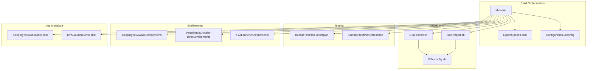
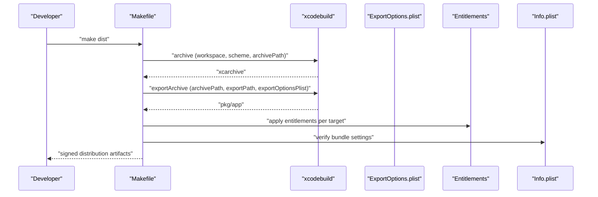
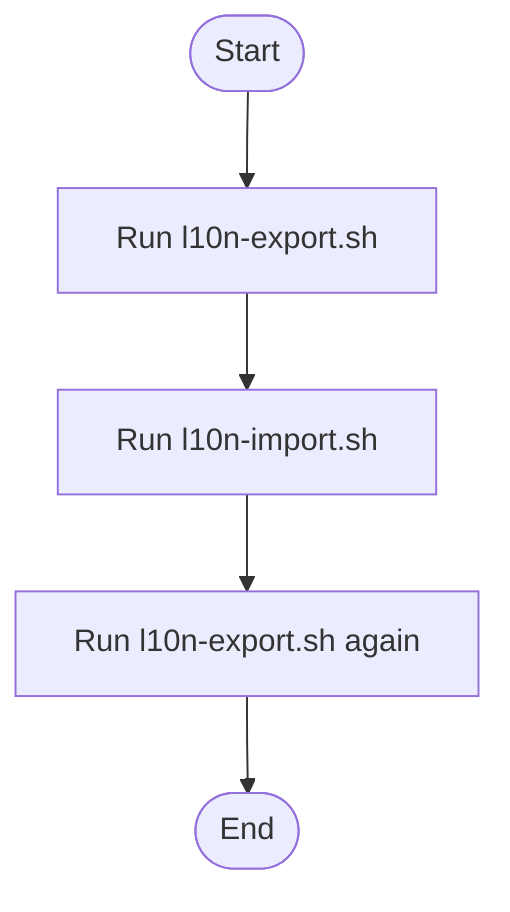

# Build and Deployment

<cite>
**Referenced Files in This Document**
- [Makefile](file://Makefile)
- [ExportOptions.plist](file://ExportOptions.plist)
- [Configuration.xcconfig](file://Configuration.xcconfig)
- [README.md](file://README.md)
- [KeepingYouAwake/Info.plist](file://KeepingYouAwake/Info.plist)
- [KYALauncher/Info.plist](file://KYALauncher/Info.plist)
- [KeepingYouAwake/KeepingYouAwake.entitlements](file://KeepingYouAwake/KeepingYouAwake.entitlements)
- [KeepingYouAwake/KeepingYouAwake-Direct.entitlements](file://KeepingYouAwake/KeepingYouAwake-Direct.entitlements)
- [KYALauncher/KYALauncher.entitlements](file://KYALauncher/KYALauncher.entitlements)
- [Localizations/l10n-export.sh](file://Localizations/l10n-export.sh)
- [Localizations/l10n-import.sh](file://Localizations/l10n-import.sh)
- [Localizations/l10n-config.sh](file://Localizations/l10n-config.sh)
- [KeepingYouAwake/DefaultTestPlan.xctestplan](file://KeepingYouAwake/DefaultTestPlan.xctestplan)
- [KeepingYouAwake/SanitizerTestPlan.xctestplan](file://KeepingYouAwake/SanitizerTestPlan.xctestplan)
- [KeepingYouAwake.xcworkspace/xcshareddata/swiftpm/Package.resolved](file://KeepingYouAwake.xcworkspace/xcshareddata/swiftpm/Package.resolved)
- [.github/pull_request_template.md](file://.github/pull_request_template.md)
</cite>

## Table of Contents
1. [Introduction](#introduction)
2. [Project Structure](#project-structure)
3. [Core Components](#core-components)
4. [Architecture Overview](#architecture-overview)
5. [Detailed Component Analysis](#detailed-component-analysis)
6. [Dependency Analysis](#dependency-analysis)
7. [Performance Considerations](#performance-considerations)
8. [Troubleshooting Guide](#troubleshooting-guide)
9. [Conclusion](#conclusion)
10. [Appendices](#appendices)

## Introduction
This document explains the build and deployment processes for the macOS application. It covers Xcode project configuration, build phases and scripts, code signing requirements, Makefile automation for building, archiving, and distributing releases, export options for different distribution channels, CI/CD pipeline setup, automated testing integration, release automation, version management and changelog maintenance, and quality assurance processes.

## Project Structure
The project is organized as a Swift package integrated with an Xcode workspace. Key build-related artifacts include:
- A shared configuration file for compiler and bundle settings
- An export options profile for Archive and Export workflows
- Localization export/import scripts orchestrated by a shared configuration script
- Test plans for standard and sanitizer-based testing
- Entitlements files for the main app and launcher targets
- A Makefile that orchestrates xcodebuild tasks, localization updates, and packaging

**Diagram sources**
- [Makefile:1-92](file://Makefile#L1-L92)
- [ExportOptions.plist:1-13](file://ExportOptions.plist#L1-L13)
- [Configuration.xcconfig:1-20](file://Configuration.xcconfig#L1-L20)
- [Localizations/l10n-config.sh:1-11](file://Localizations/l10n-config.sh#L1-L11)
- [Localizations/l10n-export.sh:1-19](file://Localizations/l10n-export.sh#L1-L19)
- [Localizations/l10n-import.sh:1-19](file://Localizations/l10n-import.sh#L1-L19)
- [KeepingYouAwake/DefaultTestPlan.xctestplan:1-44](file://KeepingYouAwake/DefaultTestPlan.xctestplan#L1-L44)
- [KeepingYouAwake/SanitizerTestPlan.xctestplan:1-63](file://KeepingYouAwake/SanitizerTestPlan.xctestplan#L1-L63)
- [KeepingYouAwake/KeepingYouAwake.entitlements:1-6](file://KeepingYouAwake/KeepingYouAwake.entitlements#L1-L6)
- [KeepingYouAwake/KeepingYouAwake-Direct.entitlements:1-12](file://KeepingYouAwake/KeepingYouAwake-Direct.entitlements#L1-L12)
- [KYALauncher/KYALauncher.entitlements:1-6](file://KYALauncher/KYALauncher.entitlements#L1-L6)
- [KeepingYouAwake/Info.plist:1-36](file://KeepingYouAwake/Info.plist#L1-L36)
- [KYALauncher/Info.plist:1-11](file://KYALauncher/Info.plist#L1-L11)

**Section sources**
- [Makefile:1-92](file://Makefile#L1-L92)
- [Configuration.xcconfig:1-20](file://Configuration.xcconfig#L1-L20)

## Core Components
- Build orchestration via Makefile: defines targets for cleaning, testing, localization synchronization, archiving, exporting, and packaging distributions.
- Export options: controls archive export behavior for distribution channels.
- Shared configuration: sets deployment target, Swift version, bundle identifier, marketing and build versions, and Info.plist keys.
- Localization scripts: export/import localizations using xcodebuild with a centralized configuration.
- Testing plans: standard and sanitizer-focused test plans for deterministic runs and memory/thread safety checks.
- Entitlements: define capabilities for the main app, direct-download variant, and launcher.
- App metadata: Info.plist entries for URL scheme, UI appearance, privacy, and Sparkle update settings.

**Section sources**
- [Makefile:1-92](file://Makefile#L1-L92)
- [ExportOptions.plist:1-13](file://ExportOptions.plist#L1-L13)
- [Configuration.xcconfig:1-20](file://Configuration.xcconfig#L1-L20)
- [Localizations/l10n-export.sh:1-19](file://Localizations/l10n-export.sh#L1-L19)
- [Localizations/l10n-import.sh:1-19](file://Localizations/l10n-import.sh#L1-L19)
- [Localizations/l10n-config.sh:1-11](file://Localizations/l10n-config.sh#L1-L11)
- [KeepingYouAwake/DefaultTestPlan.xctestplan:1-44](file://KeepingYouAwake/DefaultTestPlan.xctestplan#L1-L44)
- [KeepingYouAwake/SanitizerTestPlan.xctestplan:1-63](file://KeepingYouAwake/SanitizerTestPlan.xctestplan#L1-L63)
- [KeepingYouAwake/KeepingYouAwake.entitlements:1-6](file://KeepingYouAwake/KeepingYouAwake.entitlements#L1-L6)
- [KeepingYouAwake/KeepingYouAwake-Direct.entitlements:1-12](file://KeepingYouAwake/KeepingYouAwake-Direct.entitlements#L1-L12)
- [KYALauncher/KYALauncher.entitlements:1-6](file://KYALauncher/KYALauncher.entitlements#L1-L6)
- [KeepingYouAwake/Info.plist:1-36](file://KeepingYouAwake/Info.plist#L1-L36)
- [KYALauncher/Info.plist:1-11](file://KYALauncher/Info.plist#L1-L11)

## Architecture Overview
The build and distribution pipeline integrates Makefile-driven xcodebuild commands with export options and entitlements to produce signed archives and packages. Localization updates are synchronized before builds. Testing is executed via test plans. Distribution artifacts are prepared for multiple channels.

**Diagram sources**
- [Makefile:65-82](file://Makefile#L65-L82)
- [ExportOptions.plist:1-13](file://ExportOptions.plist#L1-L13)
- [KeepingYouAwake/KeepingYouAwake.entitlements:1-6](file://KeepingYouAwake/KeepingYouAwake.entitlements#L1-L6)
- [KeepingYouAwake/KeepingYouAwake-Direct.entitlements:1-12](file://KeepingYouAwake/KeepingYouAwake-Direct.entitlements#L1-L12)
- [KYALauncher/KYALauncher.entitlements:1-6](file://KYALauncher/KYALauncher.entitlements#L1-L6)
- [KeepingYouAwake/Info.plist:1-36](file://KeepingYouAwake/Info.plist#L1-L36)
- [KYALauncher/Info.plist:1-11](file://KYALauncher/Info.plist#L1-L11)

## Detailed Component Analysis

### Xcode Project Configuration
- Deployment and toolchain: deployment target and Swift version are centrally defined.
- Bundle identity and versioning: bundle identifier, marketing version, and internal build number are set.
- Info.plist generation and keys: automatic Info.plist generation and several LS/App Store/privacy keys are configured.

Best practices:
- Keep the shared configuration consistent across targets.
- Use separate entitlements per target to minimize privileges.
- Manage versions in a single place to avoid drift.

**Section sources**
- [Configuration.xcconfig:1-20](file://Configuration.xcconfig#L1-L20)

### Build Phases and Scripts
- Clean and derived data management: targets remove build artifacts and DerivedData directories.
- Test execution: standard and sanitizer-based test plans are supported.
- Localization synchronization: export and import steps use a shared configuration script.
- Archive and export: archive to .xcarchive, then export to .pkg using export options.
- Packaging: zip the .app for direct distribution.
- Verification: Gatekeeper verification of the built app.

Operational notes:
- Automatic package resolution is disabled to ensure reproducibility.
- Logs are captured to a dedicated build log file.
- The export method is configured for App Store distribution.

**Section sources**
- [Makefile:20-92](file://Makefile#L20-L92)
- [ExportOptions.plist:1-13](file://ExportOptions.plist#L1-L13)

### Code Signing Requirements
- Entitlements per target:
  - Main app: minimal entitlements.
  - Direct-download variant: temporary exceptions for inter-process communication.
  - Launcher: minimal entitlements.
- App metadata:
  - URL scheme registration for the app.
  - Sparkle update preferences enabled.
  - Privacy-related flags set appropriately.

Recommendations:
- Ensure signing certificates and provisioning profiles are available in the environment.
- Verify entitlements match the intended runtime behavior.
- Confirm Info.plist keys align with distribution requirements.

**Section sources**
- [KeepingYouAwake/KeepingYouAwake.entitlements:1-6](file://KeepingYouAwake/KeepingYouAwake.entitlements#L1-L6)
- [KeepingYouAwake/KeepingYouAwake-Direct.entitlements:1-12](file://KeepingYouAwake/KeepingYouAwake-Direct.entitlements#L1-L12)
- [KYALauncher/KYALauncher.entitlements:1-6](file://KYALauncher/KYALauncher.entitlements#L1-L6)
- [KeepingYouAwake/Info.plist:1-36](file://KeepingYouAwake/Info.plist#L1-L36)
- [KYALauncher/Info.plist:1-11](file://KYALauncher/Info.plist#L1-L11)

### Makefile Automation
Key targets:
- clean: removes build artifacts.
- dist-clean: removes distribution outputs.
- test: runs unit tests with derived data isolation.
- test-with-sanitizers: executes sanitizer-enabled test plan.
- l10n-export: exports localized resources.
- l10n-import: imports localized resources.
- l10n-update: a convenience chain to export, import, and re-export.
- app: archives with the Direct scheme and extracts `dist/KeepingYouAwake.app` (no DMG).
- dmg: builds the Direct distribution DMG (`dist/KeepingYouAwake-<version>.dmg`).
- dist: archives and exports the App Store package, then zips the `.app`.
- package: builds both App Store (`.zip`) and Direct (`.dmg`) distribution artifacts.

Workflow highlights:
- Reproducible builds: disables automatic package resolution and pins versions.
- Logging: captures xcodebuild logs to a file.
- Packaging: App Store channel produces a `.zip`; Direct channel produces a standalone `.app` (`make app`) or a `.dmg` (`make dmg`).

**Section sources**
- [Makefile:1-92](file://Makefile#L1-L92)

### Export Options for Distribution Channels
- App Store: export method configured to “app-store” with App Store information generation.
- Direct download: export options can be adapted to produce a .pkg suitable for website distribution.
- Homebrew Cask: requires a separate process to package and publish; the existing export options focus on App Store distribution.

Guidance:
- For direct download, adjust export options to disable App Store metadata generation and tailor signing for distribution.
- For Homebrew Cask, prepare a .zip artifact and maintain cask formula metadata externally.

**Section sources**
- [ExportOptions.plist:1-13](file://ExportOptions.plist#L1-L13)

### CI/CD Pipeline Setup
- Automated testing: configure CI to run the test and sanitizer test targets.
- Localization sync: integrate l10n-export and l10n-import in CI to keep translations current.
- Archive and export: run the archive and export targets to produce artifacts.
- Release automation: tag releases and publish artifacts to GitHub Releases or distribution systems.
- Pull requests: use the pull request template to standardize contributions.

Note: The repository currently lacks a CI workflow definition file. Define jobs to execute the Makefile targets and integrate with artifact storage and release publishing.

**Section sources**
- [Makefile:28-49](file://Makefile#L28-L49)
- [Localizations/l10n-export.sh:1-19](file://Localizations/l10n-export.sh#L1-L19)
- [Localizations/l10n-import.sh:1-19](file://Localizations/l10n-import.sh#L1-L19)
- [.github/pull_request_template.md](file://.github/pull_request_template.md)

### Version Management and Changelog Maintenance
- Version identifiers:
  - Marketing version and build number are defined in the shared configuration.
  - The Makefile embeds a VERSION variable used for naming distribution artifacts.
- Changelog and release notes:
  - Documentation includes a versions directory with JSON and Markdown files for historical releases.
  - Use these files to maintain release notes and version history.

Practices:
- Increment versions consistently across configuration and release notes.
- Tag releases in version control and attach distribution artifacts.

**Section sources**
- [Configuration.xcconfig:13-14](file://Configuration.xcconfig#L13-L14)
- [Makefile:2](file://Makefile#L2)
- [README.md:31-35](file://README.md#L31-L35)

### Quality Assurance and Pre-/Post-release Processes
- Pre-release:
  - Run standard tests and sanitizer tests to detect memory/thread issues.
  - Verify localization completeness and correctness.
  - Confirm code signing and Gatekeeper verification pass.
- Post-release:
  - Monitor Sparkle update delivery and user feedback.
  - Track crash reports and support tickets.
  - Validate that exported artifacts match expected signatures and versions.

**Section sources**
- [KeepingYouAwake/DefaultTestPlan.xctestplan:1-44](file://KeepingYouAwake/DefaultTestPlan.xctestplan#L1-L44)
- [KeepingYouAwake/SanitizerTestPlan.xctestplan:1-63](file://KeepingYouAwake/SanitizerTestPlan.xctestplan#L1-L63)
- [Makefile:89-91](file://Makefile#L89-L91)

## Dependency Analysis
External dependencies and their versions are pinned via Swift Package Manager.

**Diagram sources**
- [KeepingYouAwake.xcworkspace/xcshareddata/swiftpm/Package.resolved:1-14](file://KeepingYouAwake.xcworkspace/xcshareddata/swiftpm/Package.resolved#L1-L14)

**Section sources**
- [KeepingYouAwake.xcworkspace/xcshareddata/swiftpm/Package.resolved:1-14](file://KeepingYouAwake.xcworkspace/xcshareddata/swiftpm/Package.resolved#L1-L14)

## Performance Considerations
- Disable automatic package resolution to ensure deterministic builds.
- Use derived data isolation for test runs to avoid cache interference.
- Streamline localization export/import to reduce CI overhead.
- Parallelize independent tasks (e.g., test and localization) where appropriate.

## Troubleshooting Guide
Common issues and resolutions:
- Build failures due to unresolved packages: ensure automatic resolution is disabled and the resolved file is used.
- Test flakiness: run with randomized ordering and sanitizer plans to surface hidden bugs.
- Localization errors: verify the export/import scripts and language list in the configuration.
- Signing problems: confirm entitlements match the target and Info.plist keys are correct.
- Export mismatches: review export options for the intended distribution channel.

**Section sources**
- [Makefile:13-16](file://Makefile#L13-L16)
- [Makefile:39-49](file://Makefile#L39-L49)
- [Localizations/l10n-config.sh:10](file://Localizations/l10n-config.sh#L10)
- [ExportOptions.plist:1-13](file://ExportOptions.plist#L1-L13)

## Conclusion
The project’s build and deployment system centers on a Makefile that coordinates xcodebuild, localization synchronization, archiving, exporting, and packaging. Configuration is centralized in an xcconfig file, while export options tailor distribution outputs. Testing is supported via dedicated test plans. To complete the process, integrate CI/CD to automate testing and release workflows, and maintain versioning and changelog practices aligned with the provided documentation.

## Appendices

### Appendix A: Localization Workflow

**Diagram sources**
- [Localizations/l10n-export.sh:1-19](file://Localizations/l10n-export.sh#L1-L19)
- [Localizations/l10n-import.sh:1-19](file://Localizations/l10n-import.sh#L1-L19)
- [Localizations/l10n-config.sh:1-11](file://Localizations/l10n-config.sh#L1-L11)