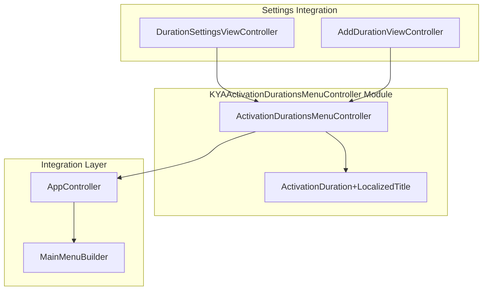
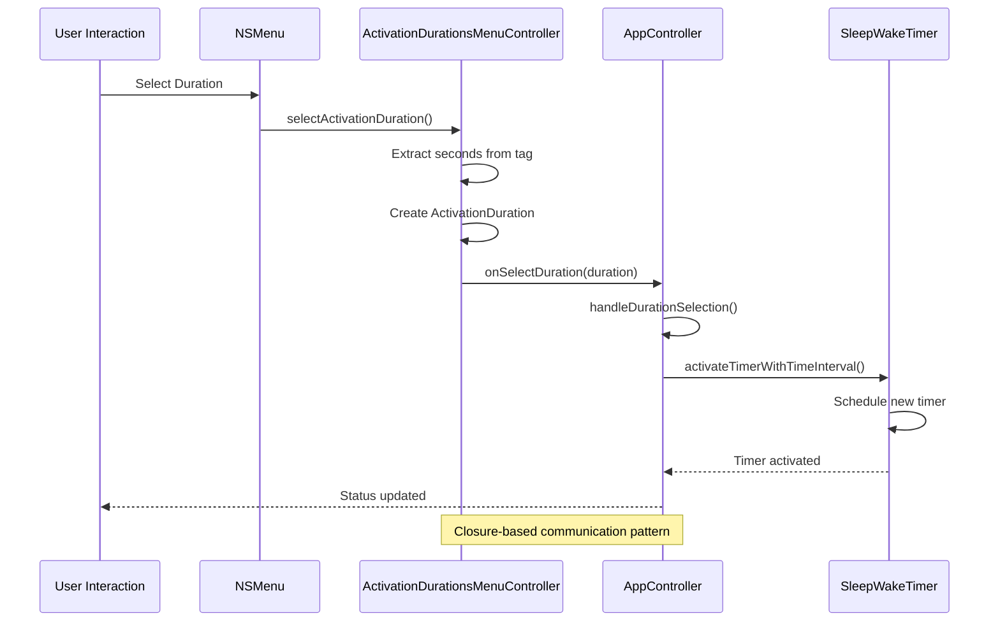
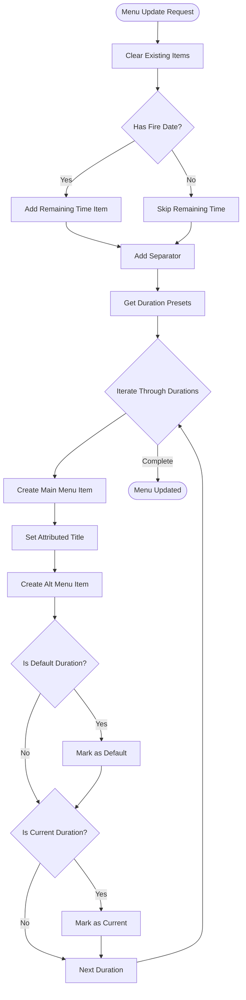
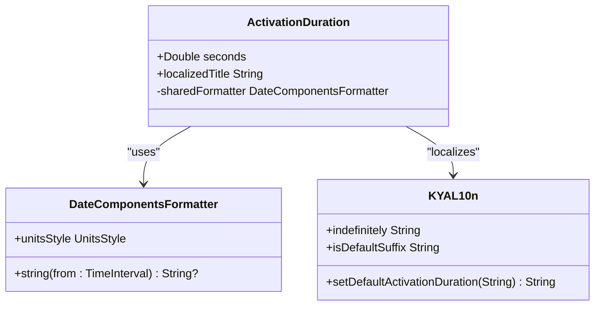
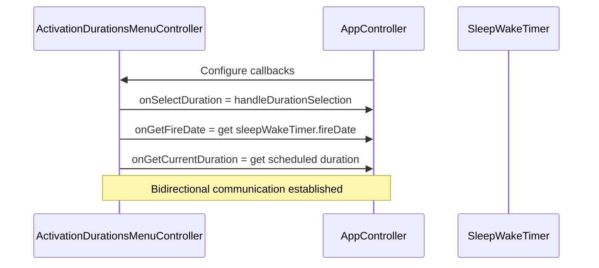
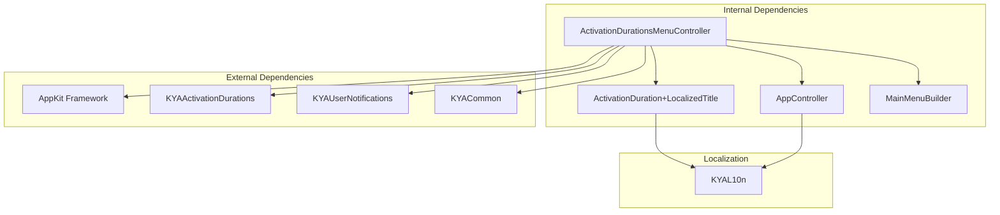

# ActivationDurationsMenuController - Duration Management

<cite>
**Referenced Files in This Document**
- [ActivationDurationsMenuController.swift](file://KeepingYouAwake/KYAActivationDurationsMenuController/ActivationDurationsMenuController.swift)
- [ActivationDuration+LocalizedTitle.swift](file://KeepingYouAwake/KYAActivationDurationsMenuController/ActivationDuration+LocalizedTitle.swift)
- [AppController.swift](file://KeepingYouAwake/KYAAppController/AppController.swift)
- [MainMenuBuilder.swift](file://KeepingYouAwake/KYAMainMenu/MainMenuBuilder.swift)
- [KYAL10n.swift](file://KeepingYouAwake/KYAL10n.swift)
- [DurationSettingsViewController.swift](file://KeepingYouAwake/Settings/KYADurationSettingsViewController/DurationSettingsViewController.swift)
- [AddDurationViewController.swift](file://KeepingYouAwake/Settings/KYADurationSettingsViewController/AddDurationViewController.swift)
</cite>

## Table of Contents
1. [Introduction](#introduction)
2. [Project Structure](#project-structure)
3. [Core Components](#core-components)
4. [Architecture Overview](#architecture-overview)
5. [Detailed Component Analysis](#detailed-component-analysis)
6. [Dependency Analysis](#dependency-analysis)
7. [Performance Considerations](#performance-considerations)
8. [Troubleshooting Guide](#troubleshooting-guide)
9. [Conclusion](#conclusion)

## Introduction

The ActivationDurationsMenuController is a crucial component responsible for managing duration presets and constructing the activation duration menu in the KeepingYouAwake macOS application. This controller serves as the bridge between user interface interactions and the underlying duration management system, providing a seamless experience for selecting activation durations.

The controller implements a closure-based communication pattern instead of traditional delegate protocols, enabling flexible integration with the broader application architecture. It manages the dynamic construction of menu items, handles user selections, and maintains synchronization with the current active duration state.

## Project Structure

The ActivationDurationsMenuController resides within the KYAActivationDurationsMenuController module, alongside supporting components for duration localization and menu construction. The controller integrates deeply with the application's main menu system and works in conjunction with the AppController for timer activation management.

**Diagram sources**
- [ActivationDurationsMenuController.swift:15-31](file://KeepingYouAwake/KYAActivationDurationsMenuController/ActivationDurationsMenuController.swift#L15-L31)
- [AppController.swift:21-66](file://KeepingYouAwake/KYAAppController/AppController.swift#L21-L66)

**Section sources**
- [ActivationDurationsMenuController.swift:1-126](file://KeepingYouAwake/KYAActivationDurationsMenuController/ActivationDurationsMenuController.swift#L1-L126)
- [MainMenuBuilder.swift:13-25](file://KeepingYouAwake/KYAMainMenu/MainMenuBuilder.swift#L13-L25)

## Core Components

The ActivationDurationsMenuController consists of several key components working together to provide comprehensive duration management functionality:

### Primary Controller Class
The main controller class manages menu lifecycle, user interactions, and duration selection callbacks. It implements the NSMenuDelegate protocol to dynamically construct menu items based on current application state.

### Duration Localization System
A specialized extension provides localized title generation for duration objects, supporting multiple languages and proper formatting of time intervals.

### Callback System
The controller utilizes closure-based callbacks for communication with parent components, eliminating tight coupling while maintaining flexibility in integration scenarios.

**Section sources**
- [ActivationDurationsMenuController.swift:14-31](file://KeepingYouAwake/KYAActivationDurationsMenuController/ActivationDurationsMenuController.swift#L14-L31)
- [ActivationDuration+LocalizedTitle.swift:12-26](file://KeepingYouAwake/KYAActivationDurationsMenuController/ActivationDuration+LocalizedTitle.swift#L12-L26)

## Architecture Overview

The ActivationDurationsMenuController operates within a layered architecture that separates concerns between menu management, duration handling, and application integration:

**Diagram sources**
- [ActivationDurationsMenuController.swift:33-38](file://KeepingYouAwake/KYAActivationDurationsMenuController/ActivationDurationsMenuController.swift#L33-L38)
- [AppController.swift:56-65](file://KeepingYouAwake/KYAAppController/AppController.swift#L56-L65)

The architecture follows a reactive pattern where user interactions trigger duration selection callbacks, which then coordinate with the timer system to manage application state.

**Section sources**
- [ActivationDurationsMenuController.swift:19-22](file://KeepingYouAwake/KYAActivationDurationsMenuController/ActivationDurationsMenuController.swift#L19-L22)
- [AppController.swift:330-335](file://KeepingYouAwake/KYAAppController/AppController.swift#L330-L335)

## Detailed Component Analysis

### ActivationDurationsMenuController Implementation

The controller implements a sophisticated menu management system with the following key features:

#### Menu Construction Logic
The controller dynamically constructs menu items during the `menuNeedsUpdate` delegate callback, ensuring the menu reflects the current state of duration presets and active timer information.

**Diagram sources**
- [ActivationDurationsMenuController.swift:81-125](file://KeepingYouAwake/KYAActivationDurationsMenuController/ActivationDurationsMenuController.swift#L81-L125)

#### Callback System Design
The controller employs a closure-based communication pattern that replaces traditional delegate protocols:

| Callback Type | Purpose | Parameters | Return Value |
|---------------|---------|------------|--------------|
| `onSelectDuration` | Handles duration selection | `(ActivationDuration) -> Void` | None |
| `onGetFireDate` | Retrieves current fire date | `(ActivationDurationsMenuController) -> Date?` | Optional Date |
| `onGetCurrentDuration` | Gets currently scheduled duration | `(ActivationDurationsMenuController) -> ActivationDuration?` | Optional Duration |

#### Dynamic Menu Updates
The controller implements intelligent menu updating mechanisms:
- **Remaining Time Display**: Shows countdown for currently scheduled timer
- **Default Duration Highlighting**: Marks the default duration preset
- **Current Duration Indication**: Visual feedback for active timer
- **Option-Key Integration**: Alternative actions accessible via Option modifier

**Section sources**
- [ActivationDurationsMenuController.swift:79-125](file://KeepingYouAwake/KYAActivationDurationsMenuController/ActivationDurationsMenuController.swift#L79-L125)

### Duration Localization System

The ActivationDuration+LocalizedTitle extension provides comprehensive internationalization support:

#### Localized Title Generation
The system generates human-readable duration descriptions using `DateComponentsFormatter` with full units style formatting.

**Diagram sources**
- [ActivationDuration+LocalizedTitle.swift:12-26](file://KeepingYouAwake/KYAActivationDurationsMenuController/ActivationDuration+LocalizedTitle.swift#L12-L26)
- [KYAL10n.swift:28-48](file://KeepingYouAwake/KYAL10n.swift#L28-L48)

#### Special Case Handling
The localization system handles special cases:
- **Indefinite Duration**: Displays "Indefinitely" for zero-second durations
- **Localized Formatting**: Uses system's locale-aware time formatting
- **Suffix Display**: Shows "(Default)" for default duration presets

**Section sources**
- [ActivationDuration+LocalizedTitle.swift:14-19](file://KeepingYouAwake/KYAActivationDurationsMenuController/ActivationDuration+LocalizedTitle.swift#L14-L19)
- [KYAL10n.swift:28-31](file://KeepingYouAwake/KYAL10n.swift#L28-L31)

### Integration with AppController

The controller integrates seamlessly with the central AppController through closure-based callbacks:

#### Timer Activation Coordination
The AppController configures the controller with three essential callbacks:
1. **Duration Selection Handler**: Processes user-selected durations
2. **Fire Date Provider**: Supplies current timer expiration information
3. **Current Duration Monitor**: Tracks active timer state

**Diagram sources**
- [AppController.swift:55-66](file://KeepingYouAwake/KYAAppController/AppController.swift#L55-L66)

#### Duration Selection Processing
When users select a duration from the menu, the controller triggers the configured callback, which coordinates with the timer system to activate or modify the current timer state.

**Section sources**
- [AppController.swift:330-335](file://KeepingYouAwake/KYAAppController/AppController.swift#L330-L335)

### Settings Integration

The controller participates in the application's settings ecosystem through dedicated view controllers:

#### Duration Management Interface
The DurationSettingsViewController provides comprehensive duration management capabilities:
- **Duration Listing**: Displays all configured duration presets
- **Add Duration**: Allows creation of custom duration presets
- **Set Default**: Designates default activation duration
- **Reset Functionality**: Restores factory-default duration presets

#### Custom Duration Creation
The AddDurationViewController enables users to create custom duration presets with validation:
- **Input Validation**: Ensures hours, minutes, and seconds are within acceptable ranges
- **Uniqueness Checking**: Prevents duplicate duration entries
- **Error Handling**: Provides clear feedback for invalid inputs

**Section sources**
- [DurationSettingsViewController.swift:151-154](file://KeepingYouAwake/Settings/KYADurationSettingsViewController/DurationSettingsViewController.swift#L151-L154)
- [AddDurationViewController.swift:160-195](file://KeepingYouAwake/Settings/KYADurationSettingsViewController/AddDurationViewController.swift#L160-L195)

## Dependency Analysis

The ActivationDurationsMenuController has well-defined dependencies that support its core functionality:

**Diagram sources**
- [ActivationDurationsMenuController.swift:9-12](file://KeepingYouAwake/KYAActivationDurationsMenuController/ActivationDurationsMenuController.swift#L9-L12)
- [ActivationDuration+LocalizedTitle.swift:9-10](file://KeepingYouAwake/KYAActivationDurationsMenuController/ActivationDuration+LocalizedTitle.swift#L9-L10)

### Coupling and Cohesion Analysis

The controller demonstrates excellent design principles:
- **Low Coupling**: Uses closures instead of strict delegate protocols
- **High Cohesion**: Focused responsibility for menu management
- **Interface Segregation**: Separate callbacks for different concerns
- **Dependency Inversion**: Relies on abstractions rather than concrete implementations

**Section sources**
- [ActivationDurationsMenuController.swift:19-22](file://KeepingYouAwake/KYAActivationDurationsMenuController/ActivationDurationsMenuController.swift#L19-L22)

## Performance Considerations

The ActivationDurationsMenuController is designed with performance optimization in mind:

### Efficient Menu Updates
- **Lazy Construction**: Menu items are built only when needed
- **Minimal Redraws**: Uses `menuNeedsUpdate` delegate pattern for efficient updates
- **Cached Formatters**: Reuses `DateComponentsFormatter` instances for localization

### Memory Management
- **Weak References**: Closures use weak references to prevent retain cycles
- **Automatic Cleanup**: NSMenuDelegate lifecycle management
- **Resource Pooling**: Shared formatter instances reduce memory overhead

### User Experience Optimizations
- **Immediate Feedback**: Visual indicators for default and current durations
- **Keyboard Accessibility**: Option-key shortcuts for alternative actions
- **Responsive Updates**: Real-time menu refreshes based on application state

## Troubleshooting Guide

Common issues and their solutions when working with the ActivationDurationsMenuController:

### Menu Not Updating
**Symptoms**: Menu shows stale duration presets or incorrect state indicators
**Causes**: 
- Missing `menuNeedsUpdate` implementation
- Incorrect callback configuration
- Timer state not properly synchronized

**Solutions**:
1. Verify `menu.delegate = self` is set during initialization
2. Ensure `onGetCurrentDuration` callback returns current timer state
3. Call `menu.needsUpdate()` after duration changes

### Duration Selection Not Working
**Symptoms**: Clicking duration items has no effect
**Causes**:
- `onSelectDuration` callback not configured
- Menu item target/action not properly set
- Duration tag values incorrect

**Solutions**:
1. Confirm callback assignment in AppController configuration
2. Verify menu item target is set to controller instance
3. Check that duration seconds are properly stored in menu item tags

### Localization Issues
**Symptoms**: Duration titles show unexpected formatting or language
**Causes**:
- Missing localization keys
- Formatter configuration problems
- Locale-specific formatting issues

**Solutions**:
1. Verify `KYAL10n.indefinitely` localization exists
2. Check `DateComponentsFormatter.unitsStyle` configuration
3. Test with different system locales

**Section sources**
- [ActivationDurationsMenuController.swift:81-125](file://KeepingYouAwake/KYAActivationDurationsMenuController/ActivationDurationsMenuController.swift#L81-L125)
- [KYAL10n.swift:28-31](file://KeepingYouAwake/KYAL10n.swift#L28-L31)

## Conclusion

The ActivationDurationsMenuController represents a well-architected solution for managing activation duration presets in the KeepingYouAwake application. Its closure-based design promotes loose coupling while maintaining flexibility, and its integration with the broader application ecosystem ensures seamless user experience.

The controller successfully balances functionality with maintainability through:
- Clean separation of concerns between menu management and duration handling
- Robust localization support for international users
- Efficient performance characteristics suitable for real-time menu updates
- Comprehensive integration with settings and timer systems

This implementation serves as an excellent example of modern Swift architecture applied to macOS menu management, providing a solid foundation for future enhancements and maintenance.