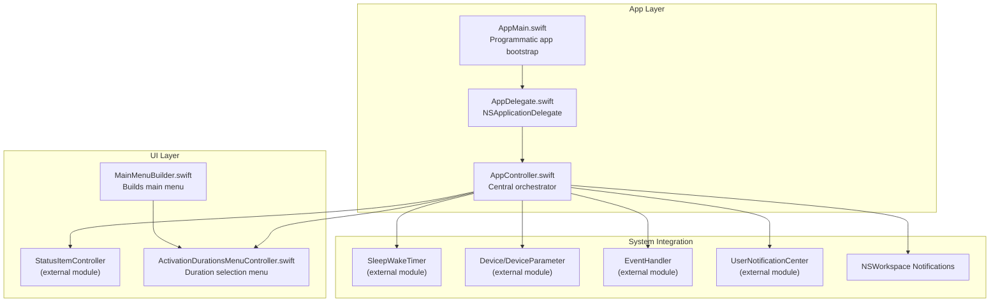
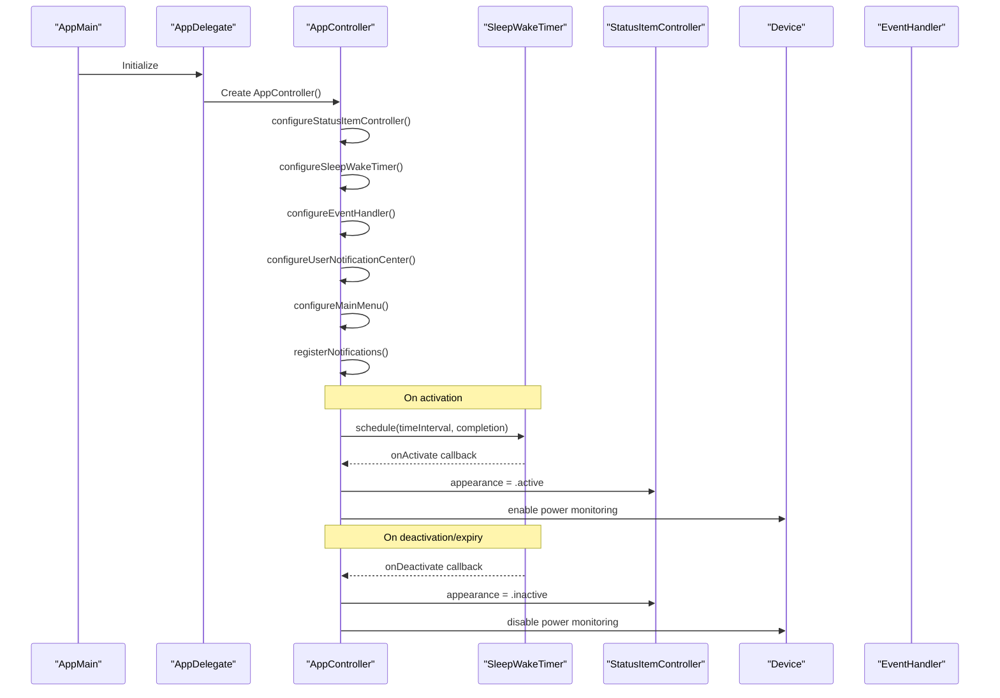
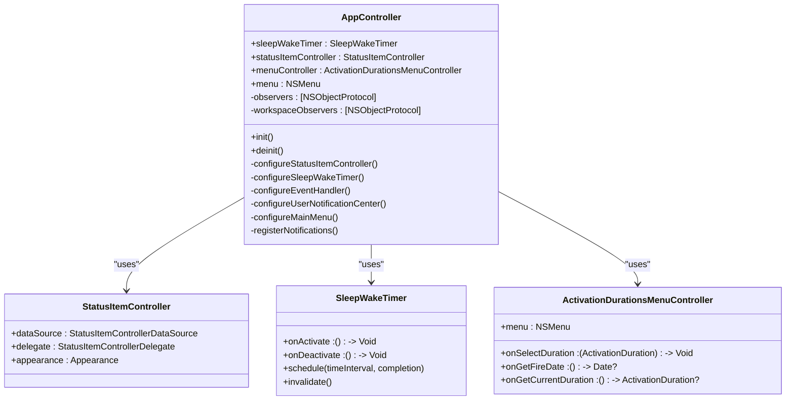
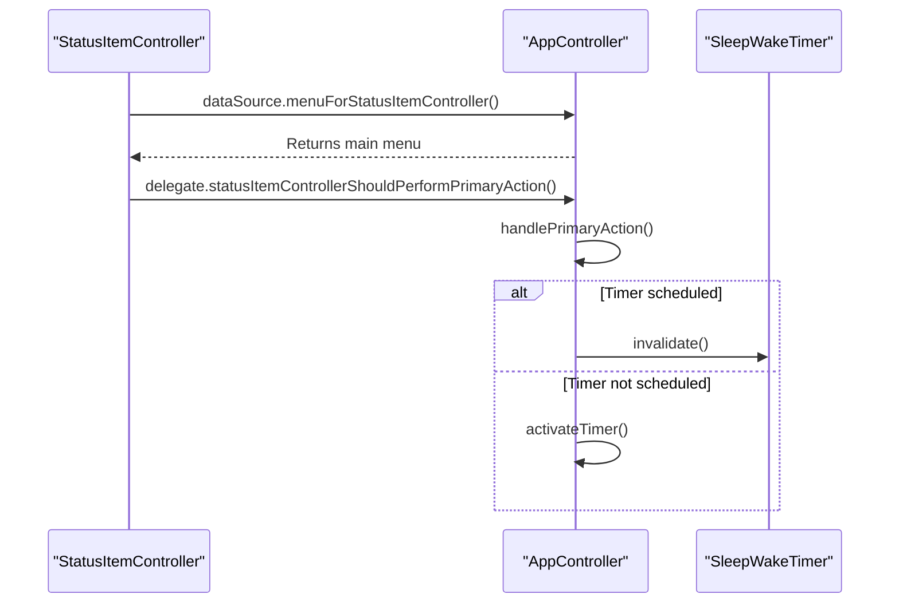
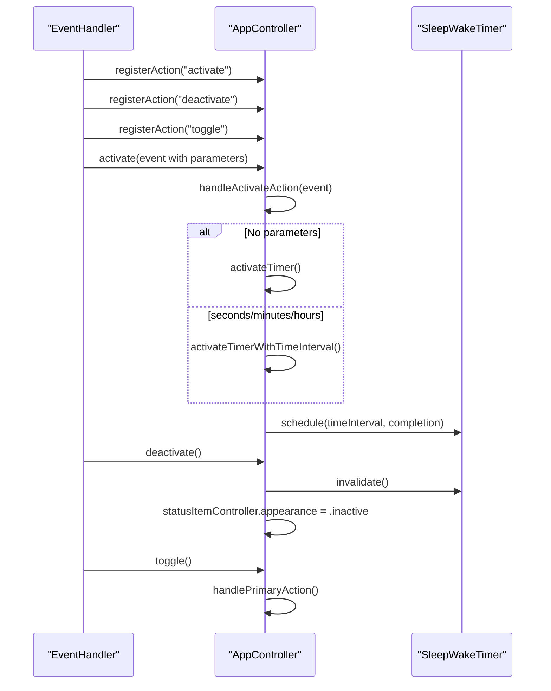
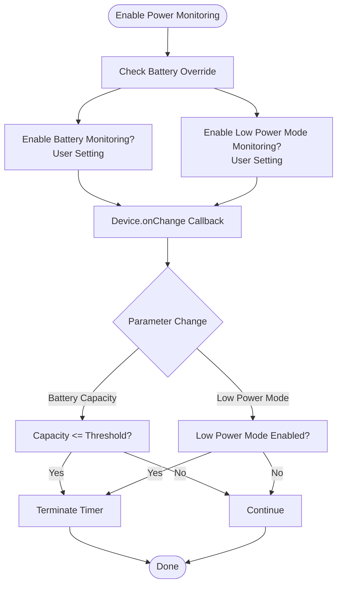
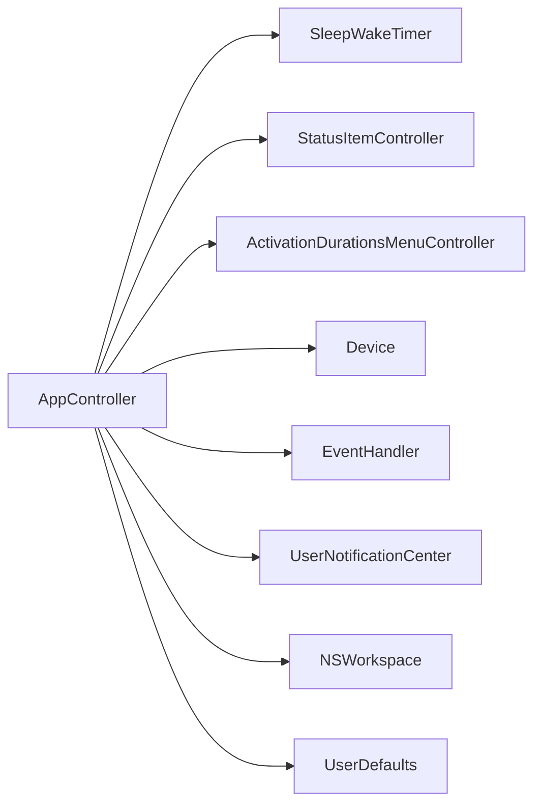

# AppController - Central Orchestrator

<cite>
**Referenced Files in This Document**
- [AppController.swift](file://KeepingYouAwake/KYAAppController/AppController.swift)
- [AppDelegate.swift](file://KeepingYouAwake/KYAAppController/AppDelegate.swift)
- [AppMain.swift](file://KeepingYouAwake/AppMain.swift)
- [ActivationDurationsMenuController.swift](file://KeepingYouAwake/KYAActivationDurationsMenuController/ActivationDurationsMenuController.swift)
- [MainMenuBuilder.swift](file://KeepingYouAwake/KYAMainMenu/MainMenuBuilder.swift)
- [BatterySettingsViewController.swift](file://KeepingYouAwake/Settings/KYABatterySettingsViewController/BatterySettingsViewController.swift)
- [AdvancedSettingsViewController.swift](file://KeepingYouAwake/Settings/KYAAdvancedSettingsViewController/AdvancedSettingsViewController.swift)
- [Automation.md](file://Documentation/Automation.md)
- [2026-05-28-swift-appkit-rewrite-design.md](file://docs/superpowers/specs/2026-05-28-swift-appkit-rewrite-design.md)
- [BatteryCapacityThreshold.swift](file://KeepingYouAwake/BatteryCapacityThreshold.swift)
</cite>

## Table of Contents
1. [Introduction](#introduction)
2. [Project Structure](#project-structure)
3. [Core Components](#core-components)
4. [Architecture Overview](#architecture-overview)
5. [Detailed Component Analysis](#detailed-component-analysis)
6. [Dependency Analysis](#dependency-analysis)
7. [Performance Considerations](#performance-considerations)
8. [Troubleshooting Guide](#troubleshooting-guide)
9. [Conclusion](#conclusion)

## Introduction
AppController serves as the central orchestrator of the KeepingYouAwake application, coordinating multiple subsystems to prevent the system from sleeping. It integrates the sleep/wake timer, status item UI, device monitors, event handlers, and various notification systems into a cohesive workflow. This document explains how AppController initializes, manages dependencies, handles lifecycle events, and coordinates power management and user interactions.

## Project Structure
AppController resides in the KYAAppController module alongside AppDelegate and the application entry point. It collaborates with several other modules:
- Sleep/Wake Timer: schedules and manages the caffeinate process lifecycle
- Status Item UI: provides the menu bar icon and menu interactions
- Activation Durations Menu Controller: builds and updates the duration selection menu
- Device Monitors: tracks battery capacity and low power mode
- Event Handler: processes URL scheme commands (activate, deactivate, toggle)
- User Notification Center: posts activation/deactivation notifications on supported macOS versions
- Settings Controllers: manage user preferences affecting AppController behavior

**Diagram sources**
- [AppMain.swift:12-23](file://KeepingYouAwake/AppMain.swift#L12-L23)
- [AppDelegate.swift:13-14](file://KeepingYouAwake/KYAAppController/AppDelegate.swift#L13-L14)
- [AppController.swift:21-25](file://KeepingYouAwake/KYAAppController/AppController.swift#L21-L25)
- [MainMenuBuilder.swift:13](file://KeepingYouAwake/KYAMainMenu/MainMenuBuilder.swift#L13)
- [ActivationDurationsMenuController.swift:15](file://KeepingYouAwake/KYAActivationDurationsMenuController/ActivationDurationsMenuController.swift#L15)

**Section sources**
- [AppMain.swift:12-23](file://KeepingYouAwake/AppMain.swift#L12-L23)
- [AppDelegate.swift:13-14](file://KeepingYouAwake/KYAAppController/AppDelegate.swift#L13-L14)
- [AppController.swift:34-41](file://KeepingYouAwake/KYAAppController/AppController.swift#L34-L41)

## Core Components
AppController composes the following primary collaborators:
- SleepWakeTimer: schedules and cancels the caffeinate process, posting activation/deactivation notifications
- StatusItemController: manages the menu bar icon appearance and menu presentation
- ActivationDurationsMenuController: builds the duration submenu and forwards selections to AppController
- Device monitors: battery capacity and low power mode detection
- EventHandler: processes URL scheme commands (activate, deactivate, toggle)
- UserNotificationCenter: posts activation notifications on supported macOS versions
- NSWorkspace: listens for session activation/resignation events

Initialization sequence ensures proper wiring of delegates, closures, and observers before the app enters the event loop.

**Section sources**
- [AppController.swift:21-25](file://KeepingYouAwake/KYAAppController/AppController.swift#L21-L25)
- [AppController.swift:34-41](file://KeepingYouAwake/KYAAppController/AppController.swift#L34-L41)

## Architecture Overview
AppController follows a centralized orchestration pattern:
- Dependency Injection: AppController creates and configures its collaborators during init
- Delegate/Closure Patterns: Uses closures for internal communication and AppKit delegates only where required
- Lifecycle Management: Registers observers for system and application notifications
- Power Management Coordination: Enables/disables device monitoring based on user settings and current conditions
- Event Handling: Processes URL scheme actions and translates them into timer operations

**Diagram sources**
- [AppController.swift:77-90](file://KeepingYouAwake/KYAAppController/AppController.swift#L77-L90)
- [AppController.swift:101-122](file://KeepingYouAwake/KYAAppController/AppController.swift#L101-L122)
- [AppController.swift:202-218](file://KeepingYouAwake/KYAAppController/AppController.swift#L202-L218)

**Section sources**
- [AppController.swift:70-90](file://KeepingYouAwake/KYAAppController/AppController.swift#L70-L90)
- [AppController.swift:133-148](file://KeepingYouAwake/KYAAppController/AppController.swift#L133-L148)
- [AppController.swift:181-187](file://KeepingYouAwake/KYAAppController/AppController.swift#L181-L187)

## Detailed Component Analysis

### Initialization and Dependency Injection
AppController performs all wiring in its initializer:
- Configures StatusItemController with AppController as dataSource and delegate
- Sets up SleepWakeTimer with activation/deactivation closures
- Registers URL scheme actions with EventHandler
- Initializes UserNotificationCenter for macOS 11+
- Builds and injects the activation durations menu
- Registers system and application notifications

The programmatic app bootstrap in AppMain ensures the menu is constructed before entering the event loop, and the AppDelegate holds a strong reference to AppController for the app lifetime.

**Diagram sources**
- [AppController.swift:21-25](file://KeepingYouAwake/KYAAppController/AppController.swift#L21-L25)
- [AppController.swift:34-41](file://KeepingYouAwake/KYAAppController/AppController.swift#L34-L41)
- [ActivationDurationsMenuController.swift:15](file://KeepingYouAwake/KYAActivationDurationsMenuController/ActivationDurationsMenuController.swift#L15)

**Section sources**
- [AppController.swift:34-41](file://KeepingYouAwake/KYAAppController/AppController.swift#L34-L41)
- [AppMain.swift:17-18](file://KeepingYouAwake/AppMain.swift#L17-L18)
- [AppDelegate.swift:14](file://KeepingYouAwake/KYAAppController/AppDelegate.swift#L14)

### UI Integration: StatusItemController DataSource and Delegate
AppController implements the StatusItemControllerDataSource and StatusItemControllerDelegate protocols:
- DataSource: Provides the main menu to the status item controller
- Delegate: Handles the primary action (toggle activation) from the status item

These integrations ensure the menu bar icon reflects the current state and responds to user interactions.

**Diagram sources**
- [AppController.swift:340-351](file://KeepingYouAwake/KYAAppController/AppController.swift#L340-L351)

**Section sources**
- [AppController.swift:340-351](file://KeepingYouAwake/KYAAppController/AppController.swift#L340-L351)

### Event Handling System: Command Actions
AppController registers three URL scheme actions with EventHandler:
- activate: Starts the timer with default or specified duration (seconds, minutes, hours)
- deactivate: Cancels the timer and sets inactive appearance
- toggle: Switches between active and inactive states

The activate action parses parameters from the event arguments and schedules the timer accordingly.

**Diagram sources**
- [AppController.swift:133-148](file://KeepingYouAwake/KYAAppController/AppController.swift#L133-L148)
- [AppController.swift:150-169](file://KeepingYouAwake/KYAAppController/AppController.swift#L150-L169)
- [AppController.swift:171-177](file://KeepingYouAwake/KYAAppController/AppController.swift#L171-L177)

**Section sources**
- [AppController.swift:133-148](file://KeepingYouAwake/KYAAppController/AppController.swift#L133-L148)
- [AppController.swift:150-169](file://KeepingYouAwake/KYAAppController/AppController.swift#L150-L169)
- [AppController.swift:171-177](file://KeepingYouAwake/KYAAppController/AppController.swift#L171-L177)
- [Automation.md:7-55](file://Documentation/Automation.md#L7-L55)

### Notification Center Integration
AppController configures UserNotificationCenter on macOS 11+ to:
- Request authorization if undetermined
- Clear previously delivered notifications

It also posts activation/deactivation notifications when the timer activates or expires, enabling external integrations and system awareness.

**Section sources**
- [AppController.swift:181-187](file://KeepingYouAwake/KYAAppController/AppController.swift#L181-L187)
- [AppController.swift:103-121](file://KeepingYouAwake/KYAAppController/AppController.swift#L103-L121)

### Workspace Session Monitoring
AppController listens for NSWorkspace session notifications:
- sessionDidBecomeActive: Restarts the timer if it was previously scheduled and the user switch setting is enabled
- sessionDidResignActive: Saves the current scheduled interval and terminates the timer when switching users

This ensures the app respects user session changes and avoids unintended long-running timers across sessions.

**Section sources**
- [AppController.swift:282-299](file://KeepingYouAwake/KYAAppController/AppController.swift#L282-L299)
- [AppController.swift:312-326](file://KeepingYouAwake/KYAAppController/AppController.swift#L312-L326)

### Power Management Coordination
AppController coordinates device parameter monitoring:
- Enables battery and low power mode monitoring based on user settings
- Checks initial battery capacity and toggles override state
- Responds to device parameter changes by terminating the timer when thresholds are met
- Disables monitoring and clears callbacks on deactivation

**Diagram sources**
- [AppController.swift:202-218](file://KeepingYouAwake/KYAAppController/AppController.swift#L202-L218)
- [AppController.swift:227-246](file://KeepingYouAwake/KYAAppController/AppController.swift#L227-L246)

**Section sources**
- [AppController.swift:191-200](file://KeepingYouAwake/KYAAppController/AppController.swift#L191-L200)
- [AppController.swift:202-218](file://KeepingYouAwake/KYAAppController/AppController.swift#L202-L218)
- [AppController.swift:227-246](file://KeepingYouAwake/KYAAppController/AppController.swift#L227-L246)

### Automatic Termination Logic
When the timer expires, AppController posts a deactivation notification and checks the "Quit when activation duration is over" setting. If enabled, the application terminates itself.

**Section sources**
- [AppController.swift:101-112](file://KeepingYouAwake/KYAAppController/AppController.swift#L101-L112)

### Configuration Options and Settings Integration
AppController reads numerous user preferences to tailor behavior:
- Activate on launch: Automatically starts the timer at app launch
- Default time interval: Initial duration when activating without parameters
- Quit on timer expiration: Terminates the app after activation completes
- Activate on external display connection: Starts/stops based on external display presence
- Deactivate on user switch: Pauses timer during user session changes
- Battery capacity threshold: Stops activation when battery drops below threshold
- Low power mode monitoring: Stops activation when low power mode is detected

Settings are managed through dedicated view controllers and UserDefaults keys, with bindings ensuring real-time updates.

**Section sources**
- [AppController.swift:87-89](file://KeepingYouAwake/KYAAppController/AppController.swift#L87-L89)
- [AppController.swift:301-310](file://KeepingYouAwake/KYAAppController/AppController.swift#L301-L310)
- [AdvancedSettingsViewController.swift:117-122](file://KeepingYouAwake/Settings/KYAAdvancedSettingsViewController/AdvancedSettingsViewController.swift#L117-L122)
- [BatterySettingsViewController.swift:192-220](file://KeepingYouAwake/Settings/KYABatterySettingsViewController/BatterySettingsViewController.swift#L192-L220)

## Dependency Analysis
AppController depends on multiple external modules and integrates with system frameworks:
- AppKit: NSApplication, NSWorkspace, NSMenu, NSStatusItem
- External Modules: SleepWakeTimer, StatusItemController, ActivationDurationsMenuController, Device, EventHandler, UserNotificationCenter
- System Notifications: Application lifecycle, screen parameter changes, workspace session changes
- UserDefaults: User preferences controlling behavior

**Diagram sources**
- [AppController.swift:9-17](file://KeepingYouAwake/KYAAppController/AppController.swift#L9-L17)
- [AppController.swift:21-25](file://KeepingYouAwake/KYAAppController/AppController.swift#L21-L25)

**Section sources**
- [AppController.swift:9-17](file://KeepingYouAwake/KYAAppController/AppController.swift#L9-L17)
- [2026-05-28-swift-appkit-rewrite-design.md:166-199](file://docs/superpowers/specs/2026-05-28-swift-appkit-rewrite-design.md#L166-L199)

## Performance Considerations
- Closures vs. Delegates: AppController uses closures for internal communication to avoid retain cycles and reduce boilerplate
- Weak References: Closures capture AppController weakly to prevent retain cycles with timers and observers
- Main Queue Observers: All UI-related updates occur on the main queue to ensure thread safety
- Minimal Work on UI Thread: Heavy operations (like scheduling timers) are performed off the main thread implicitly through external modules
- Conditional Monitoring: Device monitoring is enabled only when user settings require it, reducing overhead

## Troubleshooting Guide
Common orchestration issues and resolutions:

- Timer does not start on launch
  - Verify "Activate on Launch" setting is enabled
  - Check that default time interval is positive
  - Confirm AppController initialization order in AppDelegate

- Menu bar icon not updating after URL scheme activation
  - Ensure UserNotificationCenter is configured on supported macOS versions
  - Verify activation notifications are posted on timer activation

- Timer continues running after external display disconnects
  - Confirm "Activate when an external display is connected" setting is enabled
  - Check that screen parameter change handler is registered

- Timer does not pause on user switch
  - Verify "Deactivate when switched to another user account" setting is enabled
  - Ensure workspace session notifications are being received

- Battery threshold not triggering deactivation
  - Confirm battery monitoring is enabled in settings
  - Check that the current battery capacity is below the threshold
  - Verify the timer is currently scheduled

- App does not quit after timer expiration
  - Ensure "Quit when activation duration is over" setting is enabled
  - Confirm the timer completion block executes and reaches the termination logic

**Section sources**
- [AppController.swift:87-89](file://KeepingYouAwake/KYAAppController/AppController.swift#L87-L89)
- [AppController.swift:114-121](file://KeepingYouAwake/KYAAppController/AppController.swift#L114-L121)
- [AppController.swift:301-310](file://KeepingYouAwake/KYAAppController/AppController.swift#L301-L310)
- [AppController.swift:312-326](file://KeepingYouAwake/KYAAppController/AppController.swift#L312-L326)
- [AppController.swift:230-246](file://KeepingYouAwake/KYAAppController/AppController.swift#L230-L246)
- [AppController.swift:108-112](file://KeepingYouAwake/KYAAppController/AppController.swift#L108-L112)

## Conclusion
AppController exemplifies centralized orchestration by composing multiple subsystems into a cohesive experience. Its initialization pattern, delegate/closure usage, and robust notification handling ensure reliable power management coordination. By leveraging user preferences and system events, it adapts behavior dynamically while maintaining clean separation of concerns across modules.