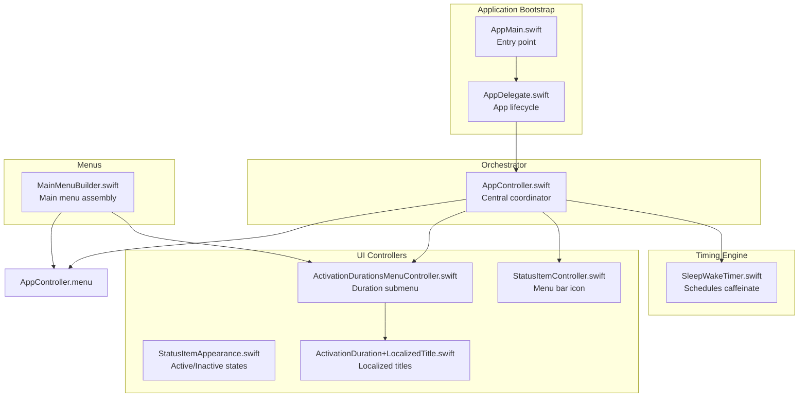
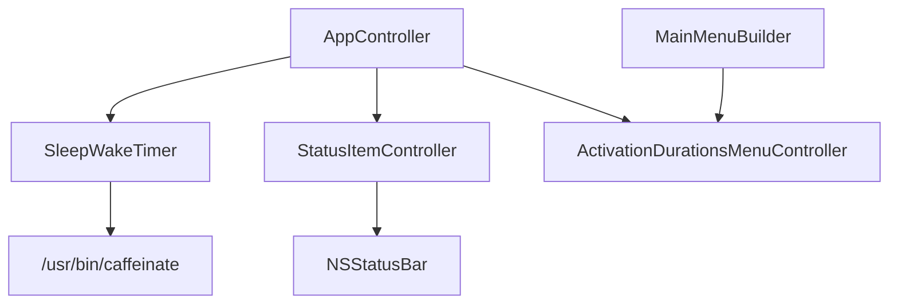
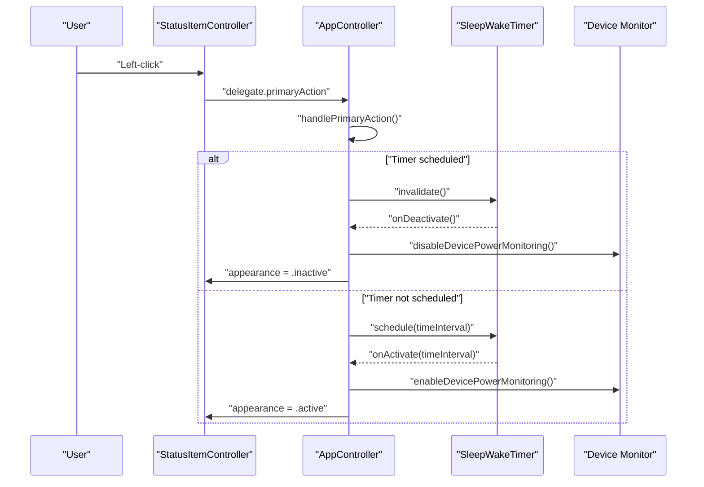
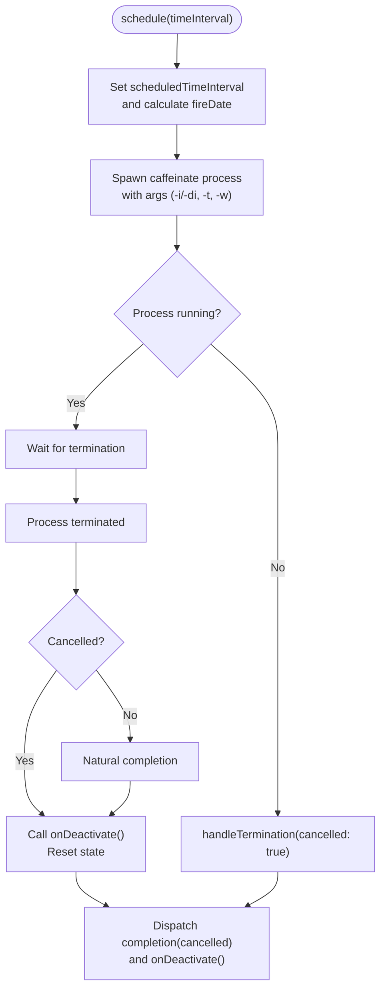
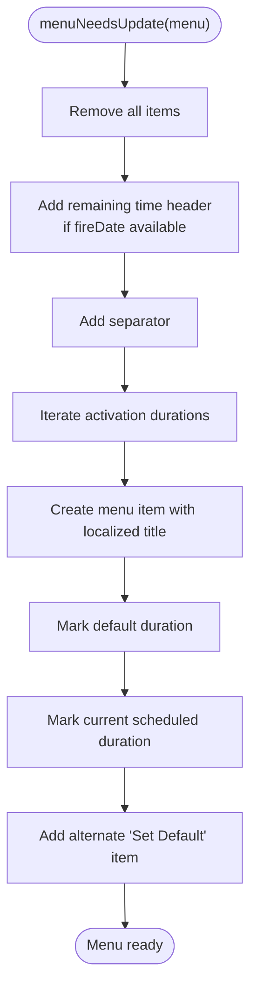
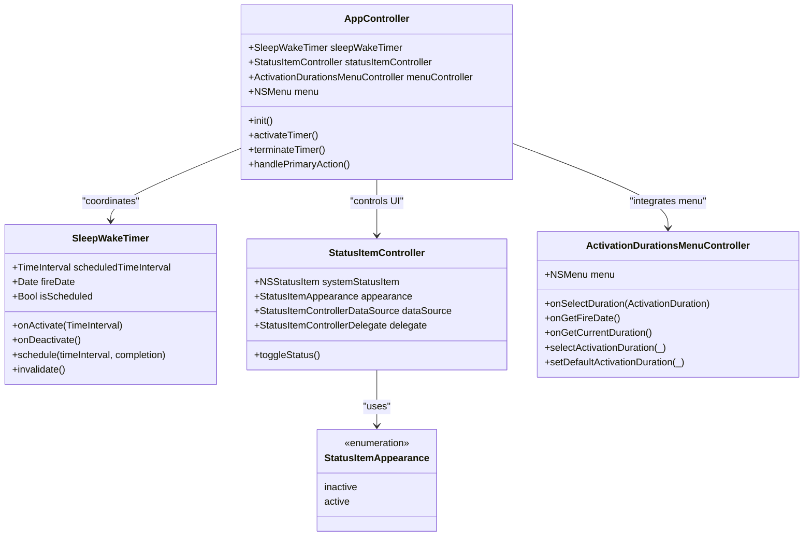
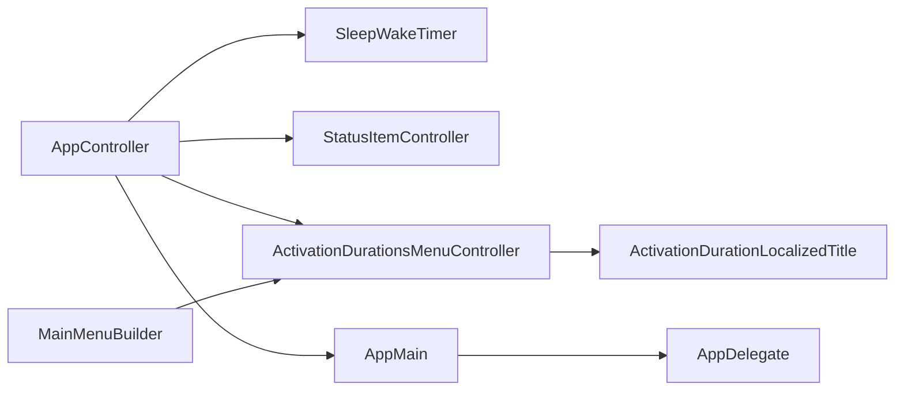

# Core Application Components

<cite>
**Referenced Files in This Document**
- [AppController.swift](file://KeepingYouAwake/KYAAppController/AppController.swift)
- [SleepWakeTimer.swift](file://Packages/KYASleepWakeTimer/Sources/KYASleepWakeTimer/SleepWakeTimer.swift)
- [StatusItemController.swift](file://Packages/KYAStatusItemUI/Sources/KYAStatusItemUI/StatusItemController.swift)
- [StatusItemAppearance.swift](file://Packages/KYAStatusItemUI/Sources/KYAStatusItemUI/StatusItemAppearance.swift)
- [ActivationDurationsMenuController.swift](file://KeepingYouAwake/KYAActivationDurationsMenuController/ActivationDurationsMenuController.swift)
- [ActivationDuration+LocalizedTitle.swift](file://KeepingYouAwake/KYAActivationDurationsMenuController/ActivationDuration+LocalizedTitle.swift)
- [AppDelegate.swift](file://KeepingYouAwake/KYAAppController/AppDelegate.swift)
- [AppMain.swift](file://KeepingYouAwake/AppMain.swift)
- [MainMenuBuilder.swift](file://KeepingYouAwake/KYAMainMenu/MainMenuBuilder.swift)
- [UserDefaultsSetting.swift](file://KeepingYouAwake/UserDefaultsSetting.swift)
</cite>

## Table of Contents
1. [Introduction](#introduction)
2. [Project Structure](#project-structure)
3. [Core Components](#core-components)
4. [Architecture Overview](#architecture-overview)
5. [Detailed Component Analysis](#detailed-component-analysis)
6. [Dependency Analysis](#dependency-analysis)
7. [Performance Considerations](#performance-considerations)
8. [Troubleshooting Guide](#troubleshooting-guide)
9. [Conclusion](#conclusion)

## Introduction
This document explains the core application components that orchestrate the sleep prevention functionality on macOS. At the center is the AppController, which coordinates the SleepWakeTimer (timing engine), StatusItemController (menu bar UI), and ActivationDurationsMenuController (duration presets). These components collaborate to manage application state, respond to system events, and provide a responsive user interface for controlling sleep prevention behavior.

## Project Structure
The core components reside in distinct modules:
- AppController orchestrates subsystems and manages lifecycle
- SleepWakeTimer handles scheduling and caffeinate process management
- StatusItemController manages the menu bar icon and interactions
- ActivationDurationsMenuController builds and updates the duration submenu
- MainMenuBuilder constructs the main application menu and integrates the duration submenu
- AppMain and AppDelegate bootstrap the application and wire components together

**Diagram sources**
- [AppMain.swift:12-23](file://KeepingYouAwake/AppMain.swift#L12-L23)
- [AppDelegate.swift:13-25](file://KeepingYouAwake/KYAAppController/AppDelegate.swift#L13-L25)
- [AppController.swift:21-41](file://KeepingYouAwake/KYAAppController/AppController.swift#L21-L41)
- [SleepWakeTimer.swift:24-74](file://Packages/KYASleepWakeTimer/Sources/KYASleepWakeTimer/SleepWakeTimer.swift#L24-L74)
- [StatusItemController.swift:29-97](file://Packages/KYAStatusItemUI/Sources/KYAStatusItemUI/StatusItemController.swift#L29-L97)
- [StatusItemAppearance.swift:10-15](file://Packages/KYAStatusItemUI/Sources/KYAStatusItemUI/StatusItemAppearance.swift#L10-L15)
- [ActivationDurationsMenuController.swift:15-31](file://KeepingYouAwake/KYAActivationDurationsMenuController/ActivationDurationsMenuController.swift#L15-L31)
- [ActivationDuration+LocalizedTitle.swift:12-26](file://KeepingYouAwake/KYAActivationDurationsMenuController/ActivationDuration+LocalizedTitle.swift#L12-L26)
- [MainMenuBuilder.swift:12-49](file://KeepingYouAwake/KYAMainMenu/MainMenuBuilder.swift#L12-L49)

**Section sources**
- [AppMain.swift:12-23](file://KeepingYouAwake/AppMain.swift#L12-L23)
- [AppDelegate.swift:13-25](file://KeepingYouAwake/KYAAppController/AppDelegate.swift#L13-L25)
- [MainMenuBuilder.swift:12-49](file://KeepingYouAwake/KYAMainMenu/MainMenuBuilder.swift#L12-L49)

## Core Components
This section documents the central orchestrator and its key collaborators, focusing on responsibilities, public interfaces, configuration options, and integration patterns.

### AppController: Central Orchestrator
Responsibilities:
- Coordinates SleepWakeTimer, StatusItemController, and ActivationDurationsMenuController
- Manages component lifecycle and application state transitions
- Handles activation/deactivation actions and system notifications
- Integrates with device monitoring and user notification centers
- Constructs and injects the main menu into the application

Key public interfaces and behaviors:
- Initialization configures status item, timer, event handler, user notifications, main menu, and notification observers
- Lifecycle controls: activateTimer(), activateTimerWithTimeInterval(), terminateTimer()
- Event handling: handlePrimaryAction(), handleActivateAction(), handleDurationSelection()
- Device power monitoring: enableDevicePowerMonitoring(), disableDevicePowerMonitoring(), handleDeviceParameterChange()
- Notification registration: registerNotifications() and workspace session handlers
- Menu integration: configureMainMenu() wires menu controller callbacks to timer state

Configuration options (via UserDefaults):
- kya_activateOnLaunch: auto-start prevention on launch
- kya_defaultTimeInterval: default duration for activation
- kya_quitOnTimerExpirationEnabled: quit after timer expires
- kya_activateOnExternalDisplayConnectedEnabled: auto-activate on external display connection
- kya_deactivateOnUserSwitchEnabled: pause on workspace session resign, resume on activation
- kya_batteryCapacityThresholdEnabled: enable battery capacity monitoring
- kya_lowPowerModeMonitoringEnabled: enable low power mode monitoring
- kya_batteryCapacityThreshold: battery capacity threshold for override
- kya_allowDisplaySleep: control caffeinate flags (-i vs -di)

Integration patterns:
- Delegation and closure-based callbacks connect menu controller to timer state
- DataSource pattern connects AppController to StatusItemController for menu supply
- Event handler actions trigger activation/deactivation/toggle
- UserNotificationCenter posts activation/deactivation notifications on supported OS versions

Practical usage scenarios:
- Launch-time activation: when kya_activateOnLaunch is enabled, AppController activates the timer during initialization
- Duration selection: selecting a duration from the menu triggers terminateTimer() followed by activateTimerWithTimeInterval()
- Toggle behavior: left-click toggles active/inactive state; right-click/ctrl-alt opens the duration menu
- Device override: when battery capacity drops below threshold, scheduled timers are terminated automatically

**Section sources**
- [AppController.swift:21-41](file://KeepingYouAwake/KYAAppController/AppController.swift#L21-L41)
- [AppController.swift:77-122](file://KeepingYouAwake/KYAAppController/AppController.swift#L77-L122)
- [AppController.swift:133-177](file://KeepingYouAwake/KYAAppController/AppController.swift#L133-L177)
- [AppController.swift:202-246](file://KeepingYouAwake/KYAAppController/AppController.swift#L202-L246)
- [AppController.swift:250-299](file://KeepingYouAwake/KYAAppController/AppController.swift#L250-L299)
- [AppController.swift:330-335](file://KeepingYouAwake/KYAAppController/AppController.swift#L330-L335)
- [UserDefaultsSetting.swift:12-31](file://KeepingYouAwake/UserDefaultsSetting.swift#L12-L31)

### SleepWakeTimer: Timing Engine
Responsibilities:
- Schedules and terminates caffeinate processes to prevent system sleep
- Calculates fire dates and tracks scheduled intervals
- Provides callbacks for activation/deactivation and completion

Public interface:
- Properties: onActivate, onDeactivate, fireDate, scheduledTimeInterval, isScheduled, completionBlock
- Methods: schedule(timeInterval:completion:), invalidate()

Processing logic:
- schedule(): sets fireDate and scheduledTimeInterval, spawns caffeinate with appropriate arguments (-i/-di, -t timeout, -w watch)
- invalidate(): terminates the caffeinate process and resets state
- Arguments are built based on configuration flags and time interval

Integration patterns:
- AppController subscribes to onActivate/onDeactivate to update UI and device monitoring
- Completion block handles post-expiration actions (notification posting, optional termination)

Configuration options:
- kya_allowDisplaySleep: determines whether to use -i (allow display sleep) or -di (prevent display sleep)
- indefiniteTimeInterval (0): runs caffeinate indefinitely without timeout

**Section sources**
- [SleepWakeTimer.swift:24-74](file://Packages/KYASleepWakeTimer/Sources/KYASleepWakeTimer/SleepWakeTimer.swift#L24-L74)
- [SleepWakeTimer.swift:85-103](file://Packages/KYASleepWakeTimer/Sources/KYASleepWakeTimer/SleepWakeTimer.swift#L85-L103)
- [SleepWakeTimer.swift:115-144](file://Packages/KYASleepWakeTimer/Sources/KYASleepWakeTimer/SleepWakeTimer.swift#L115-L144)
- [SleepWakeTimer.swift:146-171](file://Packages/KYASleepWakeTimer/Sources/KYASleepWakeTimer/SleepWakeTimer.swift#L146-L171)

### StatusItemController: Menu Bar Interface
Responsibilities:
- Manages the NSStatusItem and its button
- Provides active/inactive visual feedback via StatusItemAppearance
- Handles user interactions (left/right/ctrl/alt clicks) and menu presentation

Public interface:
- Properties: systemStatusItem, dataSource, delegate, appearance
- Methods: toggleStatus() action, showMenuFromDataSource()

Behavior:
- appearance setter switches between active/inactive icons and tooltips
- toggleStatus() distinguishes between menu presentation and primary action based on modifier keys
- DataSource pattern supplies the menu to display

Integration patterns:
- AppController implements StatusItemControllerDataSource to provide the main menu
- AppController implements StatusItemControllerDelegate to receive primary action events

**Section sources**
- [StatusItemController.swift:29-97](file://Packages/KYAStatusItemUI/Sources/KYAStatusItemUI/StatusItemController.swift#L29-L97)
- [StatusItemController.swift:104-124](file://Packages/KYAStatusItemUI/Sources/KYAStatusItemUI/StatusItemController.swift#L104-L124)
- [StatusItemAppearance.swift:10-15](file://Packages/KYAStatusItemUI/Sources/KYAStatusItemUI/StatusItemAppearance.swift#L10-L15)

### ActivationDurationsMenuController: Duration Preset Management
Responsibilities:
- Builds and updates the "Activate for Duration" submenu
- Manages default duration selection and current duration highlighting
- Provides localized titles and remaining time display

Public interface:
- Properties: menu, onSelectDuration, onGetFireDate, onGetCurrentDuration
- Methods: selectActivationDuration(_:) and setDefaultActivationDuration(_:)

Behavior:
- menuNeedsUpdate() rebuilds items dynamically, including a remaining time header
- Each duration item displays localized title and supports "Set Default" via alternate action
- Currently scheduled duration is marked visually

Integration patterns:
- AppController configures onSelectDuration, onGetFireDate, and onGetCurrentDuration closures
- MainMenuBuilder integrates the submenu into the main application menu

**Section sources**
- [ActivationDurationsMenuController.swift:15-31](file://KeepingYouAwake/KYAActivationDurationsMenuController/ActivationDurationsMenuController.swift#L15-L31)
- [ActivationDurationsMenuController.swift:81-125](file://KeepingYouAwake/KYAActivationDurationsMenuController/ActivationDurationsMenuController.swift#L81-L125)
- [ActivationDuration+LocalizedTitle.swift:12-26](file://KeepingYouAwake/KYAActivationDurationsMenuController/ActivationDuration+LocalizedTitle.swift#L12-L26)

## Architecture Overview
The system follows a layered architecture with AppController as the central orchestrator. It subscribes to and coordinates multiple subsystems while exposing clean interfaces to the UI and system.

**Diagram sources**
- [AppController.swift:21-25](file://KeepingYouAwake/KYAAppController/AppController.swift#L21-L25)
- [SleepWakeTimer.swift:146-171](file://Packages/KYASleepWakeTimer/Sources/KYASleepWakeTimer/SleepWakeTimer.swift#L146-L171)
- [StatusItemController.swift:31-37](file://Packages/KYAStatusItemUI/Sources/KYAStatusItemUI/StatusItemController.swift#L31-L37)
- [MainMenuBuilder.swift:13-25](file://KeepingYouAwake/KYAMainMenu/MainMenuBuilder.swift#L13-L25)

## Detailed Component Analysis

### AppController Orchestration Flow
This sequence illustrates how AppController coordinates activation, UI updates, and device monitoring.

**Diagram sources**
- [AppController.swift:171-177](file://KeepingYouAwake/KYAAppController/AppController.swift#L171-L177)
- [AppController.swift:77-90](file://KeepingYouAwake/KYAAppController/AppController.swift#L77-L90)
- [SleepWakeTimer.swift:89-91](file://Packages/KYASleepWakeTimer/Sources/KYASleepWakeTimer/SleepWakeTimer.swift#L89-L91)
- [StatusItemController.swift:40-61](file://Packages/KYAStatusItemUI/Sources/KYAStatusItemUI/StatusItemController.swift#L40-L61)

### SleepWakeTimer Scheduling and Completion
This flow shows how the timer calculates fire dates and handles completion.

**Diagram sources**
- [SleepWakeTimer.swift:85-103](file://Packages/KYASleepWakeTimer/Sources/KYASleepWakeTimer/SleepWakeTimer.swift#L85-L103)
- [SleepWakeTimer.swift:146-171](file://Packages/KYASleepWakeTimer/Sources/KYASleepWakeTimer/SleepWakeTimer.swift#L146-L171)
- [SleepWakeTimer.swift:173-190](file://Packages/KYASleepWakeTimer/Sources/KYASleepWakeTimer/SleepWakeTimer.swift#L173-L190)

### ActivationDurationsMenuController Menu Construction
This flow shows dynamic menu building with localized titles and current duration highlighting.

**Diagram sources**
- [ActivationDurationsMenuController.swift:81-125](file://KeepingYouAwake/KYAActivationDurationsMenuController/ActivationDurationsMenuController.swift#L81-L125)
- [ActivationDuration+LocalizedTitle.swift:14-19](file://KeepingYouAwake/KYAActivationDurationsMenuController/ActivationDuration+LocalizedTitle.swift#L14-L19)

### Component Class Relationships

**Diagram sources**
- [AppController.swift:21-25](file://KeepingYouAwake/KYAAppController/AppController.swift#L21-L25)
- [SleepWakeTimer.swift:24-51](file://Packages/KYASleepWakeTimer/Sources/KYASleepWakeTimer/SleepWakeTimer.swift#L24-L51)
- [StatusItemController.swift:29-61](file://Packages/KYAStatusItemUI/Sources/KYAStatusItemUI/StatusItemController.swift#L29-L61)
- [StatusItemAppearance.swift:10-15](file://Packages/KYAStatusItemUI/Sources/KYAStatusItemUI/StatusItemAppearance.swift#L10-L15)
- [ActivationDurationsMenuController.swift:15-25](file://KeepingYouAwake/KYAActivationDurationsMenuController/ActivationDurationsMenuController.swift#L15-L25)

## Dependency Analysis
The components exhibit clear separation of concerns with AppController mediating interactions. Dependencies are primarily unidirectional from orchestrator to subsystems.

**Diagram sources**
- [AppController.swift:21-25](file://KeepingYouAwake/KYAAppController/AppController.swift#L21-L25)
- [ActivationDurationsMenuController.swift:16-16](file://KeepingYouAwake/KYAActivationDurationsMenuController/ActivationDurationsMenuController.swift#L16-L16)
- [MainMenuBuilder.swift:13-25](file://KeepingYouAwake/KYAMainMenu/MainMenuBuilder.swift#L13-L25)
- [AppMain.swift:17-18](file://KeepingYouAwake/AppMain.swift#L17-L18)

**Section sources**
- [AppController.swift:34-51](file://KeepingYouAwake/KYAAppController/AppController.swift#L34-L51)
- [SleepWakeTimer.swift:59-74](file://Packages/KYASleepWakeTimer/Sources/KYASleepWakeTimer/SleepWakeTimer.swift#L59-L74)
- [StatusItemController.swift:63-97](file://Packages/KYAStatusItemUI/Sources/KYAStatusItemUI/StatusItemController.swift#L63-L97)

## Performance Considerations
- Minimize UI updates: batch menu updates and avoid frequent reconfiguration
- Use weak references in closures to prevent retain cycles, especially in timer and notification handlers
- Avoid redundant device monitoring; enable/disable only when needed based on user preferences
- Keep timer scheduling precise but avoid excessive rescheduling; consolidate duration selections
- Leverage asynchronous dispatch for UI updates triggered by timer completions

## Troubleshooting Guide
Common issues and resolutions:
- Caffeinate fails to launch: verify arguments and permissions; check error logs emitted by the timer component
- Menu not updating: ensure menu delegate is set and menuNeedsUpdate is called; confirm AppController wiring of onGetFireDate and onGetCurrentDuration
- Status icon not changing: verify appearance property updates and that active/inactive images are available
- Device override not triggering: confirm battery/low power mode monitoring is enabled and thresholds are configured appropriately
- Notifications not posted: ensure user authorization is granted and UserNotificationCenter is properly configured

**Section sources**
- [SleepWakeTimer.swift:160-164](file://Packages/KYASleepWakeTimer/Sources/KYASleepWakeTimer/SleepWakeTimer.swift#L160-L164)
- [ActivationDurationsMenuController.swift:81-125](file://KeepingYouAwake/KYAActivationDurationsMenuController/ActivationDurationsMenuController.swift#L81-L125)
- [StatusItemController.swift:40-61](file://Packages/KYAStatusItemUI/Sources/KYAStatusItemUI/StatusItemController.swift#L40-L61)
- [AppController.swift:212-218](file://KeepingYouAwake/KYAAppController/AppController.swift#L212-L218)

## Conclusion
The core application components form a cohesive system where AppController orchestrates SleepWakeTimer, StatusItemController, and ActivationDurationsMenuController. This design enables robust sleep prevention control with responsive UI feedback, configurable behavior, and resilient integration with macOS system events and device monitoring.