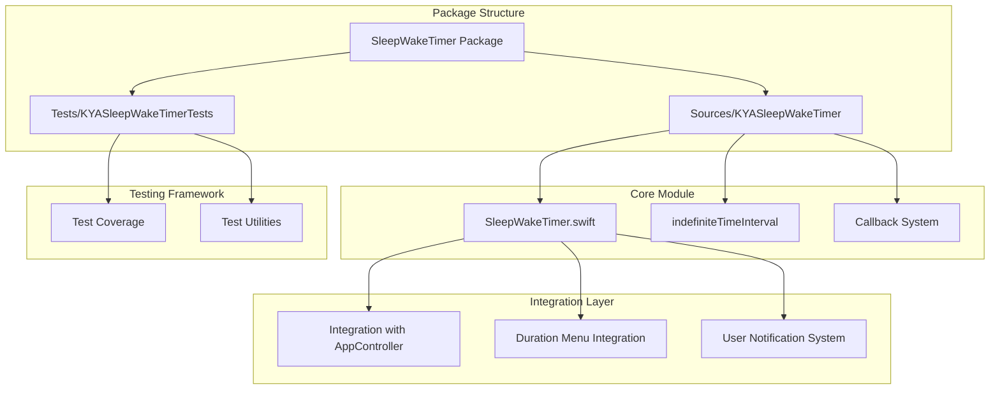
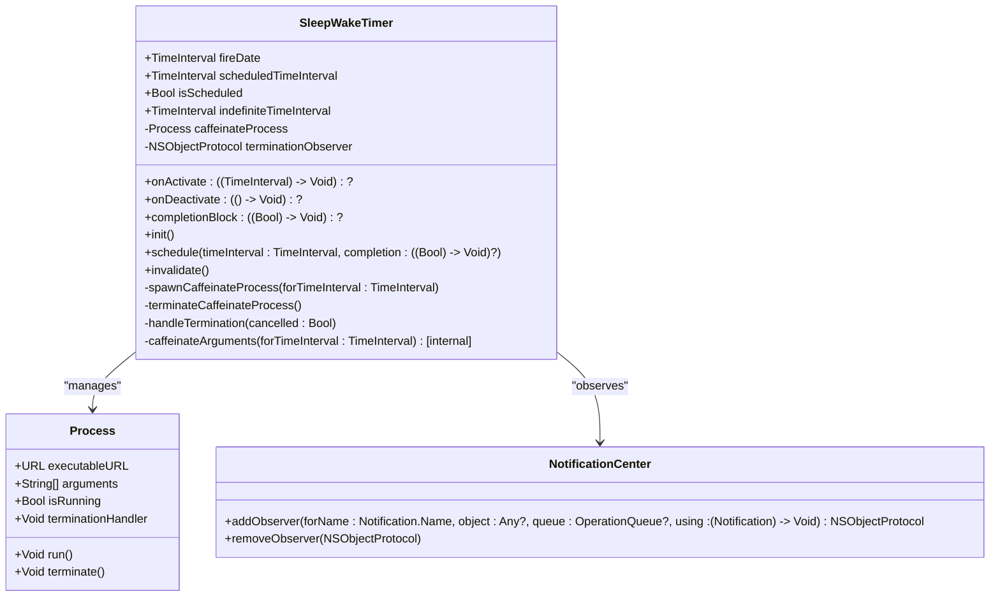
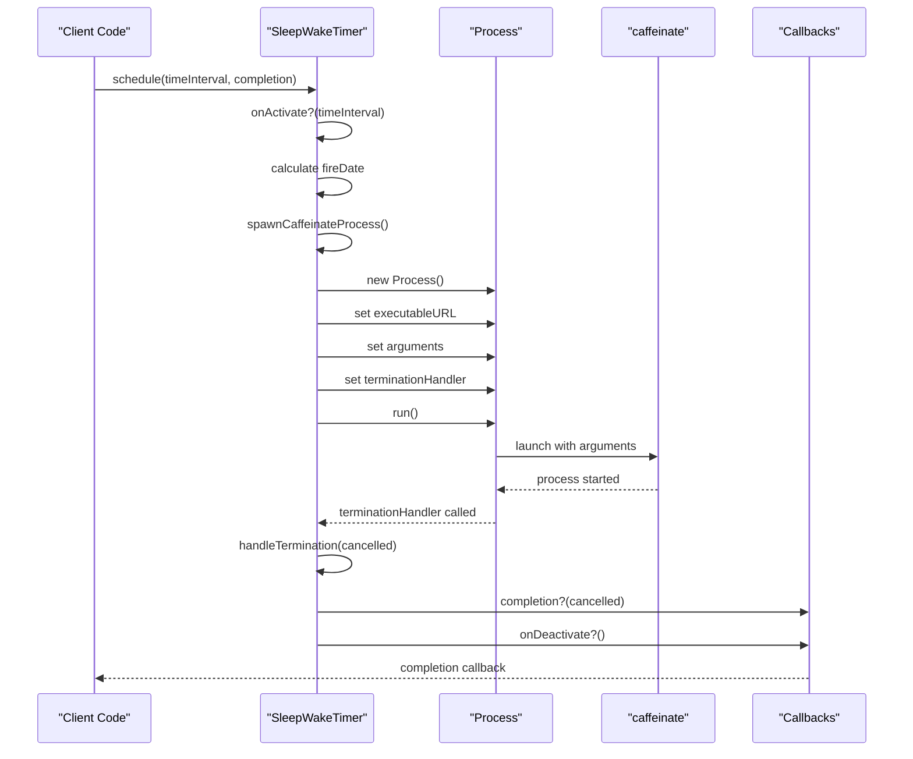
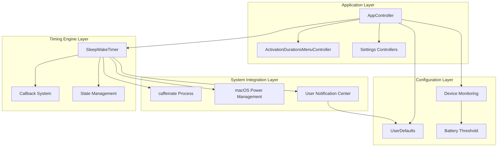
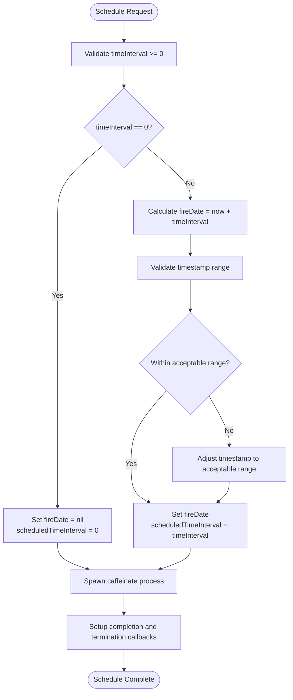
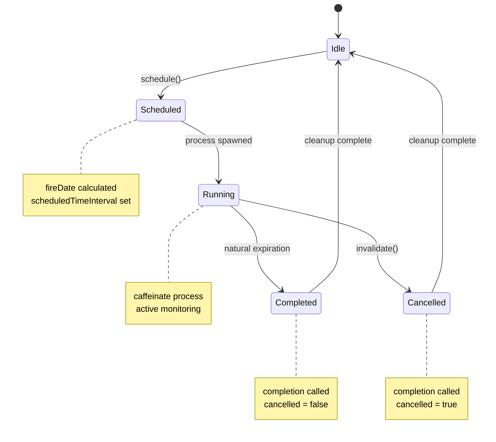
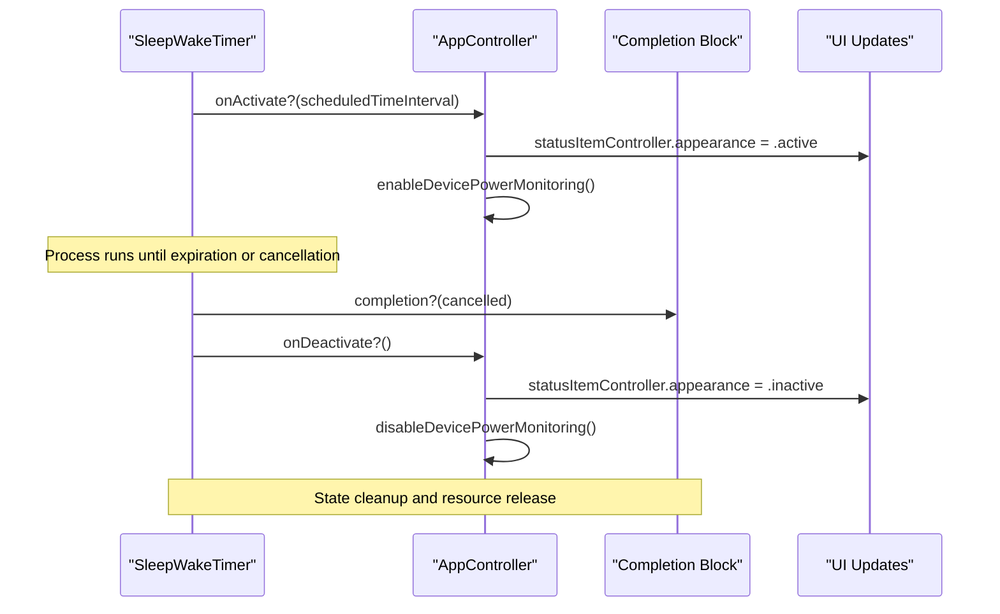
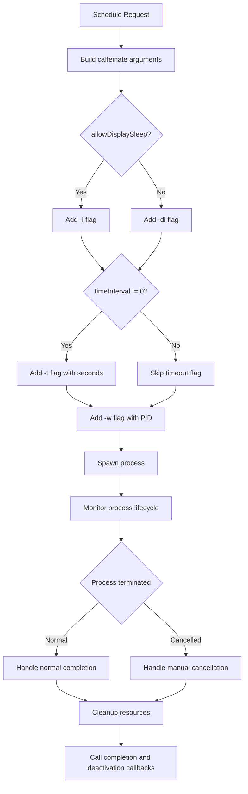
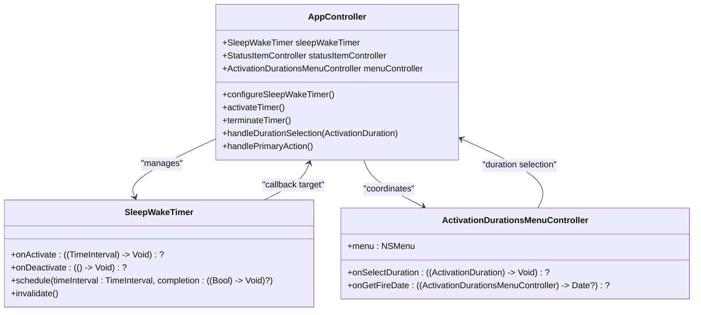
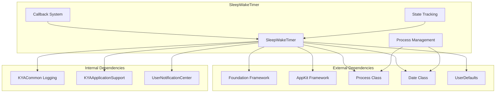

# SleepWakeTimer - Core Timing Engine

<cite>
**Referenced Files in This Document**
- [SleepWakeTimer.swift](file://Packages/KYASleepWakeTimer/Sources/KYASleepWakeTimer/SleepWakeTimer.swift)
- [AppController.swift](file://KeepingYouAwake/KYAAppController/AppController.swift)
- [SleepWakeTimerTests.swift](file://Packages/KYASleepWakeTimer/Tests/KYASleepWakeTimerTests/SleepWakeTimerTests.swift)
- [ActivationDurationsMenuController.swift](file://KeepingYouAwake/KYAActivationDurationsMenuController/ActivationDurationsMenuController.swift)
- [ActivationUserNotification.swift](file://KeepingYouAwake/KYAActivationUserNotification/ActivationUserNotification.swift)
- [AdvancedSettingsViewController.swift](file://KeepingYouAwake/Settings/KYAAdvancedSettingsViewController/AdvancedSettingsViewController.swift)
- [BatterySettingsViewController.swift](file://KeepingYouAwake/Settings/KYABatterySettingsViewController/BatterySettingsViewController.swift)
- [KYAL10n.swift](file://KeepingYouAwake/KYAL10n.swift)
</cite>

## Table of Contents
1. [Introduction](#introduction)
2. [Project Structure](#project-structure)
3. [Core Components](#core-components)
4. [Architecture Overview](#architecture-overview)
5. [Detailed Component Analysis](#detailed-component-analysis)
6. [Dependency Analysis](#dependency-analysis)
7. [Performance Considerations](#performance-considerations)
8. [Troubleshooting Guide](#troubleshooting-guide)
9. [Conclusion](#conclusion)

## Introduction
SleepWakeTimer is the core timing engine responsible for macOS sleep prevention functionality in KeepingYouAwake. It serves as a Swift wrapper around Apple's `caffeinate` command-line utility, managing system sleep prevention through process spawning and lifecycle callbacks. The component provides a clean, callback-based interface for activation and deactivation events while handling the complexities of macOS power management integration.

The timer operates in two primary modes: indefinite mode (timeInterval = 0) for continuous sleep prevention, and timed mode (timeInterval > 0) for temporary sleep prevention with automatic expiration. It integrates deeply with macOS power management APIs and provides comprehensive state tracking for reliable operation.

## Project Structure
The SleepWakeTimer component is organized within a dedicated Swift package that encapsulates all timing-related functionality. The package follows a modular architecture with clear separation of concerns between the timer logic, process management, and callback systems.

**Diagram sources**
- [SleepWakeTimer.swift:1-191](file://Packages/KYASleepWakeTimer/Sources/KYASleepWakeTimer/SleepWakeTimer.swift#L1-L191)
- [AppController.swift:1-352](file://KeepingYouAwake/KYAAppController/AppController.swift#L1-L352)

**Section sources**
- [SleepWakeTimer.swift:1-191](file://Packages/KYASleepWakeTimer/Sources/KYASleepWakeTimer/SleepWakeTimer.swift#L1-L191)
- [AppController.swift:1-352](file://KeepingYouAwake/KYAAppController/AppController.swift#L1-L352)

## Core Components

### SleepWakeTimer Class Architecture
The SleepWakeTimer class implements a robust timer management system with comprehensive state tracking and callback mechanisms. The class maintains four primary callback points: onActivate, onDeactivate, and a completion block that receives cancellation status.

**Diagram sources**
- [SleepWakeTimer.swift:24-191](file://Packages/KYASleepWakeTimer/Sources/KYASleepWakeTimer/SleepWakeTimer.swift#L24-L191)

### Timer Scheduling Mechanism
The scheduling system operates through a sophisticated process spawning mechanism that leverages macOS's built-in `caffeinate` utility. The system supports both indefinite and timed scheduling modes with precise fire date calculation.

**Diagram sources**
- [SleepWakeTimer.swift:78-112](file://Packages/KYASleepWakeTimer/Sources/KYASleepWakeTimer/SleepWakeTimer.swift#L78-L112)
- [SleepWakeTimer.swift:146-165](file://Packages/KYASleepWakeTimer/Sources/KYASleepWakeTimer/SleepWakeTimer.swift#L146-L165)

**Section sources**
- [SleepWakeTimer.swift:24-191](file://Packages/KYASleepWakeTimer/Sources/KYASleepWakeTimer/SleepWakeTimer.swift#L24-L191)

## Architecture Overview

### System Integration Architecture
The SleepWakeTimer integrates with multiple system components to provide comprehensive sleep prevention functionality. The architecture ensures minimal overhead while maintaining robust system integration.

**Diagram sources**
- [AppController.swift:21-90](file://KeepingYouAwake/KYAAppController/AppController.swift#L21-L90)
- [SleepWakeTimer.swift:18-57](file://Packages/KYASleepWakeTimer/Sources/KYASleepWakeTimer/SleepWakeTimer.swift#L18-L57)

### Fire Date Calculation Algorithm
The fire date calculation system implements precise timestamp computation for timed scheduling modes. The algorithm handles both absolute and relative time calculations with appropriate tolerance for system timing variations.

**Diagram sources**
- [SleepWakeTimer.swift:98-102](file://Packages/KYASleepWakeTimer/Sources/KYASleepWakeTimer/SleepWakeTimer.swift#L98-L102)

**Section sources**
- [SleepWakeTimer.swift:78-103](file://Packages/KYASleepWakeTimer/Sources/KYASleepWakeTimer/SleepWakeTimer.swift#L78-L103)

## Detailed Component Analysis

### Timer State Management
The SleepWakeTimer maintains comprehensive state tracking through four key properties: `fireDate`, `scheduledTimeInterval`, `isScheduled`, and `completionBlock`. These properties provide external visibility into the timer's current state while maintaining internal consistency.

**Diagram sources**
- [SleepWakeTimer.swift:42-51](file://Packages/KYASleepWakeTimer/Sources/KYASleepWakeTimer/SleepWakeTimer.swift#L42-L51)
- [SleepWakeTimer.swift:173-190](file://Packages/KYASleepWakeTimer/Sources/KYASleepWakeTimer/SleepWakeTimer.swift#L173-L190)

### Callback-Based Architecture
The callback system provides three distinct callback points for different lifecycle events: `onActivate`, `onDeactivate`, and the completion block. Each callback serves a specific purpose in the timer lifecycle management.

**Diagram sources**
- [SleepWakeTimer.swift:27-30](file://Packages/KYASleepWakeTimer/Sources/KYASleepWakeTimer/SleepWakeTimer.swift#L27-L30)
- [AppController.swift:78-85](file://KeepingYouAwake/KYAAppController/AppController.swift#L78-L85)

**Section sources**
- [SleepWakeTimer.swift:26-51](file://Packages/KYASleepWakeTimer/Sources/KYASleepWakeTimer/SleepWakeTimer.swift#L26-L51)
- [AppController.swift:77-85](file://KeepingYouAwake/KYAAppController/AppController.swift#L77-L85)

### Caffeinate Process Integration
The process integration layer manages the spawning and lifecycle of `caffeinate` processes with comprehensive error handling and cleanup procedures. The system supports both indefinite and timed operation modes through appropriate argument construction.

**Diagram sources**
- [SleepWakeTimer.swift:120-144](file://Packages/KYASleepWakeTimer/Sources/KYASleepWakeTimer/SleepWakeTimer.swift#L120-L144)
- [SleepWakeTimer.swift:146-165](file://Packages/KYASleepWakeTimer/Sources/KYASleepWakeTimer/SleepWakeTimer.swift#L146-L165)

**Section sources**
- [SleepWakeTimer.swift:115-165](file://Packages/KYASleepWakeTimer/Sources/KYASleepWakeTimer/SleepWakeTimer.swift#L115-L165)

### Integration with AppController
The AppController serves as the central orchestrator that integrates SleepWakeTimer with the broader application ecosystem. The integration includes menu system coordination, user notification handling, and device monitoring capabilities.

**Diagram sources**
- [AppController.swift:21-352](file://KeepingYouAwake/KYAAppController/AppController.swift#L21-L352)
- [ActivationDurationsMenuController.swift:15-126](file://KeepingYouAwake/KYAActivationDurationsMenuController/ActivationDurationsMenuController.swift#L15-L126)

**Section sources**
- [AppController.swift:77-122](file://KeepingYouAwake/KYAAppController/AppController.swift#L77-L122)
- [ActivationDurationsMenuController.swift:15-38](file://KeepingYouAwake/KYAActivationDurationsMenuController/ActivationDurationsMenuController.swift#L15-L38)

## Dependency Analysis

### Component Dependencies
The SleepWakeTimer component maintains focused dependencies on system frameworks and internal utilities, ensuring modularity and testability.

**Diagram sources**
- [SleepWakeTimer.swift:8-11](file://Packages/KYASleepWakeTimer/Sources/KYASleepWakeTimer/SleepWakeTimer.swift#L8-L11)
- [SleepWakeTimer.swift:57](file://Packages/KYASleepWakeTimer/Sources/KYASleepWakeTimer/SleepWakeTimer.swift#L57)

### Integration Points with System APIs
The component integrates with several macOS system APIs for comprehensive power management functionality.

| Integration Point | Purpose | Implementation |
|------------------|---------|----------------|
| `caffeinate` Process | System sleep prevention | Process spawning with arguments |
| `NSApplication.willTerminateNotification` | Graceful shutdown cleanup | Observer registration |
| `UserNotificationCenter` | User notifications | macOS 11.0+ notification posting |
| `UserDefaults` | Configuration persistence | Boolean flags and thresholds |
| `Device Monitoring` | Battery and power state | Low power mode and capacity monitoring |

**Section sources**
- [SleepWakeTimer.swift:59-74](file://Packages/KYASleepWakeTimer/Sources/KYASleepWakeTimer/SleepWakeTimer.swift#L59-L74)
- [AppController.swift:181-187](file://KeepingYouAwake/KYAAppController/AppController.swift#L181-L187)

## Performance Considerations

### Process Management Efficiency
The timer implementation optimizes resource usage through efficient process management and minimal overhead. The system spawns a single `caffeinate` process per activation and cleans up resources upon completion or cancellation.

### Memory Management
The component employs weak references in callback closures to prevent retain cycles and ensure proper memory cleanup. The design pattern prevents memory leaks while maintaining functional integrity.

### Callback Execution Strategy
All callbacks execute on the main queue to ensure thread safety and UI consistency. This approach prevents race conditions while maintaining responsive user interface updates.

## Troubleshooting Guide

### Common Error Scenarios

#### Process Launch Failures
When the `caffeinate` process fails to launch, the system logs an error and triggers immediate deactivation. Common causes include permission issues or system resource constraints.

**Detection**: Error logging in `handleTermination(cancelled: true)` with process launch exceptions.

#### State Inconsistencies
The system includes safeguards against state inconsistencies through careful state management and cleanup procedures. Double-calling of completion blocks is prevented through state reset.

**Detection**: Test coverage for completion block invocation frequency and state reset verification.

#### Configuration Conflicts
Conflicting user preferences can cause unexpected behavior. The system validates input parameters and gracefully handles invalid configurations.

**Detection**: Input validation in `activateTimerWithTimeInterval` and preference checking in AppController.

### Debugging Strategies

#### Logging Integration
The component uses the unified logging system (`KYALog`) for comprehensive debugging information. Logs capture activation attempts, process lifecycle events, and error conditions.

#### Test Coverage
Extensive unit tests validate core functionality including argument construction, state management, and callback behavior. Tests cover both positive and negative scenarios.

**Section sources**
- [SleepWakeTimer.swift:162-164](file://Packages/KYASleepWakeTimer/Sources/KYASleepWakeTimer/SleepWakeTimer.swift#L162-L164)
- [SleepWakeTimerTests.swift:133-146](file://Packages/KYASleepWakeTimer/Tests/KYASleepWakeTimerTests/SleepWakeTimerTests.swift#L133-L146)

## Conclusion

The SleepWakeTimer component represents a sophisticated yet elegant solution for macOS sleep prevention functionality. Through its integration with `caffeinate`, comprehensive callback system, and robust state management, it provides reliable and efficient sleep prevention capabilities.

The component's architecture demonstrates excellent separation of concerns, with clear boundaries between process management, callback handling, and state tracking. The integration with AppController and other system components creates a cohesive timing workflow that responds appropriately to user actions and system events.

Key strengths of the implementation include:
- **Reliable Process Management**: Efficient `caffeinate` process spawning with comprehensive error handling
- **Flexible Scheduling**: Support for both indefinite and timed operation modes
- **Robust Callback System**: Three-tier callback architecture for comprehensive lifecycle management
- **System Integration**: Deep integration with macOS power management and notification systems
- **Comprehensive Testing**: Extensive test coverage ensuring reliability across scenarios

The component successfully balances functionality with simplicity, providing developers with a clean interface while handling the complexities of system-level sleep prevention. Its modular design and clear dependencies make it maintainable and extensible for future enhancements.