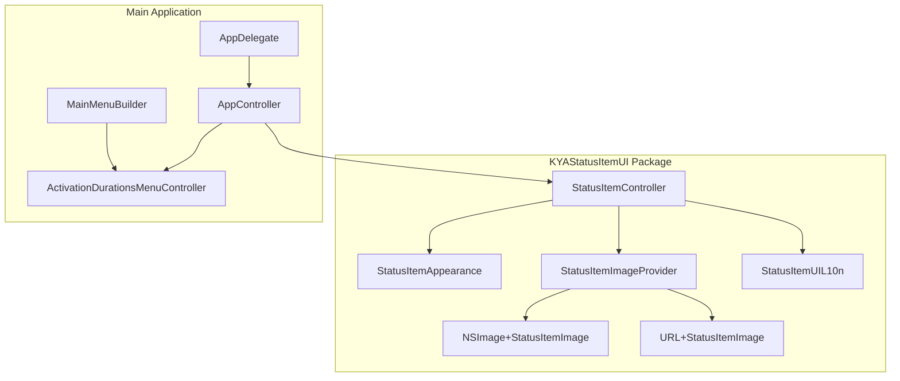
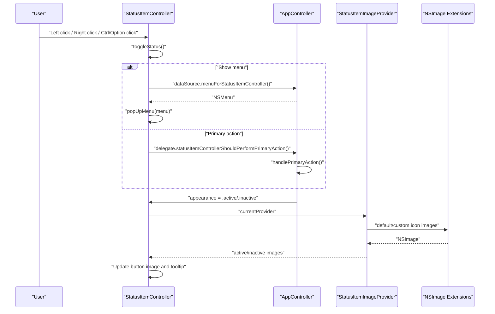
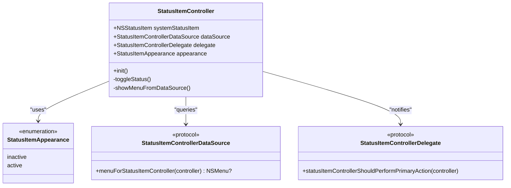
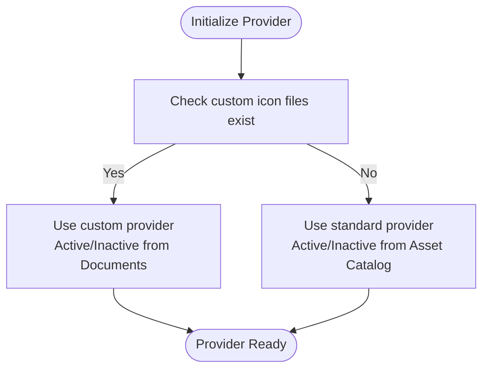
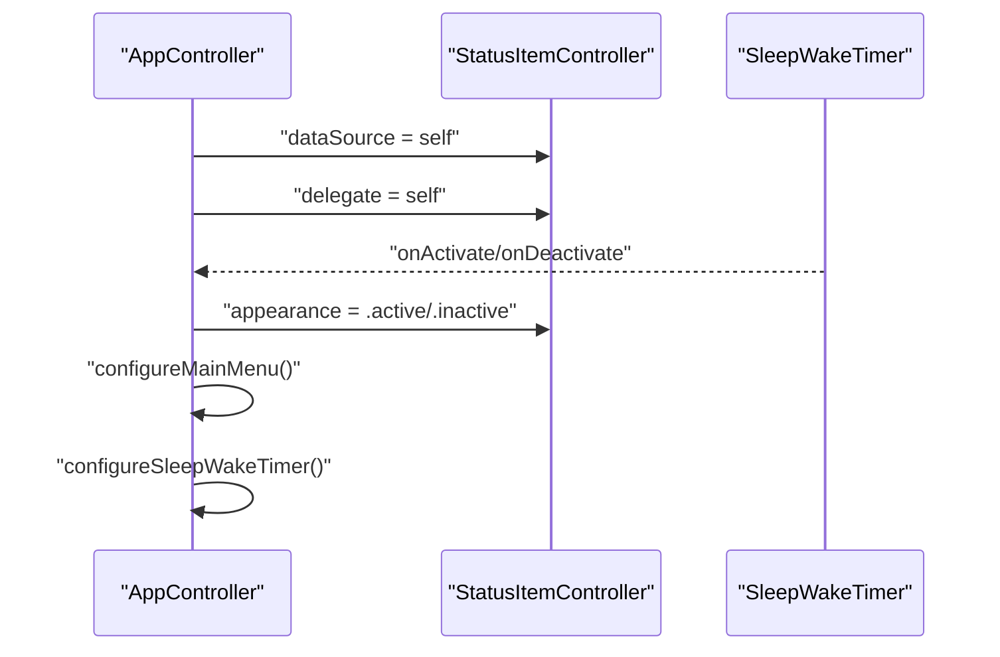
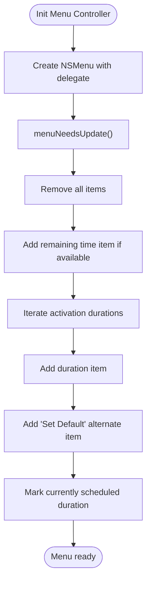
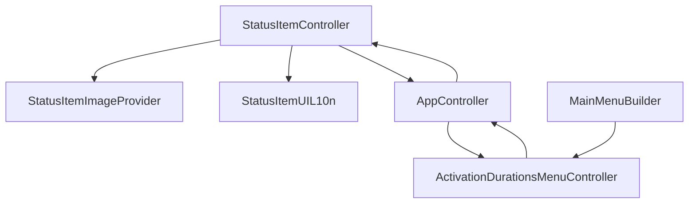

# StatusItemController - Menu Bar Interface

<cite>
**Referenced Files in This Document**
- [StatusItemController.swift](file://Packages/KYAStatusItemUI/Sources/KYAStatusItemUI/StatusItemController.swift)
- [StatusItemAppearance.swift](file://Packages/KYAStatusItemUI/Sources/KYAStatusItemUI/StatusItemAppearance.swift)
- [StatusItemImageProvider.swift](file://Packages/KYAStatusItemUI/Sources/KYAStatusItemUI/StatusItemImageProvider.swift)
- [NSImage+StatusItemImage.swift](file://Packages/KYAStatusItemUI/Sources/KYAStatusItemUI/NSImage+StatusItemImage.swift)
- [URL+StatusItemImage.swift](file://Packages/KYAStatusItemUI/Sources/KYAStatusItemUI/URL+StatusItemImage.swift)
- [StatusItemUIL10n.swift](file://Packages/KYAStatusItemUI/Sources/KYAStatusItemUI/StatusItemUIL10n.swift)
- [AppController.swift](file://KeepingYouAwake/KYAAppController/AppController.swift)
- [AppDelegate.swift](file://KeepingYouAwake/KYAAppController/AppDelegate.swift)
- [ActivationDurationsMenuController.swift](file://KeepingYouAwake/KYAActivationDurationsMenuController/ActivationDurationsMenuController.swift)
- [MainMenuBuilder.swift](file://KeepingYouAwake/KYAMainMenu/MainMenuBuilder.swift)
</cite>

## Table of Contents
1. [Introduction](#introduction)
2. [Project Structure](#project-structure)
3. [Core Components](#core-components)
4. [Architecture Overview](#architecture-overview)
5. [Detailed Component Analysis](#detailed-component-analysis)
6. [Dependency Analysis](#dependency-analysis)
7. [Performance Considerations](#performance-considerations)
8. [Troubleshooting Guide](#troubleshooting-guide)
9. [Conclusion](#conclusion)

## Introduction
This document provides comprehensive technical documentation for the StatusItemController responsible for managing the macOS menu bar interface and visual feedback system. It covers status indicator management, appearance states (active/inactive), visual feedback mechanisms, data source and delegate patterns for menu integration, primary action handling, user interaction processing, integration with AppController for status updates and menu construction, menu bar item lifecycle, icon management, and accessibility features. Examples of status appearance changes, menu integration patterns, and troubleshooting display issues are included to aid developers and advanced users.

## Project Structure
The StatusItemController resides in the KYAStatusItemUI package and integrates with the main application through AppController. The menu system is constructed by ActivationDurationsMenuController and MainMenuBuilder, while icon resources are managed via StatusItemImageProvider and NSImage extensions.

**Diagram sources**
- [StatusItemController.swift:29-97](file://Packages/KYAStatusItemUI/Sources/KYAStatusItemUI/StatusItemController.swift#L29-L97)
- [StatusItemImageProvider.swift:16-58](file://Packages/KYAStatusItemUI/Sources/KYAStatusItemUI/StatusItemImageProvider.swift#L16-L58)
- [NSImage+StatusItemImage.swift:10-59](file://Packages/KYAStatusItemUI/Sources/KYAStatusItemUI/NSImage+StatusItemImage.swift#L10-L59)
- [URL+StatusItemImage.swift:11-51](file://Packages/KYAStatusItemUI/Sources/KYAStatusItemUI/URL+StatusItemImage.swift#L11-L51)
- [StatusItemAppearance.swift:9-15](file://Packages/KYAStatusItemUI/Sources/KYAStatusItemUI/StatusItemAppearance.swift#L9-L15)
- [StatusItemUIL10n.swift:10-29](file://Packages/KYAStatusItemUI/Sources/KYAStatusItemUI/StatusItemUIL10n.swift#L10-L29)
- [AppController.swift:21-41](file://KeepingYouAwake/KYAAppController/AppController.swift#L21-L41)
- [AppDelegate.swift:12-25](file://KeepingYouAwake/KYAAppController/AppDelegate.swift#L12-L25)
- [ActivationDurationsMenuController.swift:14-31](file://KeepingYouAwake/KYAActivationDurationsMenuController/ActivationDurationsMenuController.swift#L14-L31)
- [MainMenuBuilder.swift:11-50](file://KeepingYouAwake/KYAMainMenu/MainMenuBuilder.swift#L11-L50)

**Section sources**
- [StatusItemController.swift:29-97](file://Packages/KYAStatusItemUI/Sources/KYAStatusItemUI/StatusItemController.swift#L29-L97)
- [AppController.swift:21-41](file://KeepingYouAwake/KYAAppController/AppController.swift#L21-L41)

## Core Components
This section analyzes the primary components involved in menu bar status management and visual feedback.

- StatusItemController: Manages the NSStatusItem, handles user interactions (left/right/control/option clicks), controls appearance states, and coordinates menu presentation.
- StatusItemAppearance: Enumerates the visual states (active/inactive) used to switch icons and tooltips.
- StatusItemImageProvider: Supplies active and inactive icons, preferring custom icons from the Documents directory or falling back to asset catalog images.
- AppController: Integrates StatusItemController with the sleep/wake timer, manages status updates, and configures menu controllers.
- ActivationDurationsMenuController: Builds the activation durations submenu with dynamic items and closure-based callbacks.
- MainMenuBuilder: Constructs the main application menu and attaches the activation durations submenu.

**Section sources**
- [StatusItemController.swift:13-61](file://Packages/KYAStatusItemUI/Sources/KYAStatusItemUI/StatusItemController.swift#L13-L61)
- [StatusItemAppearance.swift:9-15](file://Packages/KYAStatusItemUI/Sources/KYAStatusItemUI/StatusItemAppearance.swift#L9-L15)
- [StatusItemImageProvider.swift:11-58](file://Packages/KYAStatusItemUI/Sources/KYAStatusItemUI/StatusItemImageProvider.swift#L11-L58)
- [AppController.swift:21-41](file://KeepingYouAwake/KYAAppController/AppController.swift#L21-L41)
- [ActivationDurationsMenuController.swift:14-31](file://KeepingYouAwake/KYAActivationDurationsMenuController/ActivationDurationsMenuController.swift#L14-L31)
- [MainMenuBuilder.swift:11-50](file://KeepingYouAwake/KYAMainMenu/MainMenuBuilder.swift#L11-L50)

## Architecture Overview
The StatusItemController operates as a bridge between the system NSStatusItem and the application domain. AppController configures the StatusItemController, wires up data sources and delegates, and updates the status based on timer events. The menu system is dynamically generated by ActivationDurationsMenuController and attached to the main menu via MainMenuBuilder.

**Diagram sources**
- [StatusItemController.swift:104-116](file://Packages/KYAStatusItemUI/Sources/KYAStatusItemUI/StatusItemController.swift#L104-L116)
- [StatusItemController.swift:40-61](file://Packages/KYAStatusItemUI/Sources/KYAStatusItemUI/StatusItemController.swift#L40-L61)
- [StatusItemImageProvider.swift:23-58](file://Packages/KYAStatusItemUI/Sources/KYAStatusItemUI/StatusItemImageProvider.swift#L23-L58)
- [NSImage+StatusItemImage.swift:17-37](file://Packages/KYAStatusItemUI/Sources/KYAStatusItemUI/NSImage+StatusItemImage.swift#L17-L37)
- [AppController.swift:340-352](file://KeepingYouAwake/KYAAppController/AppController.swift#L340-L352)

## Detailed Component Analysis

### StatusItemController
StatusItemController encapsulates the NSStatusItem, manages appearance transitions, and routes user interactions. It supports:
- Appearance management: active/inactive states with corresponding icons and tooltips.
- Interaction routing: left click triggers primary action, right click/control/option click shows the associated menu.
- DataSource/Delegate integration: defers menu creation to the data source and forwards primary actions to the delegate.
- Lifecycle: initializes the status item, sets button targets/actions, and applies initial appearance.

**Diagram sources**
- [StatusItemController.swift:29-124](file://Packages/KYAStatusItemUI/Sources/KYAStatusItemUI/StatusItemController.swift#L29-L124)
- [StatusItemAppearance.swift:9-15](file://Packages/KYAStatusItemUI/Sources/KYAStatusItemUI/StatusItemAppearance.swift#L9-L15)

**Section sources**
- [StatusItemController.swift:29-97](file://Packages/KYAStatusItemUI/Sources/KYAStatusItemUI/StatusItemController.swift#L29-L97)
- [StatusItemController.swift:104-116](file://Packages/KYAStatusItemUI/Sources/KYAStatusItemUI/StatusItemController.swift#L104-L116)

### StatusItemAppearance
Defines the visual states for the status item icon:
- inactive: Represents the default state with the inactive icon and tooltip.
- active: Represents the activated state with the active icon and tooltip.

**Section sources**
- [StatusItemAppearance.swift:9-15](file://Packages/KYAStatusItemUI/Sources/KYAStatusItemUI/StatusItemAppearance.swift#L9-L15)

### StatusItemImageProvider
Provides active and inactive icons with a preference for custom icons stored in the user's Documents directory. If custom icons are missing, it falls back to asset catalog images. The provider is a singleton that selects either custom or standard based on file existence checks.

**Diagram sources**
- [StatusItemImageProvider.swift:23-58](file://Packages/KYAStatusItemUI/Sources/KYAStatusItemUI/StatusItemImageProvider.swift#L23-L58)
- [URL+StatusItemImage.swift:43-51](file://Packages/KYAStatusItemUI/Sources/KYAStatusItemUI/URL+StatusItemImage.swift#L43-L51)

**Section sources**
- [StatusItemImageProvider.swift:11-58](file://Packages/KYAStatusItemUI/Sources/KYAStatusItemUI/StatusItemImageProvider.swift#L11-L58)
- [NSImage+StatusItemImage.swift:17-37](file://Packages/KYAStatusItemUI/Sources/KYAStatusItemUI/NSImage+StatusItemImage.swift#L17-L37)
- [URL+StatusItemImage.swift:11-51](file://Packages/KYAStatusItemUI/Sources/KYAStatusItemUI/URL+StatusItemImage.swift#L11-L51)

### AppController Integration
AppController configures the StatusItemController by setting its dataSource and delegate, and updates the appearance based on timer activation/deactivation events. It also manages the activation durations menu controller and main menu construction.

**Diagram sources**
- [AppController.swift:70-90](file://KeepingYouAwake/KYAAppController/AppController.swift#L70-L90)
- [AppController.swift:77-85](file://KeepingYouAwake/KYAAppController/AppController.swift#L77-L85)
- [AppController.swift:340-352](file://KeepingYouAwake/KYAAppController/AppController.swift#L340-L352)

**Section sources**
- [AppController.swift:70-90](file://KeepingYouAwake/KYAAppController/AppController.swift#L70-L90)
- [AppController.swift:77-85](file://KeepingYouAwake/KYAAppController/AppController.swift#L77-L85)
- [AppController.swift:340-352](file://KeepingYouAwake/KYAAppController/AppController.swift#L340-L352)

### ActivationDurationsMenuController
Builds the activation durations submenu dynamically, updating items based on current state and user preferences. It uses closure-based callbacks to communicate with AppController for duration selection and timing information.

**Diagram sources**
- [ActivationDurationsMenuController.swift:27-31](file://KeepingYouAwake/KYAActivationDurationsMenuController/ActivationDurationsMenuController.swift#L27-L31)
- [ActivationDurationsMenuController.swift:81-125](file://KeepingYouAwake/KYAActivationDurationsMenuController/ActivationDurationsMenuController.swift#L81-L125)

**Section sources**
- [ActivationDurationsMenuController.swift:14-31](file://KeepingYouAwake/KYAActivationDurationsMenuController/ActivationDurationsMenuController.swift#L14-L31)
- [ActivationDurationsMenuController.swift:81-125](file://KeepingYouAwake/KYAActivationDurationsMenuController/ActivationDurationsMenuController.swift#L81-L125)

### MainMenuBuilder
Constructs the main application menu and attaches the activation durations submenu. It also adds settings and quit actions.

**Section sources**
- [MainMenuBuilder.swift:11-50](file://KeepingYouAwake/KYAMainMenu/MainMenuBuilder.swift#L11-L50)

## Dependency Analysis
The StatusItemController depends on StatusItemImageProvider for icon images and StatusItemUIL10n for tooltips. AppController coordinates StatusItemController with SleepWakeTimer and menu controllers. ActivationDurationsMenuController provides the submenu content and communicates with AppController via closures.

**Diagram sources**
- [StatusItemController.swift:40-61](file://Packages/KYAStatusItemUI/Sources/KYAStatusItemUI/StatusItemController.swift#L40-L61)
- [StatusItemImageProvider.swift:23-58](file://Packages/KYAStatusItemUI/Sources/KYAStatusItemUI/StatusItemImageProvider.swift#L23-L58)
- [StatusItemUIL10n.swift:15-29](file://Packages/KYAStatusItemUI/Sources/KYAStatusItemUI/StatusItemUIL10n.swift#L15-L29)
- [AppController.swift:21-41](file://KeepingYouAwake/KYAAppController/AppController.swift#L21-L41)
- [ActivationDurationsMenuController.swift:14-31](file://KeepingYouAwake/KYAActivationDurationsMenuController/ActivationDurationsMenuController.swift#L14-L31)
- [MainMenuBuilder.swift:11-50](file://KeepingYouAwake/KYAMainMenu/MainMenuBuilder.swift#L11-L50)

**Section sources**
- [StatusItemController.swift:40-61](file://Packages/KYAStatusItemUI/Sources/KYAStatusItemUI/StatusItemController.swift#L40-L61)
- [AppController.swift:21-41](file://KeepingYouAwake/KYAAppController/AppController.swift#L21-L41)

## Performance Considerations
- Icon loading: StatusItemImageProvider caches the current provider instance and loads images lazily. Custom icons are loaded from the Documents directory with retina support, which may incur file I/O overhead on first access.
- Menu updates: ActivationDurationsMenuController rebuilds menu items on demand via NSMenuDelegate, minimizing unnecessary work but still performing iteration over durations and attribute creation.
- KVO notifications: StatusItemController uses KVO for the appearance property, ensuring efficient UI updates when the appearance changes.
- Memory footprint: The singleton pattern for StatusItemImageProvider prevents redundant instances and reduces memory usage.

## Troubleshooting Guide
Common display and interaction issues and their resolutions:

- Status icon does not change after activation/deactivation:
  - Verify that AppController updates the StatusItemController appearance when SleepWakeTimer fires activation/deactivation callbacks.
  - Confirm that StatusItemImageProvider returns the expected active/inactive images and that the button's image is being set correctly.

- Menu does not appear on right/control/option click:
  - Ensure StatusItemController's button target/action is set and that toggleStatus() properly detects modifier flags and invokes showMenuFromDataSource().
  - Check that AppController's StatusItemControllerDataSource returns a valid NSMenu.

- Custom icons not displayed:
  - Confirm that both standard and @2x variants of ActiveIcon.png and InactiveIcon.png exist in the Documents directory.
  - Verify that the images are valid PNG files and readable by the application.

- Tooltips not localized:
  - Ensure StatusItemUIL10n keys are present in the main bundle's localization files and that NSLocalizedString resolves correctly.

- Accessibility and highlight mode:
  - On supported macOS versions, the status item behavior and visibility properties are configured. If highlighting or visibility appears incorrect, verify the relevant system properties are supported and set.

**Section sources**
- [StatusItemController.swift:104-116](file://Packages/KYAStatusItemUI/Sources/KYAStatusItemUI/StatusItemController.swift#L104-L116)
- [StatusItemController.swift:120-123](file://Packages/KYAStatusItemUI/Sources/KYAStatusItemUI/StatusItemController.swift#L120-L123)
- [StatusItemImageProvider.swift:46-52](file://Packages/KYAStatusItemUI/Sources/KYAStatusItemUI/StatusItemImageProvider.swift#L46-L52)
- [URL+StatusItemImage.swift:43-51](file://Packages/KYAStatusItemUI/Sources/KYAStatusItemUI/URL+StatusItemImage.swift#L43-L51)
- [StatusItemUIL10n.swift:15-29](file://Packages/KYAStatusItemUI/Sources/KYAStatusItemUI/StatusItemUIL10n.swift#L15-L29)
- [AppController.swift:77-85](file://KeepingYouAwake/KYAAppController/AppController.swift#L77-L85)

## Conclusion
The StatusItemController provides a robust foundation for menu bar status management, integrating seamlessly with AppController for state synchronization and with ActivationDurationsMenuController for dynamic menu construction. Its design leverages protocols for data source and delegate patterns, supports both custom and standard icons, and maintains accessibility and performance through careful resource management and KVO-based updates. By following the patterns documented here, developers can extend or troubleshoot the menu bar interface effectively.