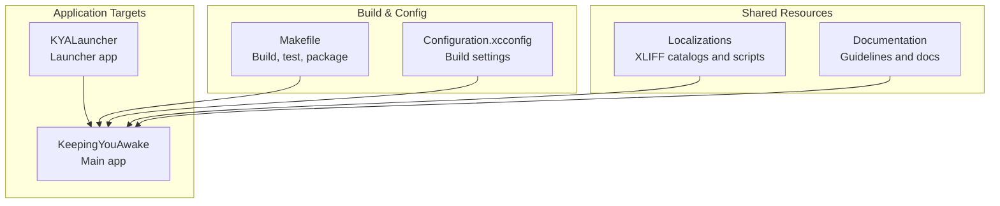
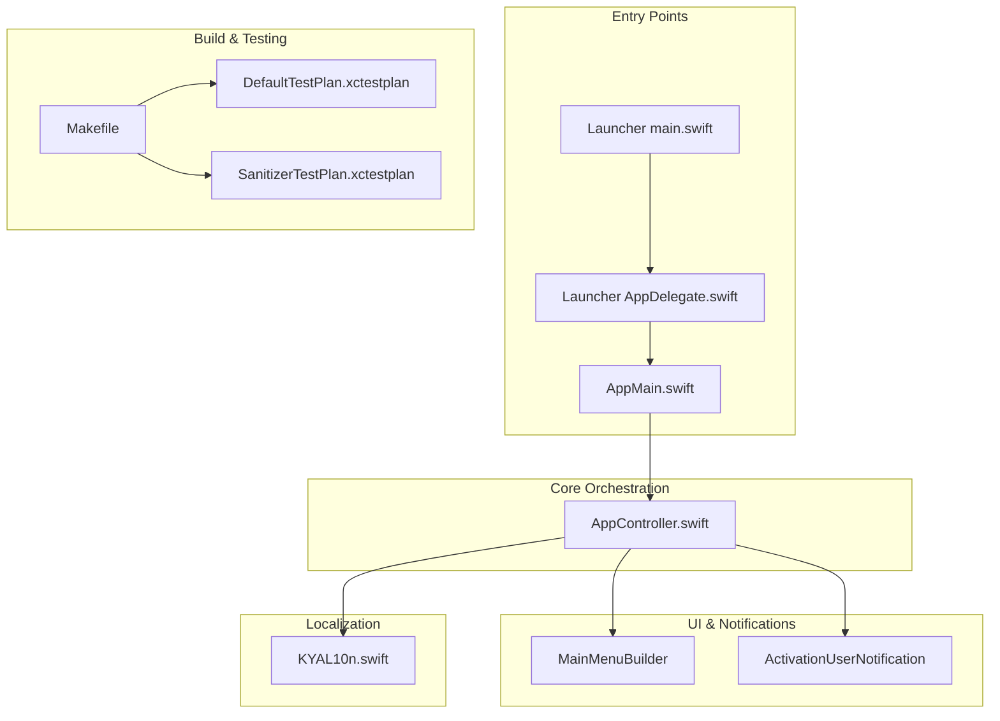
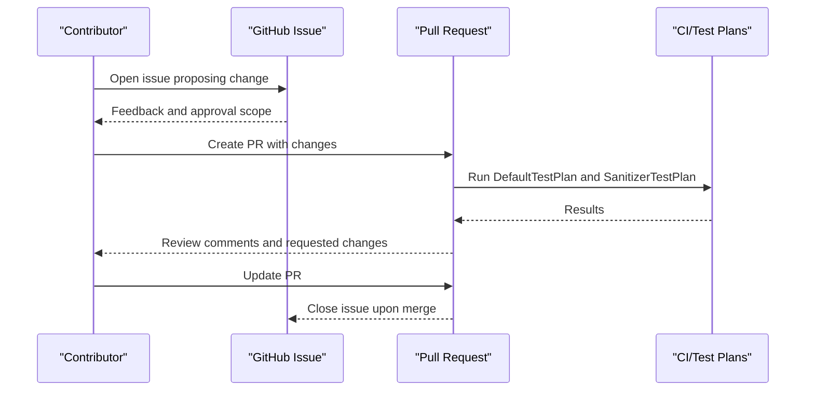
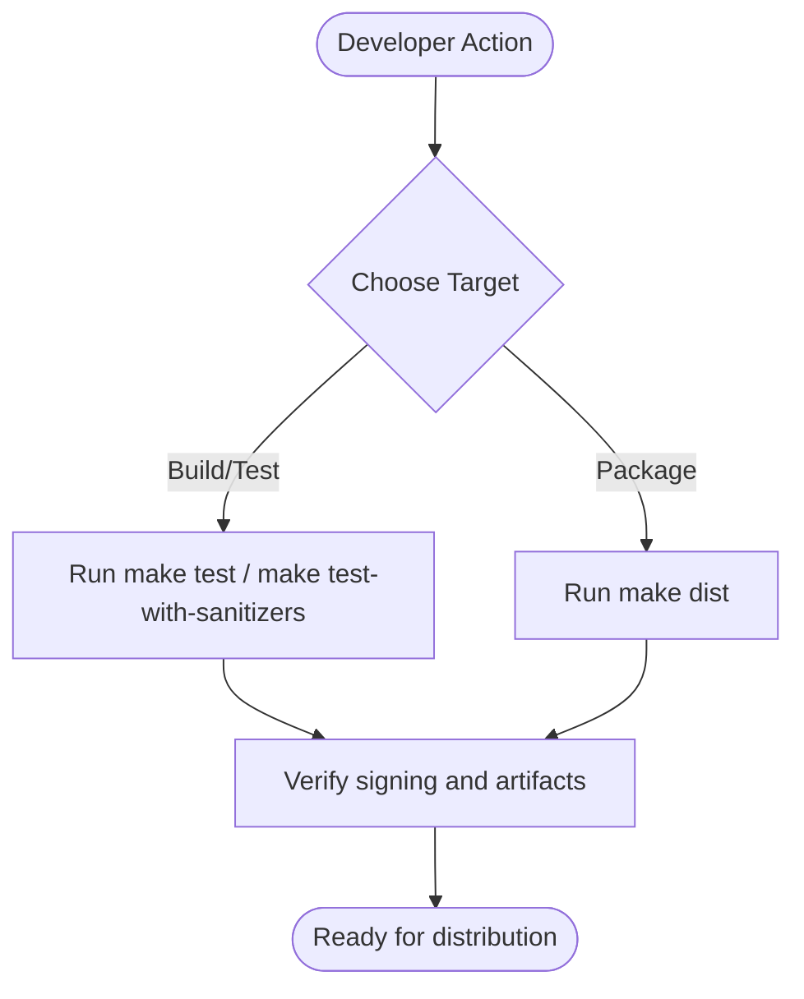
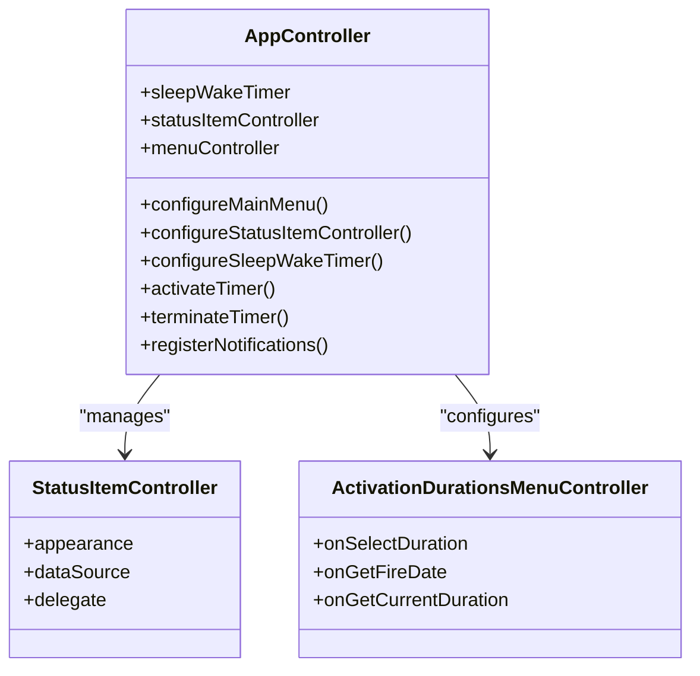
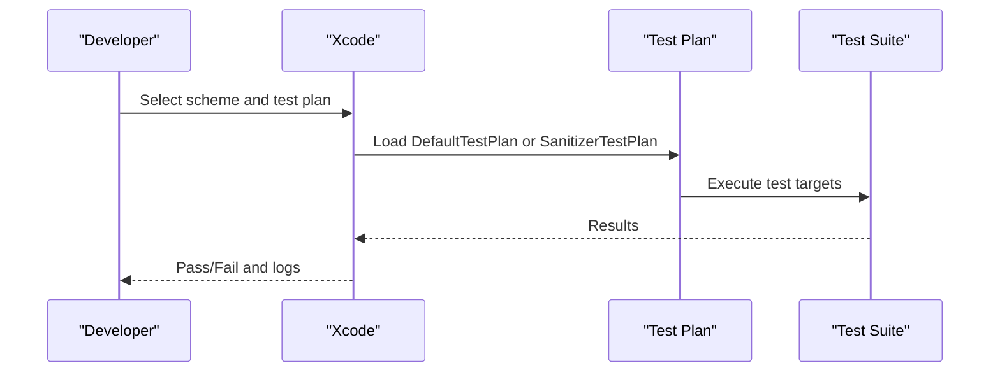
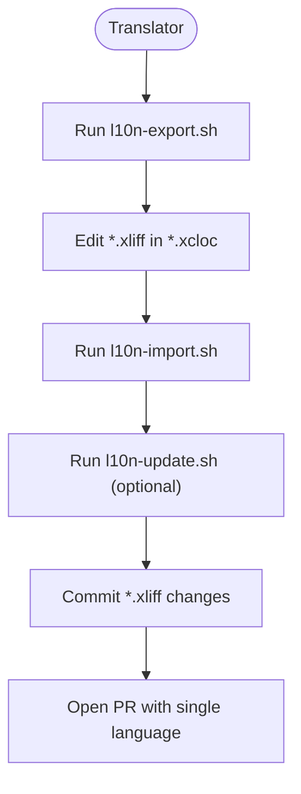
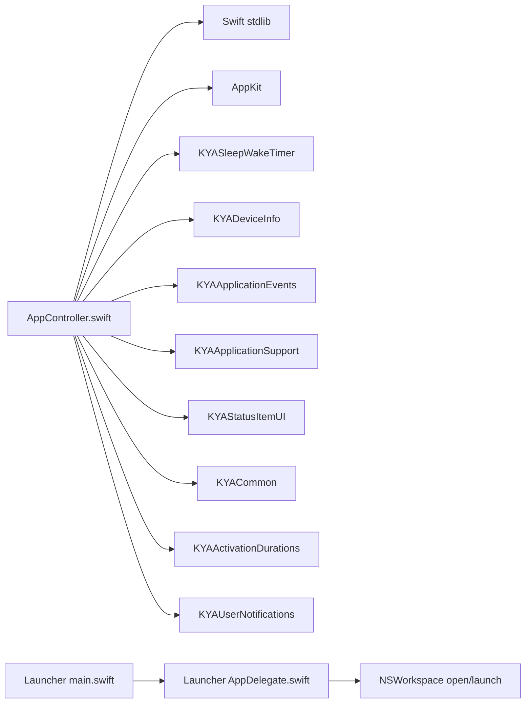

# Development Guidelines

<cite>
**Referenced Files in This Document**
- [CONTRIBUTING.md](file://CONTRIBUTING.md)
- [.github/pull_request_template.md](file://.github/pull_request_template.md)
- [README.md](file://README.md)
- [Makefile](file://Makefile)
- [Configuration.xcconfig](file://Configuration.xcconfig)
- [Localizations/README.md](file://Localizations/README.md)
- [Localizations/l10n-export.sh](file://Localizations/l10n-export.sh)
- [Localizations/l10n-import.sh](file://Localizations/l10n-import.sh)
- [Localizations/l10n-config.sh](file://Localizations/l10n-config.sh)
- [KYALauncher/AppDelegate.swift](file://KYALauncher/AppDelegate.swift)
- [KYALauncher/main.swift](file://KYALauncher/main.swift)
- [KeepingYouAwake/AppMain.swift](file://KeepingYouAwake/AppMain.swift)
- [KeepingYouAwake/KYAAppController/AppController.swift](file://KeepingYouAwake/KYAAppController/AppController.swift)
- [KeepingYouAwake/KYAL10n.swift](file://KeepingYouAwake/KYAL10n.swift)
- [KeepingYouAwake/DefaultTestPlan.xctestplan](file://KeepingYouAwake/DefaultTestPlan.xctestplan)
- [KeepingYouAwake/SanitizerTestPlan.xctestplan](file://KeepingYouAwake/SanitizerTestPlan.xctestplan)
</cite>

## Table of Contents
1. [Introduction](#introduction)
2. [Project Structure](#project-structure)
3. [Core Components](#core-components)
4. [Architecture Overview](#architecture-overview)
5. [Detailed Component Analysis](#detailed-component-analysis)
6. [Dependency Analysis](#dependency-analysis)
7. [Performance Considerations](#performance-considerations)
8. [Troubleshooting Guide](#troubleshooting-guide)
9. [Conclusion](#conclusion)
10. [Appendices](#appendices)

## Introduction
This document consolidates development guidelines and contribution processes for the project. It covers code standards, Swift coding conventions, naming conventions, documentation requirements, pull request and issue reporting procedures, code review guidelines, development tools configuration, debugging and profiling techniques, performance monitoring, Swift migration from Objective-C, architectural patterns, testing requirements, community guidelines, communication channels, recognition processes, localization workflows, and quality assurance expectations.

## Project Structure
The repository is organized into:
- Application targets: the main app and a lightweight launcher
- Shared localization resources and automation scripts
- Build and packaging automation via a Makefile
- Configuration for Xcode build settings
- Documentation and contribution policies

**Section sources**
- [README.md:1-45](file://README.md#L1-L45)
- [Makefile:1-92](file://Makefile#L1-L92)
- [Configuration.xcconfig:1-20](file://Configuration.xcconfig#L1-L20)

## Core Components
- App entry points and lifecycle:
  - Main app entry: [KeepingYouAwake/AppMain.swift](file://KeepingYouAwake/AppMain.swift)
  - Launcher entry: [KYALauncher/main.swift](file://KYALauncher/main.swift)
  - App delegate orchestration: [KeepingYouAwake/KYAAppController/AppController.swift](file://KeepingYouAwake/KYAAppController/AppController.swift)
- Localization:
  - Localization namespace: [KeepingYouAwake/KYAL10n.swift](file://KeepingYouAwake/KYAL10n.swift)
  - Localization catalog and scripts: [Localizations/README.md](file://Localizations/README.md), [Localizations/l10n-export.sh](file://Localizations/l10n-export.sh), [Localizations/l10n-import.sh](file://Localizations/l10n-import.sh), [Localizations/l10n-config.sh](file://Localizations/l10n-config.sh)
- Build and testing:
  - Build automation: [Makefile](file://Makefile)
  - Test plans: [KeepingYouAwake/DefaultTestPlan.xctestplan](file://KeepingYouAwake/DefaultTestPlan.xctestplan), [KeepingYouAwake/SanitizerTestPlan.xctestplan](file://KeepingYouAwake/SanitizerTestPlan.xctestplan)
- Policies and templates:
  - Contribution guidelines: [CONTRIBUTING.md](file://CONTRIBUTING.md)
  - Pull request template: [.github/pull_request_template.md](file://.github/pull_request_template.md)

**Section sources**
- [KeepingYouAwake/AppMain.swift:1-24](file://KeepingYouAwake/AppMain.swift#L1-L24)
- [KYALauncher/main.swift:1-14](file://KYALauncher/main.swift#L1-L14)
- [KeepingYouAwake/KYAAppController/AppController.swift:1-352](file://KeepingYouAwake/KYAAppController/AppController.swift#L1-L352)
- [KeepingYouAwake/KYAL10n.swift:1-65](file://KeepingYouAwake/KYAL10n.swift#L1-L65)
- [Localizations/README.md:1-21](file://Localizations/README.md#L1-L21)
- [Localizations/l10n-export.sh:1-19](file://Localizations/l10n-export.sh#L1-L19)
- [Localizations/l10n-import.sh:1-19](file://Localizations/l10n-import.sh#L1-L19)
- [Localizations/l10n-config.sh:1-11](file://Localizations/l10n-config.sh#L1-L11)
- [Makefile:28-91](file://Makefile#L28-L91)
- [KeepingYouAwake/DefaultTestPlan.xctestplan:1-45](file://KeepingYouAwake/DefaultTestPlan.xctestplan#L1-L45)
- [KeepingYouAwake/SanitizerTestPlan.xctestplan:1-64](file://KeepingYouAwake/SanitizerTestPlan.xctestplan#L1-L64)
- [CONTRIBUTING.md:1-44](file://CONTRIBUTING.md#L1-L44)
- [.github/pull_request_template.md:1-14](file://.github/pull_request_template.md#L1-L14)

## Architecture Overview
The app follows a modular architecture centered around an orchestrator that coordinates timers, UI, notifications, and device monitoring. The launcher opens the main app and terminates itself. Localization is centralized via a dedicated namespace.

**Diagram sources**
- [KeepingYouAwake/AppMain.swift:11-23](file://KeepingYouAwake/AppMain.swift#L11-L23)
- [KYALauncher/main.swift:11-14](file://KYALauncher/main.swift#L11-L14)
- [KYALauncher/AppDelegate.swift:12-25](file://KYALauncher/AppDelegate.swift#L12-L25)
- [KeepingYouAwake/KYAAppController/AppController.swift:21-41](file://KeepingYouAwake/KYAAppController/AppController.swift#L21-L41)
- [KeepingYouAwake/KYAL10n.swift:13-65](file://KeepingYouAwake/KYAL10n.swift#L13-L65)
- [Makefile:28-91](file://Makefile#L28-L91)
- [KeepingYouAwake/DefaultTestPlan.xctestplan:20-44](file://KeepingYouAwake/DefaultTestPlan.xctestplan#L20-L44)
- [KeepingYouAwake/SanitizerTestPlan.xctestplan:39-63](file://KeepingYouAwake/SanitizerTestPlan.xctestplan#L39-L63)

**Section sources**
- [KeepingYouAwake/AppMain.swift:11-23](file://KeepingYouAwake/AppMain.swift#L11-L23)
- [KYALauncher/AppDelegate.swift:12-25](file://KYALauncher/AppDelegate.swift#L12-L25)
- [KeepingYouAwake/KYAAppController/AppController.swift:21-41](file://KeepingYouAwake/KYAAppController/AppController.swift#L21-L41)

## Detailed Component Analysis

### Swift Coding Conventions and Standards
- Prefer Swift as the primary language for new development and contributions.
- Follow existing code style conventions observed in the codebase (brackets, spacing, line breaks).
- Use appropriate Swift idioms and patterns (optionals, closures, weak references, async/await where applicable).
- Keep naming consistent with existing patterns (CamelCase for types and properties, lowercase initial for functions and variables).
- Prefer immutability where possible; use guard statements for early exits.
- Use structured concurrency and main-queue safety for UI-related operations.

**Section sources**
- [CONTRIBUTING.md:22-25](file://CONTRIBUTING.md#L22-L25)

### Naming Conventions
- Types: UpperCamelCase (e.g., AppController)
- Properties and methods: lowerCamelCase (e.g., activateTimer)
- Constants and enums: UpperCamelCase (e.g., KYAL10n)
- Files: UpperCamelCase (e.g., AppController.swift)
- Modules/packages: UpperCamelCase (e.g., KYAAppController)

**Section sources**
- [KeepingYouAwake/KYAAppController/AppController.swift:21](file://KeepingYouAwake/KYAAppController/AppController.swift#L21)
- [KeepingYouAwake/KYAL10n.swift:13](file://KeepingYouAwake/KYAL10n.swift#L13)

### Documentation Requirements
- Public APIs and significant internal components should include clear documentation comments.
- Enum cases and constants should include concise descriptions.
- Complex logic should be documented with inline comments explaining intent and behavior.

**Section sources**
- [KeepingYouAwake/KYAL10n.swift:11-13](file://KeepingYouAwake/KYAL10n.swift#L11-L13)

### Pull Request Process
- Before implementing features or structural changes, open a GitHub issue to propose the change.
- Keep pull requests scoped to a single concern; avoid bundling unrelated changes.
- Follow the pull request template and confirm the required checkboxes.
- Avoid AI-generated or assisted code; if AI tools are used for descriptions, disclose it.

**Diagram sources**
- [CONTRIBUTING.md:27-31](file://CONTRIBUTING.md#L27-L31)
- [.github/pull_request_template.md:6-14](file://.github/pull_request_template.md#L6-L14)
- [KeepingYouAwake/DefaultTestPlan.xctestplan:1-45](file://KeepingYouAwake/DefaultTestPlan.xctestplan#L1-L45)
- [KeepingYouAwake/SanitizerTestPlan.xctestplan:1-64](file://KeepingYouAwake/SanitizerTestPlan.xctestplan#L1-L64)

**Section sources**
- [CONTRIBUTING.md:27-31](file://CONTRIBUTING.md#L27-L31)
- [.github/pull_request_template.md:6-14](file://.github/pull_request_template.md#L6-L14)

### Issue Reporting Procedures
- For features, structural changes, or UI modifications, open a GitHub issue first to discuss scope and feasibility.
- Provide clear problem statements, acceptance criteria, and context.

**Section sources**
- [CONTRIBUTING.md:27](file://CONTRIBUTING.md#L27)

### Code Review Guidelines
- Reviewers will provide constructive feedback; pull requests may be closed with reasons when necessary.
- Contributors should address feedback promptly and keep discussions respectful.

**Section sources**
- [CONTRIBUTING.md:37-38](file://CONTRIBUTING.md#L37-L38)

### Development Tools Configuration
- Build and packaging:
  - Use the Makefile targets for building, testing, archiving, and packaging.
  - Targets include test, test-with-sanitizers, l10n-export, l10n-import, l10n-update, and dist.
- Xcode configuration:
  - Build settings are centralized in Configuration.xcconfig, including deployment target, Swift version, bundle identifier, marketing version, and project version.

**Diagram sources**
- [Makefile:28-91](file://Makefile#L28-L91)
- [Configuration.xcconfig:9-19](file://Configuration.xcconfig#L9-L19)

**Section sources**
- [Makefile:28-91](file://Makefile#L28-L91)
- [Configuration.xcconfig:9-19](file://Configuration.xcconfig#L9-L19)

### Debugging Techniques
- Use Xcode’s debugger and console output; the Makefile enables unbuffered I/O for clearer logs.
- Leverage sanitizers for memory and threading issues via the sanitizer test plan.

**Section sources**
- [Makefile:13-16](file://Makefile#L13-L16)
- [KeepingYouAwake/SanitizerTestPlan.xctestplan:12-27](file://KeepingYouAwake/SanitizerTestPlan.xctestplan#L12-L27)

### Profiling Methods and Performance Monitoring
- Run tests with sanitizers enabled to detect undefined behavior and memory/thread issues.
- Use Xcode Instruments for CPU, memory, and energy profiling during development.
- Monitor app behavior under various device states (battery threshold, low power mode).

**Section sources**
- [KeepingYouAwake/SanitizerTestPlan.xctestplan:12-27](file://KeepingYouAwake/SanitizerTestPlan.xctestplan#L12-L27)
- [KeepingYouAwake/KYAAppController/AppController.swift:202-225](file://KeepingYouAwake/KYAAppController/AppController.swift#L202-L225)

### Swift Migration Guidelines from Objective-C
- Prefer Swift for new features and refactoring; maintain backward compatibility where necessary.
- Replace Objective-C patterns with Swift idioms (optionals, closures, structs, enums).
- Keep migration incremental; ensure tests pass after each change.

**Section sources**
- [CONTRIBUTING.md:25](file://CONTRIBUTING.md#L25)

### Architectural Patterns to Follow
- Orchestration pattern: central coordinator (AppController) manages subsystems (timer, UI, notifications, device monitoring).
- Delegation and data-source patterns for UI components.
- Event-driven actions via an event handler registry.
- Weak references to avoid retain cycles in closures and observers.

**Diagram sources**
- [KeepingYouAwake/KYAAppController/AppController.swift:21-41](file://KeepingYouAwake/KYAAppController/AppController.swift#L21-L41)
- [KeepingYouAwake/KYAAppController/AppController.swift:55-66](file://KeepingYouAwake/KYAAppController/AppController.swift#L55-L66)
- [KeepingYouAwake/KYAAppController/AppController.swift:70-90](file://KeepingYouAwake/KYAAppController/AppController.swift#L70-L90)

**Section sources**
- [KeepingYouAwake/KYAAppController/AppController.swift:21-41](file://KeepingYouAwake/KYAAppController/AppController.swift#L21-L41)

### Testing Requirements
- Run unit tests using the default test plan.
- Use the sanitizer test plan to detect memory and threading issues.
- Keep test coverage focused on critical paths (timer scheduling, device monitoring, UI actions).

**Diagram sources**
- [KeepingYouAwake/DefaultTestPlan.xctestplan:20-44](file://KeepingYouAwake/DefaultTestPlan.xctestplan#L20-L44)
- [KeepingYouAwake/SanitizerTestPlan.xctestplan:39-63](file://KeepingYouAwake/SanitizerTestPlan.xctestplan#L39-L63)

**Section sources**
- [Makefile:28-49](file://Makefile#L28-L49)
- [KeepingYouAwake/DefaultTestPlan.xctestplan:1-45](file://KeepingYouAwake/DefaultTestPlan.xctestplan#L1-L45)
- [KeepingYouAwake/SanitizerTestPlan.xctestplan:1-64](file://KeepingYouAwake/SanitizerTestPlan.xctestplan#L1-L64)

### Community Guidelines, Communication, and Recognition
- Respectful collaboration and constructive feedback are expected.
- Pull requests may be closed with reasons when necessary.
- Contributors may be credited for major translation updates; follow the pattern in the guidelines.

**Section sources**
- [CONTRIBUTING.md:37-38](file://CONTRIBUTING.md#L37-L38)
- [CONTRIBUTING.md:11-21](file://CONTRIBUTING.md#L11-L21)

### Localization Contribution Workflows
- Preferred format: modify only *.xliff files inside *.xcloc catalogs.
- Updated translations should be exported from Xcode and placed under Localizations/KeepingYouAwake/<language>.xcloc/Localized Contents/.
- Single-language PRs are preferred; avoid mixing unrelated code changes.
- Use the provided scripts to export/import/update translations.

**Diagram sources**
- [Localizations/README.md:3-21](file://Localizations/README.md#L3-L21)
- [Localizations/l10n-export.sh:1-19](file://Localizations/l10n-export.sh#L1-L19)
- [Localizations/l10n-import.sh:1-19](file://Localizations/l10n-import.sh#L1-L19)
- [Localizations/l10n-config.sh:10](file://Localizations/l10n-config.sh#L10)

**Section sources**
- [CONTRIBUTING.md:4-10](file://CONTRIBUTING.md#L4-L10)
- [Localizations/README.md:3-21](file://Localizations/README.md#L3-L21)
- [Localizations/l10n-export.sh:12-18](file://Localizations/l10n-export.sh#L12-L18)
- [Localizations/l10n-import.sh:10-17](file://Localizations/l10n-import.sh#L10-L17)
- [Localizations/l10n-config.sh:10](file://Localizations/l10n-config.sh#L10)

### Quality Assurance Expectations
- All changes should be tested locally using the provided test plans.
- Ensure localization updates are consistent across catalogs.
- Verify packaging and signing before distribution.

**Section sources**
- [Makefile:28-91](file://Makefile#L28-L91)
- [Localizations/README.md:3-21](file://Localizations/README.md#L3-L21)

## Dependency Analysis
The main app depends on several packages and integrates with system services (notifications, device monitoring). The launcher depends on the main app and opens it on launch.

**Diagram sources**
- [KeepingYouAwake/KYAAppController/AppController.swift:9-17](file://KeepingYouAwake/KYAAppController/AppController.swift#L9-L17)
- [KYALauncher/main.swift:9](file://KYALauncher/main.swift#L9)
- [KYALauncher/AppDelegate.swift:12-25](file://KYALauncher/AppDelegate.swift#L12-L25)

**Section sources**
- [KeepingYouAwake/KYAAppController/AppController.swift:9-17](file://KeepingYouAwake/KYAAppController/AppController.swift#L9-L17)
- [KYALauncher/AppDelegate.swift:12-25](file://KYALauncher/AppDelegate.swift#L12-L25)

## Performance Considerations
- Minimize UI updates off the main thread; use dispatch queues judiciously.
- Avoid retain cycles by using weak references in closures and observers.
- Monitor device power states and adjust behavior accordingly to conserve energy.

**Section sources**
- [KeepingYouAwake/KYAAppController/AppController.swift:30-51](file://KeepingYouAwake/KYAAppController/AppController.swift#L30-L51)
- [KeepingYouAwake/KYAAppController/AppController.swift:208-246](file://KeepingYouAwake/KYAAppController/AppController.swift#L208-L246)

## Troubleshooting Guide
- Build logs: The Makefile captures logs to a derived data directory for inspection.
- Test failures: Run tests with sanitizers enabled to surface memory/thread errors.
- Packaging verification: Use the built-in verification step in the dist target.

**Section sources**
- [Makefile:16](file://Makefile#L16)
- [Makefile:39-49](file://Makefile#L39-L49)
- [Makefile:88-91](file://Makefile#L88-L91)

## Conclusion
This guide consolidates the essential processes and standards for contributing to the project. By following the coding conventions, testing requirements, localization workflows, and review practices outlined here, contributors can efficiently collaborate and maintain high-quality code.

## Appendices
- Build and test commands:
  - Run tests: make test
  - Run tests with sanitizers: make test-with-sanitizers
  - Export localizations: make l10n-export
  - Import localizations: make l10n-import
  - Update localizations: make l10n-update
  - Package distribution: make dist

**Section sources**
- [Makefile:28-63](file://Makefile#L28-L63)