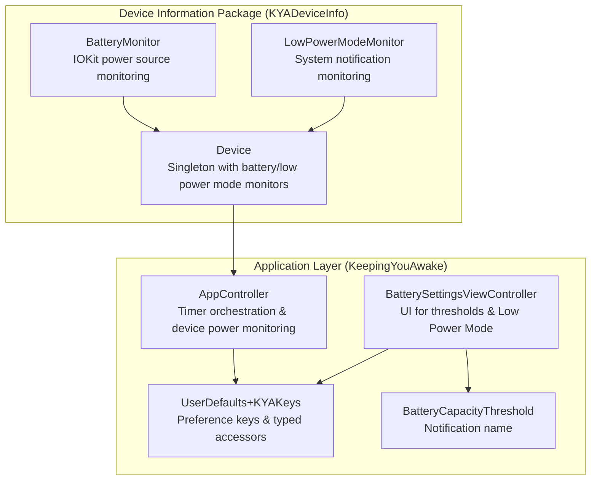
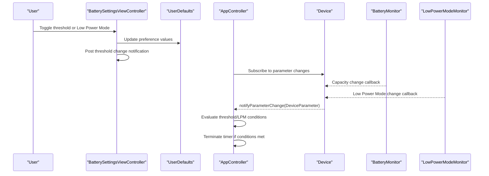
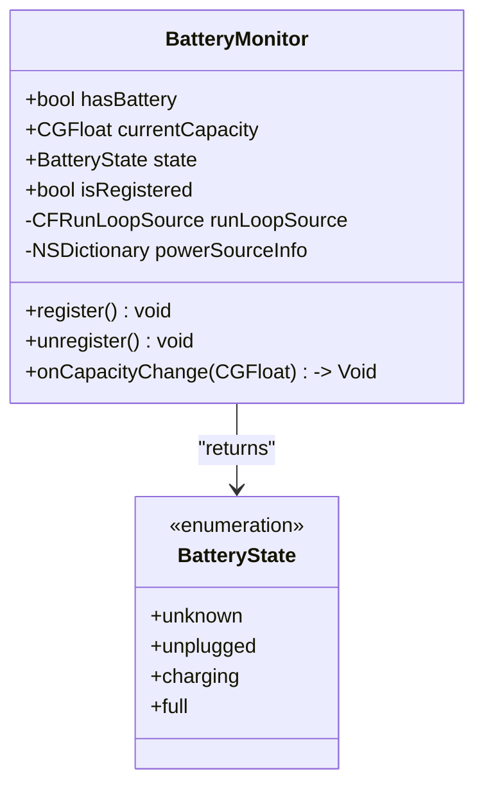
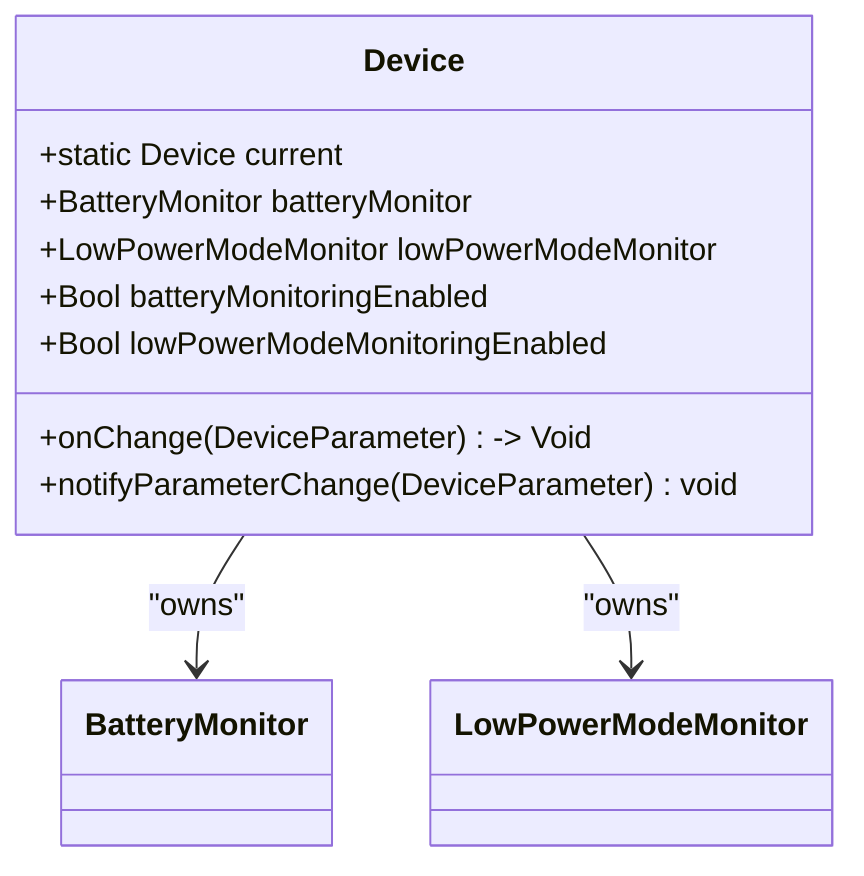
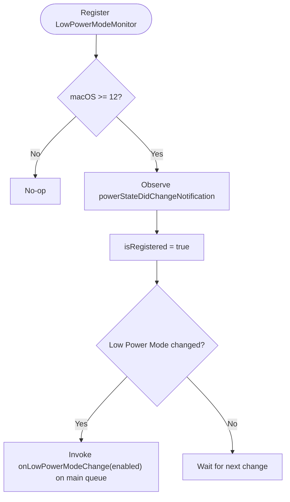
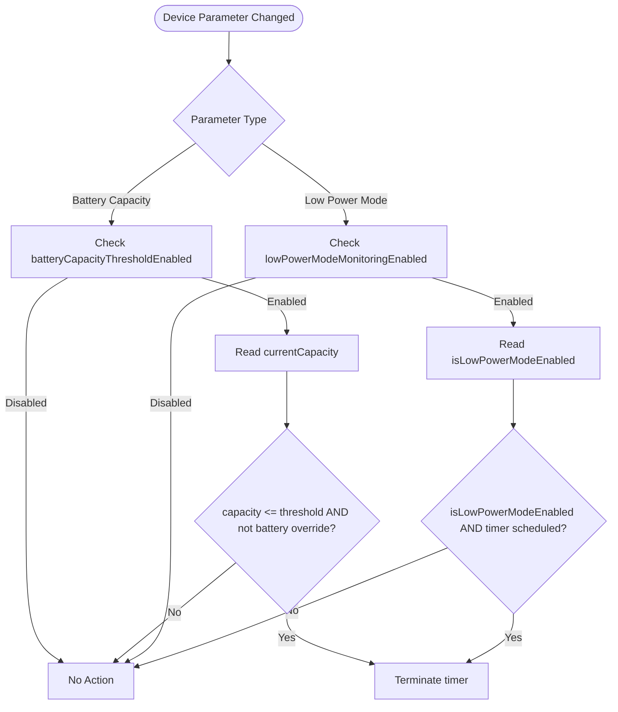
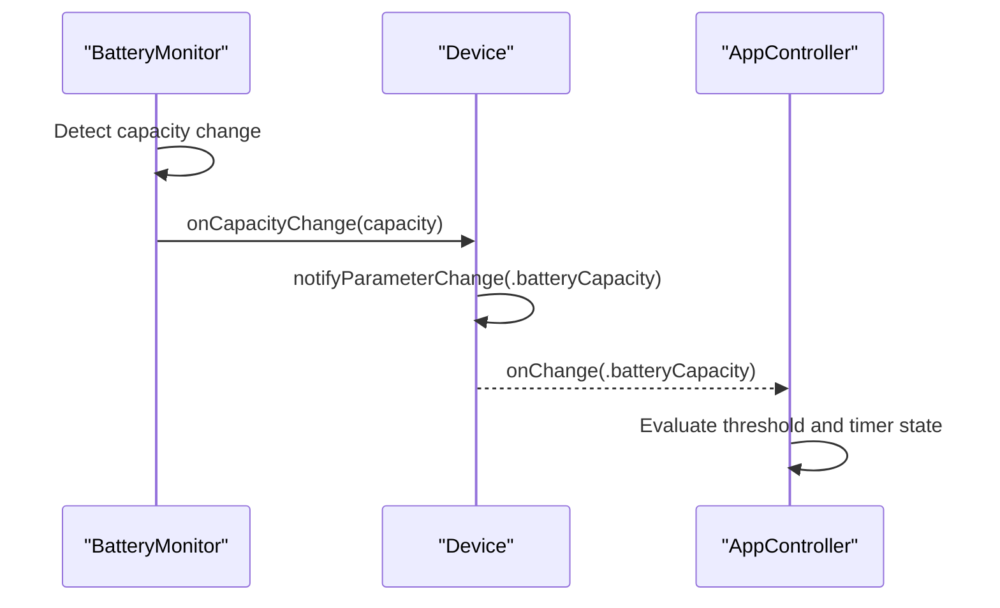
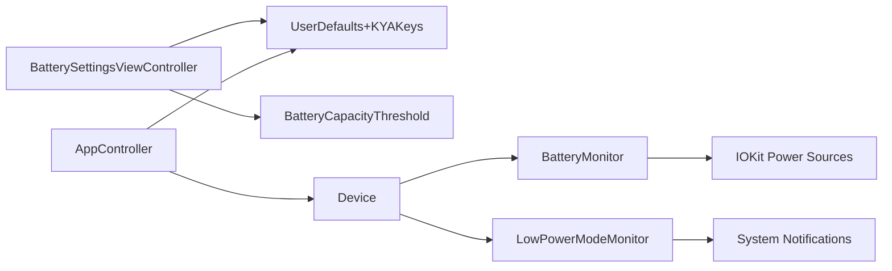

# Battery Monitoring System

<cite>
**Referenced Files in This Document**
- [BatteryMonitor.swift](file://Packages/KYADeviceInfo/Sources/KYADeviceInfo/BatteryMonitor.swift)
- [Device.swift](file://Packages/KYADeviceInfo/Sources/KYADeviceInfo/Device.swift)
- [LowPowerModeMonitor.swift](file://Packages/KYADeviceInfo/Sources/KYADeviceInfo/LowPowerModeMonitor.swift)
- [BatterySettingsViewController.swift](file://KeepingYouAwake/Settings/KYABatterySettingsViewController/BatterySettingsViewController.swift)
- [BatteryCapacityThreshold.swift](file://KeepingYouAwake/BatteryCapacityThreshold.swift)
- [AppController.swift](file://KeepingYouAwake/KYAAppController/AppController.swift)
- [UserDefaults+KYAKeys.swift](file://Packages/KYAApplicationSupport/Sources/KYAApplicationSupport/UserDefaults+KYAKeys.swift)
- [UserDefaultsSetting.swift](file://KeepingYouAwake/UserDefaultsSetting.swift)
- [2026-05-28-swift-appkit-rewrite-design.md](file://docs/superpowers/specs/2026-05-28-swift-appkit-rewrite-design.md)
</cite>

## Table of Contents
1. [Introduction](#introduction)
2. [Project Structure](#project-structure)
3. [Core Components](#core-components)
4. [Architecture Overview](#architecture-overview)
5. [Detailed Component Analysis](#detailed-component-analysis)
6. [Dependency Analysis](#dependency-analysis)
7. [Performance Considerations](#performance-considerations)
8. [Troubleshooting Guide](#troubleshooting-guide)
9. [Conclusion](#conclusion)

## Introduction
This document explains the battery monitoring system used by the application to prevent sleep/wake timer activation when battery capacity falls below a configured threshold or when Low Power Mode is enabled. It covers the BatteryMonitor implementation, its integration with the Device singleton, capacity tracking mechanisms, threshold configuration, automatic deactivation logic, callback system, detection capabilities, platform support differences, configuration examples, and power efficiency considerations.

## Project Structure
The battery monitoring system spans two main areas:
- Device information package (KYADeviceInfo): Implements BatteryMonitor, Device singleton, and LowPowerModeMonitor
- Application layer (KeepingYouAwake): Integrates monitoring with the sleep/wake timer, settings UI, and user defaults

**Diagram sources**
- [BatteryMonitor.swift:1-142](file://Packages/KYADeviceInfo/Sources/KYADeviceInfo/BatteryMonitor.swift#L1-L142)
- [Device.swift:1-139](file://Packages/KYADeviceInfo/Sources/KYADeviceInfo/Device.swift#L1-L139)
- [LowPowerModeMonitor.swift:1-85](file://Packages/KYADeviceInfo/Sources/KYADeviceInfo/LowPowerModeMonitor.swift#L1-L85)
- [AppController.swift:1-200](file://KeepingYouAwake/KYAAppController/AppController.swift#L1-L200)
- [BatterySettingsViewController.swift:1-263](file://KeepingYouAwake/Settings/KYABatterySettingsViewController/BatterySettingsViewController.swift#L1-L263)
- [UserDefaults+KYAKeys.swift:1-120](file://Packages/KYAApplicationSupport/Sources/KYAApplicationSupport/UserDefaults+KYAKeys.swift#L1-L120)
- [BatteryCapacityThreshold.swift:1-15](file://KeepingYouAwake/BatteryCapacityThreshold.swift#L1-L15)

**Section sources**
- [BatteryMonitor.swift:1-142](file://Packages/KYADeviceInfo/Sources/KYADeviceInfo/BatteryMonitor.swift#L1-L142)
- [Device.swift:1-139](file://Packages/KYADeviceInfo/Sources/KYADeviceInfo/Device.swift#L1-L139)
- [LowPowerModeMonitor.swift:1-85](file://Packages/KYADeviceInfo/Sources/KYADeviceInfo/LowPowerModeMonitor.swift#L1-L85)
- [AppController.swift:1-200](file://KeepingYouAwake/KYAAppController/AppController.swift#L1-L200)
- [BatterySettingsViewController.swift:1-263](file://KeepingYouAwake/Settings/KYABatterySettingsViewController/BatterySettingsViewController.swift#L1-L263)
- [UserDefaults+KYAKeys.swift:1-120](file://Packages/KYAApplicationSupport/Sources/KYAApplicationSupport/UserDefaults+KYAKeys.swift#L1-L120)
- [BatteryCapacityThreshold.swift:1-15](file://KeepingYouAwake/BatteryCapacityThreshold.swift#L1-L15)

## Core Components
- BatteryMonitor: Wraps IOKit power source monitoring to detect battery presence, current capacity, and state changes. Provides a registration mechanism and a capacity change callback invoked on the main queue.
- Device: Singleton that aggregates monitors, exposes enable/disable toggles for battery and Low Power Mode monitoring, and notifies subscribers when parameters change.
- LowPowerModeMonitor: Observes system Low Power Mode changes on supported platforms and invokes callbacks on the main queue.
- AppController: Orchestrates sleep/wake timer activation/deactivation and integrates device power monitoring. It checks thresholds and Low Power Mode to automatically terminate the timer when conditions are met.
- BatterySettingsViewController: UI for configuring battery capacity threshold enablement, threshold value, and Low Power Mode monitoring. Posts a notification when threshold settings change.
- UserDefaults+KYAKeys: Defines preference keys and typed accessors for battery capacity threshold, Low Power Mode monitoring, and related settings.
- BatteryCapacityThreshold: Provides the notification name used when threshold settings change.

**Section sources**
- [BatteryMonitor.swift:28-142](file://Packages/KYADeviceInfo/Sources/KYADeviceInfo/BatteryMonitor.swift#L28-L142)
- [Device.swift:24-139](file://Packages/KYADeviceInfo/Sources/KYADeviceInfo/Device.swift#L24-L139)
- [LowPowerModeMonitor.swift:19-85](file://Packages/KYADeviceInfo/Sources/KYADeviceInfo/LowPowerModeMonitor.swift#L19-L85)
- [AppController.swift:189-246](file://KeepingYouAwake/KYAAppController/AppController.swift#L189-L246)
- [BatterySettingsViewController.swift:14-263](file://KeepingYouAwake/Settings/KYABatterySettingsViewController/BatterySettingsViewController.swift#L14-L263)
- [UserDefaults+KYAKeys.swift:18-120](file://Packages/KYAApplicationSupport/Sources/KYAApplicationSupport/UserDefaults+KYAKeys.swift#L18-L120)
- [BatteryCapacityThreshold.swift:11-15](file://KeepingYouAwake/BatteryCapacityThreshold.swift#L11-L15)

## Architecture Overview
The system follows a layered architecture:
- Device layer: Provides unified access to device parameters via a singleton with monitor objects.
- Application layer: Subscribes to device parameter changes and reacts by enabling/disabling monitoring or terminating timers.
- Settings layer: Exposes UI controls bound to user defaults, posting notifications when threshold settings change.

**Diagram sources**
- [BatterySettingsViewController.swift:129-134](file://KeepingYouAwake/Settings/KYABatterySettingsViewController/BatterySettingsViewController.swift#L129-L134)
- [AppController.swift:208-246](file://KeepingYouAwake/KYAAppController/AppController.swift#L208-L246)
- [Device.swift:134-138](file://Packages/KYADeviceInfo/Sources/KYADeviceInfo/Device.swift#L134-L138)
- [BatteryMonitor.swift:97-109](file://Packages/KYADeviceInfo/Sources/KYADeviceInfo/BatteryMonitor.swift#L97-L109)
- [LowPowerModeMonitor.swift:70-80](file://Packages/KYADeviceInfo/Sources/KYADeviceInfo/LowPowerModeMonitor.swift#L70-L80)

## Detailed Component Analysis

### BatteryMonitor Implementation
BatteryMonitor encapsulates IOKit power source monitoring:
- Detection: Determines whether the device has an internal battery by inspecting power source descriptions.
- Capacity Tracking: Retrieves current capacity from IOKit and exposes it as a CGFloat, with a sentinel value when unavailable.
- State Tracking: Reports battery state (unknown, unplugged, charging, full) based on power source state.
- Registration: Creates and registers an IOKit run loop source for capacity change notifications.
- Callback: Invokes a user-provided handler on the main queue when capacity changes.

**Diagram sources**
- [BatteryMonitor.swift:28-142](file://Packages/KYADeviceInfo/Sources/KYADeviceInfo/BatteryMonitor.swift#L28-L142)

**Section sources**
- [BatteryMonitor.swift:28-142](file://Packages/KYADeviceInfo/Sources/KYADeviceInfo/BatteryMonitor.swift#L28-L142)

### Device Singleton Integration
Device acts as a central coordinator:
- Aggregates BatteryMonitor and LowPowerModeMonitor instances.
- Exposes enable/disable properties for monitoring with platform-aware guards.
- Converts monitor callbacks into DeviceParameter change notifications via a callback subscription mechanism.
- Ensures monitoring is only enabled when the device supports the feature.

**Diagram sources**
- [Device.swift:24-139](file://Packages/KYADeviceInfo/Sources/KYADeviceInfo/Device.swift#L24-L139)

**Section sources**
- [Device.swift:24-139](file://Packages/KYADeviceInfo/Sources/KYADeviceInfo/Device.swift#L24-L139)

### Low Power Mode Monitoring
LowPowerModeMonitor observes system Low Power Mode changes on supported macOS versions:
- Platform Support: Only active on macOS 12+; returns false on earlier versions.
- Detection: Uses a system notification to detect Low Power Mode state changes.
- Callback: Invokes a user-provided handler on the main queue when state changes.

**Diagram sources**
- [LowPowerModeMonitor.swift:20-85](file://Packages/KYADeviceInfo/Sources/KYADeviceInfo/LowPowerModeMonitor.swift#L20-L85)

**Section sources**
- [LowPowerModeMonitor.swift:19-85](file://Packages/KYADeviceInfo/Sources/KYADeviceInfo/LowPowerModeMonitor.swift#L19-L85)

### Automatic Deactivation Logic
AppController coordinates automatic deactivation based on:
- Battery Capacity Threshold: If enabled, compares current capacity against the configured threshold and terminates the timer when capacity drops below the threshold (unless a manual override is active).
- Low Power Mode: If enabled, terminates the timer when Low Power Mode becomes active and the timer is scheduled.

**Diagram sources**
- [AppController.swift:227-246](file://KeepingYouAwake/KYAAppController/AppController.swift#L227-L246)

**Section sources**
- [AppController.swift:191-246](file://KeepingYouAwake/KYAAppController/AppController.swift#L191-L246)

### Capacity Change Callback System
The callback system ensures UI and logic react to device parameter changes:
- Device notifies subscribers via a closure when parameters change.
- BatteryMonitor invokes onCapacityChange on the main queue.
- LowPowerModeMonitor invokes onLowPowerModeChange on the main queue.
- AppController subscribes to Device.onChange to evaluate conditions and manage timer lifecycle.

**Diagram sources**
- [BatteryMonitor.swift:97-109](file://Packages/KYADeviceInfo/Sources/KYADeviceInfo/BatteryMonitor.swift#L97-L109)
- [Device.swift:134-138](file://Packages/KYADeviceInfo/Sources/KYADeviceInfo/Device.swift#L134-L138)
- [AppController.swift:208-246](file://KeepingYouAwake/KYAAppController/AppController.swift#L208-L246)

**Section sources**
- [Device.swift:120-139](file://Packages/KYADeviceInfo/Sources/KYADeviceInfo/Device.swift#L120-L139)
- [BatteryMonitor.swift:97-109](file://Packages/KYADeviceInfo/Sources/KYADeviceInfo/BatteryMonitor.swift#L97-L109)
- [LowPowerModeMonitor.swift:70-80](file://Packages/KYADeviceInfo/Sources/KYADeviceInfo/LowPowerModeMonitor.swift#L70-L80)

### Battery Detection Capabilities and Platform Support
- Battery Presence: Determined by inspecting IOKit power source type; only internal batteries are considered.
- Battery Capacity: Retrieved from IOKit; returns a sentinel value when unavailable.
- Low Power Mode: Supported only on macOS 12+; on earlier versions, Low Power Mode monitoring is disabled.
- UI Availability: The settings UI disables controls when the device lacks a battery or when Low Power Mode is unsupported.

**Section sources**
- [BatteryMonitor.swift:30-43](file://Packages/KYADeviceInfo/Sources/KYADeviceInfo/BatteryMonitor.swift#L30-L43)
- [LowPowerModeMonitor.swift:20-35](file://Packages/KYADeviceInfo/Sources/KYADeviceInfo/LowPowerModeMonitor.swift#L20-L35)
- [BatterySettingsViewController.swift:223-231](file://KeepingYouAwake/Settings/KYABatterySettingsViewController/BatterySettingsViewController.swift#L223-L231)

### Configuration Examples and Integration with Core Timing System
- Enable/Disable Battery Threshold: Controlled via a boolean preference key; when enabled, Device battery monitoring is turned on, and AppController evaluates capacity thresholds.
- Configure Threshold Value: Stored as a numeric preference with a minimum enforced by the accessor.
- Enable/Disable Low Power Mode Monitoring: Controlled via a boolean preference key; when enabled, Device Low Power Mode monitoring is turned on, and AppController terminates the timer upon Low Power Mode activation.
- Integration with Sleep/Wake Timer: AppController activates device power monitoring when the timer is scheduled and disables it when deactivated. Manual overrides prevent automatic termination while the timer is running.

**Section sources**
- [UserDefaults+KYAKeys.swift:59-110](file://Packages/KYAApplicationSupport/Sources/KYAApplicationSupport/UserDefaults+KYAKeys.swift#L59-L110)
- [Device.swift:46-91](file://Packages/KYADeviceInfo/Sources/KYADeviceInfo/Device.swift#L46-L91)
- [AppController.swift:77-90](file://KeepingYouAwake/KYAAppController/AppController.swift#L77-L90)
- [AppController.swift:202-225](file://KeepingYouAwake/KYAAppController/AppController.swift#L202-L225)

## Dependency Analysis
The system exhibits clean separation of concerns:
- Device depends on BatteryMonitor and LowPowerModeMonitor.
- AppController depends on Device and UserDefaults.
- Settings UI depends on Device for capability checks and UserDefaults for bindings.
- BatterySettingsViewController posts a notification when threshold settings change, allowing other components to react.

**Diagram sources**
- [BatterySettingsViewController.swift:190-221](file://KeepingYouAwake/Settings/KYABatterySettingsViewController/BatterySettingsViewController.swift#L190-L221)
- [AppController.swift:189-246](file://KeepingYouAwake/KYAAppController/AppController.swift#L189-L246)
- [Device.swift:24-139](file://Packages/KYADeviceInfo/Sources/KYADeviceInfo/Device.swift#L24-L139)
- [BatteryMonitor.swift:77-87](file://Packages/KYADeviceInfo/Sources/KYADeviceInfo/BatteryMonitor.swift#L77-L87)
- [LowPowerModeMonitor.swift:44-55](file://Packages/KYADeviceInfo/Sources/KYADeviceInfo/LowPowerModeMonitor.swift#L44-L55)

**Section sources**
- [BatterySettingsViewController.swift:190-221](file://KeepingYouAwake/Settings/KYABatterySettingsViewController/BatterySettingsViewController.swift#L190-L221)
- [AppController.swift:189-246](file://KeepingYouAwake/KYAAppController/AppController.swift#L189-L246)
- [Device.swift:24-139](file://Packages/KYADeviceInfo/Sources/KYADeviceInfo/Device.swift#L24-L139)
- [BatteryMonitor.swift:77-87](file://Packages/KYADeviceInfo/Sources/KYADeviceInfo/BatteryMonitor.swift#L77-L87)
- [LowPowerModeMonitor.swift:44-55](file://Packages/KYADeviceInfo/Sources/KYADeviceInfo/LowPowerModeMonitor.swift#L44-L55)

## Performance Considerations
- IOKit Run Loop Source: BatteryMonitor registers a lightweight run loop source for capacity change notifications. This minimizes polling overhead and reduces CPU usage compared to periodic checks.
- Main Queue Dispatch: Callbacks are dispatched to the main queue to ensure UI updates occur safely without blocking monitoring threads.
- Conditional Monitoring: Device only enables monitoring when the device supports the feature (e.g., Low Power Mode monitoring requires macOS 12+), avoiding unnecessary work on unsupported platforms.
- Preference Access: Typed accessors in UserDefaults provide efficient, type-safe reads and writes for threshold and monitoring flags.

[No sources needed since this section provides general guidance]

## Troubleshooting Guide
- Battery capacity always shows as unavailable:
  - Verify the device has an internal battery and that IOKit power source queries succeed.
  - Confirm BatteryMonitor is registered and that onCapacityChange is set.
- Low Power Mode monitoring not triggering:
  - Ensure the system is macOS 12+; otherwise, Low Power Mode monitoring is disabled.
  - Confirm Low Power Mode monitoring is enabled in preferences and that Device is registered.
- Timer not terminating on threshold drop:
  - Check that battery capacity threshold is enabled and that the current capacity is below the configured threshold.
  - Verify that a manual override is not active preventing termination.
- Settings UI controls disabled:
  - Controls are disabled when the device lacks a battery or when Low Power Mode is unsupported; enable the respective monitoring features accordingly.

**Section sources**
- [BatteryMonitor.swift:30-43](file://Packages/KYADeviceInfo/Sources/KYADeviceInfo/BatteryMonitor.swift#L30-L43)
- [LowPowerModeMonitor.swift:20-35](file://Packages/KYADeviceInfo/Sources/KYADeviceInfo/LowPowerModeMonitor.swift#L20-L35)
- [BatterySettingsViewController.swift:223-231](file://KeepingYouAwake/Settings/KYABatterySettingsViewController/BatterySettingsViewController.swift#L223-L231)
- [AppController.swift:227-246](file://KeepingYouAwake/KYAAppController/AppController.swift#L227-L246)

## Conclusion
The battery monitoring system integrates IOKit-based battery detection with a Device singleton that exposes a unified interface for monitoring and reacting to device parameter changes. AppController uses these capabilities to automatically manage sleep/wake timer activation based on configurable thresholds and Low Power Mode state. The design emphasizes platform-aware behavior, efficient callbacks, and clean separation between UI, preferences, and device monitoring logic.