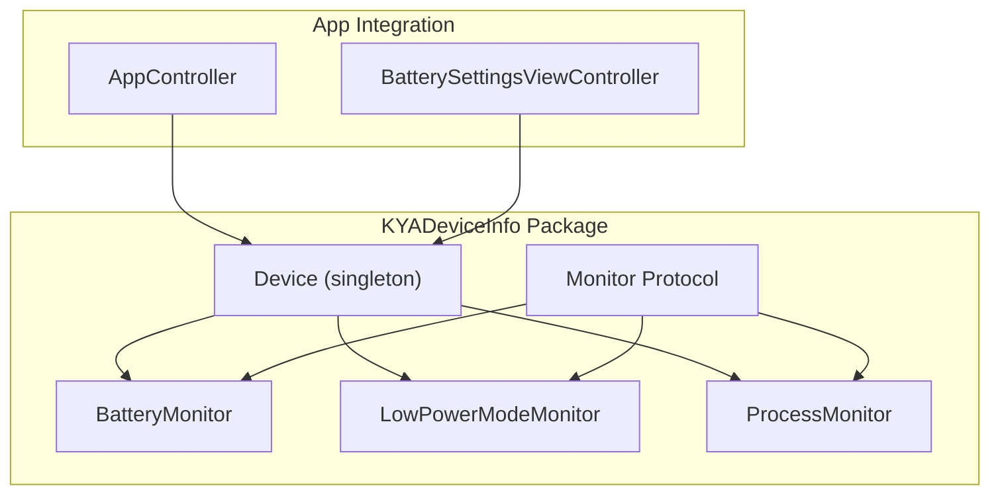
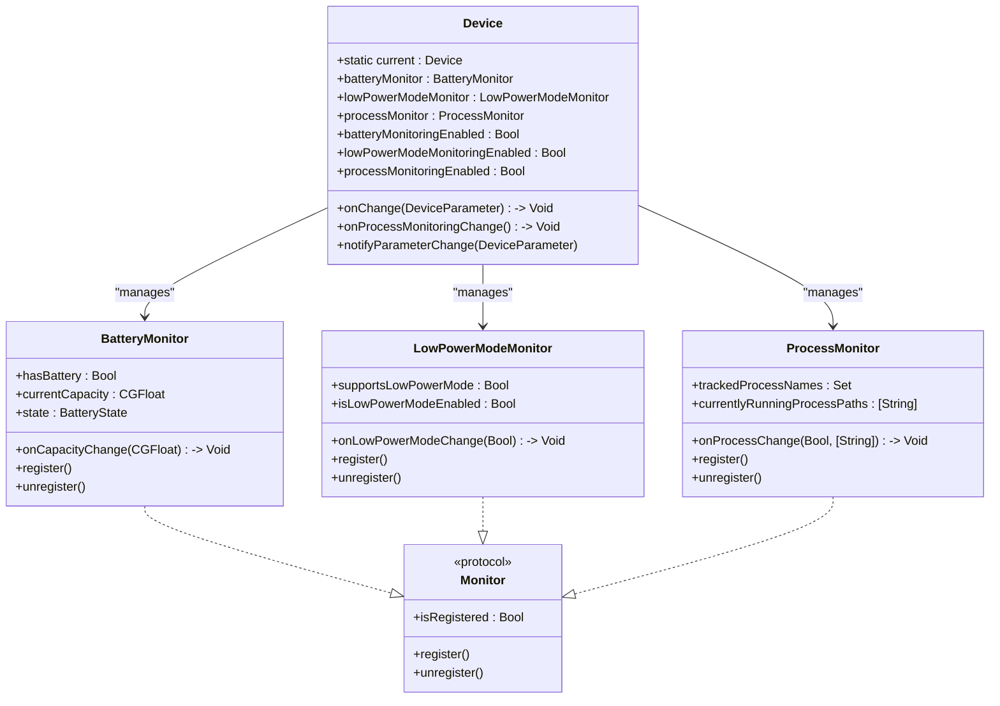
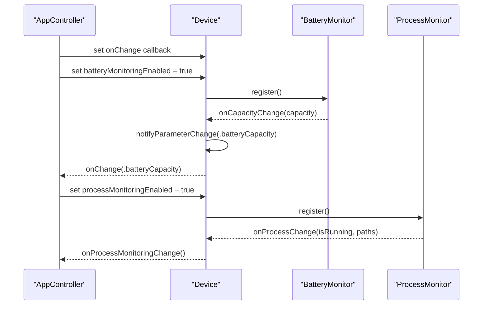
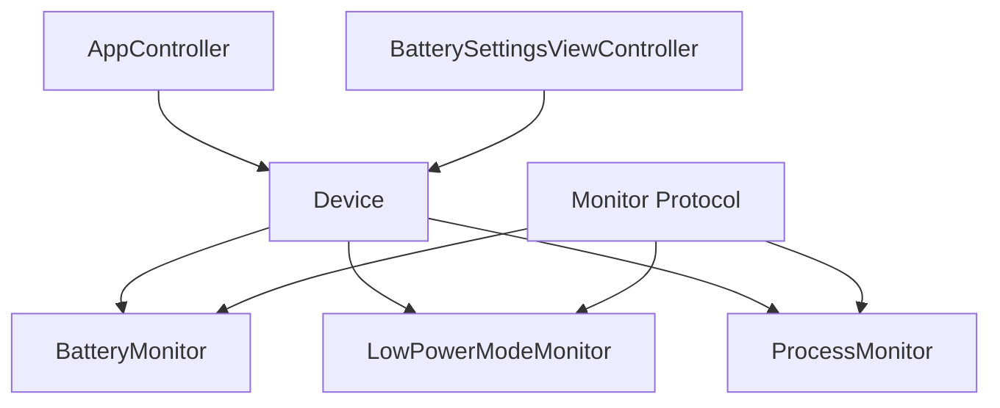

# Device Architecture and Core Components

<cite>
**Referenced Files in This Document**
- [Device.swift](file://Packages/KYADeviceInfo/Sources/KYADeviceInfo/Device.swift)
- [Monitor.swift](file://Packages/KYADeviceInfo/Sources/KYADeviceInfo/Monitor.swift)
- [BatteryMonitor.swift](file://Packages/KYADeviceInfo/Sources/KYADeviceInfo/BatteryMonitor.swift)
- [LowPowerModeMonitor.swift](file://Packages/KYADeviceInfo/Sources/KYADeviceInfo/LowPowerModeMonitor.swift)
- [ProcessMonitor.swift](file://Packages/KYADeviceInfo/Sources/KYADeviceInfo/ProcessMonitor.swift)
- [DeviceTests.swift](file://Packages/KYADeviceInfo/Tests/KYADeviceInfoTests/DeviceTests.swift)
- [AppController.swift](file://KeepingYouAwake/KYAAppController/AppController.swift)
- [BatterySettingsViewController.swift](file://KeepingYouAwake/Settings/KYABatterySettingsViewController/BatterySettingsViewController.swift)
- [BatteryCapacityThreshold.swift](file://KeepingYouAwake/BatteryCapacityThreshold.swift)
- [2026-05-28-swift-appkit-rewrite-design.md](file://docs/superpowers/specs/2026-05-28-swift-appkit-rewrite-design.md)
</cite>

## Table of Contents
1. [Introduction](#introduction)
2. [Project Structure](#project-structure)
3. [Core Components](#core-components)
4. [Architecture Overview](#architecture-overview)
5. [Detailed Component Analysis](#detailed-component-analysis)
6. [Dependency Analysis](#dependency-analysis)
7. [Performance Considerations](#performance-considerations)
8. [Troubleshooting Guide](#troubleshooting-guide)
9. [Conclusion](#conclusion)

## Introduction
This document explains the Device architecture and core components that coordinate device monitoring across battery status, Low Power Mode, and process activity. It covers the singleton Device pattern, the DeviceParameter enumeration replacing legacy string constants, the Monitor protocol enabling consistent monitor behavior, the callback system for parameter change notifications, weak reference handling for memory safety, and the internal notification mechanism with thread-safety considerations. Practical integration examples demonstrate how Device coordinates with other system components and responds to device state changes.

## Project Structure
The Device subsystem resides in the KYADeviceInfo package and integrates with the main application through the AppController. The Device class acts as a central coordinator for three monitor types: BatteryMonitor, LowPowerModeMonitor, and ProcessMonitor. Each monitor conforms to the Monitor protocol, ensuring consistent registration/unregistration and callback semantics.

**Diagram sources**
- [Device.swift:24-38](file://Packages/KYADeviceInfo/Sources/KYADeviceInfo/Device.swift#L24-L38)
- [Monitor.swift:12-21](file://Packages/KYADeviceInfo/Sources/KYADeviceInfo/Monitor.swift#L12-L21)
- [BatteryMonitor.swift:29](file://Packages/KYADeviceInfo/Sources/KYADeviceInfo/BatteryMonitor.swift#L29)
- [LowPowerModeMonitor.swift:20](file://Packages/KYADeviceInfo/Sources/KYADeviceInfo/LowPowerModeMonitor.swift#L20)
- [ProcessMonitor.swift:17](file://Packages/KYADeviceInfo/Sources/KYADeviceInfo/ProcessMonitor.swift#L17)
- [AppController.swift:202-218](file://KeepingYouAwake/KYAAppController/AppController.swift#L202-L218)
- [BatterySettingsViewController.swift:222-237](file://KeepingYouAwake/Settings/KYABatterySettingsViewController/BatterySettingsViewController.swift#L222-L237)

**Section sources**
- [Device.swift:24-38](file://Packages/KYADeviceInfo/Sources/KYADeviceInfo/Device.swift#L24-L38)
- [Monitor.swift:12-21](file://Packages/KYADeviceInfo/Sources/KYADeviceInfo/Monitor.swift#L12-L21)
- [AppController.swift:202-218](file://KeepingYouAwake/KYAAppController/AppController.swift#L202-L218)

## Core Components
- Device (singleton): Central coordinator managing BatteryMonitor, LowPowerModeMonitor, and ProcessMonitor. Exposes enable/disable properties for each monitor and a unified onChange callback for parameter changes.
- Monitor protocol: Defines the common interface for all monitors: isRegistered, register(), and unregister().
- Monitor implementations:
  - BatteryMonitor: Tracks battery capacity and state via IOKit, notifying on capacity changes.
  - LowPowerModeMonitor: Tracks Low Power Mode state via system notifications (macOS 12+).
  - ProcessMonitor: Hybrid monitoring pipeline (polling + path matching + exit observers) for CLI processes.

Key responsibilities:
- Replace legacy string-based device parameter constants with a strongly typed DeviceParameter enumeration.
- Provide a unified callback mechanism (onChange) instead of NSNotificationCenter for internal device parameter changes.
- Ensure thread-safe delivery of callbacks to the main queue.
- Use weak references in monitor callbacks to prevent retain cycles.

**Section sources**
- [Device.swift:13-20](file://Packages/KYADeviceInfo/Sources/KYADeviceInfo/Device.swift#L13-L20)
- [Device.swift:24-38](file://Packages/KYADeviceInfo/Sources/KYADeviceInfo/Device.swift#L24-L38)
- [Monitor.swift:12-21](file://Packages/KYADeviceInfo/Sources/KYADeviceInfo/Monitor.swift#L12-L21)
- [BatteryMonitor.swift:29](file://Packages/KYADeviceInfo/Sources/KYADeviceInfo/BatteryMonitor.swift#L29)
- [LowPowerModeMonitor.swift:20](file://Packages/KYADeviceInfo/Sources/KYADeviceInfo/LowPowerModeMonitor.swift#L20)
- [ProcessMonitor.swift:17](file://Packages/KYADeviceInfo/Sources/KYADeviceInfo/ProcessMonitor.swift#L17)

## Architecture Overview
The Device class encapsulates three monitor types behind a unified interface. Each monitor registers/unregisters itself and invokes its own callback when state changes. Device forwards monitor-specific callbacks to its own onChange callback on the main queue, ensuring thread safety. Process monitoring also exposes a dedicated onProcessMonitoringChange callback.

**Diagram sources**
- [Device.swift:24-38](file://Packages/KYADeviceInfo/Sources/KYADeviceInfo/Device.swift#L24-L38)
- [Monitor.swift:12-21](file://Packages/KYADeviceInfo/Sources/KYADeviceInfo/Monitor.swift#L12-L21)
- [BatteryMonitor.swift:29](file://Packages/KYADeviceInfo/Sources/KYADeviceInfo/BatteryMonitor.swift#L29)
- [LowPowerModeMonitor.swift:20](file://Packages/KYADeviceInfo/Sources/KYADeviceInfo/LowPowerModeMonitor.swift#L20)
- [ProcessMonitor.swift:17](file://Packages/KYADeviceInfo/Sources/KYADeviceInfo/ProcessMonitor.swift#L17)

## Detailed Component Analysis

### Device Singleton Pattern and Central Coordination
- Singleton pattern: Device.current provides a single shared instance, ensuring centralized access to all monitors.
- Central coordination: Device wires monitor callbacks to its own onChange callback, normalizing device parameter change notifications across heterogeneous sources.
- Thread safety: Device.notifyParameterChange dispatches to the main queue, guaranteeing UI-safe updates.
- Weak reference usage: Device captures self weakly when binding monitor callbacks to avoid retain cycles.

Integration example:
- AppController sets Device.current.onChange and toggles monitoring based on user preferences, then reacts to parameter changes.

**Section sources**
- [Device.swift:26](file://Packages/KYADeviceInfo/Sources/KYADeviceInfo/Device.swift#L26)
- [Device.swift:53-56](file://Packages/KYADeviceInfo/Sources/KYADeviceInfo/Device.swift#L53-L56)
- [Device.swift:80-83](file://Packages/KYADeviceInfo/Sources/KYADeviceInfo/Device.swift#L80-L83)
- [Device.swift:105-108](file://Packages/KYADeviceInfo/Sources/KYADeviceInfo/Device.swift#L105-L108)
- [Device.swift:134-138](file://Packages/KYADeviceInfo/Sources/KYADeviceInfo/Device.swift#L134-L138)
- [AppController.swift:202-218](file://KeepingYouAwake/KYAAppController/AppController.swift#L202-L218)

### DeviceParameter Enumeration System
- Replaces legacy string-based constants with a strongly typed DeviceParameter enumeration.
- Cases represent device parameters that can change: batteryCapacity, lowPowerMode, externalDisplay.
- Used to signal the type of parameter change in Device.onChange callbacks.

Validation:
- Tests confirm raw values match expected string identifiers.

**Section sources**
- [Device.swift:13-20](file://Packages/KYADeviceInfo/Sources/KYADeviceInfo/Device.swift#L13-L20)
- [DeviceTests.swift:140-144](file://Packages/KYADeviceInfo/Tests/KYADeviceInfoTests/DeviceTests.swift#L140-L144)

### Monitor Protocol Design Pattern
- Contract: Monitor defines isRegistered, register(), and unregister() for consistent lifecycle management.
- Implementation: Each monitor manages its own registration state and system integration:
  - BatteryMonitor: IOKit-based run loop source for capacity changes.
  - LowPowerModeMonitor: System notification observation for Low Power Mode (macOS 12+).
  - ProcessMonitor: Three-layer hybrid pipeline (polling + path matching + exit observers).

Benefits:
- Eliminates boilerplate duplication across monitors.
- Encapsulates platform-specific integration details within each monitor.

**Section sources**
- [Monitor.swift:12-21](file://Packages/KYADeviceInfo/Sources/KYADeviceInfo/Monitor.swift#L12-L21)
- [BatteryMonitor.swift:67-94](file://Packages/KYADeviceInfo/Sources/KYADeviceInfo/BatteryMonitor.swift#L67-L94)
- [LowPowerModeMonitor.swift:39-67](file://Packages/KYADeviceInfo/Sources/KYADeviceInfo/LowPowerModeMonitor.swift#L39-L67)
- [ProcessMonitor.swift:32-67](file://Packages/KYADeviceInfo/Sources/KYADeviceInfo/ProcessMonitor.swift#L32-L67)

### Callback System and Weak Reference Handling
- Device.onChange: Unified callback for device parameter changes, invoked on the main queue.
- Monitor callbacks: Each monitor exposes its own callback (onCapacityChange, onLowPowerModeChange, onProcessChange) that Device forwards to onChange.
- Weak capture: Device uses [weak self] when binding monitor callbacks to prevent retain cycles.
- Process monitoring callback: Device.onProcessMonitoringChange is invoked directly by ProcessMonitor when tracked processes start or exit.

Thread safety:
- All monitor callbacks are dispatched to the main queue before invoking higher-level callbacks.

**Section sources**
- [Device.swift:122-125](file://Packages/KYADeviceInfo/Sources/KYADeviceInfo/Device.swift#L122-L125)
- [Device.swift:53-56](file://Packages/KYADeviceInfo/Sources/KYADeviceInfo/Device.swift#L53-L56)
- [Device.swift:80-83](file://Packages/KYADeviceInfo/Sources/KYADeviceInfo/Device.swift#L80-L83)
- [Device.swift:105-108](file://Packages/KYADeviceInfo/Sources/KYADeviceInfo/Device.swift#L105-L108)
- [BatteryMonitor.swift:97](file://Packages/KYADeviceInfo/Sources/KYADeviceInfo/BatteryMonitor.swift#L97)
- [LowPowerModeMonitor.swift:70](file://Packages/KYADeviceInfo/Sources/KYADeviceInfo/LowPowerModeMonitor.swift#L70)
- [ProcessMonitor.swift:21](file://Packages/KYADeviceInfo/Sources/KYADeviceInfo/ProcessMonitor.swift#L21)
- [ProcessMonitor.swift:221-223](file://Packages/KYADeviceInfo/Sources/KYADeviceInfo/ProcessMonitor.swift#L221-L223)

### Internal Notification Mechanism and Thread Safety
- Internal mechanism: Device.notifyParameterChange schedules the onChange callback on the main queue, ensuring thread-safe delivery.
- Monitor-level notifications: Each monitor invokes its callback on the main queue before forwarding to Device.
- Process monitoring: ProcessMonitor constructs a snapshot of currently running process paths and notifies on the main queue.

**Section sources**
- [Device.swift:134-138](file://Packages/KYADeviceInfo/Sources/KYADeviceInfo/Device.swift#L134-L138)
- [BatteryMonitor.swift:106-108](file://Packages/KYADeviceInfo/Sources/KYADeviceInfo/BatteryMonitor.swift#L106-L108)
- [LowPowerModeMonitor.swift:77-79](file://Packages/KYADeviceInfo/Sources/KYADeviceInfo/LowPowerModeMonitor.swift#L77-L79)
- [ProcessMonitor.swift:218-224](file://Packages/KYADeviceInfo/Sources/KYADeviceInfo/ProcessMonitor.swift#L218-L224)

### Integration Examples and Device State Handling
- AppController integration:
  - Enables monitoring based on user defaults.
  - Subscribes to Device.onChange and reacts to batteryCapacity and lowPowerMode changes.
  - Terminates timers when thresholds or Low Power Mode conditions are met.
- Settings integration:
  - BatterySettingsViewController reads device capabilities (hasBattery, supportsLowPowerMode) to enable/disable UI controls.
  - Binds to user defaults for threshold values and toggles.

**Diagram sources**
- [AppController.swift:202-218](file://KeepingYouAwake/KYAAppController/AppController.swift#L202-L218)
- [Device.swift:48-64](file://Packages/KYADeviceInfo/Sources/KYADeviceInfo/Device.swift#L48-L64)
- [Device.swift:101-116](file://Packages/KYADeviceInfo/Sources/KYADeviceInfo/Device.swift#L101-L116)
- [BatteryMonitor.swift:73-87](file://Packages/KYADeviceInfo/Sources/KYADeviceInfo/BatteryMonitor.swift#L73-L87)
- [ProcessMonitor.swift:32-48](file://Packages/KYADeviceInfo/Sources/KYADeviceInfo/ProcessMonitor.swift#L32-L48)

**Section sources**
- [AppController.swift:202-246](file://KeepingYouAwake/KYAAppController/AppController.swift#L202-L246)
- [BatterySettingsViewController.swift:222-237](file://KeepingYouAwake/Settings/KYABatterySettingsViewController/BatterySettingsViewController.swift#L222-L237)
- [BatteryCapacityThreshold.swift:14](file://KeepingYouAwake/BatteryCapacityThreshold.swift#L14)

## Dependency Analysis
Device depends on three monitor implementations, each conforming to the Monitor protocol. AppController depends on Device for state changes, while BatterySettingsViewController depends on Device for capability checks. The rewrite specification documents the migration rationale and replacement strategy for internal notifications.

**Diagram sources**
- [AppController.swift:202-218](file://KeepingYouAwake/KYAAppController/AppController.swift#L202-L218)
- [BatterySettingsViewController.swift:222-237](file://KeepingYouAwake/Settings/KYABatterySettingsViewController/BatterySettingsViewController.swift#L222-L237)
- [Device.swift:24-38](file://Packages/KYADeviceInfo/Sources/KYADeviceInfo/Device.swift#L24-L38)
- [Monitor.swift:12-21](file://Packages/KYADeviceInfo/Sources/KYADeviceInfo/Monitor.swift#L12-L21)

**Section sources**
- [2026-05-28-swift-appkit-rewrite-design.md:55-66](file://docs/superpowers/specs/2026-05-28-swift-appkit-rewrite-design.md#L55-L66)
- [2026-05-28-swift-appkit-rewrite-design.md:131-147](file://docs/superpowers/specs/2026-05-28-swift-appkit-rewrite-design.md#L131-L147)

## Performance Considerations
- Process monitoring pipeline:
  - Polling interval balances responsiveness and CPU usage; adjust timing carefully.
  - Exit observers provide low-latency detection for process termination.
  - Path matching avoids unnecessary work by filtering by tracked process names.
- Main-queue dispatch:
  - All callbacks are scheduled on the main queue to minimize UI-thread contention.
- Conditional registration:
  - Device gates monitor registration on capability checks (e.g., hasBattery, supportsLowPowerMode) to avoid unnecessary overhead.

[No sources needed since this section provides general guidance]

## Troubleshooting Guide
- Device singleton behavior:
  - Tests verify Device.current returns the same instance consistently.
- Monitor lifecycle:
  - Tests confirm initial unregistered state and successful register/unregister cycles for all monitors.
- Callback invocation:
  - Tests verify Device.onChange receives the expected DeviceParameter and onProcessMonitoringChange executes without crashes.
- Capability checks:
  - BatterySettingsViewController relies on device capabilities to enable/disable UI controls; ensure Device properties reflect actual hardware support.

**Section sources**
- [DeviceTests.swift:14-25](file://Packages/KYADeviceInfo/Tests/KYADeviceInfoTests/DeviceTests.swift#L14-L25)
- [DeviceTests.swift:29-72](file://Packages/KYADeviceInfo/Tests/KYADeviceInfoTests/DeviceTests.swift#L29-L72)
- [DeviceTests.swift:166-180](file://Packages/KYADeviceInfo/Tests/KYADeviceInfoTests/DeviceTests.swift#L166-L180)
- [BatterySettingsViewController.swift:222-237](file://KeepingYouAwake/Settings/KYABatterySettingsViewController/BatterySettingsViewController.swift#L222-L237)

## Conclusion
The Device architecture consolidates device monitoring into a cohesive, thread-safe system. The singleton Device centralizes monitor lifecycle management and normalizes notifications through a unified callback interface. The Monitor protocol standardizes behavior across heterogeneous monitor types, while the DeviceParameter enumeration improves type safety over legacy string constants. Weak references and main-queue dispatch ensure memory safety and UI responsiveness. AppController and settings views integrate seamlessly with Device to react to real-time device state changes.