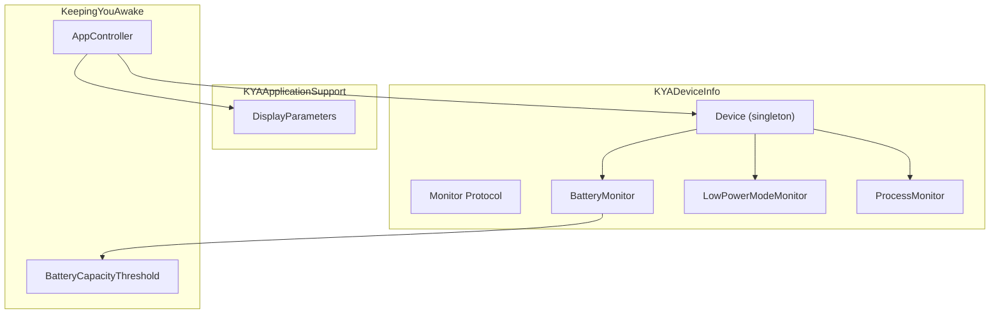
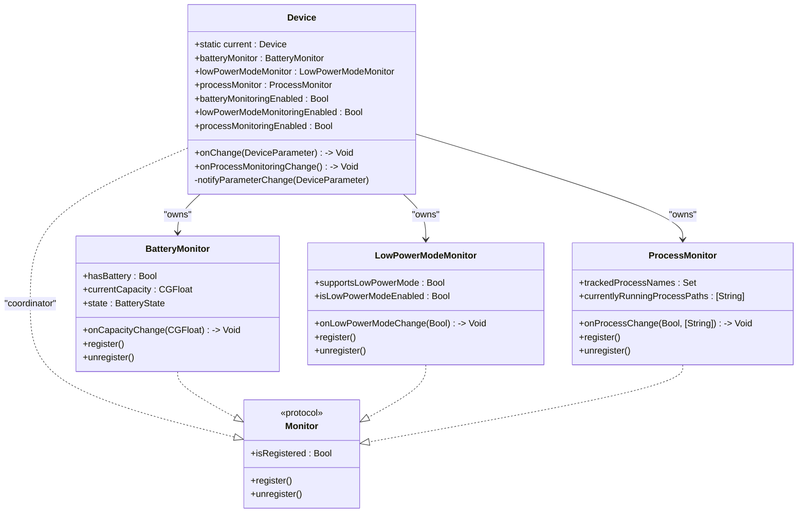
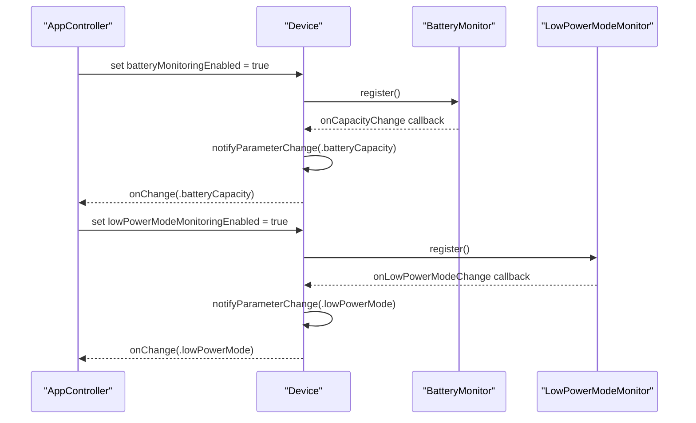
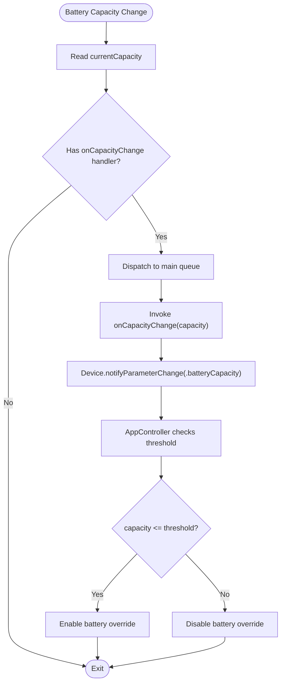
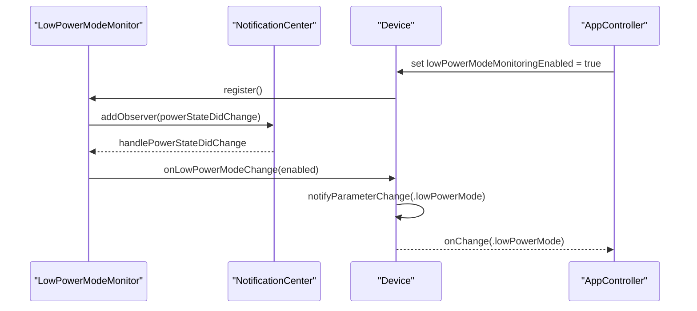
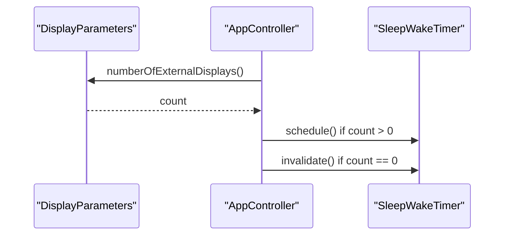
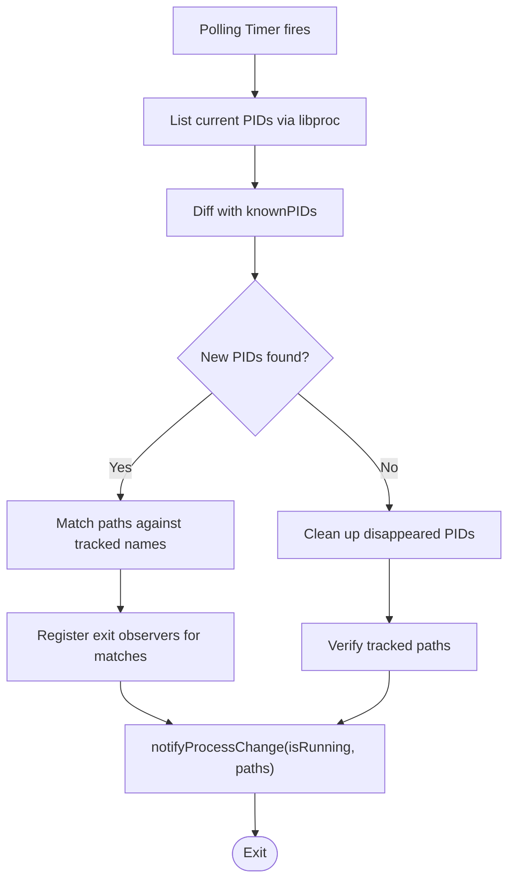
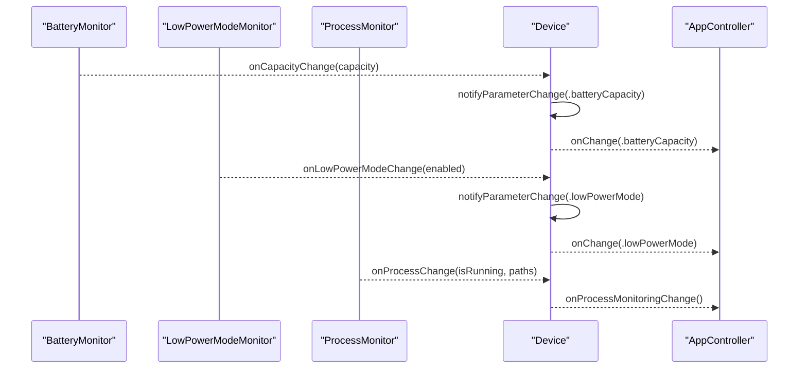
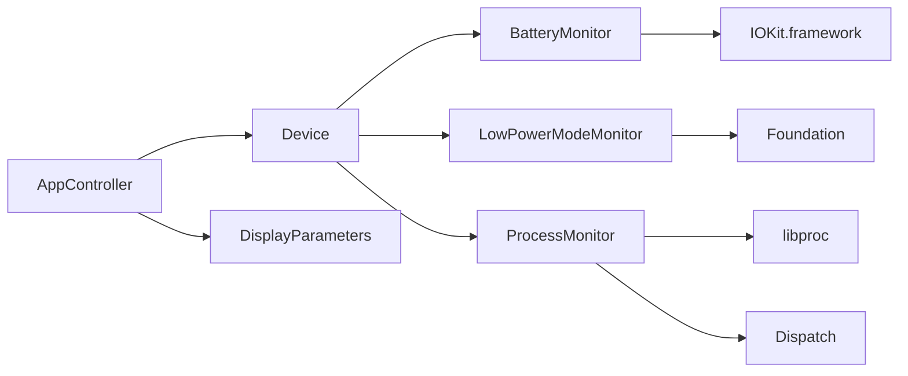

# Device Monitoring System

<cite>
**Referenced Files in This Document**
- [Device.swift](file://Packages/KYADeviceInfo/Sources/KYADeviceInfo/Device.swift)
- [Monitor.swift](file://Packages/KYADeviceInfo/Sources/KYADeviceInfo/Monitor.swift)
- [BatteryMonitor.swift](file://Packages/KYADeviceInfo/Sources/KYADeviceInfo/BatteryMonitor.swift)
- [LowPowerModeMonitor.swift](file://Packages/KYADeviceInfo/Sources/KYADeviceInfo/LowPowerModeMonitor.swift)
- [ProcessMonitor.swift](file://Packages/KYADeviceInfo/Sources/KYADeviceInfo/ProcessMonitor.swift)
- [BatteryCapacityThreshold.swift](file://KeepingYouAwake/BatteryCapacityThreshold.swift)
- [DisplayParameters.swift](file://Packages/KYAApplicationSupport/Sources/KYAApplicationSupport/DisplayParameters.swift)
- [AppController.swift](file://KeepingYouAwake/KYAAppController/AppController.swift)
</cite>

## Table of Contents
1. [Introduction](#introduction)
2. [Project Structure](#project-structure)
3. [Core Components](#core-components)
4. [Architecture Overview](#architecture-overview)
5. [Detailed Component Analysis](#detailed-component-analysis)
6. [Dependency Analysis](#dependency-analysis)
7. [Performance Considerations](#performance-considerations)
8. [Troubleshooting Guide](#troubleshooting-guide)
9. [Conclusion](#conclusion)

## Introduction
This document describes the device monitoring system responsible for tracking hardware and system state changes that influence sleep prevention behavior. It covers the Device singleton pattern architecture, the Monitor Protocol design, battery capacity monitoring with threshold configuration and automatic deactivation logic, low power mode detection, external display tracking for session state management, parameter enumeration, and change notification mechanisms. It also explains how these monitors integrate with the core timing system and how device state affects sleep prevention behavior.

## Project Structure
The device monitoring system is organized into focused modules:
- KYADeviceInfo: Core device monitoring abstractions and implementations
- KYAApplicationSupport: Application-level utilities (e.g., display parameter queries)
- KeepingYouAwake: Application controller that orchestrates timers and integrates device monitors

**Diagram sources**
- [Device.swift:24-139](file://Packages/KYADeviceInfo/Sources/KYADeviceInfo/Device.swift#L24-L139)
- [Monitor.swift:10-21](file://Packages/KYADeviceInfo/Sources/KYADeviceInfo/Monitor.swift#L10-L21)
- [BatteryMonitor.swift:28-142](file://Packages/KYADeviceInfo/Sources/KYADeviceInfo/BatteryMonitor.swift#L28-L142)
- [LowPowerModeMonitor.swift:19-85](file://Packages/KYADeviceInfo/Sources/KYADeviceInfo/LowPowerModeMonitor.swift#L19-L85)
- [ProcessMonitor.swift:13-229](file://Packages/KYADeviceInfo/Sources/KYADeviceInfo/ProcessMonitor.swift#L13-L229)
- [DisplayParameters.swift:14-58](file://Packages/KYAApplicationSupport/Sources/KYAApplicationSupport/DisplayParameters.swift#L14-L58)
- [AppController.swift:19-122](file://KeepingYouAwake/KYAAppController/AppController.swift#L19-L122)
- [BatteryCapacityThreshold.swift:11-15](file://KeepingYouAwake/BatteryCapacityThreshold.swift#L11-L15)

**Section sources**
- [Device.swift:24-139](file://Packages/KYADeviceInfo/Sources/KYADeviceInfo/Device.swift#L24-L139)
- [Monitor.swift:10-21](file://Packages/KYADeviceInfo/Sources/KYADeviceInfo/Monitor.swift#L10-L21)
- [BatteryMonitor.swift:28-142](file://Packages/KYADeviceInfo/Sources/KYADeviceInfo/BatteryMonitor.swift#L28-L142)
- [LowPowerModeMonitor.swift:19-85](file://Packages/KYADeviceInfo/Sources/KYADeviceInfo/LowPowerModeMonitor.swift#L19-L85)
- [ProcessMonitor.swift:13-229](file://Packages/KYADeviceInfo/Sources/KYADeviceInfo/ProcessMonitor.swift#L13-L229)
- [DisplayParameters.swift:14-58](file://Packages/KYAApplicationSupport/Sources/KYAApplicationSupport/DisplayParameters.swift#L14-L58)
- [AppController.swift:19-122](file://KeepingYouAwake/KYAAppController/AppController.swift#L19-L122)
- [BatteryCapacityThreshold.swift:11-15](file://KeepingYouAwake/BatteryCapacityThreshold.swift#L11-L15)

## Core Components
- Device (singleton): Central coordinator exposing battery, low power mode, and process monitors. It translates monitor events into DeviceParameter change notifications and manages enable/disable lifecycle per monitor.
- Monitor Protocol: Defines registration/unregistration semantics for stateful monitors.
- BatteryMonitor: Tracks internal battery capacity and state via IOKit power source APIs, notifying capacity changes on the main queue.
- LowPowerModeMonitor: Detects Low Power Mode state changes on supported macOS versions and forwards updates to handlers.
- ProcessMonitor: Hybrid monitoring of CLI processes using polling, path matching, and process exit observers.
- DisplayParameters: Utility to count external displays, accounting for mirroring and fallbacks.
- BatteryCapacityThreshold: Notification name for threshold change events.
- AppController: Integrates device monitors with the sleep/wake timer and applies battery override logic.

**Section sources**
- [Device.swift:11-139](file://Packages/KYADeviceInfo/Sources/KYADeviceInfo/Device.swift#L11-L139)
- [Monitor.swift:10-21](file://Packages/KYADeviceInfo/Sources/KYADeviceInfo/Monitor.swift#L10-L21)
- [BatteryMonitor.swift:13-142](file://Packages/KYADeviceInfo/Sources/KYADeviceInfo/BatteryMonitor.swift#L13-L142)
- [LowPowerModeMonitor.swift:11-85](file://Packages/KYADeviceInfo/Sources/KYADeviceInfo/LowPowerModeMonitor.swift#L11-L85)
- [ProcessMonitor.swift:13-229](file://Packages/KYADeviceInfo/Sources/KYADeviceInfo/ProcessMonitor.swift#L13-L229)
- [DisplayParameters.swift:14-58](file://Packages/KYAApplicationSupport/Sources/KYAApplicationSupport/DisplayParameters.swift#L14-L58)
- [BatteryCapacityThreshold.swift:11-15](file://KeepingYouAwake/BatteryCapacityThreshold.swift#L11-L15)
- [AppController.swift:19-122](file://KeepingYouAwake/KYAAppController/AppController.swift#L19-L122)

## Architecture Overview
The Device singleton aggregates multiple monitors behind a unified interface. Each monitor conforms to the Monitor protocol and exposes registration controls. Device translates monitor events into DeviceParameter notifications. AppController subscribes to Device notifications and orchestrates the sleep/wake timer accordingly.

**Diagram sources**
- [Device.swift:24-139](file://Packages/KYADeviceInfo/Sources/KYADeviceInfo/Device.swift#L24-L139)
- [Monitor.swift:10-21](file://Packages/KYADeviceInfo/Sources/KYADeviceInfo/Monitor.swift#L10-L21)
- [BatteryMonitor.swift:28-142](file://Packages/KYADeviceInfo/Sources/KYADeviceInfo/BatteryMonitor.swift#L28-L142)
- [LowPowerModeMonitor.swift:19-85](file://Packages/KYADeviceInfo/Sources/KYADeviceInfo/LowPowerModeMonitor.swift#L19-L85)
- [ProcessMonitor.swift:13-229](file://Packages/KYADeviceInfo/Sources/KYADeviceInfo/ProcessMonitor.swift#L13-L229)

## Detailed Component Analysis

### Device Singleton Pattern and Parameter Enumeration
- Singleton access: Device.current provides a single entry point for all device monitoring capabilities.
- DeviceParameter enumeration: batteryCapacity, lowPowerMode, externalDisplay define the parameter domain for change notifications.
- Change notification: Device.notifyParameterChange dispatches on the main queue to ensure UI-safe callbacks.
- Monitor enable/disable: Each monitor exposes a Boolean property that registers/unregisters and wires handlers to emit DeviceParameter changes.

**Diagram sources**
- [Device.swift:42-64](file://Packages/KYADeviceInfo/Sources/KYADeviceInfo/Device.swift#L42-L64)
- [Device.swift:73-91](file://Packages/KYADeviceInfo/Sources/KYADeviceInfo/Device.swift#L73-L91)
- [BatteryMonitor.swift:72-94](file://Packages/KYADeviceInfo/Sources/KYADeviceInfo/BatteryMonitor.swift#L72-L94)
- [LowPowerModeMonitor.swift:42-67](file://Packages/KYADeviceInfo/Sources/KYADeviceInfo/LowPowerModeMonitor.swift#L42-L67)

**Section sources**
- [Device.swift:11-26](file://Packages/KYADeviceInfo/Sources/KYADeviceInfo/Device.swift#L11-L26)
- [Device.swift:134-139](file://Packages/KYADeviceInfo/Sources/KYADeviceInfo/Device.swift#L134-L139)
- [Device.swift:42-64](file://Packages/KYADeviceInfo/Sources/KYADeviceInfo/Device.swift#L42-L64)
- [Device.swift:73-91](file://Packages/KYADeviceInfo/Sources/KYADeviceInfo/Device.swift#L73-L91)

### Battery Capacity Monitoring and Threshold Logic
- Availability and state: BatteryMonitor exposes hasBattery, currentCapacity, and BatteryState derived from IOKit power source information.
- Registration: register adds an IOPS notification run loop source; unregister removes it.
- Handler invocation: onCapacityChange is invoked on the main queue with the latest capacity.
- Integration with AppController: AppController checks current capacity against a user-configured threshold to decide whether to enable a battery override that prevents sleep.

**Diagram sources**
- [BatteryMonitor.swift:72-109](file://Packages/KYADeviceInfo/Sources/KYADeviceInfo/BatteryMonitor.swift#L72-L109)
- [Device.swift:53-56](file://Packages/KYADeviceInfo/Sources/KYADeviceInfo/Device.swift#L53-L56)
- [AppController.swift:191-196](file://KeepingYouAwake/KYAAppController/AppController.swift#L191-L196)
- [BatteryCapacityThreshold.swift:11-15](file://KeepingYouAwake/BatteryCapacityThreshold.swift#L11-L15)

**Section sources**
- [BatteryMonitor.swift:13-142](file://Packages/KYADeviceInfo/Sources/KYADeviceInfo/BatteryMonitor.swift#L13-L142)
- [Device.swift:42-64](file://Packages/KYADeviceInfo/Sources/KYADeviceInfo/Device.swift#L42-L64)
- [AppController.swift:191-196](file://KeepingYouAwake/KYAAppController/AppController.swift#L191-L196)
- [BatteryCapacityThreshold.swift:11-15](file://KeepingYouAwake/BatteryCapacityThreshold.swift#L11-L15)

### Low Power Mode Detection
- Availability: supportsLowPowerMode checks the macOS version; on unsupported systems, register is effectively a no-op.
- Current state: isLowPowerModeEnabled reads ProcessInfo when available.
- Registration: LowPowerModeMonitor registers for a custom notification compatible with the deployment target and forwards state changes to onLowPowerModeChange on the main queue.

**Diagram sources**
- [LowPowerModeMonitor.swift:19-85](file://Packages/KYADeviceInfo/Sources/KYADeviceInfo/LowPowerModeMonitor.swift#L19-L85)
- [Device.swift:80-83](file://Packages/KYADeviceInfo/Sources/KYADeviceInfo/Device.swift#L80-L83)

**Section sources**
- [LowPowerModeMonitor.swift:19-85](file://Packages/KYADeviceInfo/Sources/KYADeviceInfo/LowPowerModeMonitor.swift#L19-L85)
- [Device.swift:66-91](file://Packages/KYADeviceInfo/Sources/KYADeviceInfo/Device.swift#L66-L91)

### External Display Tracking and Session State Management
- External display counting: DisplayParameters.numberOfExternalDisplays queries CoreGraphics for active displays, filters out mirrors and the main display, and returns a count suitable for session decisions.
- Session-driven activation: AppController subscribes to workspace session notifications and toggles the sleep/wake timer based on external display presence when the relevant preference is enabled.

**Diagram sources**
- [DisplayParameters.swift:21-57](file://Packages/KYAApplicationSupport/Sources/KYAApplicationSupport/DisplayParameters.swift#L21-L57)
- [AppController.swift:301-310](file://KeepingYouAwake/KYAAppController/AppController.swift#L301-L310)

**Section sources**
- [DisplayParameters.swift:14-58](file://Packages/KYAApplicationSupport/Sources/KYAApplicationSupport/DisplayParameters.swift#L14-L58)
- [AppController.swift:301-310](file://KeepingYouAwake/KYAAppController/AppController.swift#L301-L310)

### Process Monitoring (CLI Tool Tracking)
- Hybrid approach: Periodic polling (every 2 seconds) diffs PIDs, path matching to identify target processes, and DispatchSourceProcess exit observers for immediate exit detection.
- Registration: Starts a timer on a utility queue; unregister cancels the timer and removes all exit observers.
- Notifications: onProcessChange reports whether any tracked process is running and provides current paths.

**Diagram sources**
- [ProcessMonitor.swift:32-67](file://Packages/KYADeviceInfo/Sources/KYADeviceInfo/ProcessMonitor.swift#L32-L67)
- [ProcessMonitor.swift:92-113](file://Packages/KYADeviceInfo/Sources/KYADeviceInfo/ProcessMonitor.swift#L92-L113)
- [ProcessMonitor.swift:117-137](file://Packages/KYADeviceInfo/Sources/KYADeviceInfo/ProcessMonitor.swift#L117-L137)
- [ProcessMonitor.swift:149-182](file://Packages/KYADeviceInfo/Sources/KYADeviceInfo/ProcessMonitor.swift#L149-L182)
- [ProcessMonitor.swift:218-224](file://Packages/KYADeviceInfo/Sources/KYADeviceInfo/ProcessMonitor.swift#L218-L224)

**Section sources**
- [ProcessMonitor.swift:13-229](file://Packages/KYADeviceInfo/Sources/KYADeviceInfo/ProcessMonitor.swift#L13-L229)

### Parameter Enumeration and Change Notification Mechanisms
- DeviceParameter: Enumerates batteryCapacity, lowPowerMode, externalDisplay to unify change notifications.
- Device.onChange: Receives DeviceParameter changes and is invoked on the main queue.
- Device.onProcessMonitoringChange: Dedicated callback for process monitoring state transitions.

**Diagram sources**
- [Device.swift:120-125](file://Packages/KYADeviceInfo/Sources/KYADeviceInfo/Device.swift#L120-L125)
- [Device.swift:134-139](file://Packages/KYADeviceInfo/Sources/KYADeviceInfo/Device.swift#L134-L139)
- [BatteryMonitor.swift:97](file://Packages/KYADeviceInfo/Sources/KYADeviceInfo/BatteryMonitor.swift#L97)
- [LowPowerModeMonitor.swift:70](file://Packages/KYADeviceInfo/Sources/KYADeviceInfo/LowPowerModeMonitor.swift#L70)
- [ProcessMonitor.swift:21](file://Packages/KYADeviceInfo/Sources/KYADeviceInfo/ProcessMonitor.swift#L21)

**Section sources**
- [Device.swift:11-20](file://Packages/KYADeviceInfo/Sources/KYADeviceInfo/Device.swift#L11-L20)
- [Device.swift:120-125](file://Packages/KYADeviceInfo/Sources/KYADeviceInfo/Device.swift#L120-L125)
- [Device.swift:134-139](file://Packages/KYADeviceInfo/Sources/KYADeviceInfo/Device.swift#L134-L139)

## Dependency Analysis
- Device depends on Monitor protocol and concrete monitor implementations.
- AppController depends on Device for state changes and on DisplayParameters for external display counts.
- BatteryMonitor and LowPowerModeMonitor depend on system frameworks (IOKit, Foundation).
- ProcessMonitor depends on libproc and Dispatch APIs.

**Diagram sources**
- [Device.swift:24-38](file://Packages/KYADeviceInfo/Sources/KYADeviceInfo/Device.swift#L24-L38)
- [AppController.swift:19-18](file://KeepingYouAwake/KYAAppController/AppController.swift#L19-L18)
- [BatteryMonitor.swift:9-11](file://Packages/KYADeviceInfo/Sources/KYADeviceInfo/BatteryMonitor.swift#L9-L11)
- [LowPowerModeMonitor.swift:9](file://Packages/KYADeviceInfo/Sources/KYADeviceInfo/LowPowerModeMonitor.swift#L9)
- [ProcessMonitor.swift:9-11](file://Packages/KYADeviceInfo/Sources/KYADeviceInfo/ProcessMonitor.swift#L9-L11)

**Section sources**
- [Device.swift:24-38](file://Packages/KYADeviceInfo/Sources/KYADeviceInfo/Device.swift#L24-L38)
- [AppController.swift:19-18](file://KeepingYouAwake/KYAAppController/AppController.swift#L19-L18)
- [BatteryMonitor.swift:9-11](file://Packages/KYADeviceInfo/Sources/KYADeviceInfo/BatteryMonitor.swift#L9-L11)
- [LowPowerModeMonitor.swift:9](file://Packages/KYADeviceInfo/Sources/KYADeviceInfo/LowPowerModeMonitor.swift#L9)
- [ProcessMonitor.swift:9-11](file://Packages/KYADeviceInfo/Sources/KYADeviceInfo/ProcessMonitor.swift#L9-L11)

## Performance Considerations
- Run loop and timers: BatteryMonitor uses an IOPS run loop source; ProcessMonitor uses a periodic timer with a utility QoS queue to minimize UI impact.
- Main queue dispatch: All change handlers are dispatched to the main queue to keep UI updates safe.
- Conditional registration: Monitors only register when explicitly enabled, reducing overhead when idle.
- Polling cadence: ProcessMonitor polls every 2 seconds with leeway to balance responsiveness and efficiency.
- Resource cleanup: unregister cancels timers and removes observers to prevent leaks and unnecessary work.

[No sources needed since this section provides general guidance]

## Troubleshooting Guide
- Battery monitoring not triggering:
  - Verify hasBattery is true and batteryMonitoringEnabled is set to true.
  - Confirm onCapacityChange is assigned and Device.onChange is subscribed.
- Low Power Mode not detected:
  - Ensure supportsLowPowerMode is true (macOS 12+); on older systems, register is a no-op.
  - Confirm onLowPowerModeChange is assigned and Device.onChange is subscribed.
- External display detection issues:
  - Validate DisplayParameters.numberOfExternalDisplays logic and ensure preferences enabling activation on external display connection are set.
- Process monitoring false positives/negatives:
  - Check trackedProcessNames and verify process paths match expectations.
  - Confirm exit observers are registered and cleaned up on process exit.

**Section sources**
- [BatteryMonitor.swift:30-43](file://Packages/KYADeviceInfo/Sources/KYADeviceInfo/BatteryMonitor.swift#L30-L43)
- [LowPowerModeMonitor.swift:21-27](file://Packages/KYADeviceInfo/Sources/KYADeviceInfo/LowPowerModeMonitor.swift#L21-L27)
- [ProcessMonitor.swift:28-30](file://Packages/KYADeviceInfo/Sources/KYADeviceInfo/ProcessMonitor.swift#L28-L30)
- [DisplayParameters.swift:21-57](file://Packages/KYAApplicationSupport/Sources/KYAApplicationSupport/DisplayParameters.swift#L21-L57)

## Conclusion
The device monitoring system leverages a clean singleton architecture with a unified Monitor Protocol to coordinate battery, low power mode, and process state changes. DeviceParameter notifications enable AppController to enforce sleep prevention policies based on real-time hardware and system conditions. Threshold-based battery override logic, external display tracking, and robust process monitoring collectively ensure reliable behavior across diverse macOS environments.