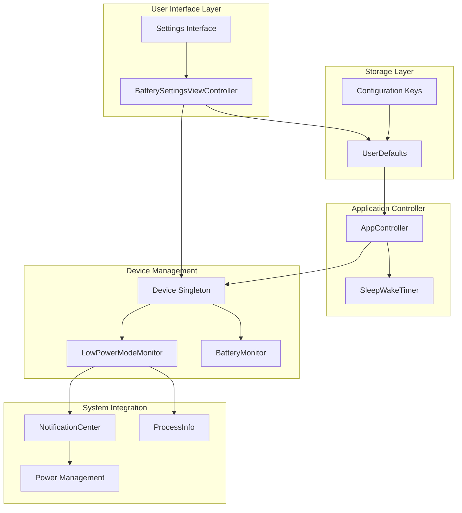
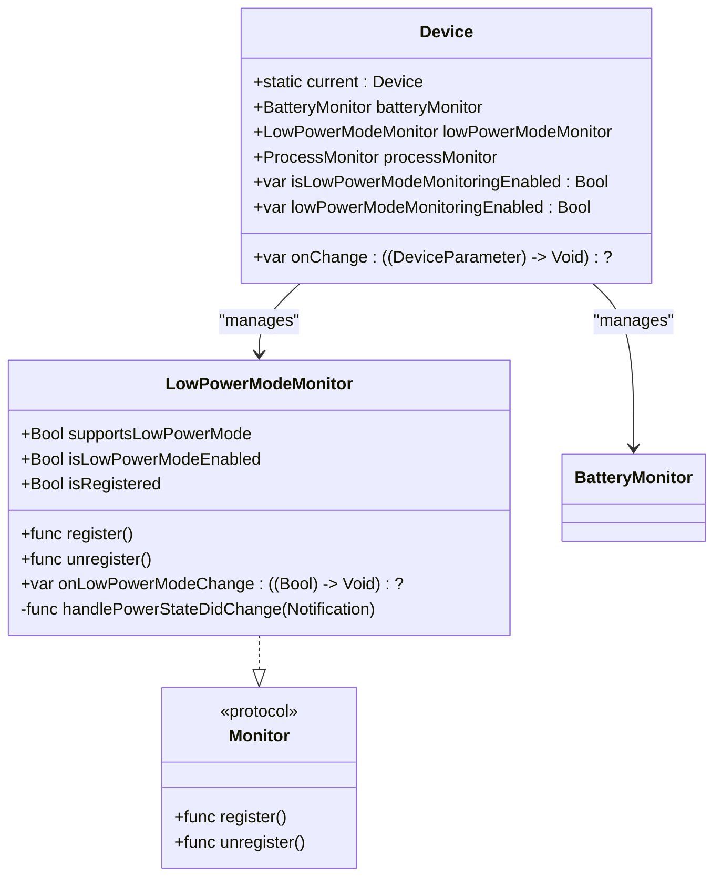
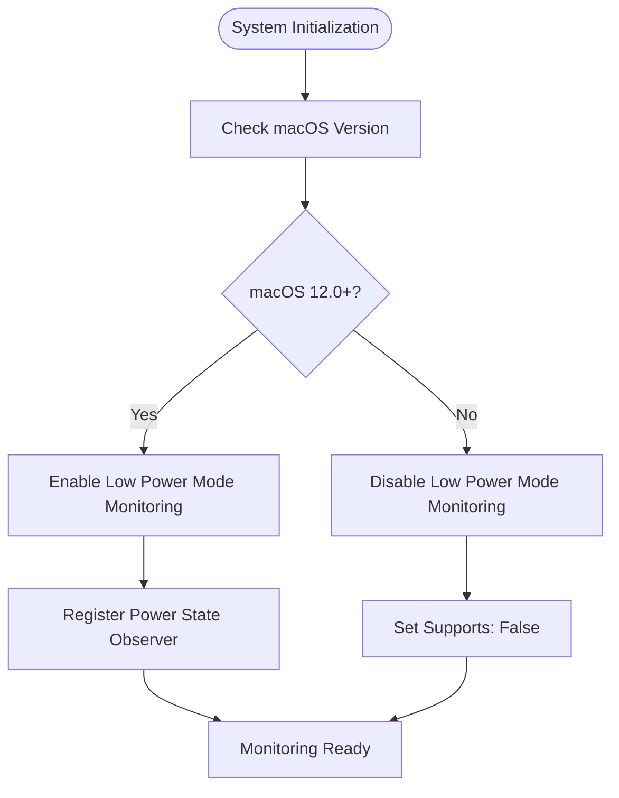
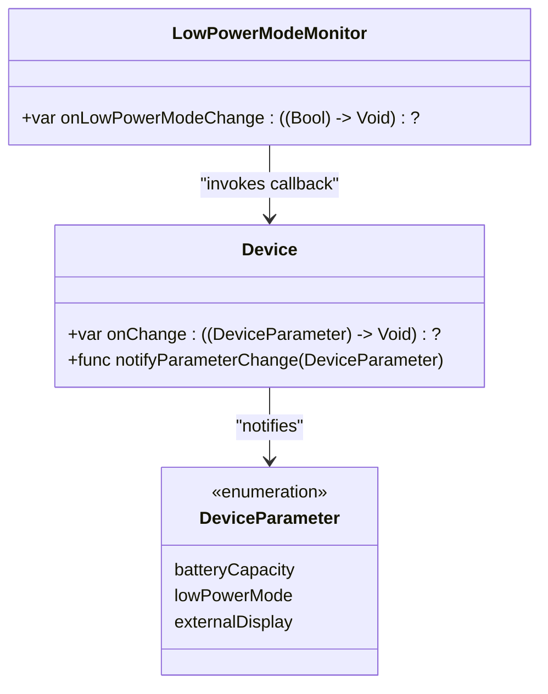
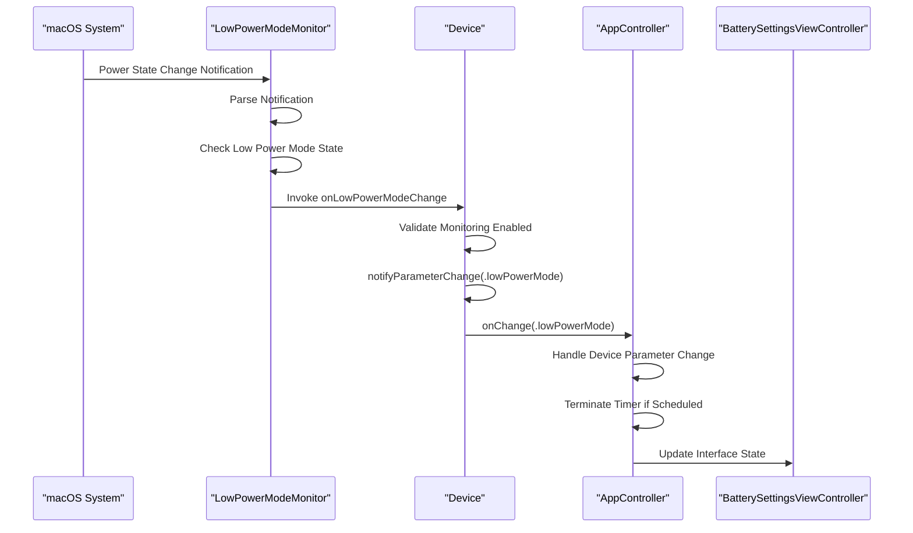
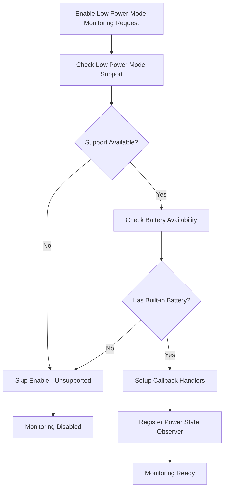
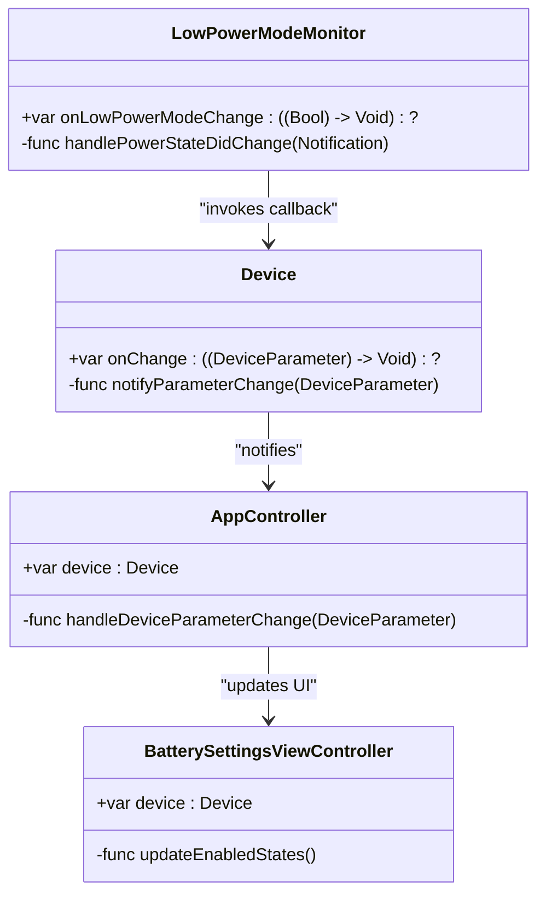
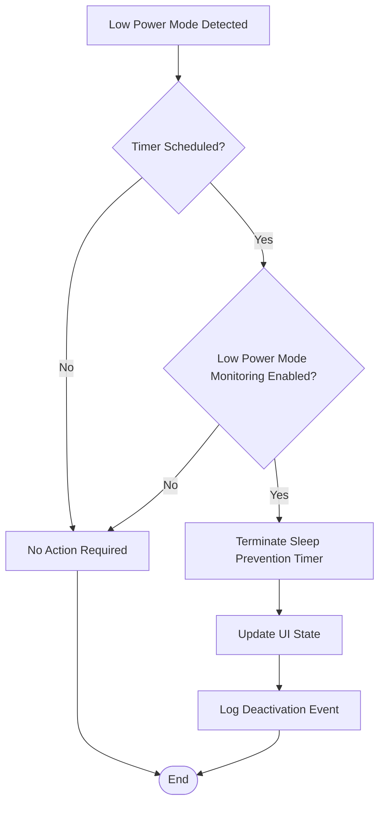

# Low Power Mode Monitoring

<cite>
**Referenced Files in This Document**
- [LowPowerModeMonitor.swift](file://Packages/KYADeviceInfo/Sources/KYADeviceInfo/LowPowerModeMonitor.swift)
- [Device.swift](file://Packages/KYADeviceInfo/Sources/KYADeviceInfo/Device.swift)
- [AppController.swift](file://KeepingYouAwake/KYAAppController/AppController.swift)
- [BatterySettingsViewController.swift](file://KeepingYouAwake/Settings/KYABatterySettingsViewController/BatterySettingsViewController.swift)
- [UserDefaults+KYAKeys.swift](file://Packages/KYAApplicationSupport/Sources/KYAApplicationSupport/UserDefaults+KYAKeys.swift)
- [BatteryMonitor.swift](file://Packages/KYADeviceInfo/Sources/KYADeviceInfo/BatteryMonitor.swift)
- [DeviceTests.swift](file://Packages/KYADeviceInfo/Tests/KYADeviceInfoTests/DeviceTests.swift)
</cite>

## Table of Contents
1. [Introduction](#introduction)
2. [System Architecture](#system-architecture)
3. [LowPowerModeMonitor Implementation](#lowpowermodemonitor-implementation)
4. [Platform Compatibility and Detection](#platform-compatibility-and-detection)
5. [Integration with Device Parameter Notifications](#integration-with-device-parameter-notifications)
6. [Conditional Monitoring Logic](#conditional-monitoring-logic)
7. [Callback System and State Changes](#callback-system-and-state-changes)
8. [Sleep Prevention Behavior Impact](#sleep-prevention-behavior-impact)
9. [Examples and Use Cases](#examples-and-use-cases)
10. [Performance Considerations](#performance-considerations)
11. [Troubleshooting Guide](#troubleshooting-guide)
12. [Conclusion](#conclusion)

## Introduction

The Low Power Mode Monitoring system in KeepingYouAwake provides automatic detection and response to macOS Low Power Mode state changes. This system allows the application to automatically deactivate sleep prevention when the operating system enters Low Power Mode, ensuring optimal battery life while maintaining user control over when the application should remain active.

The monitoring system is designed with platform compatibility in mind, supporting both modern macOS systems with Low Power Mode support and legacy systems without this capability. The implementation follows a clean separation of concerns, with dedicated monitoring classes, device parameter notifications, and user interface integration.

## System Architecture

The Low Power Mode Monitoring system is built around a modular architecture that separates concerns between monitoring, device management, and user interface components.

**Diagram sources**
- [Device.swift:24-35](file://Packages/KYADeviceInfo/Sources/KYADeviceInfo/Device.swift#L24-L35)
- [LowPowerModeMonitor.swift:19-35](file://Packages/KYADeviceInfo/Sources/KYADeviceInfo/LowPowerModeMonitor.swift#L19-L35)
- [AppController.swift:21-25](file://KeepingYouAwake/KYAAppController/AppController.swift#L21-L25)

## LowPowerModeMonitor Implementation

The `LowPowerModeMonitor` class serves as the core component responsible for detecting Low Power Mode state changes on macOS systems. It implements a clean, protocol-based architecture that ensures consistent behavior across different monitor types.

### Core Properties and Methods

The monitor provides essential properties for checking Low Power Mode support and current state:

**Diagram sources**
- [LowPowerModeMonitor.swift:19-85](file://Packages/KYADeviceInfo/Sources/KYADeviceInfo/LowPowerModeMonitor.swift#L19-L85)
- [Device.swift:24-91](file://Packages/KYADeviceInfo/Sources/KYADeviceInfo/Device.swift#L24-L91)

### Platform-Specific Implementation

The monitor implements platform-specific logic to handle different macOS versions:

- **macOS 12.0+**: Full Low Power Mode support with real-time notifications
- **Legacy Systems**: Graceful degradation with support detection

**Section sources**
- [LowPowerModeMonitor.swift:21-35](file://Packages/KYADeviceInfo/Sources/KYADeviceInfo/LowPowerModeMonitor.swift#L21-L35)

## Platform Compatibility and Detection

The Low Power Mode monitoring system implements sophisticated platform compatibility checks to ensure reliable operation across different macOS versions and hardware configurations.

### Support Detection Mechanism

The system uses compile-time availability checks to determine Low Power Mode support:

**Diagram sources**
- [LowPowerModeMonitor.swift:21-27](file://Packages/KYADeviceInfo/Sources/KYADeviceInfo/LowPowerModeMonitor.swift#L21-L27)
- [Device.swift:78-89](file://Packages/KYADeviceInfo/Sources/KYADeviceInfo/Device.swift#L78-L89)

### Hardware Configuration Considerations

The system accounts for various hardware configurations:

- **Built-in Battery Required**: Low Power Mode detection requires systems with internal battery management
- **External Power Sources**: Monitoring respects AC power vs. battery power states
- **System Settings Integration**: Works with macOS System Settings Battery panel controls

**Section sources**
- [LowPowerModeMonitor.swift:21-27](file://Packages/KYADeviceInfo/Sources/KYADeviceInfo/LowPowerModeMonitor.swift#L21-L27)
- [Device.swift:78-89](file://Packages/KYADeviceInfo/Sources/KYADeviceInfo/Device.swift#L78-L89)

## Integration with Device Parameter Notifications

The Low Power Mode monitoring integrates seamlessly with the Device parameter notification system, providing a unified interface for device state changes.

### Device Parameter Enumeration

The system defines a comprehensive enumeration of device parameters:

**Diagram sources**
- [Device.swift:13-20](file://Packages/KYADeviceInfo/Sources/KYADeviceInfo/Device.swift#L13-L20)
- [Device.swift:134-138](file://Packages/KYADeviceInfo/Sources/KYADeviceInfo/Device.swift#L134-L138)

### Notification Flow

The notification system follows a structured flow for Low Power Mode state changes:

**Diagram sources**
- [LowPowerModeMonitor.swift:74-80](file://Packages/KYADeviceInfo/Sources/KYADeviceInfo/LowPowerModeMonitor.swift#L74-L80)
- [Device.swift:80-83](file://Packages/KYADeviceInfo/Sources/KYADeviceInfo/Device.swift#L80-L83)
- [AppController.swift:227-246](file://KeepingYouAwake/KYAAppController/AppController.swift#L227-L246)

**Section sources**
- [Device.swift:13-20](file://Packages/KYADeviceInfo/Sources/KYADeviceInfo/Device.swift#L13-L20)
- [Device.swift:134-138](file://Packages/KYADeviceInfo/Sources/KYADeviceInfo/Device.swift#L134-L138)

## Conditional Monitoring Logic

The system implements sophisticated conditional logic to ensure monitoring is only enabled when appropriate and supported.

### Support Validation

The monitoring system performs comprehensive validation before enabling Low Power Mode detection:

**Diagram sources**
- [Device.swift:78-89](file://Packages/KYADeviceInfo/Sources/KYADeviceInfo/Device.swift#L78-L89)
- [BatteryMonitor.swift:31-35](file://Packages/KYADeviceInfo/Sources/KYADeviceInfo/BatteryMonitor.swift#L31-L35)

### User Preference Integration

The system respects user preferences through UserDefaults integration:

- **User Control**: Users can enable/disable Low Power Mode monitoring in settings
- **Persistence**: Preferences are stored using standardized key names
- **Runtime Updates**: Changes take effect immediately without requiring application restart

**Section sources**
- [Device.swift:78-89](file://Packages/KYADeviceInfo/Sources/KYADeviceInfo/Device.swift#L78-L89)
- [UserDefaults+KYAKeys.swift:24](file://Packages/KYAApplicationSupport/Sources/KYAApplicationSupport/UserDefaults+KYAKeys.swift#L24)

## Callback System and State Changes

The Low Power Mode monitoring system implements a robust callback architecture that handles state changes and propagates them through the application hierarchy.

### Callback Architecture

The system uses a multi-layered callback approach:

**Diagram sources**
- [LowPowerModeMonitor.swift:69-80](file://Packages/KYADeviceInfo/Sources/KYADeviceInfo/LowPowerModeMonitor.swift#L69-L80)
- [Device.swift:80-83](file://Packages/KYADeviceInfo/Sources/KYADeviceInfo/Device.swift#L80-L83)
- [AppController.swift:208-210](file://KeepingYouAwake/KYAAppController/AppController.swift#L208-L210)

### Main Queue Dispatch

All callbacks are dispatched on the main queue to ensure thread safety and proper UI updates:

- **Thread Safety**: All state changes occur on the main thread
- **UI Consistency**: Interface updates happen synchronously with state changes
- **Performance**: Minimal overhead through efficient main queue dispatching

**Section sources**
- [LowPowerModeMonitor.swift:77-79](file://Packages/KYADeviceInfo/Sources/KYADeviceInfo/LowPowerModeMonitor.swift#L77-L79)
- [Device.swift:135-137](file://Packages/KYADeviceInfo/Sources/KYADeviceInfo/Device.swift#L135-L137)

## Sleep Prevention Behavior Impact

The Low Power Mode monitoring system significantly impacts sleep prevention behavior by automatically responding to system power state changes.

### Timer Deactivation Logic

When Low Power Mode is detected, the system automatically deactivates the sleep prevention timer:

**Diagram sources**
- [AppController.swift:238-242](file://KeepingYouAwake/KYAAppController/AppController.swift#L238-L242)

### User Experience Considerations

The system maintains a balance between automatic behavior and user control:

- **Automatic Protection**: Prevents unexpected timer activation during Low Power Mode
- **User Override**: Allows manual activation regardless of Low Power Mode state
- **Clear Feedback**: Provides immediate visual feedback through status indicators

**Section sources**
- [AppController.swift:238-242](file://KeepingYouAwake/KYAAppController/AppController.swift#L238-L242)

## Examples and Use Cases

The Low Power Mode monitoring system handles various real-world scenarios and user interactions.

### Example 1: Automatic Deactivation

**Scenario**: User enables Low Power Mode in System Settings while timer is active

**Expected Behavior**:
- Low Power Mode detection triggers immediately
- Current sleep prevention timer is terminated
- Application returns to inactive state
- Settings interface reflects new state

### Example 2: Manual Override

**Scenario**: User manually activates timer despite Low Power Mode being enabled

**Expected Behavior**:
- Manual activation bypasses Low Power Mode protection
- Timer remains active until completion or manual termination
- User receives clear indication of manual override

### Example 3: System Transition

**Scenario**: System transitions between Low Power Mode and normal operation

**Expected Behavior**:
- Automatic detection of state changes
- Smooth transitions between active and inactive states
- Consistent behavior across multiple transitions

**Section sources**
- [AppController.swift:238-242](file://KeepingYouAwake/KYAAppController/AppController.swift#L238-L242)
- [BatterySettingsViewController.swift:224-228](file://KeepingYouAwake/Settings/KYABatterySettingsViewController/BatterySettingsViewController.swift#L224-L228)

## Performance Considerations

The Low Power Mode monitoring system is designed for minimal performance impact while maintaining responsiveness.

### Memory Management

- **Weak References**: Callback handlers use weak references to prevent retain cycles
- **Automatic Cleanup**: Proper cleanup in deinitialization methods
- **Observer Management**: Clean registration and unregistration of notification observers

### Thread Safety

- **Main Queue Dispatch**: All UI-related updates occur on the main thread
- **Atomic Operations**: State changes are atomic and thread-safe
- **Minimal Blocking**: Monitoring operations avoid blocking the main thread

### Resource Efficiency

- **Conditional Registration**: Observers are only registered when supported and enabled
- **Lazy Evaluation**: Support checks are performed only when needed
- **Efficient Notifications**: Minimal overhead in notification processing

**Section sources**
- [LowPowerModeMonitor.swift:82-84](file://Packages/KYADeviceInfo/Sources/KYADeviceInfo/LowPowerModeMonitor.swift#L82-L84)
- [Device.swift:135-137](file://Packages/KYADeviceInfo/Sources/KYADeviceInfo/Device.swift#L135-L137)

## Troubleshooting Guide

Common issues and solutions for the Low Power Mode monitoring system.

### Issue 1: Monitoring Not Working

**Symptoms**: Low Power Mode changes don't affect timer behavior

**Possible Causes**:
- Low Power Mode monitoring disabled in settings
- System lacks Low Power Mode support
- Battery monitor indicates no built-in battery

**Solutions**:
- Verify Low Power Mode monitoring is enabled in Battery settings
- Check macOS version compatibility (requires 12.0+)
- Confirm system has built-in battery

### Issue 2: Incorrect State Detection

**Symptoms**: Timer state doesn't match Low Power Mode status

**Possible Causes**:
- Delayed system notification processing
- Race conditions in state checking
- UI refresh timing issues

**Solutions**:
- Wait for system to fully process Low Power Mode changes
- Check system logs for monitoring errors
- Restart application to reinitialize monitoring

### Issue 3: Performance Issues

**Symptoms**: Application becomes sluggish with monitoring enabled

**Possible Causes**:
- Excessive notification processing
- Memory leaks in callback handlers
- Inefficient state checking

**Solutions**:
- Verify monitoring is properly registered/unregistered
- Check for retain cycles in callback closures
- Review notification observer management

**Section sources**
- [DeviceTests.swift:94-107](file://Packages/KYADeviceInfo/Tests/KYADeviceInfoTests/DeviceTests.swift#L94-L107)
- [LowPowerModeMonitor.swift:44-55](file://Packages/KYADeviceInfo/Sources/KYADeviceInfo/LowPowerModeMonitor.swift#L44-L55)

## Conclusion

The Low Power Mode Monitoring system in KeepingYouAwake provides a robust, platform-aware solution for automatic sleep prevention management. The implementation demonstrates excellent architectural design through its modular structure, comprehensive platform compatibility, and seamless integration with the broader application ecosystem.

Key strengths of the system include:

- **Platform Awareness**: Sophisticated support detection for different macOS versions
- **User Control**: Flexible configuration through UserDefaults integration
- **Performance**: Minimal overhead with efficient resource management
- **Reliability**: Comprehensive error handling and graceful degradation
- **Integration**: Seamless coordination with timer management and UI components

The system successfully balances automation with user control, providing intelligent behavior that adapts to system conditions while respecting user preferences. This approach ensures optimal battery life management without sacrificing the application's core functionality.