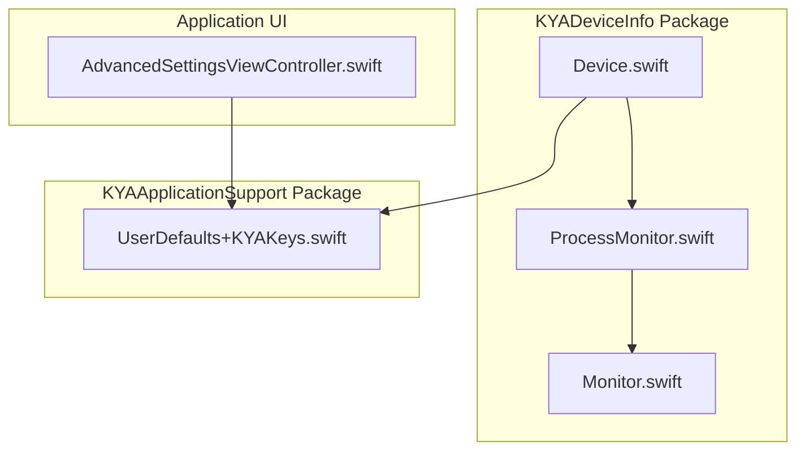
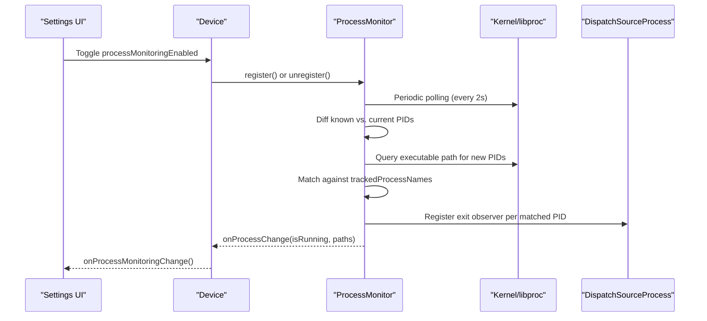
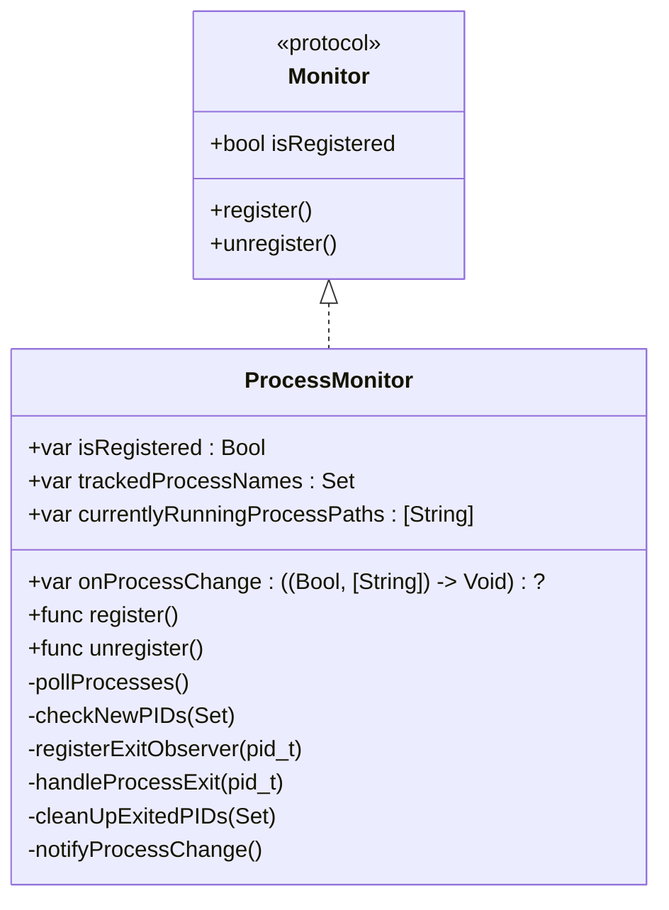
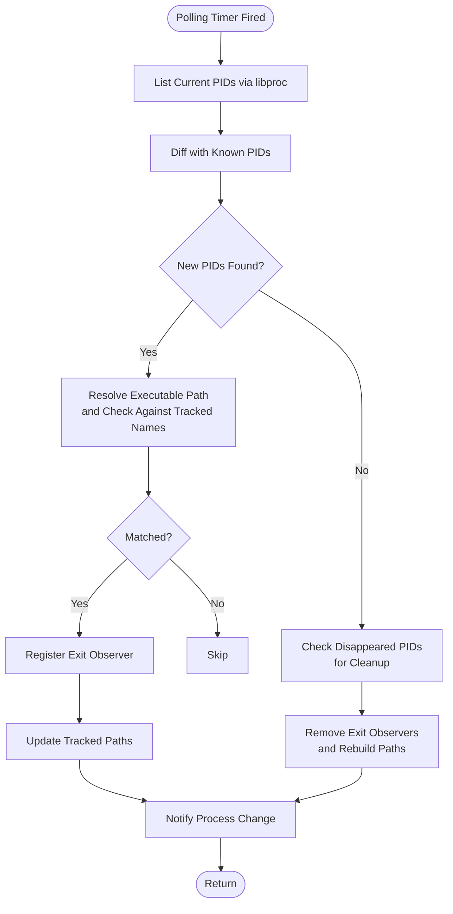
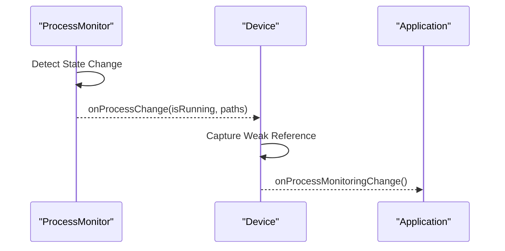
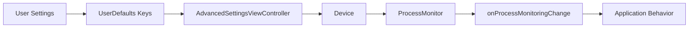
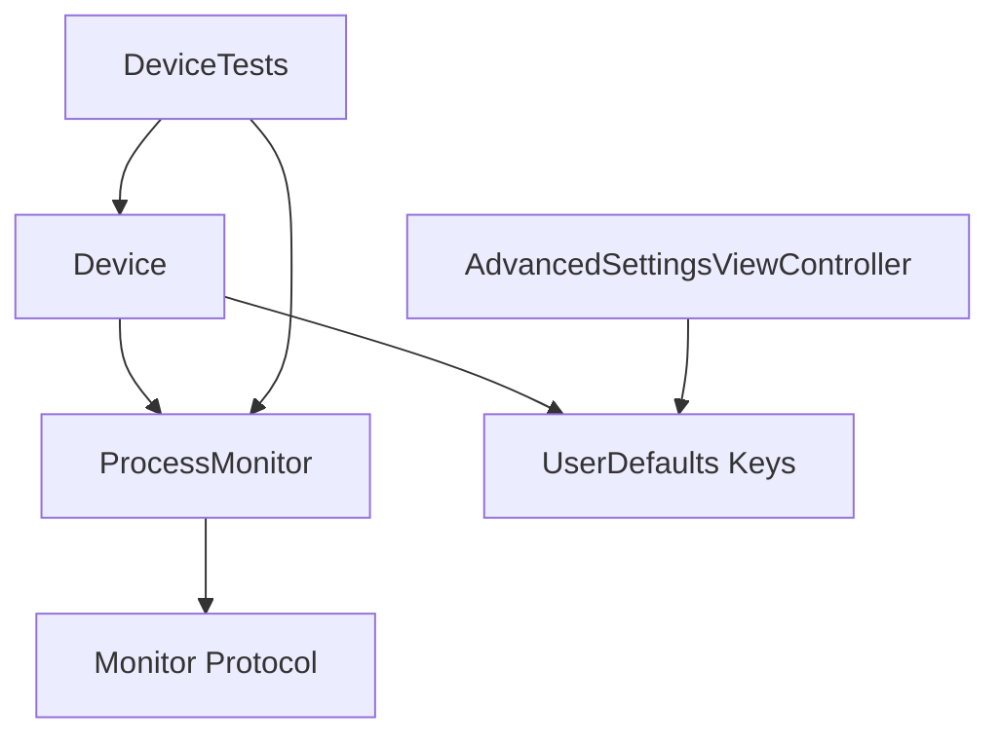

# Process Monitoring System

<cite>
**Referenced Files in This Document**
- [ProcessMonitor.swift](file://Packages/KYADeviceInfo/Sources/KYADeviceInfo/ProcessMonitor.swift)
- [Device.swift](file://Packages/KYADeviceInfo/Sources/KYADeviceInfo/Device.swift)
- [Monitor.swift](file://Packages/KYADeviceInfo/Sources/KYADeviceInfo/Monitor.swift)
- [UserDefaults+KYAKeys.swift](file://Packages/KYAApplicationSupport/Sources/KYAApplicationSupport/UserDefaults+KYAKeys.swift)
- [AdvancedSettingsViewController.swift](file://KeepingYouAwake/Settings/KYAAdvancedSettingsViewController/AdvancedSettingsViewController.swift)
- [DeviceTests.swift](file://Packages/KYADeviceInfo/Tests/KYADeviceInfoTests/DeviceTests.swift)
</cite>

## Table of Contents
1. [Introduction](#introduction)
2. [Project Structure](#project-structure)
3. [Core Components](#core-components)
4. [Architecture Overview](#architecture-overview)
5. [Detailed Component Analysis](#detailed-component-analysis)
6. [Dependency Analysis](#dependency-analysis)
7. [Performance Considerations](#performance-considerations)
8. [Troubleshooting Guide](#troubleshooting-guide)
9. [Conclusion](#conclusion)

## Introduction
This document explains the Process Monitoring System responsible for tracking command-line interface tool processes to influence device sleep prevention behavior. The system comprises a three-layer hybrid monitoring approach: periodic polling for process discovery, path-based matching for target processes, and low-latency exit detection via process exit observers. It integrates with the Device class to expose a callback that signals when monitored processes start or exit, enabling the application to adjust its activation state accordingly.

## Project Structure
The process monitoring functionality spans several modules:
- KYADeviceInfo package: Contains the ProcessMonitor implementation, Device integration, and the Monitor protocol.
- KYAApplicationSupport package: Provides UserDefaults keys for persisting user preferences related to process monitoring.
- Application settings UI: Presents controls to enable/disable process monitoring and configure monitored process names.

**Diagram sources**
- [ProcessMonitor.swift:1-229](file://Packages/KYADeviceInfo/Sources/KYADeviceInfo/ProcessMonitor.swift#L1-L229)
- [Device.swift:1-139](file://Packages/KYADeviceInfo/Sources/KYADeviceInfo/Device.swift#L1-L139)
- [Monitor.swift:1-21](file://Packages/KYADeviceInfo/Sources/KYADeviceInfo/Monitor.swift#L1-L21)
- [UserDefaults+KYAKeys.swift:1-120](file://Packages/KYAApplicationSupport/Sources/KYAApplicationSupport/UserDefaults+KYAKeys.swift#L1-L120)
- [AdvancedSettingsViewController.swift:38-107](file://KeepingYouAwake/Settings/KYAAdvancedSettingsViewController/AdvancedSettingsViewController.swift#L38-L107)

**Section sources**
- [ProcessMonitor.swift:1-229](file://Packages/KYADeviceInfo/Sources/KYADeviceInfo/ProcessMonitor.swift#L1-L229)
- [Device.swift:1-139](file://Packages/KYADeviceInfo/Sources/KYADeviceInfo/Device.swift#L1-L139)
- [Monitor.swift:1-21](file://Packages/KYADeviceInfo/Sources/KYADeviceInfo/Monitor.swift#L1-L21)
- [UserDefaults+KYAKeys.swift:1-120](file://Packages/KYAApplicationSupport/Sources/KYAApplicationSupport/UserDefaults+KYAKeys.swift#L1-L120)
- [AdvancedSettingsViewController.swift:38-107](file://KeepingYouAwake/Settings/KYAAdvancedSettingsViewController/AdvancedSettingsViewController.swift#L38-L107)

## Core Components
- ProcessMonitor: Implements a three-layer hybrid monitoring system to detect when specified CLI processes start and exit, and notifies listeners accordingly.
- Device: Exposes processMonitoringEnabled property and onProcessMonitoringChange callback, wiring ProcessMonitor to the application's activation logic.
- Monitor protocol: Defines the common interface for all monitors (register, unregister, isRegistered).
- UserDefaults keys: Persist user preferences for enabling process monitoring and specifying process names to track.
- Settings UI: Binds UI controls to UserDefaults keys to allow users to enable/disable monitoring and configure process names.

**Section sources**
- [ProcessMonitor.swift:17-229](file://Packages/KYADeviceInfo/Sources/KYADeviceInfo/ProcessMonitor.swift#L17-L229)
- [Device.swift:95-125](file://Packages/KYADeviceInfo/Sources/KYADeviceInfo/Device.swift#L95-L125)
- [Monitor.swift:10-21](file://Packages/KYADeviceInfo/Sources/KYADeviceInfo/Monitor.swift#L10-L21)
- [UserDefaults+KYAKeys.swift:29-33](file://Packages/KYAApplicationSupport/Sources/KYAApplicationSupport/UserDefaults+KYAKeys.swift#L29-L33)
- [AdvancedSettingsViewController.swift:57-58](file://KeepingYouAwake/Settings/KYAAdvancedSettingsViewController/AdvancedSettingsViewController.swift#L57-L58)

## Architecture Overview
The Process Monitoring System follows a layered architecture:
- Layer 1: Polling timer (every 2 seconds) queries the kernel for all running PIDs.
- Layer 2: New PIDs are inspected; if their executable name matches configured process names, they are tracked.
- Layer 3: For each tracked PID, a DispatchSourceProcess exit observer is registered to detect process termination promptly.
- Notifications: When tracked processes start or exit, ProcessMonitor invokes onProcessChange, which Device forwards to onProcessMonitoringChange.

**Diagram sources**
- [Device.swift:100-116](file://Packages/KYADeviceInfo/Sources/KYADeviceInfo/Device.swift#L100-L116)
- [ProcessMonitor.swift:33-48](file://Packages/KYADeviceInfo/Sources/KYADeviceInfo/ProcessMonitor.swift#L33-L48)
- [ProcessMonitor.swift:92-113](file://Packages/KYADeviceInfo/Sources/KYADeviceInfo/ProcessMonitor.swift#L92-L113)
- [ProcessMonitor.swift:117-137](file://Packages/KYADeviceInfo/Sources/KYADeviceInfo/ProcessMonitor.swift#L117-L137)
- [ProcessMonitor.swift:149-158](file://Packages/KYADeviceInfo/Sources/KYADeviceInfo/ProcessMonitor.swift#L149-L158)

## Detailed Component Analysis

### ProcessMonitor Implementation
ProcessMonitor implements the Monitor protocol and manages:
- Registration and deregistration of a periodic polling timer.
- Tracking of currently running target process paths.
- DispatchSourceProcess exit observers for low-latency exit detection.
- A three-layer hybrid detection pipeline.

Key behaviors:
- Polling: Every 2 seconds, collects all PIDs, diffs with previously known PIDs, and identifies newly appeared or disappeared PIDs.
- Path matching: For new PIDs, resolves the executable path and checks if the last path component matches tracked names.
- Exit observation: Registers a DispatchSourceProcess observer per tracked PID; upon exit, removes the observer and updates tracked paths.
- Fallback cleanup: If a PID disappears without triggering an exit event, revalidates tracked paths by checking if any known PID still has the same executable name.
- Notifications: Invokes onProcessChange on the main queue with the current running state and paths.

**Diagram sources**
- [Monitor.swift:10-21](file://Packages/KYADeviceInfo/Sources/KYADeviceInfo/Monitor.swift#L10-L21)
- [ProcessMonitor.swift:17-229](file://Packages/KYADeviceInfo/Sources/KYADeviceInfo/ProcessMonitor.swift#L17-L229)

**Section sources**
- [ProcessMonitor.swift:17-229](file://Packages/KYADeviceInfo/Sources/KYADeviceInfo/ProcessMonitor.swift#L17-L229)

### Process Detection Mechanism
The detection mechanism operates in three layers:
- Polling and diffing: Collects current PIDs and compares with the previous set to identify new and exited processes.
- Path matching: Resolves executable paths for new PIDs and matches the executable name against tracked names.
- Exit observation: Registers process exit observers for each tracked PID to receive immediate notifications when a process terminates.

**Diagram sources**
- [ProcessMonitor.swift:92-113](file://Packages/KYADeviceInfo/Sources/KYADeviceInfo/ProcessMonitor.swift#L92-L113)
- [ProcessMonitor.swift:117-137](file://Packages/KYADeviceInfo/Sources/KYADeviceInfo/ProcessMonitor.swift#L117-L137)
- [ProcessMonitor.swift:149-158](file://Packages/KYADeviceInfo/Sources/KYADeviceInfo/ProcessMonitor.swift#L149-L158)
- [ProcessMonitor.swift:184-214](file://Packages/KYADeviceInfo/Sources/KYADeviceInfo/ProcessMonitor.swift#L184-L214)

**Section sources**
- [ProcessMonitor.swift:92-214](file://Packages/KYADeviceInfo/Sources/KYADeviceInfo/ProcessMonitor.swift#L92-L214)

### Monitored Process Tracking
Monitored processes are identified by matching the executable name (last path component) against a user-defined set of process names. The system maintains:
- trackedProcessNames: A set of process names to watch.
- trackedProcessPaths: The list of currently tracked process executable paths.
- knownPIDs: The set of PIDs observed in the previous polling cycle.

Behavior highlights:
- Adding a process: When a new PID is discovered whose executable name matches a tracked name, the process path is appended to trackedProcessPaths and an exit observer is registered.
- Removing a process: On exit, the observer is canceled and the path is removed from trackedProcessPaths. If all tracked processes exit, a log message indicates so.

**Section sources**
- [ProcessMonitor.swift:28-31](file://Packages/KYADeviceInfo/Sources/KYADeviceInfo/ProcessMonitor.swift#L28-L31)
- [ProcessMonitor.swift:70-72](file://Packages/KYADeviceInfo/Sources/KYADeviceInfo/ProcessMonitor.swift#L70-L72)
- [ProcessMonitor.swift:80-86](file://Packages/KYADeviceInfo/Sources/KYADeviceInfo/ProcessMonitor.swift#L80-L86)
- [ProcessMonitor.swift:117-137](file://Packages/KYADeviceInfo/Sources/KYADeviceInfo/ProcessMonitor.swift#L117-L137)
- [ProcessMonitor.swift:160-182](file://Packages/KYADeviceInfo/Sources/KYADeviceInfo/ProcessMonitor.swift#L160-L182)

### Change Notification System
ProcessMonitor exposes onProcessChange, which receives:
- isRunning: Boolean indicating whether any tracked processes are currently running.
- paths: Array of executable paths for currently tracked processes.

Device bridges this to onProcessMonitoringChange, allowing higher-level components to react to process state changes.

**Diagram sources**
- [ProcessMonitor.swift:218-224](file://Packages/KYADeviceInfo/Sources/KYADeviceInfo/ProcessMonitor.swift#L218-L224)
- [Device.swift:104-108](file://Packages/KYADeviceInfo/Sources/KYADeviceInfo/Device.swift#L104-L108)

**Section sources**
- [ProcessMonitor.swift:21-21](file://Packages/KYADeviceInfo/Sources/KYADeviceInfo/ProcessMonitor.swift#L21-L21)
- [ProcessMonitor.swift:218-224](file://Packages/KYADeviceInfo/Sources/KYADeviceInfo/ProcessMonitor.swift#L218-L224)
- [Device.swift:104-108](file://Packages/KYADeviceInfo/Sources/KYADeviceInfo/Device.swift#L104-L108)

### Integration with CLI Tools and Device State Awareness
Process monitoring enables the application to automatically activate when specified CLI tools are running. The integration path:
- Users configure process names in settings (comma-separated).
- Device.processMonitoringEnabled toggles ProcessMonitor registration and wires onProcessChange to onProcessMonitoringChange.
- When onProcessMonitoringChange fires, the application can adjust its activation state to prevent sleep.

**Diagram sources**
- [UserDefaults+KYAKeys.swift:29-33](file://Packages/KYAApplicationSupport/Sources/KYAApplicationSupport/UserDefaults+KYAKeys.swift#L29-L33)
- [AdvancedSettingsViewController.swift:57-58](file://KeepingYouAwake/Settings/KYAAdvancedSettingsViewController/AdvancedSettingsViewController.swift#L57-L58)
- [Device.swift:100-116](file://Packages/KYADeviceInfo/Sources/KYADeviceInfo/Device.swift#L100-L116)
- [ProcessMonitor.swift:21-21](file://Packages/KYADeviceInfo/Sources/KYADeviceInfo/ProcessMonitor.swift#L21-L21)

**Section sources**
- [UserDefaults+KYAKeys.swift:112-119](file://Packages/KYAApplicationSupport/Sources/KYAApplicationSupport/UserDefaults+KYAKeys.swift#L112-L119)
- [AdvancedSettingsViewController.swift:57-58](file://KeepingYouAwake/Settings/KYAAdvancedSettingsViewController/AdvancedSettingsViewController.swift#L57-L58)
- [Device.swift:100-116](file://Packages/KYADeviceInfo/Sources/KYADeviceInfo/Device.swift#L100-L116)

### Configuration Examples
- Enabling process monitoring:
  - Set the preference key for enabling process monitoring to true.
  - Configure the comma-separated list of process names to monitor.
- Disabling process monitoring:
  - Set the preference key for enabling process monitoring to false.
  - Optionally clear the process names list.

These preferences are bound to the settings UI, allowing real-time updates.

**Section sources**
- [UserDefaults+KYAKeys.swift:29-33](file://Packages/KYAApplicationSupport/Sources/KYAApplicationSupport/UserDefaults+KYAKeys.swift#L29-L33)
- [UserDefaults+KYAKeys.swift:114-119](file://Packages/KYAApplicationSupport/Sources/KYAApplicationSupport/UserDefaults+KYAKeys.swift#L114-L119)
- [AdvancedSettingsViewController.swift:57-58](file://KeepingYouAwake/Settings/KYAAdvancedSettingsViewController/AdvancedSettingsViewController.swift#L57-L58)

### Relationship Between Process State Changes and Sleep Prevention
When tracked processes start or exit, the system triggers onProcessMonitoringChange. This callback allows the application to:
- Activate or deactivate sleep prevention based on whether any tracked process is running.
- Maintain awareness of device state changes caused by external CLI tool activity.

**Section sources**
- [Device.swift:100-116](file://Packages/KYADeviceInfo/Sources/KYADeviceInfo/Device.swift#L100-L116)
- [ProcessMonitor.swift:218-224](file://Packages/KYADeviceInfo/Sources/KYADeviceInfo/ProcessMonitor.swift#L218-L224)

### Process Lifecycle Management and Memory Efficiency
Lifecycle management:
- Registration: Starts a periodic polling timer and resets internal state.
- Unregistration: Cancels the timer, removes all exit observers, clears tracked state, and logs unregistration.
- Observer cleanup: Ensures observers are canceled when processes exit or during unregistration.

Memory efficiency considerations:
- Exit observers are keyed by PID and removed when processes exit or during cleanup.
- Polling occurs at a fixed interval to balance responsiveness and CPU usage.
- Weak references are used in callbacks to avoid retain cycles.

**Section sources**
- [ProcessMonitor.swift:33-67](file://Packages/KYADeviceInfo/Sources/KYADeviceInfo/ProcessMonitor.swift#L33-L67)
- [ProcessMonitor.swift:149-158](file://Packages/KYADeviceInfo/Sources/KYADeviceInfo/ProcessMonitor.swift#L149-L158)
- [ProcessMonitor.swift:160-182](file://Packages/KYADeviceInfo/Sources/KYADeviceInfo/ProcessMonitor.swift#L160-L182)
- [ProcessMonitor.swift:184-214](file://Packages/KYADeviceInfo/Sources/KYADeviceInfo/ProcessMonitor.swift#L184-L214)

## Dependency Analysis
The following diagram shows the primary dependencies among components:

**Diagram sources**
- [Monitor.swift:10-21](file://Packages/KYADeviceInfo/Sources/KYADeviceInfo/Monitor.swift#L10-L21)
- [ProcessMonitor.swift:17-229](file://Packages/KYADeviceInfo/Sources/KYADeviceInfo/ProcessMonitor.swift#L17-L229)
- [Device.swift:95-125](file://Packages/KYADeviceInfo/Sources/KYADeviceInfo/Device.swift#L95-L125)
- [UserDefaults+KYAKeys.swift:29-33](file://Packages/KYAApplicationSupport/Sources/KYAApplicationSupport/UserDefaults+KYAKeys.swift#L29-L33)
- [AdvancedSettingsViewController.swift:57-58](file://KeepingYouAwake/Settings/KYAAdvancedSettingsViewController/AdvancedSettingsViewController.swift#L57-L58)
- [DeviceTests.swift:109-136](file://Packages/KYADeviceInfo/Tests/KYADeviceInfoTests/DeviceTests.swift#L109-L136)

**Section sources**
- [Device.swift:95-125](file://Packages/KYADeviceInfo/Sources/KYADeviceInfo/Device.swift#L95-L125)
- [ProcessMonitor.swift:17-229](file://Packages/KYADeviceInfo/Sources/KYADeviceInfo/ProcessMonitor.swift#L17-L229)
- [UserDefaults+KYAKeys.swift:29-33](file://Packages/KYAApplicationSupport/Sources/KYAApplicationSupport/UserDefaults+KYAKeys.swift#L29-L33)
- [AdvancedSettingsViewController.swift:57-58](file://KeepingYouAwake/Settings/KYAAdvancedSettingsViewController/AdvancedSettingsViewController.swift#L57-L58)
- [DeviceTests.swift:109-136](file://Packages/KYADeviceInfo/Tests/KYADeviceInfoTests/DeviceTests.swift#L109-L136)

## Performance Considerations
- Polling interval: The 2-second interval balances responsiveness with minimal overhead. Adjusting this value affects both detection latency and CPU usage.
- Observer efficiency: Using DispatchSourceProcess for exit detection reduces polling overhead by reacting immediately to process termination.
- Path resolution: Executable path retrieval is performed only for new PIDs, limiting I/O overhead.
- Queue scheduling: Polling runs on a dedicated utility queue to avoid blocking the main thread.

[No sources needed since this section provides general guidance]

## Troubleshooting Guide
Common issues and diagnostics:
- Processes not detected:
  - Verify trackedProcessNames contains the correct executable names (matching the last path component).
  - Confirm processMonitoringEnabled is true and ProcessMonitor is registered.
- No notifications triggered:
  - Ensure onProcessChange is set on ProcessMonitor and Device.onProcessMonitoringChange is set on Device.
  - Check that the polling timer is active and observing PIDs.
- Exit events not recognized:
  - Confirm DispatchSourceProcess observers are registered for tracked PIDs.
  - Verify cleanup routines remove observers and update tracked paths.

Validation references:
- Tests confirm initial unregistered state, register/unregister cycles, and callback invocation behavior.

**Section sources**
- [DeviceTests.swift:39-72](file://Packages/KYADeviceInfo/Tests/KYADeviceInfoTests/DeviceTests.swift#L39-L72)
- [DeviceTests.swift:124-136](file://Packages/KYADeviceInfo/Tests/KYADeviceInfoTests/DeviceTests.swift#L124-L136)
- [DeviceTests.swift:182-191](file://Packages/KYADeviceInfo/Tests/KYADeviceInfoTests/DeviceTests.swift#L182-L191)

## Conclusion
The Process Monitoring System provides robust, low-latency detection of CLI tool processes through a three-layer hybrid approach. It integrates seamlessly with Device to expose a concise callback for state changes, enabling the application to maintain accurate device state awareness and adjust sleep prevention behavior accordingly. The design emphasizes memory efficiency, responsive notifications, and straightforward configuration via UserDefaults and the settings UI.