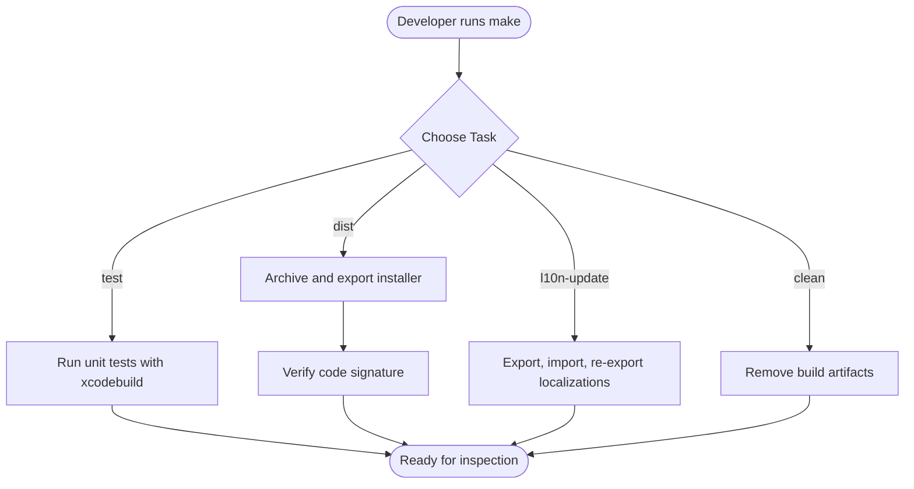
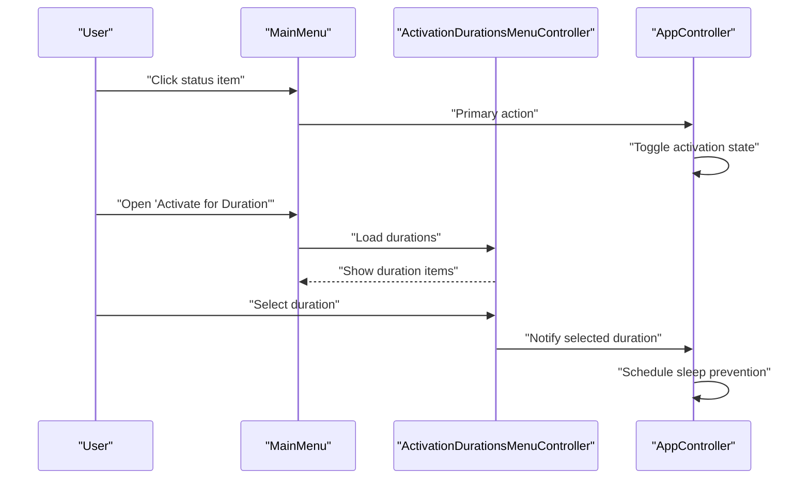
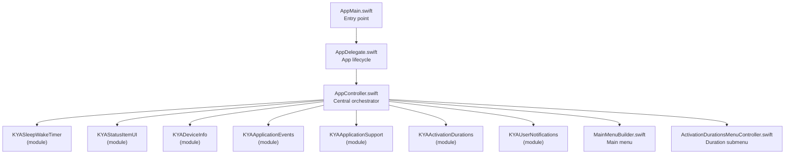
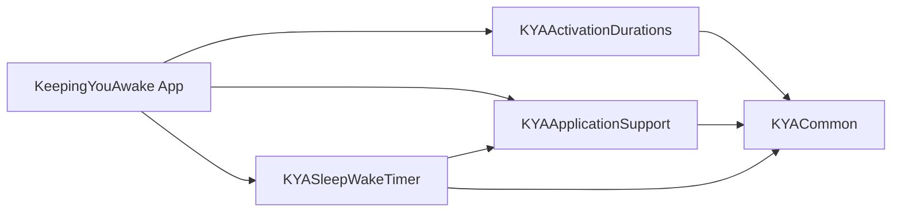

# Getting Started

<cite>
**Referenced Files in This Document**
- [README.md](file://README.md)
- [Makefile](file://Makefile)
- [Configuration.xcconfig](file://Configuration.xcconfig)
- [AppMain.swift](file://KeepingYouAwake/AppMain.swift)
- [AppDelegate.swift](file://KeepingYouAwake/KYAAppController/AppDelegate.swift)
- [AppController.swift](file://KeepingYouAwake/KYAAppController/AppController.swift)
- [MainMenuBuilder.swift](file://KeepingYouAwake/KYAMainMenu/MainMenuBuilder.swift)
- [ActivationDurationsMenuController.swift](file://KeepingYouAwake/KYAActivationDurationsMenuController/ActivationDurationsMenuController.swift)
- [GeneralSettingsViewController.swift](file://KeepingYouAwake/Settings/KYAGeneralSettingsViewController/GeneralSettingsViewController.swift)
- [BatteryCapacityThreshold.swift](file://KeepingYouAwake/BatteryCapacityThreshold.swift)
- [UserDefaultsSetting.swift](file://KeepingYouAwake/UserDefaultsSetting.swift)
- [Package.swift (KYAActivationDurations)](file://Packages/KYAActivationDurations/Package.swift)
- [Package.swift (KYAApplicationSupport)](file://Packages/KYAApplicationSupport/Package.swift)
- [Package.swift (KYASleepWakeTimer)](file://Packages/KYASleepWakeTimer/Package.swift)
</cite>

## Table of Contents
1. [Introduction](#introduction)
2. [Development Environment Setup](#development-environment-setup)
3. [Build Process from Source](#build-process-from-source)
4. [First Run Configuration](#first-run-configuration)
5. [Basic Usage Tutorial](#basic-usage-tutorial)
6. [Common Tasks and Advanced Features](#common-tasks-and-advanced-features)
7. [Architecture Overview](#architecture-overview)
8. [Dependency Analysis](#dependency-analysis)
9. [Performance Considerations](#performance-considerations)
10. [Troubleshooting Guide](#troubleshooting-guide)
11. [Conclusion](#conclusion)

## Introduction
KeepingYouAwake is a macOS menu bar utility designed to prevent your Mac from entering sleep mode for a specified duration or indefinitely. It wraps Apple's official caffeinate command-line utility and integrates seamlessly with the macOS menu bar. This guide helps you set up a development environment, build from source, configure the app, and use it effectively.

**Section sources**
- [README.md:1-45](file://README.md#L1-L45)

## Development Environment Setup
To develop and build KeepingYouAwake, ensure your environment meets the following requirements:

- macOS Version: The project targets macOS 10.13 and newer.
- Xcode: Use a recent version compatible with Swift 5.9.
- Swift Version: The project uses Swift 5.9.
- Command Line Tools: Install Xcode command line tools for building and testing.

These requirements are defined in the project configuration.

**Section sources**
- [Configuration.xcconfig:9-10](file://Configuration.xcconfig#L9-L10)

## Build Process from Source
The project uses Xcode and a Makefile to orchestrate builds, tests, localization updates, and distribution packaging. Here's how to build locally:

- Clean previous builds:
  make clean
- Build and test:
  make test
- Archive and package for distribution:
  make dist
- Localization update workflow:
  make l10n-update

The Makefile defines the scheme, workspace, and derived data paths, and disables automatic package resolution to ensure deterministic builds.

**Diagram sources**
- [Makefile:18-92](file://Makefile#L18-L92)

**Section sources**
- [Makefile:13-16](file://Makefile#L13-L16)
- [Makefile:28-49](file://Makefile#L28-L49)
- [Makefile:65-87](file://Makefile#L65-L87)

## First Run Configuration
After launching the app for the first time, configure essential preferences:

- Start at Login: Enable to automatically launch the app when you log in.
- Activate on Launch: Enable to immediately start preventing sleep when the app launches.
- Notification Settings: Open system notification settings for the app if needed.

These options are exposed in the General settings panel.

**Section sources**
- [GeneralSettingsViewController.swift:29-104](file://KeepingYouAwake/Settings/KYAGeneralSettingsViewController/GeneralSettingsViewController.swift#L29-L104)

## Basic Usage Tutorial
Interact with the app via the menu bar:

- Toggle activation: Click the status item to turn activation on or off.
- Select a duration: Open the "Activate for Duration" menu and choose a preset or set a duration as default.
- Access settings: Use the "Settings…" menu item to open the settings window.
- Quit the app: Use the "Quit" menu item.

Keyboard shortcuts:
- Settings: Comma key (",")
- Quit: Command-Q ("q")

The main menu is built programmatically and integrates with the activation durations submenu.

**Diagram sources**
- [MainMenuBuilder.swift:13-49](file://KeepingYouAwake/KYAMainMenu/MainMenuBuilder.swift#L13-L49)
- [ActivationDurationsMenuController.swift:33-125](file://KeepingYouAwake/KYAActivationDurationsMenuController/ActivationDurationsMenuController.swift#L33-L125)
- [AppController.swift:53-66](file://KeepingYouAwake/KYAAppController/AppController.swift#L53-L66)

**Section sources**
- [MainMenuBuilder.swift:13-49](file://KeepingYouAwake/KYAMainMenu/MainMenuBuilder.swift#L13-L49)
- [ActivationDurationsMenuController.swift:33-125](file://KeepingYouAwake/KYAActivationDurationsMenuController/ActivationDurationsMenuController.swift#L33-L125)
- [AppController.swift:171-177](file://KeepingYouAwake/KYAAppController/AppController.swift#L171-L177)

## Common Tasks and Advanced Features
Configure and customize behavior:

- Set a custom duration as default:
  - Open the "Activate for Duration" menu.
  - Option-click a duration item to set it as default.
- Configure battery threshold:
  - Use the battery monitoring settings to specify a capacity threshold.
  - When the battery drops below this threshold, the app cancels the scheduled activation.
- Quit on timer expiration:
  - Enable the related preference to automatically quit after the timer completes.
- Deactivate on user switch:
  - Enable the related preference to pause activation when switching users.
- Activate on external display connection:
  - Enable the related preference to start activation when an external display is connected.

These behaviors are managed by the central AppController and device monitoring subsystems.

**Section sources**
- [ActivationDurationsMenuController.swift:40-46](file://KeepingYouAwake/KYAActivationDurationsMenuController/ActivationDurationsMenuController.swift#L40-L46)
- [AppController.swift:191-246](file://KeepingYouAwake/KYAAppController/AppController.swift#L191-L246)
- [AppController.swift:301-326](file://KeepingYouAwake/KYAAppController/AppController.swift#L301-L326)
- [BatteryCapacityThreshold.swift:11-15](file://KeepingYouAwake/BatteryCapacityThreshold.swift#L11-L15)

## Architecture Overview
The app follows a modular architecture centered around a main entry point and a central orchestrator:

- App entry point: Initializes the NSApplication, sets the delegate, builds the main menu, and starts the run loop.
- Central orchestrator: AppController coordinates the sleep/wake timer, status item UI, device monitoring, and notifications.
- Menu system: MainMenuBuilder constructs the main menu; ActivationDurationsMenuController manages duration presets and default selection.
- Settings: General settings panel exposes user preferences such as start-at-login and activate-on-launch.

**Diagram sources**
- [AppMain.swift:11-23](file://KeepingYouAwake/AppMain.swift#L11-L23)
- [AppController.swift:19-41](file://KeepingYouAwake/KYAAppController/AppController.swift#L19-L41)
- [MainMenuBuilder.swift:13-49](file://KeepingYouAwake/KYAMainMenu/MainMenuBuilder.swift#L13-L49)
- [ActivationDurationsMenuController.swift:15-31](file://KeepingYouAwake/KYAActivationDurationsMenuController/ActivationDurationsMenuController.swift#L15-L31)

**Section sources**
- [AppMain.swift:11-23](file://KeepingYouAwake/AppMain.swift#L11-L23)
- [AppController.swift:19-41](file://KeepingYouAwake/KYAAppController/AppController.swift#L19-L41)

## Dependency Analysis
The app uses Swift Package Manager with modular packages. The main app depends on several internal packages:

- KYAActivationDurations: Provides activation duration models and controllers.
- KYAApplicationSupport: Provides application support utilities.
- KYASleepWakeTimer: Provides sleep/wake scheduling and timers.
- KYACommon: Shared utilities used across modules.

**Diagram sources**
- [Package.swift (KYAActivationDurations):5-30](file://Packages/KYAActivationDurations/Package.swift#L5-L30)
- [Package.swift (KYAApplicationSupport):5-31](file://Packages/KYAApplicationSupport/Package.swift#L5-L31)
- [Package.swift (KYASleepWakeTimer):5-30](file://Packages/KYASleepWakeTimer/Package.swift#L5-L30)

**Section sources**
- [Package.swift (KYAActivationDurations):5-30](file://Packages/KYAActivationDurations/Package.swift#L5-L30)
- [Package.swift (KYAApplicationSupport):5-31](file://Packages/KYAApplicationSupport/Package.swift#L5-L31)
- [Package.swift (KYASleepWakeTimer):5-30](file://Packages/KYASleepWakeTimer/Package.swift#L5-L30)

## Performance Considerations
- Minimize UI updates: The status item appearance changes only when activation state changes.
- Efficient scheduling: The sleep/wake timer schedules only when needed and invalidates on termination.
- Resource monitoring: Battery and low power mode monitoring are enabled conditionally based on user preferences.

[No sources needed since this section provides general guidance]

## Troubleshooting Guide
Common setup and runtime issues:

- Build fails due to package resolution:
  - The Makefile disables automatic package resolution and relies on a resolved file. Ensure dependencies are properly resolved before building.
- App does not appear in menu bar:
  - Confirm the activation policy is set to accessory and the status item controller is configured.
- Activation not working:
  - Verify the default timer interval is positive and that the app has permission to prevent sleep.
- Battery threshold not triggering:
  - Ensure battery monitoring is enabled and the threshold value is set appropriately.
- Settings not persisting:
  - Confirm UserDefaults synchronization occurs when toggling settings.

**Section sources**
- [Makefile:15](file://Makefile#L15)
- [AppController.swift:96-122](file://KeepingYouAwake/KYAAppController/AppController.swift#L96-L122)
- [AppController.swift:191-200](file://KeepingYouAwake/KYAAppController/AppController.swift#L191-L200)
- [UserDefaultsSetting.swift:16-26](file://KeepingYouAwake/UserDefaultsSetting.swift#L16-L26)

## Conclusion
You now have the essentials to set up a development environment, build the project, configure preferences, and use KeepingYouAwake effectively. For deeper customization, explore the modular packages and settings panels to tailor behavior to your workflow.

[No sources needed since this section summarizes without analyzing specific files]