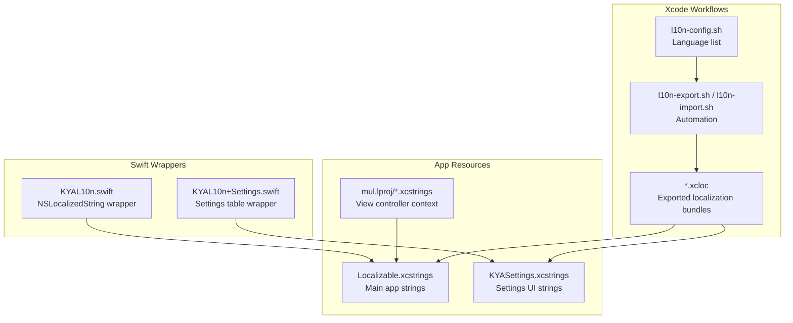
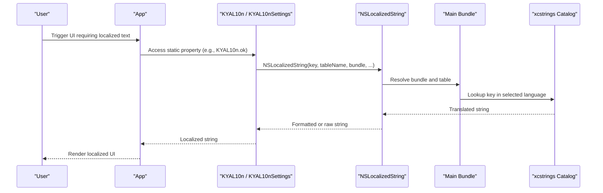
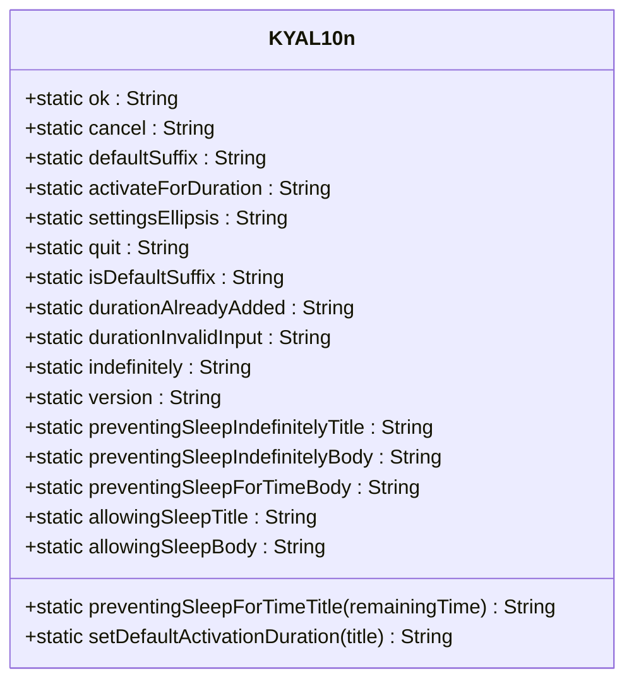
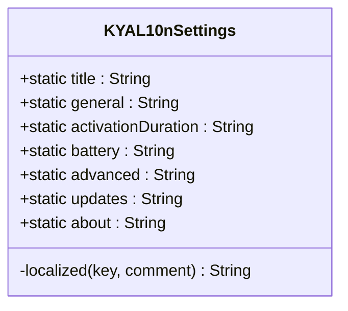
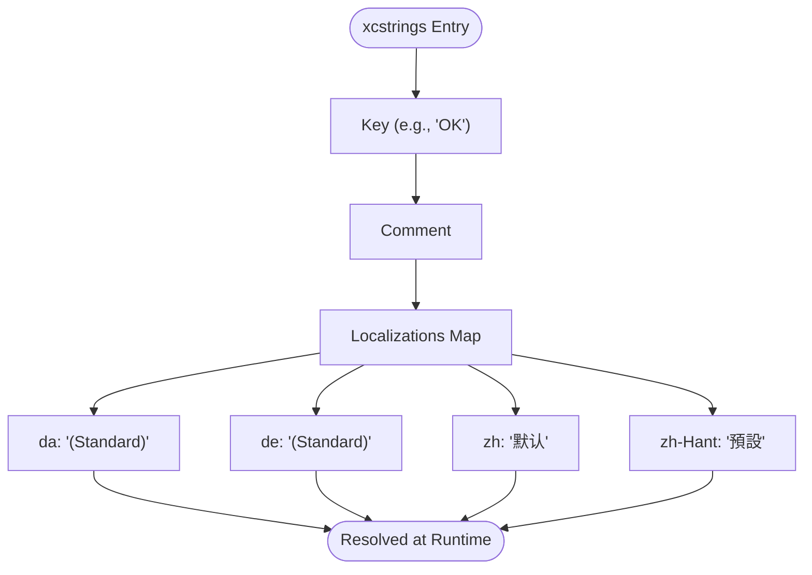
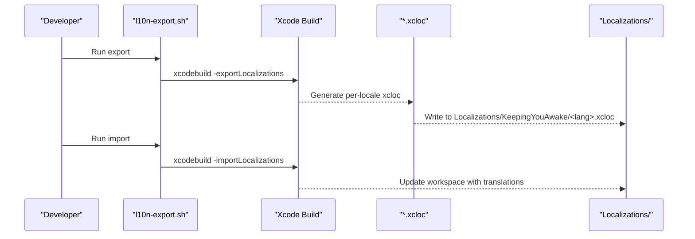
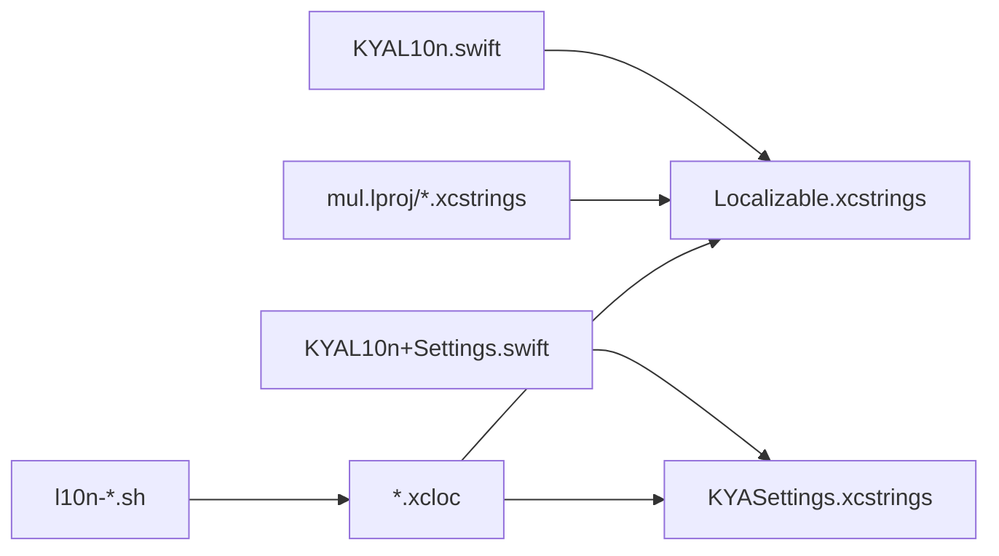

# Localization System

<cite>
**Referenced Files in This Document**
- [KYAL10n.swift](file://KeepingYouAwake/KYAL10n.swift)
- [KYAL10n+Settings.swift](file://KeepingYouAwake/Settings/KYAL10n+Settings.swift)
- [Localizable.xcstrings](file://KeepingYouAwake/Localizable.xcstrings)
- [KYASettings.xcstrings](file://KeepingYouAwake/Settings/KYASettings.xcstrings)
- [KYAGeneralSettingsViewController.xcstrings](file://KeepingYouAwake/Settings/KYAGeneralSettingsViewController/mul.lproj/KYAGeneralSettingsViewController.xcstrings)
- [KYADurationSettingsViewController.xcstrings](file://KeepingYouAwake/Settings/KYADurationSettingsViewController/mul.lproj/KYADurationSettingsViewController.xcstrings)
- [README.md](file://Localizations/README.md)
- [l10n-config.sh](file://Localizations/l10n-config.sh)
- [l10n-export.sh](file://Localizations/l10n-export.sh)
- [l10n-import.sh](file://Localizations/l10n-import.sh)
- [en.xcloc contents.json](file://Localizations/KeepingYouAwake/en.xcloc/contents.json)
- [de.xcloc contents.json](file://Localizations/KeepingYouAwake/de.xcloc/contents.json)
</cite>

## Table of Contents
1. [Introduction](#introduction)
2. [Project Structure](#project-structure)
3. [Core Components](#core-components)
4. [Architecture Overview](#architecture-overview)
5. [Detailed Component Analysis](#detailed-component-analysis)
6. [Dependency Analysis](#dependency-analysis)
7. [Performance Considerations](#performance-considerations)
8. [Troubleshooting Guide](#troubleshooting-guide)
9. [Conclusion](#conclusion)
10. [Appendices](#appendices)

## Introduction
This document describes the localization system for the macOS application, focusing on multi-language support, dynamic language switching, resource loading, Xcode localization workflows, and best practices for maintaining consistency across 25+ language catalogs managed via xcloc files. It explains how the app uses xcstrings and xcloc files, integrates settings localization, and supports contextual and formatted strings.

## Project Structure
The localization system is organized around:
- A main localization catalog using the "Localizable" table
- A dedicated "KYASettings" table for settings UI strings
- Per-view controller xcstrings under mul.lproj directories for contextual strings
- Xcode localization projects (.xcloc) exported/imported via shell scripts
- Centralized Swift wrappers for NSLocalizedString calls

**Diagram sources**
- [KYAL10n.swift:11-65](file://KeepingYouAwake/KYAL10n.swift#L11-L65)
- [KYAL10n+Settings.swift:11-24](file://KeepingYouAwake/Settings/KYAL10n+Settings.swift#L11-L24)
- [Localizable.xcstrings:1-200](file://KeepingYouAwake/Localizable.xcstrings#L1-L200)
- [KYASettings.xcstrings:1-200](file://KeepingYouAwake/Settings/KYASettings.xcstrings#L1-L200)
- [l10n-config.sh:10](file://Localizations/l10n-config.sh#L10)
- [l10n-export.sh:12-18](file://Localizations/l10n-export.sh#L12-L18)
- [l10n-import.sh:10-17](file://Localizations/l10n-import.sh#L10-L17)

**Section sources**
- [KYAL10n.swift:11-65](file://KeepingYouAwake/KYAL10n.swift#L11-L65)
- [KYAL10n+Settings.swift:11-24](file://KeepingYouAwake/Settings/KYAL10n+Settings.swift#L11-L24)
- [Localizable.xcstrings:1-200](file://KeepingYouAwake/Localizable.xcstrings#L1-L200)
- [KYASettings.xcstrings:1-200](file://KeepingYouAwake/Settings/KYASettings.xcstrings#L1-L200)
- [l10n-config.sh:10](file://Localizations/l10n-config.sh#L10)
- [l10n-export.sh:12-18](file://Localizations/l10n-export.sh#L12-L18)
- [l10n-import.sh:10-17](file://Localizations/l10n-import.sh#L10-L17)

## Core Components
- KYAL10n: A Swift enum namespace wrapping NSLocalizedString for the main app, preserving existing xcstrings keys and using the "Localizable" table.
- KYAL10nSettings: A Swift enum namespace for settings UI strings using the "KYASettings" table.
- xcstrings catalogs: JSON-based catalogs containing source language and per-locale translations, including contextual strings in mul.lproj directories.
- xcloc bundles: Xcode localization bundles exported/imported for each target locale.
- Automation scripts: Bash scripts to export/import all localizations and maintain synchronization.

Key responsibilities:
- Provide strongly-typed, compile-time-safe accessors for localized strings
- Preserve existing xcstrings key names to keep all 25+ languages synchronized
- Support formatted strings and contextual variants
- Integrate with Xcode localization workflows for export/import

**Section sources**
- [KYAL10n.swift:11-65](file://KeepingYouAwake/KYAL10n.swift#L11-L65)
- [KYAL10n+Settings.swift:11-24](file://KeepingYouAwake/Settings/KYAL10n+Settings.swift#L11-L24)
- [Localizable.xcstrings:1-200](file://KeepingYouAwake/Localizable.xcstrings#L1-L200)
- [KYASettings.xcstrings:1-200](file://KeepingYouAwake/Settings/KYASettings.xcstrings#L1-L200)
- [l10n-config.sh:10](file://Localizations/l10n-config.sh#L10)
- [l10n-export.sh:12-18](file://Localizations/l10n-export.sh#L12-L18)
- [l10n-import.sh:10-17](file://Localizations/l10n-import.sh#L10-L17)

## Architecture Overview
The localization architecture centers on xcstrings catalogs and Swift wrappers. At runtime, NSLocalizedString resolves keys to the appropriate language based on the user's system language and the app's bundle. The automation scripts manage xcloc bundles for export/import across languages.

**Diagram sources**
- [KYAL10n.swift:16-65](file://KeepingYouAwake/KYAL10n.swift#L16-L65)
- [KYAL10n+Settings.swift:13-24](file://KeepingYouAwake/Settings/KYAL10n+Settings.swift#L13-L24)
- [Localizable.xcstrings:1-200](file://KeepingYouAwake/Localizable.xcstrings#L1-L200)
- [KYASettings.xcstrings:1-200](file://KeepingYouAwake/Settings/KYASettings.xcstrings#L1-L200)

## Detailed Component Analysis

### KYAL10n: Main App Localization Wrapper
- Purpose: Provide a centralized, type-safe interface to NSLocalizedString using the "Localizable" table
- Design: Static properties for generic, menu, duration display, notification, and settings-related strings
- Formatting: Uses String(format:...) for placeholders, ensuring correct argument binding
- Backward compatibility: Preserves existing xcstrings keys to maintain all 25+ languages

**Diagram sources**
- [KYAL10n.swift:13-65](file://KeepingYouAwake/KYAL10n.swift#L13-L65)

**Section sources**
- [KYAL10n.swift:11-65](file://KeepingYouAwake/KYAL10n.swift#L11-L65)

### KYAL10nSettings: Settings UI Localization Wrapper
- Purpose: Provide localized strings for settings UI using the "KYASettings" table
- Design: Private localized(...) helper to encapsulate NSLocalizedString calls
- Coverage: Titles and categories such as General, Activation Duration, Battery, Advanced, Updates, About

**Diagram sources**
- [KYAL10n+Settings.swift:12-24](file://KeepingYouAwake/Settings/KYAL10n+Settings.swift#L12-L24)

**Section sources**
- [KYAL10n+Settings.swift:11-24](file://KeepingYouAwake/Settings/KYAL10n+Settings.swift#L11-L24)

### xcstrings Catalogs and Contextual Strings
- Main catalog: Localizable.xcstrings contains the primary app strings with per-language translations
- Settings catalog: KYASettings.xcstrings contains settings UI strings
- Contextual vc catalogs: mul.lproj/*.xcstrings provide contextual strings for specific view controllers
- Structure: Each entry includes source language, comments, and a "localizations" map keyed by locale codes

**Diagram sources**
- [Localizable.xcstrings:4-104](file://KeepingYouAwake/Localizable.xcstrings#L4-L104)
- [KYASettings.xcstrings:4-140](file://KeepingYouAwake/Settings/KYASettings.xcstrings#L4-L140)

**Section sources**
- [Localizable.xcstrings:1-200](file://KeepingYouAwake/Localizable.xcstrings#L1-L200)
- [KYASettings.xcstrings:1-200](file://KeepingYouAwake/Settings/KYASettings.xcstrings#L1-L200)
- [KYAGeneralSettingsViewController.xcstrings:1-200](file://KeepingYouAwake/Settings/KYAGeneralSettingsViewController/mul.lproj/KYAGeneralSettingsViewController.xcstrings#L1-L200)
- [KYADurationSettingsViewController.xcstrings:1-200](file://KeepingYouAwake/Settings/KYADurationSettingsViewController/mul.lproj/KYADurationSettingsViewController.xcstrings#L1-L200)

### Xcode Localization Workflows (xcloc)
- Export: l10n-export.sh iterates over TRANSLATIONS and exports xcloc bundles for each language
- Import: l10n-import.sh imports xcloc bundles back into the Xcode workspace
- Configuration: l10n-config.sh defines the list of supported locales
- xcloc metadata: contents.json indicates target locale and tool info

**Diagram sources**
- [l10n-config.sh:10](file://Localizations/l10n-config.sh#L10)
- [l10n-export.sh:12-18](file://Localizations/l10n-export.sh#L12-L18)
- [l10n-import.sh:10-17](file://Localizations/l10n-import.sh#L10-L17)
- [en.xcloc contents.json:1-12](file://Localizations/KeepingYouAwake/en.xcloc/contents.json#L1-L12)
- [de.xcloc contents.json:1-12](file://Localizations/KeepingYouAwake/de.xcloc/contents.json#L1-L12)

**Section sources**
- [README.md:1-21](file://Localizations/README.md#L1-L21)
- [l10n-config.sh:1-11](file://Localizations/l10n-config.sh#L1-L11)
- [l10n-export.sh:1-19](file://Localizations/l10n-export.sh#L1-L19)
- [l10n-import.sh:1-19](file://Localizations/l10n-import.sh#L1-L19)
- [en.xcloc contents.json:1-12](file://Localizations/KeepingYouAwake/en.xcloc/contents.json#L1-L12)
- [de.xcloc contents.json:1-12](file://Localizations/KeepingYouAwake/de.xcloc/contents.json#L1-L12)

## Dependency Analysis
- Swift wrappers depend on xcstrings catalogs via NSLocalizedString
- xcstrings catalogs are consumed by the main bundle at runtime
- Automation scripts depend on Xcode build system and workspace configuration
- xcloc bundles encapsulate per-locale XLIFF data for export/import

**Diagram sources**
- [KYAL10n.swift:11-65](file://KeepingYouAwake/KYAL10n.swift#L11-L65)
- [KYAL10n+Settings.swift:11-24](file://KeepingYouAwake/Settings/KYAL10n+Settings.swift#L11-L24)
- [Localizable.xcstrings:1-200](file://KeepingYouAwake/Localizable.xcstrings#L1-L200)
- [KYASettings.xcstrings:1-200](file://KeepingYouAwake/Settings/KYASettings.xcstrings#L1-L200)
- [l10n-export.sh:12-18](file://Localizations/l10n-export.sh#L12-L18)
- [l10n-import.sh:10-17](file://Localizations/l10n-import.sh#L10-L17)

**Section sources**
- [KYAL10n.swift:11-65](file://KeepingYouAwake/KYAL10n.swift#L11-L65)
- [KYAL10n+Settings.swift:11-24](file://KeepingYouAwake/Settings/KYAL10n+Settings.swift#L11-L24)
- [Localizable.xcstrings:1-200](file://KeepingYouAwake/Localizable.xcstrings#L1-L200)
- [KYASettings.xcstrings:1-200](file://KeepingYouAwake/Settings/KYASettings.xcstrings#L1-L200)
- [l10n-export.sh:12-18](file://Localizations/l10n-export.sh#L12-L18)
- [l10n-import.sh:10-17](file://Localizations/l10n-import.sh#L10-L17)

## Performance Considerations
- NSLocalizedString resolution is efficient; avoid excessive repeated lookups in tight loops
- Keep xcstrings catalogs organized to minimize merge conflicts and improve build times
- Use contextual mul.lproj catalogs judiciously to avoid bloating the main catalog

## Troubleshooting Guide
Common issues and resolutions:
- Missing translations: Verify keys exist in the appropriate xcstrings file and that the language is included in l10n-config.sh
- Incorrect language selection: Confirm the target locale is present in *.xcloc and imported via l10n-import.sh
- Build errors after localization changes: Re-run the export/import scripts to synchronize xcloc bundles with the workspace

**Section sources**
- [README.md:1-21](file://Localizations/README.md#L1-L21)
- [l10n-config.sh:10](file://Localizations/l10n-config.sh#L10)
- [l10n-export.sh:12-18](file://Localizations/l10n-export.sh#L12-L18)
- [l10n-import.sh:10-17](file://Localizations/l10n-import.sh#L10-L17)

## Conclusion
The localization system leverages xcstrings and xcloc workflows with Swift wrappers to deliver robust, maintainable multi-language support across 25+ locales. The design preserves existing keys, centralizes access via type-safe enums, and integrates seamlessly with Xcode’s export/import automation.

## Appendices

### String Localization Guidelines
- Preserve original keys in xcstrings to maintain translations across languages
- Use the "Localizable" table for main app strings and "KYASettings" for settings UI
- Place contextual strings in mul.lproj/*.xcstrings for view controllers
- Keep comments descriptive for translators

### Pluralization and Contextual Translations
- Use format specifiers for placeholders in KYAL10n methods that accept arguments
- For pluralization, use appropriate format specifiers and ensure translators provide correct forms per locale
- For contextual strings, include sufficient context in comments to guide accurate translations

### Cultural Adaptation Considerations
- Respect right-to-left languages and adjust UI layouts accordingly
- Account for date/time, number, and currency formatting differences
- Avoid culturally specific metaphors or imagery in strings

### Translation Quality Assurance and Coverage Tracking
- Track translation states in xcstrings (e.g., translated/new/manual extraction)
- Use l10n-export.sh and l10n-import.sh to keep xcloc bundles synchronized
- Regularly review and update l10n-config.sh to reflect supported locales