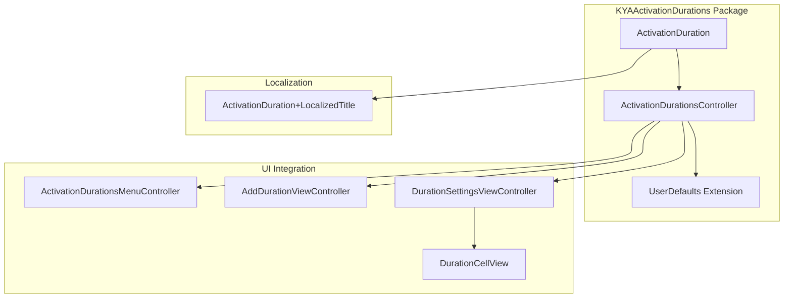
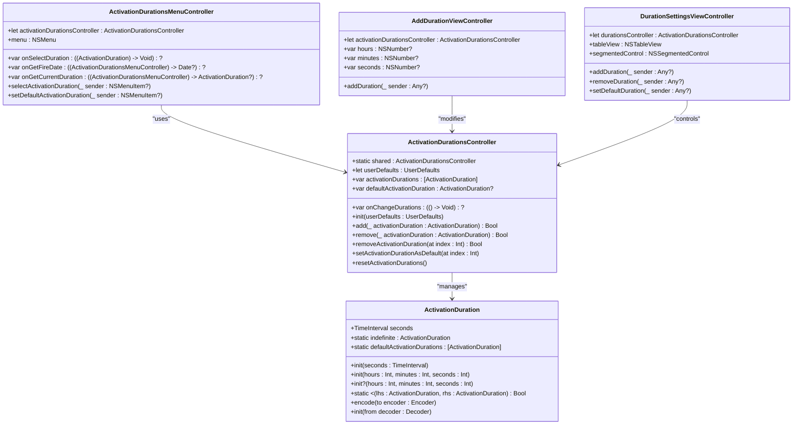
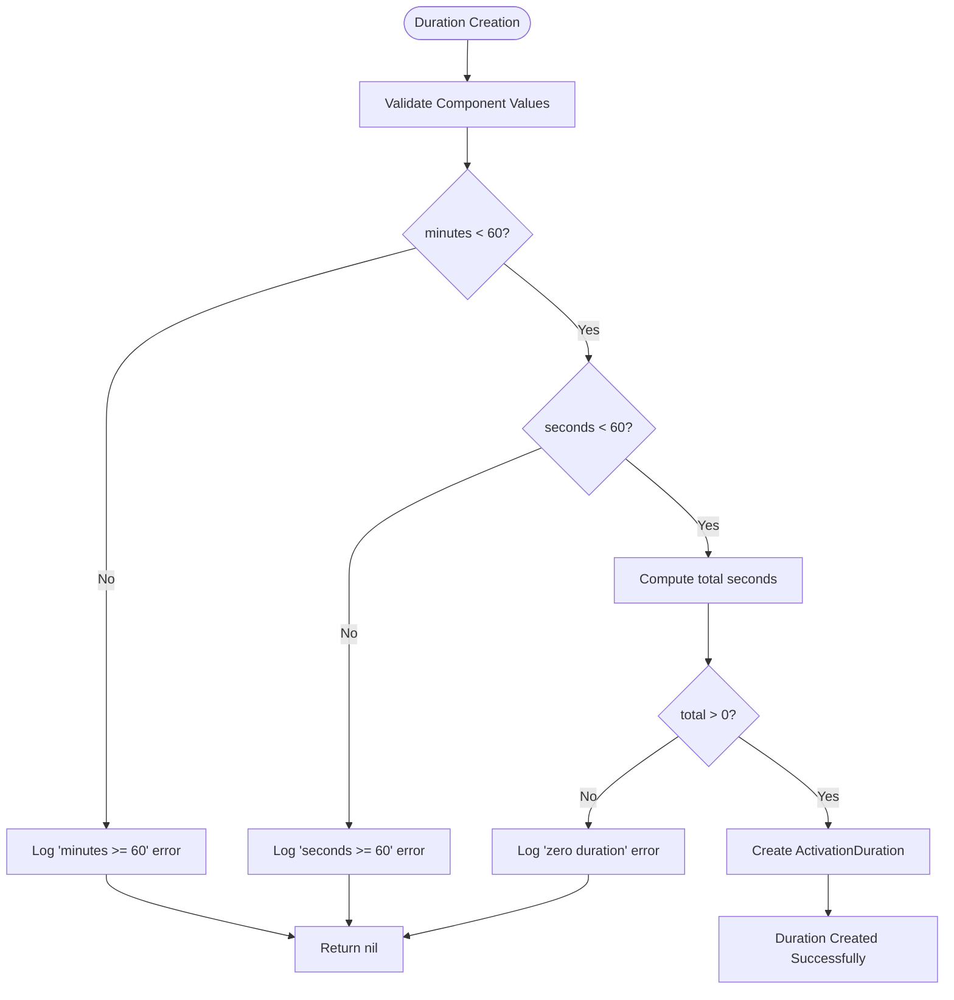
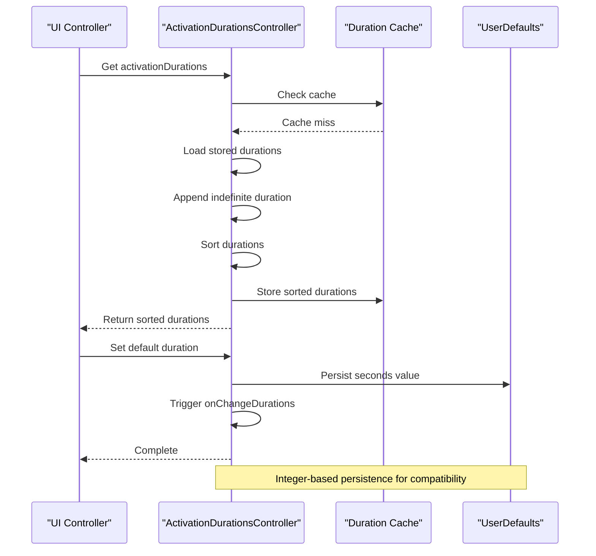
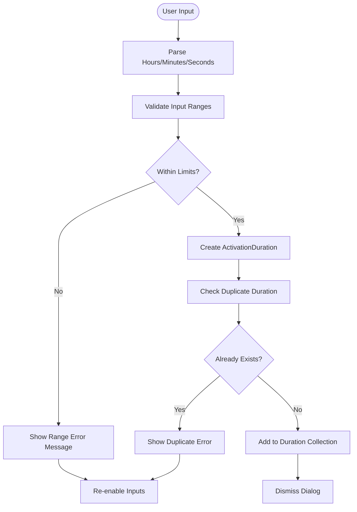
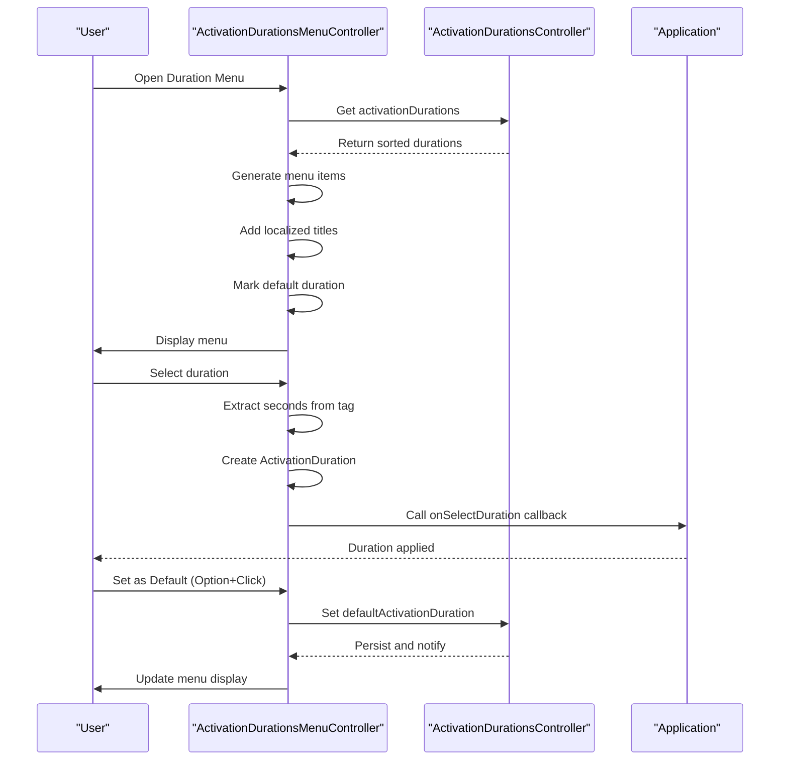
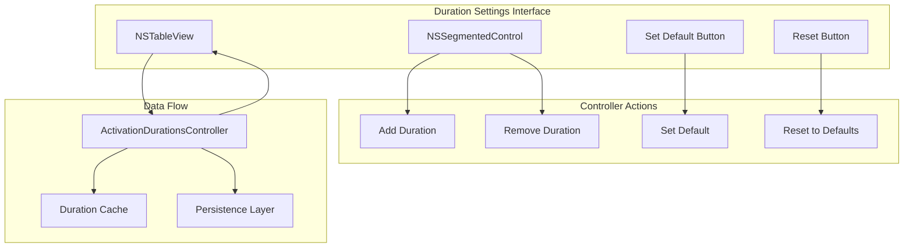
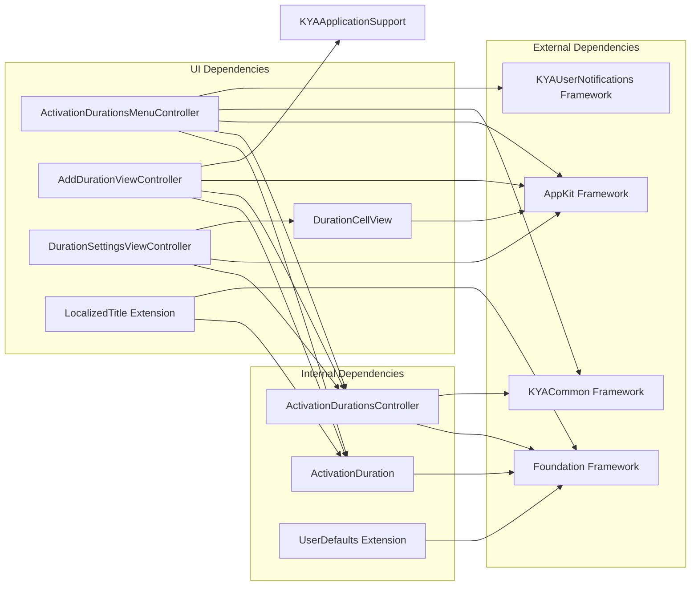

# KYAActivationDurations Package

<cite>
**Referenced Files in This Document**
- [ActivationDuration.swift](file://Packages/KYAActivationDurations/Sources/KYAActivationDurations/ActivationDuration.swift)
- [ActivationDurationsController.swift](file://Packages/KYAActivationDurations/Sources/KYAActivationDurations/ActivationDurationsController.swift)
- [UserDefaults+DefaultTimeInterval.swift](file://Packages/KYAActivationDurations/Sources/KYAActivationDurations/UserDefaults+DefaultTimeInterval.swift)
- [ActivationDuration+LocalizedTitle.swift](file://KeepingYouAwake/KYAActivationDurationsMenuController/ActivationDuration+LocalizedTitle.swift)
- [ActivationDurationsMenuController.swift](file://KeepingYouAwake/KYAActivationDurationsMenuController/ActivationDurationsMenuController.swift)
- [AddDurationViewController.swift](file://KeepingYouAwake/Settings/KYADurationSettingsViewController/AddDurationViewController.swift)
- [DurationSettingsViewController.swift](file://KeepingYouAwake/Settings/KYADurationSettingsViewController/DurationSettingsViewController.swift)
- [DurationCellView.swift](file://KeepingYouAwake/Settings/KYADurationSettingsViewController/KYADurationCell/DurationCellView.swift)
- [ActivationDurationTests.swift](file://Packages/KYAActivationDurations/Tests/KYAActivationDurationsTests/ActivationDurationTests.swift)
- [ActivationDurationsControllerTests.swift](file://Packages/KYAActivationDurations/Tests/KYAActivationDurationsTests/ActivationDurationsControllerTests.swift)
</cite>

## Table of Contents
1. [Introduction](#introduction)
2. [Project Structure](#project-structure)
3. [Core Components](#core-components)
4. [Architecture Overview](#architecture-overview)
5. [Detailed Component Analysis](#detailed-component-analysis)
6. [Dependency Analysis](#dependency-analysis)
7. [Performance Considerations](#performance-considerations)
8. [Troubleshooting Guide](#troubleshooting-guide)
9. [Conclusion](#conclusion)

## Introduction
The KYAActivationDurations package provides comprehensive duration management and preset handling for the KeepingYouAwake application. It enables users to configure activation durations for sleep/wake timer functionality, manage predefined duration sets, and persist user preferences. The package consists of two primary components: the ActivationDuration data structure that represents time intervals, and the ActivationDurationsController that manages collections of durations, default selections, and persistence.

The package integrates seamlessly with the application's UI through dedicated menu controllers and settings views, providing intuitive duration selection and customization capabilities. It supports both predefined standard durations and user-defined custom durations, with robust validation and persistence mechanisms.

## Project Structure
The KYAActivationDurations package follows a clean separation of concerns with distinct modules for data modeling, business logic, and UI integration:

**Diagram sources**
- [ActivationDuration.swift:12-125](file://Packages/KYAActivationDurations/Sources/KYAActivationDurations/ActivationDuration.swift#L12-L125)
- [ActivationDurationsController.swift:18-198](file://Packages/KYAActivationDurations/Sources/KYAActivationDurations/ActivationDurationsController.swift#L18-L198)
- [ActivationDurationsMenuController.swift:14-126](file://KeepingYouAwake/KYAActivationDurationsMenuController/ActivationDurationsMenuController.swift#L14-L126)

**Section sources**
- [ActivationDuration.swift:1-125](file://Packages/KYAActivationDurations/Sources/KYAActivationDurations/ActivationDuration.swift#L1-L125)
- [ActivationDurationsController.swift:1-198](file://Packages/KYAActivationDurations/Sources/KYAActivationDurations/ActivationDurationsController.swift#L1-L198)

## Core Components

### ActivationDuration Data Structure
The ActivationDuration struct serves as the fundamental data model representing time intervals for activation periods. It provides multiple initialization methods and comprehensive validation logic.

Key characteristics:
- **Time Representation**: Stores duration as TimeInterval (seconds)
- **Special Case Handling**: Supports indefinite duration (0 seconds)
- **Multiple Initialization Methods**: Seconds-based, component-based (hours/minutes/seconds), and convenience initializers
- **Validation**: Ensures minutes < 60, seconds < 60, and total > 0
- **Persistence**: Codable with backward compatibility support

### ActivationDurationsController Management
The ActivationDurationsController provides centralized management of duration collections with advanced features:

- **Singleton Pattern**: Shared instance for global access
- **Collection Management**: Add, remove, and sort durations
- **Default Selection**: Track and persist user's preferred duration
- **Persistence Layer**: UserDefaults-backed storage with integer-based encoding
- **Change Notifications**: Callback system for UI updates
- **Cache Management**: Optimized retrieval of sorted duration lists

### UI Integration Components
The package integrates with the application's interface through specialized controllers and views:

- **Menu Controller**: Dynamic menu generation with localization support
- **Settings Views**: Comprehensive duration management interface
- **Custom Validation**: Input validation with user feedback
- **Cell Rendering**: Specialized table cell display with default indicators

**Section sources**
- [ActivationDuration.swift:12-125](file://Packages/KYAActivationDurations/Sources/KYAActivationDurations/ActivationDuration.swift#L12-L125)
- [ActivationDurationsController.swift:18-198](file://Packages/KYAActivationDurations/Sources/KYAActivationDurations/ActivationDurationsController.swift#L18-L198)
- [ActivationDurationsMenuController.swift:14-126](file://KeepingYouAwake/KYAActivationDurationsMenuController/ActivationDurationsMenuController.swift#L14-L126)

## Architecture Overview

**Diagram sources**
- [ActivationDuration.swift:12-125](file://Packages/KYAActivationDurations/Sources/KYAActivationDurations/ActivationDuration.swift#L12-L125)
- [ActivationDurationsController.swift:18-198](file://Packages/KYAActivationDurations/Sources/KYAActivationDurations/ActivationDurationsController.swift#L18-L198)
- [ActivationDurationsMenuController.swift:14-126](file://KeepingYouAwake/KYAActivationDurationsMenuController/ActivationDurationsMenuController.swift#L14-L126)
- [AddDurationViewController.swift:24-262](file://KeepingYouAwake/Settings/KYADurationSettingsViewController/AddDurationViewController.swift#L24-L262)
- [DurationSettingsViewController.swift:15-228](file://KeepingYouAwake/Settings/KYADurationSettingsViewController/DurationSettingsViewController.swift#L15-L228)

## Detailed Component Analysis

### Duration Data Structures and Validation

The ActivationDuration struct implements comprehensive validation and multiple construction patterns:

**Diagram sources**
- [ActivationDuration.swift:55-76](file://Packages/KYAActivationDurations/Sources/KYAActivationDurations/ActivationDuration.swift#L55-L76)

The validation system ensures data integrity through multiple checks:
- Component range validation (minutes < 60, seconds < 60)
- Positive duration requirement (total > 0)
- Error logging for invalid operations
- Graceful failure handling with nil returns

**Section sources**
- [ActivationDuration.swift:12-125](file://Packages/KYAActivationDurations/Sources/KYAActivationDurations/ActivationDuration.swift#L12-L125)

### Preset Management System

The ActivationDurationsController implements sophisticated preset management with caching and persistence:

**Diagram sources**
- [ActivationDurationsController.swift:30-60](file://Packages/KYAActivationDurations/Sources/KYAActivationDurations/ActivationDurationsController.swift#L30-L60)
- [ActivationDurationsController.swift:169-198](file://Packages/KYAActivationDurations/Sources/KYAActivationDurations/ActivationDurationsController.swift#L169-L198)

Key features of the preset system:
- **Default Preset**: Standard durations (5min, 10min, 15min, 30min, 1h, 2h, 5h)
- **Dynamic Loading**: Runtime loading from UserDefaults with fallback to defaults
- **Automatic Sorting**: Ascending order with indefinite duration placement
- **Cache Optimization**: Prevents repeated computations
- **Change Notifications**: Real-time UI updates

**Section sources**
- [ActivationDurationsController.swift:18-198](file://Packages/KYAActivationDurations/Sources/KYAActivationDurations/ActivationDurationsController.swift#L18-L198)

### User-Defined Duration Handling

The AddDurationViewController provides comprehensive input validation and user feedback:

**Diagram sources**
- [AddDurationViewController.swift:160-195](file://KeepingYouAwake/Settings/KYADurationSettingsViewController/AddDurationViewController.swift#L160-L195)

The validation system includes:
- **Range Constraints**: Maximum values (hours ≤ 999, minutes ≤ 59, seconds ≤ 59)
- **Duplicate Detection**: Prevents identical durations
- **Real-time Feedback**: Immediate user notification for errors
- **Input Protection**: Automatic correction to maximum values when exceeded

**Section sources**
- [AddDurationViewController.swift:14-262](file://KeepingYouAwake/Settings/KYADurationSettingsViewController/AddDurationViewController.swift#L14-L262)

### Menu Integration and User Interface

The ActivationDurationsMenuController provides dynamic menu generation with localization support:

**Diagram sources**
- [ActivationDurationsMenuController.swift:81-125](file://KeepingYouAwake/KYAActivationDurationsMenuController/ActivationDurationsMenuController.swift#L81-L125)

The menu system features:
- **Dynamic Generation**: Items created based on current duration collection
- **Localization Support**: Uses shared DateComponentsFormatter for localized display
- **Default Marking**: Visual indication of selected default duration
- **Current Duration Highlighting**: Shows active timer duration
- **Keyboard Shortcuts**: Option-click for setting defaults

**Section sources**
- [ActivationDurationsMenuController.swift:14-126](file://KeepingYouAwake/KYAActivationDurationsMenuController/ActivationDurationsMenuController.swift#L14-L126)
- [ActivationDuration+LocalizedTitle.swift:12-26](file://KeepingYouAwake/KYAActivationDurationsMenuController/ActivationDuration+LocalizedTitle.swift#L12-L26)

### Settings Interface Integration

The DurationSettingsViewController provides comprehensive management capabilities:

**Diagram sources**
- [DurationSettingsViewController.swift:15-228](file://KeepingYouAwake/Settings/KYADurationSettingsViewController/DurationSettingsViewController.swift#L15-L228)

The settings interface includes:
- **Table View Display**: Clean list of formatted duration strings
- **Context Menu**: Right-click actions for quick operations
- **Limit Management**: Prevents excessive duration entries (limit: 42)
- **Real-time Updates**: Automatic UI refresh on changes
- **Accessibility Features**: Keyboard shortcuts and command combinations

**Section sources**
- [DurationSettingsViewController.swift:15-228](file://KeepingYouAwake/Settings/KYADurationSettingsViewController/DurationSettingsViewController.swift#L15-L228)
- [DurationCellView.swift:12-75](file://KeepingYouAwake/Settings/KYADurationSettingsViewController/KYADurationCell/DurationCellView.swift#L12-L75)

## Dependency Analysis

The KYAActivationDurations package maintains clean dependency boundaries with minimal external coupling:

**Diagram sources**
- [ActivationDuration.swift:9-11](file://Packages/KYAActivationDurations/Sources/KYAActivationDurations/ActivationDuration.swift#L9-L11)
- [ActivationDurationsController.swift:9-11](file://Packages/KYAActivationDurations/Sources/KYAActivationDurations/ActivationDurationsController.swift#L9-L11)
- [ActivationDurationsMenuController.swift:9-13](file://KeepingYouAwake/KYAActivationDurationsMenuController/ActivationDurationsMenuController.swift#L9-L13)
- [AddDurationViewController.swift:9-13](file://KeepingYouAwake/Settings/KYADurationSettingsViewController/AddDurationViewController.swift#L9-L13)

Key dependency characteristics:
- **Minimal External Coupling**: Only Foundation and AppKit dependencies
- **Framework Isolation**: Clear separation from application-specific frameworks
- **Testability**: Easy mocking and testing through protocol-based design
- **Backward Compatibility**: Maintains compatibility with existing UserDefaults storage

**Section sources**
- [ActivationDuration.swift:9-11](file://Packages/KYAActivationDurations/Sources/KYAActivationDurations/ActivationDuration.swift#L9-L11)
- [ActivationDurationsController.swift:9-11](file://Packages/KYAActivationDurations/Sources/KYAActivationDurations/ActivationDurationsController.swift#L9-L11)

## Performance Considerations

The package implements several optimization strategies for efficient operation:

### Caching Strategy
The ActivationDurationsController employs intelligent caching to minimize computational overhead:
- **Sorted Duration Cache**: Prevents repeated sorting operations
- **Lazy Loading**: Durations loaded only when requested
- **Cache Invalidation**: Automatic cache clearing on data changes

### Memory Management
- **Immutable Data Structures**: ActivationDuration instances are immutable, enabling safe sharing
- **Weak References**: Proper use of weak references in callback systems
- **Efficient Storage**: Integer-based UserDefaults storage minimizes memory footprint

### UI Responsiveness
- **Asynchronous Operations**: Long-running operations performed off the main thread
- **Batch Updates**: Multiple changes batched into single UI refresh cycles
- **Lazy Evaluation**: Complex calculations deferred until necessary

## Troubleshooting Guide

### Common Issues and Solutions

**Duration Not Saving Correctly**
- Verify UserDefaults key: `info.marcel-dierkes.KeepingYouAwake.Durations`
- Check integer truncation: Values stored as Int, decimal places are dropped
- Confirm synchronization: `userDefaults.synchronize()` called after writes

**Menu Shows Incorrect Duration Formatting**
- Ensure localized title extension is properly imported
- Verify DateComponentsFormatter configuration
- Check for custom locale settings affecting formatting

**Validation Errors When Adding Custom Durations**
- Confirm component values within limits (hours ≤ 999, minutes ≤ 59, seconds ≤ 59)
- Verify duration is positive (total > 0)
- Check for duplicate durations in collection

**Memory Leaks in Controller Instances**
- Ensure proper cleanup of onChangeDurations callbacks
- Verify singleton pattern usage prevents multiple instances
- Check for retain cycles in closure-based communication

**Section sources**
- [ActivationDurationsController.swift:169-198](file://Packages/KYAActivationDurations/Sources/KYAActivationDurations/ActivationDurationsController.swift#L169-L198)
- [AddDurationViewController.swift:160-195](file://KeepingYouAwake/Settings/KYADurationSettingsViewController/AddDurationViewController.swift#L160-L195)

## Conclusion

The KYAActivationDurations package provides a robust, well-architected solution for duration management in the KeepingYouAwake application. Its design emphasizes:

**Technical Excellence**
- Clean separation of concerns between data modeling and business logic
- Comprehensive validation and error handling
- Efficient caching and persistence mechanisms
- Extensive test coverage ensuring reliability

**User Experience**
- Intuitive menu-based duration selection
- Flexible settings interface for customization
- Real-time feedback and validation
- Localization support for international users

**Integration Capabilities**
- Seamless integration with existing application architecture
- Minimal external dependencies
- Backward compatibility with established storage formats
- Extensible design supporting future enhancements

The package successfully balances functionality, performance, and maintainability, providing a solid foundation for duration management across the application's various components.