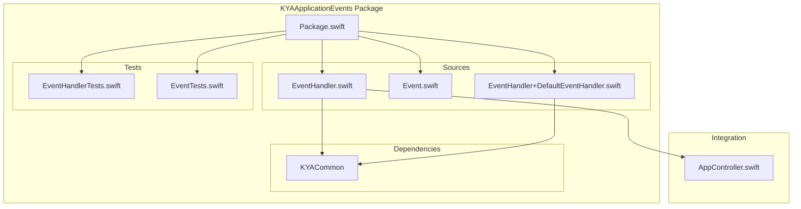
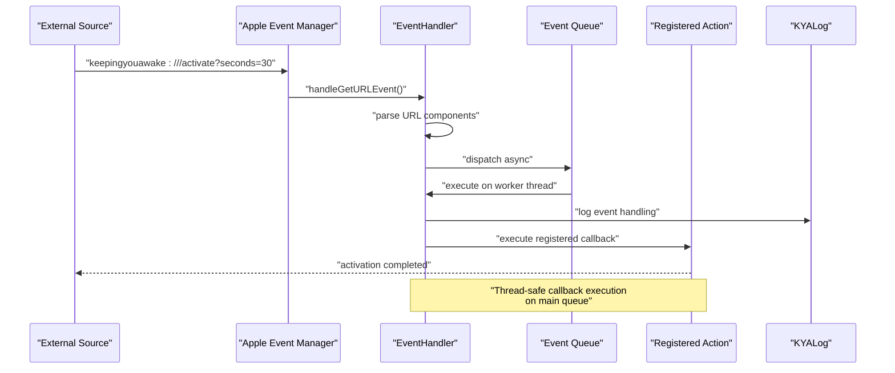
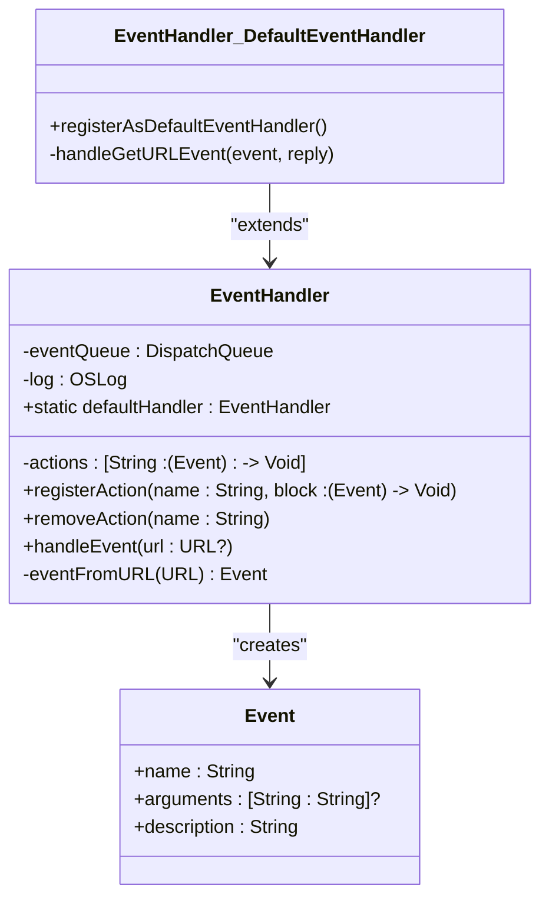
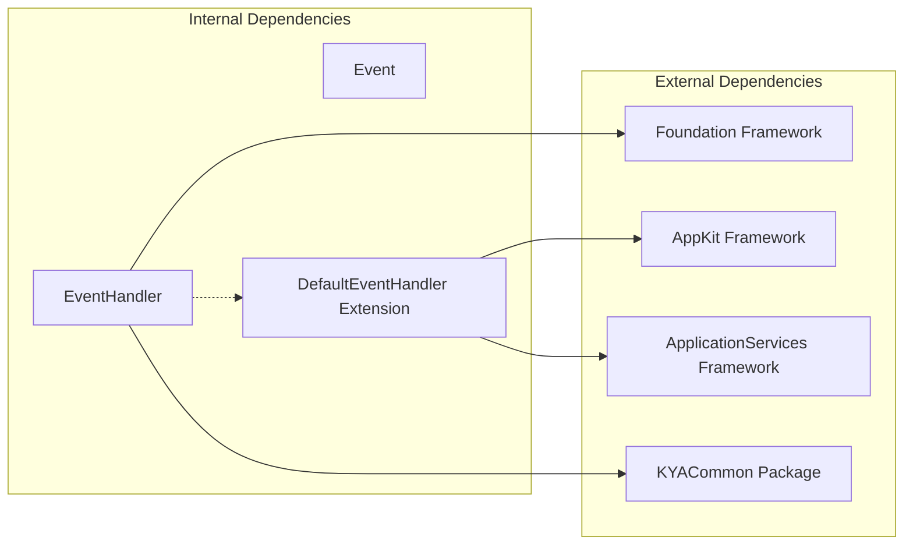

# KYAApplicationEvents Package

<cite>
**Referenced Files in This Document**
- [Package.swift](file://Packages/KYAApplicationEvents/Package.swift)
- [EventHandler.swift](file://Packages/KYAApplicationEvents/Sources/KYAApplicationEvents/EventHandler.swift)
- [Event.swift](file://Packages/KYAApplicationEvents/Sources/KYAApplicationEvents/Event.swift)
- [EventHandler+DefaultEventHandler.swift](file://Packages/KYAApplicationEvents/Sources/KYAApplicationEvents/EventHandler+DefaultEventHandler.swift)
- [AppController.swift](file://KeepingYouAwake/KYAAppController/AppController.swift)
- [Automation.md](file://Documentation/Automation.md)
- [2026-05-28-swift-appkit-rewrite-design.md](file://docs/superpowers/specs/2026-05-28-swift-appkit-rewrite-design.md)
</cite>

## Table of Contents
1. [Introduction](#introduction)
2. [Project Structure](#project-structure)
3. [Core Components](#core-components)
4. [Architecture Overview](#architecture-overview)
5. [Detailed Component Analysis](#detailed-component-analysis)
6. [Dependency Analysis](#dependency-analysis)
7. [Performance Considerations](#performance-considerations)
8. [Troubleshooting Guide](#troubleshooting-guide)
9. [Conclusion](#conclusion)

## Introduction

The KYAApplicationEvents package provides a centralized event processing mechanism for handling application-level events and command patterns in the KeepingYouAwake macOS application. This package implements a sophisticated event handling architecture that processes user interactions, system events, and application state changes through a unified URL scheme-based command system.

The package serves as the backbone for external command execution, enabling the application to respond to `keepingyouawake://` URL scheme events that originate from various sources including external applications, command-line tools, and system integrations. It implements a robust observer pattern through callback registration, ensuring clean separation of concerns between event generation and event handling.

## Project Structure

The KYAApplicationEvents package follows a modular Swift package structure with clear separation of concerns:

**Diagram sources**
- [Package.swift:1-26](file://Packages/KYAApplicationEvents/Package.swift#L1-L26)
- [EventHandler.swift:1-81](file://Packages/KYAApplicationEvents/Sources/KYAApplicationEvents/EventHandler.swift#L1-L81)
- [Event.swift:1-20](file://Packages/KYAApplicationEvents/Sources/KYAApplicationEvents/Event.swift#L1-L20)
- [EventHandler+DefaultEventHandler.swift:1-32](file://Packages/KYAApplicationEvents/Sources/KYAApplicationEvents/EventHandler+DefaultEventHandler.swift#L1-L32)

**Section sources**
- [Package.swift:1-26](file://Packages/KYAApplicationEvents/Package.swift#L1-L26)

## Core Components

The package consists of three primary components that work together to provide comprehensive event processing capabilities:

### Event Model
The `Event` struct serves as the fundamental data structure representing application events with immutable properties for name and optional arguments. It conforms to `Equatable`, `Hashable`, and `CustomStringConvertible` protocols, providing efficient comparison and logging capabilities.

### Event Handler
The `EventHandler` class implements the central event processing logic, featuring thread-safe action registration, URL parsing, and asynchronous event dispatching. It maintains an internal action registry and provides a dedicated serial queue for safe concurrent access.

### Default Event Handler Extension
The `EventHandler+DefaultEventHandler` extension integrates with macOS's Apple Event Manager, registering the handler as the default responder for `kAEGetURL` events and facilitating seamless URL scheme integration.

**Section sources**
- [Event.swift:9-20](file://Packages/KYAApplicationEvents/Sources/KYAApplicationEvents/Event.swift#L9-L20)
- [EventHandler.swift:13-81](file://Packages/KYAApplicationEvents/Sources/KYAApplicationEvents/EventHandler.swift#L13-L81)
- [EventHandler+DefaultEventHandler.swift:11-32](file://Packages/KYAApplicationEvents/Sources/KYAApplicationEvents/EventHandler+DefaultEventHandler.swift#L11-L32)

## Architecture Overview

The KYAApplicationEvents package implements a sophisticated event-driven architecture that combines URL scheme processing with a flexible callback-based system:

**Diagram sources**
- [EventHandler+DefaultEventHandler.swift:23-31](file://Packages/KYAApplicationEvents/Sources/KYAApplicationEvents/EventHandler+DefaultEventHandler.swift#L23-L31)
- [EventHandler.swift:47-62](file://Packages/KYAApplicationEvents/Sources/KYAApplicationEvents/EventHandler.swift#L47-L62)

The architecture ensures thread safety through a dedicated serial queue while maintaining responsiveness through asynchronous processing. The system leverages macOS's native Apple Event Manager integration for seamless URL scheme handling.

**Section sources**
- [EventHandler.swift:18-22](file://Packages/KYAApplicationEvents/Sources/KYAApplicationEvents/EventHandler.swift#L18-L22)
- [EventHandler+DefaultEventHandler.swift:14-21](file://Packages/KYAApplicationEvents/Sources/KYAApplicationEvents/EventHandler+DefaultEventHandler.swift#L14-L21)

## Detailed Component Analysis

### Event Handler Implementation

The `EventHandler` class provides a comprehensive solution for event processing with the following key features:

#### Thread-Safe Action Management
The handler maintains an internal dictionary-based action registry with atomic operations for registration and removal. The `registerAction(name:block:)` method enables dynamic action binding, while `removeAction(name:)` provides cleanup capabilities.

#### Asynchronous Event Processing
All event handling occurs on a dedicated serial queue (`eventQueue`) to ensure thread safety and prevent blocking the main thread. The `handleEvent(url:)` method implements a robust async processing pipeline with proper error handling and weak self capture to prevent retain cycles.

#### URL Parsing and Argument Extraction
The `eventFromURL(_:)` method utilizes `URLComponents` for clean URL parsing, extracting the event name from the last path component and query parameters as key-value pairs for argument passing.

**Diagram sources**
- [EventHandler.swift:14-81](file://Packages/KYAApplicationEvents/Sources/KYAApplicationEvents/EventHandler.swift#L14-L81)
- [Event.swift:10-20](file://Packages/KYAApplicationEvents/Sources/KYAApplicationEvents/Event.swift#L10-L20)
- [EventHandler+DefaultEventHandler.swift:11-32](file://Packages/KYAApplicationEvents/Sources/KYAApplicationEvents/EventHandler+DefaultEventHandler.swift#L11-L32)

**Section sources**
- [EventHandler.swift:24-62](file://Packages/KYAApplicationEvents/Sources/KYAApplicationEvents/EventHandler.swift#L24-L62)

### Default Event Handler Integration

The extension to `EventHandler` provides seamless macOS integration through the Apple Event Manager:

#### Apple Event Registration
The `registerAsDefaultEventHandler()` method registers the handler for `kAEGetURL` events, enabling the application to respond to external URL scheme requests without requiring explicit URL opening mechanisms.

#### Event Descriptor Processing
The `handleGetURLEvent(_:withReplyEvent:)` method extracts URL strings from Apple Event descriptors, validates them, and delegates processing to the main `handleEvent(url:)` method for consistent event handling.

**Section sources**
- [EventHandler+DefaultEventHandler.swift:12-31](file://Packages/KYAApplicationEvents/Sources/KYAApplicationEvents/EventHandler+DefaultEventHandler.swift#L12-L31)

### Event Model Design

The `Event` struct provides a clean, immutable representation of application events:

#### Immutable Data Structure
Properties are declared as `let` constants, ensuring immutability and thread safety. The struct conforms to `Equatable` and `Hashable` for efficient collection operations and caching.

#### Flexible Argument Support
Optional arguments dictionary allows for extensible parameter passing, supporting complex event scenarios with multiple named parameters extracted from URL query strings.

**Section sources**
- [Event.swift:10-20](file://Packages/KYAApplicationEvents/Sources/KYAApplicationEvents/Event.swift#L10-L20)

## Dependency Analysis

The KYAApplicationEvents package maintains minimal external dependencies while providing comprehensive functionality:

**Diagram sources**
- [Package.swift:13-21](file://Packages/KYAApplicationEvents/Package.swift#L13-L21)
- [EventHandler.swift:9-11](file://Packages/KYAApplicationEvents/Sources/KYAApplicationEvents/EventHandler.swift#L9-L11)
- [EventHandler+DefaultEventHandler.swift:8-10](file://Packages/KYAApplicationEvents/Sources/KYAApplicationEvents/EventHandler+DefaultEventHandler.swift#L8-L10)

The package depends on:
- **Foundation**: Core data structures, URL handling, and dispatch queues
- **AppKit**: Apple Event Manager integration and event descriptor handling  
- **ApplicationServices**: Low-level Apple Event support
- **KYACommon**: Logging infrastructure and shared utilities

**Section sources**
- [Package.swift:13-21](file://Packages/KYAApplicationEvents/Package.swift#L13-L21)

## Performance Considerations

The package implements several performance optimizations for efficient event processing:

### Thread Safety and Concurrency
- Dedicated serial queue ensures single-threaded access to action registry
- Weak self capture prevents retain cycles during asynchronous processing
- Main queue synchronization guarantees UI-safe callback execution

### Memory Management
- Dictionary-based action storage with O(1) lookup performance
- Optional argument handling minimizes memory overhead for simple events
- Struct-based event model provides stack allocation benefits

### Processing Pipeline
- Asynchronous URL parsing prevents main thread blocking
- Early validation and guard statements minimize unnecessary processing
- Efficient URLComponents usage reduces parsing overhead

## Troubleshooting Guide

### Common Issues and Solutions

#### Event Handler Not Receiving Events
- Verify Apple Event Manager registration using `registerAsDefaultEventHandler()`
- Check URL scheme format: `keepingyouawake:///action?param=value`
- Ensure proper URL encoding for special characters

#### Action Callback Not Executing
- Confirm action registration with correct event name
- Verify callback execution occurs on main queue for UI updates
- Check for proper error handling in action blocks

#### Performance Issues
- Monitor event queue backlog using logging
- Optimize heavy operations in action callbacks
- Consider batching similar events when appropriate

**Section sources**
- [EventHandler.swift:56-61](file://Packages/KYAApplicationEvents/Sources/KYAApplicationEvents/EventHandler.swift#L56-L61)
- [EventHandler+DefaultEventHandler.swift:14-21](file://Packages/KYAApplicationEvents/Sources/KYAApplicationEvents/EventHandler+DefaultEventHandler.swift#L14-L21)

## Conclusion

The KYAApplicationEvents package provides a robust, scalable foundation for application-level event processing in the KeepingYouAwake ecosystem. Its architecture successfully balances simplicity with power, offering developers a clean interface for handling external commands while maintaining excellent performance characteristics.

The package's integration with macOS's native Apple Event Manager ensures seamless compatibility with external systems, while its callback-based design promotes clean separation of concerns and testability. The thread-safe implementation and comprehensive logging support make it suitable for production environments requiring reliable event processing.

Future enhancements could include event filtering, priority queuing, and reactive programming integration, building upon the solid foundation established by the current implementation.