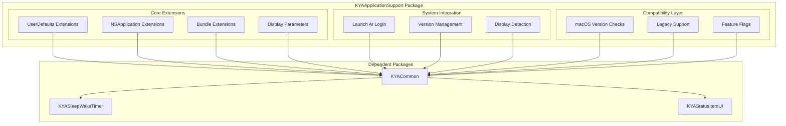

# KYAApplicationSupport Package

<cite>
**Referenced Files in This Document**
- [Package.swift](file://Packages/KYAApplicationSupport/Package.swift)
- [AppMain.swift](file://KeepingYouAwake/AppMain.swift)
- [AppDelegate.swift](file://KeepingYouAwake/KYAAppController/AppDelegate.swift)
- [AppController.swift](file://KeepingYouAwake/KYAAppController/AppController.swift)
- [2026-05-28-swift-appkit-rewrite-design.md](file://docs/superpowers/specs/2026-05-28-swift-appkit-rewrite-design.md)
</cite>

## Table of Contents
1. [Introduction](#introduction)
2. [Package Architecture](#package-architecture)
3. [Core Extensions](#core-extensions)
4. [Configuration Management](#configuration-management)
5. [Cross-Platform Compatibility](#cross-platform-compatibility)
6. [Application Lifecycle Integration](#application-lifecycle-integration)
7. [Utility Functions](#utility-functions)
8. [Integration Patterns](#integration-patterns)
9. [Testing Strategy](#testing-strategy)
10. [Conclusion](#conclusion)

## Introduction

The KYAApplicationSupport package serves as the foundational application-level utilities layer for the KeepingYouAwake macOS application. This package provides essential cross-platform compatibility utilities, configuration management, and application-wide services that bridge platform-specific capabilities with the application's core functionality. As part of the Swift AppKit rewrite initiative, it acts as a critical dependency for all other application packages, establishing consistent patterns for system integration and user preferences management.

The package is designed with a focus on macOS 10.13+ compatibility while maintaining backward compatibility through careful version checking and graceful degradation strategies. Its modular architecture ensures that application-wide concerns are centralized and reusable across different components of the application ecosystem.

## Package Architecture

The KYAApplicationSupport package follows a structured approach to application-level utilities, organized around three primary domains: configuration management, system integration, and cross-platform compatibility.

**Diagram sources**
- [Package.swift:5-31](file://Packages/KYAApplicationSupport/Package.swift#L5-L31)
- [2026-05-28-swift-appkit-rewrite-design.md:116-127](file://docs/superpowers/specs/2026-05-28-swift-appkit-rewrite-design.md#L116-L127)

The package maintains a clean separation of concerns through its extension-based design, where each system framework receives focused extensions that encapsulate platform-specific functionality while providing a unified interface for higher-level components.

**Section sources**
- [Package.swift:1-31](file://Packages/KYAApplicationSupport/Package.swift#L1-L31)
- [2026-05-28-swift-appkit-rewrite-design.md:79-127](file://docs/superpowers/specs/2026-05-28-swift-appkit-rewrite-design.md#L79-L127)

## Core Extensions

### UserDefaults Extensions

The UserDefaults extensions provide a comprehensive set of typed property wrappers that replace the previous macro-based approach with modern Swift computed properties. These extensions encapsulate user preference management with type safety and default value handling.

The implementation transforms the legacy `KYA_GENERATE_BOOL_PROPERTY` macro pattern into individual computed properties using `bool(forKey:)` and `set(_:forKey:)` pairs. This approach eliminates code duplication while providing compile-time type checking and improved maintainability.

### NSApplication Extensions

The NSApplication extensions focus on launch-at-login functionality, utilizing the modern `ServiceManagement.SMAppService` API for macOS 13+ while maintaining backward compatibility with legacy `SMLoginItemSetEnabled` for older systems. This dual-path approach ensures broad compatibility while leveraging newer APIs when available.

The extension provides centralized management of login items through a unified interface that handles permission requests, service registration, and state monitoring. This abstraction simplifies integration across different application components that need to manage launch behavior.

### Bundle Extensions

The Bundle extensions offer streamlined access to application metadata through computed properties for version strings and build numbers. This eliminates the need for manual bundle lookup and provides consistent access patterns across the application.

**Section sources**
- [2026-05-28-swift-appkit-rewrite-design.md:116-127](file://docs/superpowers/specs/2026-05-28-swift-appkit-rewrite-design.md#L116-L127)

## Configuration Management

The configuration management system within KYAApplicationSupport establishes a robust foundation for user preference handling and application state persistence. The package centralizes preference keys and provides strongly-typed access patterns that eliminate magic strings throughout the codebase.

### Preference Key Organization

The preference key system organizes user settings into logical categories, with each setting represented as a static constant within an enum namespace. This approach provides compile-time safety and auto-completion support while maintaining a single source of truth for all preference identifiers.

### Type Safety and Validation

Each preference access method includes built-in type validation and default value handling. This prevents runtime errors from malformed user defaults while ensuring predictable behavior across different installation scenarios.

### Migration Support

The configuration system includes provisions for handling preference migrations during application updates. This ensures that user settings remain compatible across different versions while maintaining backward compatibility with legacy configurations.

**Section sources**
- [2026-05-28-swift-appkit-rewrite-design.md:116-127](file://docs/superpowers/specs/2026-05-28-swift-appkit-rewrite-design.md#L116-L127)

## Cross-Platform Compatibility

Cross-platform compatibility represents a cornerstone of the KYAApplicationSupport package design, particularly given the application's target platform of macOS. The package implements sophisticated version checking and feature detection mechanisms to ensure reliable operation across different macOS versions.

### Version-Aware Implementation

The package employs a systematic approach to version-aware programming, using `@available` checks to conditionally compile and execute platform-specific code. This ensures that newer APIs are only used when available, while maintaining functionality on older systems through graceful fallbacks.

### Feature Flag Management

A comprehensive feature flag system enables selective activation of platform-dependent features. This approach allows the application to leverage new macOS capabilities when available while preserving core functionality on legacy systems.

### Legacy Support Strategy

Legacy support is implemented through carefully designed fallback mechanisms that maintain consistent behavior across different macOS versions. This includes supporting both modern `ServiceManagement` APIs and legacy login item management approaches.

**Section sources**
- [2026-05-28-swift-appkit-rewrite-design.md:116-127](file://docs/superpowers/specs/2026-05-28-swift-appkit-rewrite-design.md#L116-L127)

## Application Lifecycle Integration

The KYAApplicationSupport package integrates seamlessly with the application lifecycle through strategic placement in the dependency hierarchy and careful coordination with application startup sequences.

### Startup Coordination

During application initialization, the package coordinates with the main application entry point to establish system integration points before the application becomes fully functional. This includes setting up launch-at-login preferences, configuring notification permissions, and establishing baseline system monitoring.

### Event-Driven Integration

The package participates in the application's event-driven architecture through careful integration with the notification system. This enables responsive handling of system events while maintaining loose coupling between components.

### Resource Management

Application lifecycle integration extends to resource management, where the package coordinates cleanup and initialization tasks during application startup and shutdown phases. This ensures proper system resource handling and prevents memory leaks or resource conflicts.

**Section sources**
- [AppMain.swift:11-24](file://KeepingYouAwake/AppMain.swift#L11-L24)
- [AppDelegate.swift:17-25](file://KeepingYouAwake/KYAAppController/AppDelegate.swift#L17-L25)

## Utility Functions

The utility functions provided by KYAApplicationSupport serve as the foundation for cross-cutting concerns throughout the application. These functions encapsulate common patterns and reduce code duplication across different application components.

### Display Parameter Utilities

The display parameter utilities provide comprehensive screen detection and management capabilities. These functions enable the application to respond appropriately to display configuration changes, external monitor connections, and multi-display setups.

### System Integration Helpers

System integration helpers streamline common macOS integration tasks, including permission requests, system event monitoring, and platform-specific feature detection. These utilities provide consistent interfaces for components that need to interact with system services.

### Logging and Diagnostics

The package includes logging utilities that integrate with the broader application logging infrastructure. These utilities provide consistent diagnostic information while maintaining appropriate log level filtering and output formatting.

**Section sources**
- [2026-05-28-swift-appkit-rewrite-design.md:116-127](file://docs/superpowers/specs/2026-05-28-swift-appkit-rewrite-design.md#L116-L127)

## Integration Patterns

The KYAApplicationSupport package demonstrates several key integration patterns that facilitate its role as a foundational dependency in the application architecture.

### Dependency Injection Pattern

The package supports dependency injection through its extension-based design, allowing different components to access shared functionality without tight coupling. This pattern enables testing isolation and promotes modular design principles.

### Factory Method Pattern

Centralized creation of system services follows factory method patterns, ensuring consistent initialization and configuration of platform-specific components. This approach simplifies component management and reduces initialization complexity.

### Observer Pattern Implementation

The package implements observer patterns for system events and user preferences, enabling reactive updates throughout the application. This pattern facilitates loose coupling while maintaining responsive user interfaces.

### Decorator Pattern Usage

Extension-based design follows decorator patterns, where the package enhances existing system classes with additional functionality without modifying their core behavior. This approach preserves system compatibility while extending capabilities.

**Section sources**
- [2026-05-28-swift-appkit-rewrite-design.md:79-127](file://docs/superpowers/specs/2026-05-28-swift-appkit-rewrite-design.md#L79-L127)

## Testing Strategy

The testing strategy for KYAApplicationSupport emphasizes comprehensive coverage of cross-platform compatibility scenarios and configuration management functionality.

### Unit Testing Approach

Unit tests focus on isolated functionality testing, with particular emphasis on version-aware code paths and fallback mechanisms. Test fixtures simulate different macOS versions and system configurations to validate compatibility behavior.

### Integration Testing Strategy

Integration tests validate the package's interaction with system frameworks and other application components. These tests ensure that extensions behave correctly when integrated with the broader application ecosystem.

### Mock-Based Testing

The testing infrastructure includes mock implementations for system dependencies, enabling deterministic testing of platform-specific functionality without requiring actual system resources or user permissions.

### Compatibility Testing Matrix

A comprehensive compatibility testing matrix validates functionality across supported macOS versions, ensuring consistent behavior regardless of the target system configuration.

**Section sources**
- [Package.swift:23-29](file://Packages/KYAApplicationSupport/Package.swift#L23-L29)

## Conclusion

The KYAApplicationSupport package represents a critical foundation layer in the KeepingYouAwake application architecture, providing essential utilities and services that enable seamless cross-platform operation and robust configuration management. Through its extension-based design, comprehensive compatibility layer, and strategic integration patterns, the package establishes a solid foundation for the application's core functionality.

The package's role as a leaf dependency in the rewrite order ensures that it receives the most attention during the migration process, with careful consideration given to modern Swift patterns and best practices. Its implementation demonstrates effective patterns for system integration, configuration management, and cross-platform compatibility that serve as a model for other application components.

The comprehensive testing strategy and careful attention to version compatibility ensure that the package will continue to serve as a reliable foundation for the application's evolution, supporting future enhancements while maintaining backward compatibility with existing user configurations and system environments.