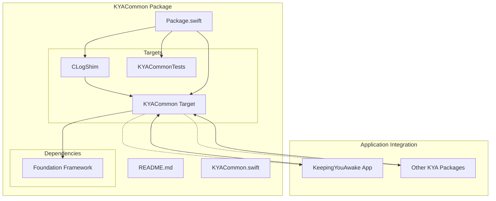
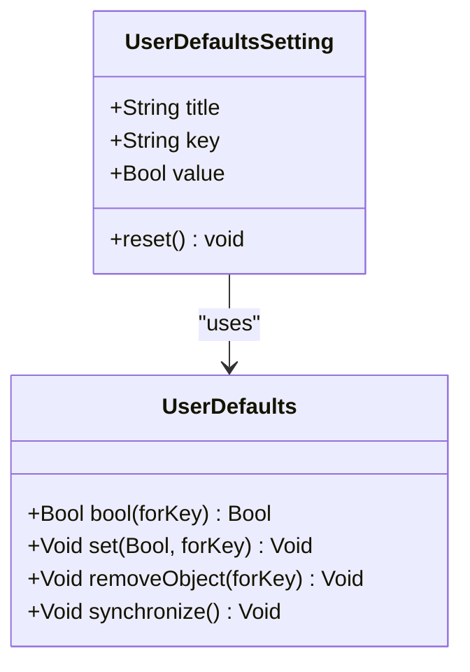
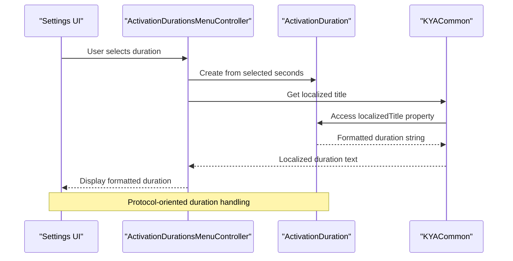
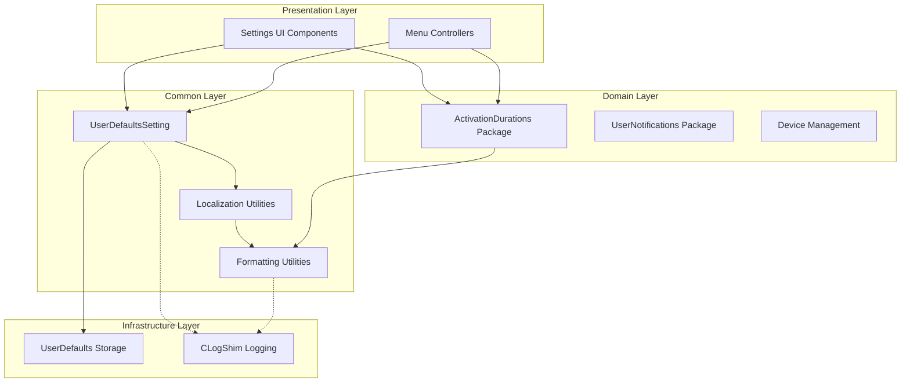
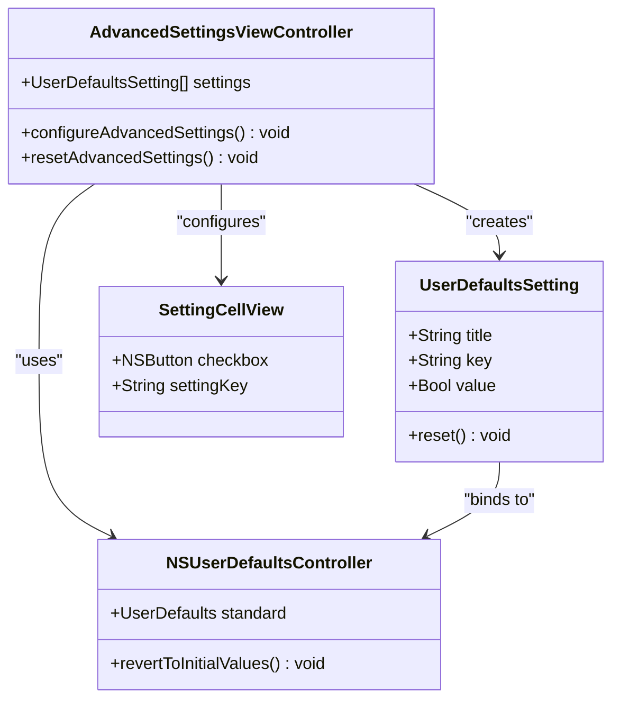
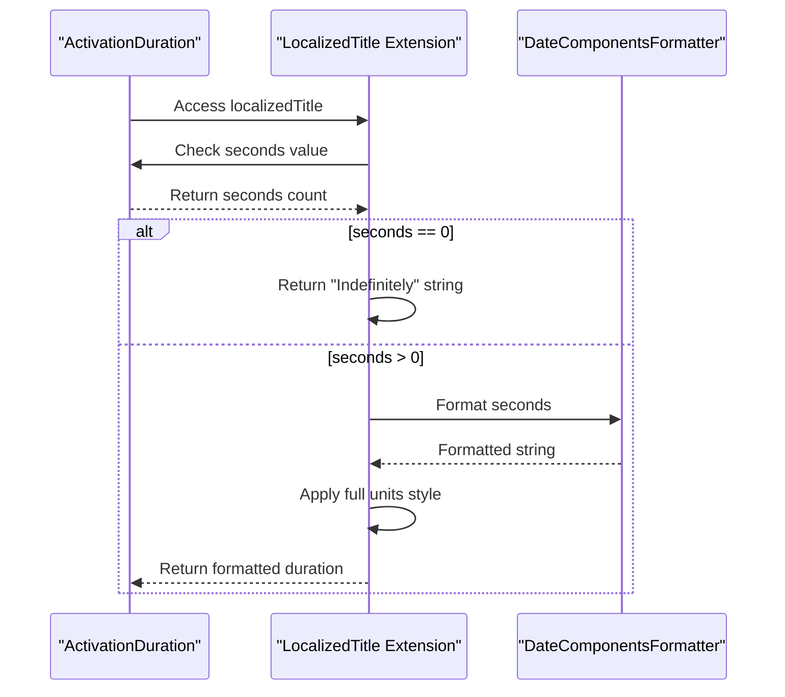
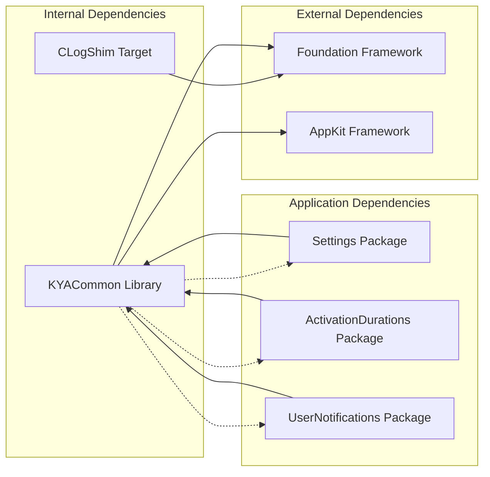

# KYACommon Package

<cite>
**Referenced Files in This Document**
- [Package.swift](file://Packages/KYACommon/Package.swift)
- [README.md](file://Packages/KYACommon/README.md)
- [KYACommon.swift](file://Packages/KYACommon/Sources/KYACommon/KYACommon.swift)
- [UserDefaultsSetting.swift](file://KeepingYouAwake/UserDefaultsSetting.swift)
- [ActivationDurationsMenuController.swift](file://KeepingYouAwake/KYAActivationDurationsMenuController/ActivationDurationsMenuController.swift)
- [ActivationDuration+LocalizedTitle.swift](file://KeepingYouAwake/KYAActivationDurationsMenuController/ActivationDuration+LocalizedTitle.swift)
- [AdvancedSettingsViewController.swift](file://KeepingYouAwake/Settings/KYAAdvancedSettingsViewController/AdvancedSettingsViewController.swift)
</cite>

## Table of Contents
1. [Introduction](#introduction)
2. [Project Structure](#project-structure)
3. [Core Components](#core-components)
4. [Architecture Overview](#architecture-overview)
5. [Detailed Component Analysis](#detailed-component-analysis)
6. [Dependency Analysis](#dependency-analysis)
7. [Performance Considerations](#performance-considerations)
8. [Troubleshooting Guide](#troubleshooting-guide)
9. [Conclusion](#conclusion)

## Introduction

The KYACommon package serves as the foundational shared types and utilities for the KeepingYouAwake application ecosystem. This package provides the common foundation that enables type safety, protocol-oriented design patterns, and reusable utility functions across all other packages in the application. The package is designed with strict separation of concerns, ensuring that shared components remain cohesive while maintaining loose coupling with specialized domain packages.

The package's primary responsibility is to define core data models, enums, and protocols that establish the fundamental building blocks for the entire application. These shared components enable other packages to focus on their specific domain logic while leveraging the type safety and consistency provided by the common layer.

## Project Structure

The KYACommon package follows a modular structure that emphasizes separation of concerns and maintainability:



**Diagram sources**
- [Package.swift:1-26](file://Packages/KYACommon/Package.swift#L1-L26)

The package structure demonstrates a clean separation between the logging shim target and the main common library target. The CLogShim provides essential logging capabilities while the main KYACommon target exposes the shared APIs and types used throughout the application.

**Section sources**
- [Package.swift:1-26](file://Packages/KYACommon/Package.swift#L1-L26)
- [README.md:1-4](file://Packages/KYACommon/README.md#L1-L4)

## Core Components

The KYACommon package defines several critical shared components that form the backbone of the application's type system:

### UserDefaultsSetting Abstraction

The `UserDefaultsSetting` struct represents a fundamental UI model pattern for boolean preferences backed by UserDefaults. This abstraction encapsulates the complexity of user defaults management while providing a clean interface for UI components.



**Diagram sources**
- [UserDefaultsSetting.swift:11-31](file://KeepingYouAwake/UserDefaultsSetting.swift#L11-L31)

The `UserDefaultsSetting` provides:
- Type-safe boolean preference management
- Automatic synchronization with UserDefaults
- Clean reset functionality
- Display-friendly title property for UI binding

### ActivationDuration Integration

The package integrates seamlessly with the ActivationDurations domain through extension patterns and shared type definitions. The `ActivationDuration` type, while defined in a separate package, benefits from common formatting and localization utilities provided by KYACommon.



**Diagram sources**
- [ActivationDurationsMenuController.swift:14-105](file://KeepingYouAwake/KYAActivationDurationsMenuController/ActivationDurationsMenuController.swift#L14-L105)
- [ActivationDuration+LocalizedTitle.swift:12-26](file://KeepingYouAwake/KYAActivationDurationsMenuController/ActivationDuration+LocalizedTitle.swift#L12-L26)

### Protocol-Oriented Design Patterns

The package establishes protocol-oriented design patterns that enable flexible, testable, and extensible code. These patterns promote loose coupling while maintaining strong type safety guarantees.

**Section sources**
- [UserDefaultsSetting.swift:11-31](file://KeepingYouAwake/UserDefaultsSetting.swift#L11-L31)
- [ActivationDurationsMenuController.swift:14-105](file://KeepingYouAwake/KYAActivationDurationsMenuController/ActivationDurationsMenuController.swift#L14-L105)
- [ActivationDuration+LocalizedTitle.swift:12-26](file://KeepingYouAwake/KYAActivationDurationsMenuController/ActivationDuration+LocalizedTitle.swift#L12-L26)

## Architecture Overview

The KYACommon package implements a layered architecture that promotes separation of concerns and maintainability:



This architecture ensures that:
- Presentation components depend on common abstractions rather than domain specifics
- Domain packages remain focused on their core responsibilities
- Common utilities provide consistent behavior across the application
- Infrastructure concerns are isolated in dedicated targets

## Detailed Component Analysis

### UserDefaultsSetting Implementation

The `UserDefaultsSetting` struct exemplifies the package's commitment to type safety and clean abstractions:

```mermaid
flowchart TD
Start([Access UserDefaultsSetting.value]) --> CheckValue{"New Value True?"}
CheckValue --> |Yes| SetValue["Set Boolean True in UserDefaults"]
CheckValue --> |No| RemoveValue["Remove Object from UserDefaults"]
SetValue --> Sync["Call synchronize()"]
RemoveValue --> Sync
Sync --> End([Return Updated Value])
ResetStart([Call reset()]) --> RemoveKey["Remove Object for Key"]
RemoveKey --> ResetEnd([Reset Complete])
```

**Diagram sources**
- [UserDefaultsSetting.swift:16-26](file://KeepingYouAwake/UserDefaultsSetting.swift#L16-L26)

The implementation demonstrates several key design principles:
- **Atomic Operations**: The getter and setter work together to maintain consistency
- **Automatic Persistence**: Changes are immediately persisted to UserDefaults
- **Clean Interface**: The abstraction hides UserDefaults complexity from consumers
- **Type Safety**: Strong typing prevents common UserDefaults misuse errors

### Integration Patterns with Application Components

The package's integration with the broader application showcases its role as a common foundation:



**Diagram sources**
- [AdvancedSettingsViewController.swift:121-137](file://KeepingYouAwake/Settings/KYAAdvancedSettingsViewController/AdvancedSettingsViewController.swift#L121-L137)

This integration pattern demonstrates:
- **Declarative Configuration**: Settings are defined as data structures
- **Automatic Binding**: UI components bind directly to UserDefaults values
- **Consistent Behavior**: All settings follow the same pattern and lifecycle
- **Easy Maintenance**: Adding new settings requires minimal code changes

**Section sources**
- [UserDefaultsSetting.swift:11-31](file://KeepingYouAwake/UserDefaultsSetting.swift#L11-L31)
- [AdvancedSettingsViewController.swift:121-168](file://KeepingYouAwake/Settings/KYAAdvancedSettingsViewController/AdvancedSettingsViewController.swift#L121-L168)

### Extension-Based Integration

The package leverages Swift's extension system to provide additional functionality without modifying base types:



**Diagram sources**
- [ActivationDuration+LocalizedTitle.swift:14-19](file://KeepingYouAwake/KYAActivationDurationsMenuController/ActivationDuration+LocalizedTitle.swift#L14-L19)

**Section sources**
- [ActivationDuration+LocalizedTitle.swift:12-26](file://KeepingYouAwake/KYAActivationDurationsMenuController/ActivationDuration+LocalizedTitle.swift#L12-L26)

## Dependency Analysis

The package maintains carefully managed dependencies that support its role as a common foundation:



**Diagram sources**
- [Package.swift:17-20](file://Packages/KYACommon/Package.swift#L17-L20)

The dependency structure ensures:
- **Minimal External Coupling**: Only essential frameworks are directly imported
- **Clear Internal Boundaries**: CLogShim provides isolated infrastructure concerns
- **Flexible Application Integration**: Other packages can selectively import only needed components
- **Testable Architecture**: Dependencies flow outward from the common package

**Section sources**
- [Package.swift:17-20](file://Packages/KYACommon/Package.swift#L17-L20)

## Performance Considerations

The KYACommon package is designed with performance in mind through several optimization strategies:

### Memory Efficiency
- **Value Types**: Uses structs for immutable data models to minimize memory overhead
- **Lazy Initialization**: Extensions use lazy initialization for expensive resources
- **Minimal Allocations**: Avoids unnecessary object creation in hot paths

### Thread Safety
- **Immutable Data**: Shared data structures are designed to be thread-safe
- **Atomic Operations**: UserDefaults operations are properly synchronized
- **Safe Defaults**: Provides safe fallbacks for missing configuration values

### Caching Strategies
- **Shared Formatters**: Reuses expensive formatter instances across the application
- **Efficient Lookups**: Uses efficient key-based storage patterns
- **Minimal Synchronization**: Reduces unnecessary synchronization overhead

## Troubleshooting Guide

Common issues and solutions when working with KYACommon components:

### UserDefaults Synchronization Issues
**Problem**: Changes not persisting immediately
**Solution**: The package automatically calls synchronization after value changes. If experiencing delays, verify that the application has proper entitlements for UserDefaults access.

### Extension Method Conflicts
**Problem**: Custom extensions conflicting with package-provided extensions
**Solution**: Ensure custom extensions are defined in separate namespaces or use more specific type constraints to avoid conflicts.

### Memory Leaks in Closures
**Problem**: Retain cycles when using closure-based patterns
**Solution**: Use `[weak self]` capture lists in closures and ensure proper cleanup of observer registrations.

### Localization Issues
**Problem**: Missing or incorrect localized strings
**Solution**: Verify that the localizedTitle extension is properly imported and that the underlying localization system is functioning correctly.

**Section sources**
- [UserDefaultsSetting.swift:16-26](file://KeepingYouAwake/UserDefaultsSetting.swift#L16-L26)
- [ActivationDuration+LocalizedTitle.swift:21-25](file://KeepingYouAwake/KYAActivationDurationsMenuController/ActivationDuration+LocalizedTitle.swift#L21-L25)

## Conclusion

The KYACommon package successfully establishes a robust foundation for the KeepingYouAwake application ecosystem. Through its carefully designed shared types, protocol-oriented patterns, and integration strategies, it enables maintainable, testable, and extensible code across all application domains.

The package's strength lies in its ability to provide consistent abstractions while maintaining strict separation of concerns. The `UserDefaultsSetting` abstraction demonstrates how the package encapsulates infrastructure concerns into clean, reusable interfaces. The extension-based integration patterns show how the package can enhance existing types without creating tight coupling.

By serving as the common foundation, KYACommon enables other packages to focus on their specific domain logic while benefiting from shared utilities, type safety, and consistent behavior. This architectural approach supports long-term maintainability and facilitates future enhancements to the application ecosystem.

The package's design principles—type safety, protocol orientation, reusable utilities, and strict separation of concerns—provide a solid foundation for continued development and evolution of the KeepingYouAwake application suite.