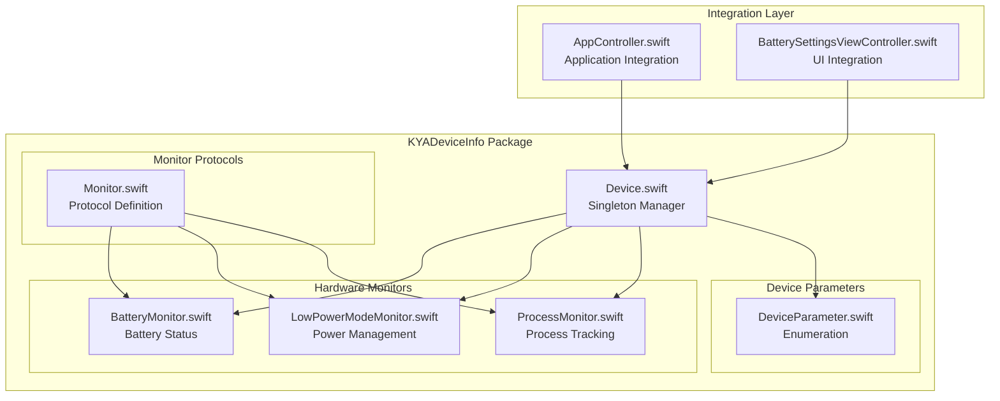
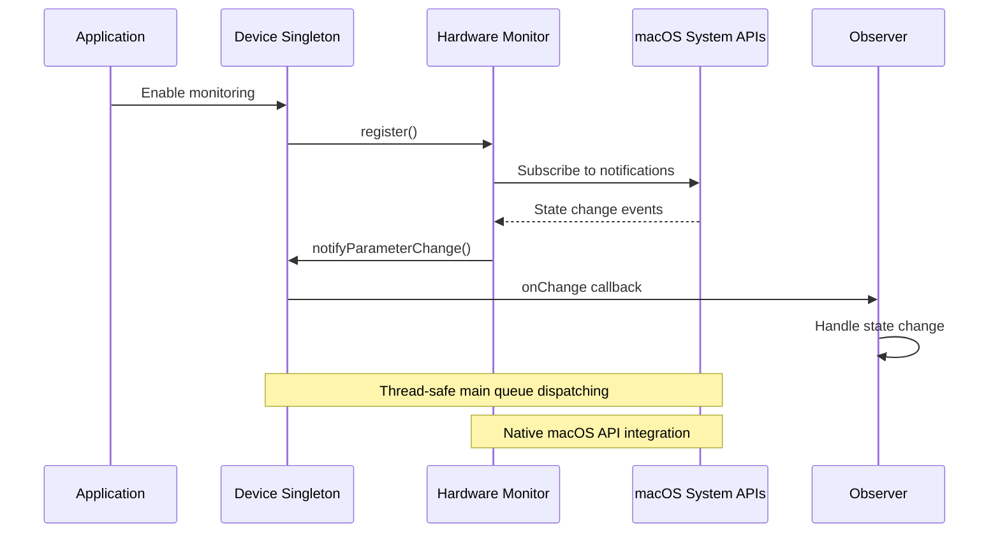
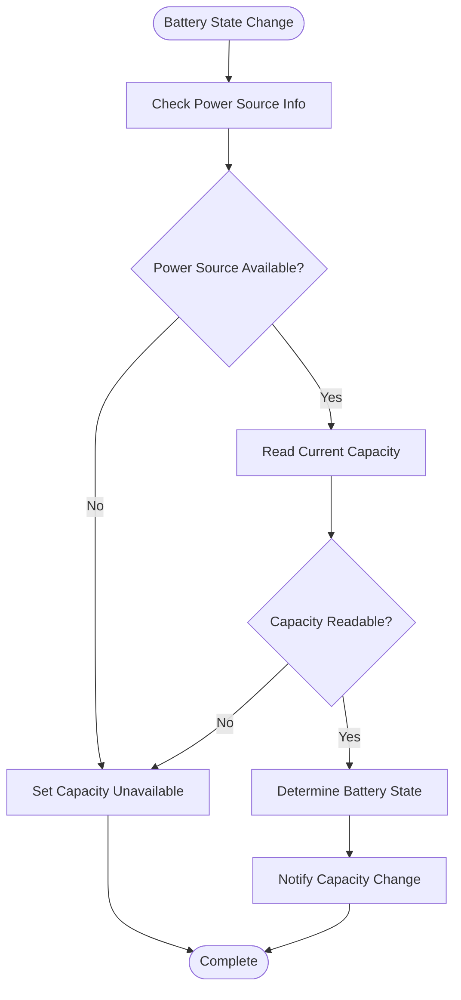
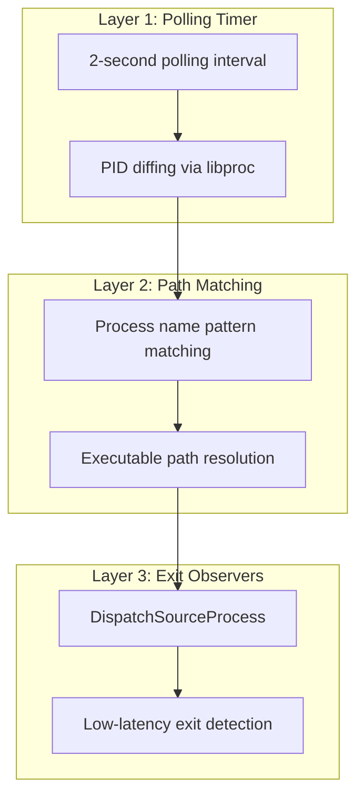
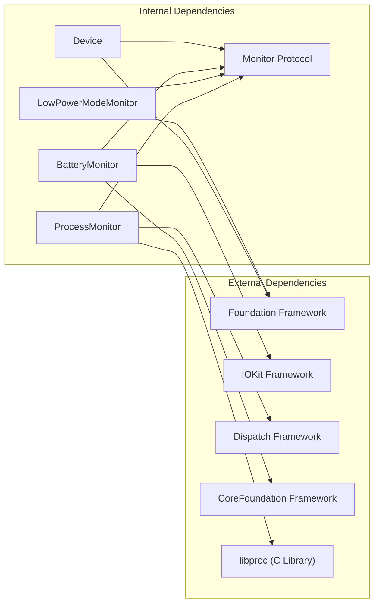

# KYADeviceInfo Package

<cite>
**Referenced Files in This Document**
- [Device.swift](file://Packages/KYADeviceInfo/Sources/KYADeviceInfo/Device.swift)
- [BatteryMonitor.swift](file://Packages/KYADeviceInfo/Sources/KYADeviceInfo/BatteryMonitor.swift)
- [LowPowerModeMonitor.swift](file://Packages/KYADeviceInfo/Sources/KYADeviceInfo/LowPowerModeMonitor.swift)
- [ProcessMonitor.swift](file://Packages/KYADeviceInfo/Sources/KYADeviceInfo/ProcessMonitor.swift)
- [Monitor.swift](file://Packages/KYADeviceInfo/Sources/KYADeviceInfo/Monitor.swift)
- [AppController.swift](file://KeepingYouAwake/KYAAppController/AppController.swift)
- [BatterySettingsViewController.swift](file://KeepingYouAwake/Settings/KYABatterySettingsViewController/BatterySettingsViewController.swift)
- [DisplayParameters.swift](file://Packages/KYAApplicationSupport/Sources/KYAApplicationSupport/DisplayParameters.swift)
- [UserDefaults+KYAKeys.swift](file://Packages/KYAApplicationSupport/Sources/KYAApplicationSupport/UserDefaults+KYAKeys.swift)
- [KYADeviceInfo Package Design](file://docs/superpowers/specs/2026-05-28-swift-appkit-rewrite-design.md)
</cite>

## Table of Contents
1. [Introduction](#introduction)
2. [Project Structure](#project-structure)
3. [Core Components](#core-components)
4. [Architecture Overview](#architecture-overview)
5. [Detailed Component Analysis](#detailed-component-analysis)
6. [Dependency Analysis](#dependency-analysis)
7. [Performance Considerations](#performance-considerations)
8. [Troubleshooting Guide](#troubleshooting-guide)
9. [Conclusion](#conclusion)

## Introduction

The KYADeviceInfo package is a comprehensive hardware and system device monitoring solution for macOS applications. It provides unified access to device parameters including battery status, Low Power Mode detection, and external display tracking through a sophisticated singleton pattern implementation. The package leverages native macOS system APIs while maintaining a clean, Swift-native interface for developers.

The package follows modern iOS/macOS development patterns with a focus on reactive programming, thread-safe operations, and seamless integration with the broader KeepingYouAwake ecosystem. It replaces legacy Objective-C categories with modern Swift protocols and enums, providing type safety and improved developer experience.

## Project Structure

The KYADeviceInfo package is organized as a cohesive Swift package with clear separation of concerns:

**Diagram sources**
- [Device.swift:1-139](file://Packages/KYADeviceInfo/Sources/KYADeviceInfo/Device.swift#L1-L139)
- [Monitor.swift:1-21](file://Packages/KYADeviceInfo/Sources/KYADeviceInfo/Monitor.swift#L1-L21)
- [BatteryMonitor.swift:1-142](file://Packages/KYADeviceInfo/Sources/KYADeviceInfo/BatteryMonitor.swift#L1-L142)
- [LowPowerModeMonitor.swift:1-85](file://Packages/KYADeviceInfo/Sources/KYADeviceInfo/LowPowerModeMonitor.swift#L1-L85)
- [ProcessMonitor.swift:1-229](file://Packages/KYADeviceInfo/Sources/KYADeviceInfo/ProcessMonitor.swift#L1-L229)

**Section sources**
- [Device.swift:1-139](file://Packages/KYADeviceInfo/Sources/KYADeviceInfo/Device.swift#L1-L139)
- [Monitor.swift:1-21](file://Packages/KYADeviceInfo/Sources/KYADeviceInfo/Monitor.swift#L1-L21)

## Core Components

The KYADeviceInfo package centers around four primary components that work together to provide comprehensive device monitoring capabilities:

### Device Singleton Pattern

The Device class implements a thread-safe singleton pattern that serves as the central coordinator for all device monitoring activities. The singleton instance provides controlled access to individual monitor instances while managing their lifecycle and state transitions.

Key characteristics of the Device singleton:
- Thread-safe access through main queue dispatching
- Centralized parameter change notifications
- Automatic resource cleanup in deinitialization
- Weak reference handling to prevent retain cycles

### Monitor Protocol Design

The Monitor protocol establishes a consistent interface for all monitoring implementations, ensuring uniform behavior across different hardware and system monitoring capabilities. The protocol defines three essential methods: registration, unregistration, and state observation.

Implementation requirements for all monitors:
- `isRegistered`: Boolean property indicating monitoring state
- `register()`: Method to begin monitoring system state changes
- `unregister()`: Method to stop monitoring and clean up resources

### Parameter Enumeration System

The DeviceParameter enumeration provides type-safe representation of all monitored device states, replacing legacy string-based constants with compile-time checked alternatives. The enumeration currently supports three primary parameter types:

- `batteryCapacity`: Tracks battery percentage changes and charging states
- `lowPowerMode`: Monitors system-wide Low Power Mode activation
- `externalDisplay`: Detects external display connection/disconnection events

### Change Notification Mechanisms

The package implements a robust notification system that delivers state changes to registered observers through closures. The notification mechanism ensures thread-safe delivery of updates to the main queue while maintaining weak references to prevent memory leaks.

**Section sources**
- [Device.swift:13-20](file://Packages/KYADeviceInfo/Sources/KYADeviceInfo/Device.swift#L13-L20)
- [Monitor.swift:10-21](file://Packages/KYADeviceInfo/Sources/KYADeviceInfo/Monitor.swift#L10-L21)
- [Device.swift:120-126](file://Packages/KYADeviceInfo/Sources/KYADeviceInfo/Device.swift#L120-L126)

## Architecture Overview

The KYADeviceInfo package employs a layered architecture that separates concerns between monitoring, notification, and integration layers:

**Diagram sources**
- [Device.swift:134-138](file://Packages/KYADeviceInfo/Sources/KYADeviceInfo/Device.swift#L134-L138)
- [BatteryMonitor.swift:73-87](file://Packages/KYADeviceInfo/Sources/KYADeviceInfo/BatteryMonitor.swift#L73-L87)
- [LowPowerModeMonitor.swift:44-55](file://Packages/KYADeviceInfo/Sources/KYADeviceInfo/LowPowerModeMonitor.swift#L44-L55)

The architecture ensures loose coupling between components while maintaining efficient communication channels for real-time state updates. Each monitor operates independently but coordinates through the central Device singleton, which manages the overall monitoring lifecycle.

**Section sources**
- [Device.swift:24-38](file://Packages/KYADeviceInfo/Sources/KYADeviceInfo/Device.swift#L24-L38)
- [AppController.swift:208-217](file://KeepingYouAwake/KYAAppController/AppController.swift#L208-L217)

## Detailed Component Analysis

### Battery Monitoring Implementation

The BatteryMonitor class provides comprehensive battery status tracking through direct integration with macOS IOKit framework. It offers multiple levels of battery information including capacity percentages, charging states, and power source detection.

#### Battery State Management

The battery monitoring system tracks four distinct states:
- Unknown: Battery state cannot be determined
- Unplugged: Device running on battery power
- Charging: Device plugged in with battery charging
- Full: Device plugged in with fully charged battery

#### Capacity Monitoring Workflow

**Diagram sources**
- [BatteryMonitor.swift:38-63](file://Packages/KYADeviceInfo/Sources/KYADeviceInfo/BatteryMonitor.swift#L38-L63)
- [BatteryMonitor.swift:103-109](file://Packages/KYADeviceInfo/Sources/KYADeviceInfo/BatteryMonitor.swift#L103-L109)

#### Integration with macOS IOKit

The battery monitor utilizes IOKit's power source management APIs to access real-time battery information. The implementation carefully manages memory through proper reference counting and ensures thread-safe access to battery state information.

**Section sources**
- [BatteryMonitor.swift:17-26](file://Packages/KYADeviceInfo/Sources/KYADeviceInfo/BatteryMonitor.swift#L17-L26)
- [BatteryMonitor.swift:31-43](file://Packages/KYADeviceInfo/Sources/KYADeviceInfo/BatteryMonitor.swift#L31-L43)
- [BatteryMonitor.swift:114-137](file://Packages/KYADeviceInfo/Sources/KYADeviceInfo/BatteryMonitor.swift#L114-L137)

### Low Power Mode Detection

The LowPowerModeMonitor provides detection of macOS Low Power Mode activation, a system-wide power management feature introduced in macOS 12. The implementation handles version compatibility gracefully while maintaining consistent behavior across supported platforms.

#### Version Compatibility Handling

The low power mode monitor implements conditional compilation to support both older and newer macOS versions:

- macOS 12+: Direct access to `ProcessInfo.processInfo.isLowPowerModeEnabled`
- Earlier versions: Returns `false` to indicate lack of support

#### Notification System Integration

The monitor registers for system notifications through `NotificationCenter.default`, observing the appropriate notification name for the current macOS version. The implementation ensures proper cleanup during deallocation by removing observers when monitoring is disabled.

**Section sources**
- [LowPowerModeMonitor.swift:22-35](file://Packages/KYADeviceInfo/Sources/KYADeviceInfo/LowPowerModeMonitor.swift#L22-L35)
- [LowPowerModeMonitor.swift:44-55](file://Packages/KYADeviceInfo/Sources/KYADeviceInfo/LowPowerModeMonitor.swift#L44-L55)
- [LowPowerModeMonitor.swift:74-80](file://Packages/KYADeviceInfo/Sources/KYADeviceInfo/LowPowerModeMonitor.swift#L74-L80)

### External Display Tracking

The Device class includes support for external display tracking through the `externalDisplay` parameter in the DeviceParameter enumeration. While the core monitoring implementation focuses on battery and power management, the package integrates with the broader application support layer for comprehensive display detection.

#### Display Detection Integration

External display tracking leverages the DisplayParameters utility from the application support package, which provides functions for detecting connected external displays. The integration allows the main application to respond to display connection events by activating timers or adjusting behavior accordingly.

**Section sources**
- [Device.swift:18-19](file://Packages/KYADeviceInfo/Sources/KYADeviceInfo/Device.swift#L18-L19)
- [DisplayParameters.swift:20](file://Packages/KYAApplicationSupport/Sources/KYAApplicationSupport/DisplayParameters.swift#L20)
- [UserDefaults+KYAKeys.swift:82](file://Packages/KYAApplicationSupport/Sources/KYAApplicationSupport/UserDefaults+KYAKeys.swift#L82)

### Process Monitoring Architecture

The ProcessMonitor implements a sophisticated three-layer hybrid approach for tracking CLI processes, combining polling, path matching, and low-latency exit detection for optimal performance and accuracy.

#### Three-Layer Hybrid Architecture

**Diagram sources**
- [ProcessMonitor.swift:13-17](file://Packages/KYADeviceInfo/Sources/KYADeviceInfo/ProcessMonitor.swift#L13-L17)
- [ProcessMonitor.swift:92-113](file://Packages/KYADeviceInfo/Sources/KYADeviceInfo/ProcessMonitor.swift#L92-L113)
- [ProcessMonitor.swift:149-158](file://Packages/KYADeviceInfo/Sources/KYADeviceInfo/ProcessMonitor.swift#L149-L158)

#### Process Lifecycle Management

The process monitoring system maintains detailed state for tracked processes, including PID tracking, path verification, and exit observer management. The implementation handles edge cases such as process termination detection through polling fallbacks and maintains accurate process state information.

**Section sources**
- [ProcessMonitor.swift:17-22](file://Packages/KYADeviceInfo/Sources/KYADeviceInfo/ProcessMonitor.swift#L17-L22)
- [ProcessMonitor.swift:92-137](file://Packages/KYADeviceInfo/Sources/KYADeviceInfo/ProcessMonitor.swift#L92-L137)
- [ProcessMonitor.swift:160-182](file://Packages/KYADeviceInfo/Sources/KYADeviceInfo/ProcessMonitor.swift#L160-L182)

## Dependency Analysis

The KYADeviceInfo package maintains minimal external dependencies while providing comprehensive device monitoring capabilities through strategic integration with macOS system frameworks.

**Diagram sources**
- [BatteryMonitor.swift:9-11](file://Packages/KYADeviceInfo/Sources/KYADeviceInfo/BatteryMonitor.swift#L9-L11)
- [ProcessMonitor.swift:9-11](file://Packages/KYADeviceInfo/Sources/KYADeviceInfo/ProcessMonitor.swift#L9-L11)
- [LowPowerModeMonitor.swift:9](file://Packages/KYADeviceInfo/Sources/KYADeviceInfo/LowPowerModeMonitor.swift#L9)

The dependency graph reveals a clean separation between internal package components and external system frameworks. Each monitor maintains its specific external dependencies while sharing common internal interfaces through the Monitor protocol.

**Section sources**
- [BatteryMonitor.swift:9-11](file://Packages/KYADeviceInfo/Sources/KYADeviceInfo/BatteryMonitor.swift#L9-L11)
- [ProcessMonitor.swift:9-11](file://Packages/KYADeviceInfo/Sources/KYADeviceInfo/ProcessMonitor.swift#L9-L11)
- [LowPowerModeMonitor.swift:9](file://Packages/KYADeviceInfo/Sources/KYADeviceInfo/LowPowerModeMonitor.swift#L9)

## Performance Considerations

The KYADeviceInfo package implements several performance optimization strategies to minimize system impact while maintaining responsive monitoring capabilities.

### Memory Management

All monitor instances use weak references in their callback closures to prevent retain cycles and ensure proper cleanup during deallocation. The Device singleton manages monitor lifecycle through explicit registration and unregistration methods, allowing for controlled resource cleanup.

### Threading Model

The package implements a strict main queue threading model for delivering state changes to observers. All callbacks are dispatched to the main queue to ensure thread-safe UI updates and consistent state access patterns.

### Resource Efficiency

Process monitoring uses a conservative polling interval of 2 seconds to balance responsiveness with system performance. The three-layer hybrid approach optimizes for both accuracy and efficiency, using low-latency exit detection for immediate response while maintaining polling as a reliable fallback.

### Integration Patterns

The Device singleton pattern enables centralized resource management and prevents multiple concurrent monitoring instances. The package coordinates with the main application lifecycle to enable/disable monitoring based on user preferences and system conditions.

## Troubleshooting Guide

### Common Issues and Solutions

**Battery Monitoring Not Working**
- Verify device has built-in battery using `batteryMonitor.hasBattery`
- Check if monitoring is properly enabled through `device.batteryMonitoringEnabled`
- Ensure proper permissions are granted for system power state access

**Low Power Mode Detection Failures**
- Confirm macOS version compatibility (requires macOS 12+)
- Verify notification registration through `lowPowerModeMonitor.register()`
- Check system preferences for Low Power Mode settings

**Process Monitoring Inaccuracies**
- Review tracked process name patterns in `processMonitor.trackedProcessNames`
- Verify process permissions and accessibility settings
- Check for process path resolution issues with `pidPath()` method

**Memory Leaks Prevention**
- Always call `unregister()` when monitoring is no longer needed
- Ensure weak references in callback closures
- Monitor for retained references in observer objects

**Section sources**
- [Device.swift:48-64](file://Packages/KYADeviceInfo/Sources/KYADeviceInfo/Device.swift#L48-L64)
- [LowPowerModeMonitor.swift:44-55](file://Packages/KYADeviceInfo/Sources/KYADeviceInfo/LowPowerModeMonitor.swift#L44-L55)
- [ProcessMonitor.swift:50-67](file://Packages/KYADeviceInfo/Sources/KYADeviceInfo/ProcessMonitor.swift#L50-L67)

### Debugging Strategies

Enable logging throughout the monitoring lifecycle to identify issues early. The package includes comprehensive logging through the `NSLog` function, providing insights into registration, state changes, and cleanup operations.

Monitor system notifications and ensure proper observer registration for reliable state change detection. Use the provided callback mechanisms to receive real-time updates about device parameter changes.

## Conclusion

The KYADeviceInfo package represents a comprehensive solution for macOS device monitoring, implementing modern Swift patterns while leveraging native system APIs for reliable hardware state detection. The package's singleton architecture, protocol-driven design, and thread-safe implementation provide a solid foundation for applications requiring real-time device monitoring capabilities.

Through careful integration with macOS frameworks and thoughtful performance optimizations, the package delivers accurate and responsive monitoring while minimizing system impact. The modular design allows for easy extension and maintenance, supporting future enhancements to device monitoring capabilities.

The implementation demonstrates best practices in cross-platform Swift development, providing a template for similar monitoring solutions in macOS applications. The package's architecture supports both current requirements and future expansion, making it a valuable component of the KeepingYouAwake ecosystem.