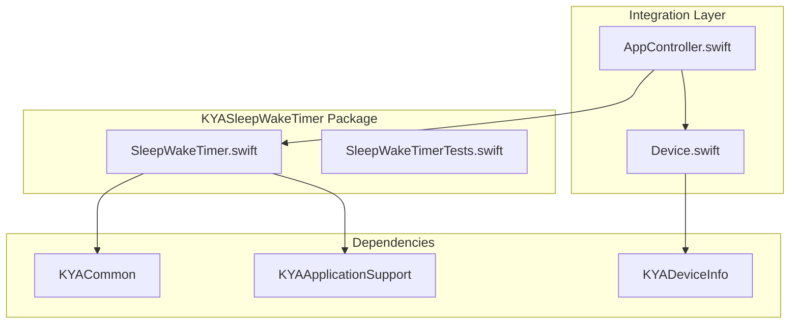
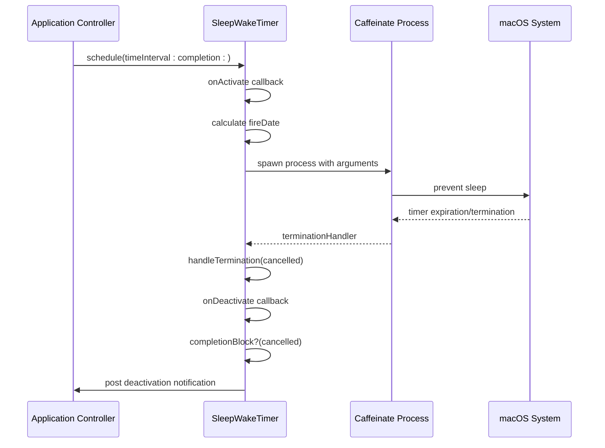
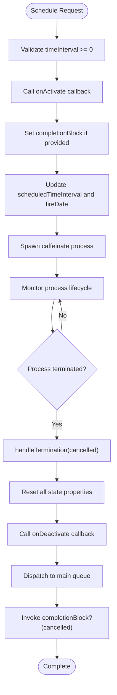
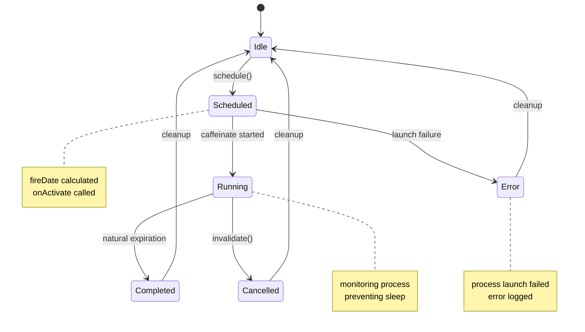
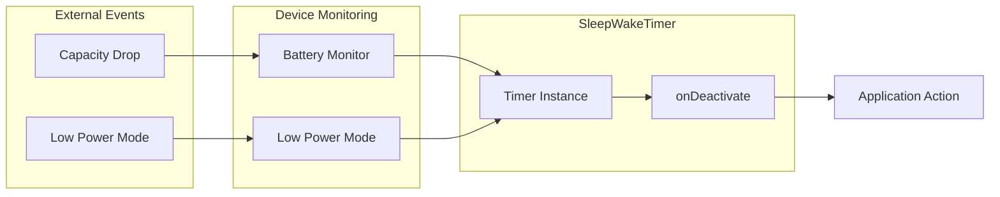
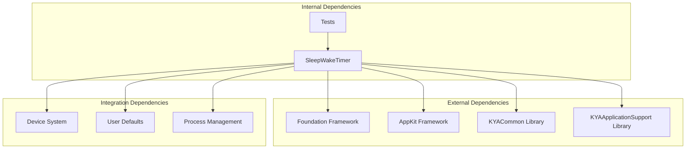

# KYASleepWakeTimer Package

<cite>
**Referenced Files in This Document**
- [SleepWakeTimer.swift](file://Packages/KYASleepWakeTimer/Sources/KYASleepWakeTimer/SleepWakeTimer.swift)
- [SleepWakeTimerTests.swift](file://Packages/KYASleepWakeTimer/Tests/KYASleepWakeTimerTests/SleepWakeTimerTests.swift)
- [Package.swift](file://Packages/KYASleepWakeTimer/Package.swift)
- [AppController.swift](file://KeepingYouAwake/KYAAppController/AppController.swift)
- [Device.swift](file://Packages/KYADeviceInfo/Sources/KYADeviceInfo/Device.swift)
- [BatterySettingsViewController.swift](file://KeepingYouAwake/Settings/KYABatterySettingsViewController/BatterySettingsViewController.swift)
</cite>

## Table of Contents
1. [Introduction](#introduction)
2. [Project Structure](#project-structure)
3. [Core Components](#core-components)
4. [Architecture Overview](#architecture-overview)
5. [Detailed Component Analysis](#detailed-component-analysis)
6. [Dependency Analysis](#dependency-analysis)
7. [Performance Considerations](#performance-considerations)
8. [Troubleshooting Guide](#troubleshooting-guide)
9. [Conclusion](#conclusion)

## Introduction

The KYASleepWakeTimer package provides the core timing engine for KeepingYouAwake's sleep prevention functionality. It serves as a sophisticated wrapper around Apple's `caffeinate` command-line utility, implementing a robust timer system that prevents macOS from entering sleep mode for specified durations or indefinitely.

The package implements a comprehensive sleep/wake state management system that integrates seamlessly with macOS power management APIs. It provides precise timer scheduling, automatic state persistence, and intelligent device monitoring capabilities that adapt to various power conditions and user preferences.

## Project Structure

The KYASleepWakeTimer package follows a modular architecture within the broader KeepingYouAwake ecosystem:

**Diagram sources**
- [Package.swift:13-23](file://Packages/KYASleepWakeTimer/Package.swift#L13-L23)
- [SleepWakeTimer.swift:8-11](file://Packages/KYASleepWakeTimer/Sources/KYASleepWakeTimer/SleepWakeTimer.swift#L8-L11)

The package consists of two primary components:
- **Core Timer Implementation**: The `SleepWakeTimer` class that manages caffeinate processes
- **Comprehensive Test Suite**: Extensive unit tests covering all scheduling modes and edge cases

**Section sources**
- [Package.swift:1-30](file://Packages/KYASleepWakeTimer/Package.swift#L1-L30)

## Core Components

### SleepWakeTimer Class

The `SleepWakeTimer` class is the central component responsible for managing sleep prevention through caffeinate process orchestration. It implements a sophisticated state machine with clear activation and deactivation callbacks.

#### Key Properties and Methods

The class exposes several critical properties for external integration:

- **Callbacks**: `onActivate` and `onDeactivate` for lifecycle management
- **State Tracking**: `fireDate`, `scheduledTimeInterval`, and `isScheduled` for monitoring
- **Process Management**: `schedule(timeInterval:completion:)` and `invalidate()` for control

#### Timer Modes

The system supports two distinct timer modes:

1. **Indefinite Mode** (`timeInterval = 0`): Runs caffeinate indefinitely without timeout
2. **Timed Mode** (`timeInterval > 0`): Runs for specified duration with automatic cleanup

#### Process Arguments Generation

The `caffeinateArguments(forTimeInterval:)` method intelligently generates command-line arguments based on user preferences and system requirements:

- **Display Sleep Control**: Uses `-i` (allow display sleep) or `-di` (prevent display sleep)
- **Timeout Management**: Includes `-t` flag with formatted seconds for timed operations
- **Process Watch**: Implements `-w` flag with current process ID for reliable cleanup

**Section sources**
- [SleepWakeTimer.swift:24-191](file://Packages/KYASleepWakeTimer/Sources/KYASleepWakeTimer/SleepWakeTimer.swift#L24-L191)

## Architecture Overview

The KYASleepWakeTimer package integrates deeply with the application's architecture through a well-defined callback system and process management layer:

**Diagram sources**
- [SleepWakeTimer.swift:85-103](file://Packages/KYASleepWakeTimer/Sources/KYASleepWakeTimer/SleepWakeTimer.swift#L85-L103)
- [SleepWakeTimer.swift:155-190](file://Packages/KYASleepWakeTimer/Sources/KYASleepWakeTimer/SleepWakeTimer.swift#L155-L190)

The architecture ensures proper resource cleanup and state synchronization through automatic process termination detection and callback invocation.

## Detailed Component Analysis

### Timer Scheduling Logic

The scheduling mechanism implements a robust state management system with clear separation between immediate activation and delayed execution:

**Diagram sources**
- [SleepWakeTimer.swift:85-103](file://Packages/KYASleepWakeTimer/Sources/KYASleepWakeTimer/SleepWakeTimer.swift#L85-L103)
- [SleepWakeTimer.swift:173-190](file://Packages/KYASleepWakeTimer/Sources/KYASleepWakeTimer/SleepWakeTimer.swift#L173-L190)

#### Fire Date Calculation

The fire date calculation algorithm implements precise timestamp generation for timed operations:

- **Timed Mode**: `fireDate = Date(timeIntervalSinceNow: timeInterval)`
- **Indefinite Mode**: `fireDate = nil` (no timeout)
- **Precision**: Utilizes `Date()` for accurate timestamp calculation

#### Activation/Deactivation Callback Systems

The callback system provides comprehensive lifecycle management:

- **onActivate**: Triggered immediately upon successful scheduling
- **onDeactivate**: Triggered on both natural expiration and manual invalidation
- **completionBlock**: Provides cancellation status for cleanup operations

**Section sources**
- [SleepWakeTimer.swift:78-103](file://Packages/KYASleepWakeTimer/Sources/KYASleepWakeTimer/SleepWakeTimer.swift#L78-L103)
- [SleepWakeTimer.swift:173-190](file://Packages/KYASleepWakeTimer/Sources/KYASleepWakeTimer/SleepWakeTimer.swift#L173-L190)

### Integration with macOS Power Management APIs

The package leverages Apple's native power management through the caffeinate utility, ensuring compatibility and reliability:

#### Caffeinate Command-Line Interface

The implementation generates appropriate arguments based on user preferences:

| Flag | Purpose | Condition |
|------|---------|-----------|
| `-i` | Allow display sleep | `kya_allowDisplaySleep = true` |
| `-di` | Prevent display sleep | `kya_allowDisplaySleep = false` |
| `-t seconds` | Timeout duration | `timeInterval != 0` |
| `-w pid` | Watch parent process | Always included |

#### Process Lifecycle Management

The system implements robust process management with automatic cleanup:

- **Process Watch**: Ensures caffeinate terminates when parent process exits
- **Termination Detection**: Monitors process state changes
- **Resource Cleanup**: Automatic memory and state reset on termination

**Section sources**
- [SleepWakeTimer.swift:120-144](file://Packages/KYASleepWakeTimer/Sources/KYASleepWakeTimer/SleepWakeTimer.swift#L120-L144)
- [SleepWakeTimer.swift:146-171](file://Packages/KYASleepWakeTimer/Sources/KYASleepWakeTimer/SleepWakeTimer.swift#L146-L171)

### Timer Lifecycle Management

The timer lifecycle encompasses multiple states with clear transitions and error handling:

**Diagram sources**
- [SleepWakeTimer.swift:42-44](file://Packages/KYASleepWakeTimer/Sources/KYASleepWakeTimer/SleepWakeTimer.swift#L42-L44)
- [SleepWakeTimer.swift:107-111](file://Packages/KYASleepWakeTimer/Sources/KYASleepWakeTimer/SleepWakeTimer.swift#L107-L111)

#### State Transitions

The state machine ensures predictable behavior across all scenarios:

1. **Idle → Scheduled**: Initial activation request
2. **Scheduled → Running**: Successful caffeinate startup
3. **Running → Completed**: Natural timer expiration
4. **Running → Cancelled**: Manual termination
5. **Error → Idle**: Recovery from launch failures

#### Coordination with Device Monitoring System

The timer coordinates with the device monitoring system for adaptive behavior:

**Diagram sources**
- [AppController.swift:202-246](file://KeepingYouAwake/KYAAppController/AppController.swift#L202-L246)

**Section sources**
- [AppController.swift:202-246](file://KeepingYouAwake/KYAAppController/AppController.swift#L202-L246)

## Dependency Analysis

The KYASleepWakeTimer package maintains minimal external dependencies while providing comprehensive functionality:

**Diagram sources**
- [Package.swift:13-23](file://Packages/KYASleepWakeTimer/Package.swift#L13-L23)
- [SleepWakeTimer.swift:8-11](file://Packages/KYASleepWakeTimer/Sources/KYASleepWakeTimer/SleepWakeTimer.swift#L8-L11)

### External Dependencies

The package relies on several key frameworks and libraries:

- **Foundation**: Core data types, dates, and process management
- **AppKit**: Application lifecycle and user notification integration
- **KYACommon**: Logging infrastructure and shared utilities
- **KYAApplicationSupport**: Application-specific support functionality

### Integration Points

The timer integrates with multiple system components:

- **Process Management**: Direct caffeinate process control
- **User Defaults**: Persistent configuration storage
- **Device Monitoring**: Battery and power state awareness
- **Application Lifecycle**: Automatic cleanup on app termination

**Section sources**
- [Package.swift:13-23](file://Packages/KYASleepWakeTimer/Package.swift#L13-L23)

## Performance Considerations

The KYASleepWakeTimer package implements several performance optimizations:

### Memory Management

- **Weak References**: All callbacks use weak self references to prevent retain cycles
- **Automatic Cleanup**: Process termination triggers immediate resource deallocation
- **State Reset**: All properties are reset on completion to prevent memory leaks

### Process Efficiency

- **Minimal Overhead**: Single caffeinate process per timer instance
- **Efficient Monitoring**: Process termination handler provides instant feedback
- **Argument Optimization**: Dynamic argument generation reduces process startup overhead

### Concurrency Safety

- **Main Queue Dispatch**: All callback invocations occur on the main queue
- **Thread-Safe State**: Atomic property updates prevent race conditions
- **Completion Guard**: Completion blocks are nil'd after execution to prevent re-entry

## Troubleshooting Guide

### Common Issues and Solutions

#### Timer Fails to Start

**Symptoms**: `schedule()` returns without activating sleep prevention
**Causes**: 
- Invalid timeInterval (negative values)
- Process launch failures
- Insufficient permissions

**Solutions**:
- Validate timeInterval is non-negative
- Check system caffeinate availability
- Verify application permissions

#### Timer Exits Immediately

**Symptoms**: Timer activates then immediately deactivates
**Causes**:
- Process launch errors
- Parent process termination
- Invalid arguments

**Solutions**:
- Review error logs for launch failures
- Verify process watch argument correctness
- Check parent process lifecycle

#### State Inconsistencies

**Symptoms**: `isScheduled` returns inconsistent values
**Causes**:
- Race conditions during state updates
- Process termination timing issues

**Solutions**:
- Ensure all state updates occur on main queue
- Implement proper synchronization
- Verify termination handler execution

### Debugging Strategies

The package includes comprehensive logging through the KYALog infrastructure:

- **Debug Level**: Detailed process lifecycle information
- **Error Level**: Launch failures and process termination details
- **Category Filtering**: Dedicated "SleepWakeTimer" category for focused debugging

**Section sources**
- [SleepWakeTimer.swift:159-164](file://Packages/KYASleepWakeTimer/Sources/KYASleepWakeTimer/SleepWakeTimer.swift#L159-L164)

## Conclusion

The KYASleepWakeTimer package represents a mature, production-ready implementation of macOS sleep prevention functionality. Its robust architecture, comprehensive testing, and seamless integration with the broader KeepingYouAwake ecosystem demonstrate careful engineering and attention to user experience.

The package successfully abstracts the complexity of caffeinate process management while providing intuitive APIs for activation, deactivation, and state monitoring. Its integration with device monitoring systems enables intelligent behavior adaptation based on power conditions and user preferences.

Key strengths include:
- **Reliable Process Management**: Robust caffeinate process orchestration
- **Comprehensive Testing**: Extensive test coverage for all operational modes
- **Intelligent State Handling**: Proper lifecycle management and cleanup
- **Flexible Integration**: Clean callback system for application integration
- **Performance Optimization**: Efficient resource usage and minimal overhead

The package serves as a solid foundation for sleep prevention functionality while maintaining the flexibility needed for future enhancements and feature additions.