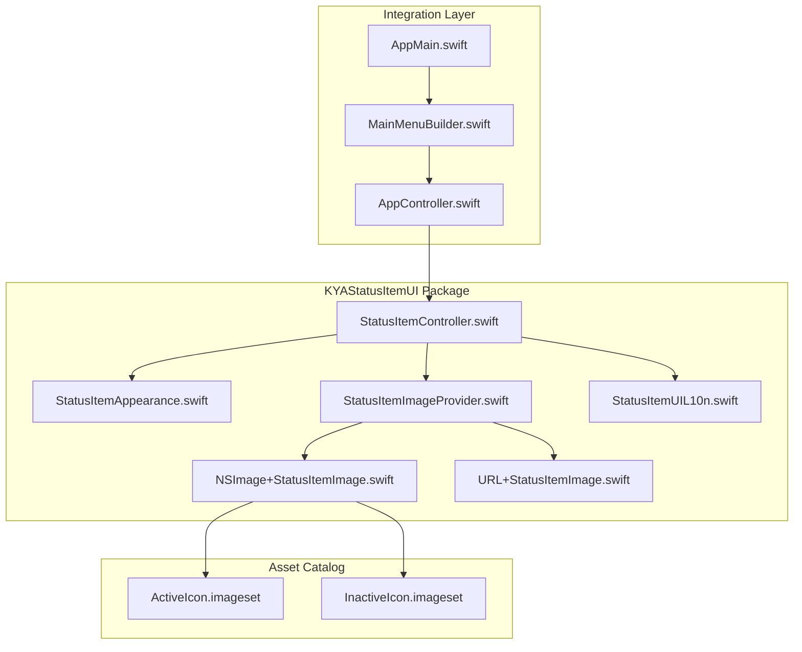
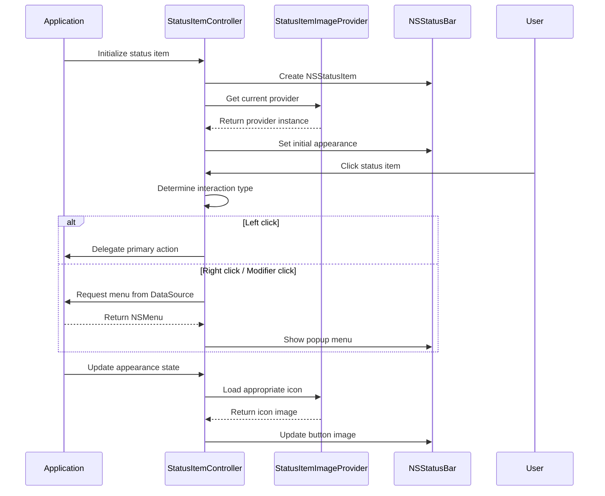
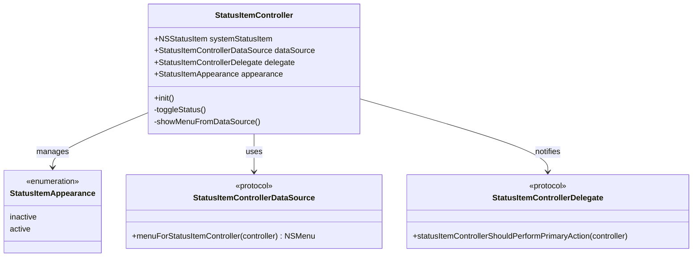
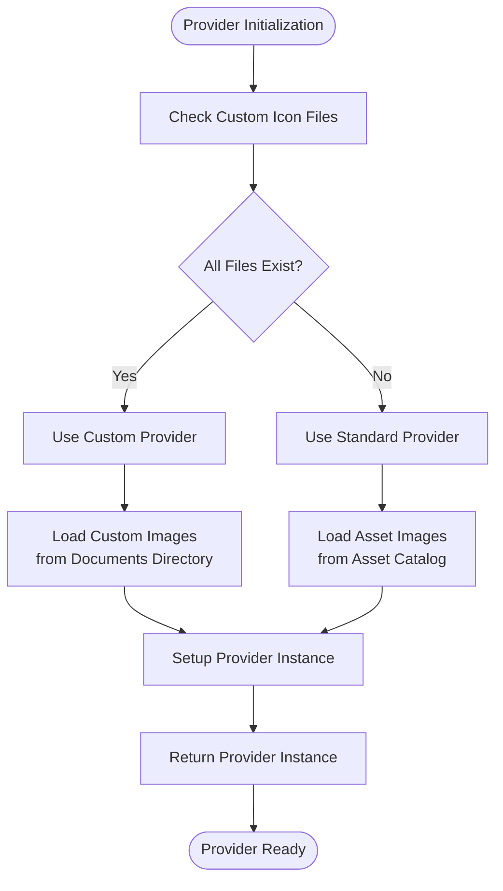
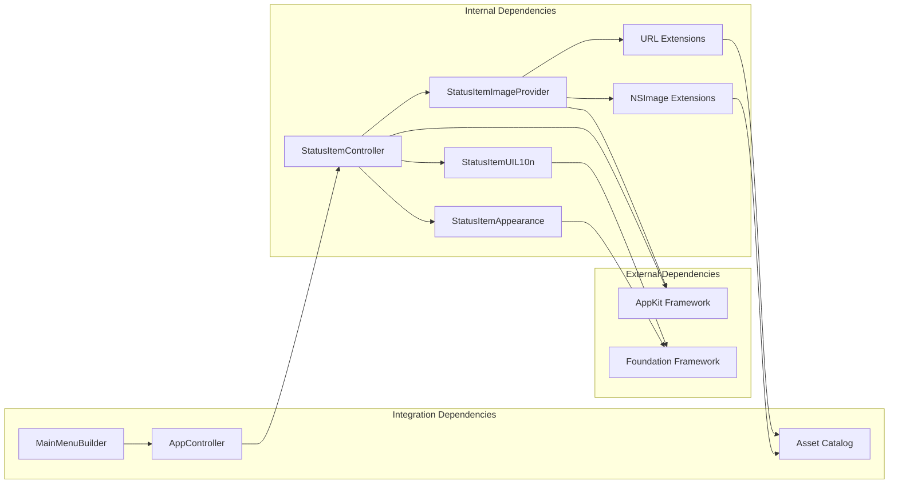

# KYAStatusItemUI Package

<cite>
**Referenced Files in This Document**
- [StatusItemController.swift](file://Packages/KYAStatusItemUI/Sources/KYAStatusItemUI/StatusItemController.swift)
- [StatusItemAppearance.swift](file://Packages/KYAStatusItemUI/Sources/KYAStatusItemUI/StatusItemAppearance.swift)
- [StatusItemImageProvider.swift](file://Packages/KYAStatusItemUI/Sources/KYAStatusItemUI/StatusItemImageProvider.swift)
- [StatusItemUIL10n.swift](file://Packages/KYAStatusItemUI/Sources/KYAStatusItemUI/StatusItemUIL10n.swift)
- [NSImage+StatusItemImage.swift](file://Packages/KYAStatusItemUI/Sources/KYAStatusItemUI/NSImage+StatusItemImage.swift)
- [URL+StatusItemImage.swift](file://Packages/KYAStatusItemUI/Sources/KYAStatusItemUI/URL+StatusItemImage.swift)
- [AppController.swift](file://KeepingYouAwake/KYAAppController/AppController.swift)
- [MainMenuBuilder.swift](file://KeepingYouAwake/KYAMainMenu/MainMenuBuilder.swift)
- [ActiveIcon.imageset/Contents.json](file://KeepingYouAwake/Assets.xcassets/ActiveIcon.imageset/Contents.json)
- [InactiveIcon.imageset/Contents.json](file://KeepingYouAwake/Assets.xcassets/InactiveIcon.imageset/Contents.json)
- [AppMain.swift](file://KeepingYouAwake/AppMain.swift)
</cite>

## Table of Contents
1. [Introduction](#introduction)
2. [Project Structure](#project-structure)
3. [Core Components](#core-components)
4. [Architecture Overview](#architecture-overview)
5. [Detailed Component Analysis](#detailed-component-analysis)
6. [Dependency Analysis](#dependency-analysis)
7. [Performance Considerations](#performance-considerations)
8. [Troubleshooting Guide](#troubleshooting-guide)
9. [Conclusion](#conclusion)

## Introduction
The KYAStatusItemUI package provides a robust framework for managing macOS menu bar status items. It handles visual appearance management, menu construction, user interaction routing, and integrates seamlessly with NSStatusBar. The package supports both built-in and custom icon themes, dynamic UI updates based on application state, and comprehensive internationalization for tooltip messages.

## Project Structure
The KYAStatusItemUI package follows a modular architecture with clear separation of concerns:

**Diagram sources**
- [StatusItemController.swift:1-124](file://Packages/KYAStatusItemUI/Sources/KYAStatusItemUI/StatusItemController.swift#L1-L124)
- [StatusItemImageProvider.swift:1-58](file://Packages/KYAStatusItemUI/Sources/KYAStatusItemUI/StatusItemImageProvider.swift#L1-L58)
- [AppController.swift:1-352](file://KeepingYouAwake/KYAAppController/AppController.swift#L1-L352)

**Section sources**
- [StatusItemController.swift:1-124](file://Packages/KYAStatusItemUI/Sources/KYAStatusItemUI/StatusItemController.swift#L1-L124)
- [StatusItemImageProvider.swift:1-58](file://Packages/KYAStatusItemUI/Sources/KYAStatusItemUI/StatusItemImageProvider.swift#L1-L58)

## Core Components
The package centers around four primary components that work together to provide comprehensive status item functionality:

### StatusItemController
The main orchestrator that manages the NSStatusItem lifecycle, appearance states, and user interactions. It implements both DataSource and Delegate protocols to integrate with the broader application architecture.

### StatusItemAppearance
Defines the visual states of the status item with a simple enum structure supporting active and inactive states.

### StatusItemImageProvider
Singleton provider that manages icon image loading, supporting both built-in asset catalog images and custom user-provided images from the Documents directory.

### StatusItemUIL10n
Internationalization wrapper for tooltip messages, providing localized strings for user guidance.

**Section sources**
- [StatusItemController.swift:25-61](file://Packages/KYAStatusItemUI/Sources/KYAStatusItemUI/StatusItemController.swift#L25-L61)
- [StatusItemAppearance.swift:9-15](file://Packages/KYAStatusItemUI/Sources/KYAStatusItemUI/StatusItemAppearance.swift#L9-L15)
- [StatusItemImageProvider.swift:11-30](file://Packages/KYAStatusItemUI/Sources/KYAStatusItemUI/StatusItemImageProvider.swift#L11-L30)
- [StatusItemUIL10n.swift:10-29](file://Packages/KYAStatusItemUI/Sources/KYAStatusItemUI/StatusItemUIL10n.swift#L10-L29)

## Architecture Overview
The status item system follows a clean architecture pattern with clear separation between presentation, data management, and application logic:

**Diagram sources**
- [StatusItemController.swift:63-97](file://Packages/KYAStatusItemUI/Sources/KYAStatusItemUI/StatusItemController.swift#L63-L97)
- [StatusItemController.swift:104-116](file://Packages/KYAStatusItemUI/Sources/KYAStatusItemUI/StatusItemController.swift#L104-L116)
- [StatusItemImageProvider.swift:28-30](file://Packages/KYAStatusItemUI/Sources/KYAStatusItemUI/StatusItemImageProvider.swift#L28-L30)

The architecture ensures loose coupling between components while maintaining clear responsibility boundaries. The StatusItemController acts as the central coordinator, delegating specialized tasks to dedicated providers and delegates.

**Section sources**
- [AppController.swift:21-41](file://KeepingYouAwake/KYAAppController/AppController.swift#L21-L41)
- [StatusItemController.swift:29-37](file://Packages/KYAStatusItemUI/Sources/KYAStatusItemUI/StatusItemController.swift#L29-L37)

## Detailed Component Analysis

### StatusItemController Implementation
The StatusItemController serves as the primary interface between the application and the macOS status bar system. Its implementation demonstrates several key design patterns:

#### Initialization and Configuration
The controller initializes with careful attention to system compatibility and user preferences:
- Creates NSStatusItem with variable length for flexible sizing
- Configures highlight mode based on user preferences
- Sets behavior properties conditionally for macOS version compatibility
- Configures button action targeting for primary click handling

#### Appearance Management
The appearance property implements KVO-compliant state management with automatic UI updates:
- Active state displays the active icon with appropriate tooltip
- Inactive state displays the inactive icon with alternative tooltip
- Automatic property observation for reactive UI updates

#### Interaction Handling
The controller intelligently routes user interactions based on modifier keys and mouse events:
- Left clicks trigger primary action delegate methods
- Right clicks and modifier combinations (Control, Option) show context menus
- Uses NSApp.currentEvent for accurate modifier detection

**Diagram sources**
- [StatusItemController.swift:29-37](file://Packages/KYAStatusItemUI/Sources/KYAStatusItemUI/StatusItemController.swift#L29-L37)
- [StatusItemAppearance.swift:10-14](file://Packages/KYAStatusItemUI/Sources/KYAStatusItemUI/StatusItemAppearance.swift#L10-L14)

**Section sources**
- [StatusItemController.swift:63-97](file://Packages/KYAStatusItemUI/Sources/KYAStatusItemUI/StatusItemController.swift#L63-L97)
- [StatusItemController.swift:40-61](file://Packages/KYAStatusItemUI/Sources/KYAStatusItemUI/StatusItemController.swift#L40-L61)
- [StatusItemController.swift:104-116](file://Packages/KYAStatusItemUI/Sources/KYAStatusItemUI/StatusItemController.swift#L104-L116)

### StatusItemImageProvider and Icon Management
The image provider implements a sophisticated fallback mechanism supporting both built-in and custom icon themes:

#### Provider Strategy
The provider uses a singleton pattern with intelligent selection logic:
- Prefers custom provider when all required icon files exist
- Falls back to standard provider using asset catalog resources
- Maintains single instance throughout application lifetime

#### Custom Icon Support
Custom icons are loaded from the user's Documents directory with comprehensive file validation:
- Checks for both standard and @2x retina variants
- Supports PNG format with proper scaling
- Automatically adds retina representations when available
- Uses template rendering for proper status bar tinting

**Diagram sources**
- [StatusItemImageProvider.swift:28-30](file://Packages/KYAStatusItemUI/Sources/KYAStatusItemUI/StatusItemImageProvider.swift#L28-L30)
- [StatusItemImageProvider.swift:46-52](file://Packages/KYAStatusItemUI/Sources/KYAStatusItemUI/StatusItemImageProvider.swift#L46-L52)

**Section sources**
- [StatusItemImageProvider.swift:16-58](file://Packages/KYAStatusItemUI/Sources/KYAStatusItemUI/StatusItemImageProvider.swift#L16-L58)
- [NSImage+StatusItemImage.swift:27-58](file://Packages/KYAStatusItemUI/Sources/KYAStatusItemUI/NSImage+StatusItemImage.swift#L27-L58)
- [URL+StatusItemImage.swift:37-51](file://Packages/KYAStatusItemUI/Sources/KYAStatusItemUI/URL+StatusItemImage.swift#L37-L51)

### Menu Construction and Integration
The status item integrates seamlessly with the application's menu system through a DataSource pattern:

#### Menu Lifecycle
The controller delegates menu creation to its DataSource, ensuring separation of concerns:
- Menu requests are forwarded to the DataSource implementation
- Popup menu presentation uses NSStatusItem.popUpMenu
- Menu updates occur on-demand through the DataSource interface

#### Application Integration
The main application coordinates status item functionality with broader system features:
- AppController serves as both DataSource and Delegate
- Integrates with SleepWakeTimer for state synchronization
- Connects with MainMenuBuilder for consistent UI experience

**Section sources**
- [StatusItemController.swift:120-123](file://Packages/KYAStatusItemUI/Sources/KYAStatusItemUI/StatusItemController.swift#L120-L123)
- [AppController.swift:340-352](file://KeepingYouAwake/KYAAppController/AppController.swift#L340-L352)

### Real-time UI Updates and State Synchronization
The system maintains consistent UI state through coordinated updates across multiple components:

#### State Propagation
Status changes propagate through the system via well-defined pathways:
- Timer activation/deactivation triggers appearance updates
- Event handlers modify state based on external conditions
- User interactions trigger immediate UI feedback

#### Theme Integration
The status item supports dynamic theming through multiple mechanisms:
- Built-in asset catalog integration
- Custom icon file support with automatic validation
- Template rendering for proper system theme compatibility

**Section sources**
- [AppController.swift:78-85](file://KeepingYouAwake/KYAAppController/AppController.swift#L78-L85)
- [AppController.swift:136-169](file://KeepingYouAwake/KYAAppController/AppController.swift#L136-L169)

## Dependency Analysis
The KYAStatusItemUI package exhibits excellent modularity with minimal external dependencies:

**Diagram sources**
- [StatusItemController.swift:9-11](file://Packages/KYAStatusItemUI/Sources/KYAStatusItemUI/StatusItemController.swift#L9-L11)
- [StatusItemImageProvider.swift:9](file://Packages/KYAStatusItemUI/Sources/KYAStatusItemUI/StatusItemImageProvider.swift#L9)

The dependency graph reveals a clean architecture with clear directional dependencies:
- Internal components depend on AppKit and Foundation frameworks
- No circular dependencies exist between modules
- Integration occurs through well-defined protocol interfaces
- Asset dependencies are isolated to specific extension files

**Section sources**
- [StatusItemController.swift:9-11](file://Packages/KYAStatusItemUI/Sources/KYAStatusItemUI/StatusItemController.swift#L9-L11)
- [StatusItemImageProvider.swift:9](file://Packages/KYAStatusItemUI/Sources/KYAStatusItemUI/StatusItemImageProvider.swift#L9)

## Performance Considerations
The package implements several performance optimizations:

### Memory Management
- Singleton pattern prevents redundant provider instances
- Weak delegate references avoid retain cycles
- Lazy loading of custom icons reduces startup overhead

### Rendering Efficiency
- Template rendering enables efficient system theme adaptation
- Asset catalog caching leverages macOS optimization
- Minimal image processing reduces CPU usage

### Event Handling
- Direct NSStatusBar integration avoids unnecessary abstraction layers
- Efficient modifier key detection minimizes computation overhead
- Conditional property setting optimizes system calls

## Troubleshooting Guide

### Common Issues and Solutions

#### Status Item Not Visible
- Verify NSStatusItem.isVisible is properly configured
- Check user preferences for menu bar icon highlighting
- Ensure proper initialization sequence

#### Custom Icons Not Loading
- Confirm all four required files exist (active/inactive × standard/@2x)
- Verify PNG format and proper naming conventions
- Check Documents directory permissions

#### Menu Not Appearing
- Validate DataSource implementation returns valid NSMenu
- Ensure button target/action is properly configured
- Check modifier key combinations for menu triggering

#### Appearance State Synchronization
- Verify delegate callbacks are properly implemented
- Check timer state consistency
- Monitor user preference changes affecting behavior

**Section sources**
- [StatusItemController.swift:63-97](file://Packages/KYAStatusItemUI/Sources/KYAStatusItemUI/StatusItemController.swift#L63-L97)
- [StatusItemImageProvider.swift:46-52](file://Packages/KYAStatusItemUI/Sources/KYAStatusItemUI/StatusItemImageProvider.swift#L46-L52)

## Conclusion
The KYAStatusItemUI package provides a comprehensive, well-architected solution for macOS menu bar status item management. Its clean separation of concerns, robust error handling, and flexible customization options make it suitable for a wide range of applications requiring system tray functionality. The package successfully balances simplicity with power, offering both straightforward integration for basic needs and extensibility for advanced customization scenarios.

The implementation demonstrates excellent software engineering practices including proper memory management, clear architectural boundaries, and comprehensive internationalization support. The modular design ensures maintainability and facilitates future enhancements while preserving backward compatibility.