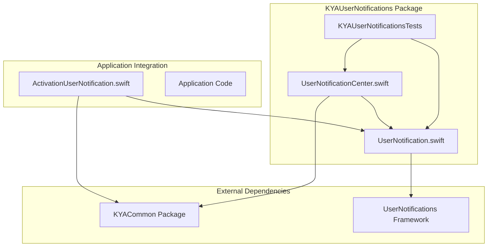
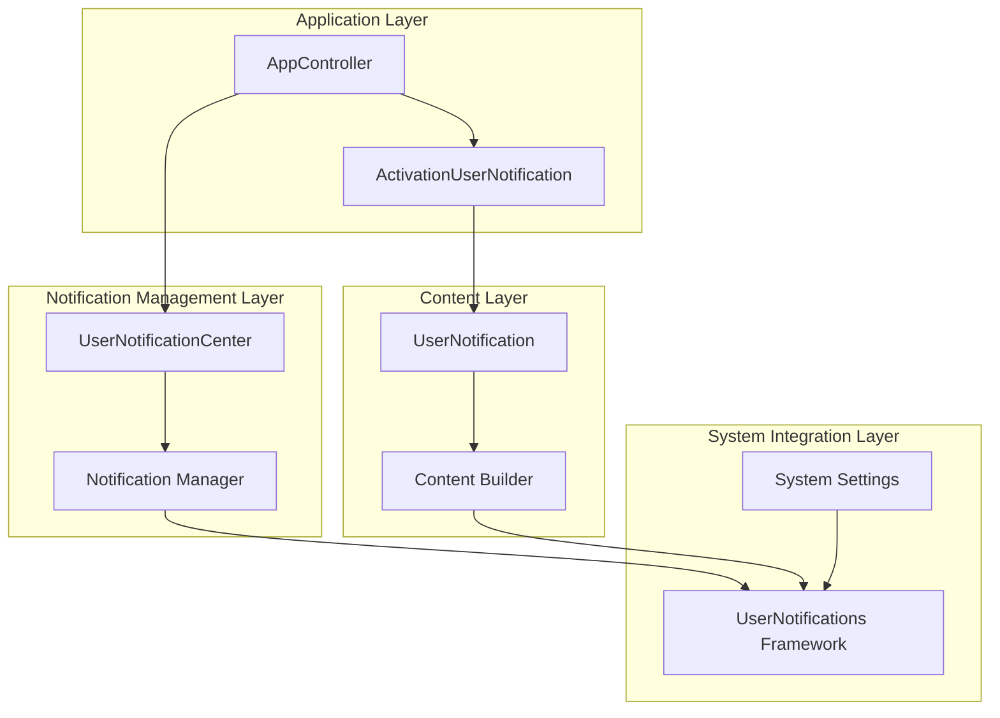
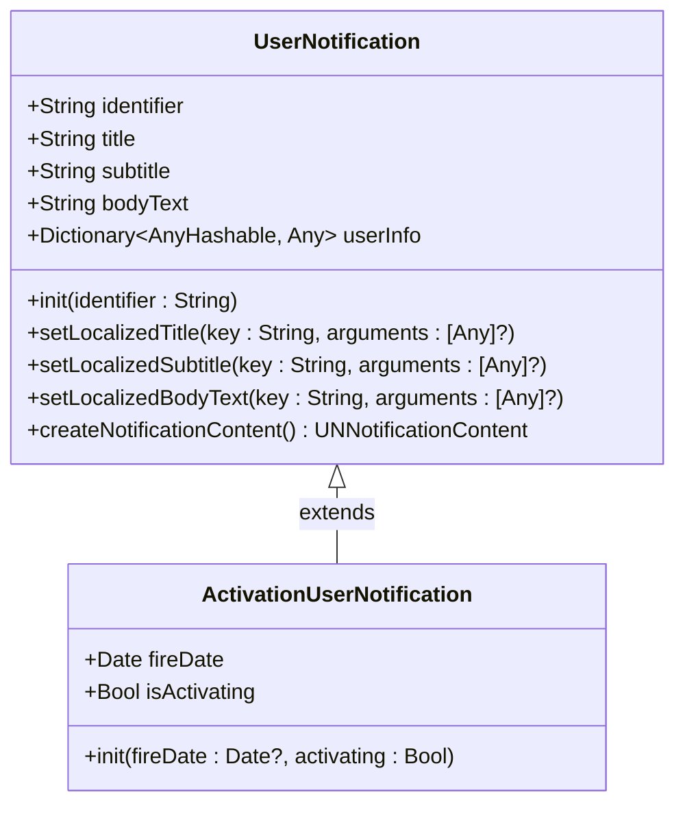
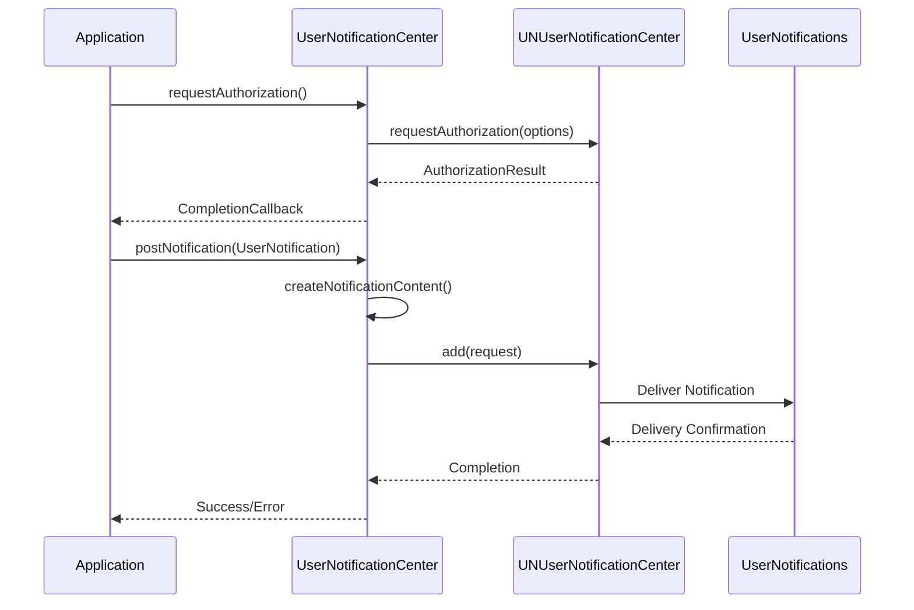
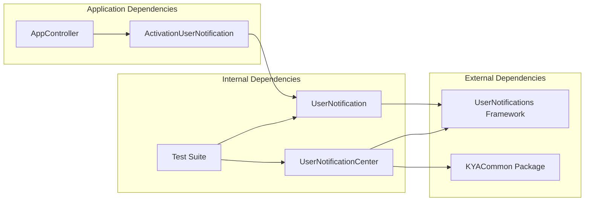

# KYAUserNotifications Package

<cite>
**Referenced Files in This Document**
- [UserNotification.swift](file://Packages/KYAUserNotifications/Sources/KYAUserNotifications/UserNotification.swift)
- [UserNotificationCenter.swift](file://Packages/KYAUserNotifications/Sources/KYAUserNotifications/UserNotificationCenter.swift)
- [ActivationUserNotification.swift](file://KeepingYouAwake/KYAActivationUserNotification/ActivationUserNotification.swift)
- [Package.swift](file://Packages/KYAUserNotifications/Package.swift)
- [UserNotificationsTests.swift](file://Packages/KYAUserNotifications/Tests/KYAUserNotificationsTests/UserNotificationsTests.swift)
</cite>

## Table of Contents
1. [Introduction](#introduction)
2. [Project Structure](#project-structure)
3. [Core Components](#core-components)
4. [Architecture Overview](#architecture-overview)
5. [Detailed Component Analysis](#detailed-component-analysis)
6. [Dependency Analysis](#dependency-analysis)
7. [Performance Considerations](#performance-considerations)
8. [Troubleshooting Guide](#troubleshooting-guide)
9. [Conclusion](#conclusion)

## Introduction

The KYAUserNotifications package provides a modern Swift-based abstraction layer for macOS notification system integration. Built on top of Apple's UserNotifications framework, this package offers a clean, type-safe interface for creating, managing, and delivering user notifications in macOS applications.

The package is specifically designed for macOS 11.0 and later, leveraging the latest notification APIs while maintaining compatibility with the broader macOS ecosystem. It serves as a foundation for applications like KeepingYouAwake, which require sophisticated notification management for user engagement and system interaction.

## Project Structure

The KYAUserNotifications package follows a modular architecture with clear separation of concerns:

**Diagram sources**
- [UserNotification.swift:1-77](file://Packages/KYAUserNotifications/Sources/KYAUserNotifications/UserNotification.swift#L1-L77)
- [UserNotificationCenter.swift:1-136](file://Packages/KYAUserNotifications/Sources/KYAUserNotifications/UserNotificationCenter.swift#L1-L136)
- [ActivationUserNotification.swift:1-38](file://KeepingYouAwake/KYAActivationUserNotification/ActivationUserNotification.swift#L1-L38)

**Section sources**
- [Package.swift:1-30](file://Packages/KYAUserNotifications/Package.swift#L1-L30)

## Core Components

The package consists of two primary components that work together to provide comprehensive notification management:

### UserNotification Class
The `UserNotification` class serves as the foundational abstraction for notification content management. It provides a clean interface for setting localized content, managing user info dictionaries, and creating `UNNotificationContent` instances compatible with the UserNotifications framework.

### UserNotificationCenter Class
The `UserNotificationCenter` class manages the complete notification lifecycle, from permission management to delivery and cleanup. It provides a centralized interface for authorization requests, notification posting, and system integration.

**Section sources**
- [UserNotification.swift:11-77](file://Packages/KYAUserNotifications/Sources/KYAUserNotifications/UserNotification.swift#L11-L77)
- [UserNotificationCenter.swift:12-114](file://Packages/KYAUserNotifications/Sources/KYAUserNotifications/UserNotificationCenter.swift#L12-L114)

## Architecture Overview

The KYAUserNotifications package implements a layered architecture that separates concerns between content management, system integration, and application-specific implementations:

**Diagram sources**
- [UserNotification.swift:13-77](file://Packages/KYAUserNotifications/Sources/KYAUserNotifications/UserNotification.swift#L13-L77)
- [UserNotificationCenter.swift:13-114](file://Packages/KYAUserNotifications/Sources/KYAUserNotifications/UserNotificationCenter.swift#L13-L114)
- [ActivationUserNotification.swift:12-38](file://KeepingYouAwake/KYAActivationUserNotification/ActivationUserNotification.swift#L12-L38)

## Detailed Component Analysis

### UserNotification Implementation

The `UserNotification` class provides a comprehensive foundation for notification content management with the following key features:

#### Core Properties and Initialization
The class maintains essential notification properties including identifier, title, subtitle, body text, and user info dictionary. The identifier serves as a unique key for notification grouping and management.

#### Localized Content Management
The implementation includes specialized methods for setting localized content using `NSString.localizedUserNotificationString(forKey:arguments:)`. This ensures proper internationalization support and dynamic content updates based on user preferences.

#### Content Creation Pipeline
The `createNotificationContent()` method transforms the internal representation into a `UNNotificationContent` instance, automatically handling nil value fallbacks to empty strings for framework compatibility.

**Diagram sources**
- [UserNotification.swift:14-77](file://Packages/KYAUserNotifications/Sources/KYAUserNotifications/UserNotification.swift#L14-L77)
- [ActivationUserNotification.swift:13-38](file://KeepingYouAwake/KYAActivationUserNotification/ActivationUserNotification.swift#L13-L38)

**Section sources**
- [UserNotification.swift:13-77](file://Packages/KYAUserNotifications/Sources/KYAUserNotifications/UserNotification.swift#L13-L77)

### UserNotificationCenter Implementation

The `UserNotificationCenter` class provides comprehensive system-level notification management with the following capabilities:

#### Authorization Management
The class handles the complete authorization lifecycle, converting between system authorization states and internal `AuthorizationStatus` enums. It supports both immediate authorization requests and conditional requests based on current authorization status.

#### Notification Delivery
The `postNotification(_:)` method creates `UNNotificationRequest` instances with the provided content and triggers, handling error logging and system integration seamlessly.

#### Legacy Support
The package includes backward compatibility support for older macOS versions through the `postLegacyUserNotification` function, ensuring graceful degradation when targeting multiple macOS versions.

**Diagram sources**
- [UserNotificationCenter.swift:57-107](file://Packages/KYAUserNotifications/Sources/KYAUserNotifications/UserNotificationCenter.swift#L57-L107)

**Section sources**
- [UserNotificationCenter.swift:13-136](file://Packages/KYAUserNotifications/Sources/KYAUserNotifications/UserNotificationCenter.swift#L13-L136)

### ActivationUserNotification Integration

The `ActivationUserNotification` class demonstrates practical application of the notification system within the KeepingYouAwake application context:

#### Dynamic Content Generation
The class generates notification content based on activation state and scheduled duration, incorporating localized time formatting for user-friendly messaging.

#### State-Based Content Selection
The implementation uses conditional logic to select appropriate localized strings based on whether the application is preventing sleep indefinitely or for a specific duration.

**Section sources**
- [ActivationUserNotification.swift:12-38](file://KeepingYouAwake/KYAActivationUserNotification/ActivationUserNotification.swift#L12-L38)

## Dependency Analysis

The KYAUserNotifications package maintains minimal external dependencies while providing comprehensive functionality:

**Diagram sources**
- [Package.swift:13-21](file://Packages/KYAUserNotifications/Package.swift#L13-L21)
- [UserNotification.swift:8-9](file://Packages/KYAUserNotifications/Sources/KYAUserNotifications/UserNotification.swift#L8-L9)
- [UserNotificationCenter.swift:8-10](file://Packages/KYAUserNotifications/Sources/KYAUserNotifications/UserNotificationCenter.swift#L8-L10)

The package depends on:
- **UserNotifications Framework**: Core system framework for notification management
- **KYACommon Package**: Shared utilities and extensions for the application ecosystem

**Section sources**
- [Package.swift:13-27](file://Packages/KYAUserNotifications/Package.swift#L13-L27)

## Performance Considerations

The KYAUserNotifications package is designed with performance and resource efficiency in mind:

### Memory Management
- Weak reference patterns in callback closures prevent retain cycles
- Automatic cleanup of notification content when no longer needed
- Efficient string localization using framework-optimized methods

### System Integration Efficiency
- Minimal overhead in notification creation pipeline
- Asynchronous authorization requests prevent UI blocking
- Batch operation support for multiple notification management tasks

### Resource Optimization
- Lazy initialization of notification content
- Efficient error handling with minimal performance impact
- Optimized logging with conditional compilation support

## Troubleshooting Guide

### Common Issues and Solutions

#### Authorization Denied Scenarios
When authorization is denied, the system converts the status to `.denied` internally. Applications should handle this gracefully and provide alternative user experiences.

#### Notification Delivery Failures
The package includes comprehensive error logging through the OS Log subsystem. Common causes include invalid identifiers, missing content, or system-level restrictions.

#### Localization Issues
Ensure that all localized string keys are properly registered in the application's localization system. The package uses `NSString.localizedUserNotificationString(forKey:arguments:)` for content generation.

**Section sources**
- [UserNotificationCenter.swift:59-106](file://Packages/KYAUserNotifications/Sources/KYAUserNotifications/UserNotificationCenter.swift#L59-L106)

## Conclusion

The KYAUserNotifications package provides a robust, modern solution for macOS notification system integration. Its clean architecture, comprehensive feature set, and strong integration with the UserNotifications framework make it an excellent foundation for applications requiring sophisticated notification management.

The package successfully balances simplicity with power, offering both basic notification creation capabilities and advanced features like dynamic content generation and comprehensive authorization management. Its design enables seamless integration with existing application architectures while maintaining clear separation of concerns and optimal performance characteristics.

Through its use in applications like KeepingYouAwake, the package demonstrates real-world applicability and reliability in production environments, making it a valuable component for macOS developers building notification-rich applications.