# Package Architecture

<cite>
**Referenced Files in This Document**
- [README.md](file://README.md)
- [Packages/KYACommon/Package.swift](file://Packages/KYACommon/Package.swift)
- [Packages/KYAApplicationSupport/Package.swift](file://Packages/KYAApplicationSupport/Package.swift)
- [Packages/KYADeviceInfo/Package.swift](file://Packages/KYADeviceInfo/Package.swift)
- [Packages/KYAActivationDurations/Package.swift](file://Packages/KYAActivationDurations/Package.swift)
- [Packages/KYAApplicationEvents/Package.swift](file://Packages/KYAApplicationEvents/Package.swift)
- [Packages/KYASleepWakeTimer/Package.swift](file://Packages/KYASleepWakeTimer/Package.swift)
- [Packages/KYAStatusItemUI/Package.swift](file://Packages/KYAStatusItemUI/Package.swift)
- [Packages/KYAUserNotifications/Package.swift](file://Packages/KYAUserNotifications/Package.swift)
- [KeepingYouAwake/AppMain.swift](file://KeepingYouAwake/AppMain.swift)
- [KeepingYouAwake/KYAAppController/AppController.swift](file://KeepingYouAwake/KYAAppController/AppController.swift)
- [KeepingYouAwake/KYAAppController/AppDelegate.swift](file://KeepingYouAwake/KYAAppController/AppDelegate.swift)
</cite>

## Table of Contents
1. [Introduction](#introduction)
2. [Project Structure](#project-structure)
3. [Core Components](#core-components)
4. [Architecture Overview](#architecture-overview)
5. [Detailed Component Analysis](#detailed-component-analysis)
6. [Dependency Analysis](#dependency-analysis)
7. [Performance Considerations](#performance-considerations)
8. [Troubleshooting Guide](#troubleshooting-guide)
9. [Conclusion](#conclusion)
10. [Appendices](#appendices)

## Introduction
This document describes the Swift Package Manager architecture of the project, focusing on the modular package design centered around eight specialized packages. The architecture emphasizes separation of concerns, enabling code reuse, testability, and maintainability. The main application integrates these packages to orchestrate activation durations, device monitoring, sleep/wake timing, user notifications, and UI components.

## Project Structure
The repository is organized into:
- A top-level Swift Package Manager workspace with eight packages under the Packages directory
- A main macOS application under KeepingYouAwake
- Supporting documentation and localization assets

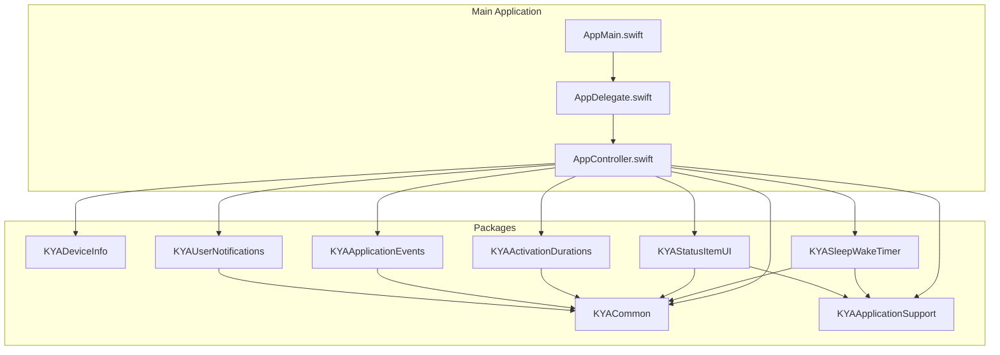

**Diagram sources**
- [Packages/KYACommon/Package.swift:1-26](file://Packages/KYACommon/Package.swift#L1-L26)
- [Packages/KYAApplicationSupport/Package.swift:1-31](file://Packages/KYAApplicationSupport/Package.swift#L1-L31)
- [Packages/KYADeviceInfo/Package.swift:1-31](file://Packages/KYADeviceInfo/Package.swift#L1-L31)
- [Packages/KYAActivationDurations/Package.swift:1-30](file://Packages/KYAActivationDurations/Package.swift#L1-L30)
- [Packages/KYAApplicationEvents/Package.swift:1-26](file://Packages/KYAApplicationEvents/Package.swift#L1-L26)
- [Packages/KYASleepWakeTimer/Package.swift:1-30](file://Packages/KYASleepWakeTimer/Package.swift#L1-L30)
- [Packages/KYAStatusItemUI/Package.swift:1-32](file://Packages/KYAStatusItemUI/Package.swift#L1-L32)
- [Packages/KYAUserNotifications/Package.swift:1-30](file://Packages/KYAUserNotifications/Package.swift#L1-L30)
- [KeepingYouAwake/AppMain.swift:1-24](file://KeepingYouAwake/AppMain.swift#L1-L24)
- [KeepingYouAwake/KYAAppController/AppController.swift:1-352](file://KeepingYouAwake/KYAAppController/AppController.swift#L1-L352)
- [KeepingYouAwake/KYAAppController/AppDelegate.swift:1-57](file://KeepingYouAwake/KYAAppController/AppDelegate.swift#L1-L57)

**Section sources**
- [README.md:1-45](file://README.md#L1-L45)
- [Packages/KYACommon/Package.swift:1-26](file://Packages/KYACommon/Package.swift#L1-L26)
- [Packages/KYAApplicationSupport/Package.swift:1-31](file://Packages/KYAApplicationSupport/Package.swift#L1-L31)
- [Packages/KYADeviceInfo/Package.swift:1-31](file://Packages/KYADeviceInfo/Package.swift#L1-L31)
- [Packages/KYAActivationDurations/Package.swift:1-30](file://Packages/KYAActivationDurations/Package.swift#L1-L30)
- [Packages/KYAApplicationEvents/Package.swift:1-26](file://Packages/KYAApplicationEvents/Package.swift#L1-L26)
- [Packages/KYASleepWakeTimer/Package.swift:1-30](file://Packages/KYASleepWakeTimer/Package.swift#L1-L30)
- [Packages/KYAStatusItemUI/Package.swift:1-32](file://Packages/KYAStatusItemUI/Package.swift#L1-L32)
- [Packages/KYAUserNotifications/Package.swift:1-30](file://Packages/KYAUserNotifications/Package.swift#L1-L30)
- [KeepingYouAwake/AppMain.swift:1-24](file://KeepingYouAwake/AppMain.swift#L1-L24)
- [KeepingYouAwake/KYAAppController/AppController.swift:1-352](file://KeepingYouAwake/KYAAppController/AppController.swift#L1-L352)
- [KeepingYouAwake/KYAAppController/AppDelegate.swift:1-57](file://KeepingYouAwake/KYAAppController/AppDelegate.swift#L1-L57)

## Core Components
This section documents each of the eight specialized packages and their roles within the architecture.

- KYACommon
  - Purpose: Provides foundational types and shared utilities used across other packages. Includes a C logging shim target and tests.
  - Dependencies: None declared for this package.
  - Build system integration: Declares a library product named "KYACommon" and a test target.

- KYAApplicationSupport
  - Purpose: Offers application-level support utilities and resources. Depends on KYACommon.
  - Dependencies: KYACommon.
  - Build system integration: Declares a library product "KYAApplicationSupport" and a test target with resource copying.

- KYADeviceInfo
  - Purpose: Handles device-related queries using a C shim for libproc functions.
  - Dependencies: ClibprocShim C target; no Swift dependency on KYACommon.
  - Build system integration: Declares a library product "KYADeviceInfo" and a test target.

- KYAActivationDurations
  - Purpose: Manages predefined activation durations and related logic.
  - Dependencies: KYACommon.
  - Build system integration: Declares a library product "KYAActivationDurations" and a test target.

- KYAApplicationEvents
  - Purpose: Encapsulates application event handling mechanisms.
  - Dependencies: KYACommon.
  - Build system integration: Declares a library product "KYAApplicationEvents" and a test target.

- KYASleepWakeTimer
  - Purpose: Orchestrates scheduling and lifecycle of sleep/wake timers.
  - Dependencies: KYACommon, KYAApplicationSupport.
  - Build system integration: Declares a library product "KYASleepWakeTimer" and a test target.

- KYAStatusItemUI
  - Purpose: Implements the status bar UI components and interactions.
  - Dependencies: KYACommon, KYAApplicationSupport.
  - Build system integration: Declares a library product "KYAStatusItemUI" and a test target.

- KYAUserNotifications
  - Purpose: Provides user notification capabilities integrated with activation events.
  - Dependencies: KYACommon.
  - Build system integration: Declares a library product "KYAUserNotifications" and a test target.

Benefits of the modular approach:
- Code Reusability: Shared types and utilities live in KYACommon; other packages import only what they need.
- Testability: Each package exposes a dedicated test target, enabling isolated unit testing.
- Maintainability: Clear boundaries between responsibilities reduce coupling and simplify refactoring.

Guidelines for adding new packages:
- Define a clear scope aligned with a single responsibility.
- Prefer importing existing packages (e.g., KYACommon) rather than duplicating shared logic.
- Add a library product and a corresponding test target.
- Keep dependencies explicit and minimal; avoid circular dependencies.
- Integrate into the main application by importing the package and wiring into AppController where appropriate.

**Section sources**
- [Packages/KYACommon/Package.swift:1-26](file://Packages/KYACommon/Package.swift#L1-L26)
- [Packages/KYAApplicationSupport/Package.swift:1-31](file://Packages/KYAApplicationSupport/Package.swift#L1-L31)
- [Packages/KYADeviceInfo/Package.swift:1-31](file://Packages/KYADeviceInfo/Package.swift#L1-L31)
- [Packages/KYAActivationDurations/Package.swift:1-30](file://Packages/KYAActivationDurations/Package.swift#L1-L30)
- [Packages/KYAApplicationEvents/Package.swift:1-26](file://Packages/KYAApplicationEvents/Package.swift#L1-L26)
- [Packages/KYASleepWakeTimer/Package.swift:1-30](file://Packages/KYASleepWakeTimer/Package.swift#L1-L30)
- [Packages/KYAStatusItemUI/Package.swift:1-32](file://Packages/KYAStatusItemUI/Package.swift#L1-L32)
- [Packages/KYAUserNotifications/Package.swift:1-30](file://Packages/KYAUserNotifications/Package.swift#L1-L30)

## Architecture Overview
The main application bootstraps the AppController, which composes and coordinates the specialized packages. AppController initializes the sleep/wake timer, status item UI, activation durations menu, device monitoring, application events, and user notifications. It registers for system notifications and manages power/monitoring state transitions.

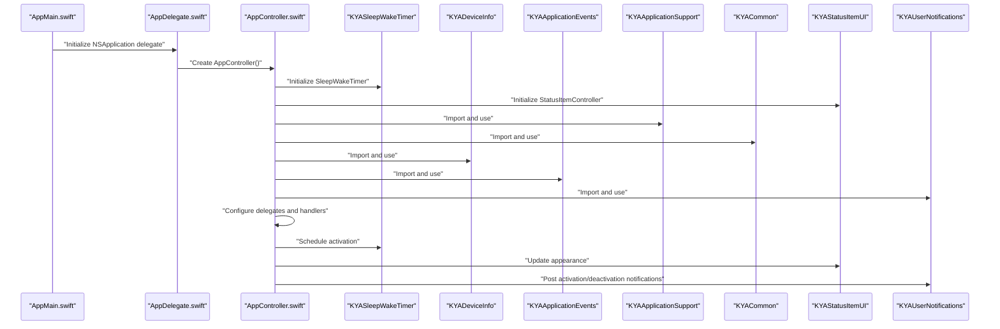

**Diagram sources**
- [KeepingYouAwake/AppMain.swift:1-24](file://KeepingYouAwake/AppMain.swift#L1-L24)
- [KeepingYouAwake/KYAAppController/AppDelegate.swift:1-57](file://KeepingYouAwake/KYAAppController/AppDelegate.swift#L1-L57)
- [KeepingYouAwake/KYAAppController/AppController.swift:1-352](file://KeepingYouAwake/KYAAppController/AppController.swift#L1-L352)
- [Packages/KYASleepWakeTimer/Package.swift:1-30](file://Packages/KYASleepWakeTimer/Package.swift#L1-L30)
- [Packages/KYAStatusItemUI/Package.swift:1-32](file://Packages/KYAStatusItemUI/Package.swift#L1-L32)
- [Packages/KYADeviceInfo/Package.swift:1-31](file://Packages/KYADeviceInfo/Package.swift#L1-L31)
- [Packages/KYAApplicationEvents/Package.swift:1-26](file://Packages/KYAApplicationEvents/Package.swift#L1-L26)
- [Packages/KYAApplicationSupport/Package.swift:1-31](file://Packages/KYAApplicationSupport/Package.swift#L1-L31)
- [Packages/KYACommon/Package.swift:1-26](file://Packages/KYACommon/Package.swift#L1-L26)
- [Packages/KYAUserNotifications/Package.swift:1-30](file://Packages/KYAUserNotifications/Package.swift#L1-L30)

## Detailed Component Analysis

### KYACommon
- Role: Foundation library providing shared types and a C logging shim.
- Targets: CLogShim (public headers), KYACommon (depends on CLogShim), KYACommonTests.
- Integration: Imported by all other packages that require shared types.

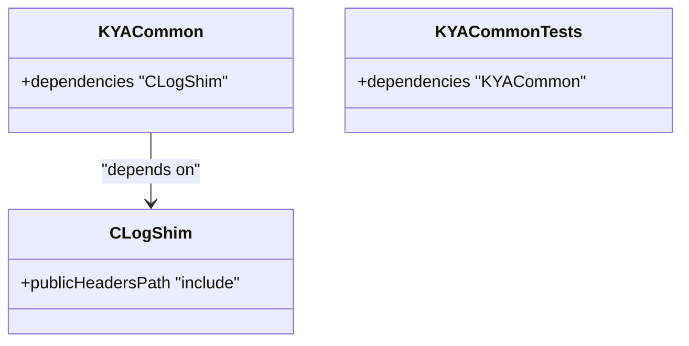

**Diagram sources**
- [Packages/KYACommon/Package.swift:1-26](file://Packages/KYACommon/Package.swift#L1-L26)

**Section sources**
- [Packages/KYACommon/Package.swift:1-26](file://Packages/KYACommon/Package.swift#L1-L26)

### KYAApplicationSupport
- Role: Application-level utilities and resources; depends on KYACommon.
- Targets: KYAApplicationSupport (depends on KYACommon), KYAApplicationSupportTests (with resource bundle copy).
- Integration: Used by packages requiring application support services.

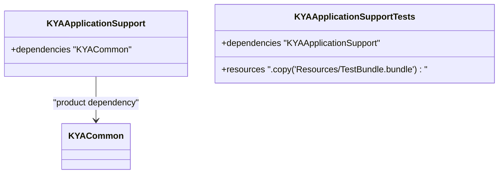

**Diagram sources**
- [Packages/KYAApplicationSupport/Package.swift:1-31](file://Packages/KYAApplicationSupport/Package.swift#L1-L31)

**Section sources**
- [Packages/KYAApplicationSupport/Package.swift:1-31](file://Packages/KYAApplicationSupport/Package.swift#L1-L31)

### KYADeviceInfo
- Role: Device information retrieval using a C shim for libproc functions.
- Targets: ClibprocShim, KYADeviceInfo (depends on ClibprocShim), KYADeviceInfoTests.
- Integration: Used by AppController for device parameter change handling.

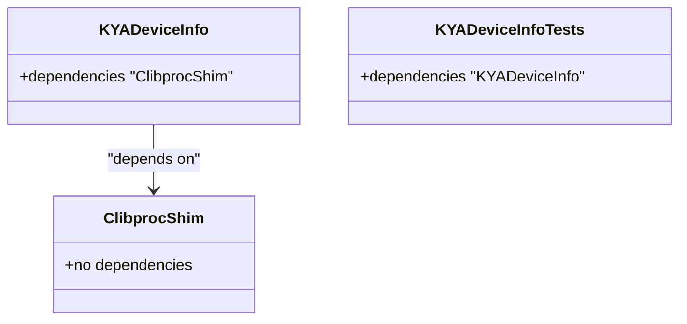

**Diagram sources**
- [Packages/KYADeviceInfo/Package.swift:1-31](file://Packages/KYADeviceInfo/Package.swift#L1-L31)

**Section sources**
- [Packages/KYADeviceInfo/Package.swift:1-31](file://Packages/KYADeviceInfo/Package.swift#L1-L31)

### KYAActivationDurations
- Role: Defines and manages activation durations used in the UI and scheduling.
- Targets: KYAActivationDurations (depends on KYACommon), KYAActivationDurationsTests.
- Integration: Used by AppController’s menu controller to select durations.

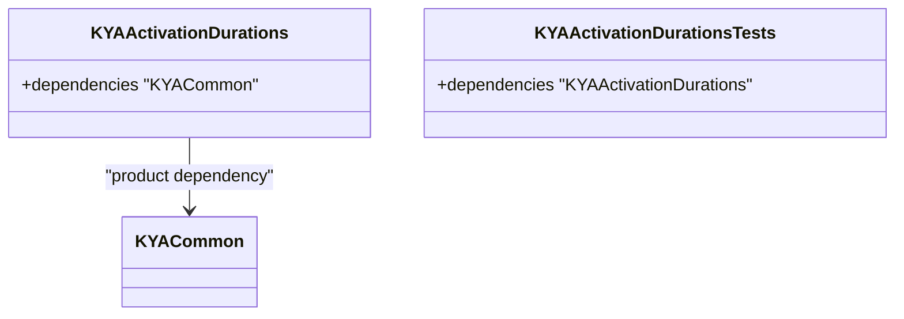

**Diagram sources**
- [Packages/KYAActivationDurations/Package.swift:1-30](file://Packages/KYAActivationDurations/Package.swift#L1-L30)

**Section sources**
- [Packages/KYAActivationDurations/Package.swift:1-30](file://Packages/KYAActivationDurations/Package.swift#L1-L30)

### KYAApplicationEvents
- Role: Encapsulates application event handling and actions.
- Targets: KYAApplicationEvents (depends on KYACommon), KYAApplicationEventsTests.
- Integration: AppController registers actions (activate, deactivate, toggle) via the event handler.

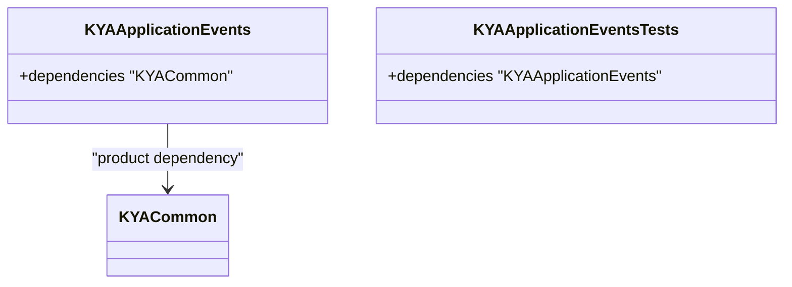

**Diagram sources**
- [Packages/KYAApplicationEvents/Package.swift:1-26](file://Packages/KYAApplicationEvents/Package.swift#L1-L26)

**Section sources**
- [Packages/KYAApplicationEvents/Package.swift:1-26](file://Packages/KYAApplicationEvents/Package.swift#L1-L26)

### KYASleepWakeTimer
- Role: Schedules and manages activation periods; integrates with application support and common libraries.
- Targets: KYASleepWakeTimer (depends on KYACommon and KYAApplicationSupport), KYASleepWakeTimerTests.
- Integration: AppController configures callbacks for activation/deactivation and schedules timers.

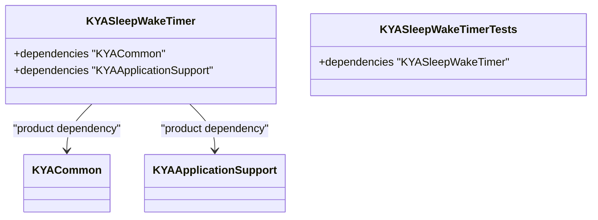

**Diagram sources**
- [Packages/KYASleepWakeTimer/Package.swift:1-30](file://Packages/KYASleepWakeTimer/Package.swift#L1-L30)

**Section sources**
- [Packages/KYASleepWakeTimer/Package.swift:1-30](file://Packages/KYASleepWakeTimer/Package.swift#L1-L30)

### KYAStatusItemUI
- Role: Implements the status bar UI and menu interactions; depends on application support and common libraries.
- Targets: KYAStatusItemUI (depends on KYACommon and KYAApplicationSupport), KYAStatusItemUITests.
- Integration: AppController sets up the status item controller and delegates.

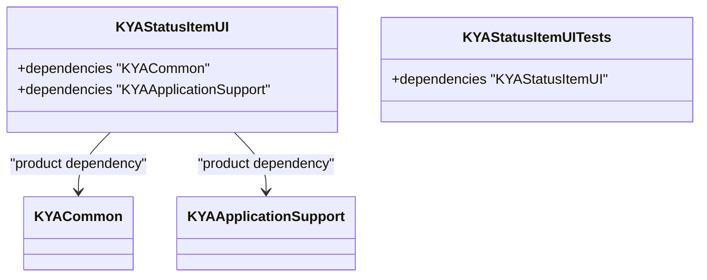

**Diagram sources**
- [Packages/KYAStatusItemUI/Package.swift:1-32](file://Packages/KYAStatusItemUI/Package.swift#L1-L32)

**Section sources**
- [Packages/KYAStatusItemUI/Package.swift:1-32](file://Packages/KYAStatusItemUI/Package.swift#L1-L32)

### KYAUserNotifications
- Role: Provides user notification capabilities for activation/deactivation events.
- Targets: KYAUserNotifications (depends on KYACommon), KYAUserNotificationsTests.
- Integration: AppController posts notifications upon activation and deactivation.

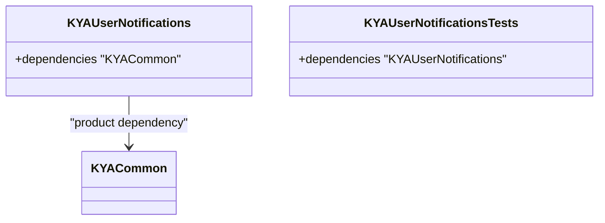

**Diagram sources**
- [Packages/KYAUserNotifications/Package.swift:1-30](file://Packages/KYAUserNotifications/Package.swift#L1-L30)

**Section sources**
- [Packages/KYAUserNotifications/Package.swift:1-30](file://Packages/KYAUserNotifications/Package.swift#L1-L30)

### Main Application Orchestration
- AppMain: Sets up the NSApplication, creates AppDelegate, and builds the main menu.
- AppDelegate: Owns AppController and handles application lifecycle events.
- AppController: Central coordinator integrating timer, status item, device monitoring, events, durations, and notifications.

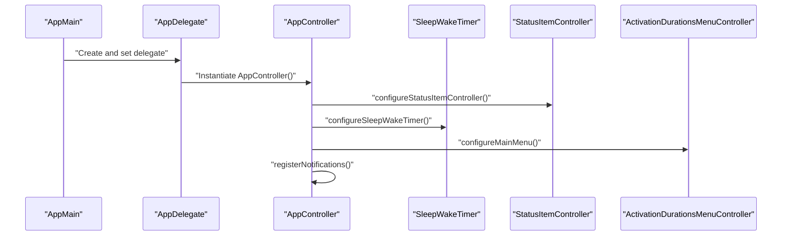

**Diagram sources**
- [KeepingYouAwake/AppMain.swift:1-24](file://KeepingYouAwake/AppMain.swift#L1-L24)
- [KeepingYouAwake/KYAAppController/AppDelegate.swift:1-57](file://KeepingYouAwake/KYAAppController/AppDelegate.swift#L1-L57)
- [KeepingYouAwake/KYAAppController/AppController.swift:1-352](file://KeepingYouAwake/KYAAppController/AppController.swift#L1-L352)

**Section sources**
- [KeepingYouAwake/AppMain.swift:1-24](file://KeepingYouAwake/AppMain.swift#L1-L24)
- [KeepingYouAwake/KYAAppController/AppDelegate.swift:1-57](file://KeepingYouAwake/KYAAppController/AppDelegate.swift#L1-L57)
- [KeepingYouAwake/KYAAppController/AppController.swift:1-352](file://KeepingYouAwake/KYAAppController/AppController.swift#L1-L352)

## Dependency Analysis
The dependency graph among packages is layered to minimize cross-package coupling and centralize shared types in KYACommon.

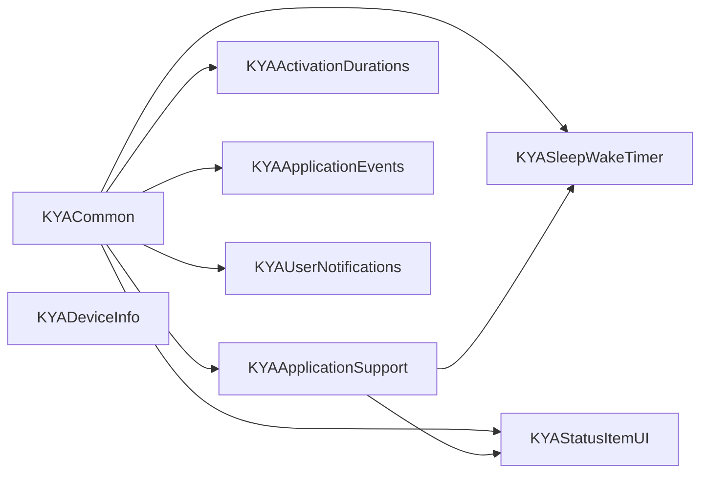

**Diagram sources**
- [Packages/KYACommon/Package.swift:1-26](file://Packages/KYACommon/Package.swift#L1-L26)
- [Packages/KYAApplicationSupport/Package.swift:1-31](file://Packages/KYAApplicationSupport/Package.swift#L1-L31)
- [Packages/KYADeviceInfo/Package.swift:1-31](file://Packages/KYADeviceInfo/Package.swift#L1-L31)
- [Packages/KYAActivationDurations/Package.swift:1-30](file://Packages/KYAActivationDurations/Package.swift#L1-L30)
- [Packages/KYAApplicationEvents/Package.swift:1-26](file://Packages/KYAApplicationEvents/Package.swift#L1-L26)
- [Packages/KYASleepWakeTimer/Package.swift:1-30](file://Packages/KYASleepWakeTimer/Package.swift#L1-L30)
- [Packages/KYAStatusItemUI/Package.swift:1-32](file://Packages/KYAStatusItemUI/Package.swift#L1-L32)
- [Packages/KYAUserNotifications/Package.swift:1-30](file://Packages/KYAUserNotifications/Package.swift#L1-L30)

**Section sources**
- [Packages/KYACommon/Package.swift:1-26](file://Packages/KYACommon/Package.swift#L1-L26)
- [Packages/KYAApplicationSupport/Package.swift:1-31](file://Packages/KYAApplicationSupport/Package.swift#L1-L31)
- [Packages/KYADeviceInfo/Package.swift:1-31](file://Packages/KYADeviceInfo/Package.swift#L1-L31)
- [Packages/KYAActivationDurations/Package.swift:1-30](file://Packages/KYAActivationDurations/Package.swift#L1-L30)
- [Packages/KYAApplicationEvents/Package.swift:1-26](file://Packages/KYAApplicationEvents/Package.swift#L1-L26)
- [Packages/KYASleepWakeTimer/Package.swift:1-30](file://Packages/KYASleepWakeTimer/Package.swift#L1-L30)
- [Packages/KYAStatusItemUI/Package.swift:1-32](file://Packages/KYAStatusItemUI/Package.swift#L1-L32)
- [Packages/KYAUserNotifications/Package.swift:1-30](file://Packages/KYAUserNotifications/Package.swift#L1-L30)

## Performance Considerations
- Minimize inter-package coupling by importing only required products.
- Keep package responsibilities narrow to reduce compile-time and runtime overhead.
- Use targeted test suites per package to accelerate feedback loops.
- Avoid unnecessary bridging overhead by limiting C shims to essential functions.

## Troubleshooting Guide
- Build failures due to missing dependencies: Verify each package declares its dependencies and that the main application imports the package where used.
- Test target resource issues: Ensure test bundles are copied via the resources array in the test target configuration.
- Circular dependencies: Confirm no two packages depend on each other; rely on KYACommon for shared types only.
- Runtime errors in device monitoring: Validate that the C shim targets are built and linked correctly.

**Section sources**
- [Packages/KYAApplicationSupport/Package.swift:26-29](file://Packages/KYAApplicationSupport/Package.swift#L26-L29)
- [Packages/KYADeviceInfo/Package.swift:15-19](file://Packages/KYADeviceInfo/Package.swift#L15-L19)

## Conclusion
The modular architecture leverages eight specialized Swift packages to achieve a clean separation of concerns. KYACommon provides shared types, while others encapsulate distinct responsibilities such as device monitoring, activation durations, application events, sleep/wake timing, status item UI, and user notifications. This design improves code reusability, testability, and maintainability, and offers a clear pattern for extending the system with new packages.

## Appendices
- Adding a new package:
  - Create a new Package.swift under Packages/<NewPackage>.
  - Define a library product and a test target.
  - Import existing packages (preferably KYACommon) rather than duplicating shared logic.
  - Integrate into the main application by importing the package and wiring into AppController.
- Managing dependencies:
  - Keep dependencies explicit and minimal.
  - Avoid cycles; if a cycle appears, refactor shared logic into KYACommon.
  - Use product dependencies to import only necessary APIs.
- Maintaining package isolation:
  - Limit public surface area to what is needed by consumers.
  - Encapsulate implementation details behind clear interfaces.
  - Use tests to validate behavior without exposing internal structures.