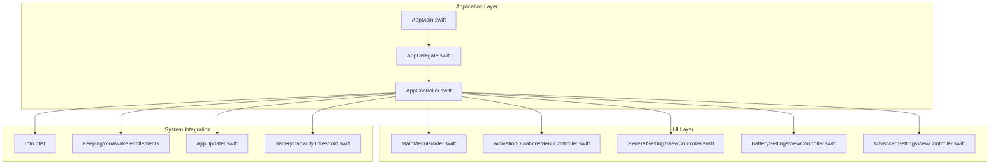
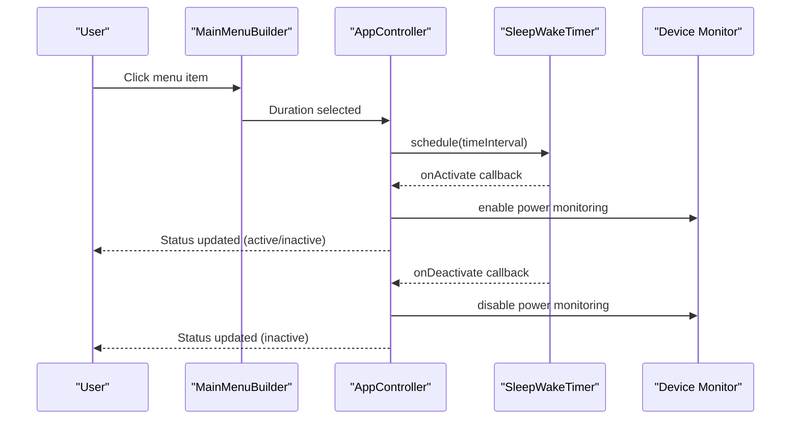
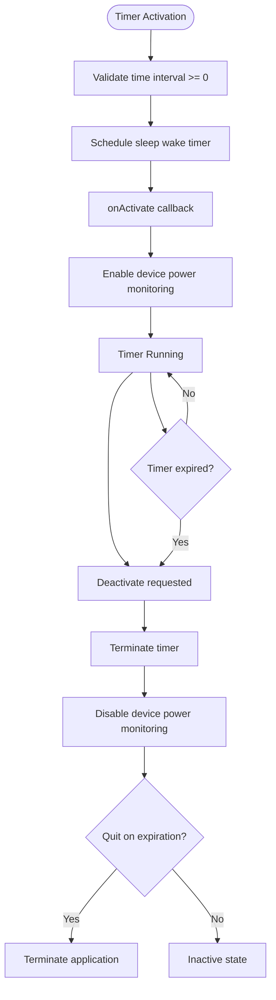
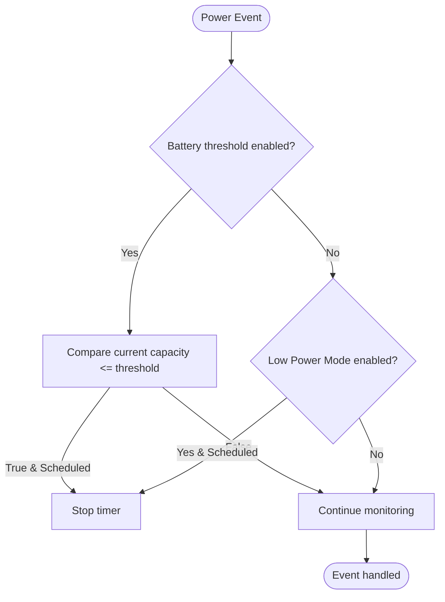
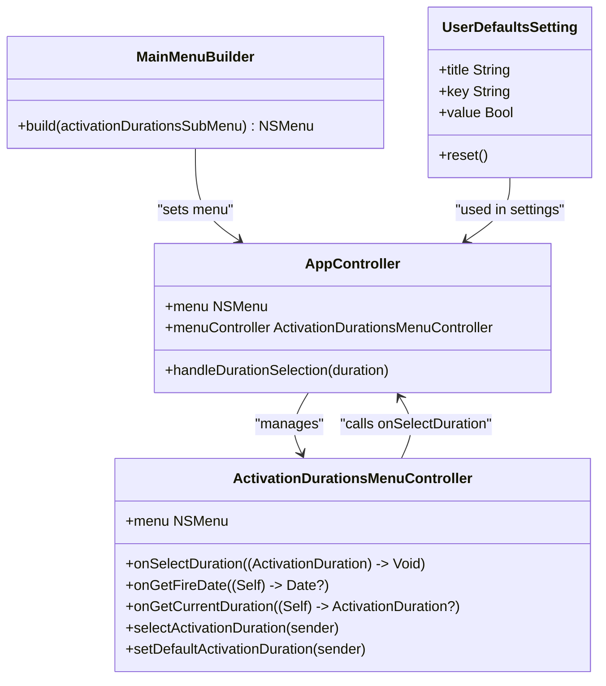
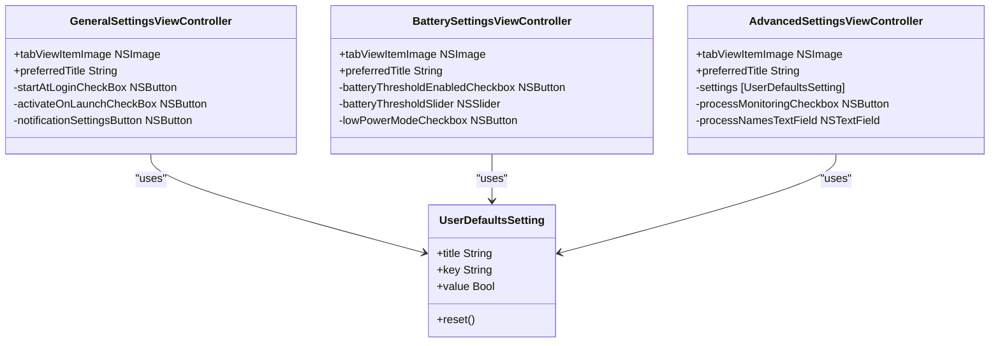
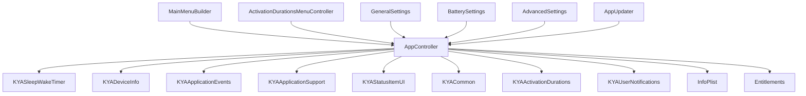

# Project Overview

<cite>
**Referenced Files in This Document**
- [README.md](file://README.md)
- [AppMain.swift](file://KeepingYouAwake/AppMain.swift)
- [AppDelegate.swift](file://KeepingYouAwake/KYAAppController/AppDelegate.swift)
- [AppController.swift](file://KeepingYouAwake/KYAAppController/AppController.swift)
- [MainMenuBuilder.swift](file://KeepingYouAwake/KYAMainMenu/MainMenuBuilder.swift)
- [ActivationDurationsMenuController.swift](file://KeepingYouAwake/KYAActivationDurationsMenuController/ActivationDurationsMenuController.swift)
- [AppUpdater.swift](file://KeepingYouAwake/KYAAppUpdater/AppUpdater.swift)
- [KYAL10n.swift](file://KeepingYouAwake/KYAL10n.swift)
- [BatterySettingsViewController.swift](file://KeepingYouAwake/Settings/KYABatterySettingsViewController/BatterySettingsViewController.swift)
- [AdvancedSettingsViewController.swift](file://KeepingYouAwake/Settings/KYAAdvancedSettingsViewController/AdvancedSettingsViewController.swift)
- [GeneralSettingsViewController.swift](file://KeepingYouAwake/Settings/KYAGeneralSettingsViewController/GeneralSettingsViewController.swift)
- [Info.plist](file://KeepingYouAwake/Info.plist)
- [KeepingYouAwake.entitlements](file://KeepingYouAwake/KeepingYouAwake.entitlements)
- [BatteryCapacityThreshold.swift](file://KeepingYouAwake/BatteryCapacityThreshold.swift)
- [UserDefaultsSetting.swift](file://KeepingYouAwake/UserDefaultsSetting.swift)
</cite>

## Table of Contents
1. [Introduction](#introduction)
2. [Project Structure](#project-structure)
3. [Core Components](#core-components)
4. [Architecture Overview](#architecture-overview)
5. [Detailed Component Analysis](#detailed-component-analysis)
6. [Dependency Analysis](#dependency-analysis)
7. [Performance Considerations](#performance-considerations)
8. [Troubleshooting Guide](#troubleshooting-guide)
9. [Conclusion](#conclusion)

## Introduction
KeepingYouAwake is a macOS menu bar utility designed to prevent your Mac from entering sleep mode for a predefined duration or indefinitely. It acts as a small wrapper around Apple's official `caffeinate` command-line utility, leveraging the system-provided tool to manage system sleep behavior. The application targets macOS 10.13 and newer, offering a lightweight, reliable solution for scenarios where you need to keep your Mac awake during presentations, downloads, or other tasks.

The project evolved from the inspiration of Caffeine by Lighthead Software, aiming to provide a modern, Swift-based implementation optimized for contemporary macOS versions. It emphasizes simplicity, safety (by relying on Apple's official tool), and user control through an intuitive menu bar interface and configurable settings.

Practical use cases include:
- Preventing sleep during long-running builds or downloads
- Keeping the display active during screen sharing or presentations
- Managing sleep behavior when external displays are connected
- Automatically responding to power events like low battery or Low Power Mode

**Section sources**
- [README.md:1-45](file://README.md#L1-L45)

## Project Structure
The project follows a modular Swift architecture with clear separation of concerns:
- Application entry point and lifecycle orchestration
- Menu bar interface construction
- Sleep prevention timer management
- Intelligent power management (battery and Low Power Mode monitoring)
- Settings management with localization support
- Optional in-app update mechanism

**Diagram sources**
- [AppMain.swift:11-23](file://KeepingYouAwake/AppMain.swift#L11-L23)
- [AppController.swift:21-41](file://KeepingYouAwake/KYAAppController/AppController.swift#L21-L41)
- [MainMenuBuilder.swift:12-49](file://KeepingYouAwake/KYAMainMenu/MainMenuBuilder.swift#L12-L49)
- [ActivationDurationsMenuController.swift:14-31](file://KeepingYouAwake/KYAActivationDurationsMenuController/ActivationDurationsMenuController.swift#L14-L31)
- [GeneralSettingsViewController.swift:13-24](file://KeepingYouAwake/Settings/KYAGeneralSettingsViewController/GeneralSettingsViewController.swift#L13-L24)
- [BatterySettingsViewController.swift:13-30](file://KeepingYouAwake/Settings/KYABatterySettingsViewController/BatterySettingsViewController.swift#L13-L30)
- [AdvancedSettingsViewController.swift:12-27](file://KeepingYouAwake/Settings/KYAAdvancedSettingsViewController/AdvancedSettingsViewController.swift#L12-L27)
- [AppUpdater.swift:15-30](file://KeepingYouAwake/KYAAppUpdater/AppUpdater.swift#L15-L30)
- [BatteryCapacityThreshold.swift:11-15](file://KeepingYouAwake/BatteryCapacityThreshold.swift#L11-L15)
- [Info.plist:22-34](file://KeepingYouAwake/Info.plist#L22-L34)
- [KeepingYouAwake.entitlements:1-6](file://KeepingYouAwake/KeepingYouAwake.entitlements#L1-L6)

**Section sources**
- [AppMain.swift:9-24](file://KeepingYouAwake/AppMain.swift#L9-L24)
- [AppController.swift:19-41](file://KeepingYouAwake/KYAAppController/AppController.swift#L19-L41)

## Core Components
- AppController: Central orchestrator managing sleep/wake timer, status item, device monitoring, and event handling. It coordinates activation/deactivation flows and integrates with the menu system.
- MainMenuBuilder: Constructs the main application menu programmatically, including duration selection, settings, and quit actions.
- ActivationDurationsMenuController: Manages the activation durations submenu, displaying available durations, default selections, and remaining time indicators.
- Settings Controllers: Provide dedicated tabs for general preferences, battery thresholds, and advanced behaviors.
- AppUpdater: Optional update mechanism using Sparkle for release and pre-release channels.
- Localization: Comprehensive multi-language support through .xcstrings and .xliff catalogs.

Key capabilities:
- Sleep prevention timers with configurable durations
- Intelligent power management reacting to battery capacity and Low Power Mode
- Menu bar interface with dynamic duration menus
- Multi-language support covering numerous locales
- Optional automatic updates and user notification integration

**Section sources**
- [AppController.swift:19-41](file://KeepingYouAwake/KYAAppController/AppController.swift#L19-L41)
- [MainMenuBuilder.swift:12-49](file://KeepingYouAwake/KYAMainMenu/MainMenuBuilder.swift#L12-L49)
- [ActivationDurationsMenuController.swift:14-31](file://KeepingYouAwake/KYAActivationDurationsMenuController/ActivationDurationsMenuController.swift#L14-L31)
- [GeneralSettingsViewController.swift:13-24](file://KeepingYouAwake/Settings/KYAGeneralSettingsViewController/GeneralSettingsViewController.swift#L13-L24)
- [BatterySettingsViewController.swift:13-30](file://KeepingYouAwake/Settings/KYABatterySettingsViewController/BatterySettingsViewController.swift#L13-L30)
- [AdvancedSettingsViewController.swift:12-27](file://KeepingYouAwake/Settings/KYAAdvancedSettingsViewController/AdvancedSettingsViewController.swift#L12-L27)
- [AppUpdater.swift:15-30](file://KeepingYouAwake/KYAAppUpdater/AppUpdater.swift#L15-L30)
- [KYAL10n.swift:13-65](file://KeepingYouAwake/KYAL10n.swift#L13-L65)

## Architecture Overview
The application uses a layered architecture with a central controller coordinating subsystems:
- Entry point initializes the application and sets up the main menu
- AppController manages the primary workflow, timer scheduling, and device monitoring
- UI components communicate through delegation and closure-based callbacks
- Settings integrate with UserDefaults for persistence and binding

**Diagram sources**
- [MainMenuBuilder.swift:13-49](file://KeepingYouAwake/KYAMainMenu/MainMenuBuilder.swift#L13-L49)
- [AppController.swift:77-122](file://KeepingYouAwake/KYAAppController/AppController.swift#L77-L122)
- [ActivationDurationsMenuController.swift:33-38](file://KeepingYouAwake/KYAActivationDurationsMenuController/ActivationDurationsMenuController.swift#L33-L38)

**Section sources**
- [AppMain.swift:13-22](file://KeepingYouAwake/AppMain.swift#L13-L22)
- [AppController.swift:77-122](file://KeepingYouAwake/KYAAppController/AppController.swift#L77-L122)

## Detailed Component Analysis

### Sleep Prevention Timer Management
The timer system provides flexible activation controls with automatic cleanup and optional quitting on expiration.

**Diagram sources**
- [AppController.swift:92-122](file://KeepingYouAwake/KYAAppController/AppController.swift#L92-L122)
- [AppController.swift:124-129](file://KeepingYouAwake/KYAAppController/AppController.swift#L124-L129)

Key behaviors:
- Immediate activation on launch when configured
- Automatic termination with optional app quit
- Graceful handling of cancellation and errors
- Integration with user notifications for macOS 11+

**Section sources**
- [AppController.swift:92-122](file://KeepingYouAwake/KYAAppController/AppController.swift#L92-L122)
- [AppController.swift:124-129](file://KeepingYouAwake/KYAAppController/AppController.swift#L124-L129)

### Intelligent Power Management
The system intelligently responds to power-related events to maintain safe operation.

**Diagram sources**
- [AppController.swift:227-246](file://KeepingYouAwake/KYAAppController/AppController.swift#L227-L246)
- [BatterySettingsViewController.swift:189-237](file://KeepingYouAwake/Settings/KYABatterySettingsViewController/BatterySettingsViewController.swift#L189-L237)

Implementation highlights:
- Battery capacity threshold with dynamic adjustment
- Low Power Mode detection and response
- Conditional monitoring based on hardware capabilities
- User-configurable thresholds and behaviors

**Section sources**
- [AppController.swift:191-246](file://KeepingYouAwake/KYAAppController/AppController.swift#L191-L246)
- [BatterySettingsViewController.swift:189-237](file://KeepingYouAwake/Settings/KYABatterySettingsViewController/BatterySettingsViewController.swift#L189-L237)

### Menu Bar Interface and Duration Management
The menu system provides intuitive access to activation controls and settings.

**Diagram sources**
- [MainMenuBuilder.swift:12-49](file://KeepingYouAwake/KYAMainMenu/MainMenuBuilder.swift#L12-L49)
- [ActivationDurationsMenuController.swift:14-126](file://KeepingYouAwake/KYAActivationDurationsMenuController/ActivationDurationsMenuController.swift#L14-L126)
- [AppController.swift:53-66](file://KeepingYouAwake/KYAAppController/AppController.swift#L53-L66)
- [UserDefaultsSetting.swift:12-31](file://KeepingYouAwake/UserDefaultsSetting.swift#L12-L31)

**Section sources**
- [MainMenuBuilder.swift:12-49](file://KeepingYouAwake/KYAMainMenu/MainMenuBuilder.swift#L12-L49)
- [ActivationDurationsMenuController.swift:14-126](file://KeepingYouAwake/KYAActivationDurationsMenuController/ActivationDurationsMenuController.swift#L14-L126)
- [AppController.swift:53-66](file://KeepingYouAwake/KYAAppController/AppController.swift#L53-L66)

### Settings and Configuration
Settings are managed through a combination of UserDefaults bindings and dedicated view controllers.

**Diagram sources**
- [GeneralSettingsViewController.swift:13-116](file://KeepingYouAwake/Settings/KYAGeneralSettingsViewController/GeneralSettingsViewController.swift#L13-L116)
- [BatterySettingsViewController.swift:13-262](file://KeepingYouAwake/Settings/KYABatterySettingsViewController/BatterySettingsViewController.swift#L13-L262)
- [AdvancedSettingsViewController.swift:12-186](file://KeepingYouAwake/Settings/KYAAdvancedSettingsViewController/AdvancedSettingsViewController.swift#L12-L186)
- [UserDefaultsSetting.swift:12-31](file://KeepingYouAwake/UserDefaultsSetting.swift#L12-L31)

**Section sources**
- [GeneralSettingsViewController.swift:13-116](file://KeepingYouAwake/Settings/KYAGeneralSettingsViewController/GeneralSettingsViewController.swift#L13-L116)
- [BatterySettingsViewController.swift:13-262](file://KeepingYouAwake/Settings/KYABatterySettingsViewController/BatterySettingsViewController.swift#L13-L262)
- [AdvancedSettingsViewController.swift:12-186](file://KeepingYouAwake/Settings/KYAAdvancedSettingsViewController/AdvancedSettingsViewController.swift#L12-L186)

## Dependency Analysis
The application maintains clean dependencies between modules while integrating with system frameworks.

**Diagram sources**
- [AppController.swift:10-18](file://KeepingYouAwake/KYAAppController/AppController.swift#L10-L18)
- [MainMenuBuilder.swift:9](file://KeepingYouAwake/KYAMainMenu/MainMenuBuilder.swift#L9)
- [ActivationDurationsMenuController.swift:9-12](file://KeepingYouAwake/KYAActivationDurationsMenuController/ActivationDurationsMenuController.swift#L9-L12)
- [GeneralSettingsViewController.swift:9-12](file://KeepingYouAwake/Settings/KYAGeneralSettingsViewController/GeneralSettingsViewController.swift#L9-L12)
- [BatterySettingsViewController.swift:9-12](file://KeepingYouAwake/Settings/KYABatterySettingsViewController/BatterySettingsViewController.swift#L9-L12)
- [AdvancedSettingsViewController.swift:9-11](file://KeepingYouAwake/Settings/KYAAdvancedSettingsViewController/AdvancedSettingsViewController.swift#L9-L11)
- [AppUpdater.swift:10](file://KeepingYouAwake/KYAAppUpdater/AppUpdater.swift#L10)

**Section sources**
- [AppController.swift:10-18](file://KeepingYouAwake/KYAAppController/AppController.swift#L10-L18)

## Performance Considerations
- Minimal resource footprint through efficient timer management and selective device monitoring
- Lazy initialization of monitoring components to reduce startup overhead
- Conditional monitoring based on user preferences and hardware capabilities
- Efficient menu updates using delegate patterns and attributed text caching
- Optimized settings binding to avoid unnecessary UI refreshes

## Troubleshooting Guide
Common scenarios and resolutions:
- Timer not stopping: Verify power threshold settings and Low Power Mode status
- Menu not updating: Check duration selection callbacks and menu delegate implementations
- Settings not persisting: Confirm UserDefaults bindings and synchronization
- Update notifications: Ensure notification permissions are granted for macOS 11+
- External display behavior: Verify activation-on-external-display preference

**Section sources**
- [AppController.swift:227-246](file://KeepingYouAwake/KYAAppController/AppController.swift#L227-L246)
- [ActivationDurationsMenuController.swift:81-125](file://KeepingYouAwake/KYAActivationDurationsMenuController/ActivationDurationsMenuController.swift#L81-L125)
- [UserDefaultsSetting.swift:16-26](file://KeepingYouAwake/UserDefaultsSetting.swift#L16-L26)

## Conclusion
KeepingYouAwake provides a robust, user-friendly solution for macOS sleep management through Apple's trusted `caffeinate` utility. Its modular architecture, comprehensive power management, and extensive localization support deliver a reliable experience across diverse use cases. The application balances simplicity with powerful features, making it an essential tool for users who need precise control over their Mac's sleep behavior.