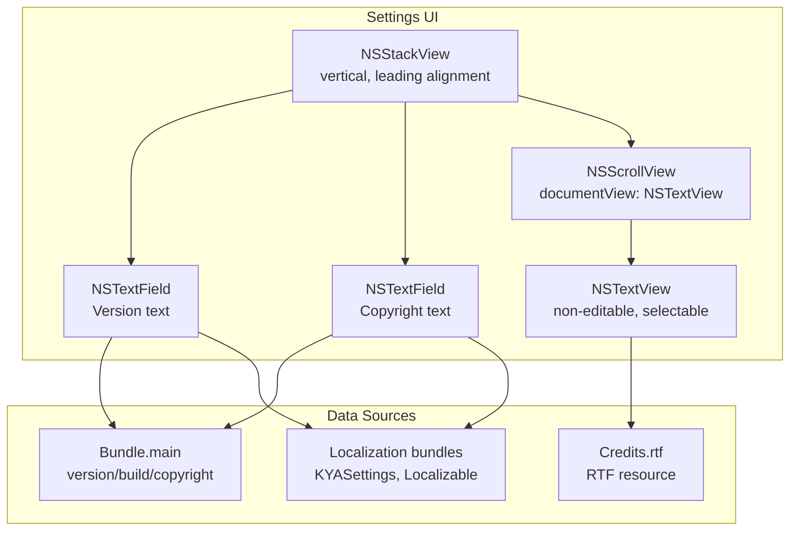
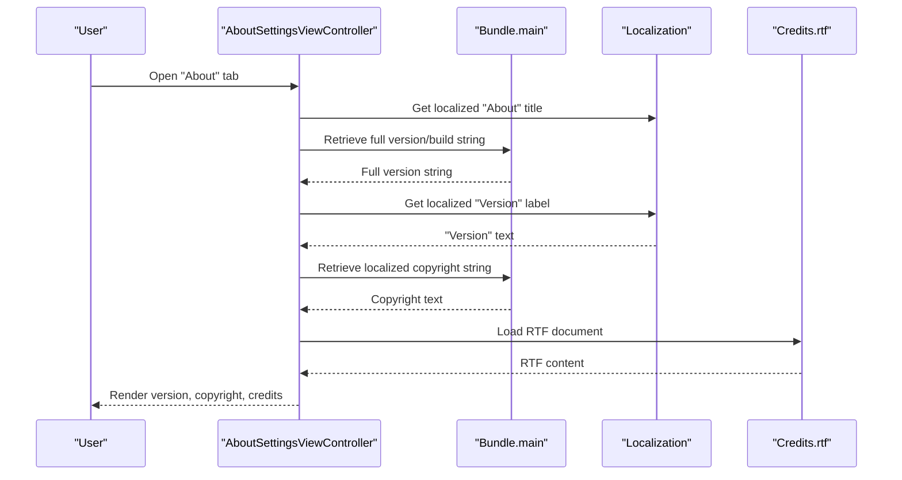
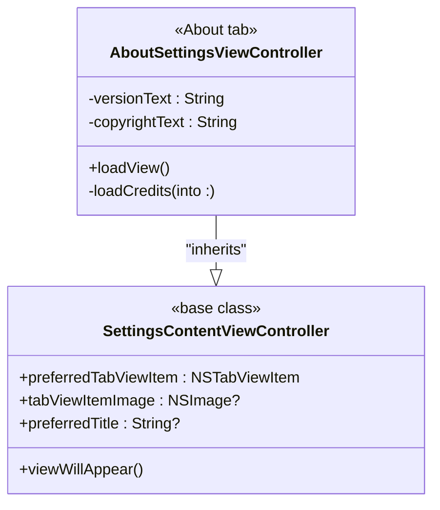
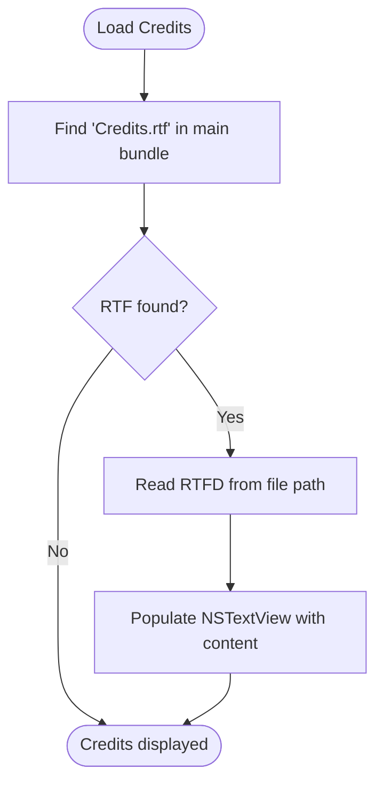
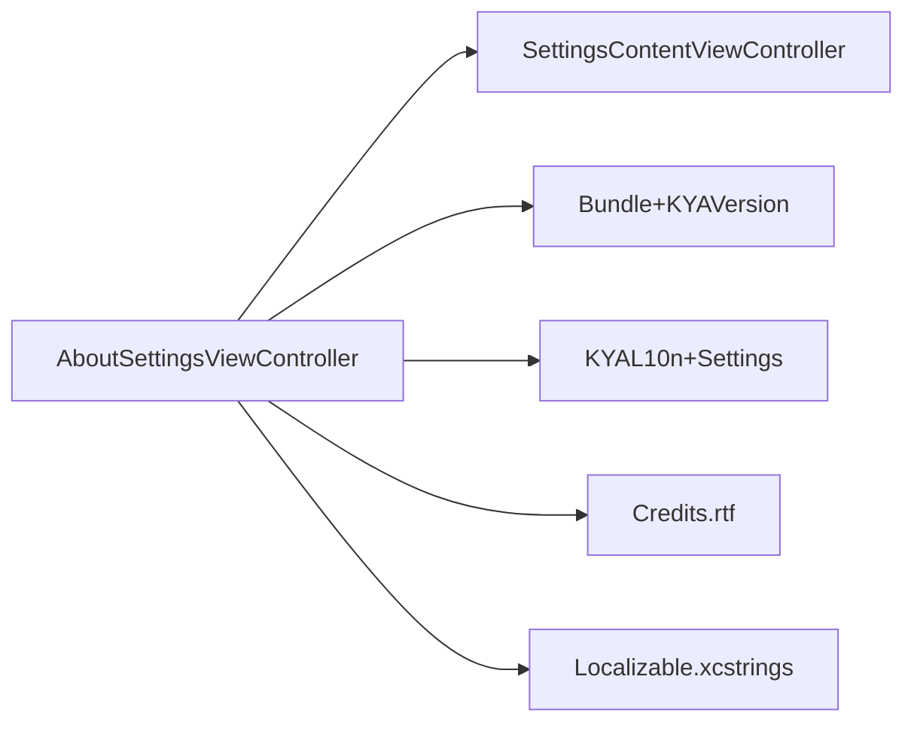

# About Settings

<cite>
**Referenced Files in This Document**
- [AboutSettingsViewController.swift](file://KeepingYouAwake/Settings/KYAAboutSettingsViewController/AboutSettingsViewController.swift)
- [SettingsContentViewController.swift](file://KeepingYouAwake/Settings/KYASettingsContentViewController/SettingsContentViewController.swift)
- [KYAL10n+Settings.swift](file://KeepingYouAwake/Settings/KYAL10n+Settings.swift)
- [KYASettings.xcstrings](file://KeepingYouAwake/Settings/KYASettings.xcstrings)
- [Localizable.xcstrings](file://KeepingYouAwake/Localizable.xcstrings)
- [Bundle+KYAVersion.swift](file://Packages/KYAApplicationSupport/Sources/KYAApplicationSupport/Bundle+KYAVersion.swift)
- [Credits.rtf](file://Credits.rtf)
</cite>

## Table of Contents
1. [Introduction](#introduction)
2. [Project Structure](#project-structure)
3. [Core Components](#core-components)
4. [Architecture Overview](#architecture-overview)
5. [Detailed Component Analysis](#detailed-component-analysis)
6. [Dependency Analysis](#dependency-analysis)
7. [Performance Considerations](#performance-considerations)
8. [Troubleshooting Guide](#troubleshooting-guide)
9. [Conclusion](#conclusion)

## Introduction
This document describes the About Settings category, focusing on how version information, copyright notices, and legal/copyright details are presented. It explains the user interface layout used to showcase application metadata and support information, documents the integration with application versioning and build information systems, and covers the presentation of credits and acknowledgments. Implementation examples are provided for displaying dynamic version information and linking to external support resources.

## Project Structure
The About Settings tab is implemented as a dedicated settings view controller that composes three primary UI elements:
- A version label that dynamically reflects the application’s version and build information
- A copyright notice label derived from localized bundle metadata
- A scrollable credits area that renders a Rich Text Format (RTF) document

These elements are arranged in a vertical stack layout with appropriate spacing and insets. The controller inherits from a base settings view controller that standardizes tab creation and sizing behavior.

**Diagram sources**
- [AboutSettingsViewController.swift:34-77](file://KeepingYouAwake/Settings/KYAAboutSettingsViewController/AboutSettingsViewController.swift#L34-L77)
- [AboutSettingsViewController.swift:81-99](file://KeepingYouAwake/Settings/KYAAboutSettingsViewController/AboutSettingsViewController.swift#L81-L99)
- [KYAL10n+Settings.swift:12-24](file://KeepingYouAwake/Settings/KYAL10n+Settings.swift#L12-L24)

**Section sources**
- [AboutSettingsViewController.swift:15-100](file://KeepingYouAwake/Settings/KYAAboutSettingsViewController/AboutSettingsViewController.swift#L15-L100)
- [SettingsContentViewController.swift:13-46](file://KeepingYouAwake/Settings/KYASettingsContentViewController/SettingsContentViewController.swift#L13-L46)

## Core Components
- AboutSettingsViewController: Renders the About tab UI, constructs version and copyright text, loads credits from an RTF resource, and applies layout constraints.
- SettingsContentViewController: Base class providing standardized tab creation and preferred content sizing.
- Localization: Provides localized strings for the About tab title and related labels.
- Bundle extensions: Supply version, build, and copyright metadata used by the About tab.

Key responsibilities:
- Dynamic version display: Combines a localized “Version” label with the application’s full version string from the bundle.
- Copyright notice: Uses localized copyright text from the bundle.
- Credits presentation: Loads an RTF document into a scrollable text view for selectable, non-editable display.

**Section sources**
- [AboutSettingsViewController.swift:16-100](file://KeepingYouAwake/Settings/KYAAboutSettingsViewController/AboutSettingsViewController.swift#L16-L100)
- [SettingsContentViewController.swift:13-46](file://KeepingYouAwake/Settings/KYASettingsContentViewController/SettingsContentViewController.swift#L13-L46)
- [KYAL10n+Settings.swift:12-24](file://KeepingYouAwake/Settings/KYAL10n+Settings.swift#L12-L24)

## Architecture Overview
The About tab integrates UI composition, localization, and bundle metadata to present a cohesive summary of application identity and support materials.

**Diagram sources**
- [AboutSettingsViewController.swift:28-30](file://KeepingYouAwake/Settings/KYAAboutSettingsViewController/AboutSettingsViewController.swift#L28-L30)
- [AboutSettingsViewController.swift:81-90](file://KeepingYouAwake/Settings/KYAAboutSettingsViewController/AboutSettingsViewController.swift#L81-L90)
- [AboutSettingsViewController.swift:94-99](file://KeepingYouAwake/Settings/KYAAboutSettingsViewController/AboutSettingsViewController.swift#L94-L99)
- [KYAL10n+Settings.swift:17-23](file://KeepingYouAwake/Settings/KYAL10n+Settings.swift#L17-L23)

## Detailed Component Analysis

### AboutSettingsViewController
Responsibilities:
- Creates a vertical stack layout with version, copyright, and credits sections.
- Builds version text using a localized prefix and the application’s full version string from the bundle.
- Retrieves localized copyright text from the bundle.
- Loads and displays credits from a bundled RTF file in a scrollable text view.

UI layout characteristics:
- Vertical stack with leading alignment and tight spacing.
- Edge insets applied for comfortable readability.
- Credits scroll view configured with a scroller, borderless appearance, and transparent background.
- Minimum height constraint ensures the credits area remains usable.

**Diagram sources**
- [SettingsContentViewController.swift:13-46](file://KeepingYouAwake/Settings/KYASettingsContentViewController/SettingsContentViewController.swift#L13-L46)
- [AboutSettingsViewController.swift:16-100](file://KeepingYouAwake/Settings/KYAAboutSettingsViewController/AboutSettingsViewController.swift#L16-L100)

Implementation highlights:
- Version text construction: Combines a localized “Version” label with the bundle’s full version string, falling back to the localized label alone if the bundle value is unavailable.
- Copyright text retrieval: Uses a localized copyright string from the bundle.
- Credits loading: Attempts to read an RTF document from the main bundle and populate the text view.

**Section sources**
- [AboutSettingsViewController.swift:34-77](file://KeepingYouAwake/Settings/KYAAboutSettingsViewController/AboutSettingsViewController.swift#L34-L77)
- [AboutSettingsViewController.swift:81-90](file://KeepingYouAwake/Settings/KYAAboutSettingsViewController/AboutSettingsViewController.swift#L81-L90)
- [AboutSettingsViewController.swift:94-99](file://KeepingYouAwake/Settings/KYAAboutSettingsViewController/AboutSettingsViewController.swift#L94-L99)

### Localization Integration
- The About tab title is localized via a settings-specific localization table.
- The “Version” label is localized using the general localization table.
- Additional localized strings for settings categories are maintained in the settings localization catalog.

Practical implications:
- The tab title adapts to the user’s language automatically.
- The “Version” label is localized consistently across languages.

**Section sources**
- [KYAL10n+Settings.swift:12-24](file://KeepingYouAwake/Settings/KYAL10n+Settings.swift#L12-L24)
- [KYASettings.xcstrings:1-140](file://KeepingYouAwake/Settings/KYASettings.xcstrings#L1-L140)
- [Localizable.xcstrings:2517-2576](file://KeepingYouAwake/Localizable.xcstrings#L2517-L2576)

### Versioning and Build Information Integration
The About tab obtains version and build details from the application bundle through an extension that exposes computed properties for version and build number. This enables dynamic display of the current application version without hardcoding values.

Integration points:
- Full version string: Used to construct the version label.
- Build number: Available via the bundle extension for potential inclusion in future enhancements.

Note: The current implementation concatenates the localized “Version” label with the full version string returned by the bundle extension.

**Section sources**
- [AboutSettingsViewController.swift:81-86](file://KeepingYouAwake/Settings/KYAAboutSettingsViewController/AboutSettingsViewController.swift#L81-L86)
- [Bundle+KYAVersion.swift](file://Packages/KYAApplicationSupport/Sources/KYAApplicationSupport/Bundle+KYAVersion.swift)

### Credits and Acknowledgments Presentation
Credits are presented in a scrollable text view loaded from a bundled RTF document. The text view is configured to be non-editable and selectable, with a transparent background and minimal inset to improve readability.

Layout behavior:
- The credits scroll view is constrained to a minimum height to ensure usability.
- The scroll view hides horizontal scrollers and uses auto-hiding vertical scrollers.

**Diagram sources**
- [AboutSettingsViewController.swift:94-99](file://KeepingYouAwake/Settings/KYAAboutSettingsViewController/AboutSettingsViewController.swift#L94-L99)
- [Credits.rtf](file://Credits.rtf)

**Section sources**
- [AboutSettingsViewController.swift:49-69](file://KeepingYouAwake/Settings/KYAAboutSettingsViewController/AboutSettingsViewController.swift#L49-L69)
- [AboutSettingsViewController.swift:72-74](file://KeepingYouAwake/Settings/KYAAboutSettingsViewController/AboutSettingsViewController.swift#L72-L74)
- [AboutSettingsViewController.swift:94-99](file://KeepingYouAwake/Settings/KYAAboutSettingsViewController/AboutSettingsViewController.swift#L94-L99)

### Support Resources and External Links
The current implementation focuses on presenting version, copyright, and credits within the app. There is no built-in mechanism to open external support URLs from the About tab. To integrate external links:
- Add a button or link field in the About tab UI.
- Implement an action that opens the desired URL using the system browser.
- Ensure the link text is localized and placed appropriately within the layout.

[No sources needed since this section provides implementation guidance without analyzing specific files]

## Dependency Analysis
The About tab depends on:
- Settings base controller for tab creation and sizing
- Localization catalogs for labels and titles
- Bundle extensions for version/build/copyright metadata
- A bundled RTF document for credits

**Diagram sources**
- [AboutSettingsViewController.swift:16-100](file://KeepingYouAwake/Settings/KYAAboutSettingsViewController/AboutSettingsViewController.swift#L16-L100)
- [SettingsContentViewController.swift:13-46](file://KeepingYouAwake/Settings/KYASettingsContentViewController/SettingsContentViewController.swift#L13-L46)
- [KYAL10n+Settings.swift:12-24](file://KeepingYouAwake/Settings/KYAL10n+Settings.swift#L12-L24)
- [Bundle+KYAVersion.swift](file://Packages/KYAApplicationSupport/Sources/KYAApplicationSupport/Bundle+KYAVersion.swift)
- [Credits.rtf](file://Credits.rtf)

**Section sources**
- [AboutSettingsViewController.swift:16-100](file://KeepingYouAwake/Settings/KYAAboutSettingsViewController/AboutSettingsViewController.swift#L16-L100)
- [SettingsContentViewController.swift:13-46](file://KeepingYouAwake/Settings/KYASettingsContentViewController/SettingsContentViewController.swift#L13-L46)

## Performance Considerations
- Credits loading: Reading an RTF file occurs once during view initialization. The cost is minimal and amortized over the lifetime of the view controller.
- Text rendering: The scroll view and text view are lightweight; performance is primarily dependent on the size of the RTF content.
- Layout: The stack view and constraints are simple and efficient for typical content sizes.

[No sources needed since this section provides general guidance]

## Troubleshooting Guide
Common issues and resolutions:
- Version text not appearing: Verify that the bundle extension provides a non-nil full version string. If unavailable, the controller falls back to displaying only the localized “Version” label.
- Copyright text missing: Ensure the bundle includes a localized copyright string; otherwise, the label will render empty.
- Credits not visible: Confirm that the Credits.rtf resource exists in the main bundle and is readable. If missing, the credits area will remain empty.

**Section sources**
- [AboutSettingsViewController.swift:81-90](file://KeepingYouAwake/Settings/KYAAboutSettingsViewController/AboutSettingsViewController.swift#L81-L90)
- [AboutSettingsViewController.swift:94-99](file://KeepingYouAwake/Settings/KYAAboutSettingsViewController/AboutSettingsViewController.swift#L94-L99)

## Conclusion
The About Settings tab provides a clean, localized presentation of application identity through version, copyright, and credits. Its modular design leverages localization and bundle metadata to deliver accurate, user-friendly information. Extending the tab to include external support links is straightforward and can enhance user access to help resources.