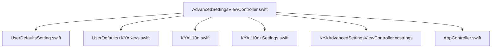
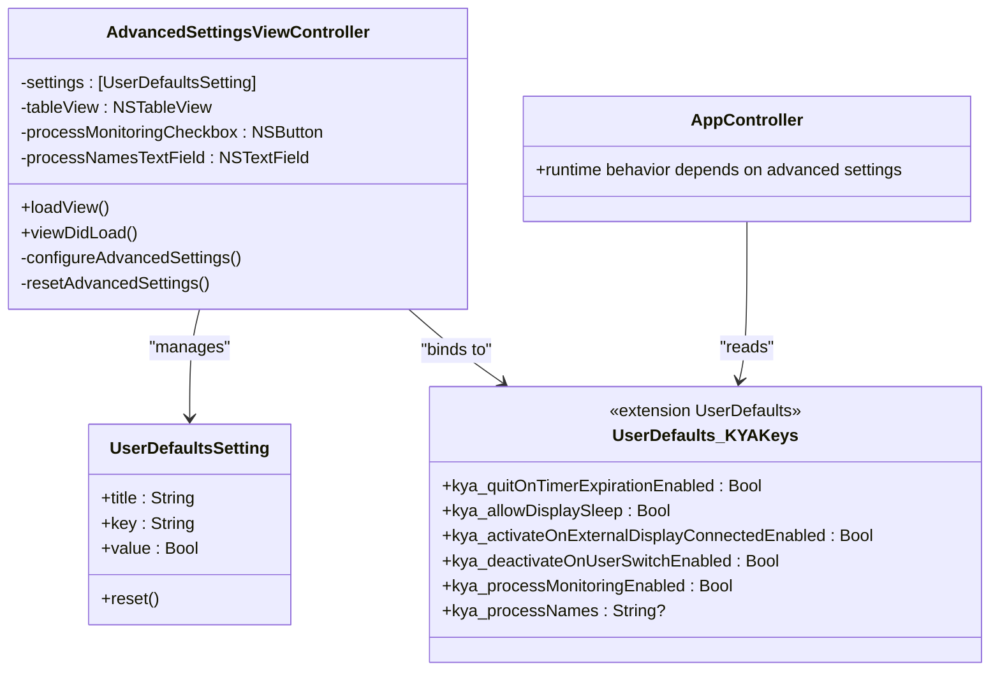
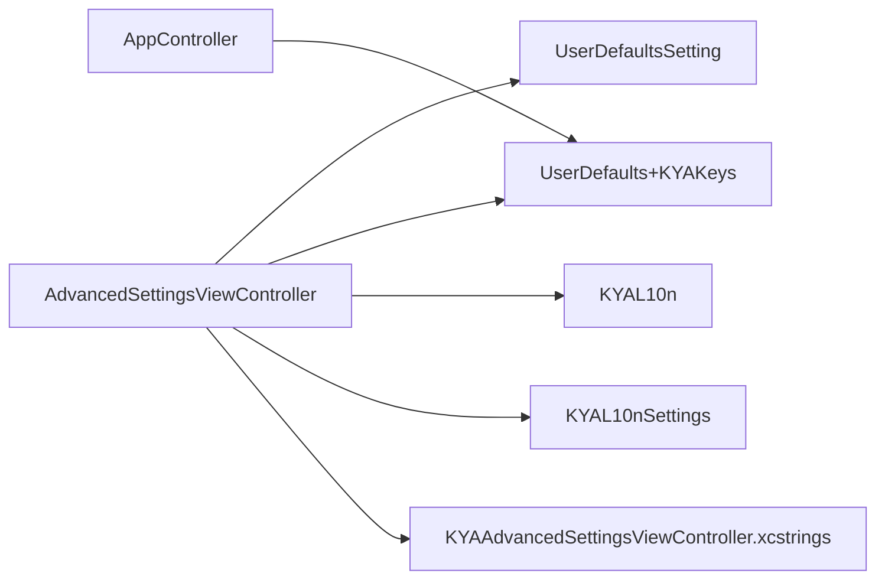
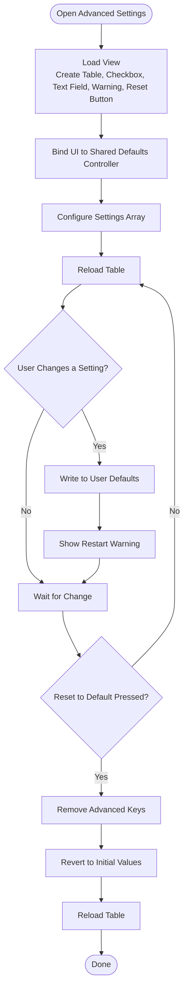

# Advanced Settings

<cite>
**Referenced Files in This Document**
- [AdvancedSettingsViewController.swift](file://KeepingYouAwake/Settings/KYAAdvancedSettingsViewController/AdvancedSettingsViewController.swift)
- [UserDefaultsSetting.swift](file://KeepingYouAwake/UserDefaultsSetting.swift)
- [UserDefaults+KYAKeys.swift](file://Packages/KYAApplicationSupport/Sources/KYAApplicationSupport/UserDefaults+KYAKeys.swift)
- [KYAL10n.swift](file://KeepingYouAwake/KYAL10n.swift)
- [KYAL10n+Settings.swift](file://KeepingYouAwake/Settings/KYAL10n+Settings.swift)
- [KYAAdvancedSettingsViewController.xcstrings](file://KeepingYouAwake/Settings/KYAAdvancedSettingsViewController/mul.lproj/KYAAdvancedSettingsViewController.xcstrings)
- [AppController.swift](file://KeepingYouAwake/KYAAppController/AppController.swift)
</cite>

## Table of Contents
1. [Introduction](#introduction)
2. [Project Structure](#project-structure)
3. [Core Components](#core-components)
4. [Architecture Overview](#architecture-overview)
5. [Detailed Component Analysis](#detailed-component-analysis)
6. [Dependency Analysis](#dependency-analysis)
7. [Performance Considerations](#performance-considerations)
8. [Troubleshooting Guide](#troubleshooting-guide)
9. [Conclusion](#conclusion)
10. [Appendices](#appendices)

## Introduction
This document describes the Advanced Settings category in the application, focusing on experimental and power-management-related controls, system integration toggles, and the user interface that presents complex configuration options. It explains how these settings influence core application behavior, outlines validation and safety mechanisms, and provides practical guidance for extending the Advanced Settings panel with new features while maintaining backward compatibility.

## Project Structure
Advanced Settings is implemented as a dedicated settings view controller with a table-driven list of boolean preferences backed by user defaults. It also includes a process monitoring feature controlled via separate keys. The UI is built programmatically with Auto Layout and integrates with the shared user defaults controller for live binding.

**Diagram sources**
- [AdvancedSettingsViewController.swift:13-138](file://KeepingYouAwake/Settings/KYAAdvancedSettingsViewController/AdvancedSettingsViewController.swift#L13-L138)
- [UserDefaultsSetting.swift:11-31](file://KeepingYouAwake/UserDefaultsSetting.swift#L11-L31)
- [UserDefaults+KYAKeys.swift:18-119](file://Packages/KYAApplicationSupport/Sources/KYAApplicationSupport/UserDefaults+KYAKeys.swift#L18-L119)
- [KYAL10n.swift:50-65](file://KeepingYouAwake/KYAL10n.swift#L50-L65)
- [KYAL10n+Settings.swift:12-24](file://KeepingYouAwake/Settings/KYAL10n+Settings.swift#L12-L24)
- [KYAAdvancedSettingsViewController.xcstrings:1-308](file://KeepingYouAwake/Settings/KYAAdvancedSettingsViewController/mul.lproj/KYAAdvancedSettingsViewController.xcstrings#L1-L308)
- [AppController.swift:100-330](file://KeepingYouAwake/KYAAppController/AppController.swift#L100-L330)

**Section sources**
- [AdvancedSettingsViewController.swift:13-138](file://KeepingYouAwake/Settings/KYAAdvancedSettingsViewController/AdvancedSettingsViewController.swift#L13-L138)
- [UserDefaults+KYAKeys.swift:18-119](file://Packages/KYAApplicationSupport/Sources/KYAApplicationSupport/UserDefaults+KYAKeys.swift#L18-L119)

## Core Components
- AdvancedSettingsViewController: Manages the Advanced Settings UI, including a table of boolean preferences, a process monitoring toggle, and a text field for specifying process names. It binds UI elements to user defaults and provides a Reset to Default action.
- UserDefaultsSetting: A lightweight UI model representing a single boolean preference with a display title and a backing user defaults key. It encapsulates reading/writing and resetting values.
- UserDefaults keys: Centralized constants and computed properties define the persisted keys and typed accessors for advanced options.
- Localization: Titles and warnings are localized via dedicated localization enums and .xcstrings resources.
- AppController integration: Core application logic reads selected advanced settings to alter runtime behavior (e.g., quitting on timer expiration, external display activation, user switch deactivation).

**Section sources**
- [AdvancedSettingsViewController.swift:13-138](file://KeepingYouAwake/Settings/KYAAdvancedSettingsViewController/AdvancedSettingsViewController.swift#L13-L138)
- [UserDefaultsSetting.swift:11-31](file://KeepingYouAwake/UserDefaultsSetting.swift#L11-L31)
- [UserDefaults+KYAKeys.swift:18-119](file://Packages/KYAApplicationSupport/Sources/KYAApplicationSupport/UserDefaults+KYAKeys.swift#L18-L119)
- [KYAL10n.swift:50-65](file://KeepingYouAwake/KYAL10n.swift#L50-L65)
- [KYAL10n+Settings.swift:12-24](file://KeepingYouAwake/Settings/KYAL10n+Settings.swift#L12-L24)
- [AppController.swift:100-330](file://KeepingYouAwake/KYAAppController/AppController.swift#L100-L330)

## Architecture Overview
The Advanced Settings panel follows a clean separation of concerns:
- UI layer: AdvancedSettingsViewController constructs views, binds to user defaults, and manages state.
- Model layer: UserDefaultsSetting provides a simple abstraction for boolean preferences.
- Persistence layer: UserDefaults keys and typed accessors in UserDefaults+KYAKeys.swift centralize storage semantics.
- Integration layer: AppController reads these settings to modify behavior at runtime.

**Diagram sources**
- [AdvancedSettingsViewController.swift:13-138](file://KeepingYouAwake/Settings/KYAAdvancedSettingsViewController/AdvancedSettingsViewController.swift#L13-L138)
- [UserDefaultsSetting.swift:11-31](file://KeepingYouAwake/UserDefaultsSetting.swift#L11-L31)
- [UserDefaults+KYAKeys.swift:18-119](file://Packages/KYAApplicationSupport/Sources/KYAApplicationSupport/UserDefaults+KYAKeys.swift#L18-L119)
- [AppController.swift:100-330](file://KeepingYouAwake/KYAAppController/AppController.swift#L100-L330)

## Detailed Component Analysis

### AdvancedSettingsViewController
Responsibilities:
- Build a scrollable table of boolean preferences.
- Provide a process monitoring toggle and a comma-separated process names input.
- Warn users that most advanced settings require an app restart.
- Offer a Reset to Default button to revert all advanced settings.

UI and binding highlights:
- Uses a table view with a custom cell view containing a checkbox bound to user defaults.
- Binds the process monitoring checkbox and process names text field to shared defaults controller.
- Reloads the table after configuration and reset actions.

Behavioral impact:
- The presence of a warning label indicates that changing these settings may require restarting the app to take effect.

**Section sources**
- [AdvancedSettingsViewController.swift:29-114](file://KeepingYouAwake/Settings/KYAAdvancedSettingsViewController/AdvancedSettingsViewController.swift#L29-L114)
- [AdvancedSettingsViewController.swift:121-137](file://KeepingYouAwake/Settings/KYAAdvancedSettingsViewController/AdvancedSettingsViewController.swift#L121-L137)
- [AdvancedSettingsViewController.swift:140-168](file://KeepingYouAwake/Settings/KYAAdvancedSettingsViewController/AdvancedSettingsViewController.swift#L140-L168)

### UserDefaultsSetting
Responsibilities:
- Encapsulate a single boolean preference with a human-readable title and a user defaults key.
- Provide a value property that writes true as a boolean and false by removing the key, ensuring consistent storage semantics.
- Expose a reset method to remove the key from user defaults.

Complexity and safety:
- O(1) read/write operations.
- Removing the key on false ensures that absence of a key equals the default state, simplifying migration and reset logic.

**Section sources**
- [UserDefaultsSetting.swift:11-31](file://KeepingYouAwake/UserDefaultsSetting.swift#L11-L31)

### UserDefaults Keys and Typed Accessors
Advanced settings keys and properties:
- Quit on timer expiration
- Allow display sleep
- Activate on external display connection
- Deactivate on user switch
- Process monitoring enabled
- Process names (comma-separated list)

Storage semantics:
- Boolean values are stored as booleans; false is represented by the absence of the key.
- Process names are stored as strings and support partial matching.

Backward compatibility:
- Keys preserve the established prefix and identifiers to maintain compatibility with existing stored preferences.

**Section sources**
- [UserDefaults+KYAKeys.swift:18-36](file://Packages/KYAApplicationSupport/Sources/KYAApplicationSupport/UserDefaults+KYAKeys.swift#L18-L36)
- [UserDefaults+KYAKeys.swift:46-99](file://Packages/KYAApplicationSupport/Sources/KYAApplicationSupport/UserDefaults+KYAKeys.swift#L46-L99)
- [UserDefaults+KYAKeys.swift:114-119](file://Packages/KYAApplicationSupport/Sources/KYAApplicationSupport/UserDefaults+KYAKeys.swift#L114-L119)

### Localization
Localization strategy:
- Titles for advanced settings are provided via KYAL10n.
- The Advanced tab title is provided via KYAL10nSettings.
- A warning message is localized and displayed prominently in the Advanced Settings UI.
- The Advanced Settings UI strings are maintained in KYAAdvancedSettingsViewController.xcstrings for multiple locales.

**Section sources**
- [KYAL10n.swift:50-65](file://KeepingYouAwake/KYAL10n.swift#L50-L65)
- [KYAL10n+Settings.swift:12-24](file://KeepingYouAwake/Settings/KYAL10n+Settings.swift#L12-L24)
- [KYAAdvancedSettingsViewController.xcstrings:167-304](file://KeepingYouAwake/Settings/KYAAdvancedSettingsViewController/mul.lproj/KYAAdvancedSettingsViewController.xcstrings#L167-L304)

### Integration with Core Application Functionality
Runtime behavior influenced by advanced settings:
- Quit on timer expiration: When enabled, the app quits after the activation timer completes.
- Allow display sleep: When enabled, the app allows the display to sleep while keeping the system awake.
- Activate on external display: When enabled, the app activates upon detection of an external display connection.
- Deactivate on user switch: When enabled, the app deactivates upon switching to another user account.

These behaviors are checked in the application controller logic.

**Section sources**
- [AppController.swift:100-115](file://KeepingYouAwake/KYAAppController/AppController.swift#L100-L115)
- [AppController.swift:300-315](file://KeepingYouAwake/KYAAppController/AppController.swift#L300-L315)
- [AppController.swift:318-325](file://KeepingYouAwake/KYAAppController/AppController.swift#L318-L325)

### User Interface Layout for Complex Options
The Advanced Settings UI consists of:
- A table view with a single column containing boolean toggles.
- A process monitoring checkbox and a label/field for process names.
- A warning label indicating that changes may require an app restart.
- A Reset to Default button aligned to the trailing edge.

Layout and binding:
- The table view uses alternating row colors and auto-layout constraints.
- The checkbox and text field are bound to user defaults controller for continuous updates.
- The reset action clears all advanced keys and reloads the table.

**Section sources**
- [AdvancedSettingsViewController.swift:29-114](file://KeepingYouAwake/Settings/KYAAdvancedSettingsViewController/AdvancedSettingsViewController.swift#L29-L114)
- [AdvancedSettingsViewController.swift:140-168](file://KeepingYouAwake/Settings/KYAAdvancedSettingsViewController/AdvancedSettingsViewController.swift#L140-L168)

### Validation and Safety Mechanisms
Safety measures:
- Warning label informs users that most advanced settings require an app restart.
- Reset to Default removes all advanced keys and reverts to initial values.
- Storage semantics ensure false is represented by key removal, simplifying default behavior.

Validation:
- Process names are stored as a comma-separated string; partial matching is supported by the application logic.
- No explicit input validation is performed in the Advanced Settings UI itself; validation occurs elsewhere in the application.

**Section sources**
- [AdvancedSettingsViewController.swift:66-71](file://KeepingYouAwake/Settings/KYAAdvancedSettingsViewController/AdvancedSettingsViewController.swift#L66-L71)
- [AdvancedSettingsViewController.swift:131-137](file://KeepingYouAwake/Settings/KYAAdvancedSettingsViewController/AdvancedSettingsViewController.swift#L131-L137)
- [UserDefaultsSetting.swift:16-26](file://KeepingYouAwake/UserDefaultsSetting.swift#L16-L26)
- [UserDefaults+KYAKeys.swift:114-119](file://Packages/KYAApplicationSupport/Sources/KYAApplicationSupport/UserDefaults+KYAKeys.swift#L114-L119)

### Implementation Examples

#### Adding a New Advanced Feature
Steps:
1. Define a new key constant and a typed accessor in UserDefaults+KYAKeys.swift.
2. Add a new UserDefaultsSetting to the settings array in AdvancedSettingsViewController.configureAdvancedSettings().
3. Bind the new setting to the defaults controller in loadView() if it is a boolean toggle.
4. Wire the setting into AppController logic to affect runtime behavior.
5. Provide a localized title via KYAL10n and update localization resources if needed.

Example references:
- Key definition and accessor: [UserDefaults+KYAKeys.swift:25-29](file://Packages/KYAApplicationSupport/Sources/KYAApplicationSupport/UserDefaults+KYAKeys.swift#L25-L29), [UserDefaults+KYAKeys.swift:77-81](file://Packages/KYAApplicationSupport/Sources/KYAApplicationSupport/UserDefaults+KYAKeys.swift#L77-L81)
- UI configuration: [AdvancedSettingsViewController.swift:121-129](file://KeepingYouAwake/Settings/KYAAdvancedSettingsViewController/AdvancedSettingsViewController.swift#L121-L129)
- Binding pattern: [AdvancedSettingsViewController.swift:57-64](file://KeepingYouAwake/Settings/KYAAdvancedSettingsViewController/AdvancedSettingsViewController.swift#L57-L64)
- Runtime integration: [AppController.swift:100-115](file://KeepingYouAwake/KYAAppController/AppController.swift#L100-L115)

**Section sources**
- [UserDefaults+KYAKeys.swift:25-29](file://Packages/KYAApplicationSupport/Sources/KYAApplicationSupport/UserDefaults+KYAKeys.swift#L25-L29)
- [UserDefaults+KYAKeys.swift:77-81](file://Packages/KYAApplicationSupport/Sources/KYAApplicationSupport/UserDefaults+KYAKeys.swift#L77-L81)
- [AdvancedSettingsViewController.swift:121-129](file://KeepingYouAwake/Settings/KYAAdvancedSettingsViewController/AdvancedSettingsViewController.swift#L121-L129)
- [AdvancedSettingsViewController.swift:57-64](file://KeepingYouAwake/Settings/KYAAdvancedSettingsViewController/AdvancedSettingsViewController.swift#L57-L64)
- [AppController.swift:100-115](file://KeepingYouAwake/KYAAppController/AppController.swift#L100-L115)

#### Handling Experimental Options
Guidelines:
- Keep experimental features behind a dedicated boolean key and typed accessor.
- Do not expose experimental options in the UI until they are ready for release.
- Use the existing reset mechanism to quickly disable experimental behavior.
- Document the requirement for app restart when enabling experimental features.

References:
- Reset mechanism: [AdvancedSettingsViewController.swift:131-137](file://KeepingYouAwake/Settings/KYAAdvancedSettingsViewController/AdvancedSettingsViewController.swift#L131-L137)
- Storage semantics: [UserDefaultsSetting.swift:16-26](file://KeepingYouAwake/UserDefaultsSetting.swift#L16-L26)

**Section sources**
- [AdvancedSettingsViewController.swift:131-137](file://KeepingYouAwake/Settings/KYAAdvancedSettingsViewController/AdvancedSettingsViewController.swift#L131-L137)
- [UserDefaultsSetting.swift:16-26](file://KeepingYouAwake/UserDefaultsSetting.swift#L16-L26)

#### Maintaining Backward Compatibility
Practices:
- Preserve existing key prefixes and identifiers to avoid breaking stored preferences.
- Use typed accessors to encapsulate storage details and default values.
- Avoid changing the meaning of existing keys; introduce new keys for new behaviors.

References:
- Key preservation: [UserDefaults+KYAKeys.swift:15-16](file://Packages/KYAApplicationSupport/Sources/KYAApplicationSupport/UserDefaults+KYAKeys.swift#L15-L16)
- Typed accessors: [UserDefaults+KYAKeys.swift:46-99](file://Packages/KYAApplicationSupport/Sources/KYAApplicationSupport/UserDefaults+KYAKeys.swift#L46-L99)

**Section sources**
- [UserDefaults+KYAKeys.swift:15-16](file://Packages/KYAApplicationSupport/Sources/KYAApplicationSupport/UserDefaults+KYAKeys.swift#L15-L16)
- [UserDefaults+KYAKeys.swift:46-99](file://Packages/KYAApplicationSupport/Sources/KYAApplicationSupport/UserDefaults+KYAKeys.swift#L46-L99)

## Dependency Analysis
The Advanced Settings module exhibits low coupling and high cohesion:
- UI depends on UserDefaultsSetting and UserDefaults keys.
- UserDefaultsSetting depends only on UserDefaults.
- AppController depends on UserDefaults keys for behavior decisions.
- Localization is decoupled via enums and .xcstrings.

**Diagram sources**
- [AdvancedSettingsViewController.swift:13-138](file://KeepingYouAwake/Settings/KYAAdvancedSettingsViewController/AdvancedSettingsViewController.swift#L13-L138)
- [UserDefaultsSetting.swift:11-31](file://KeepingYouAwake/UserDefaultsSetting.swift#L11-L31)
- [UserDefaults+KYAKeys.swift:18-119](file://Packages/KYAApplicationSupport/Sources/KYAApplicationSupport/UserDefaults+KYAKeys.swift#L18-L119)
- [KYAL10n.swift:50-65](file://KeepingYouAwake/KYAL10n.swift#L50-L65)
- [KYAL10n+Settings.swift:12-24](file://KeepingYouAwake/Settings/KYAL10n+Settings.swift#L12-L24)
- [KYAAdvancedSettingsViewController.xcstrings:167-304](file://KeepingYouAwake/Settings/KYAAdvancedSettingsViewController/mul.lproj/KYAAdvancedSettingsViewController.xcstrings#L167-L304)
- [AppController.swift:100-330](file://KeepingYouAwake/KYAAppController/AppController.swift#L100-L330)

**Section sources**
- [AdvancedSettingsViewController.swift:13-138](file://KeepingYouAwake/Settings/KYAAdvancedSettingsViewController/AdvancedSettingsViewController.swift#L13-L138)
- [UserDefaultsSetting.swift:11-31](file://KeepingYouAwake/UserDefaultsSetting.swift#L11-L31)
- [UserDefaults+KYAKeys.swift:18-119](file://Packages/KYAApplicationSupport/Sources/KYAApplicationSupport/UserDefaults+KYAKeys.swift#L18-L119)
- [AppController.swift:100-330](file://KeepingYouAwake/KYAAppController/AppController.swift#L100-L330)

## Performance Considerations
- Table rendering: The table uses alternating row colors and a fixed row height, minimizing layout overhead.
- Binding: Continuous binding to the shared defaults controller keeps UI state synchronized without manual polling.
- Storage: Removal of absent keys for false values reduces plist bloat and simplifies default resolution.

[No sources needed since this section provides general guidance]

## Troubleshooting Guide
Common issues and resolutions:
- Changes not taking effect immediately: Some advanced settings require an app restart. Verify by quitting and relaunching the application.
- Process monitoring not working: Ensure the process names list is a comma-separated string and that partial matching is intended; confirm the process monitoring key is enabled.
- Reset does not restore defaults: Use the Reset to Default button in Advanced Settings to remove all advanced keys and revert to initial values.

**Section sources**
- [AdvancedSettingsViewController.swift:66-71](file://KeepingYouAwake/Settings/KYAAdvancedSettingsViewController/AdvancedSettingsViewController.swift#L66-L71)
- [AdvancedSettingsViewController.swift:131-137](file://KeepingYouAwake/Settings/KYAAdvancedSettingsViewController/AdvancedSettingsViewController.swift#L131-L137)
- [UserDefaults+KYAKeys.swift:114-119](file://Packages/KYAApplicationSupport/Sources/KYAApplicationSupport/UserDefaults+KYAKeys.swift#L114-L119)

## Conclusion
Advanced Settings provides a robust, localized, and extensible configuration surface for power management and system integration controls. Its design emphasizes simplicity, safety, and backward compatibility while enabling future enhancements. By following the outlined patterns, developers can confidently add new advanced features, handle experimental options, and maintain consistent behavior across releases.

[No sources needed since this section summarizes without analyzing specific files]

## Appendices

### Appendix A: Advanced Settings UI Flow

**Diagram sources**
- [AdvancedSettingsViewController.swift:29-114](file://KeepingYouAwake/Settings/KYAAdvancedSettingsViewController/AdvancedSettingsViewController.swift#L29-L114)
- [AdvancedSettingsViewController.swift:121-137](file://KeepingYouAwake/Settings/KYAAdvancedSettingsViewController/AdvancedSettingsViewController.swift#L121-L137)