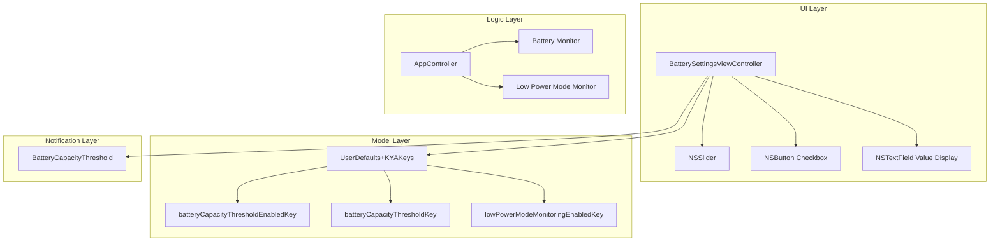
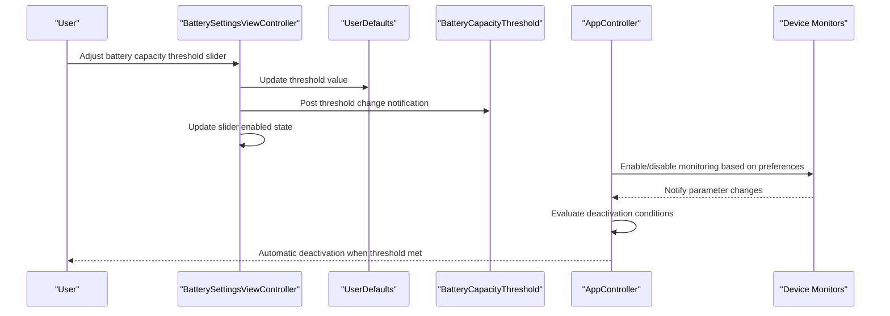
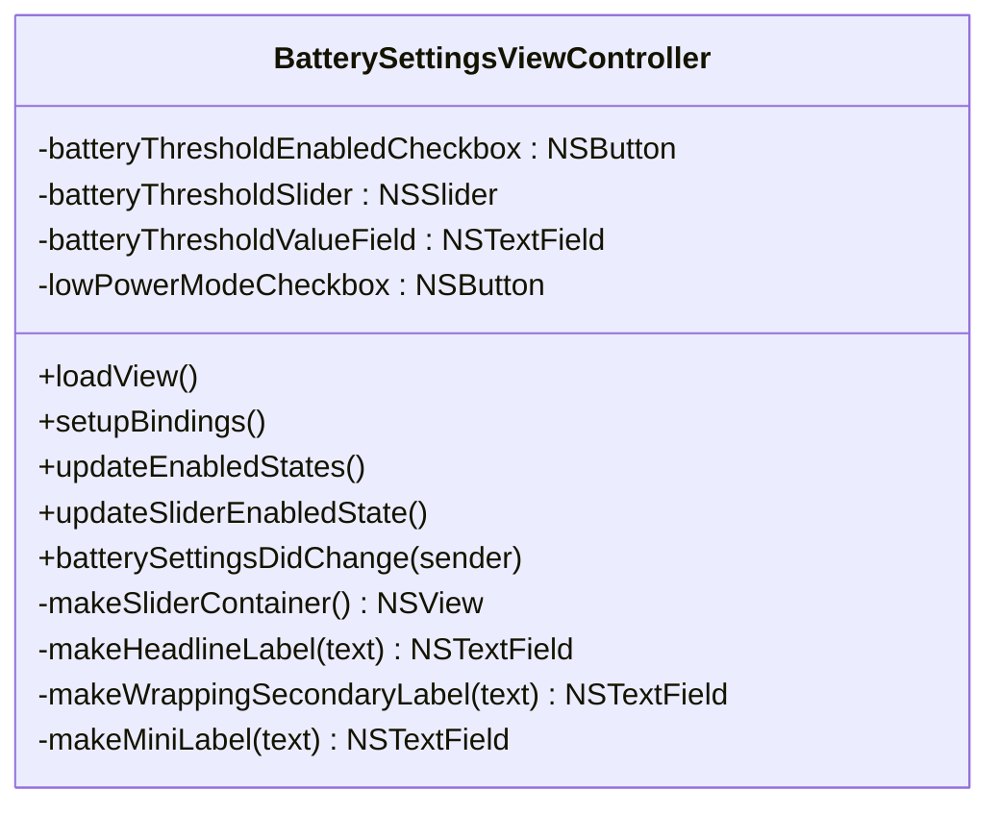
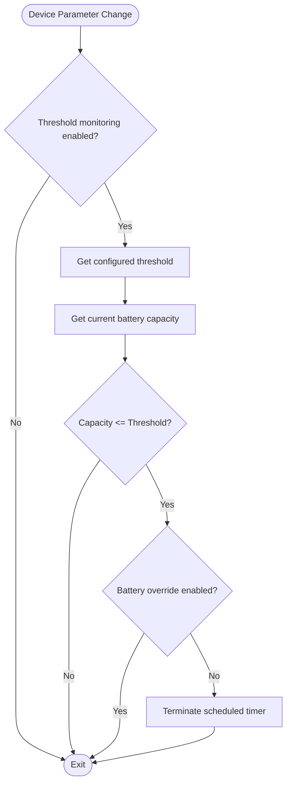
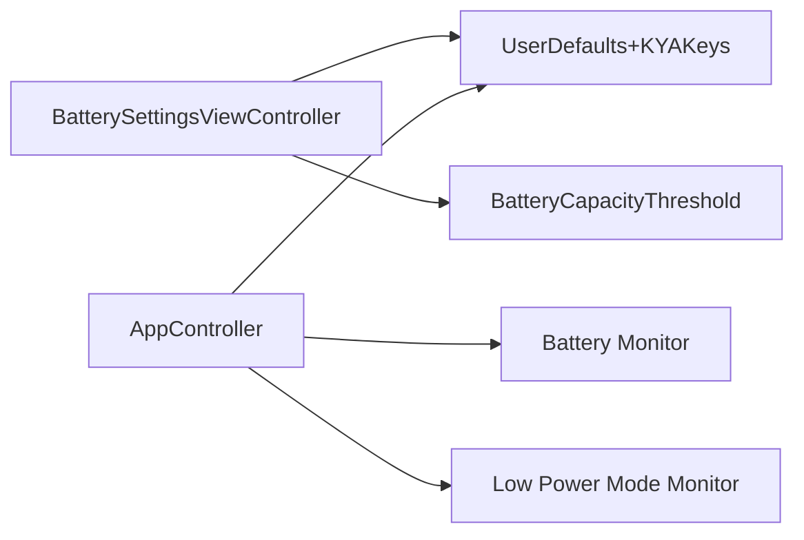

# Battery Settings

<cite>
**Referenced Files in This Document**
- [BatterySettingsViewController.swift](file://KeepingYouAwake/Settings/KYABatterySettingsViewController/BatterySettingsViewController.swift)
- [BatteryCapacityThreshold.swift](file://KeepingYouAwake/BatteryCapacityThreshold.swift)
- [AppController.swift](file://KeepingYouAwake/KYAAppController/AppController.swift)
- [UserDefaults+KYAKeys.swift](file://Packages/KYAApplicationSupport/Sources/KYAApplicationSupport/UserDefaults+KYAKeys.swift)
- [KYABatterySettingsViewController.xcstrings](file://KeepingYouAwake/Settings/KYABatterySettingsViewController/mul.lproj/KYABatterySettingsViewController.xcstrings)
- [KYAL10n+Settings.swift](file://KeepingYouAwake/Settings/KYAL10n+Settings.swift)
</cite>

## Table of Contents
1. [Introduction](#introduction)
2. [Project Structure](#project-structure)
3. [Core Components](#core-components)
4. [Architecture Overview](#architecture-overview)
5. [Detailed Component Analysis](#detailed-component-analysis)
6. [Dependency Analysis](#dependency-analysis)
7. [Performance Considerations](#performance-considerations)
8. [Troubleshooting Guide](#troubleshooting-guide)
9. [Conclusion](#conclusion)

## Introduction
This document provides comprehensive coverage of the battery settings category, focusing on the battery capacity threshold configuration using NSSlider with real-time value display. It explains the relationship between battery monitoring and automatic deactivation logic, documents the user interface components including slider controls, percentage labels, and visual feedback systems, and details the integration with device monitoring for accurate battery state tracking. Implementation examples are included for battery threshold validation, user preference persistence, and dynamic UI updates based on system battery status.

## Project Structure
The battery settings functionality spans several key areas:
- UI Layer: BatterySettingsViewController manages the user interface, including the battery capacity threshold slider, percentage display, and related checkboxes.
- Model Layer: UserDefaults+KYAKeys defines the persistent storage keys and provides typed accessors for battery-related preferences.
- Logic Layer: AppController coordinates device power monitoring and applies automatic deactivation logic based on battery thresholds and Low Power Mode status.
- Notification Layer: BatteryCapacityThreshold centralizes the notification name used to signal threshold changes.

**Diagram sources**
- [BatterySettingsViewController.swift:14-127](file://KeepingYouAwake/Settings/KYABatterySettingsViewController/BatterySettingsViewController.swift#L14-L127)
- [UserDefaults+KYAKeys.swift:22-31](file://Packages/KYAApplicationSupport/Sources/KYAApplicationSupport/UserDefaults+KYAKeys.swift#L22-L31)
- [AppController.swift:202-246](file://KeepingYouAwake/KYAAppController/AppController.swift#L202-L246)
- [BatteryCapacityThreshold.swift:12-15](file://KeepingYouAwake/BatteryCapacityThreshold.swift#L12-L15)

**Section sources**
- [BatterySettingsViewController.swift:14-127](file://KeepingYouAwake/Settings/KYABatterySettingsViewController/BatterySettingsViewController.swift#L14-L127)
- [UserDefaults+KYAKeys.swift:22-31](file://Packages/KYAApplicationSupport/Sources/KYAApplicationSupport/UserDefaults+KYAKeys.swift#L22-L31)

## Core Components
This section documents the primary components involved in battery settings configuration and automatic deactivation logic.

- BatterySettingsViewController
  - Manages the UI layout with a slider for battery capacity threshold, a percentage display field, and two checkboxes for enabling threshold-based deactivation and Low Power Mode monitoring.
  - Implements bindings to UserDefaults for real-time synchronization of user preferences.
  - Provides dynamic UI updates based on device capabilities (presence of battery and Low Power Mode support).

- UserDefaults+KYAKeys
  - Defines persistent keys for battery capacity threshold settings and Low Power Mode monitoring.
  - Offers typed getters/setters for battery capacity threshold values with validation to ensure minimum values.

- AppController
  - Coordinates device power monitoring and applies automatic deactivation logic when system conditions meet configured thresholds.
  - Registers device change callbacks and handles battery capacity and Low Power Mode events.

- BatteryCapacityThreshold
  - Centralizes the notification name used to signal changes to the battery capacity threshold, enabling UI and logic components to react to threshold updates.

**Section sources**
- [BatterySettingsViewController.swift:14-127](file://KeepingYouAwake/Settings/KYABatterySettingsViewController/BatterySettingsViewController.swift#L14-L127)
- [UserDefaults+KYAKeys.swift:22-31](file://Packages/KYAApplicationSupport/Sources/KYAApplicationSupport/UserDefaults+KYAKeys.swift#L22-L31)
- [AppController.swift:202-246](file://KeepingYouAwake/KYAAppController/AppController.swift#L202-L246)
- [BatteryCapacityThreshold.swift:12-15](file://KeepingYouAwake/BatteryCapacityThreshold.swift#L12-L15)

## Architecture Overview
The battery settings architecture integrates UI, persistence, device monitoring, and notification mechanisms to provide a cohesive user experience for configuring and enforcing battery-related deactivation policies.

**Diagram sources**
- [BatterySettingsViewController.swift:129-134](file://KeepingYouAwake/Settings/KYABatterySettingsViewController/BatterySettingsViewController.swift#L129-L134)
- [BatteryCapacityThreshold.swift:12-15](file://KeepingYouAwake/BatteryCapacityThreshold.swift#L12-L15)
- [AppController.swift:202-246](file://KeepingYouAwake/KYAAppController/AppController.swift#L202-L246)

## Detailed Component Analysis

### BatterySettingsViewController
BatterySettingsViewController orchestrates the battery settings UI and user interactions. It creates and configures:
- A checkbox to enable/disable threshold-based deactivation
- An NSSlider for selecting the battery capacity threshold (with tick marks at 10%, 50%, and 90%)
- A percentage display field bound to the slider value
- A Low Power Mode checkbox for enabling Low Power Mode monitoring
- Dynamic UI state updates based on device capabilities

Key implementation aspects:
- Real-time value display: The percentage label is bound to the slider value using a number formatter and display pattern, ensuring immediate visual feedback.
- Dynamic enablement: The slider and percentage field are enabled only when a battery is present and the threshold deactivation is enabled.
- Localization: All UI strings are localized via xcstrings resources.

**Diagram sources**
- [BatterySettingsViewController.swift:14-263](file://KeepingYouAwake/Settings/KYABatterySettingsViewController/BatterySettingsViewController.swift#L14-L263)

**Section sources**
- [BatterySettingsViewController.swift:14-127](file://KeepingYouAwake/Settings/KYABatterySettingsViewController/BatterySettingsViewController.swift#L14-L127)
- [BatterySettingsViewController.swift:190-221](file://KeepingYouAwake/Settings/KYABatterySettingsViewController/BatterySettingsViewController.swift#L190-L221)
- [BatterySettingsViewController.swift:223-238](file://KeepingYouAwake/Settings/KYABatterySettingsViewController/BatterySettingsViewController.swift#L223-L238)

### User Preferences and Validation
User preferences for battery settings are persisted using UserDefaults with typed accessors. The UserDefaults+KYAKeys extension provides:
- Keys for enabling threshold-based deactivation and Low Power Mode monitoring
- A validated getter/setter for the battery capacity threshold that ensures the stored value meets minimum requirements

Implementation highlights:
- Threshold validation: The getter ensures the stored value is at least the minimum allowed threshold.
- Preference binding: The UI binds to these keys for continuous synchronization of user choices.

**Section sources**
- [UserDefaults+KYAKeys.swift:22-31](file://Packages/KYAApplicationSupport/Sources/KYAApplicationSupport/UserDefaults+KYAKeys.swift#L22-L31)
- [UserDefaults+KYAKeys.swift:107-108](file://Packages/KYAApplicationSupport/Sources/KYAApplicationSupport/UserDefaults+KYAKeys.swift#L107-L108)

### Device Monitoring and Automatic Deactivation
AppController manages device power monitoring and applies automatic deactivation logic:
- Enables/disables battery monitoring and Low Power Mode monitoring based on user preferences
- Registers a device change callback to receive updates when battery capacity or Low Power Mode status changes
- Evaluates deactivation conditions and terminates scheduled timers when thresholds are met

**Diagram sources**
- [AppController.swift:227-246](file://KeepingYouAwake/KYAAppController/AppController.swift#L227-L246)

**Section sources**
- [AppController.swift:202-246](file://KeepingYouAwake/KYAAppController/AppController.swift#L202-L246)

### Notification Integration
BatteryCapacityThreshold centralizes the notification name posted when the threshold value changes. The UI posts this notification upon user interaction, enabling other components to respond to threshold updates.

**Section sources**
- [BatteryCapacityThreshold.swift:12-15](file://KeepingYouAwake/BatteryCapacityThreshold.swift#L12-L15)
- [BatterySettingsViewController.swift:129-134](file://KeepingYouAwake/Settings/KYABatterySettingsViewController/BatterySettingsViewController.swift#L129-L134)

### User Interface Components and Visual Feedback
The UI components provide a cohesive experience for configuring battery settings:
- Slider control: Configured with minimum/maximum values, tick marks, and action handling for real-time updates.
- Percentage label: Formatted to display whole percentages synchronized with the slider value.
- Visual feedback: Dynamic enablement of controls based on device capabilities and user preference state.

Localization support ensures consistent presentation across languages.

**Section sources**
- [BatterySettingsViewController.swift:136-188](file://KeepingYouAwake/Settings/KYABatterySettingsViewController/BatterySettingsViewController.swift#L136-L188)
- [BatterySettingsViewController.swift:190-221](file://KeepingYouAwake/Settings/KYABatterySettingsViewController/BatterySettingsViewController.swift#L190-L221)
- [KYABatterySettingsViewController.xcstrings:142-273](file://KeepingYouAwake/Settings/KYABatterySettingsViewController/mul.lproj/KYABatterySettingsViewController.xcstrings#L142-L273)

## Dependency Analysis
The battery settings implementation exhibits clear separation of concerns with minimal coupling between layers:
- UI depends on UserDefaults for persistence and BatteryCapacityThreshold for notifications
- Logic depends on device monitors and UserDefaults for runtime decisions
- Persistence is centralized in UserDefaults+KYAKeys, reducing duplication and ensuring consistency

**Diagram sources**
- [BatterySettingsViewController.swift:190-221](file://KeepingYouAwake/Settings/KYABatterySettingsViewController/BatterySettingsViewController.swift#L190-L221)
- [AppController.swift:202-246](file://KeepingYouAwake/KYAAppController/AppController.swift#L202-L246)

**Section sources**
- [BatterySettingsViewController.swift:190-221](file://KeepingYouAwake/Settings/KYABatterySettingsViewController/BatterySettingsViewController.swift#L190-L221)
- [AppController.swift:202-246](file://KeepingYouAwake/KYAAppController/AppController.swift#L202-L246)

## Performance Considerations
- Real-time bindings: Continuous updates from UserDefaults ensure immediate UI responsiveness but may introduce minor overhead. Consider throttling if needed.
- Device monitoring: Enabling battery and Low Power Mode monitoring adds event-driven callbacks; ensure appropriate cleanup when disabled.
- Slider updates: Tick mark constraints and label positioning are handled declaratively; maintain simplicity to avoid layout recalculations.

## Troubleshooting Guide
Common issues and resolutions:
- Slider not updating: Verify that the threshold deactivation checkbox is enabled and that a battery is present on the device.
- Values not persisting: Confirm that UserDefaults keys are correctly bound and that the application has permission to write to the user defaults domain.
- Automatic deactivation not triggering: Ensure that device monitoring is enabled and that the current battery capacity meets or falls below the configured threshold.

**Section sources**
- [BatterySettingsViewController.swift:223-238](file://KeepingYouAwake/Settings/KYABatterySettingsViewController/BatterySettingsViewController.swift#L223-L238)
- [AppController.swift:202-246](file://KeepingYouAwake/KYAAppController/AppController.swift#L202-L246)

## Conclusion
The battery settings category provides a robust, user-friendly mechanism for configuring automatic deactivation based on battery capacity thresholds and Low Power Mode status. Through integrated UI bindings, validated user preferences, and responsive device monitoring, the system delivers reliable behavior while maintaining a clean separation of concerns across layers.