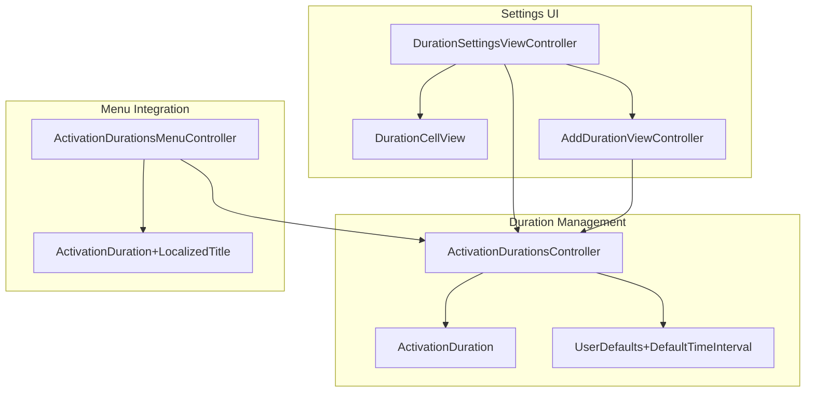
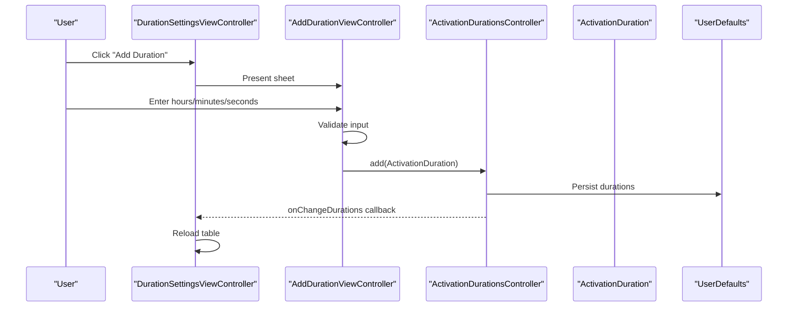
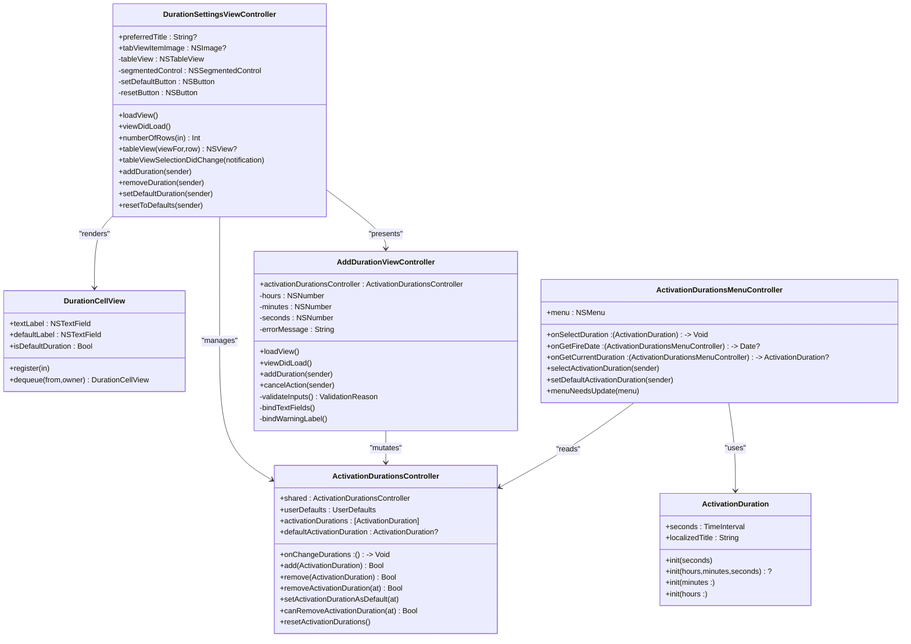
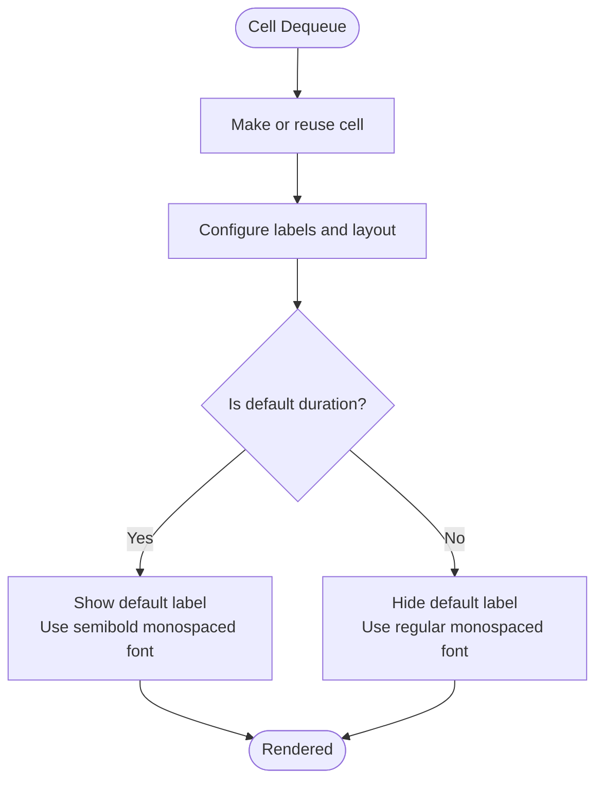
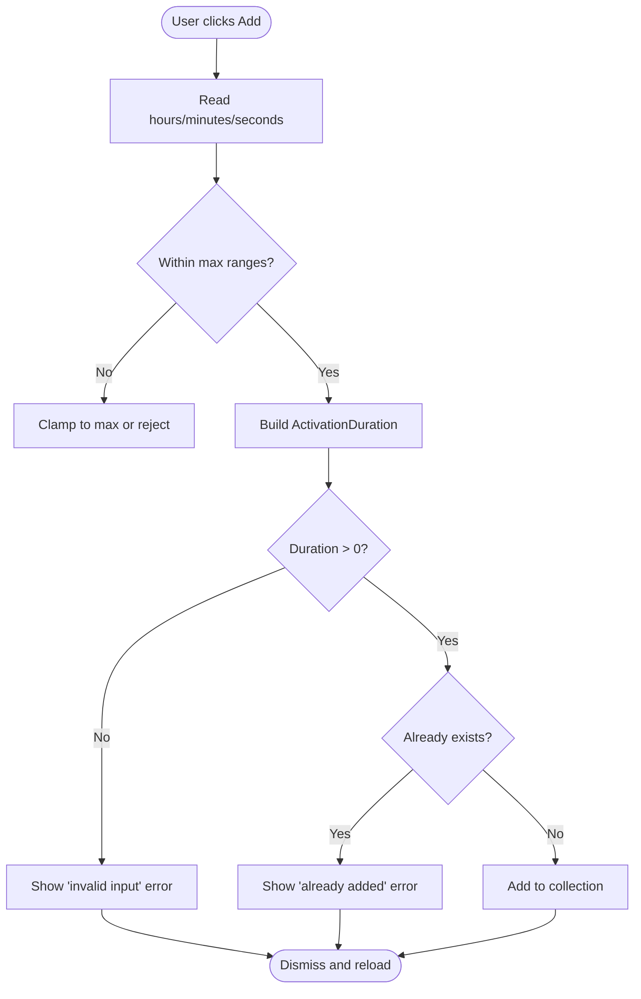
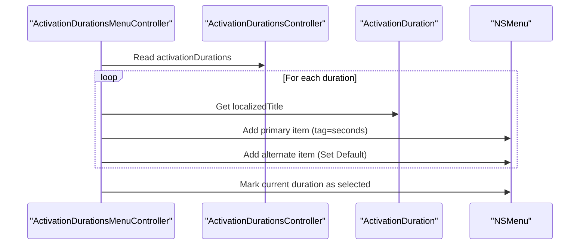
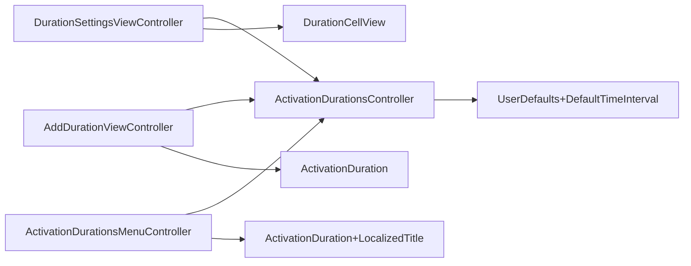

# Duration Settings

<cite>
**Referenced Files in This Document**
- [DurationSettingsViewController.swift](file://KeepingYouAwake/Settings/KYADurationSettingsViewController/DurationSettingsViewController.swift)
- [AddDurationViewController.swift](file://KeepingYouAwake/Settings/KYADurationSettingsViewController/AddDurationViewController.swift)
- [DurationCellView.swift](file://KeepingYouAwake/Settings/KYADurationSettingsViewController/KYADurationCell/DurationCellView.swift)
- [ActivationDurationsMenuController.swift](file://KeepingYouAwake/KYAActivationDurationsMenuController/ActivationDurationsMenuController.swift)
- [ActivationDuration+LocalizedTitle.swift](file://KeepingYouAwake/KYAActivationDurationsMenuController/ActivationDuration+LocalizedTitle.swift)
- [ActivationDurationsController.swift](file://Packages/KYAActivationDurations/Sources/KYAActivationDurations/ActivationDurationsController.swift)
- [ActivationDuration.swift](file://Packages/KYAActivationDurations/Sources/KYAActivationDurations/ActivationDuration.swift)
- [UserDefaults+DefaultTimeInterval.swift](file://Packages/KYAActivationDurations/Sources/KYAActivationDurations/UserDefaults+DefaultTimeInterval.swift)
</cite>

## Table of Contents
1. [Introduction](#introduction)
2. [Project Structure](#project-structure)
3. [Core Components](#core-components)
4. [Architecture Overview](#architecture-overview)
5. [Detailed Component Analysis](#detailed-component-analysis)
6. [Dependency Analysis](#dependency-analysis)
7. [Performance Considerations](#performance-considerations)
8. [Troubleshooting Guide](#troubleshooting-guide)
9. [Conclusion](#conclusion)

## Introduction
This document explains the duration settings system used to manage activation durations in the application. It covers how users can add, edit, and remove custom time intervals, how duration presets are displayed in a table, and how the system validates user input and persists custom durations. It also details the relationship between the duration presets and the activation durations menu controller that presents these durations in the application's toolbar menu.

## Project Structure
The duration settings system spans several components:
- A settings view controller that displays duration presets in a table
- A custom table cell view for rendering duration items
- A modal controller for adding new durations with validation
- A controller that manages the collection of durations and persists them
- A menu controller that consumes the duration collection for the toolbar menu

**Diagram sources**
- [DurationSettingsViewController.swift:15-228](file://KeepingYouAwake/Settings/KYADurationSettingsViewController/DurationSettingsViewController.swift#L15-L228)
- [DurationCellView.swift:12-75](file://KeepingYouAwake/Settings/KYADurationSettingsViewController/KYADurationCell/DurationCellView.swift#L12-L75)
- [AddDurationViewController.swift:24-262](file://KeepingYouAwake/Settings/KYADurationSettingsViewController/AddDurationViewController.swift#L24-L262)
- [ActivationDurationsController.swift:20-198](file://Packages/KYAActivationDurations/Sources/KYAActivationDurations/ActivationDurationsController.swift#L20-L198)
- [ActivationDuration.swift:15-125](file://Packages/KYAActivationDurations/Sources/KYAActivationDurations/ActivationDuration.swift#L15-L125)
- [UserDefaults+DefaultTimeInterval.swift:10-24](file://Packages/KYAActivationDurations/Sources/KYAActivationDurations/UserDefaults+DefaultTimeInterval.swift#L10-L24)
- [ActivationDurationsMenuController.swift:15-126](file://KeepingYouAwake/KYAActivationDurationsMenuController/ActivationDurationsMenuController.swift#L15-L126)
- [ActivationDuration+LocalizedTitle.swift:12-26](file://KeepingYouAwake/KYAActivationDurationsMenuController/ActivationDuration+LocalizedTitle.swift#L12-L26)

**Section sources**
- [DurationSettingsViewController.swift:15-228](file://KeepingYouAwake/Settings/KYADurationSettingsViewController/DurationSettingsViewController.swift#L15-L228)
- [AddDurationViewController.swift:24-262](file://KeepingYouAwake/Settings/KYADurationSettingsViewController/AddDurationViewController.swift#L24-L262)
- [DurationCellView.swift:12-75](file://KeepingYouAwake/Settings/KYADurationSettingsViewController/KYADurationCell/DurationCellView.swift#L12-L75)
- [ActivationDurationsController.swift:20-198](file://Packages/KYAActivationDurations/Sources/KYAActivationDurations/ActivationDurationsController.swift#L20-L198)
- [ActivationDurationsMenuController.swift:15-126](file://KeepingYouAwake/KYAActivationDurationsMenuController/ActivationDurationsMenuController.swift#L15-L126)
- [ActivationDuration+LocalizedTitle.swift:12-26](file://KeepingYouAwake/KYAActivationDurationsMenuController/ActivationDuration+LocalizedTitle.swift#L12-L26)

## Core Components
- DurationSettingsViewController: Presents the list of activation durations in a table, allows setting a default duration, removing durations, resetting to defaults, and adding new durations via a sheet.
- DurationCellView: Renders each duration item in the table, highlighting the default duration and showing a localized title.
- AddDurationViewController: Provides input fields for hours, minutes, and seconds, validates the input, detects conflicts, and adds the new duration to the collection.
- ActivationDurationsController: Manages the lifecycle of durations (add/remove/reset), maintains the default duration, caches the sorted list, and persists data to UserDefaults.
- ActivationDurationsMenuController: Builds the activation durations submenu for the toolbar, integrates with the default duration and current schedule state.
- ActivationDuration: The model representing a duration in seconds, with convenience initializers and localization support.
- UserDefaults+DefaultTimeInterval: Extension providing typed access to the default duration key in UserDefaults.

**Section sources**
- [DurationSettingsViewController.swift:15-228](file://KeepingYouAwake/Settings/KYADurationSettingsViewController/DurationSettingsViewController.swift#L15-L228)
- [DurationCellView.swift:12-75](file://KeepingYouAwake/Settings/KYADurationSettingsViewController/KYADurationCell/DurationCellView.swift#L12-L75)
- [AddDurationViewController.swift:24-262](file://KeepingYouAwake/Settings/KYADurationSettingsViewController/AddDurationViewController.swift#L24-L262)
- [ActivationDurationsController.swift:20-198](file://Packages/KYAActivationDurations/Sources/KYAActivationDurations/ActivationDurationsController.swift#L20-L198)
- [ActivationDurationsMenuController.swift:15-126](file://KeepingYouAwake/KYAActivationDurationsMenuController/ActivationDurationsMenuController.swift#L15-L126)
- [ActivationDuration.swift:15-125](file://Packages/KYAActivationDurations/Sources/KYAActivationDurations/ActivationDuration.swift#L15-L125)
- [UserDefaults+DefaultTimeInterval.swift:10-24](file://Packages/KYAActivationDurations/Sources/KYAActivationDurations/UserDefaults+DefaultTimeInterval.swift#L10-L24)

## Architecture Overview
The system follows a layered approach:
- UI Layer: DurationSettingsViewController and DurationCellView handle presentation and user interactions.
- Input Layer: AddDurationViewController validates user input and coordinates with the manager.
- Management Layer: ActivationDurationsController encapsulates business logic, caching, and persistence.
- Model Layer: ActivationDuration represents the domain concept and provides localization.
- Menu Integration: ActivationDurationsMenuController consumes the managed durations for the toolbar menu.

**Diagram sources**
- [DurationSettingsViewController.swift:151-154](file://KeepingYouAwake/Settings/KYADurationSettingsViewController/DurationSettingsViewController.swift#L151-L154)
- [AddDurationViewController.swift:135-149](file://KeepingYouAwake/Settings/KYADurationSettingsViewController/AddDurationViewController.swift#L135-L149)
- [ActivationDurationsController.swift:80-88](file://Packages/KYAActivationDurations/Sources/KYAActivationDurations/ActivationDurationsController.swift#L80-L88)
- [ActivationDuration.swift:55-76](file://Packages/KYAActivationDurations/Sources/KYAActivationDurations/ActivationDuration.swift#L55-L76)
- [UserDefaults+DefaultTimeInterval.swift:16-23](file://Packages/KYAActivationDurations/Sources/KYAActivationDurations/UserDefaults+DefaultTimeInterval.swift#L16-L23)

## Detailed Component Analysis

### DurationSettingsViewController
Responsibilities:
- Build and configure the duration table with a single column.
- Populate rows using DurationCellView with localized titles and default duration indicators.
- Handle actions: add, remove, set default, and reset to defaults.
- Observe changes from the duration controller and update UI state (enable/disable controls, enforce limit).

Key behaviors:
- Uses a shared ActivationDurationsController instance to fetch durations and apply changes.
- Enforces a hard limit on the number of custom durations.
- Provides context menu actions and keyboard shortcuts for common operations.

Implementation highlights:
- Table view data source and delegate methods render DurationCellView instances.
- Action methods route user interactions to the controller.
- Observes onChangeDurations to refresh the UI after modifications.

**Section sources**
- [DurationSettingsViewController.swift:15-228](file://KeepingYouAwake/Settings/KYADurationSettingsViewController/DurationSettingsViewController.swift#L15-L228)

### DurationCellView
Responsibilities:
- Render a single duration item in the table.
- Display the localized title and highlight the default duration with a distinct label and font weight.
- Provide programmatic dequeueing for reuse in the table.

Key behaviors:
- Exposes isDefaultDuration property that toggles visibility of the default indicator and adjusts font weight.
- Uses SnapKit for layout constraints.

**Section sources**
- [DurationCellView.swift:12-75](file://KeepingYouAwake/Settings/KYADurationSettingsViewController/KYADurationCell/DurationCellView.swift#L12-L75)

### AddDurationViewController
Responsibilities:
- Accept user input for hours, minutes, and seconds.
- Validate input ranges and construct an ActivationDuration.
- Detect conflicts (duplicate durations) and surface errors.
- Add the validated duration to the collection and dismiss on success.

Validation logic:
- Enforces maximum values per component.
- Constructs ActivationDuration via initializer that validates component ranges and ensures total seconds > 0.
- Checks membership in the existing collection to prevent duplicates.

User experience:
- Real-time binding of text fields to internal properties.
- Warning label displays localized error messages.
- Disables inputs during validation to prevent concurrent edits.

**Section sources**
- [AddDurationViewController.swift:24-262](file://KeepingYouAwake/Settings/KYADurationSettingsViewController/AddDurationViewController.swift#L24-L262)
- [ActivationDuration.swift:55-76](file://Packages/KYAActivationDurations/Sources/KYAActivationDurations/ActivationDuration.swift#L55-L76)

### ActivationDurationsController
Responsibilities:
- Manage the collection of activation durations with caching and sorting.
- Provide default duration selection and persistence.
- Support adding, removing, and resetting durations.
- Notify observers of changes and persist to UserDefaults.

Data flow:
- Maintains storedActivationDurations as an array of ActivationDuration.
- Composes activationDurations by appending the indefinite duration and sorting ascending by seconds.
- Persists durations as an array of integers (seconds) to UserDefaults under a dedicated key.
- Triggers onChangeDurations callbacks after mutations.

Persistence details:
- Saves and loads as [Int] arrays to maintain compatibility.
- Default duration is stored as an integer key in UserDefaults.

**Section sources**
- [ActivationDurationsController.swift:20-198](file://Packages/KYAActivationDurations/Sources/KYAActivationDurations/ActivationDurationsController.swift#L20-L198)
- [UserDefaults+DefaultTimeInterval.swift:10-24](file://Packages/KYAActivationDurations/Sources/KYAActivationDurations/UserDefaults+DefaultTimeInterval.swift#L10-L24)

### ActivationDurationsMenuController
Responsibilities:
- Build the activation durations submenu for the toolbar.
- Reflect current default and scheduled duration states.
- Allow selecting a duration or setting a new default via alternate actions.

Integration:
- Consumes ActivationDurationsController for the list of durations.
- Uses ActivationDuration.localizedTitle for display.
- Sets menu item tags to the duration's seconds for easy reconstruction.

**Section sources**
- [ActivationDurationsMenuController.swift:15-126](file://KeepingYouAwake/KYAActivationDurationsMenuController/ActivationDurationsMenuController.swift#L15-L126)
- [ActivationDuration+LocalizedTitle.swift:12-26](file://KeepingYouAwake/KYAActivationDurationsMenuController/ActivationDuration+LocalizedTitle.swift#L12-L26)

### ActivationDuration and Localization
- ActivationDuration provides convenience initializers for hours and minutes, validates component ranges, and ensures positive total seconds.
- Localization is provided by extending ActivationDuration with a localizedTitle property that uses a shared DateComponentsFormatter for human-readable strings, with a special case for indefinite durations.

**Section sources**
- [ActivationDuration.swift:15-125](file://Packages/KYAActivationDurations/Sources/KYAActivationDurations/ActivationDuration.swift#L15-L125)
- [ActivationDuration+LocalizedTitle.swift:12-26](file://KeepingYouAwake/KYAActivationDurationsMenuController/ActivationDuration+LocalizedTitle.swift#L12-L26)

## Architecture Overview

**Diagram sources**
- [DurationSettingsViewController.swift:15-228](file://KeepingYouAwake/Settings/KYADurationSettingsViewController/DurationSettingsViewController.swift#L15-L228)
- [DurationCellView.swift:12-75](file://KeepingYouAwake/Settings/KYADurationSettingsViewController/KYADurationCell/DurationCellView.swift#L12-L75)
- [AddDurationViewController.swift:24-262](file://KeepingYouAwake/Settings/KYADurationSettingsViewController/AddDurationViewController.swift#L24-L262)
- [ActivationDurationsController.swift:20-198](file://Packages/KYAActivationDurations/Sources/KYAActivationDurations/ActivationDurationsController.swift#L20-L198)
- [ActivationDurationsMenuController.swift:15-126](file://KeepingYouAwake/KYAActivationDurationsMenuController/ActivationDurationsMenuController.swift#L15-L126)
- [ActivationDuration.swift:15-125](file://Packages/KYAActivationDurations/Sources/KYAActivationDurations/ActivationDuration.swift#L15-L125)

## Detailed Component Analysis

### DurationCellView Implementation
DurationCellView renders each duration in the table with:
- A primary label showing the localized title.
- A secondary label indicating if the duration is the default.
- Dynamic font weight to emphasize the default duration.

**Diagram sources**
- [DurationCellView.swift:30-75](file://KeepingYouAwake/Settings/KYADurationSettingsViewController/KYADurationCell/DurationCellView.swift#L30-L75)

**Section sources**
- [DurationCellView.swift:12-75](file://KeepingYouAwake/Settings/KYADurationSettingsViewController/KYADurationCell/DurationCellView.swift#L12-L75)

### AddDurationViewController Validation Flow
The validation process ensures:
- Component values are within allowed ranges.
- A valid ActivationDuration can be constructed.
- The duration is not already present in the collection.

**Diagram sources**
- [AddDurationViewController.swift:160-195](file://KeepingYouAwake/Settings/KYADurationSettingsViewController/AddDurationViewController.swift#L160-L195)
- [ActivationDuration.swift:55-76](file://Packages/KYAActivationDurations/Sources/KYAActivationDurations/ActivationDuration.swift#L55-L76)

**Section sources**
- [AddDurationViewController.swift:24-262](file://KeepingYouAwake/Settings/KYADurationSettingsViewController/AddDurationViewController.swift#L24-L262)
- [ActivationDuration.swift:55-76](file://Packages/KYAActivationDurations/Sources/KYAActivationDurations/ActivationDuration.swift#L55-L76)

### Duration Presets and Activation Durations Menu Controller
The menu controller builds the activation durations submenu by:
- Iterating through durations from the controller.
- Creating primary items with localized titles and tags storing seconds.
- Adding alternate items for setting the default duration.
- Highlighting the currently scheduled duration.

**Diagram sources**
- [ActivationDurationsMenuController.swift:81-125](file://KeepingYouAwake/KYAActivationDurationsMenuController/ActivationDurationsMenuController.swift#L81-L125)
- [ActivationDuration+LocalizedTitle.swift:14-19](file://KeepingYouAwake/KYAActivationDurationsMenuController/ActivationDuration+LocalizedTitle.swift#L14-L19)

**Section sources**
- [ActivationDurationsMenuController.swift:15-126](file://KeepingYouAwake/KYAActivationDurationsMenuController/ActivationDurationsMenuController.swift#L15-L126)
- [ActivationDuration+LocalizedTitle.swift:12-26](file://KeepingYouAwake/KYAActivationDurationsMenuController/ActivationDuration+LocalizedTitle.swift#L12-L26)

## Dependency Analysis
- DurationSettingsViewController depends on ActivationDurationsController for data and mutations, and on DurationCellView for rendering.
- AddDurationViewController depends on ActivationDurationsController for adding durations and on ActivationDuration for validation.
- ActivationDurationsController depends on ActivationDuration for equality/sorting and on UserDefaults+DefaultTimeInterval for persistence.
- ActivationDurationsMenuController depends on ActivationDurationsController and ActivationDuration+LocalizedTitle for display.

**Diagram sources**
- [DurationSettingsViewController.swift:25-25](file://KeepingYouAwake/Settings/KYADurationSettingsViewController/DurationSettingsViewController.swift#L25-L25)
- [AddDurationViewController.swift:25-25](file://KeepingYouAwake/Settings/KYADurationSettingsViewController/AddDurationViewController.swift#L25-L25)
- [ActivationDurationsController.swift:28-28](file://Packages/KYAActivationDurations/Sources/KYAActivationDurations/ActivationDurationsController.swift#L28-L28)
- [ActivationDurationsMenuController.swift:16-16](file://KeepingYouAwake/KYAActivationDurationsMenuController/ActivationDurationsMenuController.swift#L16-L16)
- [ActivationDuration+LocalizedTitle.swift:14-19](file://KeepingYouAwake/KYAActivationDurationsMenuController/ActivationDuration+LocalizedTitle.swift#L14-L19)

**Section sources**
- [DurationSettingsViewController.swift:15-228](file://KeepingYouAwake/Settings/KYADurationSettingsViewController/DurationSettingsViewController.swift#L15-L228)
- [AddDurationViewController.swift:24-262](file://KeepingYouAwake/Settings/KYADurationSettingsViewController/AddDurationViewController.swift#L24-L262)
- [ActivationDurationsController.swift:20-198](file://Packages/KYAActivationDurations/Sources/KYAActivationDurations/ActivationDurationsController.swift#L20-L198)
- [ActivationDurationsMenuController.swift:15-126](file://KeepingYouAwake/KYAActivationDurationsMenuController/ActivationDurationsMenuController.swift#L15-L126)
- [ActivationDuration+LocalizedTitle.swift:12-26](file://KeepingYouAwake/KYAActivationDurationsMenuController/ActivationDuration+LocalizedTitle.swift#L12-L26)

## Performance Considerations
- Caching: ActivationDurationsController caches the sorted duration list and invalidates it on changes to avoid repeated recomputation.
- Persistence: Durations are persisted as integer arrays to UserDefaults, minimizing overhead and maintaining backward compatibility.
- UI updates: The table reloads efficiently when the controller notifies changes, and the cell view updates only the default indicator state.

## Troubleshooting Guide
Common issues and resolutions:
- Duplicate duration entry: The add controller checks for existing durations and shows a conflict message. Choose a different combination of hours/minutes/seconds.
- Invalid input range: Values exceeding maximums are clamped. Ensure hours, minutes, and seconds are within allowed bounds.
- Cannot remove default duration: The indefinite duration (0 seconds) cannot be removed; remove another duration first.
- Limit reached: There is a hard cap on custom durations; remove an existing duration to add more.
- Default duration not persisting: Verify the default duration key in UserDefaults is being written and synchronized.

**Section sources**
- [AddDurationViewController.swift:160-195](file://KeepingYouAwake/Settings/KYADurationSettingsViewController/AddDurationViewController.swift#L160-L195)
- [ActivationDurationsController.swift:117-131](file://Packages/KYAActivationDurations/Sources/KYAActivationDurations/ActivationDurationsController.swift#L117-L131)
- [ActivationDurationsController.swift:173-197](file://Packages/KYAActivationDurations/Sources/KYAActivationDurations/ActivationDurationsController.swift#L173-L197)

## Conclusion
The duration settings system provides a robust, user-friendly way to manage activation durations. It combines a clean UI with strong validation, conflict detection, and reliable persistence. The separation of concerns across the settings view controller, cell renderer, input controller, and management/controller/persistence layers ensures maintainability and extensibility while keeping the user experience responsive and intuitive.