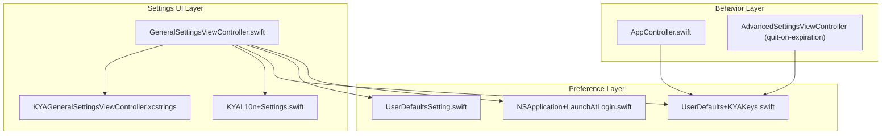
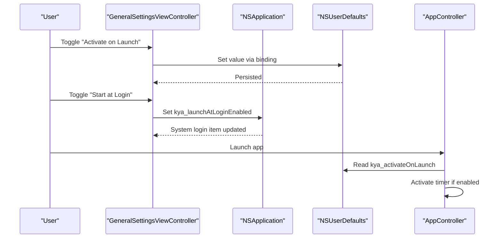
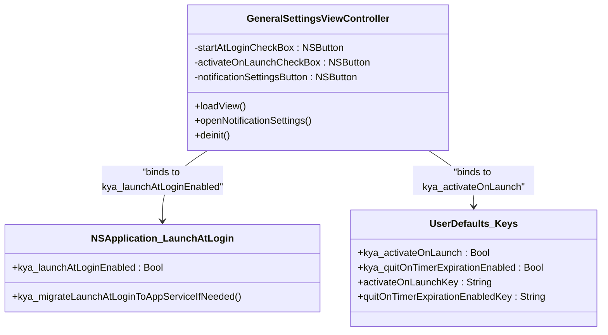
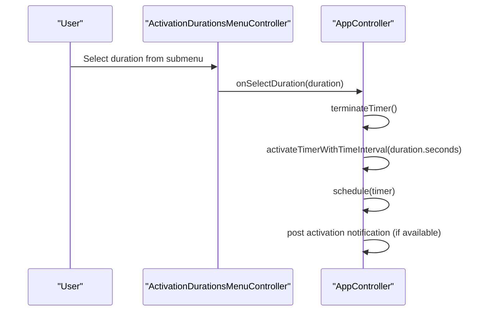
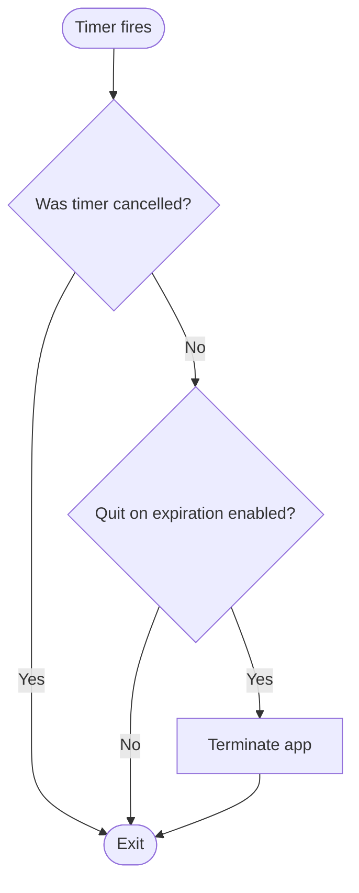
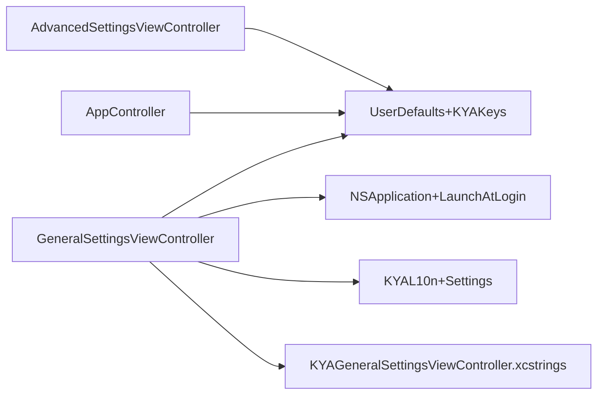

# General Settings

<cite>
**Referenced Files in This Document**
- [GeneralSettingsViewController.swift](file://KeepingYouAwake/Settings/KYAGeneralSettingsViewController/GeneralSettingsViewController.swift)
- [KYAGeneralSettingsViewController.xcstrings](file://KeepingYouAwake/Settings/KYAGeneralSettingsViewController/mul.lproj/KYAGeneralSettingsViewController.xcstrings)
- [UserDefaultsSetting.swift](file://KeepingYouAwake/UserDefaultsSetting.swift)
- [UserDefaults+KYAKeys.swift](file://Packages/KYAApplicationSupport/Sources/KYAApplicationSupport/UserDefaults+KYAKeys.swift)
- [NSApplication+LaunchAtLogin.swift](file://Packages/KYAApplicationSupport/Sources/KYAApplicationSupport/NSApplication+LaunchAtLogin.swift)
- [KYAL10n+Settings.swift](file://KeepingYouAwake/Settings/KYAL10n+Settings.swift)
- [KYAL10n.swift](file://KeepingYouAwake/KYAL10n.swift)
- [AppController.swift](file://KeepingYouAwake/KYAAppController/AppController.swift)
- [AddDurationViewController.swift](file://KeepingYouAwake/Settings/KYADurationSettingsViewController/AddDurationViewController.swift)
</cite>

## Table of Contents
1. [Introduction](#introduction)
2. [Project Structure](#project-structure)
3. [Core Components](#core-components)
4. [Architecture Overview](#architecture-overview)
5. [Detailed Component Analysis](#detailed-component-analysis)
6. [Dependency Analysis](#dependency-analysis)
7. [Performance Considerations](#performance-considerations)
8. [Troubleshooting Guide](#troubleshooting-guide)
9. [Conclusion](#conclusion)
10. [Appendices](#appendices)

## Introduction
This document describes the General Settings category of the application, focusing on how user interface components control application behavior. It covers:
- Default activation duration selection (menu-driven)
- Launch behavior settings (start at login, activate on launch)
- Quit-on-expiration option (advanced settings)
- User interface components (checkboxes, buttons)
- Preference persistence and validation mechanisms
- Localization support for general settings strings
- Guidance for adding new general settings options and validating user input

## Project Structure
The General Settings UI is implemented as a dedicated view controller with localized strings and binds to application-wide preferences via Cocoa bindings and extension properties.

**Diagram sources**
- [GeneralSettingsViewController.swift:14-120](file://KeepingYouAwake/Settings/KYAGeneralSettingsViewController/GeneralSettingsViewController.swift#L14-L120)
- [KYAGeneralSettingsViewController.xcstrings:1-804](file://KeepingYouAwake/Settings/KYAGeneralSettingsViewController/mul.lproj/KYAGeneralSettingsViewController.xcstrings#L1-L804)
- [KYAL10n+Settings.swift:11-24](file://KeepingYouAwake/Settings/KYAL10n+Settings.swift#L11-L24)
- [UserDefaults+KYAKeys.swift:18-99](file://Packages/KYAApplicationSupport/Sources/KYAApplicationSupport/UserDefaults+KYAKeys.swift#L18-L99)
- [UserDefaultsSetting.swift:12-31](file://KeepingYouAwake/UserDefaultsSetting.swift#L12-L31)
- [NSApplication+LaunchAtLogin.swift:31-46](file://Packages/KYAApplicationSupport/Sources/KYAApplicationSupport/NSApplication+LaunchAtLogin.swift#L31-L46)
- [AppController.swift:92-122](file://KeepingYouAwake/KYAAppController/AppController.swift#L92-L122)

**Section sources**
- [GeneralSettingsViewController.swift:14-120](file://KeepingYouAwake/Settings/KYAGeneralSettingsViewController/GeneralSettingsViewController.swift#L14-L120)
- [KYAL10n+Settings.swift:11-24](file://KeepingYouAwake/Settings/KYAL10n+Settings.swift#L11-L24)

## Core Components
- GeneralSettingsViewController: Presents and manages the General Settings UI, including checkboxes for "Start at Login" and "Activate on Launch," and a button to open system notification settings. It also includes a Quit button bound to the application termination action.
- UserDefaultsSetting: A lightweight Bool-backed preference model with title and key, providing getter/setter and reset semantics.
- UserDefaults extension keys: Centralized key constants and Objective-C dynamic properties for accessing preferences.
- NSApplication extension: Exposes the "Start at Login" capability via a Boolean property bound to system login items.
- Localization: Strings are managed in xcstrings files under the General Settings bundle and Settings-specific localization helpers.

**Section sources**
- [GeneralSettingsViewController.swift:14-120](file://KeepingYouAwake/Settings/KYAGeneralSettingsViewController/GeneralSettingsViewController.swift#L14-L120)
- [UserDefaultsSetting.swift:12-31](file://KeepingYouAwake/UserDefaultsSetting.swift#L12-L31)
- [UserDefaults+KYAKeys.swift:18-99](file://Packages/KYAApplicationSupport/Sources/KYAApplicationSupport/UserDefaults+KYAKeys.swift#L18-L99)
- [NSApplication+LaunchAtLogin.swift:31-46](file://Packages/KYAApplicationSupport/Sources/KYAApplicationSupport/NSApplication+LaunchAtLogin.swift#L31-L46)
- [KYAGeneralSettingsViewController.xcstrings:1-804](file://KeepingYouAwake/Settings/KYAGeneralSettingsViewController/mul.lproj/KYAGeneralSettingsViewController.xcstrings#L1-L804)

## Architecture Overview
The General Settings UI binds to preferences using Cocoa bindings:
- "Start at Login" binds to a system-level property exposed by the application.
- "Activate on Launch" binds to a user-defaults-backed property.
- Quit-on-expiration is configured in Advanced Settings and respected by the application controller.

**Diagram sources**
- [GeneralSettingsViewController.swift:31-46](file://KeepingYouAwake/Settings/KYAGeneralSettingsViewController/GeneralSettingsViewController.swift#L31-L46)
- [NSApplication+LaunchAtLogin.swift:31-46](file://Packages/KYAApplicationSupport/Sources/KYAApplicationSupport/NSApplication+LaunchAtLogin.swift#L31-L46)
- [UserDefaults+KYAKeys.swift:41-44](file://Packages/KYAApplicationSupport/Sources/KYAApplicationSupport/UserDefaults+KYAKeys.swift#L41-L44)
- [AppController.swift:92-98](file://KeepingYouAwake/KYAAppController/AppController.swift#L92-L98)

## Detailed Component Analysis

### General Settings UI: Behavior Controls
- Start at Login (checkbox)
  - Bound to the application's system login item property.
  - Provides a description label explaining automatic startup behavior.
- Activate on Launch (checkbox)
  - Bound to a user defaults property controlling whether the app activates the sleep-prevention timer immediately upon launch.
  - Includes a description label explaining immediate activation behavior.
- Notification Settings (button)
  - Opens system notification settings on supported macOS versions.
- Quit (button)
  - Terminates the application using the standard termination action.

**Diagram sources**
- [GeneralSettingsViewController.swift:26-114](file://KeepingYouAwake/Settings/KYAGeneralSettingsViewController/GeneralSettingsViewController.swift#L26-L114)
- [NSApplication+LaunchAtLogin.swift:31-46](file://Packages/KYAApplicationSupport/Sources/KYAApplicationSupport/NSApplication+LaunchAtLogin.swift#L31-L46)
- [UserDefaults+KYAKeys.swift:18-44](file://Packages/KYAApplicationSupport/Sources/KYAApplicationSupport/UserDefaults+KYAKeys.swift#L18-L44)

**Section sources**
- [GeneralSettingsViewController.swift:30-108](file://KeepingYouAwake/Settings/KYAGeneralSettingsViewController/GeneralSettingsViewController.swift#L30-L108)
- [NSApplication+LaunchAtLogin.swift:31-46](file://Packages/KYAApplicationSupport/Sources/KYAApplicationSupport/NSApplication+LaunchAtLogin.swift#L31-L46)
- [UserDefaults+KYAKeys.swift:41-44](file://Packages/KYAApplicationSupport/Sources/KYAApplicationSupport/UserDefaults+KYAKeys.swift#L41-L44)

### Default Activation Duration Selection
- The default activation duration is selected from a submenu accessed via the menu bar icon.
- The duration selection triggers the application controller to schedule the sleep-wake timer accordingly.
- The "Quit when activation duration is over" option is controlled in Advanced Settings and respected by the application controller.

**Diagram sources**
- [ActivationDurationsMenuController.swift:15-38](file://KeepingYouAwake/KYAActivationDurationsMenuController/ActivationDurationsMenuController.swift#L15-L38)
- [AppController.swift:92-122](file://KeepingYouAwake/KYAAppController/AppController.swift#L92-L122)

**Section sources**
- [ActivationDurationsMenuController.swift:15-38](file://KeepingYouAwake/KYAActivationDurationsMenuController/ActivationDurationsMenuController.swift#L15-L38)
- [AppController.swift:92-122](file://KeepingYouAwake/KYAAppController/AppController.swift#L92-L122)

### Quit-on-Expiration Option
- The quit-on-expiration setting is a boolean preference that causes the app to terminate automatically when the scheduled activation timer completes.
- It is configured in Advanced Settings and bound to the application controller logic that handles timer completion.

**Diagram sources**
- [AppController.swift:108-112](file://KeepingYouAwake/KYAAppController/AppController.swift#L108-L112)
- [UserDefaults+KYAKeys.swift:77-81](file://Packages/KYAApplicationSupport/Sources/KYAApplicationSupport/UserDefaults+KYAKeys.swift#L77-L81)

**Section sources**
- [AppController.swift:108-112](file://KeepingYouAwake/KYAAppController/AppController.swift#L108-L112)
- [UserDefaults+KYAKeys.swift:77-81](file://Packages/KYAApplicationSupport/Sources/KYAApplicationSupport/UserDefaults+KYAKeys.swift#L77-L81)

### User Interface Components
- Checkboxes
  - "Start at Login": Toggles system login item via application extension property.
  - "Activate on Launch": Toggles immediate activation behavior via user defaults.
- Buttons
  - "Notification Settings…": Opens system notification settings on supported macOS versions.
  - "Quit": Terminates the application.
- Layout and Binding
  - Uses SnapKit for layout constraints.
  - Uses Cocoa Bindings to connect UI elements to preferences and system services.

**Section sources**
- [GeneralSettingsViewController.swift:30-108](file://KeepingYouAwake/Settings/KYAGeneralSettingsViewController/GeneralSettingsViewController.swift#L30-L108)

### Preference Persistence Mechanism
- UserDefaultsSetting
  - Encapsulates a Bool preference with a display title and key.
  - Getter reads from UserDefaults; setter writes or removes the key and synchronizes.
  - Provides a reset method to remove the key.
- UserDefaults Extension Keys
  - Defines strongly-typed keys and Objective-C dynamic properties for preferences.
  - Ensures consistent key naming and access patterns across the app.
- NSApplication Launch At Login
  - Exposes a Boolean property that manages the system login item state.
  - Handles migration from legacy APIs on newer macOS versions.

**Section sources**
- [UserDefaultsSetting.swift:12-31](file://KeepingYouAwake/UserDefaultsSetting.swift#L12-L31)
- [UserDefaults+KYAKeys.swift:18-99](file://Packages/KYAApplicationSupport/Sources/KYAApplicationSupport/UserDefaults+KYAKeys.swift#L18-L99)
- [NSApplication+LaunchAtLogin.swift:31-46](file://Packages/KYAApplicationSupport/Sources/KYAApplicationSupport/NSApplication+LaunchAtLogin.swift#L31-L46)

### Validation Logic
- General Settings Inputs
  - "Start at Login" and "Activate on Launch" are simple boolean toggles validated by the Cocoa bindings and underlying system/user defaults.
- Duration Inputs (related context)
  - While not part of General Settings, the duration input validation demonstrates robust input handling patterns:
    - Numeric range checks per field (hours, minutes, seconds)
    - Aggregated duration validation
    - Duplicate detection
    - Immediate feedback via warning label

**Section sources**
- [AddDurationViewController.swift:160-195](file://KeepingYouAwake/Settings/KYADurationSettingsViewController/AddDurationViewController.swift#L160-L195)

### Localization Support
- General Settings strings are localized using xcstrings files under the General Settings bundle.
- Settings-specific localization helper provides localized titles for settings tabs.
- The app uses separate localization tables for general UI strings and settings-specific strings.

**Section sources**
- [KYAGeneralSettingsViewController.xcstrings:1-804](file://KeepingYouAwake/Settings/KYAGeneralSettingsViewController/mul.lproj/KYAGeneralSettingsViewController.xcstrings#L1-L804)
- [KYAL10n+Settings.swift:11-24](file://KeepingYouAwake/Settings/KYAL10n+Settings.swift#L11-L24)
- [KYAL10n.swift:50-65](file://KeepingYouAwake/KYAL10n.swift#L50-L65)

### Implementation Examples: Adding New General Settings Options
- Add a new Bool preference:
  - Define a new key constant in UserDefaults extension keys.
  - Add a localized string for the new setting title/description.
  - Create a new UI element (e.g., NSButton checkbox) and bind it to the new key.
  - Optionally add a description label and layout constraints.
- Example steps summary:
  - Extend UserDefaults with a new key and property.
  - Add strings to the General Settings xcstrings file.
  - Instantiate and bind the UI control in the view controller.
  - Unbind in deinit to avoid retain cycles.

**Section sources**
- [UserDefaults+KYAKeys.swift:18-99](file://Packages/KYAApplicationSupport/Sources/KYAApplicationSupport/UserDefaults+KYAKeys.swift#L18-L99)
- [GeneralSettingsViewController.swift:30-119](file://KeepingYouAwake/Settings/KYAGeneralSettingsViewController/GeneralSettingsViewController.swift#L30-L119)

## Dependency Analysis
- GeneralSettingsViewController depends on:
  - NSApplication extension for login item management
  - UserDefaults extension for preference access
  - Settings localization helpers
  - System notification settings opening (macOS 11+)
- AppController depends on:
  - UserDefaults for runtime behavior decisions
  - Timer scheduling and notifications

**Diagram sources**
- [GeneralSettingsViewController.swift:14-120](file://KeepingYouAwake/Settings/KYAGeneralSettingsViewController/GeneralSettingsViewController.swift#L14-L120)
- [NSApplication+LaunchAtLogin.swift:31-46](file://Packages/KYAApplicationSupport/Sources/KYAApplicationSupport/NSApplication+LaunchAtLogin.swift#L31-L46)
- [UserDefaults+KYAKeys.swift:18-99](file://Packages/KYAApplicationSupport/Sources/KYAApplicationSupport/UserDefaults+KYAKeys.swift#L18-L99)
- [AppController.swift:92-122](file://KeepingYouAwake/KYAAppController/AppController.swift#L92-L122)

**Section sources**
- [GeneralSettingsViewController.swift:14-120](file://KeepingYouAwake/Settings/KYAGeneralSettingsViewController/GeneralSettingsViewController.swift#L14-L120)
- [AppController.swift:92-122](file://KeepingYouAwake/KYAAppController/AppController.swift#L92-L122)

## Performance Considerations
- UI responsiveness: Use continuous updates for live feedback on toggles; keep validation lightweight.
- Preference synchronization: UserDefaults synchronize is called in the preference model; avoid excessive writes.
- Timer scheduling: Ensure timer activation/deactivation occurs only when necessary to minimize overhead.

## Troubleshooting Guide
- "Start at Login" toggle does nothing
  - Verify system permissions and macOS version-specific behavior.
  - Check for migration logs from the launch-at-login service.
- "Activate on Launch" has no effect
  - Confirm the preference is persisted and read during app initialization.
  - Ensure the application controller schedules the timer on launch when enabled.
- Quit-on-expiration not working
  - Confirm the Advanced Settings option is enabled.
  - Verify the timer completion handler terminates the app when enabled.

**Section sources**
- [NSApplication+LaunchAtLogin.swift:31-46](file://Packages/KYAApplicationSupport/Sources/KYAApplicationSupport/NSApplication+LaunchAtLogin.swift#L31-L46)
- [AppController.swift:108-112](file://KeepingYouAwake/KYAAppController/AppController.swift#L108-L112)

## Conclusion
The General Settings category provides straightforward controls for launch behavior and notification access, with robust preference persistence and localization. The design leverages Cocoa bindings and extension properties to maintain clean separation between UI and behavior, while Advanced Settings manage more complex options like quit-on-expiration.

## Appendices

### UI Component Reference
- Checkboxes
  - Start at Login: System-level login item toggle
  - Activate on Launch: Application-level activation toggle
- Button
  - Notification Settings…: Opens system notification settings (macOS 11+)
  - Quit: Terminates the application

**Section sources**
- [GeneralSettingsViewController.swift:30-108](file://KeepingYouAwake/Settings/KYAGeneralSettingsViewController/GeneralSettingsViewController.swift#L30-L108)