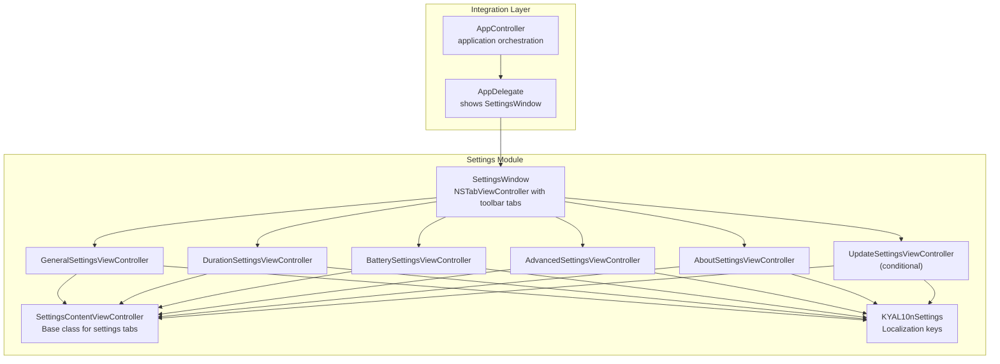
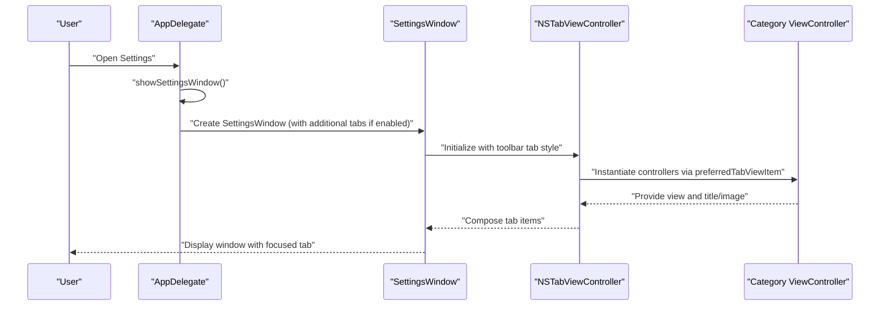
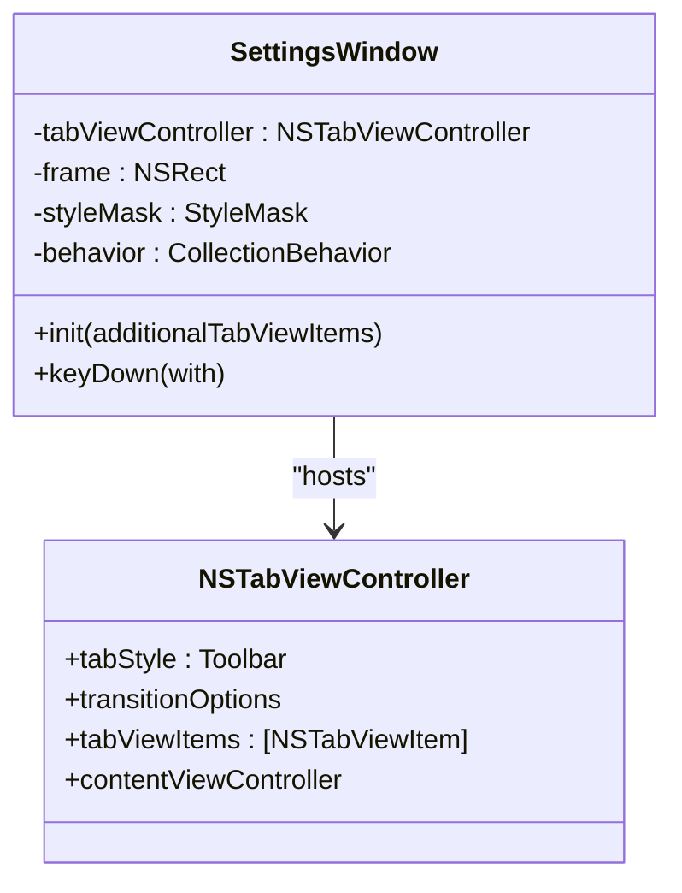
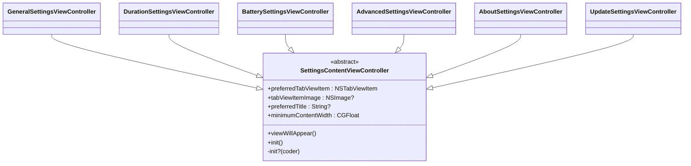
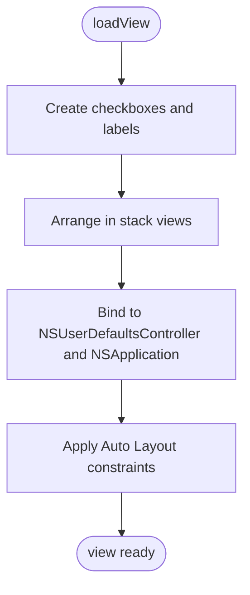
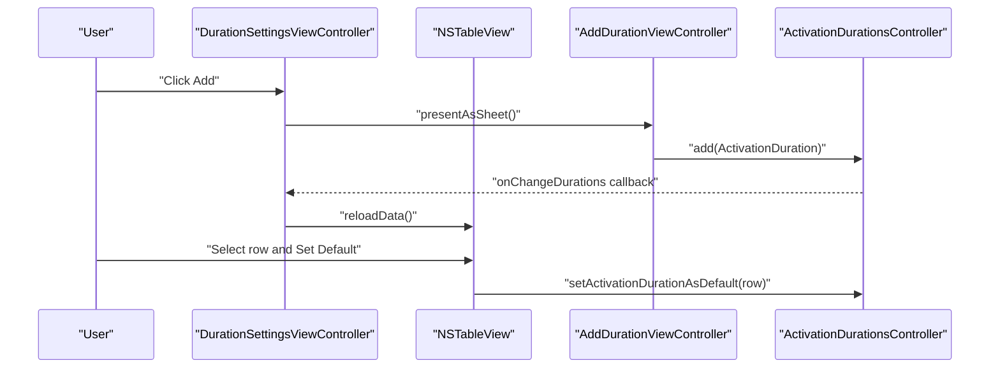
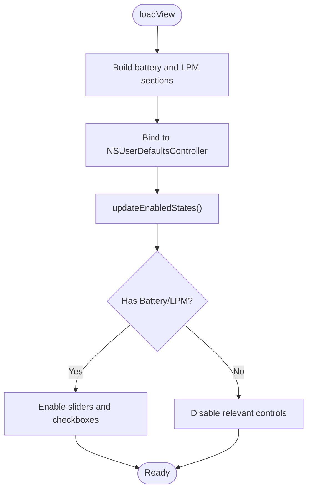
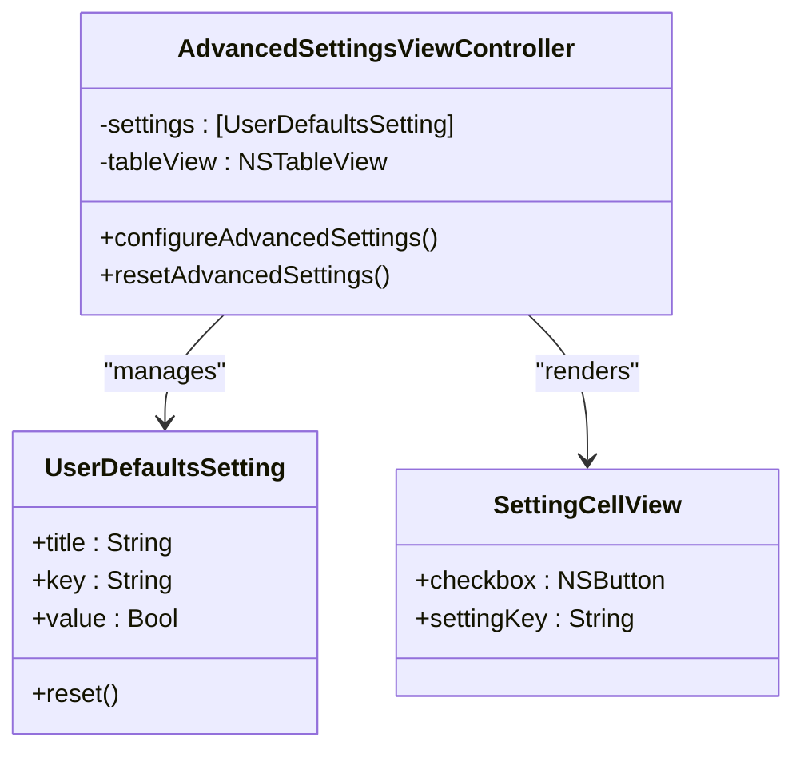
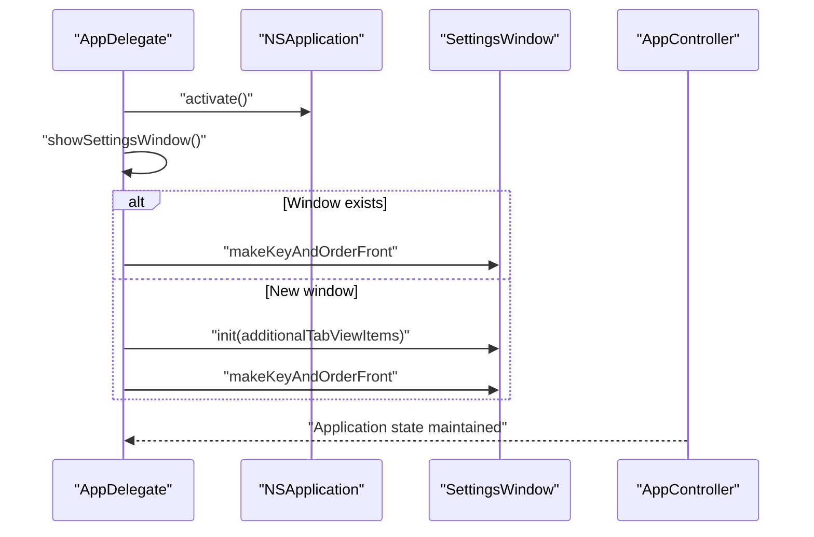
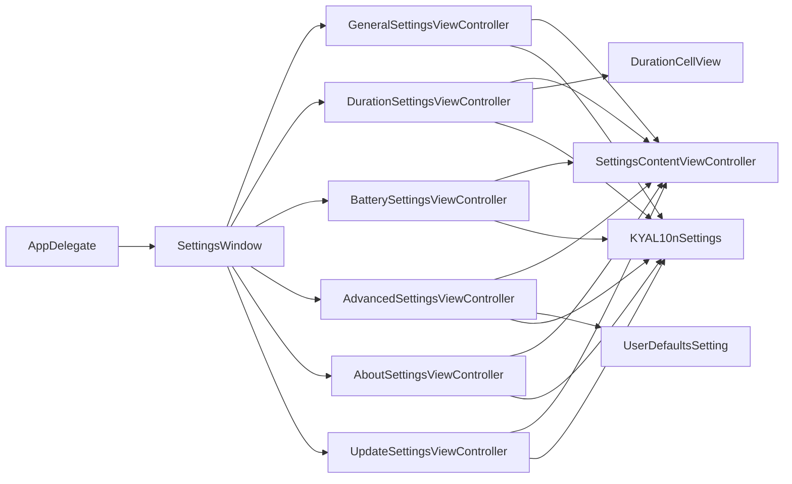

# Settings Architecture

<cite>
**Referenced Files in This Document**
- [SettingsWindow.swift](file://KeepingYouAwake/Settings/KYASettingsWindow/SettingsWindow.swift)
- [SettingsContentViewController.swift](file://KeepingYouAwake/Settings/KYASettingsContentViewController/SettingsContentViewController.swift)
- [GeneralSettingsViewController.swift](file://KeepingYouAwake/Settings/KYAGeneralSettingsViewController/GeneralSettingsViewController.swift)
- [DurationSettingsViewController.swift](file://KeepingYouAwake/Settings/KYADurationSettingsViewController/DurationSettingsViewController.swift)
- [BatterySettingsViewController.swift](file://KeepingYouAwake/Settings/KYABatterySettingsViewController/BatterySettingsViewController.swift)
- [AdvancedSettingsViewController.swift](file://KeepingYouAwake/Settings/KYAAdvancedSettingsViewController/AdvancedSettingsViewController.swift)
- [AboutSettingsViewController.swift](file://KeepingYouAwake/Settings/KYAAboutSettingsViewController/AboutSettingsViewController.swift)
- [UpdateSettingsViewController.swift](file://KeepingYouAwake/Settings/KYAUpdateSettingsViewController/UpdateSettingsViewController.swift)
- [DurationCellView.swift](file://KeepingYouAwake/Settings/KYADurationSettingsViewController/KYADurationCell/DurationCellView.swift)
- [AddDurationViewController.swift](file://KeepingYouAwake/Settings/KYADurationSettingsViewController/AddDurationViewController.swift)
- [UserDefaultsSetting.swift](file://KeepingYouAwake/UserDefaultsSetting.swift)
- [KYAL10nSettings.swift](file://KeepingYouAwake/Settings/KYAL10n+Settings.swift)
- [AppDelegate.swift](file://KeepingYouAwake/KYAAppController/AppDelegate.swift)
- [AppController.swift](file://KeepingYouAwake/KYAAppController/AppController.swift)
</cite>

## Table of Contents
1. [Introduction](#introduction)
2. [Project Structure](#project-structure)
3. [Core Components](#core-components)
4. [Architecture Overview](#architecture-overview)
5. [Detailed Component Analysis](#detailed-component-analysis)
6. [Dependency Analysis](#dependency-analysis)
7. [Performance Considerations](#performance-considerations)
8. [Troubleshooting Guide](#troubleshooting-guide)
9. [Conclusion](#conclusion)

## Introduction
This document describes the settings architecture foundation of the application, focusing on the NSTabViewController-based tabbed interface with toolbar-style tabs, the SettingsWindow implementation, keyboard shortcuts, window management, and the SettingsContentViewController base class. It also covers tab item creation patterns, content view controller integration, toolbar navigation, persistence mechanisms, keyboard handling, and accessibility features. Practical examples demonstrate how to extend the settings architecture with new categories.

## Project Structure
The settings subsystem is organized by feature-based folders under the Settings directory. Each category is implemented as a dedicated view controller inheriting from SettingsContentViewController. The central window is implemented as SettingsWindow, which composes an NSTabViewController with toolbar tabs. Localization keys for settings are centralized in KYAL10nSettings.

**Diagram sources**
- [SettingsWindow.swift:13-41](file://KeepingYouAwake/Settings/KYASettingsWindow/SettingsWindow.swift#L13-L41)
- [SettingsContentViewController.swift:13-46](file://KeepingYouAwake/Settings/KYASettingsContentViewController/SettingsContentViewController.swift#L13-L46)
- [GeneralSettingsViewController.swift:13-24](file://KeepingYouAwake/Settings/KYAGeneralSettingsViewController/GeneralSettingsViewController.swift#L13-L24)
- [DurationSettingsViewController.swift:15-24](file://KeepingYouAwake/Settings/KYADurationSettingsViewController/DurationSettingsViewController.swift#L15-L24)
- [BatterySettingsViewController.swift:14-31](file://KeepingYouAwake/Settings/KYABatterySettingsViewController/BatterySettingsViewController.swift#L14-L31)
- [AdvancedSettingsViewController.swift:13-28](file://KeepingYouAwake/Settings/KYAAdvancedSettingsViewController/AdvancedSettingsViewController.swift#L13-L28)
- [AboutSettingsViewController.swift:16-31](file://KeepingYouAwake/Settings/KYAAboutSettingsViewController/AboutSettingsViewController.swift#L16-L31)
- [UpdateSettingsViewController.swift:14-24](file://KeepingYouAwake/Settings/KYAUpdateSettingsViewController/UpdateSettingsViewController.swift#L14-L24)
- [KYAL10nSettings.swift:12-24](file://KeepingYouAwake/Settings/KYAL10n+Settings.swift#L12-L24)
- [AppDelegate.swift:36-56](file://KeepingYouAwake/KYAAppController/AppDelegate.swift#L36-L56)

**Section sources**
- [SettingsWindow.swift:13-41](file://KeepingYouAwake/Settings/KYASettingsWindow/SettingsWindow.swift#L13-L41)
- [SettingsContentViewController.swift:13-46](file://KeepingYouAwake/Settings/KYASettingsContentViewController/SettingsContentViewController.swift#L13-L46)
- [AppDelegate.swift:36-56](file://KeepingYouAwake/KYAAppController/AppDelegate.swift#L36-L56)

## Core Components
- SettingsWindow: A programmatic NSWindow that hosts an NSTabViewController configured with toolbar-style tabs. It sets up the initial tab items, window behavior, title, and persistence via autosave name. It also handles keyboard shortcuts for quitting and closing.
- SettingsContentViewController: A base class for all settings tab view controllers. It defines the tab item creation pattern via a class method, provides a minimum content width, and manages preferred content size based on view fitting size.
- Category View Controllers: Specialized controllers for each settings category (General, Duration, Battery, Advanced, About, Update) that inherit from SettingsContentViewController and implement their own UI composition and bindings.
- Supporting Models: UserDefaultsSetting encapsulates a boolean preference with a display title; DurationCellView renders individual rows in the duration table; AddDurationViewController provides a modal dialog for adding custom durations.

**Section sources**
- [SettingsWindow.swift:13-60](file://KeepingYouAwake/Settings/KYASettingsWindow/SettingsWindow.swift#L13-L60)
- [SettingsContentViewController.swift:13-46](file://KeepingYouAwake/Settings/KYASettingsContentViewController/SettingsContentViewController.swift#L13-L46)
- [UserDefaultsSetting.swift:12-31](file://KeepingYouAwake/UserDefaultsSetting.swift#L12-L31)
- [DurationCellView.swift:11-74](file://KeepingYouAwake/Settings/KYADurationSettingsViewController/KYADurationCell/DurationCellView.swift#L11-L74)
- [AddDurationViewController.swift:23-266](file://KeepingYouAwake/Settings/KYADurationSettingsViewController/AddDurationViewController.swift#L23-266)

## Architecture Overview
The settings architecture follows a layered design:
- Window Layer: SettingsWindow constructs and configures the window and its content controller.
- Navigation Layer: NSTabViewController with toolbar style provides tabbed navigation across categories.
- Content Layer: Each category is a dedicated view controller inheriting from SettingsContentViewController.
- Integration Layer: AppDelegate triggers window creation and visibility; AppController coordinates application-wide behavior.

**Diagram sources**
- [AppDelegate.swift:36-56](file://KeepingYouAwake/KYAAppController/AppDelegate.swift#L36-L56)
- [SettingsWindow.swift:14-41](file://KeepingYouAwake/Settings/KYASettingsWindow/SettingsWindow.swift#L14-L41)
- [SettingsContentViewController.swift:15-20](file://KeepingYouAwake/Settings/KYASettingsContentViewController/SettingsContentViewController.swift#L15-L20)

## Detailed Component Analysis

### SettingsWindow: Programmatic Window with Toolbar Tabs
SettingsWindow creates an NSTabViewController with toolbar-style tabs, sets window properties (title, closable, managed collection behavior), and enables autosave of the window frame. It integrates category controllers by building a list of tab view items and assigning them to the tab view controller. Keyboard handling intercepts Command+W to close and Command+Q to terminate the application.

**Diagram sources**
- [SettingsWindow.swift:13-60](file://KeepingYouAwake/Settings/KYASettingsWindow/SettingsWindow.swift#L13-L60)

**Section sources**
- [SettingsWindow.swift:13-60](file://KeepingYouAwake/Settings/KYASettingsWindow/SettingsWindow.swift#L13-L60)

### SettingsContentViewController: Base Class for Common Functionality
SettingsContentViewController defines the tab item creation pattern using a class method that instantiates a controller, wraps it in an NSTabViewItem, and applies the tab image. It sets the controller's title from a class property and ensures a minimum content width. Subclasses override preferredTitle and tabViewItemImage to customize appearance.

**Diagram sources**
- [SettingsContentViewController.swift:13-46](file://KeepingYouAwake/Settings/KYASettingsContentViewController/SettingsContentViewController.swift#L13-L46)
- [GeneralSettingsViewController.swift:13-24](file://KeepingYouAwake/Settings/KYAGeneralSettingsViewController/GeneralSettingsViewController.swift#L13-L24)
- [DurationSettingsViewController.swift:15-24](file://KeepingYouAwake/Settings/KYADurationSettingsViewController/DurationSettingsViewController.swift#L15-L24)
- [BatterySettingsViewController.swift:14-31](file://KeepingYouAwake/Settings/KYABatterySettingsViewController/BatterySettingsViewController.swift#L14-L31)
- [AdvancedSettingsViewController.swift:13-28](file://KeepingYouAwake/Settings/KYAAdvancedSettingsViewController/AdvancedSettingsViewController.swift#L13-L28)
- [AboutSettingsViewController.swift:16-31](file://KeepingYouAwake/Settings/KYAAboutSettingsViewController/AboutSettingsViewController.swift#L16-L31)
- [UpdateSettingsViewController.swift:14-24](file://KeepingYouAwake/Settings/KYAUpdateSettingsViewController/UpdateSettingsViewController.swift#L14-L24)

**Section sources**
- [SettingsContentViewController.swift:13-46](file://KeepingYouAwake/Settings/KYASettingsContentViewController/SettingsContentViewController.swift#L13-L46)

### General Settings: Programmatic UI with Bindings
GeneralSettingsViewController demonstrates programmatic view construction using NSStackView and NSBox, with bindings to application settings and user defaults. It includes controls for startup behavior, activation on launch, and notification settings, plus a quit button with keyboard shortcut.

**Diagram sources**
- [GeneralSettingsViewController.swift:29-104](file://KeepingYouAwake/Settings/KYAGeneralSettingsViewController/GeneralSettingsViewController.swift#L29-L104)

**Section sources**
- [GeneralSettingsViewController.swift:29-116](file://KeepingYouAwake/Settings/KYAGeneralSettingsViewController/GeneralSettingsViewController.swift#L29-L116)

### Duration Settings: Table-Based Configuration with Custom Cell
DurationSettingsViewController implements a table-driven UI for managing activation durations. It registers a custom cell view, binds to an activation durations controller, and provides actions for adding, removing, and setting default durations. An additional sheet-based controller allows users to add custom durations.

**Diagram sources**
- [DurationSettingsViewController.swift:159-161](file://KeepingYouAwake/Settings/KYADurationSettingsViewController/DurationSettingsViewController.swift#L159-L161)
- [AddDurationViewController.swift:138-198](file://KeepingYouAwake/Settings/KYADurationSettingsViewController/AddDurationViewController.swift#L138-L198)
- [DurationCellView.swift:29-37](file://KeepingYouAwake/Settings/KYADurationSettingsViewController/KYADurationCell/DurationCellView.swift#L29-L37)

**Section sources**
- [DurationSettingsViewController.swift:15-235](file://KeepingYouAwake/Settings/KYADurationSettingsViewController/DurationSettingsViewController.swift#L15-L235)
- [AddDurationViewController.swift:23-266](file://KeepingYouAwake/Settings/KYADurationSettingsViewController/AddDurationViewController.swift#L23-266)
- [DurationCellView.swift:11-74](file://KeepingYouAwake/Settings/KYADurationSettingsViewController/KYADurationCell/DurationCellView.swift#L11-74)

### Battery Settings: Dynamic UI with Device Monitoring
BatterySettingsViewController builds a dynamic UI based on device capabilities, enabling or disabling controls depending on whether the device has a battery or supports low power mode. It binds UI controls to user defaults and posts notifications when settings change.

**Diagram sources**
- [BatterySettingsViewController.swift:34-127](file://KeepingYouAwake/Settings/KYABatterySettingsViewController/BatterySettingsViewController.swift#L34-L127)
- [BatterySettingsViewController.swift:223-238](file://KeepingYouAwake/Settings/KYABatterySettingsViewController/BatterySettingsViewController.swift#L223-L238)

**Section sources**
- [BatterySettingsViewController.swift:14-263](file://KeepingYouAwake/Settings/KYABatterySettingsViewController/BatterySettingsViewController.swift#L14-L263)

### Advanced Settings: Table of Boolean Preferences
AdvancedSettingsViewController presents a table of boolean preferences backed by UserDefaultsSetting. It configures a reusable cell view and binds each checkbox to the appropriate user defaults key. Includes a reset action to restore defaults.

**Diagram sources**
- [AdvancedSettingsViewController.swift:13-138](file://KeepingYouAwake/Settings/KYAAdvancedSettingsViewController/AdvancedSettingsViewController.swift#L13-L138)
- [UserDefaultsSetting.swift:12-31](file://KeepingYouAwake/UserDefaultsSetting.swift#L12-L31)

**Section sources**
- [AdvancedSettingsViewController.swift:13-190](file://KeepingYouAwake/Settings/KYAAdvancedSettingsViewController/AdvancedSettingsViewController.swift#L13-L190)
- [UserDefaultsSetting.swift:12-31](file://KeepingYouAwake/UserDefaultsSetting.swift#L12-L31)

### About Settings: Static Information with Credits
AboutSettingsViewController displays version and copyright information and loads Credits.rtf into a scrollable text view. It uses SnapKit for layout constraints and provides a natural vertical expansion for the credits area.

**Section sources**
- [AboutSettingsViewController.swift:16-100](file://KeepingYouAwake/Settings/KYAAboutSettingsViewController/AboutSettingsViewController.swift#L16-L100)

### Update Settings: Conditional Tab with App Updater Integration
UpdateSettingsViewController provides controls for automatic update checking and pre-release updates. It conditionally appears based on a build-time flag and binds to the application updater service.

**Section sources**
- [UpdateSettingsViewController.swift:14-117](file://KeepingYouAwake/Settings/KYAUpdateSettingsViewController/UpdateSettingsViewController.swift#L14-L117)

### Integration with Application Lifecycle
AppDelegate manages the SettingsWindow lifecycle, ensuring the app activates and reuses or creates the window as needed. AppController coordinates application-wide behavior and responds to device and workspace events that may affect settings.

**Diagram sources**
- [AppDelegate.swift:36-56](file://KeepingYouAwake/KYAAppController/AppDelegate.swift#L36-L56)
- [AppController.swift:21-51](file://KeepingYouAwake/KYAAppController/AppController.swift#L21-L51)

**Section sources**
- [AppDelegate.swift:36-56](file://KeepingYouAwake/KYAAppController/AppDelegate.swift#L36-L56)
- [AppController.swift:21-51](file://KeepingYouAwake/KYAAppController/AppController.swift#L21-L51)

## Dependency Analysis
The settings architecture exhibits clear separation of concerns:
- SettingsWindow depends on category view controllers and localization keys.
- Category view controllers depend on SettingsContentViewController and user defaults.
- DurationSettingsViewController depends on a shared activation durations controller and custom cell rendering.
- AdvancedSettingsViewController depends on UserDefaultsSetting for model abstraction.
- AppDelegate orchestrates window creation and visibility.
- AppController coordinates application-wide behavior and settings-related notifications.

**Diagram sources**
- [AppDelegate.swift:36-56](file://KeepingYouAwake/KYAAppController/AppDelegate.swift#L36-L56)
- [SettingsWindow.swift:14-22](file://KeepingYouAwake/Settings/KYASettingsWindow/SettingsWindow.swift#L14-L22)
- [SettingsContentViewController.swift:15-20](file://KeepingYouAwake/Settings/KYASettingsContentViewController/SettingsContentViewController.swift#L15-L20)
- [DurationCellView.swift:29-37](file://KeepingYouAwake/Settings/KYADurationSettingsViewController/KYADurationCell/DurationCellView.swift#L29-L37)
- [UserDefaultsSetting.swift:12-31](file://KeepingYouAwake/UserDefaultsSetting.swift#L12-L31)
- [KYAL10nSettings.swift:12-24](file://KeepingYouAwake/Settings/KYAL10n+Settings.swift#L12-L24)

**Section sources**
- [SettingsWindow.swift:14-22](file://KeepingYouAwake/Settings/KYASettingsWindow/SettingsWindow.swift#L14-L22)
- [SettingsContentViewController.swift:15-20](file://KeepingYouAwake/Settings/KYASettingsContentViewController/SettingsContentViewController.swift#L15-L20)
- [DurationCellView.swift:29-37](file://KeepingYouAwake/Settings/KYADurationSettingsViewController/KYADurationCell/DurationCellView.swift#L29-L37)
- [UserDefaultsSetting.swift:12-31](file://KeepingYouAwake/UserDefaultsSetting.swift#L12-L31)
- [KYAL10nSettings.swift:12-24](file://KeepingYouAwake/Settings/KYAL10n+Settings.swift#L12-L24)

## Performance Considerations
- View Construction: All views are constructed programmatically without NIBs, reducing loading overhead and simplifying maintenance.
- Binding Strategy: NSUserDefaultsController and NSApplication bindings minimize manual synchronization and reduce boilerplate.
- Table Rendering: Custom cell views and reuse identifiers optimize table rendering performance.
- Window Persistence: Autosave of the window frame avoids expensive layout computations on subsequent launches.
- Conditional Features: Optional update tab reduces unnecessary dependencies when disabled.

[No sources needed since this section provides general guidance]

## Troubleshooting Guide
- Window does not appear: Verify AppDelegate.showSettingsWindow is invoked and SettingsWindow is created with the correct additional tab items.
- Keyboard shortcuts not working: Ensure Command+Q and Command+W are handled in SettingsWindow.keyDown and that the window is key.
- Settings not persisting: Confirm bindings to NSUserDefaultsController and that user defaults keys match the expected values.
- Table selection issues: Check NSTableView delegate/dataSource methods and ensure selection changes trigger UI updates.
- Device capability checks failing: Validate battery monitoring and low power mode support conditions in BatterySettingsViewController.

**Section sources**
- [SettingsWindow.swift:45-59](file://KeepingYouAwake/Settings/KYASettingsWindow/SettingsWindow.swift#L45-L59)
- [DurationSettingsViewController.swift:222-234](file://KeepingYouAwake/Settings/KYADurationSettingsViewController/DurationSettingsViewController.swift#L222-L234)
- [BatterySettingsViewController.swift:223-238](file://KeepingYouAwake/Settings/KYABatterySettingsViewController/BatterySettingsViewController.swift#L223-L238)

## Conclusion
The settings architecture leverages a clean, extensible design centered around SettingsContentViewController and an NSTabViewController with toolbar tabs. SettingsWindow provides a robust programmatic foundation with keyboard handling and persistence. Category controllers encapsulate domain-specific UI and behavior while sharing common infrastructure. The design supports easy extension with new categories and maintains strong separation between window management, navigation, and content concerns.