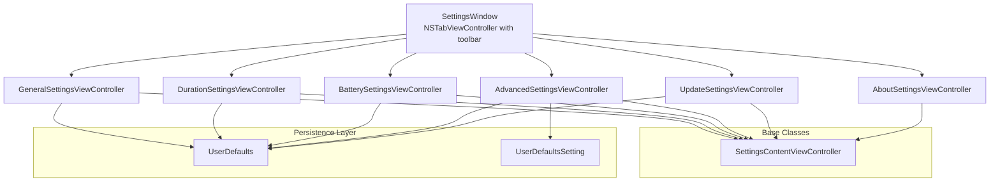
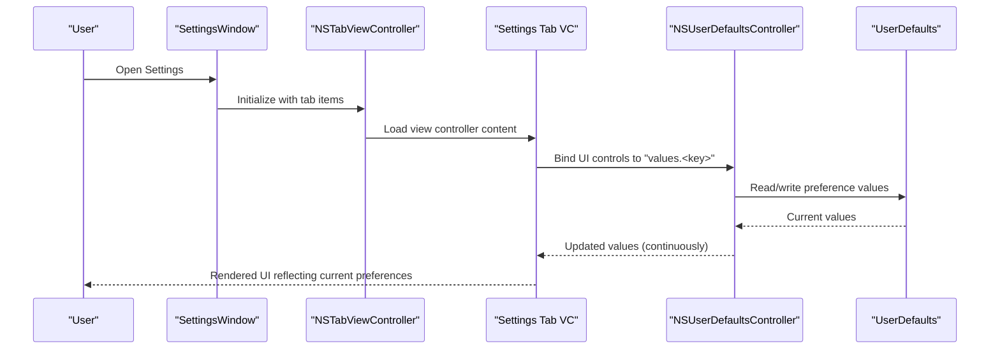
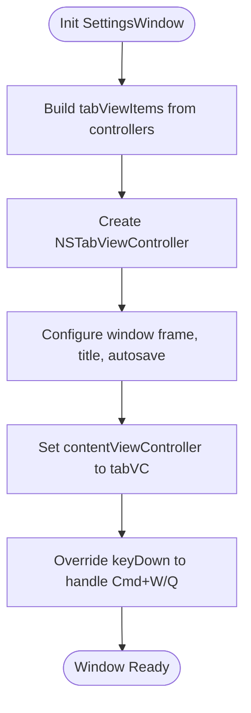
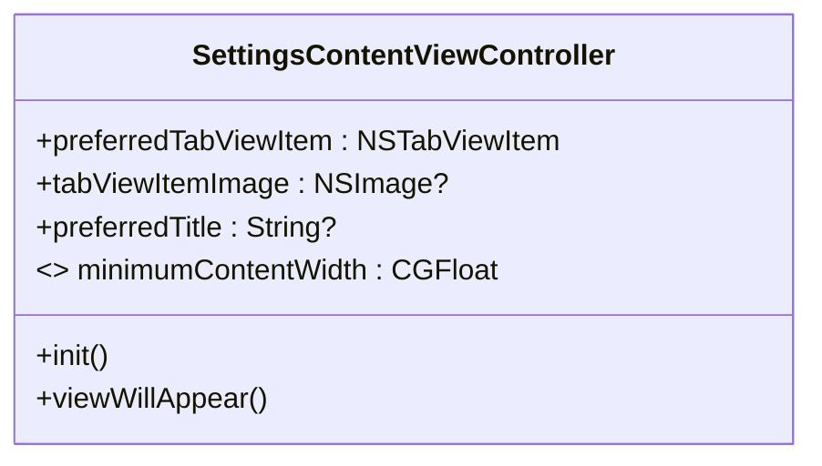
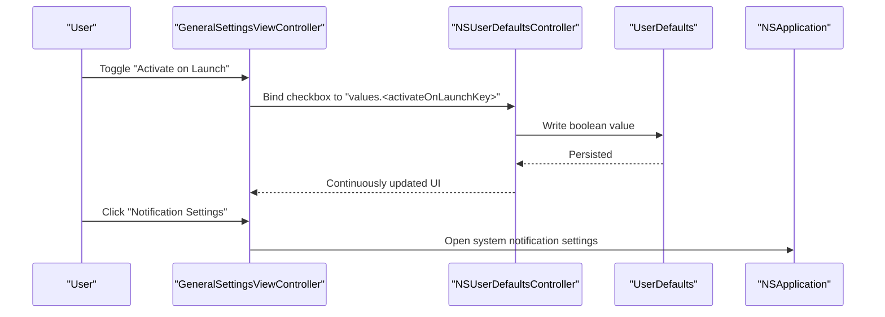
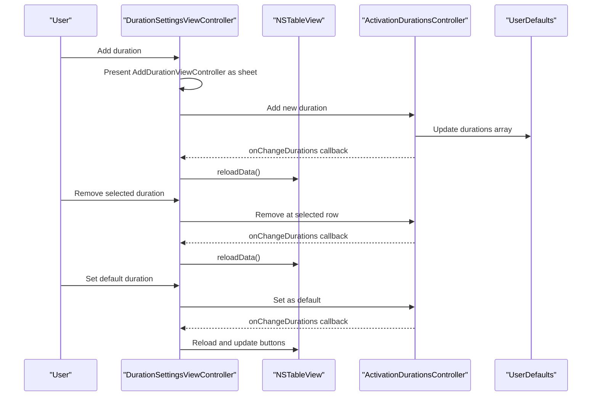
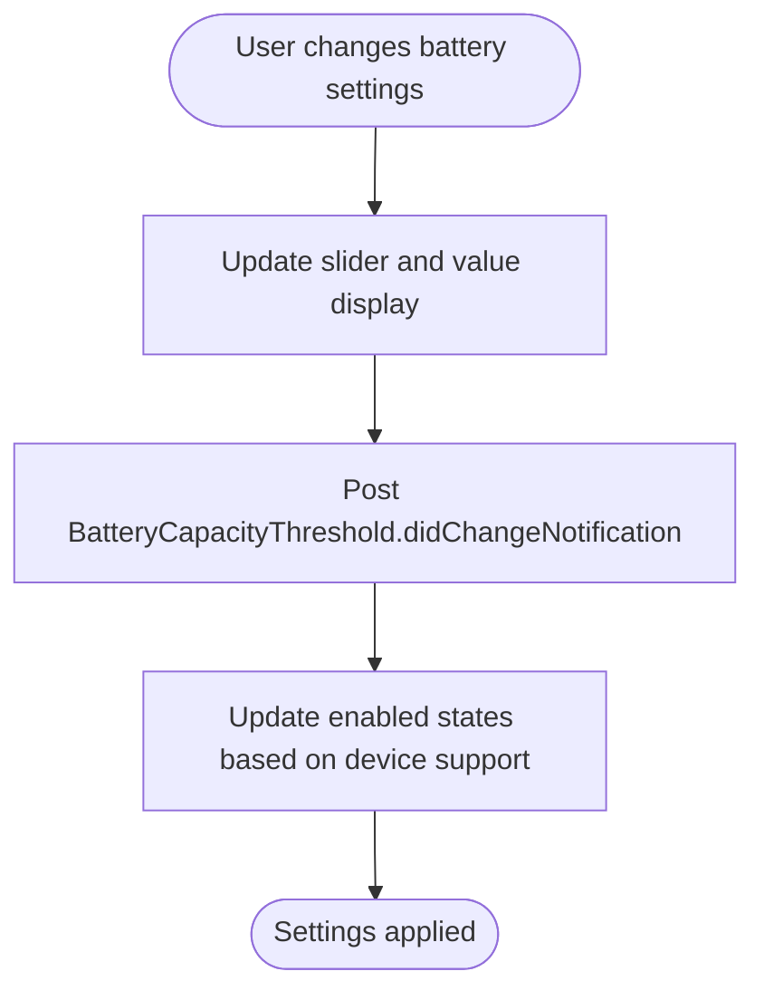
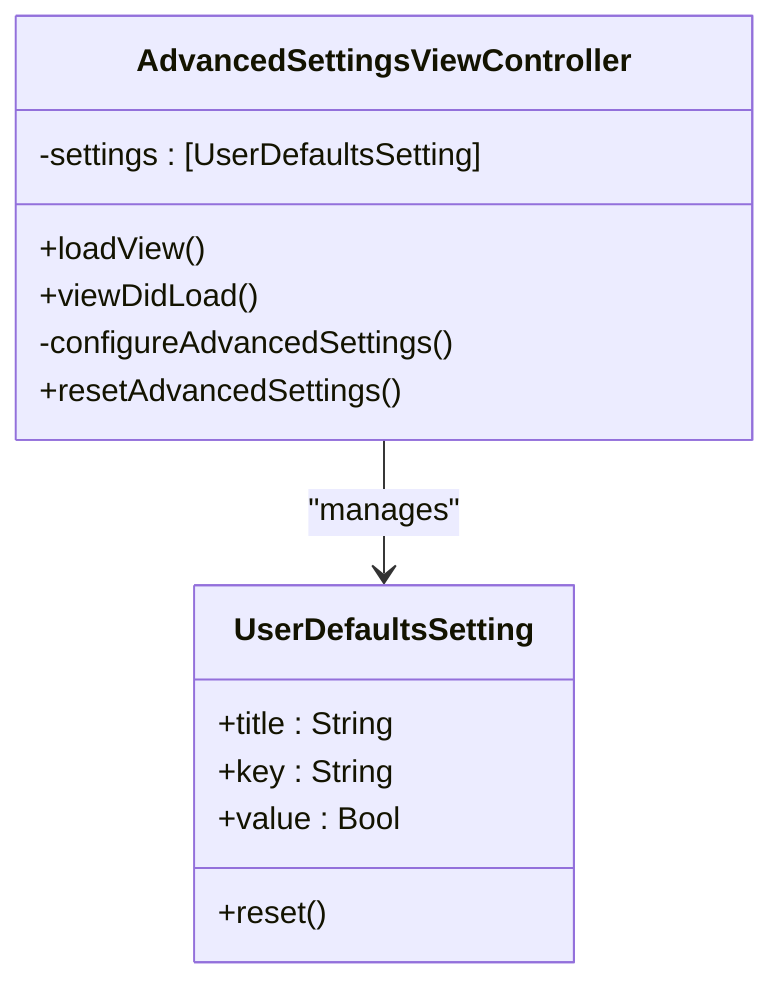
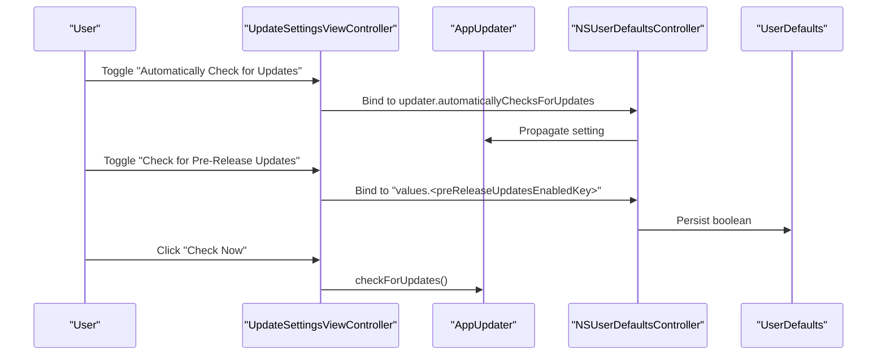
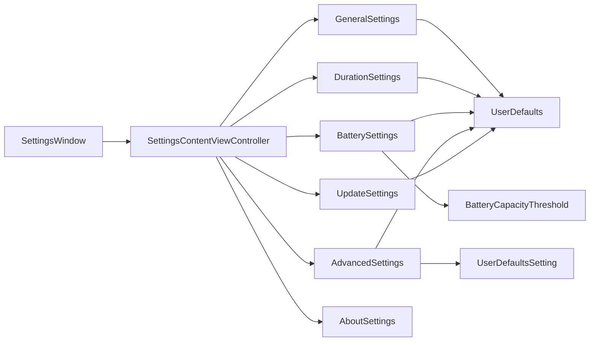

# Settings Management System

<cite>
**Referenced Files in This Document**
- [SettingsWindow.swift](file://KeepingYouAwake/Settings/KYASettingsWindow/SettingsWindow.swift)
- [SettingsContentViewController.swift](file://KeepingYouAwake/Settings/KYASettingsContentViewController/SettingsContentViewController.swift)
- [GeneralSettingsViewController.swift](file://KeepingYouAwake/Settings/KYAGeneralSettingsViewController/GeneralSettingsViewController.swift)
- [DurationSettingsViewController.swift](file://KeepingYouAwake/Settings/KYADurationSettingsViewController/DurationSettingsViewController.swift)
- [BatterySettingsViewController.swift](file://KeepingYouAwake/Settings/KYABatterySettingsViewController/BatterySettingsViewController.swift)
- [AdvancedSettingsViewController.swift](file://KeepingYouAwake/Settings/KYAAdvancedSettingsViewController/AdvancedSettingsViewController.swift)
- [AboutSettingsViewController.swift](file://KeepingYouAwake/Settings/KYAAboutSettingsViewController/AboutSettingsViewController.swift)
- [UpdateSettingsViewController.swift](file://KeepingYouAwake/Settings/KYAUpdateSettingsViewController/UpdateSettingsViewController.swift)
- [UserDefaultsSetting.swift](file://KeepingYouAwake/UserDefaultsSetting.swift)
- [BatteryCapacityThreshold.swift](file://KeepingYouAwake/BatteryCapacityThreshold.swift)
- [KYAL10nSettings.swift](file://KeepingYouAwake/Settings/KYAL10n+Settings.swift)
- [KYAL10n.swift](file://KeepingYouAwake/KYAL10n.swift)
</cite>

## Table of Contents
1. [Introduction](#introduction)
2. [Project Structure](#project-structure)
3. [Core Components](#core-components)
4. [Architecture Overview](#architecture-overview)
5. [Detailed Component Analysis](#detailed-component-analysis)
6. [Dependency Analysis](#dependency-analysis)
7. [Performance Considerations](#performance-considerations)
8. [Troubleshooting Guide](#troubleshooting-guide)
9. [Conclusion](#conclusion)

## Introduction
This document describes the settings management system used by the macOS application. It covers the tabbed settings window built with NSTabViewController and toolbar navigation, the preference persistence layer using UserDefaults with type-safe settings abstractions, and the complete set of settings categories: general behavior configuration, duration management, battery threshold settings, advanced power management options, and update preferences. It also explains form validation, real-time updates, and the integration between the user interface and backend storage, along with practical examples for extending the system with new settings categories.

## Project Structure
The settings system is organized around a central window that hosts multiple tabs, each implemented as a dedicated view controller. A base class provides shared behavior for all tabs, while specialized controllers handle UI layout, bindings, and domain-specific logic. Preferences are persisted via UserDefaults and accessed through a lightweight type-safe abstraction.

**Diagram sources**
- [SettingsWindow.swift:13-41](file://KeepingYouAwake/Settings/KYASettingsWindow/SettingsWindow.swift#L13-L41)
- [SettingsContentViewController.swift:13-46](file://KeepingYouAwake/Settings/KYASettingsContentViewController/SettingsContentViewController.swift#L13-L46)
- [GeneralSettingsViewController.swift:13-116](file://KeepingYouAwake/Settings/KYAGeneralSettingsViewController/GeneralSettingsViewController.swift#L13-L116)
- [DurationSettingsViewController.swift:14-232](file://KeepingYouAwake/Settings/KYADurationSettingsViewController/DurationSettingsViewController.swift#L14-L232)
- [BatterySettingsViewController.swift:13-262](file://KeepingYouAwake/Settings/KYABatterySettingsViewController/BatterySettingsViewController.swift#L13-L262)
- [AdvancedSettingsViewController.swift:12-186](file://KeepingYouAwake/Settings/KYAAdvancedSettingsViewController/AdvancedSettingsViewController.swift#L12-L186)
- [UpdateSettingsViewController.swift:14-117](file://KeepingYouAwake/Settings/KYAUpdateSettingsViewController/UpdateSettingsViewController.swift#L14-L117)
- [UserDefaultsSetting.swift:12-31](file://KeepingYouAwake/UserDefaultsSetting.swift#L12-L31)

**Section sources**
- [SettingsWindow.swift:13-41](file://KeepingYouAwake/Settings/KYASettingsWindow/SettingsWindow.swift#L13-L41)
- [SettingsContentViewController.swift:13-46](file://KeepingYouAwake/Settings/KYASettingsContentViewController/SettingsContentViewController.swift#L13-L46)

## Core Components
- SettingsWindow: Creates and configures an NSTabViewController with toolbar-style tabs, sets up the window frame and autosave behavior, and wires up keyboard shortcuts for quick actions.
- SettingsContentViewController: Base class that creates a reusable tab view item, provides a common initialization pattern, and manages preferred content size and minimum widths.
- UserDefaultsSetting: A lightweight, type-safe wrapper for boolean preferences stored in UserDefaults, including convenience methods for resetting values.
- BatteryCapacityThreshold: A value-type wrapper that exposes a notification name used when the battery threshold changes, enabling reactive updates elsewhere in the app.

**Section sources**
- [SettingsWindow.swift:13-60](file://KeepingYouAwake/Settings/KYASettingsWindow/SettingsWindow.swift#L13-L60)
- [SettingsContentViewController.swift:13-46](file://KeepingYouAwake/Settings/KYASettingsContentViewController/SettingsContentViewController.swift#L13-L46)
- [UserDefaultsSetting.swift:12-31](file://KeepingYouAwake/UserDefaultsSetting.swift#L12-L31)
- [BatteryCapacityThreshold.swift:12-15](file://KeepingYouAwake/BatteryCapacityThreshold.swift#L12-L15)

## Architecture Overview
The settings architecture follows a layered approach:
- Presentation Layer: Each settings tab is a view controller responsible for its own UI and bindings.
- Persistence Layer: UserDefaults-backed storage with a type-safe abstraction for boolean settings.
- Integration Layer: NSUserDefaultsController and direct bindings connect UI controls to preferences, enabling real-time synchronization.
- Event Layer: Notifications propagate changes (e.g., battery threshold) to interested components.

**Diagram sources**
- [SettingsWindow.swift:14-27](file://KeepingYouAwake/Settings/KYASettingsWindow/SettingsWindow.swift#L14-L27)
- [GeneralSettingsViewController.swift:30-104](file://KeepingYouAwake/Settings/KYAGeneralSettingsViewController/GeneralSettingsViewController.swift#L30-L104)
- [AdvancedSettingsViewController.swift:116-132](file://KeepingYouAwake/Settings/KYAAdvancedSettingsViewController/AdvancedSettingsViewController.swift#L116-L132)

## Detailed Component Analysis

### SettingsWindow: Tabbed Window with Toolbar Navigation
- Initializes an NSTabViewController with toolbar tab style and transitions options.
- Composes tab view items from each settings controller's preferredTabViewItem factory method.
- Sets window properties including title, frame, autosave name, and collection behavior.
- Implements keyboard shortcuts for Command+W (close) and Command+Q (terminate).

**Diagram sources**
- [SettingsWindow.swift:14-41](file://KeepingYouAwake/Settings/KYASettingsWindow/SettingsWindow.swift#L14-L41)

**Section sources**
- [SettingsWindow.swift:13-60](file://KeepingYouAwake/Settings/KYASettingsWindow/SettingsWindow.swift#L13-L60)

### SettingsContentViewController: Base Class for Tabs
- Provides a class method to create a properly configured NSTabViewItem for each tab.
- Exposes class properties for tab image and title, intended to be overridden by subclasses.
- Ensures minimum content width and preferred content size adjustments during view appearance.

**Diagram sources**
- [SettingsContentViewController.swift:13-46](file://KeepingYouAwake/Settings/KYASettingsContentViewController/SettingsContentViewController.swift#L13-L46)

**Section sources**
- [SettingsContentViewController.swift:13-46](file://KeepingYouAwake/Settings/KYASettingsContentViewController/SettingsContentViewController.swift#L13-L46)

### General Settings: Behavior Configuration
- Controls:
  - Start at Login: Binds to application-level launch-at-login state.
  - Activate on Launch: Binds to a boolean preference via NSUserDefaultsController.
  - Notification Settings: Opens system notification settings on supported OS versions.
  - Quit Button: Terminates the application.
- Real-time updates: Uses continuous binding to reflect preference changes immediately.
- Validation: No explicit validation logic here; relies on system-provided controls.

**Diagram sources**
- [GeneralSettingsViewController.swift:29-116](file://KeepingYouAwake/Settings/KYAGeneralSettingsViewController/GeneralSettingsViewController.swift#L29-L116)

**Section sources**
- [GeneralSettingsViewController.swift:13-116](file://KeepingYouAwake/Settings/KYAGeneralSettingsViewController/GeneralSettingsViewController.swift#L13-L116)

### Duration Settings: Activation Duration Management
- Data source and delegate for an NSTableView that displays activation durations.
- Supports adding, removing, and setting default durations via actions and context menu.
- Integrates with a shared controller that manages the list and default selection.
- UI constraints and layout ensure proper sizing and spacing.
- Real-time updates: Observes controller changes and refreshes the table accordingly.

**Diagram sources**
- [DurationSettingsViewController.swift:14-232](file://KeepingYouAwake/Settings/KYADurationSettingsViewController/DurationSettingsViewController.swift#L14-L232)

**Section sources**
- [DurationSettingsViewController.swift:14-232](file://KeepingYouAwake/Settings/KYADurationSettingsViewController/DurationSettingsViewController.swift#L14-L232)

### Battery Settings: Threshold and Low Power Monitoring
- Controls:
  - Enable battery capacity threshold: Toggles monitoring based on battery percentage.
  - Slider and value field: Adjusts the threshold with formatted display.
  - Low Power Mode monitoring: Optional monitoring when system Low Power Mode is active.
- Real-time updates:
  - Continuous binding keeps UI synchronized with UserDefaults values.
  - Changes post a notification to signal downstream components.
- Validation: Slider range is constrained; UI enables/disables controls based on device capabilities.

**Diagram sources**
- [BatterySettingsViewController.swift:128-133](file://KeepingYouAwake/Settings/KYABatterySettingsViewController/BatterySettingsViewController.swift#L128-L133)
- [BatteryCapacityThreshold.swift:14](file://KeepingYouAwake/BatteryCapacityThreshold.swift#L14)

**Section sources**
- [BatterySettingsViewController.swift:13-262](file://KeepingYouAwake/Settings/KYABatterySettingsViewController/BatterySettingsViewController.swift#L13-L262)
- [BatteryCapacityThreshold.swift:12-15](file://KeepingYouAwake/BatteryCapacityThreshold.swift#L12-L15)

### Advanced Settings: Type-Safe Boolean Preferences
- Presents a table of boolean settings backed by UserDefaultsSetting instances.
- Each row is a custom table cell containing a checkbox bound to a specific preference key.
- Includes a reset action that restores defaults for all advanced settings and clears monitored process configuration.
- Real-time updates: Uses continuous binding to keep checkboxes in sync with UserDefaults.

**Diagram sources**
- [AdvancedSettingsViewController.swift:12-186](file://KeepingYouAwake/Settings/KYAAdvancedSettingsViewController/AdvancedSettingsViewController.swift#L12-L186)
- [UserDefaultsSetting.swift:12-31](file://KeepingYouAwake/UserDefaultsSetting.swift#L12-L31)

**Section sources**
- [AdvancedSettingsViewController.swift:12-186](file://KeepingYouAwake/Settings/KYAAdvancedSettingsViewController/AdvancedSettingsViewController.swift#L12-L186)
- [UserDefaultsSetting.swift:12-31](file://KeepingYouAwake/UserDefaultsSetting.swift#L12-L31)

### Update Settings: App Update Preferences
- Controls:
  - Automatically check for updates: Binds to the updater service.
  - Check for pre-release updates: Binds to a boolean preference.
  - Check now: Triggers an immediate update check.
- Real-time updates: Uses bindings to keep the UI synchronized with the updater and UserDefaults.
- Conditional compilation: Only included when the app updater feature is enabled.

**Diagram sources**
- [UpdateSettingsViewController.swift:25-50](file://KeepingYouAwake/Settings/KYAUpdateSettingsViewController/UpdateSettingsViewController.swift#L25-L50)
- [UpdateSettingsViewController.swift:107-109](file://KeepingYouAwake/Settings/KYAUpdateSettingsViewController/UpdateSettingsViewController.swift#L107-L109)

**Section sources**
- [UpdateSettingsViewController.swift:14-117](file://KeepingYouAwake/Settings/KYAUpdateSettingsViewController/UpdateSettingsViewController.swift#L14-L117)

### About Settings: Application Information
- Displays version, copyright, and credits loaded from resource files.
- Uses a scrollable text view to present credits content.

**Section sources**
- [AboutSettingsViewController.swift:14-99](file://KeepingYouAwake/Settings/KYAAboutSettingsViewController/AboutSettingsViewController.swift#L14-L99)

## Dependency Analysis
The settings system exhibits clear separation of concerns:
- SettingsWindow depends on each settings controller's preferredTabViewItem.
- All settings controllers inherit from SettingsContentViewController for shared behavior.
- Controllers bind UI controls to UserDefaults via NSUserDefaultsController, ensuring real-time synchronization.
- AdvancedSettingsViewController composes UserDefaultsSetting instances for type-safe boolean preferences.
- BatterySettingsViewController posts a notification when threshold settings change, decoupling UI from downstream consumers.

**Diagram sources**
- [SettingsWindow.swift:14-27](file://KeepingYouAwake/Settings/KYASettingsWindow/SettingsWindow.swift#L14-L27)
- [AdvancedSettingsViewController.swift:116-132](file://KeepingYouAwake/Settings/KYAAdvancedSettingsViewController/AdvancedSettingsViewController.swift#L116-L132)
- [BatterySettingsViewController.swift:128-133](file://KeepingYouAwake/Settings/KYABatterySettingsViewController/BatterySettingsViewController.swift#L128-L133)
- [BatteryCapacityThreshold.swift:14](file://KeepingYouAwake/BatteryCapacityThreshold.swift#L14)

**Section sources**
- [SettingsWindow.swift:14-27](file://KeepingYouAwake/Settings/KYASettingsWindow/SettingsWindow.swift#L14-L27)
- [AdvancedSettingsViewController.swift:116-132](file://KeepingYouAwake/Settings/KYAAdvancedSettingsViewController/AdvancedSettingsViewController.swift#L116-L132)
- [BatterySettingsViewController.swift:128-133](file://KeepingYouAwake/Settings/KYABatterySettingsViewController/BatterySettingsViewController.swift#L128-L133)

## Performance Considerations
- Continuous bindings ensure minimal latency between user input and UI updates but can increase CPU usage if overused. Limit continuous updates to controls that truly benefit from real-time feedback.
- Table reloads in DurationSettingsViewController occur on controller changes; batch UI updates when possible to avoid redundant redraws.
- Battery threshold updates post a single notification; downstream observers should be efficient and avoid heavy work in notification handlers.
- UserDefaults synchronization is performed after writes; avoid frequent writes in tight loops to prevent unnecessary disk I/O.

## Troubleshooting Guide
- Settings not updating in real time:
  - Verify that controls are bound to NSUserDefaultsController with continuouslyUpdatesValue enabled.
  - Confirm that the correct preference keys are used and that values exist in UserDefaults.
- Reset actions not reverting all settings:
  - Advanced settings reset clears both boolean settings and process monitoring configuration; ensure the reset method is invoked and NSUserDefaultsController reverts to initial values.
- Battery threshold changes not taking effect:
  - Ensure the BatteryCapacityThreshold.didChangeNotification is posted and that downstream components observe this notification.
- Duration management issues:
  - Confirm the ActivationDurationsController is properly initialized and that onChangeDurations callbacks are registered to refresh the table view.

**Section sources**
- [AdvancedSettingsViewController.swift:126-132](file://KeepingYouAwake/Settings/KYAAdvancedSettingsViewController/AdvancedSettingsViewController.swift#L126-L132)
- [BatterySettingsViewController.swift:128-133](file://KeepingYouAwake/Settings/KYABatterySettingsViewController/BatterySettingsViewController.swift#L128-L133)
- [DurationSettingsViewController.swift:136-142](file://KeepingYouAwake/Settings/KYADurationSettingsViewController/DurationSettingsViewController.swift#L136-L142)

## Conclusion
The settings management system combines a clean, extensible architecture with robust preference persistence and real-time UI synchronization. The tabbed window design provides intuitive navigation, while type-safe abstractions and bindings simplify development and reduce errors. The modular structure makes it straightforward to add new settings categories and integrate them seamlessly into the existing framework.