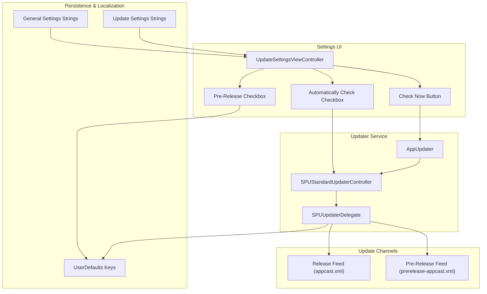
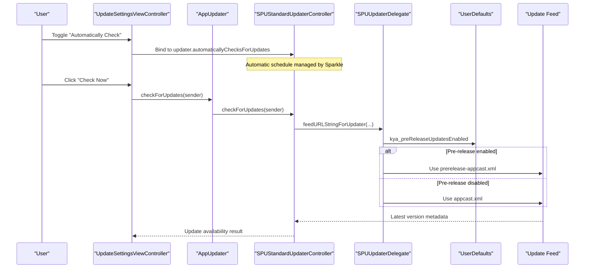
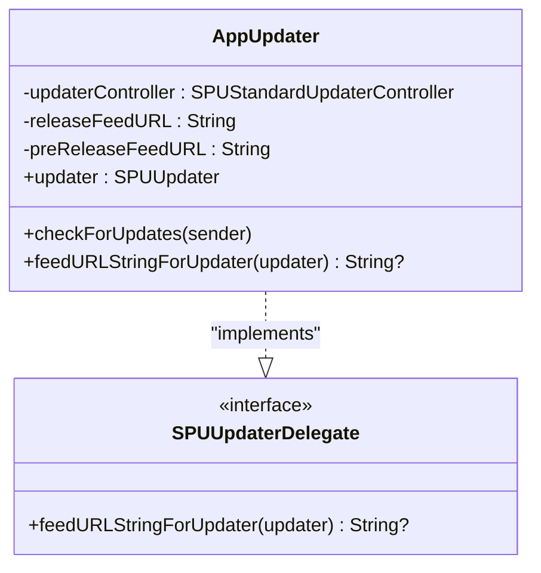
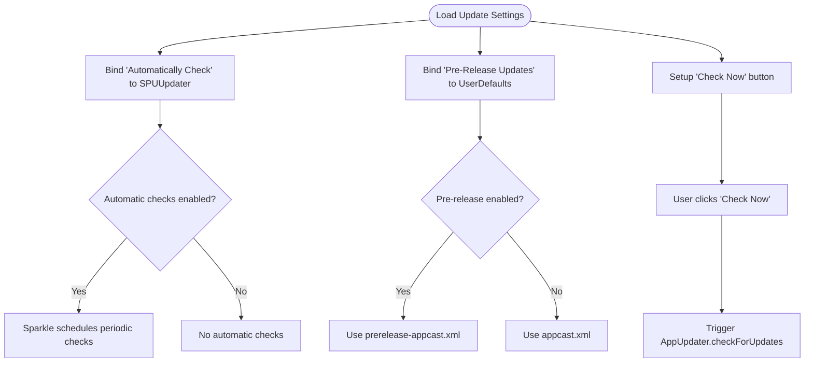
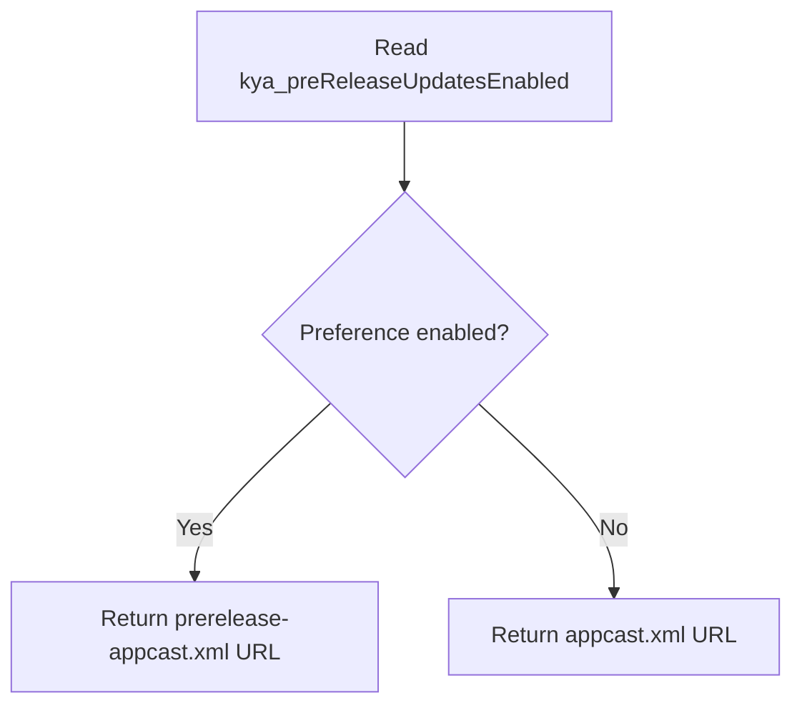
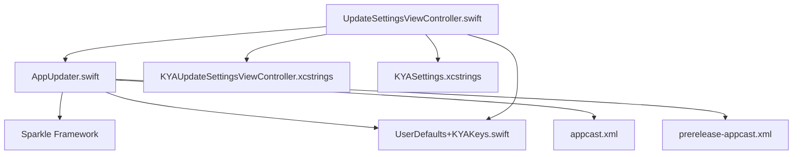

# Update Settings

<cite>
**Referenced Files in This Document**
- [AppUpdater.swift](file://KeepingYouAwake/KYAAppUpdater/AppUpdater.swift)
- [UpdateSettingsViewController.swift](file://KeepingYouAwake/Settings/KYAUpdateSettingsViewController/UpdateSettingsViewController.swift)
- [UserDefaults+KYAKeys.swift](file://Packages/KYAApplicationSupport/Sources/KYAApplicationSupport/UserDefaults+KYAKeys.swift)
- [appcast.xml](file://docs/appcast.xml)
- [prerelease-appcast.xml](file://docs/prerelease-appcast.xml)
- [KYAUpdateSettingsViewController.xcstrings](file://KeepingYouAwake/Settings/KYAUpdateSettingsViewController/mul.lproj/KYAUpdateSettingsViewController.xcstrings)
- [KYASettings.xcstrings](file://KeepingYouAwake/Settings/KYASettings.xcstrings)
- [Package.resolved](file://KeepingYouAwake.xcworkspace/xcshareddata/swiftpm/Package.resolved)
</cite>

## Table of Contents
1. [Introduction](#introduction)
2. [Project Structure](#project-structure)
3. [Core Components](#core-components)
4. [Architecture Overview](#architecture-overview)
5. [Detailed Component Analysis](#detailed-component-analysis)
6. [Dependency Analysis](#dependency-analysis)
7. [Performance Considerations](#performance-considerations)
8. [Troubleshooting Guide](#troubleshooting-guide)
9. [Conclusion](#conclusion)

## Introduction
This document describes the update settings category for the application, focusing on Sparkle integration for automatic updates. It explains how update channels are configured, how manual update checks work, and how the user interface controls update behavior and notification preferences. It also covers the update checking mechanism, version comparison logic, and the relationship between update settings and the application lifecycle.

## Project Structure
The update settings functionality spans three primary areas:
- Application updater service: responsible for coordinating update checks and channel selection
- Settings UI: provides controls for automatic checks, pre-release inclusion, and manual update initiation
- Persistence and localization: stores user preferences and provides localized strings

**Diagram sources**
- [UpdateSettingsViewController.swift:15-118](file://KeepingYouAwake/Settings/KYAUpdateSettingsViewController/UpdateSettingsViewController.swift#L15-L118)
- [AppUpdater.swift:15-43](file://KeepingYouAwake/KYAAppUpdater/AppUpdater.swift#L15-L43)
- [UserDefaults+KYAKeys.swift:24-73](file://Packages/KYAApplicationSupport/Sources/KYAApplicationSupport/UserDefaults+KYAKeys.swift#L24-L73)
- [appcast.xml:1-171](file://docs/appcast.xml#L1-L171)
- [prerelease-appcast.xml:1-286](file://docs/prerelease-appcast.xml#L1-L286)

**Section sources**
- [UpdateSettingsViewController.swift:15-118](file://KeepingYouAwake/Settings/KYAUpdateSettingsViewController/UpdateSettingsViewController.swift#L15-L118)
- [AppUpdater.swift:15-43](file://KeepingYouAwake/KYAAppUpdater/AppUpdater.swift#L15-L43)

## Core Components
- AppUpdater: Manages Sparkle's updater controller, exposes a convenience method to trigger manual checks, and acts as an SPUUpdaterDelegate to select the appropriate update feed based on user preferences.
- UpdateSettingsViewController: Provides the UI for controlling update behavior, including automatic checks, pre-release inclusion, and manual update initiation.
- UserDefaults keys: Persist user preferences for pre-release updates and expose them as a computed property for the updater delegate.
- Update feeds: Separate RSS channels for release and pre-release builds.

Key responsibilities:
- Automatic update scheduling is controlled by Sparkle via the updater controller bound to the "Automatically Check" checkbox.
- Manual checks are initiated by the "Check Now" button, which delegates to the updater controller.
- Channel selection is dynamic based on the "Check for Pre-Release Updates" preference.

**Section sources**
- [AppUpdater.swift:15-43](file://KeepingYouAwake/KYAAppUpdater/AppUpdater.swift#L15-L43)
- [UpdateSettingsViewController.swift:26-51](file://KeepingYouAwake/Settings/KYAUpdateSettingsViewController/UpdateSettingsViewController.swift#L26-L51)
- [UserDefaults+KYAKeys.swift:24-73](file://Packages/KYAApplicationSupport/Sources/KYAApplicationSupport/UserDefaults+KYAKeys.swift#L24-L73)

## Architecture Overview
The update settings architecture integrates UI bindings, persistence, and Sparkle's update framework:

**Diagram sources**
- [UpdateSettingsViewController.swift:110-112](file://KeepingYouAwake/Settings/KYAUpdateSettingsViewController/UpdateSettingsViewController.swift#L110-L112)
- [AppUpdater.swift:32-42](file://KeepingYouAwake/KYAAppUpdater/AppUpdater.swift#L32-L42)
- [UserDefaults+KYAKeys.swift:71-73](file://Packages/KYAApplicationSupport/Sources/KYAApplicationSupport/UserDefaults+KYAKeys.swift#L71-L73)
- [appcast.xml:1-171](file://docs/appcast.xml#L1-L171)
- [prerelease-appcast.xml:1-286](file://docs/prerelease-appcast.xml#L1-L286)

## Detailed Component Analysis

### AppUpdater Component
AppUpdater encapsulates Sparkle's update controller and provides:
- A singleton instance for centralized access
- A method to trigger manual update checks
- An SPUUpdaterDelegate implementation that selects the appropriate feed URL based on user preferences

Implementation highlights:
- Uses SPUStandardUpdaterController to integrate with Sparkle
- Exposes the underlying SPUUpdater instance for UI binding
- Selects feed URL dynamically using UserDefaults-backed computed property

**Diagram sources**
- [AppUpdater.swift:15-43](file://KeepingYouAwake/KYAAppUpdater/AppUpdater.swift#L15-L43)

**Section sources**
- [AppUpdater.swift:15-43](file://KeepingYouAwake/KYAAppUpdater/AppUpdater.swift#L15-L43)

### UpdateSettingsViewController Component
The settings UI provides:
- A checkbox bound to Sparkle's automatic update scheduling
- A checkbox to include pre-release updates
- A button to manually initiate an update check
- Layout and constraints using SnapKit

User interaction flow:
- "Automatically Check" checkbox is bound to the updater's automatic check property
- "Check for Pre-Release Updates" checkbox is bound to a user defaults key
- "Check Now" triggers the updater controller's manual check method

**Diagram sources**
- [UpdateSettingsViewController.swift:26-51](file://KeepingYouAwake/Settings/KYAUpdateSettingsViewController/UpdateSettingsViewController.swift#L26-L51)
- [UpdateSettingsViewController.swift:110-112](file://KeepingYouAwake/Settings/KYAUpdateSettingsViewController/UpdateSettingsViewController.swift#L110-L112)

**Section sources**
- [UpdateSettingsViewController.swift:26-51](file://KeepingYouAwake/Settings/KYAUpdateSettingsViewController/UpdateSettingsViewController.swift#L26-L51)
- [UpdateSettingsViewController.swift:88-108](file://KeepingYouAwake/Settings/KYAUpdateSettingsViewController/UpdateSettingsViewController.swift#L88-L108)
- [UpdateSettingsViewController.swift:110-117](file://KeepingYouAwake/Settings/KYAUpdateSettingsViewController/UpdateSettingsViewController.swift#L110-L117)

### Update Channel Configuration
The application supports two update channels:
- Release channel: appcast.xml
- Pre-release channel: prerelease-appcast.xml

Channel selection logic:
- When the pre-release preference is enabled, the updater delegate returns the pre-release feed URL
- Otherwise, it returns the release feed URL

**Diagram sources**
- [AppUpdater.swift:38-42](file://KeepingYouAwake/KYAAppUpdater/AppUpdater.swift#L38-L42)
- [UserDefaults+KYAKeys.swift:71-73](file://Packages/KYAApplicationSupport/Sources/KYAApplicationSupport/UserDefaults+KYAKeys.swift#L71-L73)

**Section sources**
- [AppUpdater.swift:20-42](file://KeepingYouAwake/KYAAppUpdater/AppUpdater.swift#L20-L42)
- [appcast.xml:1-171](file://docs/appcast.xml#L1-L171)
- [prerelease-appcast.xml:1-286](file://docs/prerelease-appcast.xml#L1-L286)

### Manual Check Functionality
Manual checks are initiated through the settings UI:
- The "Check Now" button triggers AppUpdater.checkForUpdates
- AppUpdater forwards the call to SPUStandardUpdaterController
- The updater controller queries the selected feed and presents results

Integration points:
- UI binding to the updater controller
- Delegate-driven feed selection
- Sparkle-managed update presentation

**Section sources**
- [UpdateSettingsViewController.swift:46-51](file://KeepingYouAwake/Settings/KYAUpdateSettingsViewController/UpdateSettingsViewController.swift#L46-L51)
- [UpdateSettingsViewController.swift:110-112](file://KeepingYouAwake/Settings/KYAUpdateSettingsViewController/UpdateSettingsViewController.swift#L110-L112)
- [AppUpdater.swift:32-34](file://KeepingYouAwake/KYAAppUpdater/AppUpdater.swift#L32-L34)

### User Interface Components for Update Behavior
The settings UI includes:
- Automatically Check for Updates: bound to Sparkle's automatic update scheduling
- Check for Pre-Release Updates: toggles inclusion of pre-release builds
- Check Now: initiates an immediate update check

Localization:
- All labels are localized via .xcstrings files
- The settings strings file provides localized titles for the Updates tab and related UI elements

**Section sources**
- [UpdateSettingsViewController.swift:26-44](file://KeepingYouAwake/Settings/KYAUpdateSettingsViewController/UpdateSettingsViewController.swift#L26-L44)
- [UpdateSettingsViewController.swift:46-51](file://KeepingYouAwake/Settings/KYAUpdateSettingsViewController/UpdateSettingsViewController.swift#L46-L51)
- [KYAUpdateSettingsViewController.xcstrings:1-420](file://KeepingYouAwake/Settings/KYAUpdateSettingsViewController/mul.lproj/KYAUpdateSettingsViewController.xcstrings#L1-L420)
- [KYASettings.xcstrings:391-536](file://KeepingYouAwake/Settings/KYASettings.xcstrings#L391-L536)

### Update Checking Mechanism and Version Comparison
The update checking mechanism relies on Sparkle:
- Automatic checks: scheduled by Sparkle based on the bound property
- Manual checks: initiated by the user
- Version comparison: performed by Sparkle using metadata from the selected feed

Feed metadata:
- RSS items include version information and minimum system requirements
- Sparkle compares current version against feed entries to determine update availability

**Section sources**
- [appcast.xml:8-14](file://docs/appcast.xml#L8-L14)
- [prerelease-appcast.xml:8-14](file://docs/prerelease-appcast.xml#L8-L14)

## Dependency Analysis
The update settings category depends on:
- Sparkle framework for update functionality
- Application support package for UserDefaults extensions
- Settings localization resources for UI text

**Diagram sources**
- [AppUpdater.swift:12-13](file://KeepingYouAwake/KYAAppUpdater/AppUpdater.swift#L12-L13)
- [Package.resolved:4-11](file://KeepingYouAwake.xcworkspace/xcshareddata/swiftpm/Package.resolved#L4-L11)
- [UserDefaults+KYAKeys.swift:24-73](file://Packages/KYAApplicationSupport/Sources/KYAApplicationSupport/UserDefaults+KYAKeys.swift#L24-L73)
- [UpdateSettingsViewController.swift:9-13](file://KeepingYouAwake/Settings/KYAUpdateSettingsViewController/UpdateSettingsViewController.swift#L9-L13)

**Section sources**
- [Package.resolved:1-14](file://KeepingYouAwake.xcworkspace/xcshareddata/swiftpm/Package.resolved#L1-L14)
- [AppUpdater.swift:12-13](file://KeepingYouAwake/KYAAppUpdater/AppUpdater.swift#L12-L13)

## Performance Considerations
- Automatic update checks are handled by Sparkle and scheduled according to platform defaults; avoid unnecessary manual checks to minimize network usage.
- Pre-release updates may increase update frequency; enable only if desired.
- Feed parsing and version comparison are performed by Sparkle; ensure reliable network connectivity for consistent update discovery.

## Troubleshooting Guide
Common issues and resolutions:
- Automatic checks not triggering: Verify the "Automatically Check for Updates" checkbox is enabled and bound to the updater controller.
- Wrong update channel: Confirm the "Check for Pre-Release Updates" preference matches intended channel.
- Manual check fails: Ensure network connectivity and that the selected feed URL is accessible.
- Localization issues: Confirm .xcstrings files are properly loaded and keys match expected values.

**Section sources**
- [UpdateSettingsViewController.swift:26-44](file://KeepingYouAwake/Settings/KYAUpdateSettingsViewController/UpdateSettingsViewController.swift#L26-L44)
- [UpdateSettingsViewController.swift:114-117](file://KeepingYouAwake/Settings/KYAUpdateSettingsViewController/UpdateSettingsViewController.swift#L114-L117)

## Conclusion
The update settings category integrates Sparkle-based automatic updates with user-controllable preferences for channel selection and manual checks. The UI binds directly to Sparkle's updater controller and UserDefaults-backed preferences, ensuring a seamless update experience. The architecture cleanly separates concerns between UI, persistence, and update logic while leveraging Sparkle for robust update discovery and presentation.