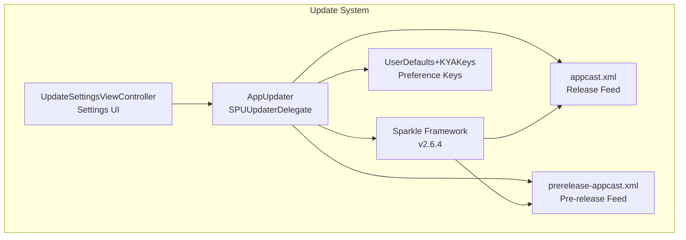
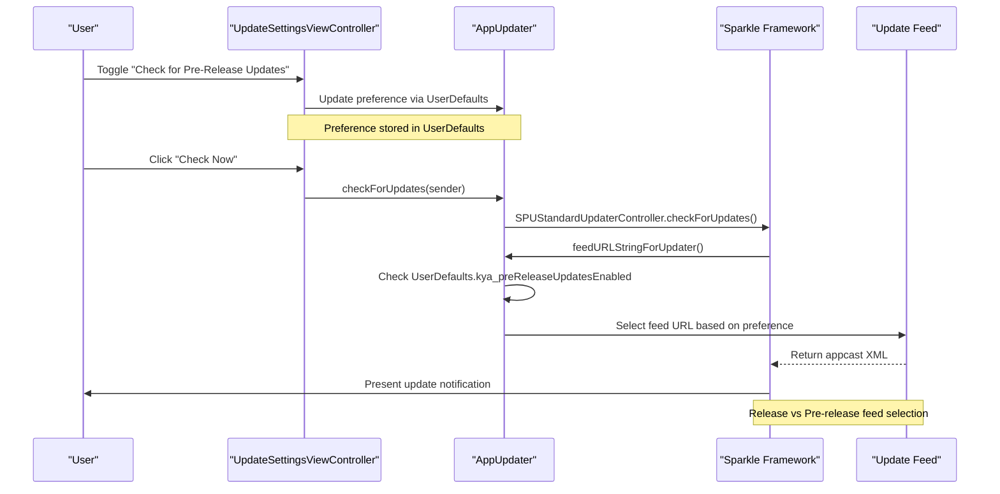
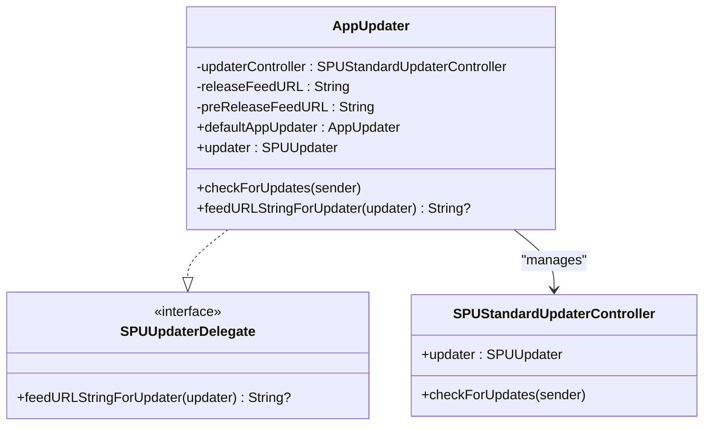
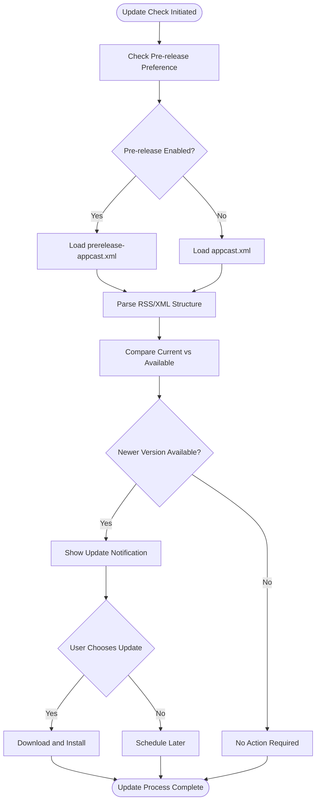
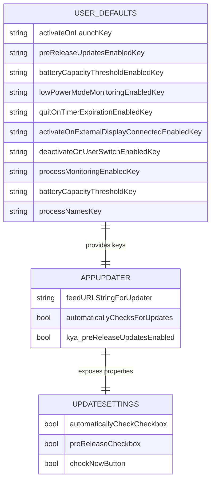
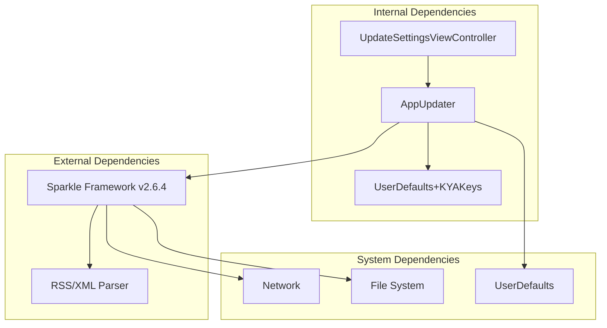

# Automatic Update System

<cite>
**Referenced Files in This Document**
- [AppUpdater.swift](file://KeepingYouAwake/KYAAppUpdater/AppUpdater.swift)
- [UpdateSettingsViewController.swift](file://KeepingYouAwake/Settings/KYAUpdateSettingsViewController/UpdateSettingsViewController.swift)
- [UserDefaults+KYAKeys.swift](file://Packages/KYAApplicationSupport/Sources/KYAApplicationSupport/UserDefaults+KYAKeys.swift)
- [appcast.xml](file://docs/appcast.xml)
- [prerelease-appcast.xml](file://docs/prerelease-appcast.xml)
- [Package.resolved](file://KeepingYouAwake.xcworkspace/xcshareddata/swiftpm/Package.resolved)
- [v1.6.6.md](file://docs/Versions/v1.6.6.md)
</cite>

## Table of Contents
1. [Introduction](#introduction)
2. [Project Structure](#project-structure)
3. [Core Components](#core-components)
4. [Architecture Overview](#architecture-overview)
5. [Detailed Component Analysis](#detailed-component-analysis)
6. [Dependency Analysis](#dependency-analysis)
7. [Performance Considerations](#performance-considerations)
8. [Security Considerations](#security-considerations)
9. [Troubleshooting Guide](#troubleshooting-guide)
10. [Conclusion](#conclusion)

## Introduction
This document provides comprehensive documentation for the automatic update system in the application, built on top of the Sparkle framework. It covers the AppUpdater class implementation, update feed configuration for release and pre-release channels, update checking mechanisms, feed URL management, update channel selection based on user preferences, and the update installation process. It also documents the appcast.xml structure for release updates and prerelease-appcast.xml for beta releases, update notification handling, user preference management for update channels, fallback mechanisms, examples of update configuration, custom update feeds, and troubleshooting update-related issues. Security considerations, certificate validation, and compatibility with different Sparkle versions are addressed.

## Project Structure
The update system is organized across several key areas:
- Application update controller: AppUpdater class manages Sparkle integration
- User settings: UpdateSettingsViewController provides UI for update preferences
- User defaults: UserDefaults extension defines keys and properties for update preferences
- Update feeds: XML appcast files for release and pre-release channels
- Package dependencies: Sparkle framework integration

**Diagram sources**
- [AppUpdater.swift:15-43](file://KeepingYouAwake/KYAAppUpdater/AppUpdater.swift#L15-L43)
- [UpdateSettingsViewController.swift:15-44](file://KeepingYouAwake/Settings/KYAUpdateSettingsViewController/UpdateSettingsViewController.swift#L15-L44)
- [UserDefaults+KYAKeys.swift:18-75](file://Packages/KYAApplicationSupport/Sources/KYAApplicationSupport/UserDefaults+KYAKeys.swift#L18-L75)

**Section sources**
- [AppUpdater.swift:1-44](file://KeepingYouAwake/KYAAppUpdater/AppUpdater.swift#L1-L44)
- [UpdateSettingsViewController.swift:1-120](file://KeepingYouAwake/Settings/KYAUpdateSettingsViewController/UpdateSettingsViewController.swift#L1-L120)
- [UserDefaults+KYAKeys.swift:18-120](file://Packages/KYAApplicationSupport/Sources/KYAApplicationSupport/UserDefaults+KYAKeys.swift#L18-L120)

## Core Components
The update system consists of three primary components:

### AppUpdater Class
The AppUpdater class serves as the central controller for Sparkle integration. It implements the SPUUpdaterDelegate protocol and manages feed URL selection based on user preferences.

Key responsibilities:
- Manages SPUStandardUpdaterController lifecycle
- Implements feedURLStringForUpdater delegate method for dynamic feed selection
- Provides centralized access to the underlying SPUUpdater instance
- Handles user-initiated update checks

### UpdateSettingsViewController
This view controller provides the user interface for update preferences within the application settings. It offers:
- Automatic update checking toggle
- Pre-release update checking option
- Immediate update check button
- Visual feedback through binding to the AppUpdater instance

### UserDefaults Extension
The UserDefaults extension defines and manages all preference keys related to update functionality:
- Pre-release update enable/disable flag
- Integration with Sparkle's automatic update checking
- Backward compatibility with existing preference storage

**Section sources**
- [AppUpdater.swift:15-43](file://KeepingYouAwake/KYAAppUpdater/AppUpdater.swift#L15-L43)
- [UpdateSettingsViewController.swift:15-44](file://KeepingYouAwake/Settings/KYAUpdateSettingsViewController/UpdateSettingsViewController.swift#L15-L44)
- [UserDefaults+KYAKeys.swift:25-75](file://Packages/KYAApplicationSupport/Sources/KYAApplicationSupport/UserDefaults+KYAKeys.swift#L25-L75)

## Architecture Overview
The update system follows a clean separation of concerns with clear data flow between components:

**Diagram sources**
- [UpdateSettingsViewController.swift:110-112](file://KeepingYouAwake/Settings/KYAUpdateSettingsViewController/UpdateSettingsViewController.swift#L110-L112)
- [AppUpdater.swift:32-42](file://KeepingYouAwake/KYAAppUpdater/AppUpdater.swift#L32-L42)
- [UserDefaults+KYAKeys.swift:72-75](file://Packages/KYAApplicationSupport/Sources/KYAApplicationSupport/UserDefaults+KYAKeys.swift#L72-L75)

## Detailed Component Analysis

### AppUpdater Implementation
The AppUpdater class implements a singleton pattern with private initialization to ensure controlled access to the Sparkle updater controller.

**Diagram sources**
- [AppUpdater.swift:15-34](file://KeepingYouAwake/KYAAppUpdater/AppUpdater.swift#L15-L34)

The feed URL selection mechanism operates as follows:
1. User preference is checked via UserDefaults.kya_preReleaseUpdatesEnabled
2. If true: select prerelease-appcast.xml URL
3. If false: select appcast.xml URL
4. Return selected URL to Sparkle framework

**Section sources**
- [AppUpdater.swift:15-43](file://KeepingYouAwake/KYAAppUpdater/AppUpdater.swift#L15-L43)

### Update Feed Configuration
The system maintains separate RSS feeds for release and pre-release updates, each with distinct characteristics:

#### Release Feed (appcast.xml)
- Contains stable, production-ready releases
- Includes standard version information and release notes
- Supports minimum system version requirements
- Provides direct download links to GitHub releases

#### Pre-release Feed (prerelease-appcast.xml)
- Contains beta, alpha, and release candidate versions
- Includes both stable releases and pre-release variants
- Allows users to opt-in to receiving pre-release updates
- Maintains backward compatibility with standard Sparkle format

**Diagram sources**
- [AppUpdater.swift:38-42](file://KeepingYouAwake/KYAAppUpdater/AppUpdater.swift#L38-L42)
- [UpdateSettingsViewController.swift:36-44](file://KeepingYouAwake/Settings/KYAUpdateSettingsViewController/UpdateSettingsViewController.swift#L36-L44)

**Section sources**
- [appcast.xml:1-171](file://docs/appcast.xml#L1-L171)
- [prerelease-appcast.xml:1-286](file://docs/prerelease-appcast.xml#L1-L286)

### User Preference Management
The update system integrates seamlessly with the application's preference management through the UserDefaults extension:

**Diagram sources**
- [UserDefaults+KYAKeys.swift:18-99](file://Packages/KYAApplicationSupport/Sources/KYAApplicationSupport/UserDefaults+KYAKeys.swift#L18-L99)
- [UpdateSettingsViewController.swift:26-44](file://KeepingYouAwake/Settings/KYAUpdateSettingsViewController/UpdateSettingsViewController.swift#L26-L44)

**Section sources**
- [UserDefaults+KYAKeys.swift:25-75](file://Packages/KYAApplicationSupport/Sources/KYAApplicationSupport/UserDefaults+KYAKeys.swift#L25-L75)
- [UpdateSettingsViewController.swift:26-44](file://KeepingYouAwake/Settings/KYAUpdateSettingsViewController/UpdateSettingsViewController.swift#L26-L44)

## Dependency Analysis
The update system has minimal external dependencies and maintains clean architectural boundaries:

**Diagram sources**
- [AppUpdater.swift:12-13](file://KeepingYouAwake/KYAAppUpdater/AppUpdater.swift#L12-L13)
- [Package.resolved:4-11](file://KeepingYouAwake.xcworkspace/xcshareddata/swiftpm/Package.resolved#L4-L11)

The dependency relationships show:
- AppUpdater depends on Sparkle for update functionality
- UpdateSettingsViewController depends on AppUpdater for UI binding
- All components depend on UserDefaults for persistent storage
- External dependencies include Sparkle framework, RSS/XML parsing, network connectivity, and file system access

**Section sources**
- [Package.resolved:1-14](file://KeepingYouAwake.xcworkspace/xcshareddata/swiftpm/Package.resolved#L1-L14)
- [AppUpdater.swift:12-13](file://KeepingYouAwake/KYAAppUpdater/AppUpdater.swift#L12-L13)

## Performance Considerations
The update system is designed for minimal performance impact:

- **Lazy Loading**: AppUpdater uses lazy initialization to defer Sparkle setup until needed
- **Efficient Feed Selection**: Feed URL resolution occurs only when Sparkle requests it
- **Minimal Memory Footprint**: Uses lightweight delegate pattern with minimal state
- **Background Operations**: Sparkle handles network operations asynchronously
- **Selective Updates**: Users can control automatic update checking frequency

## Security Considerations
The update system incorporates several security measures:

### Certificate Validation
- Sparkle framework automatically validates digital signatures on downloaded updates
- Updates are cryptographically signed to prevent tampering
- Certificate chain validation ensures authenticity of update sources

### Network Security
- All update feeds are served over HTTPS
- Digital signatures protect against man-in-the-middle attacks
- Automatic verification prevents installation of compromised updates

### Compatibility Notes
- The project upgraded to Sparkle v2.6.4, which includes enhanced security features
- Version 1.6.6 specifically mentions the Sparkle upgrade to address security concerns
- The update system maintains compatibility with modern macOS security requirements

**Section sources**
- [v1.6.6.md:13](file://docs/Versions/v1.6.6.md#L13)
- [Package.resolved:8-10](file://KeepingYouAwake.xcworkspace/xcshareddata/swiftpm/Package.resolved#L8-L10)

## Troubleshooting Guide

### Common Update Issues

#### Update Checks Fail Silently
**Symptoms**: No update notifications despite available updates
**Causes**:
- Network connectivity issues
- Firewall blocking Sparkle connections
- Incorrect feed URL configuration

**Solutions**:
1. Verify internet connectivity
2. Check firewall settings for Sparkle traffic
3. Manually trigger update check using "Check Now" button
4. Review feed URLs in AppUpdater configuration

#### Pre-release Updates Not Appearing
**Symptoms**: Stable releases available but pre-release versions missing
**Causes**:
- Pre-release preference disabled
- Network issues with prerelease feed
- Outdated Sparkle framework

**Solutions**:
1. Enable "Check for Pre-Release Updates" in settings
2. Verify prerelease-appcast.xml accessibility
3. Update to latest Sparkle version if needed

#### Update Installation Problems
**Symptoms**: Updates download but fail to install
**Causes**:
- Insufficient disk space
- Permission issues
- Corrupted download cache

**Solutions**:
1. Free up disk space on startup disk
2. Check application permissions in System Preferences
3. Clear Sparkle download cache
4. Restart application and retry update

### Diagnostic Steps
1. **Verify Sparkle Integration**: Confirm Sparkle framework loads correctly
2. **Check Feed Accessibility**: Test direct access to both appcast.xml and prerelease-appcast.xml
3. **Review User Preferences**: Validate preReleaseUpdatesEnabledKey setting
4. **Monitor Network Traffic**: Use network monitoring tools to observe Sparkle connections
5. **Check System Logs**: Review Console.app logs for Sparkle-related errors

**Section sources**
- [AppUpdater.swift:38-42](file://KeepingYouAwake/KYAAppUpdater/AppUpdater.swift#L38-L42)
- [UpdateSettingsViewController.swift:110-112](file://KeepingYouAwake/Settings/KYAUpdateSettingsViewController/UpdateSettingsViewController.swift#L110-L112)

## Conclusion
The automatic update system provides a robust, secure, and user-friendly mechanism for delivering updates to users. The implementation leverages Sparkle's proven framework while maintaining clean architectural boundaries and comprehensive user control over update preferences. The dual-feed approach accommodates both stable release users and early adopters seeking pre-release features. With proper security measures, performance considerations, and comprehensive troubleshooting guidance, the system delivers reliable update experiences across different macOS versions and user configurations.

The system's design emphasizes:
- **User Control**: Explicit opt-in for pre-release updates
- **Security**: Cryptographic validation and HTTPS delivery
- **Reliability**: Fallback mechanisms and graceful degradation
- **Maintainability**: Clean separation of concerns and minimal dependencies

Future enhancements could include customizable update schedules, progress reporting, and enhanced error recovery mechanisms, building upon the solid foundation established by the current implementation.