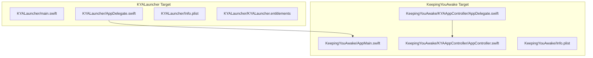
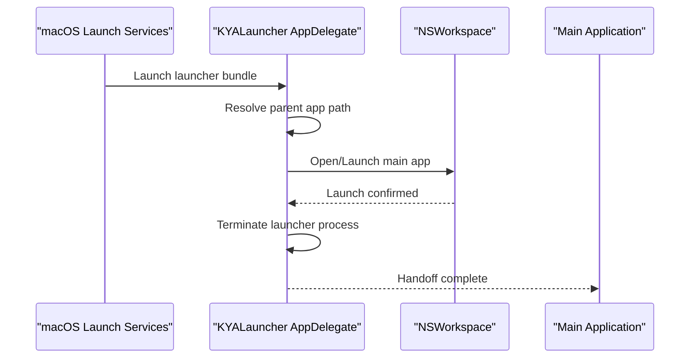
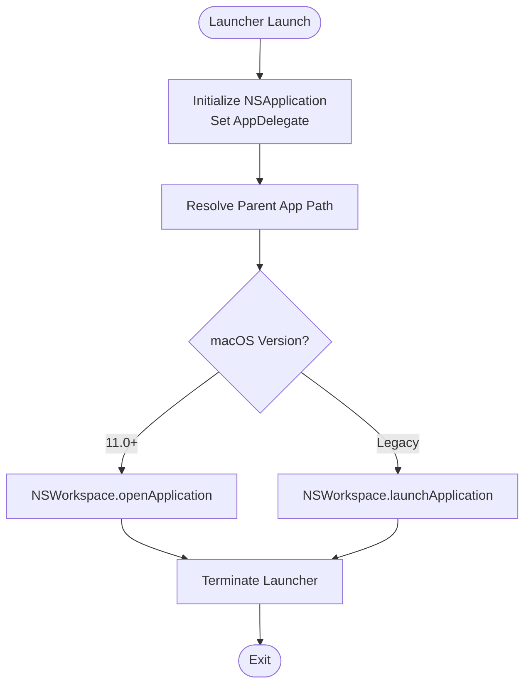
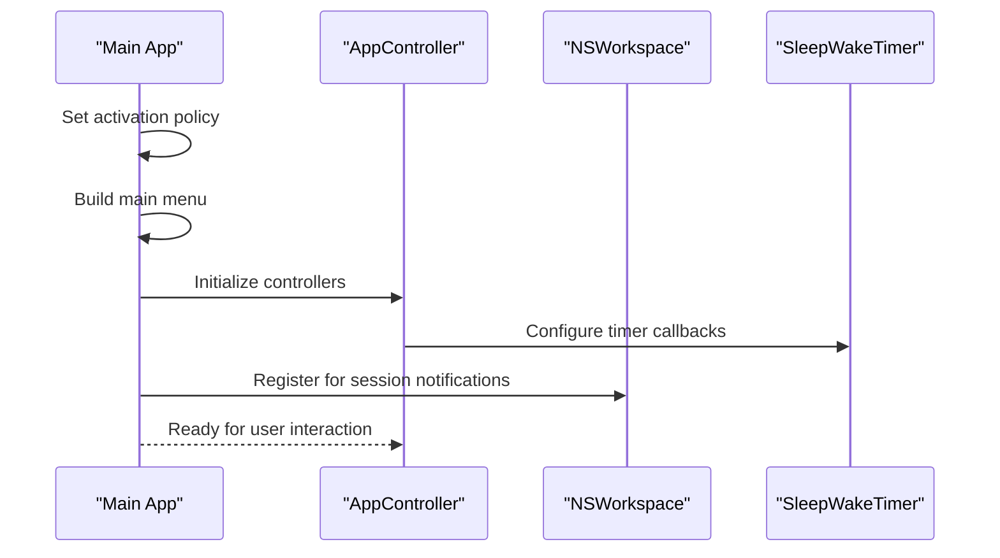
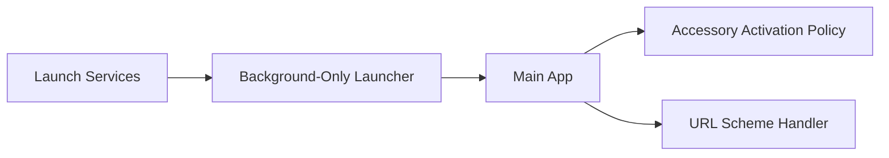
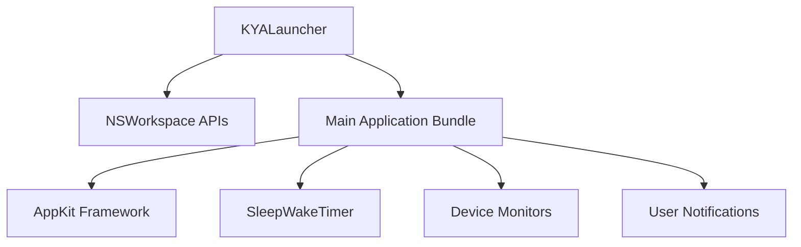

# Launcher Process Management

<cite>
**Referenced Files in This Document**
- [main.swift](file://KYALauncher/main.swift)
- [AppDelegate.swift](file://KYALauncher/AppDelegate.swift)
- [Info.plist](file://KYALauncher/Info.plist)
- [KYALauncher.entitlements](file://KYALauncher/KYALauncher.entitlements)
- [AppMain.swift](file://KeepingYouAwake/AppMain.swift)
- [AppDelegate.swift](file://KeepingYouAwake/KYAAppController/AppDelegate.swift)
- [AppController.swift](file://KeepingYouAwake/KYAAppController/AppController.swift)
- [Info.plist](file://KeepingYouAwake/Info.plist)
</cite>

## Table of Contents
1. [Introduction](#introduction)
2. [Project Structure](#project-structure)
3. [Core Components](#core-components)
4. [Architecture Overview](#architecture-overview)
5. [Detailed Component Analysis](#detailed-component-analysis)
6. [Dependency Analysis](#dependency-analysis)
7. [Performance Considerations](#performance-considerations)
8. [Troubleshooting Guide](#troubleshooting-guide)
9. [Conclusion](#conclusion)

## Introduction
This document explains the KYALauncher process management system used by KeepingYouAwake. The launcher is a separate macOS application that starts the main application on behalf of the user, enabling system-level operations while maintaining sandboxing and security boundaries. It handles background-only execution, launch services integration, and seamless handoff to the main application. The system ensures that the main app remains sandboxed while leveraging the launcher for privileged tasks such as launching the primary app at login or responding to system events.

## Project Structure
The launcher and main application are organized as distinct targets:
- KYALauncher: A minimal background-only application responsible for launching the main app and terminating itself.
- KeepingYouAwake: The main application that manages sleep/wake timers, UI, notifications, and device monitoring.

**Diagram sources**
- [main.swift:11-14](file://KYALauncher/main.swift#L11-L14)
- [AppDelegate.swift:13-25](file://KYALauncher/AppDelegate.swift#L13-L25)
- [Info.plist:7-8](file://KYALauncher/Info.plist#L7-L8)
- [AppMain.swift:11-23](file://KeepingYouAwake/AppMain.swift#L11-L23)
- [AppDelegate.swift:17-25](file://KeepingYouAwake/KYAAppController/AppDelegate.swift#L17-L25)
- [AppController.swift:34-41](file://KeepingYouAwake/KYAAppController/AppController.swift#L34-L41)
- [Info.plist:22-23](file://KeepingYouAwake/Info.plist#L22-L23)

**Section sources**
- [main.swift:11-14](file://KYALauncher/main.swift#L11-L14)
- [AppDelegate.swift:13-25](file://KYALauncher/AppDelegate.swift#L13-L25)
- [Info.plist:7-8](file://KYALauncher/Info.plist#L7-L8)
- [AppMain.swift:11-23](file://KeepingYouAwake/AppMain.swift#L11-L23)
- [AppDelegate.swift:17-25](file://KeepingYouAwake/KYAAppController/AppDelegate.swift#L17-L25)
- [AppController.swift:34-41](file://KeepingYouAwake/KYAAppController/AppController.swift#L34-L41)
- [Info.plist:22-23](file://KeepingYouAwake/Info.plist#L22-L23)

## Core Components
- KYALauncher main entry point initializes the AppKit application and sets the delegate.
- KYALauncher AppDelegate launches the main application and terminates the launcher immediately after.
- Background-only configuration ensures the launcher runs without a visible interface.
- Main application delegates manage activation policy, menu building, and lifecycle.

Key responsibilities:
- Launcher: Launch the main app and exit promptly to minimize resource usage.
- Main app: Manage timers, UI, notifications, and device monitoring with sandboxing.

**Section sources**
- [main.swift:11-14](file://KYALauncher/main.swift#L11-L14)
- [AppDelegate.swift:13-25](file://KYALauncher/AppDelegate.swift#L13-L25)
- [Info.plist:7-8](file://KYALauncher/Info.plist#L7-L8)
- [AppMain.swift:20-21](file://KeepingYouAwake/AppMain.swift#L20-L21)

## Architecture Overview
The launcher acts as a bridge between system-level launch services and the main application. It resolves the main app's bundle path, opens or launches it, and terminates itself to avoid competing resources.

**Diagram sources**
- [AppDelegate.swift:13-25](file://KYALauncher/AppDelegate.swift#L13-L25)
- [Info.plist:7-8](file://KYALauncher/Info.plist#L7-L8)

## Detailed Component Analysis

### KYALauncher Process Lifecycle
The launcher follows a strict lifecycle:
- Initialization: Creates the shared application instance and sets the delegate.
- Launch Decision: Determines the main app path by trimming the launcher's bundle path and constructs the parent path.
- Launch Execution: Uses NSWorkspace to open or launch the main application depending on macOS availability.
- Termination: Immediately terminates the launcher process to free resources.

**Diagram sources**
- [main.swift:11-14](file://KYALauncher/main.swift#L11-L14)
- [AppDelegate.swift:13-25](file://KYALauncher/AppDelegate.swift#L13-L25)

**Section sources**
- [main.swift:11-14](file://KYALauncher/main.swift#L11-L14)
- [AppDelegate.swift:13-25](file://KYALauncher/AppDelegate.swift#L13-L25)

### Main Application Integration
The main application:
- Sets activation policy to accessory to integrate seamlessly with the menu bar.
- Builds and assigns the main menu.
- Registers for launch-at-login migration when supported by the OS.
- Deinitializes observers and cleans up resources on termination.

**Diagram sources**
- [AppMain.swift:17-21](file://KeepingYouAwake/AppMain.swift#L17-L21)
- [AppDelegate.swift:17-25](file://KeepingYouAwake/KYAAppController/AppDelegate.swift#L17-L25)
- [AppController.swift:34-41](file://KeepingYouAwake/KYAAppController/AppController.swift#L34-L41)

**Section sources**
- [AppMain.swift:17-21](file://KeepingYouAwake/AppMain.swift#L17-L21)
- [AppDelegate.swift:17-25](file://KeepingYouAwake/KYAAppController/AppDelegate.swift#L17-L25)
- [AppController.swift:34-41](file://KeepingYouAwake/KYAAppController/AppController.swift#L34-L41)

### Launch Services and Background Execution
- Background-only configuration: The launcher uses a background-only Info.plist setting to prevent it from appearing in the Dock or receiving focus.
- URL scheme support: The main application declares a URL scheme for deep-linking and automation.
- Activation policy: The main app sets an accessory activation policy to operate quietly in the background.

**Diagram sources**
- [Info.plist:7-8](file://KYALauncher/Info.plist#L7-L8)
- [Info.plist:9-21](file://KeepingYouAwake/Info.plist#L9-L21)
- [AppMain.swift:20-21](file://KeepingYouAwake/AppMain.swift#L20-L21)

**Section sources**
- [Info.plist:7-8](file://KYALauncher/Info.plist#L7-L8)
- [Info.plist:9-21](file://KeepingYouAwake/Info.plist#L9-L21)
- [AppMain.swift:20-21](file://KeepingYouAwake/AppMain.swift#L20-L21)

### Entitlements and Permissions
- Launcher entitlements: The launcher entitlements file is empty, indicating minimal privileges.
- Security model: The main application is sandboxed, while the launcher is a lightweight helper that performs a single task and exits.

**Section sources**
- [KYALauncher.entitlements:4-4](file://KYALauncher/KYALauncher.entitlements#L4-L4)

## Dependency Analysis
The launcher depends on the main application bundle path resolution and NSWorkspace APIs. The main application depends on AppKit, internal packages, and system services for notifications and device monitoring.

**Diagram sources**
- [AppDelegate.swift:17-22](file://KYALauncher/AppDelegate.swift#L17-L22)
- [AppController.swift:10-17](file://KeepingYouAwake/KYAAppController/AppController.swift#L10-L17)

**Section sources**
- [AppDelegate.swift:17-22](file://KYALauncher/AppDelegate.swift#L17-L22)
- [AppController.swift:10-17](file://KeepingYouAwake/KYAAppController/AppController.swift#L10-L17)

## Performance Considerations
- Minimal footprint: The launcher terminates immediately after launching the main app, avoiding unnecessary resource consumption.
- Background-only operation: Prevents UI overhead and system visibility during launch.
- Efficient path resolution: The launcher computes the parent app path using bundle path components, minimizing computation.

## Troubleshooting Guide
Common issues and resolutions:
- Launcher fails to launch main app: Verify the bundle path resolution logic and ensure the main app exists at the computed path.
- Background-only behavior unexpected: Confirm the Info.plist background-only setting is present.
- URL scheme not recognized: Ensure the main application Info.plist declares the URL scheme and the launcher does not interfere.
- Migration of login items: On newer macOS versions, the main app migrates login item handling to system services; confirm the migration path is executed.

**Section sources**
- [AppDelegate.swift:13-25](file://KYALauncher/AppDelegate.swift#L13-L25)
- [Info.plist:7-8](file://KYALauncher/Info.plist#L7-L8)
- [Info.plist:9-21](file://KeepingYouAwake/Info.plist#L9-L21)
- [AppDelegate.swift:22-24](file://KeepingYouAwake/KYAAppController/AppDelegate.swift#L22-L24)

## Conclusion
The KYALauncher provides a clean separation between system-level launch operations and the main application's sandboxed environment. By launching the main app and terminating itself, it ensures efficient resource usage while maintaining security boundaries. The architecture leverages macOS launch services, background-only execution, and minimal entitlements to deliver a robust and secure user experience.