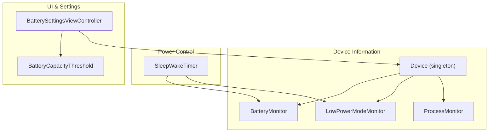
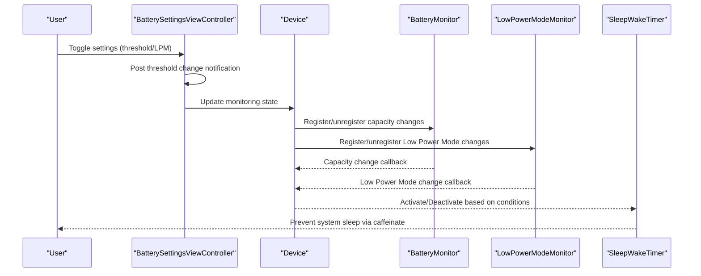
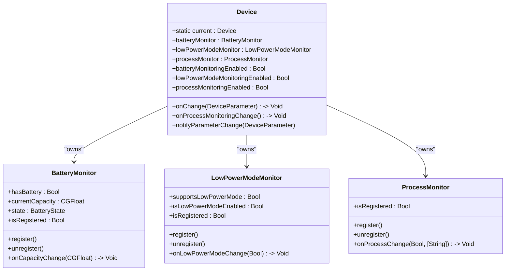
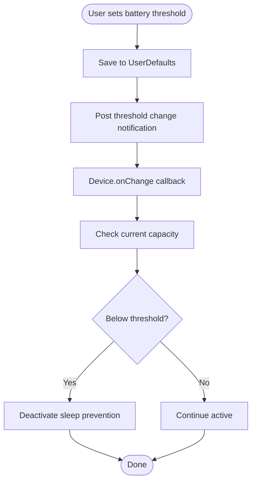
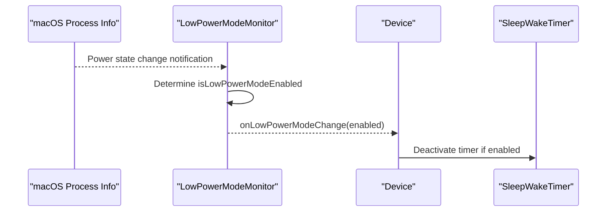
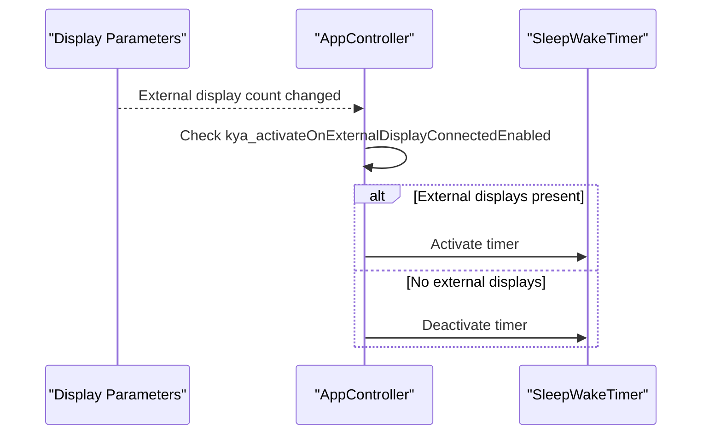
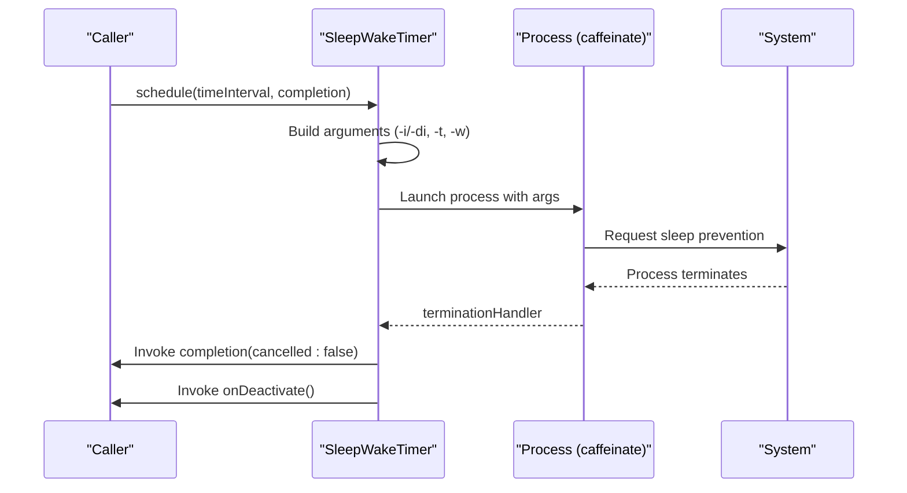
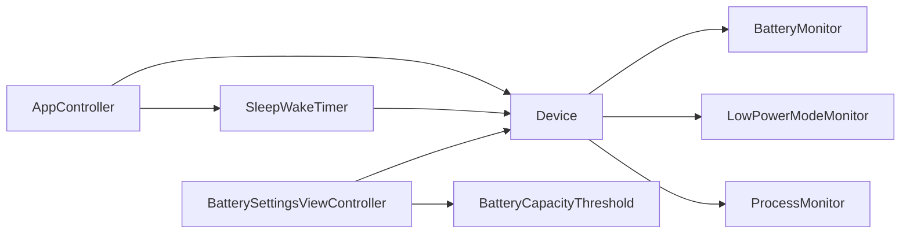

# Power Management Integration

<cite>
**Referenced Files in This Document**
- [Device.swift](file://Packages/KYADeviceInfo/Sources/KYADeviceInfo/Device.swift)
- [BatteryMonitor.swift](file://Packages/KYADeviceInfo/Sources/KYADeviceInfo/BatteryMonitor.swift)
- [LowPowerModeMonitor.swift](file://Packages/KYADeviceInfo/Sources/KYADeviceInfo/LowPowerModeMonitor.swift)
- [ProcessMonitor.swift](file://Packages/KYADeviceInfo/Sources/KYADeviceInfo/ProcessMonitor.swift)
- [BatteryCapacityThreshold.swift](file://KeepingYouAwake/BatteryCapacityThreshold.swift)
- [BatterySettingsViewController.swift](file://KeepingYouAwake/Settings/KYABatterySettingsViewController/BatterySettingsViewController.swift)
- [SleepWakeTimer.swift](file://Packages/KYASleepWakeTimer/Sources/KYASleepWakeTimer/SleepWakeTimer.swift)
- [AppController.swift](file://KeepingYouAwake/KYAAppController/AppController.swift)
</cite>

## Table of Contents
1. [Introduction](#introduction)
2. [Project Structure](#project-structure)
3. [Core Components](#core-components)
4. [Architecture Overview](#architecture-overview)
5. [Detailed Component Analysis](#detailed-component-analysis)
6. [Dependency Analysis](#dependency-analysis)
7. [Performance Considerations](#performance-considerations)
8. [Troubleshooting Guide](#troubleshooting-guide)
9. [Conclusion](#conclusion)

## Introduction
This document explains the macOS power management integration in the project, focusing on:
- Sleep prevention using the system `caffeinate` utility
- Battery capacity monitoring with configurable thresholds
- Low Power Mode detection for automatic deactivation
- External display tracking for activation triggers
- The Device singleton pattern and power state monitoring protocols
- Integration with macOS Energy Saver settings and system sleep prevention APIs
- Practical configuration examples and system compatibility considerations

## Project Structure
The power management functionality spans three main areas:
- Device information and monitoring: Device, BatteryMonitor, LowPowerModeMonitor, ProcessMonitor
- Sleep prevention: SleepWakeTimer managing the `caffeinate` process
- User configuration and UI: Battery settings view controller and threshold notifications

**Diagram sources**
- [Device.swift:24-139](file://Packages/KYADeviceInfo/Sources/KYADeviceInfo/Device.swift#L24-L139)
- [BatteryMonitor.swift:29-142](file://Packages/KYADeviceInfo/Sources/KYADeviceInfo/BatteryMonitor.swift#L29-L142)
- [LowPowerModeMonitor.swift:20-85](file://Packages/KYADeviceInfo/Sources/KYADeviceInfo/LowPowerModeMonitor.swift#L20-L85)
- [ProcessMonitor.swift](file://Packages/KYADeviceInfo/Sources/KYADeviceInfo/ProcessMonitor.swift)
- [SleepWakeTimer.swift:24-191](file://Packages/KYASleepWakeTimer/Sources/KYASleepWakeTimer/SleepWakeTimer.swift#L24-L191)
- [BatterySettingsViewController.swift:14-263](file://KeepingYouAwake/Settings/KYABatterySettingsViewController/BatterySettingsViewController.swift#L14-L263)
- [BatteryCapacityThreshold.swift:11-15](file://KeepingYouAwake/BatteryCapacityThreshold.swift#L11-L15)

**Section sources**
- [Device.swift:24-139](file://Packages/KYADeviceInfo/Sources/KYADeviceInfo/Device.swift#L24-L139)
- [SleepWakeTimer.swift:24-191](file://Packages/KYASleepWakeTimer/Sources/KYASleepWakeTimer/SleepWakeTimer.swift#L24-L191)
- [BatterySettingsViewController.swift:14-263](file://KeepingYouAwake/Settings/KYABatterySettingsViewController/BatterySettingsViewController.swift#L14-L263)

## Core Components
- Device (singleton): Central coordinator for battery, Low Power Mode, and process monitoring. Exposes enable/disable toggles and change callbacks.
- BatteryMonitor: Observes IOKit power source changes and reports capacity, charging state, and presence of a built-in battery.
- LowPowerModeMonitor: Detects Low Power Mode on macOS 12+ via process info notifications and exposes registration state.
- SleepWakeTimer: Spawns and manages the `caffeinate` process to prevent system sleep, supporting indefinite and timed modes.
- BatterySettingsViewController: Provides UI for configuring battery threshold deactivation and Low Power Mode deactivation.
- BatteryCapacityThreshold: Notification name for threshold changes.

**Section sources**
- [Device.swift:13-26](file://Packages/KYADeviceInfo/Sources/KYADeviceInfo/Device.swift#L13-L26)
- [BatteryMonitor.swift:28-63](file://Packages/KYADeviceInfo/Sources/KYADeviceInfo/BatteryMonitor.swift#L28-L63)
- [LowPowerModeMonitor.swift:19-35](file://Packages/KYADeviceInfo/Sources/KYADeviceInfo/LowPowerModeMonitor.swift#L19-L35)
- [SleepWakeTimer.swift:18-57](file://Packages/KYASleepWakeTimer/Sources/KYASleepWakeTimer/SleepWakeTimer.swift#L18-L57)
- [BatterySettingsViewController.swift:14-33](file://KeepingYouAwake/Settings/KYABatterySettingsViewController/BatterySettingsViewController.swift#L14-L33)
- [BatteryCapacityThreshold.swift:11-15](file://KeepingYouAwake/BatteryCapacityThreshold.swift#L11-L15)

## Architecture Overview
The system integrates multiple monitors to observe device state and triggers SleepWakeTimer accordingly. The Device singleton coordinates all monitors and notifies subscribers of changes. The UI reads and writes user preferences stored in UserDefaults, which influence the monitors and timer behavior.

**Diagram sources**
- [BatterySettingsViewController.swift:129-134](file://KeepingYouAwake/Settings/KYABatterySettingsViewController/BatterySettingsViewController.swift#L129-L134)
- [Device.swift:42-64](file://Packages/KYADeviceInfo/Sources/KYADeviceInfo/Device.swift#L42-L64)
- [Device.swift:68-91](file://Packages/KYADeviceInfo/Sources/KYADeviceInfo/Device.swift#L68-L91)
- [BatteryMonitor.swift:72-94](file://Packages/KYADeviceInfo/Sources/KYADeviceInfo/BatteryMonitor.swift#L72-L94)
- [LowPowerModeMonitor.swift:42-67](file://Packages/KYADeviceInfo/Sources/KYADeviceInfo/LowPowerModeMonitor.swift#L42-L67)
- [SleepWakeTimer.swift:78-111](file://Packages/KYASleepWakeTimer/Sources/KYASleepWakeTimer/SleepWakeTimer.swift#L78-L111)

## Detailed Component Analysis

### Device Singleton Pattern and Power State Monitoring
The Device class implements a singleton pattern to centralize access to device parameters. It aggregates:
- BatteryMonitor for capacity and charging state
- LowPowerModeMonitor for Low Power Mode detection
- ProcessMonitor for CLI tool tracking

Key behaviors:
- Enable/disable methods for each monitor gate on device capability (e.g., whether a device has a battery or supports Low Power Mode).
- Change notifications delivered on the main queue to the Device.onChange callback.
- Weak self usage in closures prevents retain cycles.

**Diagram sources**
- [Device.swift:24-139](file://Packages/KYADeviceInfo/Sources/KYADeviceInfo/Device.swift#L24-L139)
- [BatteryMonitor.swift:29-142](file://Packages/KYADeviceInfo/Sources/KYADeviceInfo/BatteryMonitor.swift#L29-L142)
- [LowPowerModeMonitor.swift:20-85](file://Packages/KYADeviceInfo/Sources/KYADeviceInfo/LowPowerModeMonitor.swift#L20-L85)
- [ProcessMonitor.swift](file://Packages/KYADeviceInfo/Sources/KYADeviceInfo/ProcessMonitor.swift)

**Section sources**
- [Device.swift:24-139](file://Packages/KYADeviceInfo/Sources/KYADeviceInfo/Device.swift#L24-L139)

### Battery Capacity Monitoring and Threshold Configuration
BatteryMonitor reads power source information from IOKit and exposes:
- Presence of a built-in battery
- Current capacity percentage
- Charging state (discharging, charging, full, unknown)

The UI enables threshold-based deactivation when the battery drops below a configured value. The BatterySettingsViewController binds to UserDefaults keys for:
- Threshold enablement
- Threshold value (slider)
- Low Power Mode monitoring enablement

**Diagram sources**
- [BatterySettingsViewController.swift:129-134](file://KeepingYouAwake/Settings/KYABatterySettingsViewController/BatterySettingsViewController.swift#L129-L134)
- [BatterySettingsViewController.swift:190-221](file://KeepingYouAwake/Settings/KYABatterySettingsViewController/BatterySettingsViewController.swift#L190-L221)
- [BatteryCapacityThreshold.swift:13-14](file://KeepingYouAwake/BatteryCapacityThreshold.swift#L13-L14)
- [BatteryMonitor.swift:30-63](file://Packages/KYADeviceInfo/Sources/KYADeviceInfo/BatteryMonitor.swift#L30-L63)

**Section sources**
- [BatteryMonitor.swift:28-63](file://Packages/KYADeviceInfo/Sources/KYADeviceInfo/BatteryMonitor.swift#L28-L63)
- [BatterySettingsViewController.swift:14-263](file://KeepingYouAwake/Settings/KYABatterySettingsViewController/BatterySettingsViewController.swift#L14-L263)
- [BatteryCapacityThreshold.swift:11-15](file://KeepingYouAwake/BatteryCapacityThreshold.swift#L11-L15)

### Low Power Mode Detection and Automatic Deactivation
LowPowerModeMonitor detects Low Power Mode on macOS 12+ and posts state changes to the main queue. The UI exposes a checkbox to enable Low Power Mode monitoring. When enabled, Device forwards changes to subscribers, allowing the system to deactivate sleep prevention automatically.

**Diagram sources**
- [LowPowerModeMonitor.swift:11-17](file://Packages/KYADeviceInfo/Sources/KYADeviceInfo/LowPowerModeMonitor.swift#L11-L17)
- [LowPowerModeMonitor.swift:74-80](file://Packages/KYADeviceInfo/Sources/KYADeviceInfo/LowPowerModeMonitor.swift#L74-L80)
- [Device.swift:78-88](file://Packages/KYADeviceInfo/Sources/KYADeviceInfo/Device.swift#L78-L88)

**Section sources**
- [LowPowerModeMonitor.swift:19-35](file://Packages/KYADeviceInfo/Sources/KYADeviceInfo/LowPowerModeMonitor.swift#L19-L35)
- [LowPowerModeMonitor.swift:42-67](file://Packages/KYADeviceInfo/Sources/KYADeviceInfo/LowPowerModeMonitor.swift#L42-L67)
- [Device.swift:68-91](file://Packages/KYADeviceInfo/Sources/KYADeviceInfo/Device.swift#L68-L91)

### External Display Tracking and Activation
The application can activate sleep prevention when an external display is connected. The AppController listens for screen parameter changes and toggles the SleepWakeTimer based on the number of external displays. This provides a practical way to keep the system awake when using external displays.

**Diagram sources**
- [AppController.swift:301-310](file://KeepingYouAwake/KYAAppController/AppController.swift#L301-L310)

**Section sources**
- [AppController.swift:301-310](file://KeepingYouAwake/KYAAppController/AppController.swift#L301-L310)

### Sleep Prevention Using System APIs
SleepWakeTimer spawns `/usr/bin/caffeinate` with arguments derived from user preferences:
- `-i` or `-di` depending on whether display sleep is allowed
- Optional `-t <seconds>` for timed operation
- `-w <pid>` to watch the parent process

It tracks the running process, handles termination, and invokes completion handlers on the main queue. Automatic cleanup occurs on application termination.

**Diagram sources**
- [SleepWakeTimer.swift:78-111](file://Packages/KYASleepWakeTimer/Sources/KYASleepWakeTimer/SleepWakeTimer.swift#L78-L111)
- [SleepWakeTimer.swift:115-144](file://Packages/KYASleepWakeTimer/Sources/KYASleepWakeTimer/SleepWakeTimer.swift#L115-L144)
- [SleepWakeTimer.swift:146-171](file://Packages/KYASleepWakeTimer/Sources/KYASleepWakeTimer/SleepWakeTimer.swift#L146-L171)
- [SleepWakeTimer.swift:173-190](file://Packages/KYASleepWakeTimer/Sources/KYASleepWakeTimer/SleepWakeTimer.swift#L173-L190)

**Section sources**
- [SleepWakeTimer.swift:18-57](file://Packages/KYASleepWakeTimer/Sources/KYASleepWakeTimer/SleepWakeTimer.swift#L18-L57)
- [SleepWakeTimer.swift:115-144](file://Packages/KYASleepWakeTimer/Sources/KYASleepWakeTimer/SleepWakeTimer.swift#L115-L144)
- [SleepWakeTimer.swift:146-171](file://Packages/KYASleepWakeTimer/Sources/KYASleepWakeTimer/SleepWakeTimer.swift#L146-L171)

## Dependency Analysis
The following diagram shows how components depend on each other and external frameworks:

**Diagram sources**
- [Device.swift:24-139](file://Packages/KYADeviceInfo/Sources/KYADeviceInfo/Device.swift#L24-L139)
- [BatterySettingsViewController.swift:14-33](file://KeepingYouAwake/Settings/KYABatterySettingsViewController/BatterySettingsViewController.swift#L14-L33)
- [BatteryCapacityThreshold.swift:11-15](file://KeepingYouAwake/BatteryCapacityThreshold.swift#L11-L15)
- [SleepWakeTimer.swift:24-191](file://Packages/KYASleepWakeTimer/Sources/KYASleepWakeTimer/SleepWakeTimer.swift#L24-L191)
- [AppController.swift](file://KeepingYouAwake/KYAAppController/AppController.swift)

**Section sources**
- [Device.swift:24-139](file://Packages/KYADeviceInfo/Sources/KYADeviceInfo/Device.swift#L24-L139)
- [BatterySettingsViewController.swift:14-33](file://KeepingYouAwake/Settings/KYABatterySettingsViewController/BatterySettingsViewController.swift#L14-L33)
- [SleepWakeTimer.swift:24-191](file://Packages/KYASleepWakeTimer/Sources/KYASleepWakeTimer/SleepWakeTimer.swift#L24-L191)
- [AppController.swift](file://KeepingYouAwake/KYAAppController/AppController.swift)

## Performance Considerations
- Continuous monitoring overhead: Battery and Low Power Mode monitors use run loop sources and notifications; ensure they are only active when needed to minimize CPU wake-ups.
- Main queue callbacks: All change handlers dispatch to the main queue; keep work minimal to avoid UI stalls.
- Process lifecycle: SleepWakeTimer cleans up on termination and app exit; avoid launching multiple concurrent `caffeinate` instances.
- External display checks: Polling frequency should be bounded by system events; rely on display parameter updates rather than tight loops.
- IOKit calls: BatteryMonitor queries power source info lazily; cache results when appropriate and avoid excessive repeated queries.

[No sources needed since this section provides general guidance]

## Troubleshooting Guide
- Battery threshold not triggering deactivation:
  - Verify the threshold is enabled and the value is set appropriately.
  - Confirm the device has a built-in battery; otherwise, threshold monitoring is disabled.
  - Check that the threshold change notification is being posted when settings change.
- Low Power Mode deactivation not working:
  - Ensure the device supports Low Power Mode (macOS 12+).
  - Confirm Low Power Mode monitoring is enabled in settings.
  - Verify the Low Power Mode change callback is firing and reaching the timer.
- External display activation not working:
  - Confirm the "Activate when an external display is connected" setting is enabled.
  - Check that display parameter changes are detected and the timer is activated accordingly.
- Sleep prevention not working:
  - Verify `caffeinate` is executable and arguments are constructed correctly.
  - Check for errors during process launch and ensure termination handling is invoked.
  - Confirm the timer is scheduled and not prematurely invalidated.

**Section sources**
- [BatterySettingsViewController.swift:223-238](file://KeepingYouAwake/Settings/KYABatterySettingsViewController/BatterySettingsViewController.swift#L223-L238)
- [LowPowerModeMonitor.swift:22-27](file://Packages/KYADeviceInfo/Sources/KYADeviceInfo/LowPowerModeMonitor.swift#L22-L27)
- [AppController.swift:301-310](file://KeepingYouAwake/KYAAppController/AppController.swift#L301-L310)
- [SleepWakeTimer.swift:159-164](file://Packages/KYASleepWakeTimer/Sources/KYASleepWakeTimer/SleepWakeTimer.swift#L159-L164)

## Conclusion
The power management integration combines Device monitoring, SleepWakeTimer, and user-configurable settings to intelligently prevent system sleep under specified conditions. The singleton Device pattern centralizes state observation, while SleepWakeTimer leverages the system `caffeinate` utility for reliable sleep prevention. Proper configuration of battery thresholds, Low Power Mode detection, and external display tracking ensures efficient and user-friendly behavior across supported macOS versions.