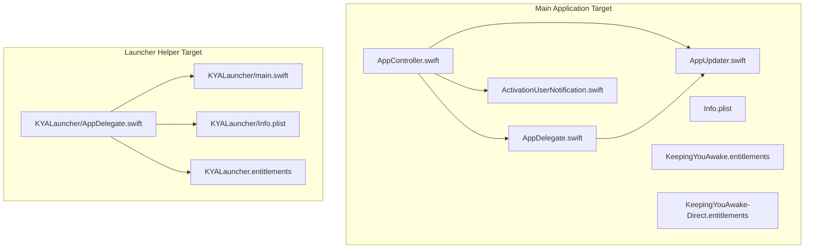
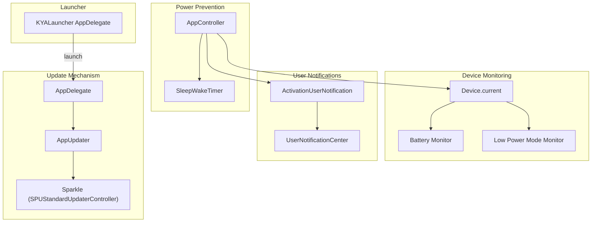
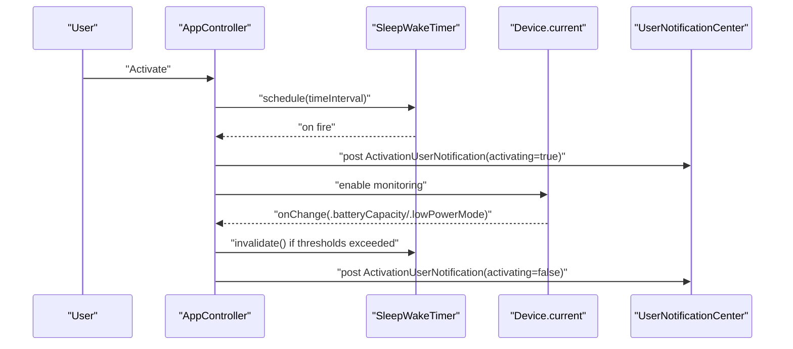
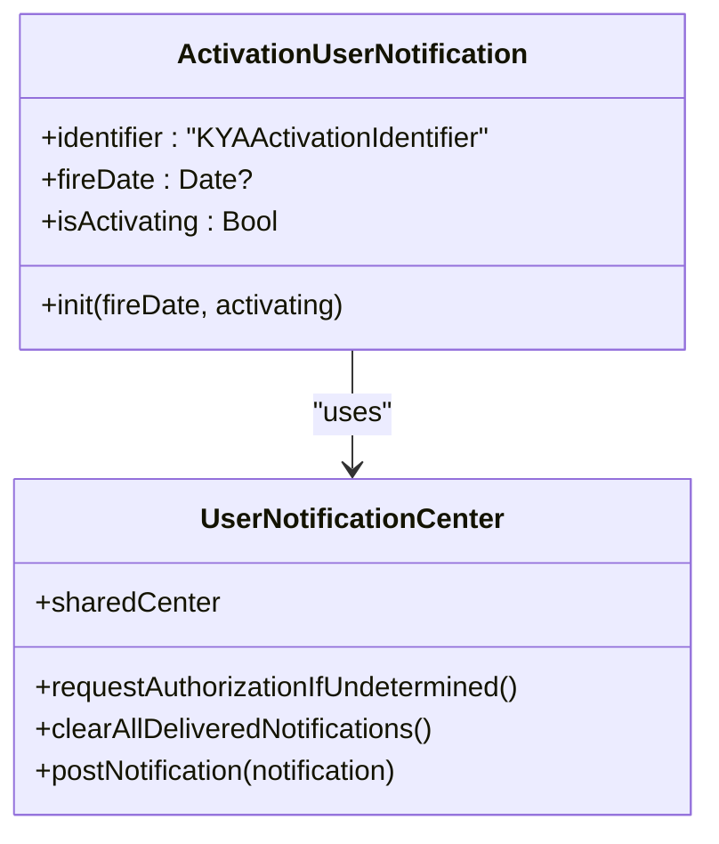
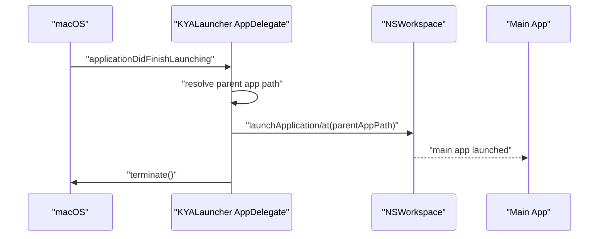
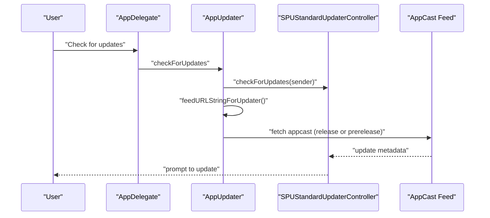
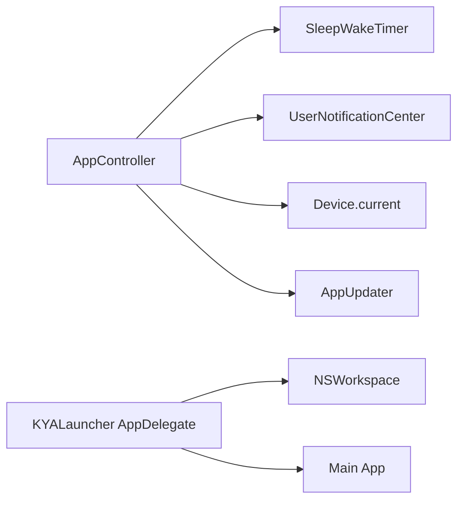

# System Integration

<cite>
**Referenced Files in This Document**
- [AppController.swift](file://KeepingYouAwake/KYAAppController/AppController.swift)
- [AppDelegate.swift](file://KeepingYouAwake/KYAAppController/AppDelegate.swift)
- [ActivationUserNotification.swift](file://KeepingYouAwake/KYAActivationUserNotification/ActivationUserNotification.swift)
- [AppUpdater.swift](file://KeepingYouAwake/KYAAppUpdater/AppUpdater.swift)
- [AppDelegate.swift](file://KYALauncher/AppDelegate.swift)
- [main.swift](file://KYALauncher/main.swift)
- [Info.plist](file://KeepingYouAwake/Info.plist)
- [Info.plist](file://KYALauncher/Info.plist)
- [KeepingYouAwake-Direct.entitlements](file://KeepingYouAwake/KeepingYouAwake-Direct.entitlements)
- [KeepingYouAwake.entitlements](file://KeepingYouAwake/KeepingYouAwake.entitlements)
- [KYALauncher.entitlements](file://KYALauncher/KYALauncher.entitlements)
- [BatteryCapacityThreshold.swift](file://KeepingYouAwake/BatteryCapacityThreshold.swift)
- [Configuration.xcconfig](file://Configuration.xcconfig)
- [README.md](file://README.md)
</cite>

## Table of Contents
1. [Introduction](#introduction)
2. [Project Structure](#project-structure)
3. [Core Components](#core-components)
4. [Architecture Overview](#architecture-overview)
5. [Detailed Component Analysis](#detailed-component-analysis)
6. [Dependency Analysis](#dependency-analysis)
7. [Performance Considerations](#performance-considerations)
8. [Troubleshooting Guide](#troubleshooting-guide)
9. [Conclusion](#conclusion)

## Introduction
This document explains the system integration features of the application, focusing on macOS power management integration, user notifications, process management, and automatic updates. It covers how the app prevents sleep using system APIs, monitors power state changes, posts user notifications, manages background processes, and integrates with Sparkle for updates. It also documents entitlements, sandboxing considerations, and compatibility across macOS versions.

## Project Structure
The system integration spans two targets:
- Main application target: orchestrates power prevention, device monitoring, notifications, and settings.
- Launcher helper target: launches the main app and terminates after delegation.

**Diagram sources**
- [AppController.swift:1-352](file://KeepingYouAwake/KYAAppController/AppController.swift#L1-L352)
- [AppDelegate.swift:1-57](file://KeepingYouAwake/KYAAppController/AppDelegate.swift#L1-L57)
- [ActivationUserNotification.swift:1-38](file://KeepingYouAwake/KYAActivationUserNotification/ActivationUserNotification.swift#L1-L38)
- [AppUpdater.swift:1-44](file://KeepingYouAwake/KYAAppUpdater/AppUpdater.swift#L1-L44)
- [AppDelegate.swift:1-26](file://KYALauncher/AppDelegate.swift#L1-L26)
- [main.swift:1-14](file://KYALauncher/main.swift#L1-L14)
- [Info.plist:1-36](file://KeepingYouAwake/Info.plist#L1-L36)
- [Info.plist:1-11](file://KYALauncher/Info.plist#L1-L11)
- [KeepingYouAwake-Direct.entitlements:1-12](file://KeepingYouAwake/KeepingYouAwake-Direct.entitlements#L1-L12)
- [KeepingYouAwake.entitlements:1-6](file://KeepingYouAwake/KeepingYouAwake.entitlements#L1-L6)
- [KYALauncher.entitlements:1-6](file://KYALauncher/KYALauncher.entitlements#L1-L6)

**Section sources**
- [AppController.swift:1-352](file://KeepingYouAwake/KYAAppController/AppController.swift#L1-L352)
- [AppDelegate.swift:1-26](file://KYALauncher/AppDelegate.swift#L1-L26)
- [main.swift:1-14](file://KYALauncher/main.swift#L1-L14)
- [Info.plist:1-36](file://KeepingYouAwake/Info.plist#L1-L36)
- [Info.plist:1-11](file://KYALauncher/Info.plist#L1-L11)

## Core Components
- AppController: central orchestrator coordinating sleep/wake timer, status item, menus, device monitoring, and notifications.
- ActivationUserNotification: macOS user notification payload for activation/deactivation events.
- AppUpdater: Sparkle-based updater with channel selection and delegate integration.
- Launcher: helper app that launches the main app and exits immediately.
- Entitlements and Info.plist: define runtime capabilities, background behavior, and update service integration.

**Section sources**
- [AppController.swift:19-41](file://KeepingYouAwake/KYAAppController/AppController.swift#L19-L41)
- [ActivationUserNotification.swift:12-38](file://KeepingYouAwake/KYAActivationUserNotification/ActivationUserNotification.swift#L12-L38)
- [AppUpdater.swift:15-44](file://KeepingYouAwake/KYAAppUpdater/AppUpdater.swift#L15-L44)
- [AppDelegate.swift:11-26](file://KYALauncher/AppDelegate.swift#L11-L26)
- [Info.plist:22-34](file://KeepingYouAwake/Info.plist#L22-L34)

## Architecture Overview
The system integration architecture ties together power prevention, device monitoring, user notifications, and update mechanisms.

**Diagram sources**
- [AppController.swift:21-90](file://KeepingYouAwake/KYAAppController/AppController.swift#L21-L90)
- [ActivationUserNotification.swift:12-38](file://KeepingYouAwake/KYAActivationUserNotification/ActivationUserNotification.swift#L12-L38)
- [AppUpdater.swift:15-44](file://KeepingYouAwake/KYAAppUpdater/AppUpdater.swift#L15-L44)
- [AppDelegate.swift:11-26](file://KYALauncher/AppDelegate.swift#L11-L26)

## Detailed Component Analysis

### macOS Power Management Integration
The app prevents sleep by scheduling a system-level timer and monitoring device power state. It posts user notifications on activation/deactivation and respects battery and low-power thresholds.

**Diagram sources**
- [AppController.swift:77-122](file://KeepingYouAwake/KYAAppController/AppController.swift#L77-L122)
- [AppController.swift:202-246](file://KeepingYouAwake/KYAAppController/AppController.swift#L202-L246)
- [ActivationUserNotification.swift:12-38](file://KeepingYouAwake/KYAActivationUserNotification/ActivationUserNotification.swift#L12-L38)

Key behaviors:
- Activation schedules a timer and posts an activation notification.
- Deactivation posts a deactivation notification and optionally quits the app.
- Device monitoring toggles power monitoring based on user preferences.
- Threshold checks terminate the timer when battery capacity or low-power mode conditions are met.

**Section sources**
- [AppController.swift:77-122](file://KeepingYouAwake/KYAAppController/AppController.swift#L77-L122)
- [AppController.swift:202-246](file://KeepingYouAwake/KYAAppController/AppController.swift#L202-L246)
- [BatteryCapacityThreshold.swift:11-15](file://KeepingYouAwake/BatteryCapacityThreshold.swift#L11-L15)

### UserNotification System Integration
ActivationUserNotification encapsulates localized titles and bodies for activation/deactivation events. The app requests authorization and clears previous notifications on startup.

**Diagram sources**
- [ActivationUserNotification.swift:12-38](file://KeepingYouAwake/KYAActivationUserNotification/ActivationUserNotification.swift#L12-L38)
- [AppController.swift:181-187](file://KeepingYouAwake/KYAAppController/AppController.swift#L181-L187)

Permissions and lifecycle:
- Authorization is requested when supported by the OS.
- Previous notifications are cleared on startup to avoid stale alerts.

**Section sources**
- [ActivationUserNotification.swift:12-38](file://KeepingYouAwake/KYAActivationUserNotification/ActivationUserNotification.swift#L12-L38)
- [AppController.swift:181-187](file://KeepingYouAwake/KYAAppController/AppController.swift#L181-L187)

### KYALauncher Process Management
The launcher target opens the main app and terminates itself. It runs in background-only mode and is configured as a helper.

**Diagram sources**
- [AppDelegate.swift:11-26](file://KYALauncher/AppDelegate.swift#L11-L26)
- [main.swift:11-14](file://KYALauncher/main.swift#L11-L14)
- [Info.plist:7-8](file://KYALauncher/Info.plist#L7-L8)

Behavioral notes:
- Background-only configuration ensures the launcher does not appear in the Dock.
- Launch Services integration is handled by the main app’s LSUIElement setting.

**Section sources**
- [AppDelegate.swift:11-26](file://KYALauncher/AppDelegate.swift#L11-L26)
- [main.swift:11-14](file://KYALauncher/main.swift#L11-L14)
- [Info.plist:7-8](file://KYALauncher/Info.plist#L7-L8)

### Sparkle Integration for Automatic Updates
The app integrates Sparkle for update checks and channel selection. Update feeds are chosen based on user preferences.

**Diagram sources**
- [AppDelegate.swift:18-20](file://KeepingYouAwake/KYAAppController/AppDelegate.swift#L18-L20)
- [AppUpdater.swift:27-42](file://KeepingYouAwake/KYAAppUpdater/AppUpdater.swift#L27-L42)

Channel management:
- Release vs prerelease feed is selected via a preference.
- Automatic update checks are enabled in the main app’s Info.plist.

**Section sources**
- [AppUpdater.swift:15-44](file://KeepingYouAwake/KYAAppUpdater/AppUpdater.swift#L15-L44)
- [Info.plist:28-33](file://KeepingYouAwake/Info.plist#L28-L33)

### Implementation Specifics: System API Integration, Launch Services, and Sandboxing
- System API integration:
  - User notifications via UserNotificationCenter.
  - Device monitoring via Device.current battery and low power mode monitors.
- Launch Services configuration:
  - Main app uses LSUIElement to run as an agent.
  - Launcher uses LSBackgroundOnly to run as a background helper.
- Sandboxing considerations:
  - Main app entitlements are minimal; a temporary Mach lookup exception exists for Sparkle internal services.
  - Launcher has no special entitlements.

**Section sources**
- [AppController.swift:181-187](file://KeepingYouAwake/KYAAppController/AppController.swift#L181-L187)
- [AppController.swift:202-225](file://KeepingYouAwake/KYAAppController/AppController.swift#L202-L225)
- [Info.plist:22-23](file://KeepingYouAwake/Info.plist#L22-L23)
- [Info.plist:7-8](file://KYALauncher/Info.plist#L7-L8)
- [KeepingYouAwake-Direct.entitlements:4-10](file://KeepingYouAwake/KeepingYouAwake-Direct.entitlements#L4-L10)
- [KeepingYouAwake.entitlements:3-5](file://KeepingYouAwake/KeepingYouAwake.entitlements#L3-L5)
- [KYALauncher.entitlements:3-5](file://KYALauncher/KYALauncher.entitlements#L3-L5)

### Security Implications, Permissions, and Compatibility
- Security and permissions:
  - User notifications require explicit authorization; the app requests it when supported.
  - No elevated privileges are used; operations rely on public frameworks.
- Compatibility:
  - Minimum deployment target is macOS 10.13.
  - Availability guards protect features introduced in later OS versions (e.g., macOS 11 user notifications, macOS 13 login item migration, macOS 14 activation behavior).
- Distribution and update channels:
  - AppCast URLs are configured in the updater; release and prerelease feeds are selectable via preferences.

**Section sources**
- [Configuration.xcconfig:9-10](file://Configuration.xcconfig#L9-L10)
- [AppController.swift:103-121](file://KeepingYouAwake/KYAAppController/AppController.swift#L103-L121)
- [AppDelegate.swift:22-24](file://KeepingYouAwake/KYAAppController/AppDelegate.swift#L22-L24)
- [AppDelegate.swift:37-41](file://KeepingYouAwake/KYAAppController/AppDelegate.swift#L37-L41)
- [AppUpdater.swift:20-21](file://KeepingYouAwake/KYAAppUpdater/AppUpdater.swift#L20-L21)
- [README.md:1-29](file://README.md#L1-L29)

## Dependency Analysis
The main application composes several subsystems: timer orchestration, device monitoring, user notifications, and updates. The launcher depends on NSWorkspace to open the main app and then terminates.

**Diagram sources**
- [AppController.swift:21-41](file://KeepingYouAwake/KYAAppController/AppController.swift#L21-L41)
- [AppDelegate.swift:11-26](file://KYALauncher/AppDelegate.swift#L11-L26)

**Section sources**
- [AppController.swift:1-51](file://KeepingYouAwake/KYAAppController/AppController.swift#L1-L51)
- [AppDelegate.swift:11-26](file://KYALauncher/AppDelegate.swift#L11-L26)

## Performance Considerations
- Minimize unnecessary device monitoring; enable only when user preferences require it.
- Avoid posting redundant notifications; clear delivered notifications on startup.
- Schedule timers with appropriate intervals to reduce CPU wake-ups.
- Use availability checks to avoid overhead on unsupported systems.

## Troubleshooting Guide
- Notifications not appearing:
  - Verify authorization was requested and granted.
  - Confirm previous notifications are cleared on startup.
- Sleep prevention stops unexpectedly:
  - Check battery capacity threshold and low power mode monitoring settings.
  - Review device parameter change handlers and termination conditions.
- Update checks not working:
  - Confirm automatic checks are enabled in Info.plist.
  - Verify feed URL selection matches user preference.
- Launcher fails to start main app:
  - Ensure the bundle path resolution logic is correct.
  - Confirm the main app is marked as LSUIElement.

**Section sources**
- [AppController.swift:181-187](file://KeepingYouAwake/KYAAppController/AppController.swift#L181-L187)
- [AppController.swift:227-246](file://KeepingYouAwake/KYAAppController/AppController.swift#L227-L246)
- [Info.plist:28-33](file://KeepingYouAwake/Info.plist#L28-L33)
- [AppDelegate.swift:13-25](file://KYALauncher/AppDelegate.swift#L13-L25)

## Conclusion
The system integration leverages macOS frameworks to prevent sleep, monitor power state, notify users, and keep the app up to date. The design balances capability with minimal permissions, uses background helpers where appropriate, and adapts to varying macOS versions. The modular architecture allows for clear maintenance and future enhancements.