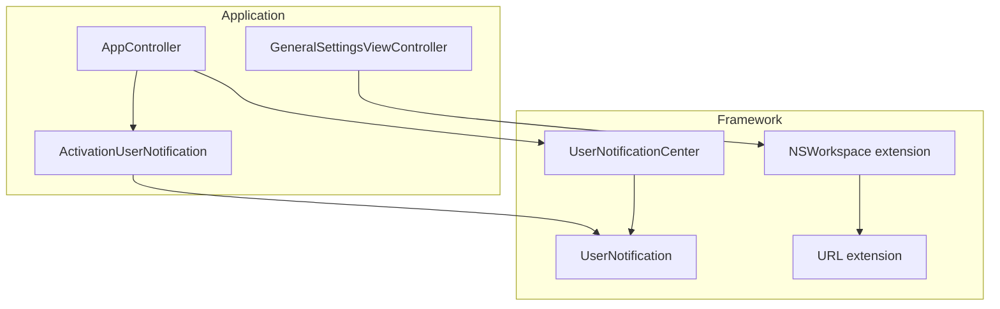
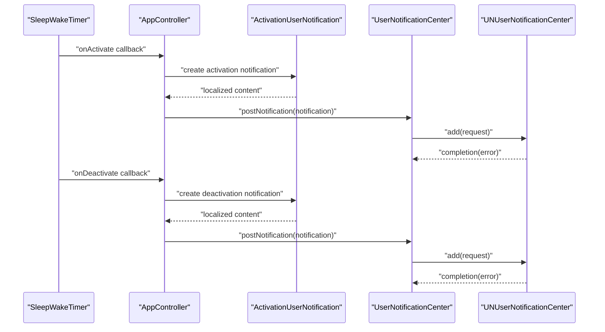
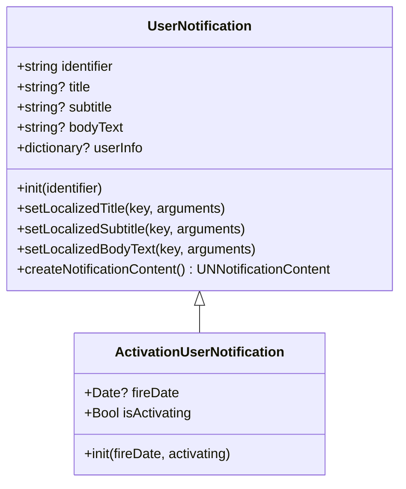
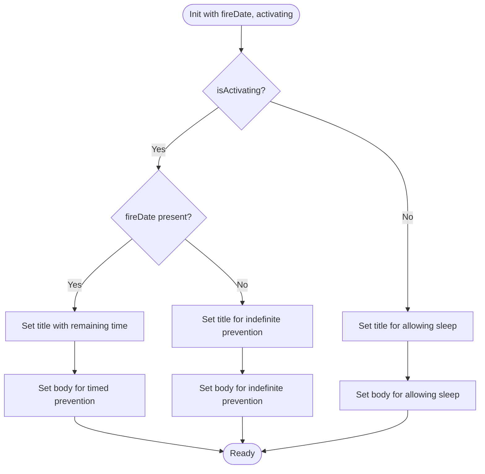
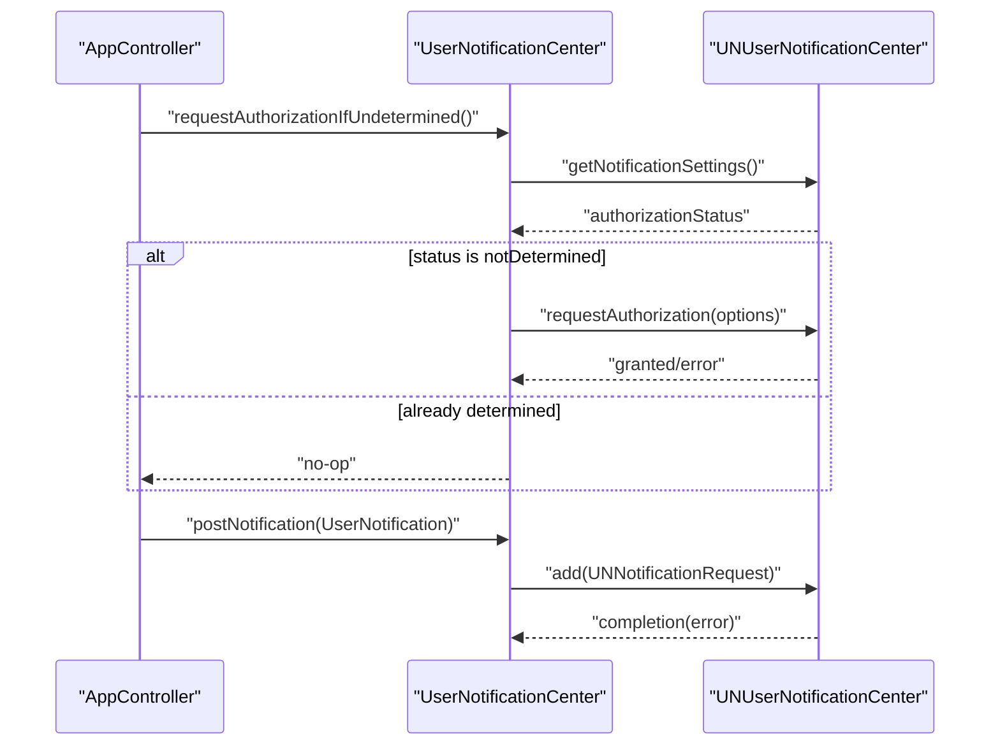
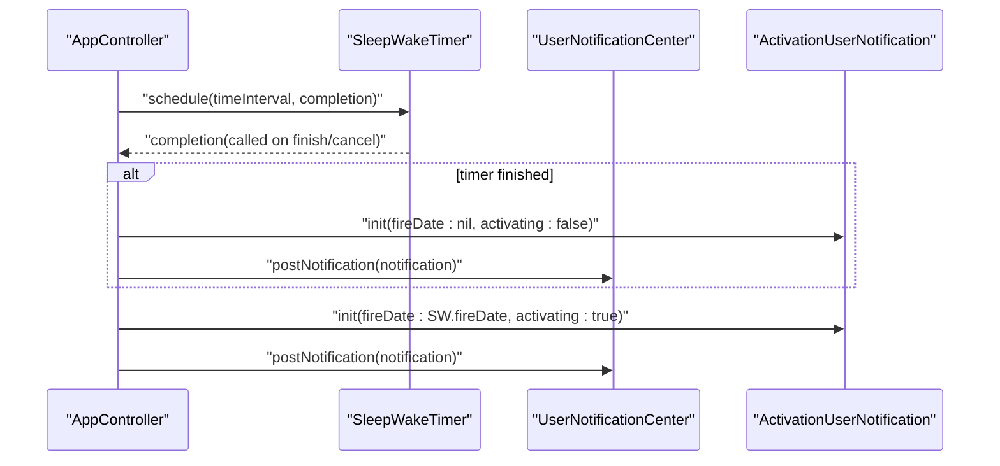
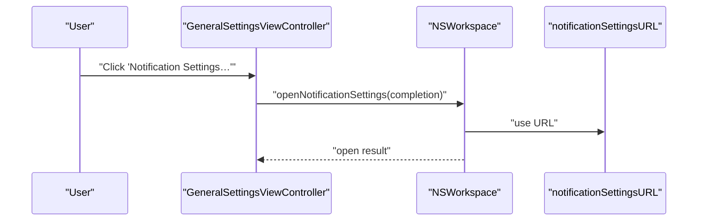
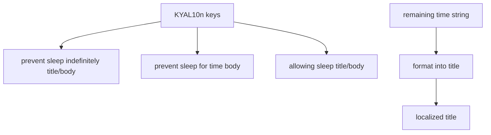
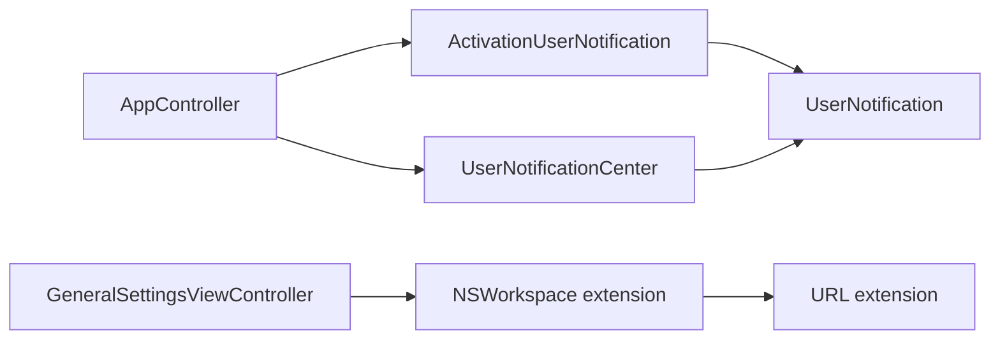

# User Notification Integration

<cite>
**Referenced Files in This Document**
- [ActivationUserNotification.swift](file://KeepingYouAwake/KYAActivationUserNotification/ActivationUserNotification.swift)
- [UserNotification.swift](file://Packages/KYAUserNotifications/Sources/KYAUserNotifications/UserNotification.swift)
- [UserNotificationCenter.swift](file://Packages/KYAUserNotifications/Sources/KYAUserNotifications/UserNotificationCenter.swift)
- [NSWorkspace+NotificationCenter.swift](file://Packages/KYAUserNotifications/Sources/KYAUserNotifications/NSWorkspace+NotificationCenter.swift)
- [URL+NotificationCenter.swift](file://Packages/KYAUserNotifications/Sources/KYAUserNotifications/URL+NotificationCenter.swift)
- [AppController.swift](file://KeepingYouAwake/KYAAppController/AppController.swift)
- [GeneralSettingsViewController.swift](file://KeepingYouAwake/Settings/KYAGeneralSettingsViewController/GeneralSettingsViewController.swift)
- [KYAL10n.swift](file://KeepingYouAwake/KYAL10n.swift)
- [v1.6.1.md](file://docs/Versions/v1.6.1.md)
- [v1.2.md](file://docs/Versions/v1.2.md)
</cite>

## Table of Contents
1. [Introduction](#introduction)
2. [Project Structure](#project-structure)
3. [Core Components](#core-components)
4. [Architecture Overview](#architecture-overview)
5. [Detailed Component Analysis](#detailed-component-analysis)
6. [Dependency Analysis](#dependency-analysis)
7. [Performance Considerations](#performance-considerations)
8. [Troubleshooting Guide](#troubleshooting-guide)
9. [Conclusion](#conclusion)

## Introduction
This document explains the user notification system integration in the application, focusing on how activation and deactivation events are communicated to users via system notifications. It covers the UserNotification framework, the ActivationUserNotification implementation, notification scheduling during timer activation/deactivation, permission management for Notification Center access, localization of notification content, and user preference handling. It also documents notification delivery mechanisms, Notification Center integration, system permission requirements, and practical guidance for configuration, customization, and reliability.

## Project Structure
The notification system spans two main areas:
- Application-side integration: AppController orchestrates timer activation/deactivation and posts notifications.
- Framework-side infrastructure: A reusable notification framework (KYAUserNotifications) handles authorization, scheduling, and delivery.

**Diagram sources**
- [AppController.swift:181-187](file://KeepingYouAwake/KYAAppController/AppController.swift#L181-L187)
- [ActivationUserNotification.swift:12-38](file://KeepingYouAwake/KYAActivationUserNotification/ActivationUserNotification.swift#L12-L38)
- [UserNotification.swift:13-77](file://Packages/KYAUserNotifications/Sources/KYAUserNotifications/UserNotification.swift#L13-L77)
- [UserNotificationCenter.swift:12-114](file://Packages/KYAUserNotifications/Sources/KYAUserNotifications/UserNotificationCenter.swift#L12-L114)
- [NSWorkspace+NotificationCenter.swift:10-26](file://Packages/KYAUserNotifications/Sources/KYAUserNotifications/NSWorkspace+NotificationCenter.swift#L10-L26)
- [URL+NotificationCenter.swift:10-15](file://Packages/KYAUserNotifications/Sources/KYAUserNotifications/URL+NotificationCenter.swift#L10-L15)

**Section sources**
- [AppController.swift:181-187](file://KeepingYouAwake/KYAAppController/AppController.swift#L181-L187)
- [UserNotificationCenter.swift:12-114](file://Packages/KYAUserNotifications/Sources/KYAUserNotifications/UserNotificationCenter.swift#L12-L114)

## Core Components
- UserNotification: Base class for notification content with localization helpers and conversion to UNNotificationContent.
- ActivationUserNotification: Specialized notification for activation/deactivation events with dynamic title/body based on activation state and optional fire date.
- UserNotificationCenter: Authorization manager and dispatcher for posting notifications to the system.
- NSWorkspace extension: Opens Notification Center settings in System Settings for user-managed permissions.
- AppController: Orchestrates timer lifecycle and posts notifications on activation and deactivation.
- GeneralSettingsViewController: Provides UI to open Notification Center settings.

**Section sources**
- [UserNotification.swift:13-77](file://Packages/KYAUserNotifications/Sources/KYAUserNotifications/UserNotification.swift#L13-L77)
- [ActivationUserNotification.swift:12-38](file://KeepingYouAwake/KYAActivationUserNotification/ActivationUserNotification.swift#L12-L38)
- [UserNotificationCenter.swift:12-114](file://Packages/KYAUserNotifications/Sources/KYAUserNotifications/UserNotificationCenter.swift#L12-L114)
- [NSWorkspace+NotificationCenter.swift:10-26](file://Packages/KYAUserNotifications/Sources/KYAUserNotifications/NSWorkspace+NotificationCenter.swift#L10-L26)
- [AppController.swift:96-122](file://KeepingYouAwake/KYAAppController/AppController.swift#L96-L122)
- [GeneralSettingsViewController.swift:110-114](file://KeepingYouAwake/Settings/KYAGeneralSettingsViewController/GeneralSettingsViewController.swift#L110-L114)

## Architecture Overview
The notification pipeline integrates three layers:
- Content Layer: UserNotification and ActivationUserNotification define localized content and metadata.
- Control Layer: UserNotificationCenter manages authorization and posts notifications via UNUserNotificationCenter.
- Orchestration Layer: AppController triggers notifications during activation/deactivation and clears previous notifications.

**Diagram sources**
- [AppController.swift:96-122](file://KeepingYouAwake/KYAAppController/AppController.swift#L96-L122)
- [ActivationUserNotification.swift:19-38](file://KeepingYouAwake/KYAActivationUserNotification/ActivationUserNotification.swift#L19-L38)
- [UserNotificationCenter.swift:90-107](file://Packages/KYAUserNotifications/Sources/KYAUserNotifications/UserNotificationCenter.swift#L90-L107)

## Detailed Component Analysis

### UserNotification Framework
UserNotification encapsulates notification content and provides localization helpers. It converts its properties into UNNotificationContent for delivery.

**Diagram sources**
- [UserNotification.swift:13-77](file://Packages/KYAUserNotifications/Sources/KYAUserNotifications/UserNotification.swift#L13-L77)
- [ActivationUserNotification.swift:12-38](file://KeepingYouAwake/KYAActivationUserNotification/ActivationUserNotification.swift#L12-L38)

**Section sources**
- [UserNotification.swift:13-77](file://Packages/KYAUserNotifications/Sources/KYAUserNotifications/UserNotification.swift#L13-L77)

### ActivationUserNotification Implementation
ActivationUserNotification builds localized titles and bodies based on:
- Activation state (activating vs deactivating)
- Optional fireDate for dynamic remaining time display

It sets the notification identifier and delegates content localization to the base class.

**Diagram sources**
- [ActivationUserNotification.swift:19-38](file://KeepingYouAwake/KYAActivationUserNotification/ActivationUserNotification.swift#L19-L38)
- [KYAL10n.swift:34-44](file://KeepingYouAwake/KYAL10n.swift#L34-L44)

**Section sources**
- [ActivationUserNotification.swift:12-38](file://KeepingYouAwake/KYAActivationUserNotification/ActivationUserNotification.swift#L12-L38)
- [KYAL10n.swift:34-44](file://KeepingYouAwake/KYAL10n.swift#L34-L44)

### UserNotificationCenter Authorization and Delivery
UserNotificationCenter centralizes:
- Authorization status retrieval and request flow
- Conditional authorization requests when undetermined
- Notification posting with identifier-based grouping
- Legacy fallback for older macOS versions

**Diagram sources**
- [UserNotificationCenter.swift:34-86](file://Packages/KYAUserNotifications/Sources/KYAUserNotifications/UserNotificationCenter.swift#L34-L86)
- [UserNotificationCenter.swift:90-107](file://Packages/KYAUserNotifications/Sources/KYAUserNotifications/UserNotificationCenter.swift#L90-L107)

**Section sources**
- [UserNotificationCenter.swift:34-86](file://Packages/KYAUserNotifications/Sources/KYAUserNotifications/UserNotificationCenter.swift#L34-L86)
- [UserNotificationCenter.swift:90-107](file://Packages/KYAUserNotifications/Sources/KYAUserNotifications/UserNotificationCenter.swift#L90-L107)

### AppController Orchestration
AppController coordinates timer activation/deactivation and posts corresponding notifications:
- On activation: creates an activation notification with the timer's fireDate and posts it.
- On deactivation: creates a deactivation notification and posts it.
- Clears previously delivered notifications during initialization to avoid clutter.

**Diagram sources**
- [AppController.swift:96-122](file://KeepingYouAwake/KYAAppController/AppController.swift#L96-L122)
- [AppController.swift:181-187](file://KeepingYouAwake/KYAAppController/AppController.swift#L181-L187)

**Section sources**
- [AppController.swift:96-122](file://KeepingYouAwake/KYAAppController/AppController.swift#L96-L122)
- [AppController.swift:181-187](file://KeepingYouAwake/KYAAppController/AppController.swift#L181-L187)

### Notification Center Integration and Permission Management
- Opening Notification Center settings: NSWorkspace extension opens the system settings notification pane.
- URL construction: A static URL constant points to the notification preferences.
- Settings UI: GeneralSettingsViewController provides a button to open settings when available.

**Diagram sources**
- [GeneralSettingsViewController.swift:110-114](file://KeepingYouAwake/Settings/KYAGeneralSettingsViewController/GeneralSettingsViewController.swift#L110-L114)
- [NSWorkspace+NotificationCenter.swift:14-25](file://Packages/KYAUserNotifications/Sources/KYAUserNotifications/NSWorkspace+NotificationCenter.swift#L14-L25)
- [URL+NotificationCenter.swift:10-15](file://Packages/KYAUserNotifications/Sources/KYAUserNotifications/URL+NotificationCenter.swift#L10-L15)

**Section sources**
- [GeneralSettingsViewController.swift:110-114](file://KeepingYouAwake/Settings/KYAGeneralSettingsViewController/GeneralSettingsViewController.swift#L110-L114)
- [NSWorkspace+NotificationCenter.swift:14-25](file://Packages/KYAUserNotifications/Sources/KYAUserNotifications/NSWorkspace+NotificationCenter.swift#L14-L25)
- [URL+NotificationCenter.swift:10-15](file://Packages/KYAUserNotifications/Sources/KYAUserNotifications/URL+NotificationCenter.swift#L10-L15)

### Notification Content Localization
Localization keys are defined in the main localization namespace and used by ActivationUserNotification to set titles and bodies. Remaining time formatting is handled by a localized helper.

**Diagram sources**
- [KYAL10n.swift:34-44](file://KeepingYouAwake/KYAL10n.swift#L34-L44)
- [ActivationUserNotification.swift:24-36](file://KeepingYouAwake/KYAActivationUserNotification/ActivationUserNotification.swift#L24-L36)

**Section sources**
- [KYAL10n.swift:34-44](file://KeepingYouAwake/KYAL10n.swift#L34-L44)
- [ActivationUserNotification.swift:24-36](file://KeepingYouAwake/KYAActivationUserNotification/ActivationUserNotification.swift#L24-L36)

### User Preference Handling
- Notification settings are managed by the user via System Settings.
- The app requests authorization when first launched and clears previously delivered notifications to keep the Notification Center clean.
- Users can open settings directly from the application UI.

**Section sources**
- [UserNotificationCenter.swift:181-187](file://KeepingYouAwake/KYAAppController/AppController.swift#L181-L187)
- [GeneralSettingsViewController.swift:110-114](file://KeepingYouAwake/Settings/KYAGeneralSettingsViewController/GeneralSettingsViewController.swift#L110-L114)

## Dependency Analysis
The notification system exhibits clear separation of concerns:
- AppController depends on UserNotificationCenter and ActivationUserNotification.
- ActivationUserNotification depends on UserNotification and localization keys.
- UserNotificationCenter depends on UNUserNotificationCenter and logs errors.
- NSWorkspace extension depends on NSWorkspace APIs to open system settings.

**Diagram sources**
- [AppController.swift:96-122](file://KeepingYouAwake/KYAAppController/AppController.swift#L96-L122)
- [ActivationUserNotification.swift:12-38](file://KeepingYouAwake/KYAActivationUserNotification/ActivationUserNotification.swift#L12-L38)
- [UserNotification.swift:13-77](file://Packages/KYAUserNotifications/Sources/KYAUserNotifications/UserNotification.swift#L13-L77)
- [UserNotificationCenter.swift:12-114](file://Packages/KYAUserNotifications/Sources/KYAUserNotifications/UserNotificationCenter.swift#L12-L114)
- [GeneralSettingsViewController.swift:110-114](file://KeepingYouAwake/Settings/KYAGeneralSettingsViewController/GeneralSettingsViewController.swift#L110-L114)
- [NSWorkspace+NotificationCenter.swift:10-26](file://Packages/KYAUserNotifications/Sources/KYAUserNotifications/NSWorkspace+NotificationCenter.swift#L10-L26)
- [URL+NotificationCenter.swift:10-15](file://Packages/KYAUserNotifications/Sources/KYAUserNotifications/URL+NotificationCenter.swift#L10-L15)

**Section sources**
- [AppController.swift:96-122](file://KeepingYouAwake/KYAAppController/AppController.swift#L96-L122)
- [UserNotificationCenter.swift:12-114](file://Packages/KYAUserNotifications/Sources/KYAUserNotifications/UserNotificationCenter.swift#L12-L114)

## Performance Considerations
- Minimal overhead: Notifications are lightweight and posted synchronously via the framework’s dispatch mechanism.
- Identifier-based grouping: Using a stable identifier ensures proper grouping and avoids duplicates in the Notification Center.
- Conditional authorization: Authorization requests are only performed when necessary, reducing unnecessary prompts.
- Cleanup: Clearing delivered notifications prevents accumulation and keeps the Notification Center responsive.

## Troubleshooting Guide
- Notifications not appearing:
  - Verify authorization status and request authorization if needed.
  - Ensure the app has permission in System Settings.
  - Confirm the notification identifier is unique per event type to avoid grouping issues.
- Permission changes:
  - Use the built-in settings button to guide users to Notification Center settings.
  - Re-request authorization if the status becomes undetermined after user changes permissions.
- Reliability:
  - The framework logs errors when adding notification requests fail; check logs for underlying causes.
  - Clear previously delivered notifications to prevent stale entries.

**Section sources**
- [UserNotificationCenter.swift:34-86](file://Packages/KYAUserNotifications/Sources/KYAUserNotifications/UserNotificationCenter.swift#L34-L86)
- [UserNotificationCenter.swift:90-107](file://Packages/KYAUserNotifications/Sources/KYAUserNotifications/UserNotificationCenter.swift#L90-L107)
- [GeneralSettingsViewController.swift:110-114](file://KeepingYouAwake/Settings/KYAGeneralSettingsViewController/GeneralSettingsViewController.swift#L110-L114)

## Conclusion
The notification system integrates cleanly with the application’s timer orchestration, delivering timely and localized feedback for activation and deactivation events. It leverages a dedicated framework for robust authorization and delivery, supports user-managed permissions, and maintains system compatibility by targeting macOS 11+. The design balances simplicity and reliability while respecting user privacy and system constraints.