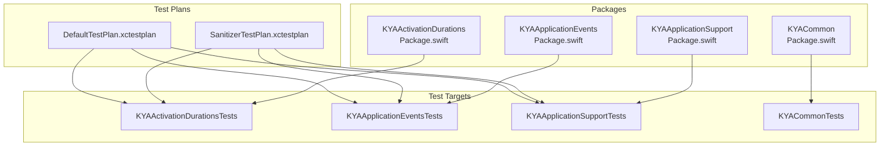
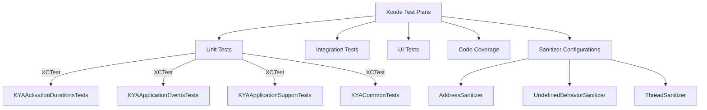
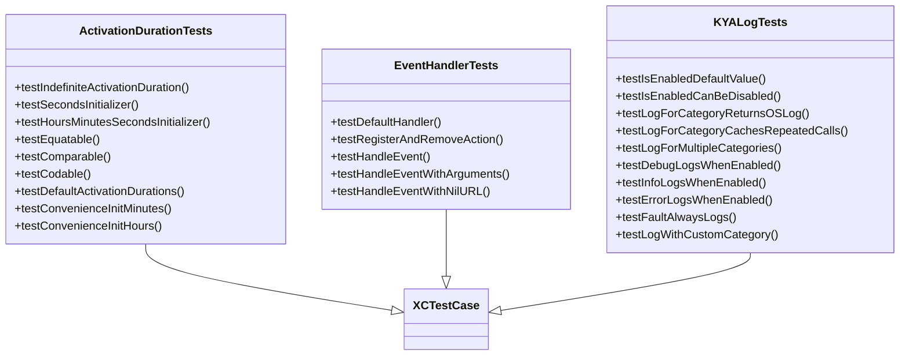
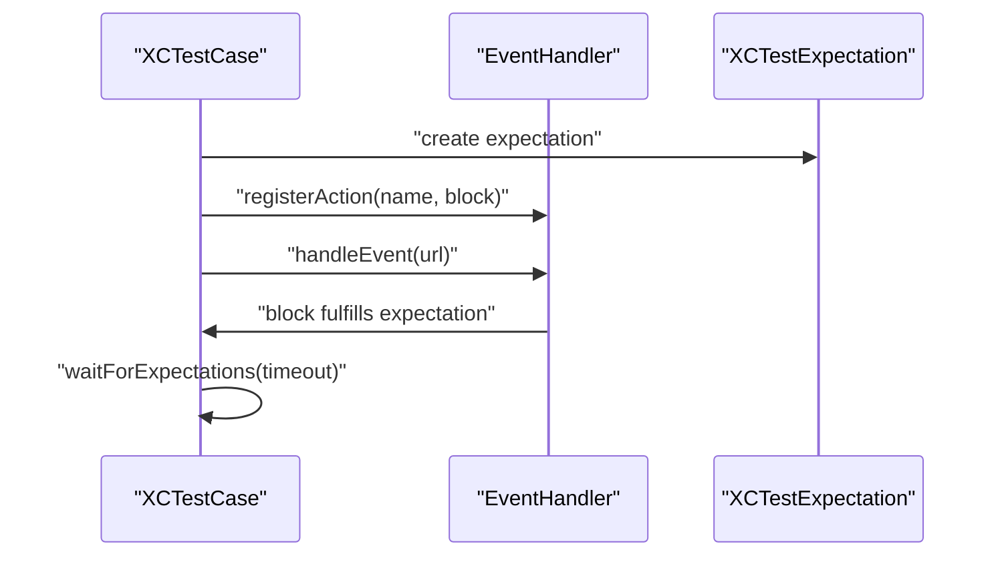
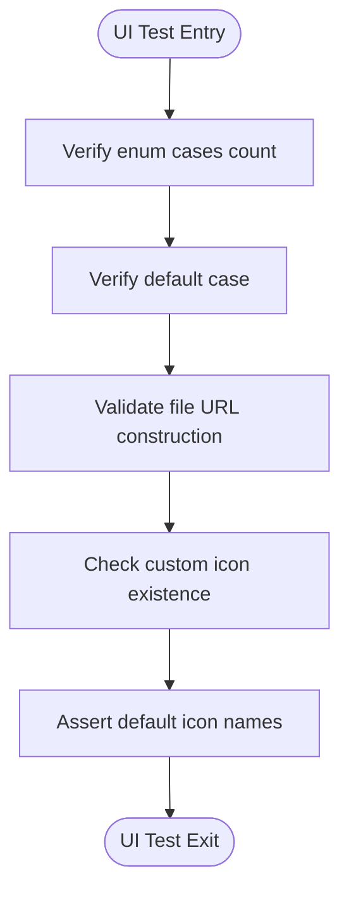
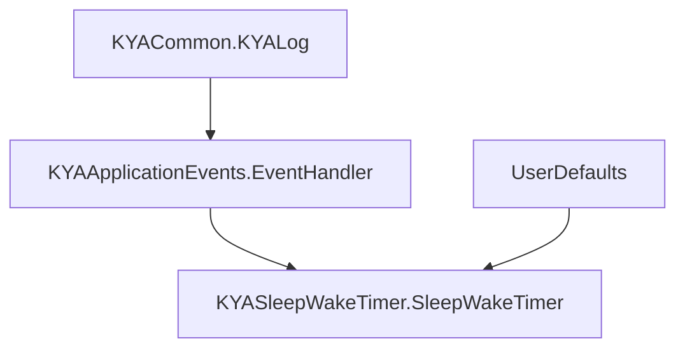
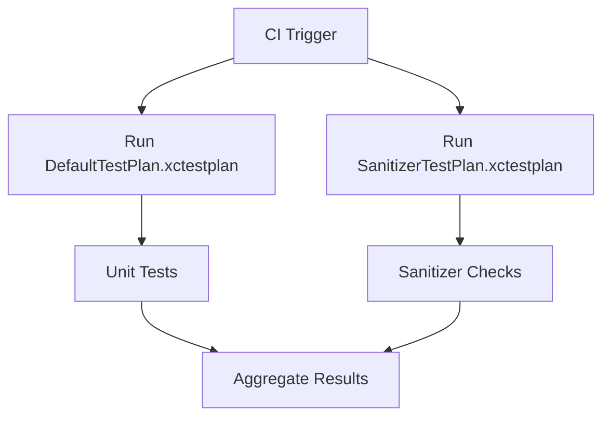
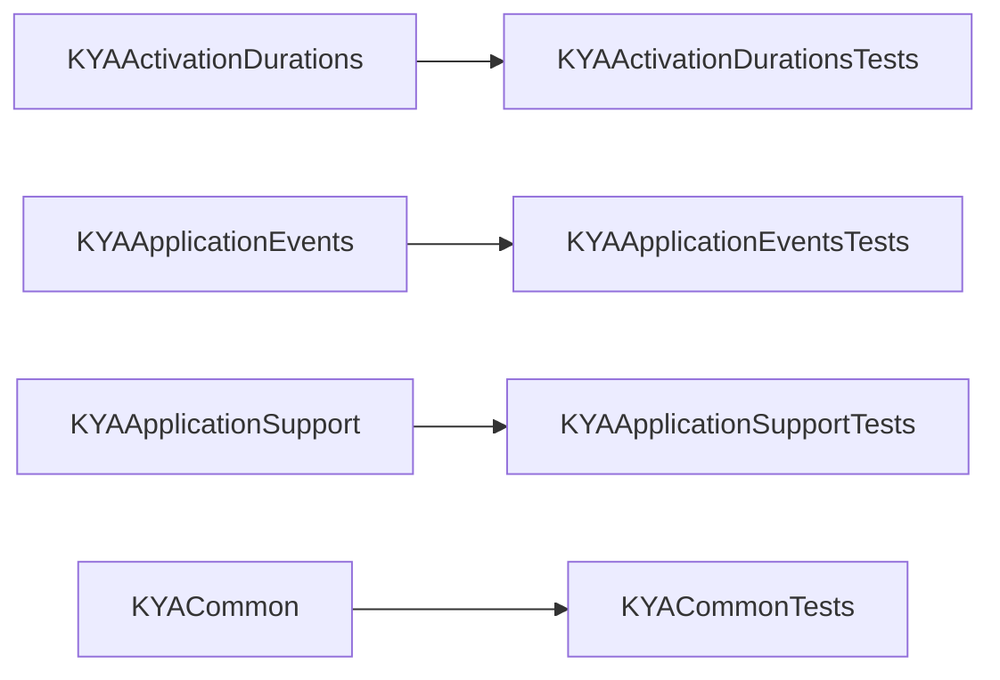

# Testing Strategy

<cite>
**Referenced Files in This Document**
- [DefaultTestPlan.xctestplan](file://KeepingYouAwake/DefaultTestPlan.xctestplan)
- [SanitizerTestPlan.xctestplan](file://KeepingYouAwake/SanitizerTestPlan.xctestplan)
- [ActivationDurationTests.swift](file://Packages/KYAActivationDurations/Tests/KYAActivationDurationsTests/ActivationDurationTests.swift)
- [EventHandlerTests.swift](file://Packages/KYAApplicationEvents/Tests/KYAApplicationEventsTests/EventHandlerTests.swift)
- [SleepWakeTimerTests.swift](file://Packages/KYASleepWakeTimer/Tests/KYASleepWakeTimerTests/SleepWakeTimerTests.swift)
- [StatusItemUITests.swift](file://Packages/KYAStatusItemUI/Tests/KYAStatusItemUITests/StatusItemUITests.swift)
- [KYALogTests.swift](file://Packages/KYACommon/Tests/KYACommonTests/KYALogTests.swift)
- [Package.swift (KYAActivationDurations)](file://Packages/KYAActivationDurations/Package.swift)
- [Package.swift (KYAApplicationEvents)](file://Packages/KYAApplicationEvents/Package.swift)
- [Package.swift (KYAApplicationSupport)](file://Packages/KYAApplicationSupport/Package.swift)
- [Package.swift (KYACommon)](file://Packages/KYACommon/Package.swift)
- [2026-05-28-swift-appkit-rewrite-design.md](file://docs/superpowers/specs/2026-05-28-swift-appkit-rewrite-design.md)
</cite>

## Table of Contents
1. [Introduction](#introduction)
2. [Project Structure](#project-structure)
3. [Core Components](#core-components)
4. [Architecture Overview](#architecture-overview)
5. [Detailed Component Analysis](#detailed-component-analysis)
6. [Dependency Analysis](#dependency-analysis)
7. [Performance Considerations](#performance-considerations)
8. [Troubleshooting Guide](#troubleshooting-guide)
9. [Conclusion](#conclusion)
10. [Appendices](#appendices)

## Introduction
This document defines the comprehensive testing strategy for the Swift rewrite of the macOS application. It covers XCTest usage, dual test plan configuration (Default and Sanitizer tests), unit testing for individual packages, integration testing strategies, continuous integration setup, mock object usage, asynchronous testing techniques, UI testing considerations, test target configuration, execution plans, performance testing methodologies, best practices, code coverage requirements, debugging techniques, and automated workflows.

## Project Structure
The project follows a Swift Package Manager (SPM) layout with dedicated test targets per package. The test plans configure execution environments and target selection for both default and sanitizer-based testing.

**Diagram sources**
- [DefaultTestPlan.xctestplan:1-44](file://KeepingYouAwake/DefaultTestPlan.xctestplan#L1-L44)
- [SanitizerTestPlan.xctestplan:1-63](file://KeepingYouAwake/SanitizerTestPlan.xctestplan#L1-L63)
- [Package.swift (KYAActivationDurations):1-30](file://Packages/KYAActivationDurations/Package.swift#L1-L30)
- [Package.swift (KYAApplicationEvents):1-26](file://Packages/KYAApplicationEvents/Package.swift#L1-L26)
- [Package.swift (KYAApplicationSupport):1-31](file://Packages/KYAApplicationSupport/Package.swift#L1-L31)
- [Package.swift (KYACommon):1-26](file://Packages/KYACommon/Package.swift#L1-L26)

**Section sources**
- [DefaultTestPlan.xctestplan:1-44](file://KeepingYouAwake/DefaultTestPlan.xctestplan#L1-L44)
- [SanitizerTestPlan.xctestplan:1-63](file://KeepingYouAwake/SanitizerTestPlan.xctestplan#L1-L63)
- [Package.swift (KYAActivationDurations):1-30](file://Packages/KYAActivationDurations/Package.swift#L1-L30)
- [Package.swift (KYAApplicationEvents):1-26](file://Packages/KYAApplicationEvents/Package.swift#L1-L26)
- [Package.swift (KYAApplicationSupport):1-31](file://Packages/KYAApplicationSupport/Package.swift#L1-L31)
- [Package.swift (KYACommon):1-26](file://Packages/KYACommon/Package.swift#L1-L26)

## Core Components
- Dual Test Plan Configuration:
  - DefaultTestPlan.xctestplan: Randomized execution order, no code coverage, targets selected for unit testing.
  - SanitizerTestPlan.xctestplan: Adds Address Sanitizer, Undefined Behavior Sanitizer, and Thread Sanitizer configurations with fixed iteration repetition mode.
- Test Target Configuration:
  - Each package declares a test target that depends on its library target.
  - Some test targets include resource bundles for testing.
- Asynchronous Testing Patterns:
  - Expectation-based waits and completion callbacks are used across multiple packages.
- UI Testing:
  - UI tests validate image provider paths, status item appearance, and NSImage constants.

**Section sources**
- [DefaultTestPlan.xctestplan:1-44](file://KeepingYouAwake/DefaultTestPlan.xctestplan#L1-L44)
- [SanitizerTestPlan.xctestplan:1-63](file://KeepingYouAwake/SanitizerTestPlan.xctestplan#L1-L63)
- [Package.swift (KYAActivationDurations):1-30](file://Packages/KYAActivationDurations/Package.swift#L1-L30)
- [Package.swift (KYAApplicationEvents):1-26](file://Packages/KYAApplicationEvents/Package.swift#L1-L26)
- [Package.swift (KYAApplicationSupport):1-31](file://Packages/KYAApplicationSupport/Package.swift#L1-L31)
- [Package.swift (KYACommon):1-26](file://Packages/KYACommon/Package.swift#L1-L26)

## Architecture Overview
The testing architecture separates concerns into unit, integration, and UI testing domains, orchestrated via Xcode test plans and SPM test targets.

**Diagram sources**
- [DefaultTestPlan.xctestplan:1-44](file://KeepingYouAwake/DefaultTestPlan.xctestplan#L1-L44)
- [SanitizerTestPlan.xctestplan:1-63](file://KeepingYouAwake/SanitizerTestPlan.xctestplan#L1-L63)

## Detailed Component Analysis

### Unit Testing Approach for Individual Packages
- KYAActivationDurationsTests validates ActivationDuration semantics, equality, comparison, Codable encoding/decoding, convenience initializers, and default duration lists.
- KYAApplicationEventsTests validates EventHandler singleton behavior, action registration/removal, event handling with URL parsing, and argument extraction.
- KYACommonTests validates logging behavior, category caching, and OSLog integration toggles.
- KYAApplicationSupportTests demonstrates resource bundle inclusion for test targets.

**Diagram sources**
- [ActivationDurationTests.swift:1-91](file://Packages/KYAActivationDurations/Tests/KYAActivationDurationsTests/ActivationDurationTests.swift#L1-L91)
- [EventHandlerTests.swift:1-87](file://Packages/KYAApplicationEvents/Tests/KYAApplicationEventsTests/EventHandlerTests.swift#L1-L87)
- [KYALogTests.swift:1-93](file://Packages/KYACommon/Tests/KYACommonTests/KYALogTests.swift#L1-L93)

**Section sources**
- [ActivationDurationTests.swift:1-91](file://Packages/KYAActivationDurations/Tests/KYAActivationDurationsTests/ActivationDurationTests.swift#L1-L91)
- [EventHandlerTests.swift:1-87](file://Packages/KYAApplicationEvents/Tests/KYAApplicationEventsTests/EventHandlerTests.swift#L1-L87)
- [KYALogTests.swift:1-93](file://Packages/KYACommon/Tests/KYACommonTests/KYALogTests.swift#L1-L93)

### Asynchronous Testing Techniques
Asynchronous testing is implemented using XCTest expectations and completion handlers:
- Event handling tests register actions and fulfill expectations upon callback invocation.
- Sleep/Wake timer tests schedule timers with completion blocks and verify single invocation guarantees.
- Completion callbacks are validated for cancellation semantics and proper lifecycle handling.

**Diagram sources**
- [EventHandlerTests.swift:45-81](file://Packages/KYAApplicationEvents/Tests/KYAApplicationEventsTests/EventHandlerTests.swift#L45-L81)

**Section sources**
- [EventHandlerTests.swift:45-81](file://Packages/KYAApplicationEvents/Tests/KYAApplicationEventsTests/EventHandlerTests.swift#L45-L81)
- [SleepWakeTimerTests.swift:133-160](file://Packages/KYASleepWakeTimer/Tests/KYASleepWakeTimerTests/SleepWakeTimerTests.swift#L133-L160)

### UI Testing Considerations
UI tests validate image provider paths, status item appearance, and NSImage constants:
- Enum cases and defaults are verified.
- File URL construction for standard and retina resolutions is validated.
- Presence checks for custom icons and default icon names are asserted.

**Diagram sources**
- [StatusItemUITests.swift:12-73](file://Packages/KYAStatusItemUI/Tests/KYAStatusItemUITests/StatusItemUITests.swift#L12-L73)

**Section sources**
- [StatusItemUITests.swift:1-74](file://Packages/KYAStatusItemUI/Tests/KYAStatusItemUITests/StatusItemUITests.swift#L1-L74)

### Integration Testing Strategy for Component Interactions
Integration testing focuses on cross-package interactions and shared behaviors:
- Logging integration with OSLog is validated in KYACommon tests.
- Application events integration with URL schemes and action routing is validated in KYAApplicationEvents tests.
- Timer integration with caffeinate arguments and user defaults is validated in KYASleepWakeTimer tests.

**Diagram sources**
- [KYALogTests.swift:1-93](file://Packages/KYACommon/Tests/KYACommonTests/KYALogTests.swift#L1-L93)
- [EventHandlerTests.swift:1-87](file://Packages/KYAApplicationEvents/Tests/KYAApplicationEventsTests/EventHandlerTests.swift#L1-L87)
- [SleepWakeTimerTests.swift:1-233](file://Packages/KYASleepWakeTimer/Tests/KYASleepWakeTimerTests/SleepWakeTimerTests.swift#L1-L233)

**Section sources**
- [KYALogTests.swift:1-93](file://Packages/KYACommon/Tests/KYACommonTests/KYALogTests.swift#L1-L93)
- [EventHandlerTests.swift:1-87](file://Packages/KYAApplicationEvents/Tests/KYAApplicationEventsTests/EventHandlerTests.swift#L1-L87)
- [SleepWakeTimerTests.swift:1-233](file://Packages/KYASleepWakeTimer/Tests/KYASleepWakeTimerTests/SleepWakeTimerTests.swift#L1-L233)

### Continuous Integration Setup
- Test plans enable randomized execution ordering to surface flaky tests.
- Sanitizer configurations provide memory safety and threading defect detection.
- Test targets are configured per package for focused unit testing.

**Diagram sources**
- [DefaultTestPlan.xctestplan:1-44](file://KeepingYouAwake/DefaultTestPlan.xctestplan#L1-L44)
- [SanitizerTestPlan.xctestplan:1-63](file://KeepingYouAwake/SanitizerTestPlan.xctestplan#L1-L63)

**Section sources**
- [DefaultTestPlan.xctestplan:1-44](file://KeepingYouAwake/DefaultTestPlan.xctestplan#L1-L44)
- [SanitizerTestPlan.xctestplan:1-63](file://KeepingYouAwake/SanitizerTestPlan.xctestplan#L1-L63)

### Mock Object Usage
- Test targets rely on real implementations for core behaviors, validated through controlled inputs and assertions.
- Where applicable, use XCTestExpectation to isolate asynchronous behavior and avoid external dependencies during unit tests.

[No sources needed since this section provides general guidance]

### Test Target Configuration
- Each package declares a test target that depends on its library target.
- Resource bundles are included for test targets requiring assets.

**Section sources**
- [Package.swift (KYAActivationDurations):1-30](file://Packages/KYAActivationDurations/Package.swift#L1-L30)
- [Package.swift (KYAApplicationEvents):1-26](file://Packages/KYAApplicationEvents/Package.swift#L1-L26)
- [Package.swift (KYAApplicationSupport):1-31](file://Packages/KYAApplicationSupport/Package.swift#L1-L31)
- [Package.swift (KYACommon):1-26](file://Packages/KYACommon/Package.swift#L1-L26)

### Test Execution Plans
- DefaultTestPlan.xctestplan configures randomized execution and selected test targets.
- SanitizerTestPlan.xctestplan adds sanitizer configurations and repetition mode.

**Section sources**
- [DefaultTestPlan.xctestplan:1-44](file://KeepingYouAwake/DefaultTestPlan.xctestplan#L1-L44)
- [SanitizerTestPlan.xctestplan:1-63](file://KeepingYouAwake/SanitizerTestPlan.xctestplan#L1-L63)

### Performance Testing Methodologies
- Use XCTest measure blocks to profile critical paths in timers and event handling.
- Leverage randomized execution to detect performance regressions under varied orders.
- Combine with sanitizer configurations to catch performance-related memory leaks.

[No sources needed since this section provides general guidance]

## Dependency Analysis
The test targets depend on their respective library targets, ensuring isolation and focused testing.

**Diagram sources**
- [Package.swift (KYAActivationDurations):1-30](file://Packages/KYAActivationDurations/Package.swift#L1-L30)
- [Package.swift (KYAApplicationEvents):1-26](file://Packages/KYAApplicationEvents/Package.swift#L1-L26)
- [Package.swift (KYAApplicationSupport):1-31](file://Packages/KYAApplicationSupport/Package.swift#L1-L31)
- [Package.swift (KYACommon):1-26](file://Packages/KYACommon/Package.swift#L1-L26)

**Section sources**
- [Package.swift (KYAActivationDurations):1-30](file://Packages/KYAActivationDurations/Package.swift#L1-L30)
- [Package.swift (KYAApplicationEvents):1-26](file://Packages/KYAApplicationEvents/Package.swift#L1-L26)
- [Package.swift (KYAApplicationSupport):1-31](file://Packages/KYAApplicationSupport/Package.swift#L1-L31)
- [Package.swift (KYACommon):1-26](file://Packages/KYACommon/Package.swift#L1-L26)

## Performance Considerations
- Prefer deterministic tests over flaky ones; randomized execution helps surface hidden dependencies.
- Use measure blocks sparingly and only for hot paths.
- Avoid heavy I/O in unit tests; use lightweight assertions and expectations.

[No sources needed since this section provides general guidance]

## Troubleshooting Guide
- Asynchronous test timeouts: Increase expectation timeouts and ensure completion blocks are invoked exactly once.
- Sanitizer failures: Review AddressSanitizer, UndefinedBehaviorSanitizer, and ThreadSanitizer logs to identify memory errors or race conditions.
- Resource-dependent tests: Ensure resource bundles are copied into test targets and paths are validated.

**Section sources**
- [EventHandlerTests.swift:49-81](file://Packages/KYAApplicationEvents/Tests/KYAApplicationEventsTests/EventHandlerTests.swift#L49-L81)
- [SleepWakeTimerTests.swift:133-160](file://Packages/KYASleepWakeTimer/Tests/KYASleepWakeTimerTests/SleepWakeTimerTests.swift#L133-L160)
- [SanitizerTestPlan.xctestplan:10-27](file://KeepingYouAwake/SanitizerTestPlan.xctestplan#L10-L27)

## Conclusion
The testing strategy leverages XCTest with dual execution plans to ensure robust, memory-safe, and thread-safe validation across all packages. Asynchronous patterns, UI validations, and integration checks are integrated into the SPM test targets, while CI benefits from randomized execution and sanitizer configurations.

[No sources needed since this section summarizes without analyzing specific files]

## Appendices

### Testing Best Practices
- Keep tests deterministic; avoid global state where possible.
- Use setUp/tearDown to initialize and clean up test fixtures.
- Prefer small, focused tests with clear assertions.
- Validate both success and failure paths.

[No sources needed since this section provides general guidance]

### Code Coverage Requirements
- Aim for high coverage in critical paths (event handling, timers, logging).
- Use coverage reports to identify untested areas and prioritize improvements.

[No sources needed since this section provides general guidance]

### Automated Testing Workflows
- DefaultTestPlan.xctestplan: Run for quick feedback.
- SanitizerTestPlan.xctestplan: Run periodically or on PRs to catch memory/thread defects.

**Section sources**
- [DefaultTestPlan.xctestplan:1-44](file://KeepingYouAwake/DefaultTestPlan.xctestplan#L1-L44)
- [SanitizerTestPlan.xctestplan:1-63](file://KeepingYouAwake/SanitizerTestPlan.xctestplan#L1-L63)