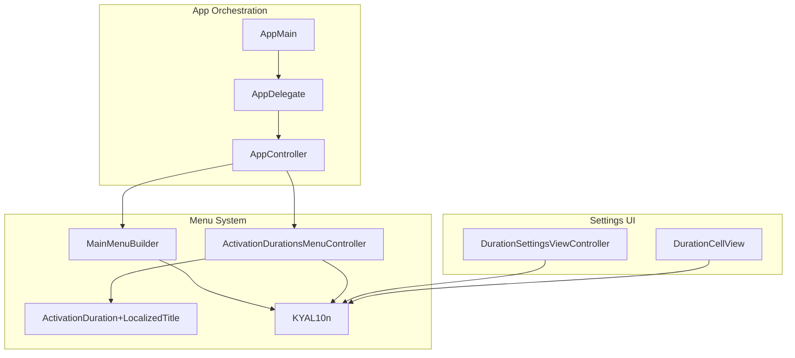
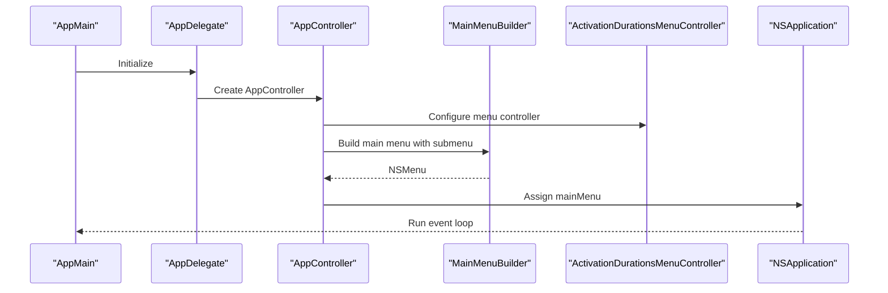
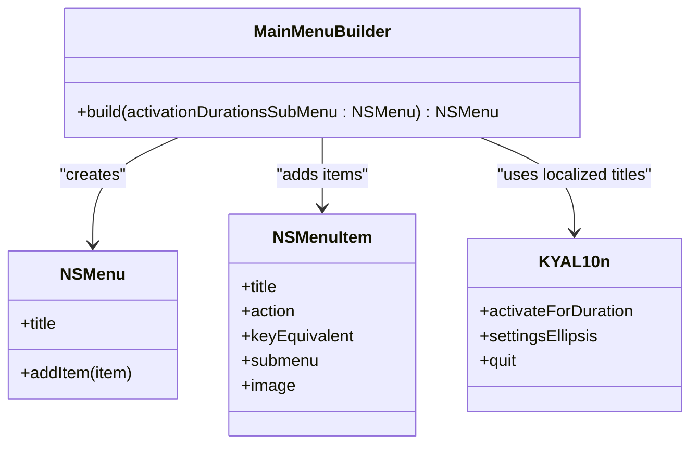
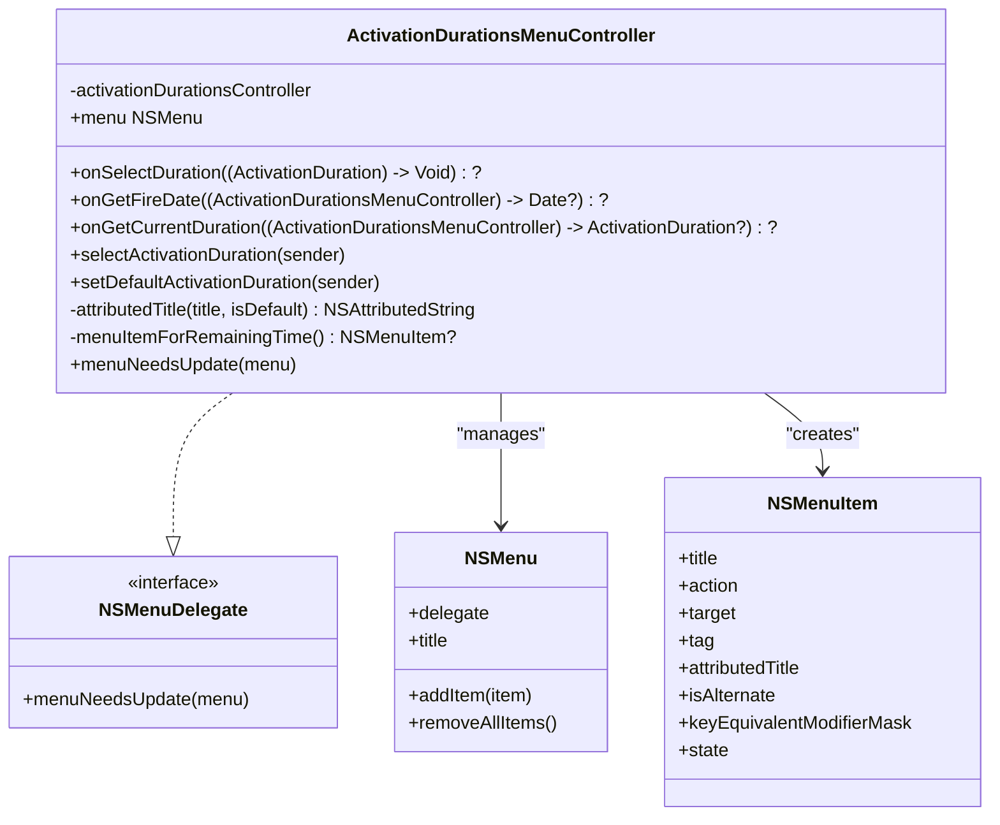
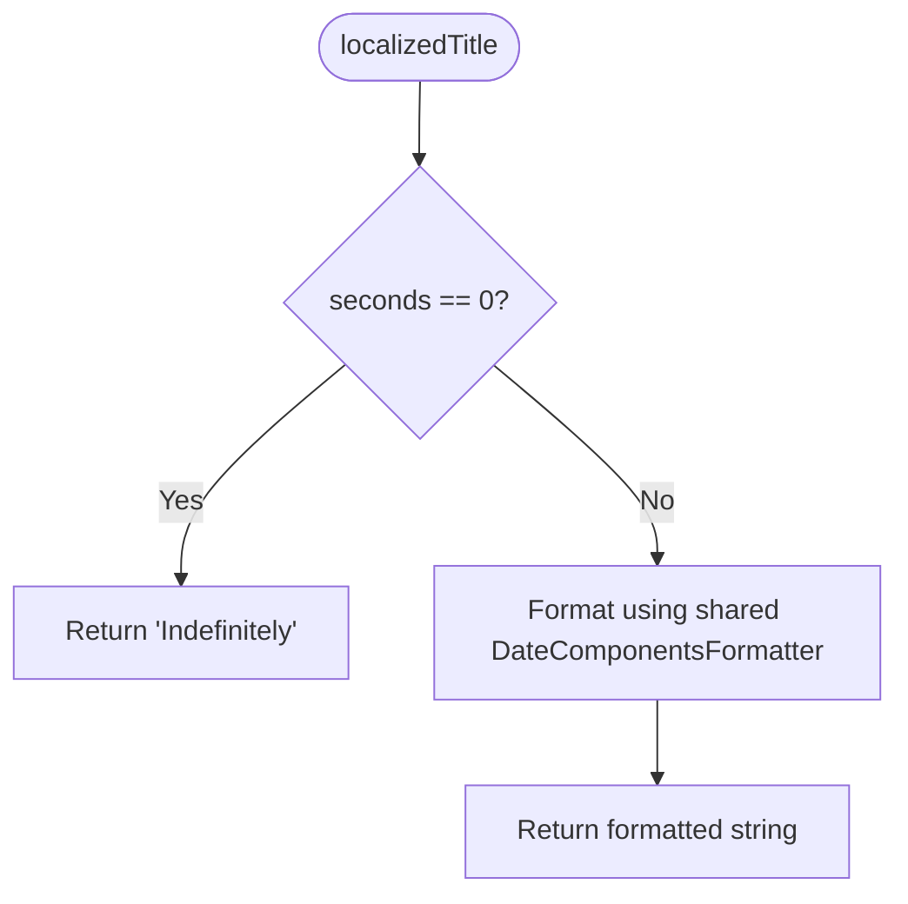
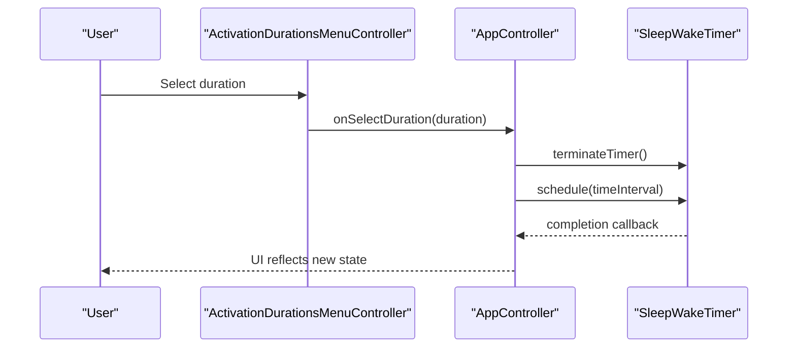
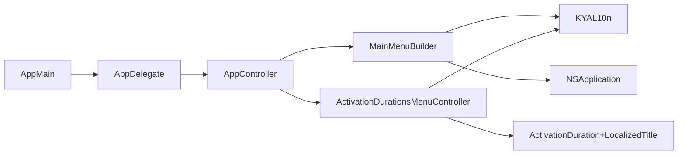

# Menu System Architecture

<cite>
**Referenced Files in This Document**
- [MainMenuBuilder.swift](file://KeepingYouAwake/KYAMainMenu/MainMenuBuilder.swift)
- [ActivationDurationsMenuController.swift](file://KeepingYouAwake/KYAActivationDurationsMenuController/ActivationDurationsMenuController.swift)
- [ActivationDuration+LocalizedTitle.swift](file://KeepingYouAwake/KYAActivationDurationsMenuController/ActivationDuration+LocalizedTitle.swift)
- [AppController.swift](file://KeepingYouAwake/KYAAppController/AppController.swift)
- [AppDelegate.swift](file://KeepingYouAwake/KYAAppController/AppDelegate.swift)
- [AppMain.swift](file://KeepingYouAwake/AppMain.swift)
- [KYAL10n.swift](file://KeepingYouAwake/KYAL10n.swift)
- [DurationSettingsViewController.swift](file://KeepingYouAwake/Settings/KYADurationSettingsViewController/DurationSettingsViewController.swift)
- [DurationCellView.swift](file://KeepingYouAwake/Settings/KYADurationSettingsViewController/KYADurationCell/DurationCellView.swift)
- [2026-05-28-swift-appkit-rewrite-design.md](file://docs/superpowers/specs/2026-05-28-swift-appkit-rewrite-design.md)
</cite>

## Table of Contents
1. [Introduction](#introduction)
2. [Project Structure](#project-structure)
3. [Core Components](#core-components)
4. [Architecture Overview](#architecture-overview)
5. [Detailed Component Analysis](#detailed-component-analysis)
6. [Dependency Analysis](#dependency-analysis)
7. [Performance Considerations](#performance-considerations)
8. [Troubleshooting Guide](#troubleshooting-guide)
9. [Conclusion](#conclusion)

## Introduction
This document explains the menu system architecture for the macOS application, focusing on the programmatic construction of the main menu, the dynamic activation durations submenu, and the integration with AppKit's NSMenu framework. It covers menu item management, keyboard shortcuts, localized titles, system symbol usage, menu state management, conditional menu items, and accessibility support. The documentation also provides practical examples of menu item creation, action handling, and menu refresh mechanisms, along with macOS menu bar application best practices.

## Project Structure
The menu system spans several modules:
- Main menu builder: constructs the top-level application menu
- Activation durations submenu controller: manages dynamic submenu items and state
- Localization: provides localized strings for menu titles
- Application orchestration: wires menu controllers into the app lifecycle
- Settings integration: maintains consistency between menu and settings UI

**Diagram sources**
- [MainMenuBuilder.swift:12-50](file://KeepingYouAwake/KYAMainMenu/MainMenuBuilder.swift#L12-L50)
- [ActivationDurationsMenuController.swift:14-31](file://KeepingYouAwake/KYAActivationDurationsMenuController/ActivationDurationsMenuController.swift#L14-L31)
- [ActivationDuration+LocalizedTitle.swift:12-26](file://KeepingYouAwake/KYAActivationDurationsMenuController/ActivationDuration+LocalizedTitle.swift#L12-L26)
- [AppController.swift:21-41](file://KeepingYouAwake/KYAAppController/AppController.swift#L21-L41)
- [AppDelegate.swift:12-16](file://KeepingYouAwake/KYAAppController/AppDelegate.swift#L12-L16)
- [AppMain.swift:11-23](file://KeepingYouAwake/AppMain.swift#L11-L23)
- [DurationSettingsViewController.swift:14-37](file://KeepingYouAwake/Settings/KYADurationSettingsViewController/DurationSettingsViewController.swift#L14-L37)
- [DurationCellView.swift:11-43](file://KeepingYouAwake/Settings/KYADurationSettingsViewController/KYADurationCell/DurationCellView.swift#L11-L43)

**Section sources**
- [MainMenuBuilder.swift:12-50](file://KeepingYouAwake/KYAMainMenu/MainMenuBuilder.swift#L12-L50)
- [ActivationDurationsMenuController.swift:14-31](file://KeepingYouAwake/KYAActivationDurationsMenuController/ActivationDurationsMenuController.swift#L14-L31)
- [AppController.swift:21-41](file://KeepingYouAwake/KYAAppController/AppController.swift#L21-L41)
- [AppMain.swift:11-23](file://KeepingYouAwake/AppMain.swift#L11-L23)

## Core Components
- MainMenuBuilder: Creates the main application menu programmatically, assigns actions, and integrates the activation durations submenu. It also applies modern macOS icons using system symbols when supported.
- ActivationDurationsMenuController: Manages the activation durations submenu, dynamically populating items based on configured durations, marking defaults and current selections, and handling selection and default-setting actions.
- ActivationDuration+LocalizedTitle: Provides localized titles for activation durations, ensuring consistent internationalization.
- AppController: Wires the menu builder and submenu controller into the application lifecycle, handles duration selection, and updates UI state.
- AppDelegate and AppMain: Set up the application delegate, construct the main menu, assign it to the NSApplication, and start the run loop.

**Section sources**
- [MainMenuBuilder.swift:12-50](file://KeepingYouAwake/KYAMainMenu/MainMenuBuilder.swift#L12-L50)
- [ActivationDurationsMenuController.swift:14-126](file://KeepingYouAwake/KYAActivationDurationsMenuController/ActivationDurationsMenuController.swift#L14-L126)
- [ActivationDuration+LocalizedTitle.swift:12-26](file://KeepingYouAwake/KYAActivationDurationsMenuController/ActivationDuration+LocalizedTitle.swift#L12-L26)
- [AppController.swift:21-66](file://KeepingYouAwake/KYAAppController/AppController.swift#L21-L66)
- [AppMain.swift:11-23](file://KeepingYouAwake/AppMain.swift#L11-L23)

## Architecture Overview
The menu system follows a modular architecture:
- Programmatic construction ensures consistency and enables dynamic updates.
- The activation durations submenu is populated on-demand via NSMenuDelegate.
- Actions are bound to selectors, enabling clean separation between UI and logic.
- Localization and system symbols provide a modern, accessible user experience.

**Diagram sources**
- [AppMain.swift:13-22](file://KeepingYouAwake/AppMain.swift#L13-L22)
- [AppDelegate.swift:17-25](file://KeepingYouAwake/KYAAppController/AppDelegate.swift#L17-L25)
- [AppController.swift:34-41](file://KeepingYouAwake/KYAAppController/AppController.swift#L34-L41)
- [MainMenuBuilder.swift:13-49](file://KeepingYouAwake/KYAMainMenu/MainMenuBuilder.swift#L13-L49)

## Detailed Component Analysis

### MainMenuBuilder: Dynamic Main Menu Construction
MainMenuBuilder creates the top-level menu programmatically:
- Adds an "Activate for Duration" item that opens the activation durations submenu.
- Inserts a separator for visual grouping.
- Adds a "Settings…" item with a keyboard shortcut and binds its action to the app delegate method.
- Adds a "Quit" item with a keyboard shortcut.
- Uses system symbols for modern macOS appearance when available.

**Diagram sources**
- [MainMenuBuilder.swift:12-50](file://KeepingYouAwake/KYAMainMenu/MainMenuBuilder.swift#L12-L50)
- [KYAL10n.swift:20-32](file://KeepingYouAwake/KYAL10n.swift#L20-L32)

**Section sources**
- [MainMenuBuilder.swift:12-50](file://KeepingYouAwake/KYAMainMenu/MainMenuBuilder.swift#L12-L50)
- [KYAL10n.swift:20-32](file://KeepingYouAwake/KYAL10n.swift#L20-L32)

### ActivationDurationsMenuController: Dynamic Submenu Management
ActivationDurationsMenuController manages the activation durations submenu:
- Implements NSMenuDelegate to populate items dynamically on menu open.
- Displays a remaining-time header when a timer is scheduled.
- Iterates through configured durations, creating menu items with localized titles.
- Marks default and currently selected durations.
- Supports alternate actions (Option-click) to set a default duration.
- Uses closure-based callbacks to integrate with AppController for selection and state queries.

**Diagram sources**
- [ActivationDurationsMenuController.swift:14-126](file://KeepingYouAwake/KYAActivationDurationsMenuController/ActivationDurationsMenuController.swift#L14-L126)

**Section sources**
- [ActivationDurationsMenuController.swift:14-126](file://KeepingYouAwake/KYAActivationDurationsMenuController/ActivationDurationsMenuController.swift#L14-L126)

### ActivationDuration+LocalizedTitle: Localized Titles
ActivationDuration extension provides localized titles:
- Returns a human-readable string for a duration.
- Uses a shared formatter to present time units in full format.
- Special-cases zero seconds to indicate "Indefinitely".

**Diagram sources**
- [ActivationDuration+LocalizedTitle.swift:12-26](file://KeepingYouAwake/KYAActivationDurationsMenuController/ActivationDuration+LocalizedTitle.swift#L12-L26)

**Section sources**
- [ActivationDuration+LocalizedTitle.swift:12-26](file://KeepingYouAwake/KYAActivationDurationsMenuController/ActivationDuration+LocalizedTitle.swift#L12-L26)

### AppController: Menu Integration and State Management
AppController coordinates menu-related behavior:
- Configures the activation durations submenu controller with closures for selection, fire date retrieval, and current duration detection.
- Handles duration selection by terminating any existing timer and scheduling a new one.
- Integrates with the status item controller and other subsystems.

**Diagram sources**
- [AppController.swift:55-66](file://KeepingYouAwake/KYAAppController/AppController.swift#L55-L66)
- [ActivationDurationsMenuController.swift:33-38](file://KeepingYouAwake/KYAActivationDurationsMenuController/ActivationDurationsMenuController.swift#L33-L38)

**Section sources**
- [AppController.swift:55-66](file://KeepingYouAwake/KYAAppController/AppController.swift#L55-L66)
- [ActivationDurationsMenuController.swift:33-38](file://KeepingYouAwake/KYAActivationDurationsMenuController/ActivationDurationsMenuController.swift#L33-L38)

### Keyboard Shortcuts and Accessibility
- Keyboard shortcuts are assigned directly on menu items for quick access.
- System symbols are used for icons, improving visual consistency and accessibility.
- The menu supports alternate actions (Option-click) for additional functionality.

**Section sources**
- [MainMenuBuilder.swift:29-45](file://KeepingYouAwake/KYAMainMenu/MainMenuBuilder.swift#L29-L45)
- [ActivationDurationsMenuController.swift:107-118](file://KeepingYouAwake/KYAActivationDurationsMenuController/ActivationDurationsMenuController.swift#L107-L118)

### Settings Integration and Consistency
The settings UI maintains consistency with the menu:
- Duration settings view uses system symbols when available.
- Cell views reflect default duration state with appropriate font weight and labels.

**Section sources**
- [DurationSettingsViewController.swift:14-37](file://KeepingYouAwake/Settings/KYADurationSettingsViewController/DurationSettingsViewController.swift#L14-L37)
- [DurationCellView.swift:11-43](file://KeepingYouAwake/Settings/KYADurationSettingsViewController/KYADurationCell/DurationCellView.swift#L11-L43)

## Dependency Analysis
The menu system exhibits low coupling and high cohesion:
- MainMenuBuilder depends on localization and AppKit.
- ActivationDurationsMenuController depends on the activation durations controller and localization.
- AppController orchestrates dependencies and provides closures for dynamic behavior.
- AppMain and AppDelegate bootstrap the application and install the main menu.

**Diagram sources**
- [MainMenuBuilder.swift:9-50](file://KeepingYouAwake/KYAMainMenu/MainMenuBuilder.swift#L9-L50)
- [ActivationDurationsMenuController.swift:9-31](file://KeepingYouAwake/KYAActivationDurationsMenuController/ActivationDurationsMenuController.swift#L9-L31)
- [AppController.swift:21-41](file://KeepingYouAwake/KYAAppController/AppController.swift#L21-L41)
- [AppDelegate.swift:12-16](file://KeepingYouAwake/KYAAppController/AppDelegate.swift#L12-L16)
- [AppMain.swift:11-23](file://KeepingYouAwake/AppMain.swift#L11-L23)

**Section sources**
- [MainMenuBuilder.swift:9-50](file://KeepingYouAwake/KYAMainMenu/MainMenuBuilder.swift#L9-L50)
- [ActivationDurationsMenuController.swift:9-31](file://KeepingYouAwake/KYAActivationDurationsMenuController/ActivationDurationsMenuController.swift#L9-L31)
- [AppController.swift:21-41](file://KeepingYouAwake/KYAAppController/AppController.swift#L21-L41)
- [AppDelegate.swift:12-16](file://KeepingYouAwake/KYAAppController/AppDelegate.swift#L12-L16)
- [AppMain.swift:11-23](file://KeepingYouAwake/AppMain.swift#L11-L23)

## Performance Considerations
- Dynamic menu population occurs on demand via NSMenuDelegate, minimizing startup overhead.
- Closures avoid retain cycles and reduce boilerplate compared to traditional delegation.
- Using system symbols reduces asset management overhead while maintaining visual consistency.

## Troubleshooting Guide
- Menu does not appear: Ensure the main menu is constructed and assigned before the run loop starts.
- Submenu not updating: Verify NSMenuDelegate is set and menuNeedsUpdate removes old items before repopulating.
- Actions not firing: Confirm target-action bindings and selector availability on the target object.
- Localization issues: Check that localized keys exist and are properly loaded by the localization system.

**Section sources**
- [AppMain.swift:17-22](file://KeepingYouAwake/AppMain.swift#L17-L22)
- [ActivationDurationsMenuController.swift:81-126](file://KeepingYouAwake/KYAActivationDurationsMenuController/ActivationDurationsMenuController.swift#L81-L126)
- [AppDelegate.swift:36-56](file://KeepingYouAwake/KYAAppController/AppDelegate.swift#L36-L56)

## Conclusion
The menu system architecture demonstrates a clean separation of concerns, leveraging AppKit's NSMenu framework for programmatic construction, dynamic submenu management, and modern macOS aesthetics. The use of localization, system symbols, and closure-based callbacks ensures maintainability, accessibility, and a consistent user experience across the application.