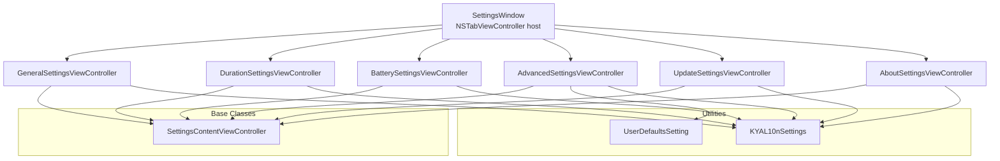
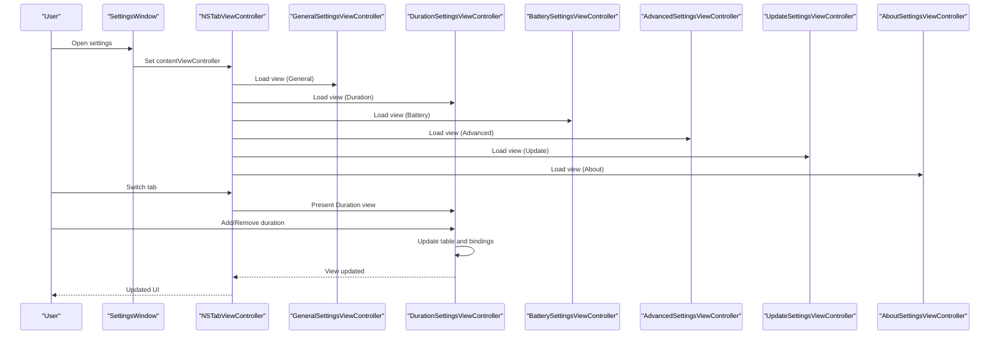
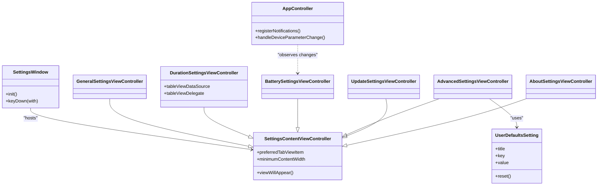

# Settings Window Interface

<cite>
**Referenced Files in This Document**
- [SettingsWindow.swift](file://KeepingYouAwake/Settings/KYASettingsWindow/SettingsWindow.swift)
- [SettingsContentViewController.swift](file://KeepingYouAwake/Settings/KYASettingsContentViewController/SettingsContentViewController.swift)
- [GeneralSettingsViewController.swift](file://KeepingYouAwake/Settings/KYAGeneralSettingsViewController/GeneralSettingsViewController.swift)
- [DurationSettingsViewController.swift](file://KeepingYouAwake/Settings/KYADurationSettingsViewController/DurationSettingsViewController.swift)
- [BatterySettingsViewController.swift](file://KeepingYouAwake/Settings/KYABatterySettingsViewController/BatterySettingsViewController.swift)
- [AdvancedSettingsViewController.swift](file://KeepingYouAwake/Settings/KYAAdvancedSettingsViewController/AdvancedSettingsViewController.swift)
- [UpdateSettingsViewController.swift](file://KeepingYouAwake/Settings/KYAUpdateSettingsViewController/UpdateSettingsViewController.swift)
- [AboutSettingsViewController.swift](file://KeepingYouAwake/Settings/KYAAboutSettingsViewController/AboutSettingsViewController.swift)
- [DurationCellView.swift](file://KeepingYouAwake/Settings/KYADurationSettingsViewController/KYADurationCell/DurationCellView.swift)
- [UserDefaultsSetting.swift](file://KeepingYouAwake/UserDefaultsSetting.swift)
- [KYAL10n+Settings.swift](file://KeepingYouAwake/Settings/KYAL10n+Settings.swift)
- [AppController.swift](file://KeepingYouAwake/KYAAppController/AppController.swift)
</cite>

## Table of Contents
1. [Introduction](#introduction)
2. [Project Structure](#project-structure)
3. [Core Components](#core-components)
4. [Architecture Overview](#architecture-overview)
5. [Detailed Component Analysis](#detailed-component-analysis)
6. [Dependency Analysis](#dependency-analysis)
7. [Performance Considerations](#performance-considerations)
8. [Troubleshooting Guide](#troubleshooting-guide)
9. [Conclusion](#conclusion)

## Introduction
This document describes the settings window interface implementation for the macOS application. It focuses on the NSTabViewController-based architecture, toolbar navigation, modal behavior, window management, and the individual settings view controllers. It also covers form validation, input controls, sliders, preference persistence, accessibility, keyboard navigation, responsive layout, and integration with the main application controller.

## Project Structure
The settings subsystem is organized around a central window that hosts a tabbed interface. Each tab is implemented as a dedicated view controller inheriting from a base settings content controller. Localization keys for settings are centralized, and preferences are persisted via UserDefaults with binding-driven UI updates.

**Diagram sources**
- [SettingsWindow.swift:13-41](file://KeepingYouAwake/Settings/KYASettingsWindow/SettingsWindow.swift#L13-L41)
- [SettingsContentViewController.swift:13-46](file://KeepingYouAwake/Settings/KYASettingsContentViewController/SettingsContentViewController.swift#L13-L46)
- [GeneralSettingsViewController.swift:14-24](file://KeepingYouAwake/Settings/KYAGeneralSettingsViewController/GeneralSettingsViewController.swift#L14-L24)
- [DurationSettingsViewController.swift:15-23](file://KeepingYouAwake/Settings/KYADurationSettingsViewController/DurationSettingsViewController.swift#L15-L23)
- [BatterySettingsViewController.swift:14-30](file://KeepingYouAwake/Settings/KYABatterySettingsViewController/BatterySettingsViewController.swift#L14-L30)
- [AdvancedSettingsViewController.swift:13-27](file://KeepingYouAwake/Settings/KYAAdvancedSettingsViewController/AdvancedSettingsViewController.swift#L13-L27)
- [UpdateSettingsViewController.swift:15-24](file://KeepingYouAwake/Settings/KYAUpdateSettingsViewController/UpdateSettingsViewController.swift#L15-L24)
- [AboutSettingsViewController.swift:16-30](file://KeepingYouAwake/Settings/KYAAboutSettingsViewController/AboutSettingsViewController.swift#L16-L30)
- [UserDefaultsSetting.swift:12-31](file://KeepingYouAwake/UserDefaultsSetting.swift#L12-L31)
- [KYAL10n+Settings.swift:12-24](file://KeepingYouAwake/Settings/KYAL10n+Settings.swift#L12-L24)

**Section sources**
- [SettingsWindow.swift:13-41](file://KeepingYouAwake/Settings/KYASettingsWindow/SettingsWindow.swift#L13-L41)
- [SettingsContentViewController.swift:13-46](file://KeepingYouAwake/Settings/KYASettingsContentViewController/SettingsContentViewController.swift#L13-L46)

## Core Components
- SettingsWindow: A window hosting an NSTabViewController with toolbar-style tabs. It configures the initial frame, title, autosave name, and keyboard shortcuts.
- SettingsContentViewController: Base class providing tab creation, minimum content width, and common lifecycle behavior.
- Individual settings view controllers: Implement specific UIs, bindings, actions, and persistence for each domain.

Key behaviors:
- Modal presentation: The window is configured as a titled, closable panel without automatic release on close, enabling reuse.
- Size constraints: Minimum content width ensures readability across tabs.
- Keyboard handling: Command+W closes the window; Command+Q terminates the app.

**Section sources**
- [SettingsWindow.swift:13-60](file://KeepingYouAwake/Settings/KYASettingsWindow/SettingsWindow.swift#L13-L60)
- [SettingsContentViewController.swift:13-46](file://KeepingYouAwake/Settings/KYASettingsContentViewController/SettingsContentViewController.swift#L13-L46)

## Architecture Overview
The settings window composes six tabs: General, Duration, Battery, Advanced, Updates, and About. Each tab controller is responsible for its own UI hierarchy, bindings, and actions. The window manages the tab controller lifecycle and window-level behaviors.

**Diagram sources**
- [SettingsWindow.swift:24-37](file://KeepingYouAwake/Settings/KYASettingsWindow/SettingsWindow.swift#L24-L37)
- [GeneralSettingsViewController.swift:30-108](file://KeepingYouAwake/Settings/KYAGeneralSettingsViewController/GeneralSettingsViewController.swift#L30-L108)
- [DurationSettingsViewController.swift:36-125](file://KeepingYouAwake/Settings/KYADurationSettingsViewController/DurationSettingsViewController.swift#L36-L125)
- [BatterySettingsViewController.swift:34-127](file://KeepingYouAwake/Settings/KYABatterySettingsViewController/BatterySettingsViewController.swift#L34-L127)
- [AdvancedSettingsViewController.swift:29-114](file://KeepingYouAwake/Settings/KYAAdvancedSettingsViewController/AdvancedSettingsViewController.swift#L29-L114)
- [UpdateSettingsViewController.swift:88-108](file://KeepingYouAwake/Settings/KYAUpdateSettingsViewController/UpdateSettingsViewController.swift#L88-L108)
- [AboutSettingsViewController.swift:34-77](file://KeepingYouAwake/Settings/KYAAboutSettingsViewController/AboutSettingsViewController.swift#L34-L77)

## Detailed Component Analysis

### Settings Window
- Composition: Builds tab items for all settings tabs and assigns an NSTabViewController as content.
- Style: Toolbar-style tabs with buffered backing and managed collection behavior.
- Frame and autosave: Fixed initial size with autosave name for restoring position/size.
- Keyboard: Handles Command+W to close and Command+Q to terminate.

Accessibility and responsiveness:
- Uses system symbol images on newer OS versions for improved accessibility.
- Minimum content width enforced in the base class to prevent cramped layouts.

**Section sources**
- [SettingsWindow.swift:13-60](file://KeepingYouAwake/Settings/KYASettingsWindow/SettingsWindow.swift#L13-L60)
- [SettingsContentViewController.swift:40-46](file://KeepingYouAwake/Settings/KYASettingsContentViewController/SettingsContentViewController.swift#L40-L46)

### General Settings
Responsibilities:
- Login behavior: Start at login and activate on launch toggles bound to application and user defaults.
- Notifications: Opens system notification settings on supported OS versions.
- Quit behavior: Provides a quit button with Command+Q shortcut.

Controls and bindings:
- Checkbox controls bound to NSUserDefaultsController shared controller for live updates.
- Description labels styled with secondary color and message font for clarity.

Validation and persistence:
- Uses continuous updates for immediate UI feedback.
- Unbinding performed in deinit to avoid retain cycles.

Accessibility:
- Rounded bezel styles for buttons.
- Clear labeling and keyboard equivalents.

**Section sources**
- [GeneralSettingsViewController.swift:14-120](file://KeepingYouAwake/Settings/KYAGeneralSettingsViewController/GeneralSettingsViewController.swift#L14-L120)

### Duration Management
Responsibilities:
- Manage activation durations list with add/remove actions.
- Set default duration and reset to defaults with confirmation dialog.
- Context menu support for table rows.

Controls and interactions:
- NSTableView with custom DurationCellView cells.
- Segmented control for add/remove actions.
- Reset and set-default buttons with keyboard shortcuts.

Persistence and validation:
- Uses ActivationDurationsController for model operations.
- Limit enforcement prevents exceeding maximum allowed durations.
- Weak self used in controller callbacks to avoid retain cycles.

Table rendering:
- Custom cell dequeuing and reuse pattern.
- Visual indication for default duration with monospaced digits and bold weight.

**Section sources**
- [DurationSettingsViewController.swift:15-228](file://KeepingYouAwake/Settings/KYADurationSettingsViewController/DurationSettingsViewController.swift#L15-L228)
- [DurationCellView.swift:12-75](file://KeepingYouAwake/Settings/KYADurationSettingsViewController/KYADurationCell/DurationCellView.swift#L12-L75)

### Battery Configuration
Responsibilities:
- Configure battery capacity threshold and low power mode monitoring.
- Dynamically enable/disable controls based on device capabilities.

Controls and bindings:
- Checkbox for enabling threshold monitoring.
- NSSlider with labeled tick marks for percentage thresholds.
- Value field formatted as percentage with continuous binding.
- Low power mode checkbox bound to user defaults.

Device-awareness:
- Checks for battery presence and low power mode support to enable appropriate UI.

Validation and persistence:
- Continuous bindings ensure real-time synchronization with UserDefaults.
- Updates propagate via notifications to the main controller for runtime adjustments.

**Section sources**
- [BatterySettingsViewController.swift:14-263](file://KeepingYouAwake/Settings/KYABatterySettingsViewController/BatterySettingsViewController.swift#L14-L263)

### Advanced Options
Responsibilities:
- Provide granular advanced settings with a table-backed UI.
- Allow resetting to defaults and process monitoring configuration.

Controls and bindings:
- Table view with custom cell views containing checkboxes.
- Process monitoring checkbox and comma-separated process names text field.
- Warning label with contextual guidance.

Persistence:
- Uses UserDefaultsSetting model for typed boolean preferences.
- Reset action clears selected keys and reverts to initial values.

**Section sources**
- [AdvancedSettingsViewController.swift:13-190](file://KeepingYouAwake/Settings/KYAAdvancedSettingsViewController/AdvancedSettingsViewController.swift#L13-L190)
- [UserDefaultsSetting.swift:12-31](file://KeepingYouAwake/UserDefaultsSetting.swift#L12-L31)

### Update Preferences
Responsibilities:
- Control automatic update checking and pre-release update selection.
- Trigger manual update checks.

Controls and bindings:
- Two checkboxes bound to updater and user defaults.
- Check Now button with return key equivalent.
- Icon and content box layout for visual emphasis.

Integration:
- Delegates to AppUpdater singleton for checking and managing updates.

**Section sources**
- [UpdateSettingsViewController.swift:15-120](file://KeepingYouAwake/Settings/KYAUpdateSettingsViewController/UpdateSettingsViewController.swift#L15-L120)

### About Settings
Responsibilities:
- Display application version, copyright, and credits.
- Non-editable text view loading Credits.rtf content.

Layout:
- Stack view organizing version, copyright, and scrollable credits area.
- Minimum height constraint on credits scroll view for responsive sizing.

**Section sources**
- [AboutSettingsViewController.swift:16-100](file://KeepingYouAwake/Settings/KYAAboutSettingsViewController/AboutSettingsViewController.swift#L16-L100)

### Settings Content Controller Base
Responsibilities:
- Factory method to create tab view items with associated view controllers.
- Minimum content width enforcement and fitting size adaptation.
- Title assignment from subclasses.

Lifecycle:
- Ensures consistent tab bar appearance and behavior across settings tabs.

**Section sources**
- [SettingsContentViewController.swift:13-46](file://KeepingYouAwake/Settings/KYASettingsContentViewController/SettingsContentViewController.swift#L13-L46)

## Dependency Analysis
The settings architecture exhibits clear separation of concerns:
- SettingsWindow composes tab controllers and manages window-level behavior.
- Each settings view controller encapsulates its UI, bindings, and actions.
- UserDefaultsSetting provides a reusable model for boolean preferences.
- KYAL10nSettings centralizes localization keys for settings-related strings.
- AppController listens for battery threshold changes and reacts by terminating timers when necessary.

**Diagram sources**
- [SettingsWindow.swift:13-60](file://KeepingYouAwake/Settings/KYASettingsWindow/SettingsWindow.swift#L13-L60)
- [SettingsContentViewController.swift:13-46](file://KeepingYouAwake/Settings/KYASettingsContentViewController/SettingsContentViewController.swift#L13-L46)
- [GeneralSettingsViewController.swift:14](file://KeepingYouAwake/Settings/KYAGeneralSettingsViewController/GeneralSettingsViewController.swift#L14)
- [DurationSettingsViewController.swift:15](file://KeepingYouAwake/Settings/KYADurationSettingsViewController/DurationSettingsViewController.swift#L15)
- [BatterySettingsViewController.swift:14](file://KeepingYouAwake/Settings/KYABatterySettingsViewController/BatterySettingsViewController.swift#L14)
- [AdvancedSettingsViewController.swift:13](file://KeepingYouAwake/Settings/KYAAdvancedSettingsViewController/AdvancedSettingsViewController.swift#L13)
- [UpdateSettingsViewController.swift:15](file://KeepingYouAwake/Settings/KYAUpdateSettingsViewController/UpdateSettingsViewController.swift#L15)
- [AboutSettingsViewController.swift:16](file://KeepingYouAwake/Settings/KYAAboutSettingsViewController/AboutSettingsViewController.swift#L16)
- [UserDefaultsSetting.swift:12-31](file://KeepingYouAwake/UserDefaultsSetting.swift#L12-L31)
- [AppController.swift:250-299](file://KeepingYouAwake/KYAAppController/AppController.swift#L250-L299)

**Section sources**
- [AppController.swift:250-299](file://KeepingYouAwake/KYAAppController/AppController.swift#L250-L299)

## Performance Considerations
- Binding-driven UI: Continuous updates minimize manual refresh but can increase update frequency; ensure bindings are scoped appropriately.
- Table rendering: Custom cell dequeuing avoids NIB overhead; reuse identifiers reduce allocation churn.
- Slider updates: Tick mark updates are lightweight; avoid unnecessary formatter recreations.
- Window autosave: Restoring size/position reduces layout thrash on reopen.
- Memory: Deinitialization unbinds controls to prevent retain cycles; weak references in closures avoid strong reference loops.

## Troubleshooting Guide
Common issues and resolutions:
- Controls not updating: Verify bindings to NSUserDefaultsController and ensure continuous updates are enabled.
- Table not reflecting changes: Ensure controller callbacks trigger table reload and selection updates.
- Battery threshold not applied: Confirm device capability checks and that notifications are posted to trigger runtime reactions.
- Keyboard shortcuts not working: Verify key equivalents and modifier masks are set on controls.
- Window not resizing: Confirm minimum content width and that fitting sizes are computed in viewWillAppear.

**Section sources**
- [GeneralSettingsViewController.swift:30-120](file://KeepingYouAwake/Settings/KYAGeneralSettingsViewController/GeneralSettingsViewController.swift#L30-L120)
- [DurationSettingsViewController.swift:127-228](file://KeepingYouAwake/Settings/KYADurationSettingsViewController/DurationSettingsViewController.swift#L127-L228)
- [BatterySettingsViewController.swift:190-238](file://KeepingYouAwake/Settings/KYABatterySettingsViewController/BatterySettingsViewController.swift#L190-L238)
- [SettingsWindow.swift:45-59](file://KeepingYouAwake/Settings/KYASettingsWindow/SettingsWindow.swift#L45-L59)

## Conclusion
The settings window interface leverages a clean, modular architecture built on NSTabViewController with robust bindings and responsive layouts. Each settings tab encapsulates its domain-specific UI and persistence while sharing common infrastructure via a base controller. The design emphasizes accessibility, keyboard navigation, and integration with the main application controller for dynamic behavior based on system events.