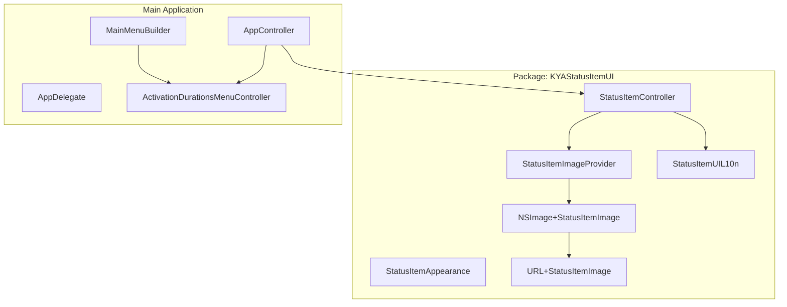
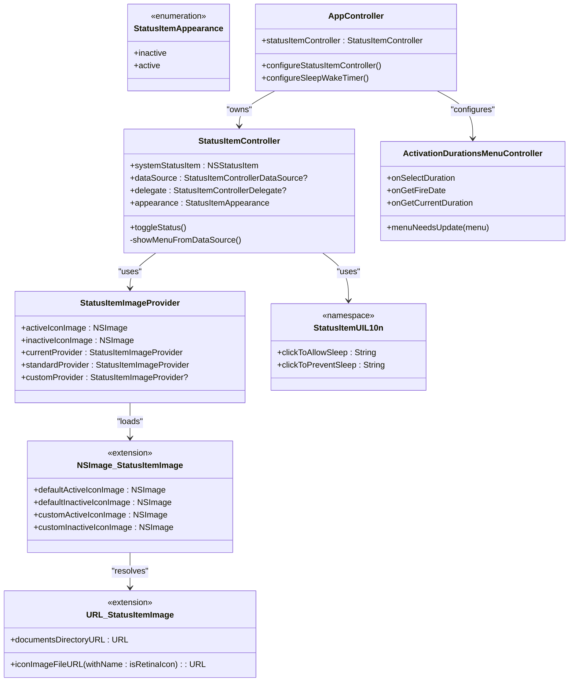
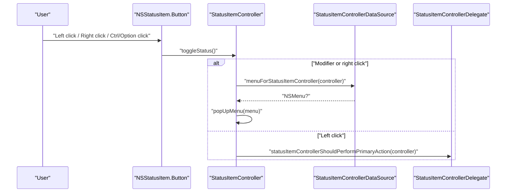
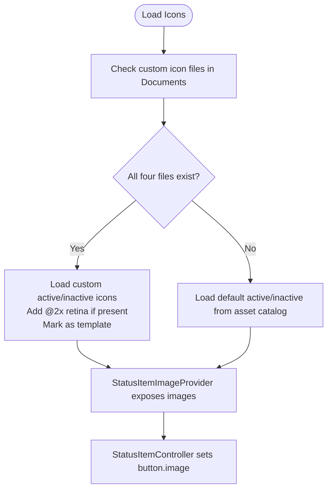
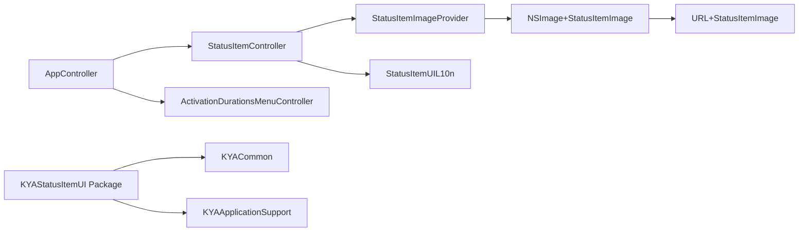

# Status Item UI

<cite>
**Referenced Files in This Document**
- [StatusItemController.swift](file://Packages/KYAStatusItemUI/Sources/KYAStatusItemUI/StatusItemController.swift)
- [StatusItemAppearance.swift](file://Packages/KYAStatusItemUI/Sources/KYAStatusItemUI/StatusItemAppearance.swift)
- [StatusItemImageProvider.swift](file://Packages/KYAStatusItemUI/Sources/KYAStatusItemUI/StatusItemImageProvider.swift)
- [NSImage+StatusItemImage.swift](file://Packages/KYAStatusItemUI/Sources/KYAStatusItemUI/NSImage+StatusItemImage.swift)
- [URL+StatusItemImage.swift](file://Packages/KYAStatusItemUI/Sources/KYAStatusItemUI/URL+StatusItemImage.swift)
- [StatusItemUIL10n.swift](file://Packages/KYAStatusItemUI/Sources/KYAStatusItemUI/StatusItemUIL10n.swift)
- [AppController.swift](file://KeepingYouAwake/KYAAppController/AppController.swift)
- [AppDelegate.swift](file://KeepingYouAwake/KYAAppController/AppDelegate.swift)
- [MainMenuBuilder.swift](file://KeepingYouAwake/KYAMainMenu/MainMenuBuilder.swift)
- [ActivationDurationsMenuController.swift](file://KeepingYouAwake/KYAActivationDurationsMenuController/ActivationDurationsMenuController.swift)
- [ActiveIcon.imageset/Contents.json](file://KeepingYouAwake/Assets.xcassets/ActiveIcon.imageset/Contents.json)
- [InactiveIcon.imageset/Contents.json](file://KeepingYouAwake/Assets.xcassets/InactiveIcon.imageset/Contents.json)
- [ToolbarDurations.imageset/Contents.json](file://KeepingYouAwake/Assets.xcassets/ToolbarDurations.imageset/Contents.json)
- [Package.swift](file://Packages/KYAStatusItemUI/Package.swift)
</cite>

## Table of Contents
1. [Introduction](#introduction)
2. [Project Structure](#project-structure)
3. [Core Components](#core-components)
4. [Architecture Overview](#architecture-overview)
5. [Detailed Component Analysis](#detailed-component-analysis)
6. [Dependency Analysis](#dependency-analysis)
7. [Performance Considerations](#performance-considerations)
8. [Troubleshooting Guide](#troubleshooting-guide)
9. [Conclusion](#conclusion)

## Introduction
This document describes the status item UI system used in the application's menu bar integration. It covers the StatusItemController implementation for managing the menu bar icon, status indicator management, and visual appearance control. It explains the icon asset system supporting active/inactive states and toolbar duration icons, the StatusItemControllerDataSource protocol for dynamic content, and menu bar integration patterns. It also documents visual feedback systems, tooltips, contextual menus, state change logic, accessibility support, theme integration, dark mode compatibility, and performance considerations.

## Project Structure
The status item UI is implemented as a separate Swift Package named KYAStatusItemUI, which is consumed by the main application. The package provides the controller, appearance model, image provider, and localization for tooltips. The main application integrates the status item via AppController and delegates menu construction to ActivationDurationsMenuController.

**Diagram sources**
- [StatusItemController.swift:29-97](file://Packages/KYAStatusItemUI/Sources/KYAStatusItemUI/StatusItemController.swift#L29-L97)
- [StatusItemImageProvider.swift:16-58](file://Packages/KYAStatusItemUI/Sources/KYAStatusItemUI/StatusItemImageProvider.swift#L16-L58)
- [NSImage+StatusItemImage.swift:10-59](file://Packages/KYAStatusItemUI/Sources/KYAStatusItemUI/NSImage+StatusItemImage.swift#L10-L59)
- [URL+StatusItemImage.swift:11-51](file://Packages/KYAStatusItemUI/Sources/KYAStatusItemUI/URL+StatusItemImage.swift#L11-L51)
- [StatusItemUIL10n.swift:15-29](file://Packages/KYAStatusItemUI/Sources/KYAStatusItemUI/StatusItemUIL10n.swift#L15-L29)
- [AppController.swift:21-41](file://KeepingYouAwake/KYAAppController/AppController.swift#L21-L41)
- [MainMenuBuilder.swift:12-50](file://KeepingYouAwake/KYAMainMenu/MainMenuBuilder.swift#L12-L50)
- [ActivationDurationsMenuController.swift:79-105](file://KeepingYouAwake/KYAActivationDurationsMenuController/ActivationDurationsMenuController.swift#L79-L105)

**Section sources**
- [Package.swift:5-32](file://Packages/KYAStatusItemUI/Package.swift#L5-L32)
- [AppController.swift:21-41](file://KeepingYouAwake/KYAAppController/AppController.swift#L21-L41)

## Core Components
- StatusItemController: Manages the NSStatusItem, handles clicks and right-clicks, toggles appearance, and defers menu creation to a data source.
- StatusItemAppearance: Enumerates active and inactive states for the icon.
- StatusItemImageProvider: Supplies active/inactive icons, preferring custom icons in the user's Documents directory, otherwise falling back to asset catalog images.
- NSImage+StatusItemImage: Loads default and custom icons from asset catalog or Documents, with retina support.
- URL+StatusItemImage: Resolves file URLs for custom icons in the Documents directory and checks for their existence.
- StatusItemUIL10n: Localized tooltips for the status item.
- AppController: Integrates the status item controller with the sleep/wake timer and event handler, controlling appearance transitions.
- ActivationDurationsMenuController: Builds the contextual menu with dynamic items and remaining time display.

**Section sources**
- [StatusItemController.swift:13-97](file://Packages/KYAStatusItemUI/Sources/KYAStatusItemUI/StatusItemController.swift#L13-L97)
- [StatusItemAppearance.swift:9-15](file://Packages/KYAStatusItemUI/Sources/KYAStatusItemUI/StatusItemAppearance.swift#L9-L15)
- [StatusItemImageProvider.swift:16-58](file://Packages/KYAStatusItemUI/Sources/KYAStatusItemUI/StatusItemImageProvider.swift#L16-L58)
- [NSImage+StatusItemImage.swift:10-59](file://Packages/KYAStatusItemUI/Sources/KYAStatusItemUI/NSImage+StatusItemImage.swift#L10-L59)
- [URL+StatusItemImage.swift:11-51](file://Packages/KYAStatusItemUI/Sources/KYAStatusItemUI/URL+StatusItemImage.swift#L11-L51)
- [StatusItemUIL10n.swift:15-29](file://Packages/KYAStatusItemUI/Sources/KYAStatusItemUI/StatusItemUIL10n.swift#L15-L29)
- [AppController.swift:21-90](file://KeepingYouAwake/KYAAppController/AppController.swift#L21-L90)
- [ActivationDurationsMenuController.swift:79-105](file://KeepingYouAwake/KYAActivationDurationsMenuController/ActivationDurationsMenuController.swift#L79-L105)

## Architecture Overview
The status item UI follows a controller-driven architecture:
- AppController owns the StatusItemController and coordinates activation/deactivation events.
- StatusItemController delegates menu creation to a data source and notifies a delegate for primary actions.
- StatusItemImageProvider supplies the appropriate icon images, selecting custom icons when present.
- NSImage extensions encapsulate loading logic for default and custom icons.
- URL helpers manage Documents directory paths and file existence checks.
- Localization provides tooltips for both active and inactive states.

**Diagram sources**
- [StatusItemController.swift:29-97](file://Packages/KYAStatusItemUI/Sources/KYAStatusItemUI/StatusItemController.swift#L29-L97)
- [StatusItemAppearance.swift:10-14](file://Packages/KYAStatusItemUI/Sources/KYAStatusItemUI/StatusItemAppearance.swift#L10-L14)
- [StatusItemImageProvider.swift:16-58](file://Packages/KYAStatusItemUI/Sources/KYAStatusItemUI/StatusItemImageProvider.swift#L16-L58)
- [NSImage+StatusItemImage.swift:10-59](file://Packages/KYAStatusItemUI/Sources/KYAStatusItemUI/NSImage+StatusItemImage.swift#L10-L59)
- [URL+StatusItemImage.swift:11-51](file://Packages/KYAStatusItemUI/Sources/KYAStatusItemUI/URL+StatusItemImage.swift#L11-L51)
- [StatusItemUIL10n.swift:15-29](file://Packages/KYAStatusItemUI/Sources/KYAStatusItemUI/StatusItemUIL10n.swift#L15-L29)
- [AppController.swift:21-90](file://KeepingYouAwake/KYAAppController/AppController.swift#L21-L90)
- [ActivationDurationsMenuController.swift:79-105](file://KeepingYouAwake/KYAActivationDurationsMenuController/ActivationDurationsMenuController.swift#L79-L105)

## Detailed Component Analysis

### StatusItemController
Responsibilities:
- Creates and configures an NSStatusItem with variable length and appropriate highlight behavior.
- Sets up the button target/action to handle left/right/middle clicks and modifier combinations.
- Exposes an appearance property that switches between active and inactive icons and updates tooltips.
- Delegates menu presentation to a data source and forwards primary actions to a delegate.

Key behaviors:
- Click detection distinguishes right-click/control-click/option-click from left-click.
- Appearance transitions update the button image and tooltip text.
- KVO-compliant appearance property supports bindings and reactive updates.

Integration points:
- Used by AppController to reflect activation/deactivation state.
- Delegates menu creation to AppController via StatusItemControllerDataSource.
- Receives primary action notifications via StatusItemControllerDelegate.

**Diagram sources**
- [StatusItemController.swift:104-123](file://Packages/KYAStatusItemUI/Sources/KYAStatusItemUI/StatusItemController.swift#L104-L123)
- [AppController.swift:340-352](file://KeepingYouAwake/KYAAppController/AppController.swift#L340-L352)

**Section sources**
- [StatusItemController.swift:29-97](file://Packages/KYAStatusItemUI/Sources/KYAStatusItemUI/StatusItemController.swift#L29-L97)
- [StatusItemController.swift:104-123](file://Packages/KYAStatusItemUI/Sources/KYAStatusItemUI/StatusItemController.swift#L104-L123)

### StatusItemControllerDataSource Protocol
Purpose:
- Provides the contextual menu for the status item when requested by the controller.

Usage:
- Implemented by AppController to return the shared menu used across the app.
- Allows decoupling of menu construction from the controller.

**Section sources**
- [StatusItemController.swift:13-17](file://Packages/KYAStatusItemUI/Sources/KYAStatusItemUI/StatusItemController.swift#L13-L17)
- [AppController.swift:340-344](file://KeepingYouAwake/KYAAppController/AppController.swift#L340-L344)

### StatusItemControllerDelegate Protocol
Purpose:
- Receives the primary action (left-click) from the status item controller.

Usage:
- Implemented by AppController to toggle activation state.

**Section sources**
- [StatusItemController.swift:19-23](file://Packages/KYAStatusItemUI/Sources/KYAStatusItemUI/StatusItemController.swift#L19-L23)
- [AppController.swift:348-352](file://KeepingYouAwake/KYAAppController/AppController.swift#L348-L352)

### StatusItemAppearance
Enumeration:
- inactive: Represents the icon when sleep prevention is not active.
- active: Represents the icon when sleep prevention is active.

Used by StatusItemController to select the appropriate icon and tooltip.

**Section sources**
- [StatusItemAppearance.swift:10-14](file://Packages/KYAStatusItemUI/Sources/KYAStatusItemUI/StatusItemAppearance.swift#L10-L14)
- [StatusItemController.swift:40-61](file://Packages/KYAStatusItemUI/Sources/KYAStatusItemUI/StatusItemController.swift#L40-L61)

### Icon Asset System
Active and inactive icons:
- Default assets: ActiveIcon and InactiveIcon in the asset catalog with 1x/2x scales.
- Template rendering intent ensures proper tinting against the menu bar background.

Custom icons:
- If all four files exist (active standard + active @2x + inactive standard + inactive @2x) in the user's Documents directory, custom icons are loaded.
- Retina support is handled by adding @2x representations when available.
- Images are marked as templates for proper appearance adaptation.

Toolbar duration icon:
- ToolbarDurations imageset includes vector PDFs with light/dark luminosity appearances for toolbar integration.

**Diagram sources**
- [StatusItemImageProvider.swift:28-52](file://Packages/KYAStatusItemUI/Sources/KYAStatusItemUI/StatusItemImageProvider.swift#L28-L52)
- [NSImage+StatusItemImage.swift:27-58](file://Packages/KYAStatusItemUI/Sources/KYAStatusItemUI/NSImage+StatusItemImage.swift#L27-L58)
- [URL+StatusItemImage.swift:31-51](file://Packages/KYAStatusItemUI/Sources/KYAStatusItemUI/URL+StatusItemImage.swift#L31-L51)
- [ActiveIcon.imageset/Contents.json:1-19](file://KeepingYouAwake/Assets.xcassets/ActiveIcon.imageset/Contents.json#L1-L19)
- [InactiveIcon.imageset/Contents.json:1-19](file://KeepingYouAwake/Assets.xcassets/InactiveIcon.imageset/Contents.json#L1-L19)
- [ToolbarDurations.imageset/Contents.json:1-35](file://KeepingYouAwake/Assets.xcassets/ToolbarDurations.imageset/Contents.json#L1-L35)

**Section sources**
- [StatusItemImageProvider.swift:16-58](file://Packages/KYAStatusItemUI/Sources/KYAStatusItemUI/StatusItemImageProvider.swift#L16-L58)
- [NSImage+StatusItemImage.swift:10-59](file://Packages/KYAStatusItemUI/Sources/KYAStatusItemUI/NSImage+StatusItemImage.swift#L10-L59)
- [URL+StatusItemImage.swift:11-51](file://Packages/KYAStatusItemUI/Sources/KYAStatusItemUI/URL+StatusItemImage.swift#L11-L51)
- [ActiveIcon.imageset/Contents.json:1-19](file://KeepingYouAwake/Assets.xcassets/ActiveIcon.imageset/Contents.json#L1-L19)
- [InactiveIcon.imageset/Contents.json:1-19](file://KeepingYouAwake/Assets.xcassets/InactiveIcon.imageset/Contents.json#L1-L19)
- [ToolbarDurations.imageset/Contents.json:1-35](file://KeepingYouAwake/Assets.xcassets/ToolbarDurations.imageset/Contents.json#L1-L35)

### Visual Feedback and Tooltips
- Tooltips change based on active/inactive state and are localized.
- Left-click triggers primary action; right-click/control-click/option-click opens the contextual menu.
- Debug builds optionally tint the status bar icon for visibility.

**Section sources**
- [StatusItemController.swift:46-61](file://Packages/KYAStatusItemUI/Sources/KYAStatusItemUI/StatusItemController.swift#L46-L61)
- [StatusItemUIL10n.swift:15-29](file://Packages/KYAStatusItemUI/Sources/KYAStatusItemUI/StatusItemUIL10n.swift#L15-L29)
- [StatusItemController.swift:80-86](file://Packages/KYAStatusItemUI/Sources/KYAStatusItemUI/StatusItemController.swift#L80-L86)

### Contextual Menu Handling
- AppController provides the menu via StatusItemControllerDataSource.
- ActivationDurationsMenuController builds the menu dynamically, including a remaining time item and selectable durations.
- Menu updates are triggered through NSMenuDelegate callbacks.

**Section sources**
- [AppController.swift:340-344](file://KeepingYouAwake/KYAAppController/AppController.swift#L340-L344)
- [ActivationDurationsMenuController.swift:79-105](file://KeepingYouAwake/KYAActivationDurationsMenuController/ActivationDurationsMenuController.swift#L79-L105)

### Status State Changes and Icon Switching Logic
- AppController updates StatusItemController.appearance when activation/deactivation occurs.
- Appearance setter switches the button image and tooltip, then posts KVO change notifications.

**Section sources**
- [AppController.swift:78-85](file://KeepingYouAwake/KYAAppController/AppController.swift#L78-L85)
- [StatusItemController.swift:46-61](file://Packages/KYAStatusItemUI/Sources/KYAStatusItemUI/StatusItemController.swift#L46-L61)

### Accessibility Support
- Tooltips are localized and describe the action and menu invocation.
- Menu items use standard NSMenuItem construction; ensure proper accessibility attributes are maintained by NSMenu infrastructure.

**Section sources**
- [StatusItemUIL10n.swift:15-29](file://Packages/KYAStatusItemUI/Sources/KYAStatusItemUI/StatusItemUIL10n.swift#L15-L29)

### Theme Integration and Dark Mode Compatibility
- Default icons use template rendering intent to adapt to system tint.
- ToolbarDurations imageset includes luminosity-specific variants for light/dark modes.
- Custom icons are treated as templates for consistent appearance.

**Section sources**
- [ActiveIcon.imageset/Contents.json:14-18](file://KeepingYouAwake/Assets.xcassets/ActiveIcon.imageset/Contents.json#L14-L18)
- [InactiveIcon.imageset/Contents.json:14-18](file://KeepingYouAwake/Assets.xcassets/InactiveIcon.imageset/Contents.json#L14-L18)
- [ToolbarDurations.imageset/Contents.json:9-25](file://KeepingYouAwake/Assets.xcassets/ToolbarDurations.imageset/Contents.json#L9-L25)

### macOS System Integration Requirements
- Behavior and visibility properties are conditionally set based on OS availability.
- Status item is configured with termination-on-removal behavior on supported versions.
- Highlight mode respects user preferences.

**Section sources**
- [StatusItemController.swift:63-97](file://Packages/KYAStatusItemUI/Sources/KYAStatusItemUI/StatusItemController.swift#L63-L97)

## Dependency Analysis
The StatusItemUI package depends on KYACommon and KYAApplicationSupport. AppController composes the status item controller and integrates it with the sleep/wake timer and event handler.

**Diagram sources**
- [Package.swift:13-24](file://Packages/KYAStatusItemUI/Package.swift#L13-L24)
- [AppController.swift:21-41](file://KeepingYouAwake/KYAAppController/AppController.swift#L21-L41)
- [StatusItemController.swift:29-97](file://Packages/KYAStatusItemUI/Sources/KYAStatusItemUI/StatusItemController.swift#L29-L97)

**Section sources**
- [Package.swift:13-24](file://Packages/KYAStatusItemUI/Package.swift#L13-L24)
- [AppController.swift:21-41](file://KeepingYouAwake/KYAAppController/AppController.swift#L21-L41)

## Performance Considerations
- Minimize frequent icon updates: batch appearance changes and avoid unnecessary KVO notifications.
- Reuse NSImage instances provided by StatusItemImageProvider to reduce memory churn.
- Keep menu construction lightweight; defer heavy operations to background queues when updating dynamic menu items.
- Avoid excessive reinitialization of the status item; initialize once and reuse the controller instance.
- Leverage template images to reduce per-pixel rendering overhead.

## Troubleshooting Guide
- Icons not visible or incorrect:
  - Verify asset catalog entries for ActiveIcon and InactiveIcon exist and are properly configured with template rendering.
  - Confirm custom icon files exist in the Documents directory if expecting custom icons.
- Tooltips not appearing:
  - Ensure StatusItemUIL10n keys resolve to localized strings in the main bundle.
- Menu not opening:
  - Confirm StatusItemControllerDataSource returns a non-nil NSMenu.
  - Verify the button action is set and modifier combinations are handled as expected.
- Appearance not changing:
  - Check that the appearance property is being set and that KVO observers are registered if relying on bindings.

**Section sources**
- [StatusItemImageProvider.swift:28-52](file://Packages/KYAStatusItemUI/Sources/KYAStatusItemUI/StatusItemImageProvider.swift#L28-L52)
- [NSImage+StatusItemImage.swift:17-37](file://Packages/KYAStatusItemUI/Sources/KYAStatusItemUI/NSImage+StatusItemImage.swift#L17-L37)
- [StatusItemUIL10n.swift:15-29](file://Packages/KYAStatusItemUI/Sources/KYAStatusItemUI/StatusItemUIL10n.swift#L15-L29)
- [StatusItemController.swift:120-123](file://Packages/KYAStatusItemUI/Sources/KYAStatusItemUI/StatusItemController.swift#L120-L123)

## Conclusion
The status item UI system provides a clean separation of concerns: StatusItemController manages the NSStatusItem and user interactions, StatusItemImageProvider supplies icons from assets or custom locations, and AppController coordinates state changes and menu integration. The design supports theme adaptation, localization, and macOS system integration while maintaining performance and accessibility.