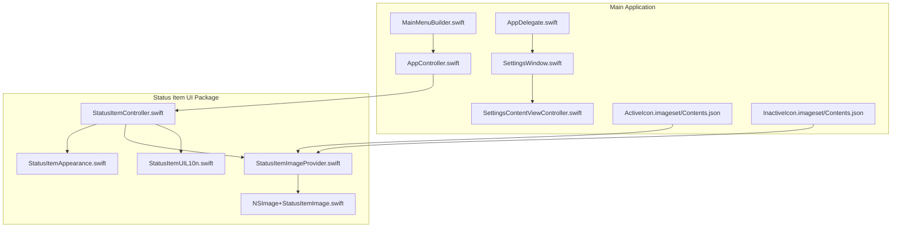
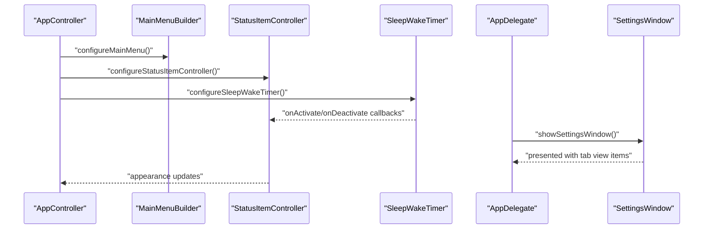
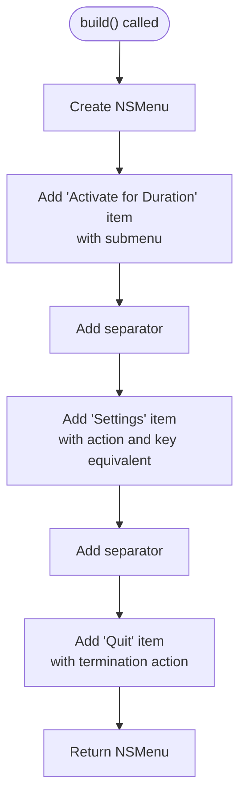
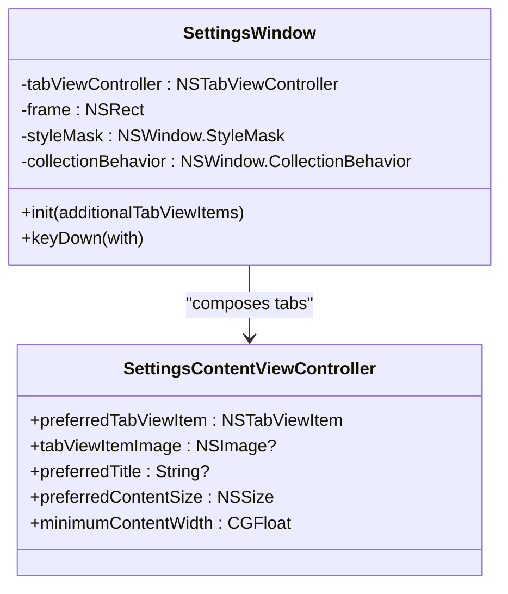
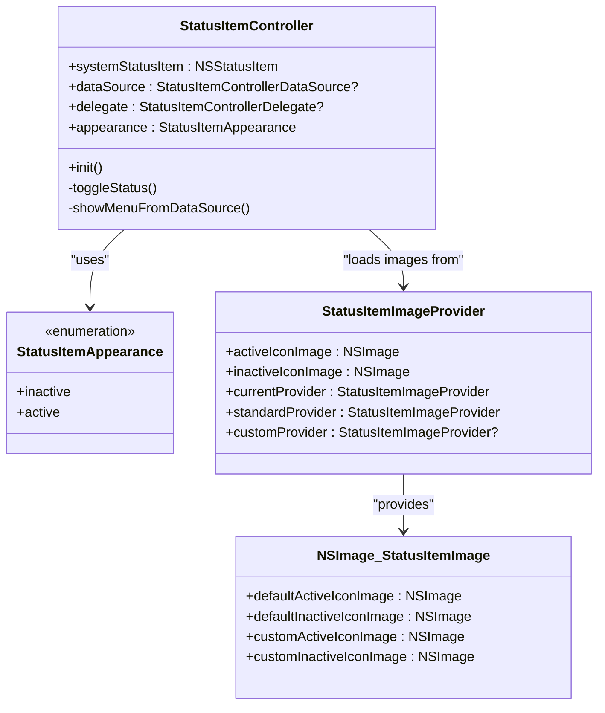
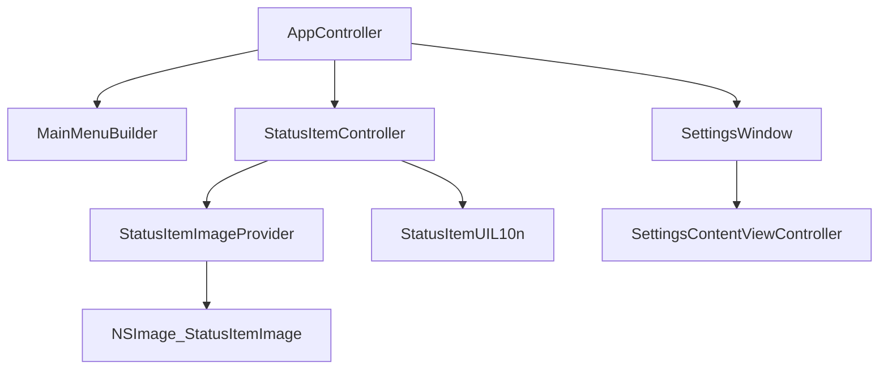

# User Interface Components

<cite>
**Referenced Files in This Document**
- [MainMenuBuilder.swift](file://KeepingYouAwake/KYAMainMenu/MainMenuBuilder.swift)
- [SettingsWindow.swift](file://KeepingYouAwake/Settings/KYASettingsWindow/SettingsWindow.swift)
- [SettingsContentViewController.swift](file://KeepingYouAwake/Settings/KYASettingsContentViewController/SettingsContentViewController.swift)
- [AppDelegate.swift](file://KeepingYouAwake/KYAAppController/AppDelegate.swift)
- [AppController.swift](file://KeepingYouAwake/KYAAppController/AppController.swift)
- [StatusItemController.swift](file://Packages/KYAStatusItemUI/Sources/KYAStatusItemUI/StatusItemController.swift)
- [StatusItemAppearance.swift](file://Packages/KYAStatusItemUI/Sources/KYAStatusItemUI/StatusItemAppearance.swift)
- [StatusItemImageProvider.swift](file://Packages/KYAStatusItemUI/Sources/KYAStatusItemUI/StatusItemImageProvider.swift)
- [NSImage+StatusItemImage.swift](file://Packages/KYAStatusItemUI/Sources/KYAStatusItemUI/NSImage+StatusItemImage.swift)
- [StatusItemUIL10n.swift](file://Packages/KYAStatusItemUI/Sources/KYAStatusItemUI/StatusItemUIL10n.swift)
- [ActiveIcon Contents.json](file://KeepingYouAwake/Assets.xcassets/ActiveIcon.imageset/Contents.json)
- [InactiveIcon Contents.json](file://KeepingYouAwake/Assets.xcassets/InactiveIcon.imageset/Contents.json)
</cite>

## Table of Contents
1. [Introduction](#introduction)
2. [Project Structure](#project-structure)
3. [Core Components](#core-components)
4. [Architecture Overview](#architecture-overview)
5. [Detailed Component Analysis](#detailed-component-analysis)
6. [Dependency Analysis](#dependency-analysis)
7. [Performance Considerations](#performance-considerations)
8. [Accessibility Support](#accessibility-support)
9. [Responsive Layout and Cross-Platform Compatibility](#responsive-layout-and-cross-platform-compatibility)
10. [Troubleshooting Guide](#troubleshooting-guide)
11. [Conclusion](#conclusion)

## Introduction
This document provides comprehensive documentation for the user interface components of the application, focusing on three primary areas: the dynamic main menu construction, the settings window interface, and the status item UI. It explains how menus are built programmatically, how the settings window uses NSTabViewController with toolbar navigation and form validation, and how the status item manages icon appearance, visual feedback, and theming. The document also covers accessibility support, responsive layout considerations, and cross-platform compatibility, along with implementation specifics for menu bar integration, settings window modal behavior, visual state management, styling customization, theming support, and integration with macOS system appearance preferences.

## Project Structure
The user interface components are organized across several modules:
- Main menu construction is handled by a dedicated builder that creates the application's main menu programmatically.
- The settings window is implemented as a tabbed interface using NSTabViewController with toolbar-style tabs.
- The status item UI is encapsulated in a separate package that manages icon appearance, menu integration, and user interactions.

**Diagram sources**
- [MainMenuBuilder.swift:11-49](file://KeepingYouAwake/KYAMainMenu/MainMenuBuilder.swift#L11-L49)
- [SettingsWindow.swift:13-41](file://KeepingYouAwake/Settings/KYASettingsWindow/SettingsWindow.swift#L13-L41)
- [SettingsContentViewController.swift:13-46](file://KeepingYouAwake/Settings/KYASettingsContentViewController/SettingsContentViewController.swift#L13-L46)
- [AppDelegate.swift:13-57](file://KeepingYouAwake/KYAAppController/AppDelegate.swift#L13-L57)
- [AppController.swift:21-41](file://KeepingYouAwake/KYAAppController/AppController.swift#L21-L41)
- [StatusItemController.swift:29-97](file://Packages/KYAStatusItemUI/Sources/KYAStatusItemUI/StatusItemController.swift#L29-L97)
- [StatusItemAppearance.swift:10-15](file://Packages/KYAStatusItemUI/Sources/KYAStatusItemUI/StatusItemAppearance.swift#L10-L15)
- [StatusItemImageProvider.swift:16-58](file://Packages/KYAStatusItemUI/Sources/KYAStatusItemUI/StatusItemImageProvider.swift#L16-L58)
- [NSImage+StatusItemImage.swift:10-59](file://Packages/KYAStatusItemUI/Sources/KYAStatusItemUI/NSImage+StatusItemImage.swift#L10-L59)
- [StatusItemUIL10n.swift:15-29](file://Packages/KYAStatusItemUI/Sources/KYAStatusItemUI/StatusItemUIL10n.swift#L15-L29)
- [ActiveIcon Contents.json:1-19](file://KeepingYouAwake/Assets.xcassets/ActiveIcon.imageset/Contents.json#L1-L19)
- [InactiveIcon Contents.json:1-19](file://KeepingYouAwake/Assets.xcassets/InactiveIcon.imageset/Contents.json#L1-L19)

**Section sources**
- [MainMenuBuilder.swift:11-49](file://KeepingYouAwake/KYAMainMenu/MainMenuBuilder.swift#L11-L49)
- [SettingsWindow.swift:13-41](file://KeepingYouAwake/Settings/KYASettingsWindow/SettingsWindow.swift#L13-L41)
- [SettingsContentViewController.swift:13-46](file://KeepingYouAwake/Settings/KYASettingsContentViewController/SettingsContentViewController.swift#L13-L46)
- [AppDelegate.swift:13-57](file://KeepingYouAwake/KYAAppController/AppDelegate.swift#L13-L57)
- [AppController.swift:21-41](file://KeepingYouAwake/KYAAppController/AppController.swift#L21-L41)
- [StatusItemController.swift:29-97](file://Packages/KYAStatusItemUI/Sources/KYAStatusItemUI/StatusItemController.swift#L29-L97)
- [StatusItemAppearance.swift:10-15](file://Packages/KYAStatusItemUI/Sources/KYAStatusItemUI/StatusItemAppearance.swift#L10-L15)
- [StatusItemImageProvider.swift:16-58](file://Packages/KYAStatusItemUI/Sources/KYAStatusItemUI/StatusItemImageProvider.swift#L16-L58)
- [NSImage+StatusItemImage.swift:10-59](file://Packages/KYAStatusItemUI/Sources/KYAStatusItemUI/NSImage+StatusItemImage.swift#L10-L59)
- [StatusItemUIL10n.swift:15-29](file://Packages/KYAStatusItemUI/Sources/KYAStatusItemUI/StatusItemUIL10n.swift#L15-L29)
- [ActiveIcon Contents.json:1-19](file://KeepingYouAwake/Assets.xcassets/ActiveIcon.imageset/Contents.json#L1-L19)
- [InactiveIcon Contents.json:1-19](file://KeepingYouAwake/Assets.xcassets/InactiveIcon.imageset/Contents.json#L1-L19)

## Core Components
This section documents the three core UI components: the main menu builder, the settings window, and the status item controller.

- MainMenuBuilder: Programmatically constructs the application's main menu, including items for activation durations, settings, and quit, with optional system symbol icons on supported macOS versions.
- SettingsWindow: Implements a tabbed settings interface using NSTabViewController with toolbar tabs, keyboard shortcuts, and autosave positioning.
- StatusItemController: Manages the menu bar status item, handles primary and contextual clicks, updates icon appearance, and integrates with the application's data source and delegate protocols.

**Section sources**
- [MainMenuBuilder.swift:11-49](file://KeepingYouAwake/KYAMainMenu/MainMenuBuilder.swift#L11-L49)
- [SettingsWindow.swift:13-60](file://KeepingYouAwake/Settings/KYASettingsWindow/SettingsWindow.swift#L13-L60)
- [StatusItemController.swift:29-124](file://Packages/KYAStatusItemUI/Sources/KYAStatusItemUI/StatusItemController.swift#L29-L124)

## Architecture Overview
The UI architecture centers around the AppController as the central orchestrator. It configures and coordinates the main menu, status item, and settings window. The status item controller receives updates from the sleep/wake timer and reflects the active/inactive state via icon appearance. The settings window is presented by the AppDelegate and uses a base settings view controller to manage tab content and sizing.

**Diagram sources**
- [AppController.swift:34-41](file://KeepingYouAwake/KYAAppController/AppController.swift#L34-L41)
- [MainMenuBuilder.swift:13-49](file://KeepingYouAwake/KYAMainMenu/MainMenuBuilder.swift#L13-L49)
- [StatusItemController.swift:70-97](file://Packages/KYAStatusItemUI/Sources/KYAStatusItemUI/StatusItemController.swift#L70-L97)
- [AppController.swift:77-90](file://KeepingYouAwake/KYAAppController/AppController.swift#L77-L90)
- [AppDelegate.swift:36-56](file://KeepingYouAwake/KYAAppController/AppDelegate.swift#L36-L56)
- [SettingsWindow.swift:14-41](file://KeepingYouAwake/Settings/KYASettingsWindow/SettingsWindow.swift#L14-L41)

## Detailed Component Analysis

### Main Menu Builder
The MainMenuBuilder creates the application's main menu programmatically, ensuring consistent localization and modern icon usage on supported macOS versions. It builds:
- An activation duration submenu item with optional system symbol icon.
- A settings item bound to the AppDelegate's showSettingsWindow selector with keyboard shortcut.
- A quit item using the standard termination action.

Implementation highlights:
- Uses localized strings for menu item titles.
- Conditionally sets system symbol icons when available.
- Assigns submenus and actions to menu items.
- Returns the constructed menu for application integration.

**Diagram sources**
- [MainMenuBuilder.swift:13-49](file://KeepingYouAwake/KYAMainMenu/MainMenuBuilder.swift#L13-L49)

**Section sources**
- [MainMenuBuilder.swift:11-49](file://KeepingYouAwake/KYAMainMenu/MainMenuBuilder.swift#L11-L49)

### Settings Window Interface
The SettingsWindow implements a tabbed settings interface using NSTabViewController with toolbar tabs. It:
- Composes tab view items from individual settings view controllers.
- Sets the window style to titled and closable with managed collection behavior.
- Configures autosave positioning and title from localized resources.
- Handles keyboard shortcuts for quick actions.

Key behaviors:
- Keyboard handling for Command+W to close and Command+Q to terminate.
- Tab view controller with toolbar-style tabs and transition options.
- Content size management through the base settings view controller.

**Diagram sources**
- [SettingsWindow.swift:13-60](file://KeepingYouAwake/Settings/KYASettingsWindow/SettingsWindow.swift#L13-L60)
- [SettingsContentViewController.swift:13-46](file://KeepingYouAwake/Settings/KYASettingsContentViewController/SettingsContentViewController.swift#L13-L46)

**Section sources**
- [SettingsWindow.swift:11-60](file://KeepingYouAwake/Settings/KYASettingsWindow/SettingsWindow.swift#L11-L60)
- [SettingsContentViewController.swift:11-46](file://KeepingYouAwake/Settings/KYASettingsContentViewController/SettingsContentViewController.swift#L11-L46)

### Status Item UI
The StatusItemController manages the menu bar status item, handling primary and contextual clicks, updating icon appearance, and integrating with the application's data source and delegate protocols. It supports:
- Active and inactive appearances controlled by the StatusItemAppearance enum.
- Dynamic icon loading via StatusItemImageProvider, which prefers custom icons if present, otherwise falls back to asset catalog images.
- Tooltips localized via StatusItemUIL10n.
- Click detection for left mouse up, right mouse up, and modifier combinations to differentiate primary actions from menu invocation.

Visual feedback and state management:
- Appearance property switches between active and inactive icons and tooltips.
- KVO-compliant appearance property enables reactive UI updates.
- Button configuration includes highlight mode and action registration.

**Diagram sources**
- [StatusItemController.swift:29-124](file://Packages/KYAStatusItemUI/Sources/KYAStatusItemUI/StatusItemController.swift#L29-L124)
- [StatusItemAppearance.swift:10-15](file://Packages/KYAStatusItemUI/Sources/KYAStatusItemUI/StatusItemAppearance.swift#L10-L15)
- [StatusItemImageProvider.swift:16-58](file://Packages/KYAStatusItemUI/Sources/KYAStatusItemUI/StatusItemImageProvider.swift#L16-L58)
- [NSImage+StatusItemImage.swift:10-59](file://Packages/KYAStatusItemUI/Sources/KYAStatusItemUI/NSImage+StatusItemImage.swift#L10-L59)

**Section sources**
- [StatusItemController.swift:13-124](file://Packages/KYAStatusItemUI/Sources/KYAStatusItemUI/StatusItemController.swift#L13-L124)
- [StatusItemAppearance.swift:9-15](file://Packages/KYAStatusItemUI/Sources/KYAStatusItemUI/StatusItemAppearance.swift#L9-L15)
- [StatusItemImageProvider.swift:11-58](file://Packages/KYAStatusItemUI/Sources/KYAStatusItemUI/StatusItemImageProvider.swift#L11-L58)
- [NSImage+StatusItemImage.swift:10-59](file://Packages/KYAStatusItemUI/Sources/KYAStatusItemUI/NSImage+StatusItemImage.swift#L10-L59)
- [StatusItemUIL10n.swift:15-29](file://Packages/KYAStatusItemUI/Sources/KYAStatusItemUI/StatusItemUIL10n.swift#L15-L29)
- [ActiveIcon Contents.json:1-19](file://KeepingYouAwake/Assets.xcassets/ActiveIcon.imageset/Contents.json#L1-L19)
- [InactiveIcon Contents.json:1-19](file://KeepingYouAwake/Assets.xcassets/InactiveIcon.imageset/Contents.json#L1-L19)

## Dependency Analysis
The UI components exhibit clear separation of concerns:
- AppController orchestrates menu, status item, and timer configurations.
- MainMenuBuilder depends on localization resources and optionally system symbols.
- SettingsWindow composes tabs from specialized view controllers.
- StatusItemController depends on StatusItemImageProvider for icon images and StatusItemUIL10n for tooltips.

**Diagram sources**
- [AppController.swift:21-41](file://KeepingYouAwake/KYAAppController/AppController.swift#L21-L41)
- [MainMenuBuilder.swift:12-13](file://KeepingYouAwake/KYAMainMenu/MainMenuBuilder.swift#L12-L13)
- [StatusItemController.swift:29-97](file://Packages/KYAStatusItemUI/Sources/KYAStatusItemUI/StatusItemController.swift#L29-L97)
- [StatusItemImageProvider.swift:16-58](file://Packages/KYAStatusItemUI/Sources/KYAStatusItemUI/StatusItemImageProvider.swift#L16-L58)
- [NSImage+StatusItemImage.swift:10-59](file://Packages/KYAStatusItemUI/Sources/KYAStatusItemUI/NSImage+StatusItemImage.swift#L10-L59)
- [StatusItemUIL10n.swift:15-29](file://Packages/KYAStatusItemUI/Sources/KYAStatusItemUI/StatusItemUIL10n.swift#L15-L29)
- [SettingsWindow.swift:14-27](file://KeepingYouAwake/Settings/KYASettingsWindow/SettingsWindow.swift#L14-L27)
- [SettingsContentViewController.swift:15-20](file://KeepingYouAwake/Settings/KYASettingsContentViewController/SettingsContentViewController.swift#L15-L20)

**Section sources**
- [AppController.swift:21-41](file://KeepingYouAwake/KYAAppController/AppController.swift#L21-L41)
- [MainMenuBuilder.swift:12-13](file://KeepingYouAwake/KYAMainMenu/MainMenuBuilder.swift#L12-L13)
- [StatusItemController.swift:29-97](file://Packages/KYAStatusItemUI/Sources/KYAStatusItemUI/StatusItemController.swift#L29-L97)
- [StatusItemImageProvider.swift:16-58](file://Packages/KYAStatusItemUI/Sources/KYAStatusItemUI/StatusItemImageProvider.swift#L16-L58)
- [NSImage+StatusItemImage.swift:10-59](file://Packages/KYAStatusItemUI/Sources/KYAStatusItemUI/NSImage+StatusItemImage.swift#L10-L59)
- [StatusItemUIL10n.swift:15-29](file://Packages/KYAStatusItemUI/Sources/KYAStatusItemUI/StatusItemUIL10n.swift#L15-L29)
- [SettingsWindow.swift:14-27](file://KeepingYouAwake/Settings/KYASettingsWindow/SettingsWindow.swift#L14-L27)
- [SettingsContentViewController.swift:15-20](file://KeepingYouAwake/Settings/KYASettingsContentViewController/SettingsContentViewController.swift#L15-L20)

## Performance Considerations
- Menu construction is lightweight and performed once during application setup.
- Status item icon switching is O(1) and leverages cached images from the provider.
- Settings window tab composition occurs at initialization; consider lazy loading for heavy tabs.
- Keyboard shortcuts avoid unnecessary UI updates by short-circuiting on modifier checks.

## Accessibility Support
- Status item tooltips use localized strings for clear user guidance.
- Menu items include keyboard equivalents for efficient access.
- Images are configured as templates to respect system appearance and contrast settings.

## Responsive Layout and Cross-Platform Compatibility
- The settings window uses fitting sizes and minimum widths to adapt to content.
- Status item images are template-rendered and support high-resolution representations.
- Menu icons conditionally use system symbols on supported macOS versions while maintaining fallback assets.

## Troubleshooting Guide
Common issues and resolutions:
- Settings window not appearing: Verify AppDelegate's showSettingsWindow is triggered and SettingsWindow is instantiated with appropriate tab view items.
- Status item icon not updating: Ensure StatusItemController.appearance is set after timer activation/deactivation and that StatusItemImageProvider has valid images.
- Menu item actions not firing: Confirm selector bindings and key equivalents are correctly assigned in MainMenuBuilder and that the target responds to the selectors.

**Section sources**
- [AppDelegate.swift:36-56](file://KeepingYouAwake/KYAAppController/AppDelegate.swift#L36-L56)
- [SettingsWindow.swift:14-41](file://KeepingYouAwake/Settings/KYASettingsWindow/SettingsWindow.swift#L14-L41)
- [StatusItemController.swift:40-61](file://Packages/KYAStatusItemUI/Sources/KYAStatusItemUI/StatusItemController.swift#L40-L61)
- [MainMenuBuilder.swift:16-46](file://KeepingYouAwake/KYAMainMenu/MainMenuBuilder.swift#L16-L46)

## Conclusion
The user interface components demonstrate a clean separation of concerns with programmatic menu construction, a flexible tabbed settings window, and a robust status item controller. The design emphasizes localization, accessibility, and responsiveness while supporting customization through themed icons and system symbol integration. The AppController orchestrates these components effectively, ensuring consistent visual state management and user feedback across interactions.